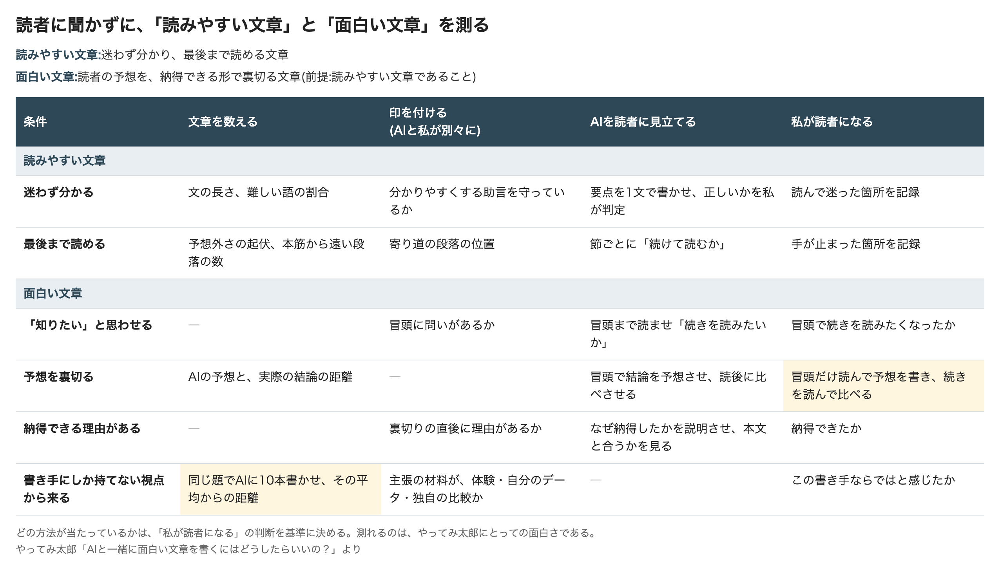

# AIと一緒に面白い文章を書くにはどうしたらいいの？

## タイトルに惹かれて開いたのに

やってみ太郎です。今日から新しい連載を始めます。

きっかけは、Zenn(エンジニア向けの記事投稿サイト)で読んだ、ある記事でした。
タイトルを見た瞬間、これは読みたい、と思いました。
ところが本文を読み進めるうちに、だんだん物足りなくなっていきました。
書いてあることは役に立つし、文章も整っている。なのに、面白くない。

似たことを、AIに書かせた文章でもよく感じます。
AIは文章を整えるのが得意です。誤字もないし、構成もきれいです。
それでも読み終えたとき、何も残っていないことがある。
「整っている」と「面白い」は、別のものなのかもしれません。

この連載では、AIの文章はなぜ面白くないのか、どうすれば面白く書かせられるのかを、実際に試して確かめていくつもりです。

AIと一緒に面白い文章を書くには、どうしたらいいのか。
考え始めてすぐに、手が止まりました。
そもそも「面白い」とは何かが決まっていなければ、AIに何を目指させればいいのかも、書けた文章が面白いかどうかも分かりません。
私は、それを一言も説明できませんでした。
だから最初の回は、確かめる前の準備です。
この連載で「面白い文章」と呼ぶものの定義を決めます。

## 「面白い」には、笑える面白さもある

最初にぶつかったのは、言葉の広さでした。

日本語の「面白い」は、いろいろな気持ちをまとめて呼びます。
お笑いを見て笑うのも、面白い。
知らなかった仕組みを知って「なるほど」と思うのも、面白い。
最初の計画では、笑いの理論も調べるつもりでした。

でも、Zennの記事で私が感じた物足りなさは、笑えなかったことではありません。
「なるほど」が来なかったことでした。
そこで、笑いは調べる対象から外しました。感動や美しさも外しました。

この連載の「面白い」は、知的な面白さに限ります。
英語でいう interesting に近いものです。
範囲を狭めるのは少し惜しい気もしました。
ただ、何でも含む定義は、何も確かめられない定義になります。

## 自分の感覚で決めるのは、ずるい気がした

次に考えたのは、定義をどう作るかでした。

実は、構想を練る段階で下書きを書いていて、そこに心理学の理論を論文4本とともに並べていました。
ただ、この4本は私が記憶から書いたものです。
原典を開いたことは、一度もありません。
知っている理論だけで定義を作れば、自分の考えに都合のよい定義になります。

そこで、探す前に探し方を決めました。
調べる分野と、検索する言葉と、論文を選ぶ基準です。
基準には、「反対の立場の論文を必ず1本入れる」も足しました。

探す作業は、AI(Claude)に任せました。
AIに論文を挙げさせると、架空の論文(実在しない論文)が混じる、とよく聞きます。
覚悟して、挙がった36本をすべて論文のデータベースと照合しました。
結果は、36本すべて実在しました。
ただ、AIが挙げたのは有名な古い論文ばかりで、検索し直すと新しい論文がいくつも出てきました。

最終的に、読む論文を14本に絞りました。
まずは、それぞれの要旨(論文の冒頭にある短いまとめ)から読み始めました。

## 最初の論文は、「分かりそう」を足してきた

読む前の私の定義は、ひとことで言えば「予想が外れること」でした。
意外な話は面白い。そう思っていました。

要旨を読み始めてすぐ、この定義は足りなくなりました(Silvia, 2005)。
人が何かを面白いと感じるのは、「新しい」と感じたときだけではありませんでした。
同時に、「自分にも分かりそうだ」と感じたときでした。

言われてみれば、そうです。
まったく知らない分野の専門書は、意外なことだらけなのに、面白くありません。
意外さは、分かるところまで降りてきて、初めて面白くなる。
定義に、「分かる形で」が加わりました。

## タイトルの論文が、私の体験を説明していた

別の論文は、もっと手前の話をしていました(Loewenstein, 1994)。
人は、自分の知らないことがあると気づいたとき、それを知りたくなる。
知りたいという気持ちは、「知らない」に気づくところから始まる、というのです。
定義の出発点は、読者に「知りたい」と思わせることになりました。

そして、検索で見つけた新しい論文の1本が、私の体験そのものを調べていました(Aubin Le Quéré & Matias, 2025)。
あるWebメディアでは、同じ記事に複数のタイトルを付けて、どれが一番読まれるかを比べていました。
この論文は、その比較8,977件を分析しています。
タイトルで明かしすぎても、隠しすぎても、読まれなかった。
ちょうどよい加減で「知らない」に気づかせるタイトルが、読まれていました。

Zennの記事のタイトルは、まさにそれでした。
私は「知らない」に気づかされて、本文を開いたのです。

でも、Loewensteinはもう一つ書いていました。
好奇心は、満たされると失望しやすい。
「知りたい」と思わせるだけでは足りない。その「知りたい」を、本文がどう満たすかまでが面白さだ。
定義に、「満たしていく」が加わりました。

## 面白くするほど、分からなくなる

ここで、基準で「必ず入れる」と決めた、反対の立場の論文を読みました(Harp & Mayer, 1998)。

説明文に、面白いけれど本筋と関係のない話を混ぜる。
すると読者は、面白い話は覚えていても、肝心の要点を覚えていなかった。
寄り道を冒頭に置くと、害はもっと大きくなりました。

正直に言うと、気が進まないまま入れた論文でした。
でも、一番身につまされました。
記事を書くとき、つかみのつもりで冒頭に余談を置くことがあるからです。

面白さを足すと、分かりやすさが削られることがある。
だとすれば、この2つを一つの物差しで測ってはいけません。
定義の外側に、「分かりやすさは別に測る」という決まりが加わりました。

## 全文を読んだら、足場がくずれた

ここまでは、要旨だけを読んで進めてきました。
全文(論文の中身すべて)を読めば、もっと確かになるはずです。
著作権を調べ、自由に読める論文のうち9本の全文を、AIに読ませました。

すると、要旨から読み取ったことが3か所くずれました。
その一つは、面白さと分かりやすさの関係でした。
全文を読んだ論文の中には、2つが同じ向きに動いていたものがありました。
面白くすると必ず分かりにくくなる、というわけではなかった。
「別に測る」は残しました。ただ、置く理由が変わりました。
2つは敵どうしではなく、別々に動きうるもの、です。

もっと大きな発見もありました。
9本のどれも、「面白さ」そのものは測っていなかったのです。
測っていたのは、読むのにかかった時間や、クリックされた回数でした。

借りてこられる定義は、どこにもない。
この連載の定義は、自分で決めて、自分で確かめるしかないということです。

## 測っていたのは、クリックだった

論文を並べ直して、もう一つ気づいたことがあります。
これ、マーケティングの教科書で見たことがある。

タイトルで知りたい気持ちをあおる。答えを言い切らずに、続きを読ませる。
集めた論文の結果の多くは、広告や記事のタイトル作りの定石として、すでに使われているものでした。
タイトルの論文が測っていたのも、面白さではなく、クリックされたかどうかです。

ここで、Zennの記事の謎が少し解けた気がしました。
あのタイトルは、読み始めさせる技術としては、うまくいっていた。
物足りなかったのは、その先です。
本文を読み終えるまで、私の「知りたい」を引っぱり続けてくれなかった。

この連載で定義したいのは、読み始めさせる力ではありません。
読み終えるまで手放させない力のほうです。
定義に、「最後まで」が加わりました。

## 「面白い」を言い換えないために

全文を読んだAIのまとめを読んでいて、気になったことがあります。
AIは、同じものを途中で別の言葉に言い換えがちです。
「要旨」が、次の段落では「概要」になり、その次では「アブストラクト」になる。
読む側は、言葉が変わるたびに「これはさっきと同じものか」を考え直すことになります。
これは読む負担をかなり上げる、と私は感じています。

これを直接調べた論文は、今回の中にはありませんでした。
近いのは、韻や同じ言い回しを繰り返す詩やことわざほど分かりやすい、という結果です(Menninghaus et al., 2023)。

定義を決める回で、これは他人事ではありません。
「面白い」が途中で「興味深い」や「魅力的」に言い換わったら、何を定義しているのかが揺れてしまいます。

それで、この記事を書く前に、AIに単語表を作らせました。
使う言葉と、使わない言葉を決めた表です。最初の行は「面白い」にしました。

```
面白い … 使わない言葉: 興味深い、魅力的、おもしろい(ひらがな)
要旨  … 使わない言葉: アブストラクト、概要、サマリー
全文  … 使わない言葉: 本文(記事の中身と紛れるため)
```

全体は[リポジトリの単語表](https://github.com/h-takeshita-henteco-shoji-com/tried/blob/main/2026/10-12-AI%E3%81%8C%E6%9B%B8%E3%81%84%E3%81%9F%E6%96%87%E7%AB%A0%E3%81%AF%E3%81%AA%E3%81%9C%E9%9D%A2%E7%99%BD%E3%81%8F%E3%81%AA%E3%81%84%E3%81%AE%E3%81%8B-01-%E5%85%88%E8%A1%8C%E7%A0%94%E7%A9%B6%E3%82%92%E8%AA%BF%E3%81%B9%E3%80%81%E9%9D%A2%E7%99%BD%E3%81%95%E3%81%AE%E6%9D%A1%E4%BB%B6%E3%82%92%E6%95%B4%E7%90%86%E3%81%99%E3%82%8B/assets/glossary.md)に置いています。
AIに文章を書かせるときは、テーマごとにこういう表を用意したほうがいいのかもしれません。

## できあがった定義は、「面白い」ではなかった

AIと一緒に面白い文章を書く。その最初の一歩は、AIと私が同じものを「面白い」と呼べるようにすることでした。
ここまでで定義に加わったものを、つなげてみました。

**読者に「知りたい」と思わせ、それを分かる形で最後まで満たしていく文章**

書き上げて読み返すと、しっくりきませんでした。
これは、面白い文章だろうか。
迷わず分かって、最後まで読める。それは、読みやすい文章ではないか。

思い返すと、Zennの記事がまさにそうでした。
本文は分かりやすく、最後まで読めました。それでも、面白くなかった。
この定義のままだと、あの記事は「面白い文章」に入ってしまいます。

もう一つ、気づいたことがありました。
読む前の私の定義は、「予想が外れること」でした。
論文を読むたびに言葉を足していくうちに、その「予想が外れる」が、いつの間にか消えていたのです。

## 文章術の助言を、102件集めてみた

この違和感を、別の角度から確かめることにしました。
「結論を先に書け」「起承転結を意識しろ」「難しい言葉を使うな」。
世の中でよく言われる文章の助言を、AIに集めさせたのです。
文章術の本、公的な文書の指針、報道やマーケティングの型などから、102件になりました。

それぞれが何に効くかを分けると、偏りがはっきり出ました。
分かりやすくするための助言が、62件。
予想を裏切ったり、見方を変えたりするための助言は、12件だけでした。
その12件には、「予想を裏切る」「決まり文句を避ける」「自分の声で書く」「書き手しか知らない体験を書く」などが入っています。

AIの文章を思い浮かべると、腑に落ちました。
AIは、結論を先に書き、節に分け、難しい言葉を避けます。分かりやすくする助言は得意です。
一方で、AIには自分の体験も、自分の声もありません。
AIと一緒に書いた文章どうしは似てくる、という論文もありました(Padmakumar & He, 2024)。

ただ、話はそう単純でもありませんでした。
別の機会に、AIが書いた技術文書を人にレビューしてもらったことがあります。
指摘は、「セクションの最初に、全体の見取り図がない」でした。
これは、分かりやすくするための助言そのものです。
AIは、分かりやすさでもつまずくことがある。

## 「読みやすい」と「面白い」を分ける

そこで、定義を2段に分けました。

**読みやすい文章とは、迷わず分かり、最後まで読める文章。**

- 迷わず分かる。読み終えて、要点を1文で言える
- 最後まで読める。途中で手が止まらない

**面白い文章とは、読者の予想を、納得できる形で裏切る文章。**

- 前提として、読みやすい文章であること
- 「知りたい」と思わせる。裏切る前に、読者に予想を持たせる
- 裏切りに、納得できる理由がある
- その裏切りが、書き手にしか持てない視点から来ている

「面白い」は、知的な面白さに限ります。笑える、感動する、美しい、は含めません。

読む前の私の定義は、「予想が外れること」でした。途中で消えていたその言葉が、定義の中心に戻ってきました。
最初の論文が足してきた「分かりそう」は、「納得できる理由」として残りました。
「書き手にしか持てない視点」は、102件の助言と、AIの文章どうしが似てくるという論文から来ています。

この2つの定義を、どう確かめるか。
本当は、たくさんの読者に読んでもらって聞きたいところです。でも、この連載でそれはできません。
そこで、読者の代わりを4つ用意しました。

- 文章を数える
- 文章に印を付ける。AIと私が別々に付けて、照らし合わせる
- AIを読者に見立てて、読ませる
- 私が、決めた手順で読む

条件ごとに、どの方法で測るかを表にまとめました。



要になるのは2つです。
1つは「予想を裏切る」です。冒頭だけを読んで結論を予想して書き、それから続きを読んで比べます。私自身も、この手順で読みます。
もう1つは「書き手にしか持てない視点」です。同じ題でAIに10本書かせ、その平均的な文章からどれだけ離れているかを測ります。AIの文章どうしが似てくるという論文の測り方を、そのまま借ります。

どの方法が当たっているかは、私の判断を基準にして決めます。
だから、ここで測れるのは、やってみ太郎にとっての面白さです。ほかの読者にも当てはまるかは、言えません。

印を付けるときの手がかりとして、論文から書き出した条件8つと、文章の助言102件もリポジトリに置いています。

- [面白い文章の条件(8つ)](https://github.com/h-takeshita-henteco-shoji-com/tried/blob/main/2026/10-12-AI%E3%81%8C%E6%9B%B8%E3%81%84%E3%81%9F%E6%96%87%E7%AB%A0%E3%81%AF%E3%81%AA%E3%81%9C%E9%9D%A2%E7%99%BD%E3%81%8F%E3%81%AA%E3%81%84%E3%81%AE%E3%81%8B-01-%E5%85%88%E8%A1%8C%E7%A0%94%E7%A9%B6%E3%82%92%E8%AA%BF%E3%81%B9%E3%80%81%E9%9D%A2%E7%99%BD%E3%81%95%E3%81%AE%E6%9D%A1%E4%BB%B6%E3%82%92%E6%95%B4%E7%90%86%E3%81%99%E3%82%8B/assets/conditions.md)
- [文章の助言(102件)](https://github.com/h-takeshita-henteco-shoji-com/tried/blob/main/2026/10-12-AI%E3%81%8C%E6%9B%B8%E3%81%84%E3%81%9F%E6%96%87%E7%AB%A0%E3%81%AF%E3%81%AA%E3%81%9C%E9%9D%A2%E7%99%BD%E3%81%8F%E3%81%AA%E3%81%84%E3%81%AE%E3%81%8B-01-%E5%85%88%E8%A1%8C%E7%A0%94%E7%A9%B6%E3%82%92%E8%AA%BF%E3%81%B9%E3%80%81%E9%9D%A2%E7%99%BD%E3%81%95%E3%81%AE%E6%9D%A1%E4%BB%B6%E3%82%92%E6%95%B4%E7%90%86%E3%81%99%E3%82%8B/assets/practices.md)
- [読んだ論文の候補と要約](https://github.com/h-takeshita-henteco-shoji-com/tried/blob/main/2026/10-12-AI%E3%81%8C%E6%9B%B8%E3%81%84%E3%81%9F%E6%96%87%E7%AB%A0%E3%81%AF%E3%81%AA%E3%81%9C%E9%9D%A2%E7%99%BD%E3%81%8F%E3%81%AA%E3%81%84%E3%81%AE%E3%81%8B-01-%E5%85%88%E8%A1%8C%E7%A0%94%E7%A9%B6%E3%82%92%E8%AA%BF%E3%81%B9%E3%80%81%E9%9D%A2%E7%99%BD%E3%81%95%E3%81%AE%E6%9D%A1%E4%BB%B6%E3%82%92%E6%95%B4%E7%90%86%E3%81%99%E3%82%8B/assets/candidates.md)

一つ、気をつけていることがあります。
面白い文章の定義は、AIの文章に欠けていそうなものから組み立てました。AIの文章だけを測ると、「面白くない」が定義から自動的に出てしまいます。
だから、同じ物差しを人の文章にも当てます。

もう一度、Zennの記事を思い出します。
あの記事は、読みやすい文章でした。タイトルは私に「知りたい」と思わせ、本文は最後まで読めました。
でも、私の予想は裏切られなかった。
あの本文に、書き手にしか持てない視点はなかったのでしょうか。
それとも、私がそれを読み取れなかっただけなのでしょうか。
