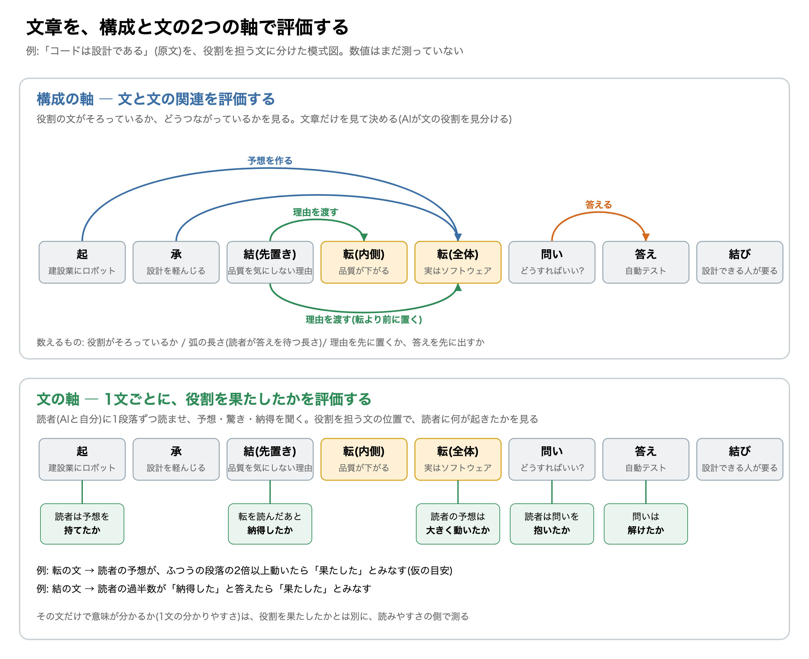
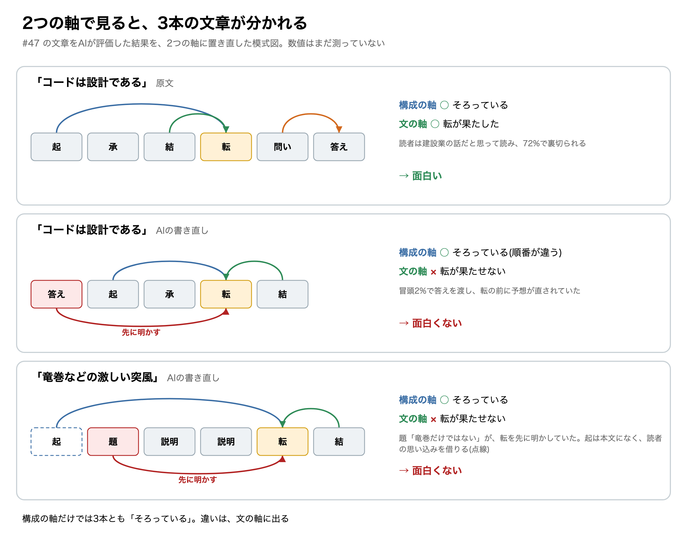

# 文章を「構成」と「文」に分けて、面白さを測る

## 測る前に、測り方を決めておきたかった

やってみ太郎です。連載「AIが書いた文章はなぜ面白くないのか」の4回目です。

前回は、「面白い文章」の定義を直しました。
読者の予想を、納得できる形で裏切る文章。それが、この連載での「面白い」です。
そして、AIに「面白いですか」と点数を聞くのはやめて、「この先どうなると思いますか」と予想させる、と決めました。

すぐにでも測ってみたくなりました。
ただ、ここで1つ怖いことがありました。

この連載には、外部の読者がいません。何をもって「面白い」とするかは、測り方で決まってしまいます。
先に測ってしまうと、結果を見てから「この測り方のほうが、それらしい数字が出るな」と選びかねません。
自分の見たい結論に合わせて、物差しを選んでしまうわけです。

そこで今回は、測りません。
測り方の手順を先に書いて、固定する日にしました。
上限は60分。測り方は4つ用意するつもりでした。数える、文の役割を見分ける、AIを読者にする、自分で読む、の4つです。

## 「冒頭だけ読んで予想する」は、一度しか使えなかった

最初につまずいたのは、自分で読む手順でした。

やり方は単純です。文章の冒頭だけを読み、結論を予想して書き留めます。それから続きを読み、予想が外れたか、外れ方に納得できたかを書きます。
これを、私の「面白い」の基準にするつもりでした。

手順を書きながら、あれ、と思いました。
前回までに分解した4本の文章は、もう全部読んでいます。
「コードは設計である」が72%のところで実はソフトウェアの話だったと明かすことも、知っています。
知っている文章の冒頭を読んで、予想を書くことはできません。

この測り方は、1つの文章に一度しか使えないんです。

もう1つ、困ったことに気づきました。
前回は、原文とAIの書き直しを組にして比べました。内容が同じで、書き方だけが違う組です。
組の片方を読めば、もう片方の中身も分かってしまいます。
初めて読めるのは、組のうち片方だけです。

結局、自分で読む文章は、まだ読んでいないものを新しく選ぶことにしました。
選ぶのはAIに任せて、私は本文を開きません。

## 一覧は、あっさり崩れた

2つ目の測り方の「文の役割を見分ける」は、文章の1文ずつに、組み立ての中での役割を割り振る作業です。
予想を作る文なのか、それを裏切る文なのか、理由を渡す文なのか。起承転結の「転」や、読者への「問い」も、役割の1つです。
役割の一覧は、16個できていました。

本当にこの一覧でいいのかが気になって、AIに崩してもらうことにしました。間違っていることを示せるか、試してもらったんです。
崩す材料は、前回の文章から2本を選びました。
「コードは設計である」の原文と、気象庁の竜巻の解説をAIが書き直したものです。竜巻の解説は、面白さを狙っていない文章として混ぜていました。

崩れ方は、予想より多彩でした。

まず、「転」が決まりません。
「コードは設計である」は、建設業の思考実験を長々と続けたあと、こう書きます。

> 本書の読者は、この話を聞いても驚かないかもしれません。同じことはすでにソフトウェアの世界で起きているからです。

ここは間違いなく転です。ところが、書き手自身が「驚かないかもしれない」と書いています。
題は「コードは設計である」で、収められた本は『プログラマが知るべき97のこと』です。題と本の名前を見た読者には、驚きはありません。
同じ文が、ある読者には転で、別の読者には転ではない。

次に、同じ文の役割が途中で変わりました。
思考実験の中盤には、建設業で品質が下がる理由が積み上げられています。読んでいる最中は、思考実験の続きです。
ところが転を読んだ瞬間、その段落は「ソフトウェアの品質が下がる理由」に変わります。
読んでいる時点と、読み終えたあとで、役割が違うんです。

一番こたえたのは、竜巻の解説でした。
最後の段落で、「竜巻注意情報」には、竜巻以外の突風への注意も含まれる、と明かします。
「竜巻注意情報だから竜巻のことだろう」という思い込みを外して、理由も添えています。
起も転も結も、そろっていました。

それでも、この文章は面白くありません。
題が「積乱雲がつくる3つの突風 ― 竜巻だけではない」だからです。転は、題で先に明かされていました。

役割の一覧で見る限り、面白い文章と面白くない文章の区別がつきませんでした。

## 文章を、構成と文に分けて評価する

崩れた点を並べて眺めているうちに、ふと思いました。
一覧が間違っているというより、評価の単位が間違っているのではないか。

私は、文章を丸ごと1つのものとして評価しようとしていました。
でも、文章は、役割を担う文の集まりです。
そう見ると、評価すべきものは2つに分かれます。

1つ目は、**構成**です。
役割を担う文が、どう集まり、どうつながっているか。
構成を評価するとは、文と文の関連を評価することです。

2つ目は、**文**です。
それぞれの文が、担った役割をどれだけ果たしたか。
文を評価するとは、1文ごとに役割の果たし具合を評価することです。

「コードは設計である」の原文で、2つの軸の評価を図にしてみました。

図の箱は、役割を担う文です。左から、読む順に並んでいます。
上の段と下の段は、同じ8つの箱を、違う目で見ています。

上の段が、構成の軸です。
見るのは、箱と箱を結ぶ矢印です。
「起」と「承」から「転(全体)」へ伸びる青い矢印は、建設業の思考実験が、読者に「これは建設業の話だ」という予想を作っていることを表します。
「結」から「転」へ伸びる緑の矢印は、理由を渡すつながりです。この文章では、理由が転より前に置かれています。
「問い」から「答え」へのオレンジの矢印は、「どうすればいい?」に「自動テスト」が答えるつながりです。

構成の軸で評価するのは、役割の箱がそろっているか、矢印がどうつながっているかです。
矢印が長いほど、読者は長く答えを待たされます。理由を先に置くのか、答えを先に出すのかも、矢印の向きで分かります。
これは、文章だけを見れば決められます。読者に聞く必要はありません。

下の段が、文の軸です。
見るのは、箱の下にぶら下がった問いかけです。
「転(全体)」の下には「読者の予想は大きく動いたか」、「結」の下には「転を読んだあと納得したか」とあります。
それぞれの文が役割を果たしたかを、その文の位置で、読者に起きたことから判定します。

こちらは、文章だけでは決められません。
読者に1段落ずつ読ませて、そのつど結論の予想や、驚いたか、納得したかを聞きます。読者は、AIと私自身です。

この2つの軸に分けると、さっきの崩れ方が、どれもどちらかに収まりました。

理由の段落が、途中で「結」に変わるのは、構成の側の話です。
理由という役割は、その段落だけでは決まりません。後ろにある転と矢印でつながったときに、初めて決まります。
転が入れ子になっていたのも、矢印のつながり方の問題でした。

同じ文が、読者によって転になったりならなかったりするのは、文の側の話です。
転という役割は、文章の側にあります。でも、予想が本当に外れたかは、読者の側で決まります。

一番すっきりしたのは、竜巻の解説でした。
前回、首をかしげた「コードは設計である」のAIの書き直しと並べると、違いがよく見えます。

構成の軸で見ると、3本とも、起・転・結がそろっています。
AIの書き直しは順番が違いますが、要素は全部残っています。竜巻の解説は、起を本文に書かず、「竜巻注意情報なら竜巻のことだろう」という読者の思い込みを借りています。
構成の軸だけで見る限り、3本に優劣はつきません。

違いが出るのは、文の軸です。
原文では、転の文が役割を果たしています。読者は建設業の話だと思って読み、72%で裏切られます。
AIの書き直しでは、冒頭で答えを渡したせいで、転が来る前に読者の予想が直されていました。
竜巻の解説では、題の「竜巻だけではない」が、転を先に言っていました。
図の下側の赤い矢印が、その「先に明かす」つながりです。

AIの書き直しが面白くなかったのは、構成が欠けていたからではなかったんです。
構成は残っていて、文が役割を果たせなくなっていた。
1つの物差しでは区別できなかった3本が、2つの軸で見ると、はっきり分かれました。

AIにこの考えを話すと、文の軸の中にも、もう1つ分け目があると返ってきました。
「その文だけで意味が分かるか」と「役割を果たせたか」は別だ、というんです。
竜巻の解説の転の文は、1文としては分かりやすい。それでも役割は果たせていません。
1文の分かりやすさは「読みやすさ」の物差しへ、役割の果たし具合は「面白さ」の物差しへ。前回決めた読みやすさと面白さの軸とも、ぶつからずに重なりました。

## 「大きく動いた」では、測ったことにならない

2つの軸で手順書を組み直したところで、自分で気づきました。
文の軸の判定に、「予想が大きく動いたら、転は役割を果たした」と書いてあります。
大きいとは、どれくらいでしょうか。

これでは、測るたびに私の気分で判定が変わります。
そこで、数字で決めることにしました。

AIに、段落を1つ読ませるごとに、結論の予想を書かせます。新しい会話で10回くり返すので、段落ごとに10個の予想が集まります。
予想の文は、意味の近さを数値で比べられる形に変換します(「埋め込み」と呼ばれる技術です)。
すると、前の段落から予想の中心がどれだけ動いたかを、数字で出せます。

ただ、この数字は文章によって全体が大きめに出たり、小さめに出たりします。
そこで、その文章のふつうの段落での動きと比べることにしました。
転の段落で、ふつうの段落の2倍以上動いたら、転は役割を果たしたとみなします。
「2倍」には、まだ根拠がありません。仮の値として、練習の結果を見て一度だけ見直すと決めておきました。

構成の軸のほうも、数字にします。
最初の図の、箱と箱を結ぶ矢印を使います。
各文の時点で、「読者がまだ答えを待っている矢印」が何本あるかを数えられます。
0本が続けば、読者は何も待っていません。多すぎれば、話を追いきれなくなるはずです。
面白さと読みやすさを、同じ数字の両側から見られるかもしれません。

## 物差しは、私自身を測っていた

ここまで来て、手順書全体をAIに見直してもらいました。
返ってきた指摘の1つ目で、手が止まりました。

私は、自分で文章を読み終えたあとに、文の役割を見分ける手順にしていました。
読む前に役割を見分けると、中身を知ってしまうからです。

そうすると、私は自分が驚いた文を「転」に選びやすくなります。
その「転」で、私が驚いたかどうかを数えたら、ほぼ必ず「驚いた」になります。
物差しが測っていたのは、文章ではなく、私自身でした。

2つの軸に分けたつもりで、構成の軸を決める人と、文の軸を測る読者が、同じ私だったんです。
そこで、文の役割はAIに見分けてもらい、私の読みとは別にすることにしました。構成を決める人と、文を測る読者を分けたわけです。

2つ目の指摘も、痛いところでした。
原文と書き直しのどちらが面白いかを、私が比べて正解にするつもりでした。
でも、2本目を読むときには、もう中身を知っています。驚けるはずがありません。
「冒頭だけ読んで予想する」は一度しか使えない。今日最初につまずいたことを、正解の決め方でもう一度踏んでいました。

正解は、1回目に読んだときの点だけにしました。

3つ目は、数字の誤りでした。
「4組のうち3組で、私の判断と同じ向きが出た数字を物差しに残す」と書いていました。そして、当てずっぽうでそうなる確率を1/16と書いていました。
1/16は、4組とも当たる確率です。3組以上なら、5/16。3回に1回くらいは、偶然で通ります。
数字の候補は20を超えていたので、偶然だけで6つほど「物差し」が残る計算でした。

数字を7つに絞り、採用の目安も厳しくしました。
そのかわり、判定には初めて読む文章が8本要ります。答えが出るのは、何日か先になりました。

## AIの文章に足りないのは、構成か、文か

「コードは設計である」の転の直前には、あの一文がありました。

> 本書の読者は、この話を聞いても驚かないかもしれません。

2つの軸で読むと、この一文の意味がはっきりします。
構成の軸で見れば、ここは間違いなく転です。建設業の話だという予想を、ここで外します。
文の軸で見ると、書き手は「この本の読者には、転が役割を果たさないかもしれない」と書いています。
題と本の名前で、もう答えを知っている読者がいるからです。
1つの文の中に、2つの軸が両方とも書き込まれていました。

この連載の問いは、「AIの書いた文章は、なぜ面白くないのか」です。
2つの軸で言い直すと、問いは2つに分かれます。
AIの書いた文章は、構成が欠けているのか。それとも、構成はあるのに、文が役割を果たせていないのか。
前回の書き直しを見る限り、後者ではないかと思っています。
もしそうなら、AIに起承転結の型を教えても、面白くはならないはずです。型は構成の軸の話で、足りないのは文の軸のほうだからです。
ただ、まだ1本も測っていません。

次回は、前回の4本で練習をします。
寺田寅彦の「科学者はあたまが悪くなくてはいけない」は、話題を変えずに主張の向きだけをひっくり返す転です。
意味の近さを測る技術は、否定に鈍いと言われています。この転で、数字はちゃんと跳ねるでしょうか。

手順書、一覧を崩した記録、見直しの指摘は、リポジトリに置いてあります。
https://github.com/h-takeshita-henteco-shoji-com/tried/tree/main/2026/10-13-AI%E3%81%8C%E6%9B%B8%E3%81%84%E3%81%9F%E6%96%87%E7%AB%A0%E3%81%AF%E3%81%AA%E3%81%9C%E9%9D%A2%E7%99%BD%E3%81%8F%E3%81%AA%E3%81%84%E3%81%AE%E3%81%8B-04-%E7%89%A9%E5%B7%AE%E3%81%97%E3%82%92%E4%BD%9C%E3%82%8B

*やってみ太郎(へんてこ商事で、中小企業のDXとAI導入を支援しています)。連載「AIが書いた文章はなぜ面白くないのか」の4回目でした。*
