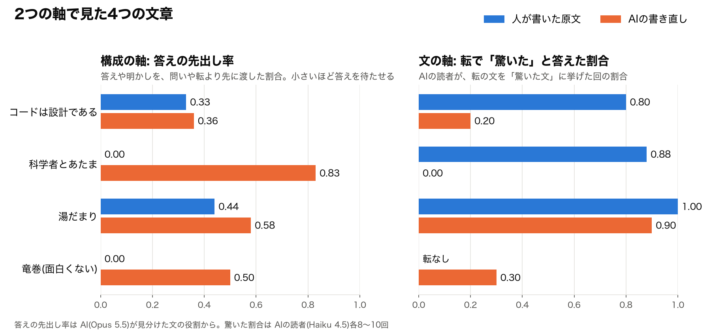
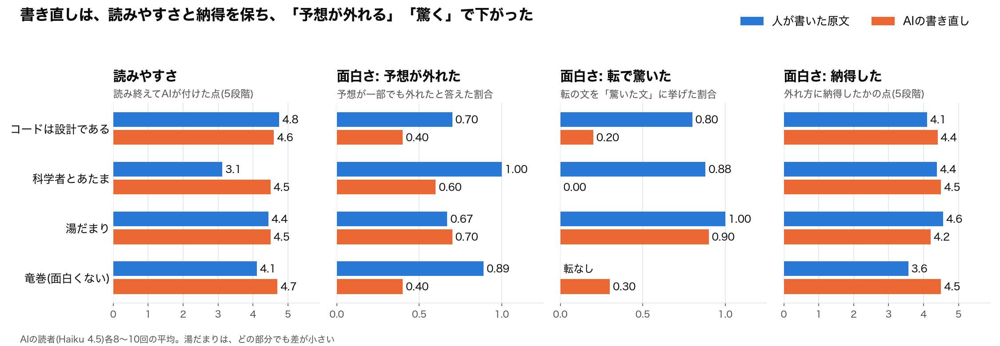
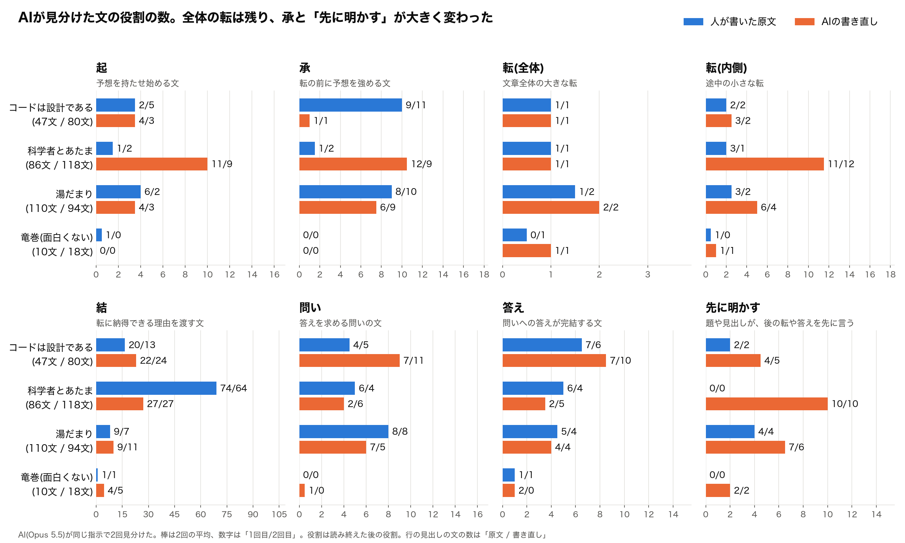

# 人が書いた4つの文章とAIの書き直しを、読みやすさと面白さで測る

## 前回までに作った物差し

やってみ太郎です。連載「AIが書いた文章はなぜ面白くないのか」の5回目です。

この連載では、2つの言葉を決めてきました。

- **読みやすい文章**: 対象の読者が、迷わず分かり、最後まで読める文章
- **面白い文章**: 読者の予想を、納得できる形で裏切る文章

面白い文章は、さらに3つの部分に分けています。
読者に予想を持たせること。その予想を裏切ること。裏切りに、納得できる理由があること。

前回は、これをどう測るかを考えました。
文章を、**構成**と**文**の2つの軸で見ることにしました。
構成の軸は、転(読者の予想を裏切る文)や問い、理由を担う文が、どう並び、どうつながっているか。文章だけを見れば決められます。
文の軸は、役割を担う文が、読者に対して本当に役割を果たしたか。転の文で予想は外れたか、理由の文で納得したか。こちらは読者に聞かないと分かりません。

そのうえで、連載の問いを言い直していました。
AIの書いた文章は、構成が欠けているのか。それとも、構成はあるのに、文が役割を果たせていないのか。
前回の私は、後者ではないかと書きました。ただ、まだ1本も測っていませんでした。

今回は、実際に測ります。

## 材料は4つの文章、測る人は2人のAI

材料は、前々回に集めた4つの文章です。それぞれに、人が書いた原文と、その内容だけを渡してAIに書き直させた版があります。原文と書き直しで、あわせて8本です。

- ライアン・ブラッシュ「コードは設計である」
- 寺田寅彦「科学者とあたま」
- 私自身の note 記事「湯だまりを頼んだら、海が来た」
- 気象庁「竜巻などの激しい突風とは」

前々回、私はこう判断していました。
読みやすさは、4つの文章すべてで、AIの書き直しのほうが上か同じ。
面白さは、はじめの3つの文章で、原文のほうが上。竜巻の解説は、どちらも面白くない。

測る役は、2人のAIに分けました。
構成の軸は、Claude の Opus 5.5 に任せました。8本の文章の文1つずつに、「転」「承」「問い」のような役割を付けてもらいます。同じ作業を、別の会話で2回させました。
文の軸は、Claude の Haiku 4.5 を読者にしました。題、冒頭、そのあと1段落ずつ渡して、そのつど答えさせます。

- いまの結論の予想
- 前の段落から、予想が変わったか
- 驚いた文、納得した文、意味が取れなかった文の番号

読み終えたら、読みやすさ、予想が外れたか、外れ方に納得したかを答えさせます。
これを、新しい会話で1本につき10回くり返しました。

## 構成と文の2つの軸で測る

構成の軸では、最初に転の位置を見ました。位置は、本文の頭から何%のところかです。

- コードは設計である: 原文は72%、書き直しは32%
- 寺田寅彦: 原文は3%、書き直しは1%
- 湯だまり: 原文は39%、書き直しは33%
- 竜巻: 原文は転なし、書き直しは冒頭

AIの書き直しにも、転はちゃんとありました。構成の要素が欠けているわけではありません。

次に、要素が並ぶ順番を数えました。
問いへの答えや、伏せていた情報を明かす文が、問いより前に来ていないか。題が先に答えを言っていないか。
そうした「先に答えを渡すつながり」の割合を、「答えの先出し率」と呼ぶことにしました。
0から1の値で、1なら答えをすべて先に渡しています。大きいほど、読者は問いを抱く前に答えを渡されています。

- コードは設計である: 原文は0.33、書き直しは0.36
- 寺田寅彦: 原文は0、書き直しは0.83
- 湯だまり: 原文は0.44、書き直しは0.58

3つの文章すべてで、書き直しのほうが答えを先に渡していました。Opus の2回目の見分けで数え直しても、向きは同じでした。

文の軸では、転の文が役割を果たしたかを見ました。AIの読者が、転の文を「驚いた文」に挙げた割合です。図では、10回中8回なら0.8と表しています。
2つの軸を並べると、こうなりました。

左が構成の軸、右が文の軸です。

寺田寅彦は、両方の軸で差が開いています。
書き直しの題は「科学者は、頭がよくて、頭が悪くなければならない」で、転を題が先に言っています。転で驚いた回は0でした。

「コードは設計である」は、左の答えの先出し率がほとんど同じです。それなのに、右の驚いた回は10回中8回と2回で、大きく違います。
この図だけを見ると、構成は同じで、文だけが役割を果たせなかったように見えます。前回、私が予想したとおりの形です。
でも、この見え方は、あとで役割の数を数えたときに変わりました。

## 結果を、定義の部分ごとに並べる

次に、連載の定義に沿って、文の軸の結果を1枚にまとめます。

左から、読みやすさ、面白さの「予想が外れた」「転で驚いた」「納得した」です。
青が人の原文、橙がAIの書き直しです。

一見して、2つに分かれました。
読みやすさと納得は、書き直しが原文と並ぶか、上回っています。
予想が外れた割合と、転で驚いた割合は、書き直しが下がっています。

## 読みやすさ: 書き直しが上だった

読みやすさの点は、4つの文章すべてで、書き直しが原文と同じか上でした。
一番差が大きいのは寺田寅彦で、原文が3.1、書き直しが4.5です。
1933年の言葉づかいで、見出しもなく長い文が続く原文は、AIの読者にも読みにくかったようです。

文の長さでも、同じ向きが出ました。
書き直しの1文の平均は、どの文章でも原文より短く、寺田寅彦では44字から23字になりました。

「意味が取れなかった文」は、どの文章でもほとんど挙がりませんでした。
迷わず分かる、という点では、原文も書き直しも大きな差はありません。
差は、読みやすさの点と文の長さに出ていました。

ここは、前々回の私の判断どおりです。

## 予想を持たせる: AIの読者では差が出ず、構成の数に出た

面白さの1つ目は、読者に予想を持たせることです。
冒頭を読んだ時点で「続きを読みたいか」を5段階で聞きました。
結果は、どれも4点から5点でした。原文と書き直しの差は、ほとんどありません。
AIの読者は、どの冒頭も読みたがります。

差が出たのは、構成の軸のほうでした。
Opus に付けてもらった役割を、起承転結、問い、答え、先に明かすの8つについて、文書ごとに数えました。

文章全体の大きな転は、原文も書き直しも、ほぼ1つずつでした。
変わっていたのは、その周りです。

答えの先出し率ではほとんど同じだった「コードは設計である」に、違いが出ました。
原文には、**承**が9文と11文ありました。承は、転の前に読者の予想を強める文です。
原文は、建設業にロボットが来たらどうなるかという思考実験を長く続けて、「これは建設業の話だ」という予想を育てています。
書き直しでは、承は2回とも1文でした。

もう1つは、**先に明かす**つながりです。題や見出しが、あとに来る転や答えを先に言っている箇所です。
4つの文章すべてで書き直しのほうが多く、寺田寅彦では0本から10本になりました。題だけでなく、見出しも先に答えを言っていました。
2回の見分けで数がほとんど同じで、この図の中で一番確かな差でした。

起と結を見ると、寺田寅彦の2本は、組み立てそのものが違いました。
原文は、結(転に納得できる理由を渡す文)が74文と64文あります。冒頭で大きな転を1つ出し、あとはその理由を積み上げる文章です。
書き直しは、起が11文と9文、内側の転(文章の途中にある小さな転)が11と12。見出しごとに「起、承、小さな転」を何度も繰り返す形に変わっていました。

転はある。でも、「コードは設計である」では転の前で予想を育てる承が痩せ、寺田寅彦では題や見出しが先回りして答えを言っていました。

## 裏切る: 原文のほうが、予想が外れ、驚かれた

面白さの2つ目は、予想を裏切ることです。
読み終えたAIに、予想は当たったか外れたかを聞きました。
「一部外れた」か「外れた」と答えた回は、こうでした。

- コードは設計である: 原文は10回中7回、書き直しは10回中4回
- 寺田寅彦: 原文は8回中8回、書き直しは10回中6回
- 湯だまり: 原文は9回中6回、書き直しは10回中7回

回の数がそろわないのは、読み終えたあとに「この文章を読んだことがある」と答えた回を除いたからです。

転の文を「驚いた文」に挙げた回も、同じ向きでした。
「コードは設計である」は10回中8回と2回、寺田寅彦は8回中7回と10回中0回、湯だまりは9回中9回と10回中9回です。

はじめは、別の方法で測るつもりでした。
AIの予想の文を、意味の近さを測れる数値の並びに変えて(「埋め込み」と呼ばれる技術です)、転の段落でどれだけ動いたかを見る方法です。
これは、うまくいきませんでした。8本の転のどれでも、予想は目立って動きませんでした。

寺田寅彦の答えを読み返すと、理由が見えました。
題「科学者とあたま」だけを見せた時点で、AIはたとえばこう予想していました。

> 科学者に必要なのは高度な知識よりも、常に基本に立ち返り、当たり前をあたり前と思わない柔軟で批判的な思考癖である。

ほとんど転の中身です。転を読んだあとの予想も、言葉はほとんど変わりません。
それでも、「科学者はあたまが悪くなくてはいけない」という言い切りには、8回中7回、驚いたと答えています。
驚きは、予想の中身ではなく、言い方のほうにあったようです。
予想の文どうしの意味の近さでは測れず、読者に「どこで驚いたか」を聞くと測れました。

## 納得: 書き直しは、理由を渡すのがうまかった

面白さの3つ目は、裏切りに納得できる理由があることです。
読み終えたAIに、外れ方に納得したかを5段階で聞きました。

- コードは設計である: 原文は4.1、書き直しは4.4
- 寺田寅彦: 原文は4.4、書き直しは4.5
- 湯だまり: 原文は4.6、書き直しは4.2

湯だまり以外は、書き直しのほうが少し上でした。
AIの書き直しは、理由を丁寧に書きます。

竜巻の解説の原文は、この点で目立っていました。
予想が外れた回は9回中8回と多いのに、納得の点は3.6で、8本の中で一番低い。
題「竜巻などの激しい突風とは」から、AIは10回とも、竜巻ができる仕組みの説明を予想しました。本文は、突風の種類を3つ並べる説明でした。
予想は外れました。でも、なぜ仕組みではなく種類の話なのかは、本文のどこにも書かれていません。
外れるだけでは面白くない。納得できる形で外れて、初めて面白い。定義のとおりの例が、面白さを狙っていない文章から出てきました。

## 違うのは、裏切る前の準備だった

部分ごとの結果を重ねると、AIの書き直しの姿が見えてきます。

- 読みやすさは、保つか、良くしている
- 納得できる理由も、ちゃんと渡している
- 違っていたのは、予想を持たせて、裏切るところ

そして構成の数を見ると、その原因が転そのものではなく、転の手前にありました。
「コードは設計である」の書き直しは、承が痩せていました。予想を育てないまま転が来るので、読者は驚けません。
寺田寅彦の書き直しは、題と見出しが先に答えを言っていました。驚く前に、答えを知っています。

前々回、私は実施記録にこう書いていました。
「AIは、裏切りの理由は書けるが、裏切りの手前で予想を育てない」。
8本を読み比べた印象でしかなかったものが、承の数と、驚いた割合と、納得の点に分かれて見えました。

前回の問いにも、答えが出ました。
AIの書き直しは、構成が欠けていたわけではありません。転も、理由も、結論もあります。
かといって、構成は無傷で、文だけが役割を果たせなかったわけでもありません。
転の前の承の量と、題や見出しで先に言う量。構成の中の、量と順番が変わっていました。

前回の記事の最後に、「コードは設計である」の転の直前の一文を引きました。

> 本書の読者は、この話を聞いても驚かないかもしれません。

書き手は、読者が驚かないことを心配していました。
原文を読んだAIの読者は、10回中8回、驚いていました。
書き直しでは、10回中2回でした。
原文は、この一文の手前で、建設業の話を9文以上かけて育てていました。

## まだ分からないこと

湯だまりは、どの部分でも原文と書き直しの差が小さく、私の判断ほどの差は出ませんでした。
私自身がAIと書いた記事なので、原文の時点でAIの書き方に寄っていたのかもしれません。

測ったのは、4つの文章とその書き直しだけです。
構成の数はAIの見分けに頼っています。承や先に明かすは2回でほぼそろいましたが、問いや答えの見分けはかなり揺れました。
物差しも、この4つの文章を見ながら作ってきました。別の文章でも同じように分かれるかは、まだ分かりません。

前回、私は「AIに起承転結の型を教えても、面白くはならないはずです」と書きました。
AIの書き直しは、もう型を持っていました。その意味では、当たっていたと思います。
では、「転の前で予想を育てて」「題で答えを言わないで」と頼んだら、どうなるでしょうか。

数字にした手順と、8本の結果、AIの読者の答えは、リポジトリに置いてあります。
https://github.com/h-takeshita-henteco-shoji-com/tried/tree/main/2026/10-13-AI%E3%81%8C%E6%9B%B8%E3%81%84%E3%81%9F%E6%96%87%E7%AB%A0%E3%81%AF%E3%81%AA%E3%81%9C%E9%9D%A2%E7%99%BD%E3%81%8F%E3%81%AA%E3%81%84%E3%81%AE%E3%81%8B-05-%E7%89%A9%E5%B7%AE%E3%81%97%E3%82%928%E6%9C%AC%E3%81%A7%E7%A2%BA%E3%81%8B%E3%82%81%E3%82%8B

*やってみ太郎(へんてこ商事で、中小企業のDXとAI導入を支援しています)。連載「AIが書いた文章はなぜ面白くないのか」の5回目でした。*
