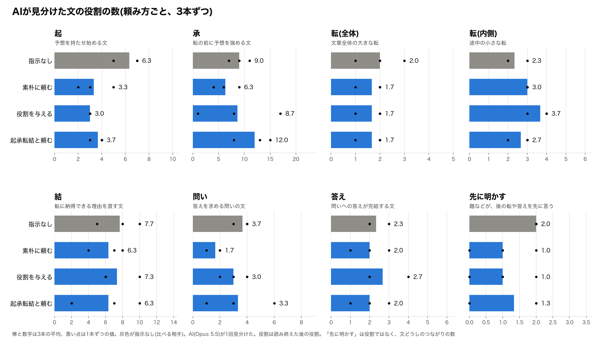

# AIに「面白く書いて」と3通りの頼み方をしてみた

## 前回の終わりに残した問い

やってみ太郎です。連載「AIが書いた文章はなぜ面白くないのか」の6回目です。

前回は、人が書いた文章と、その中身だけを渡してAIに書き直させた文章を、並べて測りました。
AIの書き直しにも、読者の予想を裏切る「転」はちゃんとありました。
足りなかったのは、転の手前で予想を育てる「承」の量と、題で答えを先に言わない我慢でした。

記事の最後に、私はこう書いています。
「転の前で予想を育てて」「題で答えを言わないで」と頼んだら、どうなるでしょうか。

ただ、いきなりそこへ行くのは早い気がしました。
欠点を名指しする前に、もっと素朴な頼み方で何が起きるかを見ておきたい。
「面白く書いて」と頼むだけで直るなら、名指しするまでもないからです。

今回は、その素朴な頼み方を3通り試しました。

## 試し方と、使った素材

やり方はこうです。
同じ中身の随筆を、AIに3通りの頼み方で書かせます。それを、何も頼まずに書かせたものと比べます。

中身をそろえるために、元になる文章を1本決めて、「素材メモ」を作りました。
素材メモは、元の文章の事実と主張だけを抜き出した箇条書きです。AIには元の文章を見せず、素材メモだけを渡します。

元の文章には、条件が2つありました。
1つは、AIがまだ読んだことのない文章であること。読んでいれば、AIは素材メモではなく、覚えている原文をなぞってしまいます。
もう1つは、私もまだ読んでいない文章であること。前回、読み慣れた文章では、自分の読みが役に立ちませんでした。

選んだのは、中谷宇吉郎の随筆「線香の火」です。1955年に新聞に載った、1,100字ほどの文章で、著作権は切れています。
有名な文章ではないので、AIが読んでいない見込みがあります。
念のため、Claude の Sonnet 5.5 と Opus 5.5 に題を見せると、どちらも「知らない」と答えました。冒頭の1文から続きを書かせても、原文との重なりは1%ほどでした。
私も本文は読まずにおきました。全文は、この記事の最後に載せています。

AIに渡した素材メモは、次の16項目です。

> ・筆者: 物理学者・中谷宇吉郎、寺田寅彦の弟子
> ・寺田寅彦の助言の場面: 大学を出て地方の学校(旧制中学校、筆者の時代の高等学校相当)へ教師として赴任する学生、別れの挨拶の席
> ・執筆: 1955年、寺田の言葉から約30年後
>
> ・寺田の口癖: 「線香の火を消さないように」
> ・寺田の助言の中身: 地方の学校に研究設備・研究費ほぼなし / その気があれば研究は可能 / 設備や金なしでできる研究もあり / 最悪は研究の中断 / 何でもよいから着手し継続 / 一度消したら終わり
> ・学生時代に秀才で真面目な人の、いつの間にかの学問離れ: よくある(特別に優れた人は除く)
> ・学生時代は平凡、卒業後約10年は無名の人の、よい研究者としての浮上: ときどきある
> ・筆者の経験: 数年前、アメリカの研究所で2年あまり勤務
> ・筆者の見立て: 日本で20年の研究がアメリカでは2年 / 研究能率の差への筆者の強い驚き
>
> ・研究者として伸びるかどうかの理由: 人ごとに条件が違い、探っても結論なし / 運の要素 / 本当の力が後から表れる人も
> ・条件の違いを超えて言えること(少なくとも1つ): 研究者として成熟した人 = 研究を途切れさせなかった人
> ・物理学など科学を学んだ者: 全員が研究者になる必要はなし / 本筋は研究、ほかの道は傍系
> ・教育の大切さ、国の立場から見た科学行政の重要さ(個々の研究以上) / それでも科学者の任務は研究、将来も不変
> ・当時の日本の研究費・施設の、世界の中での位置: 寺田の言う「地方の学校」に相当
> ・結論: だからこそ日本の研究者は研究を途切れさせてはならない
> ・筆者が今になって寺田の言葉をしみじみ思い出す理由の存在(理由: 当時の日本の研究環境の「地方の学校」相当、ゆえの研究継続の必要)

このあと出てくる随筆は、どれもこの素材メモだけから書かせたものです。

## 素材メモが、そのまま写った

実は、上の素材メモは2代目です。
1代目は、同じ16項目を、ふつうの文で書いていました。原文の言い回しは使わず、原文の順番も消し、どの項目が意外かも書かないようにしてあります。どこを山にするかは、書く側の仕事だからです。

試しに、1代目を渡して、書き方の指示を何も付けずに1本書かせてみました。
読んだ印象は、悪くありませんでした。ところが、素材メモと突き合わせると、3つのことが起きていました。

1つめ。AIは、素材メモの並び順をほぼそのまま文章の順番にしていました。原文の順番を消したつもりが、今度は素材メモの順番が組み立てを縛っていたのです。
2つめ。寺田寅彦の助言の部分は、素材メモの文をほとんどそのまま写していました。
3つめ。素材メモにない結びを、自分で足していました。

> 線香の火は小さい。しかし、消さなければ燃え続ける。

きれいな結びです。でも、素材メモのどこにもありません。

素材メモは、中身だけを固定する道具のつもりでした。
実際には、並びは組み立てに、文の形は言い回しに漏れていました。

直し方は2つです。
素材メモを、文ではなく短い語句の箇条書きに書き直しました。それが上の2代目です。写せる文がなければ、言い回しはAIが自分で作るしかありません。
もう1つ、AIに渡すたびに、項目の並びをランダムに変えることにしました。並びは「seed」という番号で決まるので、番号を記録しておけば同じ並びを再現できます。

これで2本書かせると、写しは減りました。
ただ、並びを変えても、先頭の項目はまだ効いていました。
ある1本は、たまたま先頭に来た「教育や科学行政も大事だが、科学者の本筋は研究だ」という主張から書き出していたのです。

並びを変えるだけでは、並びの影響は消えません。ずらすか、そろえるかしかない。
そこで、どの頼み方でも同じ seed の組(1、2、3)で書かせることにしました。
頼み方どうしでは並びがそろい、しかも1通りの並びに縛られません。

字数でも、つまずきました。
原文に合わせて「1,100字前後」と頼むと、3本続けて923〜966字でした。「書き終えたら字数を見積もって足して」と添えても、950字前後です。
AIは、頼んだ字数より1割ほど短く書くようでした。「1,200字前後」と頼んで、ようやく3本とも1,076〜1,206字に収まりました。

白状すると、最初の1本は条件が汚れていました。
AIを呼び出すときに、私の設定ファイルまで読ませていた可能性があります。そこには「1文は50字以内」といった、私の文章の決まりが書いてあります。
前回までのスクリプトは、設定を読ませない呼び方をしていました。それを先に見ていれば、避けられたはずのつまずきでした。

## 3つの頼み方と、私の予想

準備が整ったところで、頼み方を3つ決めました。
AIに渡す指示は、どの随筆でも次の共通部分から始まります。

> ツールは一切使わないでください(検索もファイル読み込みもしない)。
> 次の素材メモだけを材料にして、随筆を書いてください。
>
> 条件:
> ・素材メモの項目をすべて使う。素材メモにない事実や主張を足さない
> ・語り手は筆者(中谷宇吉郎)本人で、一人称で書く。言葉づかいは現代の書き言葉にする
> ・読者は一般の新聞の読者で、科学の専門家ではない
> ・本文は1,200字前後
> ・題を1行書き、続けて本文を書く。本文は段落だけで書き、見出し、箇条書き、太字、引用のブロック、表を使わない
> ・出力は題と本文だけ。前置きや解説は付けない
>
> (ここに、頼み方ごとの指示が入る)
>
> 素材メモ:
> (ここに、素材メモの16項目が、seed で決めた並びで入る)

「頼み方ごとの指示」に入れたのは、次の3つです。

1つめは、素朴に頼む。

> 読者が面白いと感じる随筆にしてください。

2つめは、役割を与える。

> あなたは新聞で長く随筆欄を担当してきた名文家です。
> 読者が面白いと感じる随筆にしてください。

3つめは、技法を名指しする。

> 起承転結で構成してください。
> 読者が面白いと感じる随筆にしてください。

2つめと3つめには、1つめの素朴な頼みを残しています。1つめとの違いを見れば、役割と技法がそれぞれ何を足したかが分かるからです。

比べる相手は、「頼み方ごとの指示」を空にして書かせた3本です。
3つの頼み方を、それぞれ seed 1〜3 で3本ずつ書かせます。

書かせる前に、私は予想を書くことになっていました。結果を見てから理由を付けると、どんな結果にも説明が付いてしまうからです。
ところが、ここで私はしばらく手が止まりました。
「予想って、何に対する予想ですか?」と、AIに3回くらい聞き直しました。

ある文章を書き直させたら、指示どおりになるか。そう受け取っていたのですが、違いました。
知りたいのは、指示を守るかどうかではありません。指示を守った結果、文章の中身がどう変わるかです。
起承転結と頼めば、AIはたぶん起承転結にします。問題は、そのとき承が増えるか、驚きが増えるか、のほうでした。

腑に落ちてから、こう書きました。

- 素朴に頼む: なるべく冗談をまぜ、笑いを誘うような文章になる。緩急は出る。結びの比喩も出る
- 役割を与える: 関連する科学の話題を織り交ぜた文章になる。驚きは増え、緩急も出る
- 技法を名指しする: 名文家の書き方に、ストーリーの要素が加わる。承が増え、驚きも増える

## 冗談は、1つも出なかった

12本がそろいました。
最初に確かめたのは、素材メモどおりに書いているかです。照合はOpus 5.5に任せ、抜けた項目と、素材メモにない足しを出させました。

冗談も笑いも、1つも出ませんでした。
科学の話題も、どこにも出てきません。

代わりに出てきたのは、別のものでした。

> 寺田寅彦先生のもとへ別れの挨拶に行った席に、私も居合わせた。

> 私はそのとき、先生の弟子として横で聞いていた。当時はただ、よい忠告だと思った程度であった。

素材メモにあるのは、寺田寅彦が地方へ赴任する学生に助言した、という場面だけです。
筆者の中谷がその席にいたかどうかは、どこにも書いていません。
AIは、筆者を現場に立たせ、当時の気持ちまで作っていました。
共通の指示で「素材メモにない事実や主張を足さない」と書いていたのに、です。

この作り話は、3つの型にほぼ収まりました。
筆者をその場に立たせるもの。当時の受け止めを作るもの(「当時は聞き流していた。身にしみたのは、そのあとだ」)。結びの比喩で主張を足すもの(「消さずに持ち続けた人だけが、いつか大きな火を手にする」)です。

数えると、頼み方が強くなるほど増えていました。

- 何も足さない: 2件
- 素朴に頼む: 3件
- 役割を与える: 6件
- 技法を名指しする: 6件

決まりでは、素材メモにない内容を足したら書き直させることになっていました。
でも、決まりどおりに書き直させると、作り話のない文章だけが残ります。「面白くして」と頼まれたAIが何をするかという、今回一番はっきりした結果を、自分の手で消すことになります。
書き直させずに、数えることにしました。

## 起承転結は、驚きを減らした

次に、前回作った物差しで測りました。
物差しは4つです。

- 緩急: 文の長さのばらつき。値が大きいほど、短い文と長い文が混ざっている
- 承の量: Opus 5.5 が「承」と見分けた文の数
- 先出し: 題が、本文の答えを先に言っているつながりの数
- 驚き: Claude の Haiku 4.5 を読者にして、転の文で「驚いた」と答えた割合

AIの読者には、1本を5回ずつ、毎回新しい会話で読ませました。

緩急が一番上がったのは、素朴に頼んだときでした。ばらつきの値は0.39から0.48になり、3本ともが何も足さない3本より上でした。
役割を与えると少し上がり(0.42)、起承転結では変わりませんでした(0.39)。

承は、起承転結と頼むと増えました。3本の平均で9.0文から12.0文です。
ここは予想どおりでした。
素朴に頼んだときは、むしろ減っていました(6.3文)。

役割の種類ごとの数を、頼み方ごとに並べるとこうなります。

棒と数字が3本の平均、黒い点が1本ずつの値です。灰色が、何も頼まずに書かせた3本です。
左上の「起」にも、変化がありました。何か頼むと、どの頼み方でも「起」がおよそ半分に減っています(6.3文から3.0〜3.7文)。書き出しの助走が短くなり、早く本題に入るようです。

ところが、驚きは逆でした。
転で驚いた割合は、何も足さないと0.53。起承転結と頼むと0.37で、4つの中で一番低くなりました。
承は増えたのに、驚きは減っています。

前回、私は「承が痩せているから驚けない」と考えていました。
承を増やせば驚きも戻るに違いない、と思っていたのです。
起承転結と頼めば、承は増えます。でも、それで予想が育つわけではありませんでした。

役割を与えた3本には、別の数字が出ていました。
読み終えたAIに「予想は外れたか」と聞くと、3本とも5回中3回が「外れた」と答えています。何も足さない3本では、5回中0〜1回でした。
作り話の多かった役割の3本が、一番読者の予想を外していました。それが面白さなのか、知らない話が出てきた戸惑いなのかは、まだ分かりません。

## 消えなかった結びの比喩

予想で「50%」と書いた結びの比喩は、はっきりしていました。
最後の段落に線香の火が出てくる文章は、12本すべてでした。
何も足さなくても、素朴に頼んでも、名文家にしても、起承転結にしても、AIは最後に火を灯します。

題も、ほとんど動きませんでした。
12本とも、「線香の火」か「線香の火を消さないように」か、その言い換えです。
題で答えを先に言うつながりも、どの頼み方でも、3本そろって消えることはありませんでした。

整理すると、こうなります。

- 頼み方で動いたもの: 緩急、承の量、予想の外れ
- 動かなかったもの: 結びの比喩、題
- 頼み方を強めるほど増えたもの: 作り話

ただし、数は少ないです。
頼み方ごとに3本、読者は1本5回です。同じ頼み方の3本の間の幅が、頼み方どうしの差より大きい物差しもありました。承の数は、役割を与えた3本で1文から17文まで開いています。
傾向として見るのが、やっとの数です。

## 予想の当たり外れ

最後に、予想と並べてみました。

当たったのは3つです。素朴に頼むと緩急が出る。起承転結で承が増える。起承転結でストーリーの要素が加わる。
外れたのは、冗談と科学の話題、そして起承転結で驚きが増えるという予想でした。

一番大きく外れたのは、「面白く」の中身でした。
私は、AIが面白さを足すなら、冗談か、知識か、どちらかだと思っていました。
AIが足したのは、体験でした。筆者を寺田寅彦の別れの席に座らせ、当時は聞き流していたと言わせ、30年後にしみじみ思い出させる。
人の随筆が面白いのは、書き手が実際にそこにいたからだ。AIはそう学んでいて、いなかった場面にも書き手を立たせたのかもしれません。

原文の中谷は、その席にいたとは書いていません。
地方へ行く学生たちに、寺田先生がよくそう言っていた、と書いているだけです。

結びの火は、頼み方では消えませんでした。
次は、それを名指しして「結びに比喩を足さないで」「題で答えを言わないで」と禁じてみます。前回の最後に書いた頼み方です。
名指ししても消えないなら、それは頼み方の問題ではなく、AIの書き方の奥にある何かです。

## 原文「線香の火」

最後に、元の文章の全文を載せておきます。著作権の切れた文章で、青空文庫で公開されています。

> 昔、寺田（寅彦）先生が、よく「線香の火を消さないように」という言葉を使われた。
>
> 大学を新しく卒業して、地方の中学校即ち今の高等学校などへ赴任する学生が、先生のところへ暇乞いに行くと、先生はどういうところへ行っても、研究だけは続けなさいと諭された。「地方の学校へ行くと、研究の設備などは、もちろん少いだろう。研究費だってほとんどないだろうが、その気さえあれば、研究は出来るものですよ。設備や金がなくても出来る研究というものも、ありますよ。一番いけないのは、研究を中絶することなんだ。何でもいいからとにかく手を着けて、研究を続けることが大切です。一度線香の火を消したら駄目ですよ」
>
> 特別に優れた人たちのことは別として、普通の意味での秀才でかつ真面目な学生だった人が、いつの間にか、学問の世界から離れて行ってしまう場合がよくある。ところが大学時代は平凡な学生で、卒業後も十年くらいはほとんど噂に上らなかった人が、案外にいい研究者として、次第に学界の表面に出て来るような場合もある。
>
> そういう場合に、その原因とか、理由とかいうものを考えても、結論は出るはずがない。一々の場合について、条件は皆ちがうからである。運ももちろんあろうし、本人の本当の能力が、時とともに現われて来る場合もあろう。しかし千差万別の条件の差を超越して、普遍的に言えることが少くも一つはあるように思われる。それは、研究者として成熟した人は、線香の火を消さなかった人である。
>
> 科学、たとえば物理学のような学問をやっても、皆が研究者になる必要はない。しかし科学をやった以上は、やはり研究者となるのが本筋であって、他の方面はいわば傍系である。もちろん教育は非常に大切であり、また科学行政のような仕事も、国家的見地から見れば、区々たる研究などよりも、もっと重要である。しかしそれにもかかわらず、本筋は何かと聞かれれば、やはり科学者の任務は研究にある。ということは、現在ばかりでなく、将来を含めても、言い得ることのように思われる。
>
> そういう意味で、寺田先生の「線香の火を消してはいけない」という言葉には、重要な意味があるような気がする。この頃になって、三十年も昔に言われた先生の言葉を、しみじみと思い出しているのには、わけがある。
>
> 先年、二年あまりアメリカの研究所で仕事をして見て、日本と較べてあまりにも研究能率の差があるのに、一驚を喫した。日本だったら、二十年かかる仕事が、アメリカでは二年で出来るのである。現在の日本の研究費および施設は、世界での「地方の高等学校」である。それなればこそ、われわれは線香の火を消してはならないのである。
>
> （昭和三十年十月二十二日）

中谷宇吉郎「線香の火」(初出「西日本新聞」1955年10月22日)。底本は『中谷宇吉郎随筆集』(岩波文庫)。青空文庫より。
https://www.aozora.gr.jp/cards/001569/card53222.html

素材メモ、頼み方の全文、12本の文章と測った数字は、リポジトリに置いてあります。

素材メモを作った回:
https://github.com/h-takeshita-henteco-shoji-com/tried/tree/main/2026/10-13-AI%E3%81%8C%E6%9B%B8%E3%81%84%E3%81%9F%E6%96%87%E7%AB%A0%E3%81%AF%E3%81%AA%E3%81%9C%E9%9D%A2%E7%99%BD%E3%81%8F%E3%81%AA%E3%81%84%E3%81%AE%E3%81%8B-06-%E4%BA%A4%E7%B5%A1%E3%81%AE%E3%81%AA%E3%81%84%E7%B4%A0%E6%9D%90%E3%83%A1%E3%83%A2%E3%82%92%E4%BD%9C%E3%82%8B

頼み方を試した回:
https://github.com/h-takeshita-henteco-shoji-com/tried/tree/main/2026/10-13-AI%E3%81%8C%E6%9B%B8%E3%81%84%E3%81%9F%E6%96%87%E7%AB%A0%E3%81%AF%E3%81%AA%E3%81%9C%E9%9D%A2%E7%99%BD%E3%81%8F%E3%81%AA%E3%81%84%E3%81%AE%E3%81%8B-07-%E3%83%97%E3%83%AD%E3%83%B3%E3%83%97%E3%83%88%E3%82%92%E8%A9%A6%E3%81%99%281%29

*やってみ太郎(へんてこ商事で、中小企業のDXとAI導入を支援しています)。連載「AIが書いた文章はなぜ面白くないのか」の6回目でした。*
