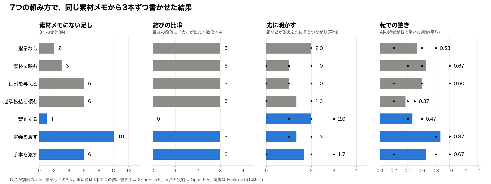

# AIに「禁止」「定義」「手本」の3通りで随筆を書かせてみた

## 前回、消えなかったもの

やってみ太郎です。連載「AIが書いた文章はなぜ面白くないのか」の7回目です。

前回は、同じ素材から、AIに3通りの頼み方で随筆を書かせました。
「面白く書いて」と素朴に頼む。名文家という役割を与える。起承転結と技法を名指しする。

https://note.com/tried_hs/n/n95e716cead9b

どの頼み方でも、消えないものが2つありました。
1つは、結びの比喩です。12本すべてが、最後の段落で「線香の火」を灯していました。
もう1つは、題です。12本とも「線香の火」か「線香の火を消さないように」でした。

そして、頼み方を強めるほど増えたものもありました。
「別れの挨拶の席に、私も居合わせた」のような、筆者の体験の作り話です。素材にはない場面に、AIは筆者を立たせていました。

今回は、頼み方を変えます。
ふわっと頼むのではなく、欠点を名指しして禁じる。面白さの定義をそのまま渡す。お手本の文章を渡す。
名指しすれば消えるのか。それとも、名指ししても消えないのか。

## 試し方

材料は前回とまったく同じです。
中谷宇吉郎の随筆「線香の火」から、事実と主張だけを抜き出した「素材メモ」(16項目)を、AIに渡します。元の随筆そのものは見せません。
書き手のAIは Claude の Sonnet 5.5、共通の指示文も、素材メモの並べ方(seed 1〜3)も、前回と同じです。

素材メモと共通の指示文の全文は、前回の記事に載せています。

変えたのは、共通の指示文の中に入れる「頼み方ごとの指示」だけです。
今回の3つには、どれも前回の素朴な頼み「読者が面白いと感じる随筆にしてください。」を残しました。前回の「素朴に頼む」との違いを見れば、足した指示が何をしたかが分かるからです。

1つめは、禁止する。前回見つかった欠点を、名指しで禁じます。

> 次のことをしないでください。
>
> ・題や書き出しで、話の山(読者の予想を裏切る事実)を先に言うこと
> ・結びに、比喩で締めくくる一文を足すこと
> ・筆者がその場にいた、当時どう感じた、など、素材メモにない体験を作ること
>
> 読者が面白いと感じる随筆にしてください。

2つめは、定義を渡す。この連載で決めてきた「面白い文章」の定義を、そのまま渡します。

> この随筆では、面白い文章を次のように定めます。
> 面白い文章とは、読者の予想を、納得できる形で裏切る文章です。
>
> ・裏切る前に、読者に予想を持たせる(起・承)
> ・その予想を外す事実を出す(転)
> ・裏切りに、納得できる理由を渡す(結)
>
> 起承転結の順番である必要はありません。ただ、転の時点で、読者がすでに予想を持っているようにしてください。
>
> 読者が面白いと感じる随筆にしてください。

3つめは、手本を渡す。寺田寅彦の随筆「科学者とあたま」(1933年、著作権切れ)の全文を渡します。
連載の2回目で、AIの書き直しより原文のほうが面白いと私が判断した文章です。寺田寅彦は中谷宇吉郎の師でもあります。

> 次の随筆を手本にして、構成と書き方を参考にしてください。手本の内容と言い回しは使わないでください。
>
> 読者が面白いと感じる随筆にしてください。
>
> 手本(寺田寅彦「科学者とあたま」):
> (ここに全文、約3,800字)

それぞれ3本ずつ、計9本を書かせました。比べる相手は、前回の「指示なし」と「素朴に頼む」の3本ずつです。
9本とも、字数と形式の決まりに一度で収まりました。

前回は、書かせる前に予想を書きました。今回は書いていません。
前回の予想は半分ほど外れ、外れた理由のほうが面白かった。今回は、出てきたものをそのまま見ることにしました。

## 禁じると、火は消えた

まず、前回の4つと今回の3つを、1枚に並べます。

点線から上が前回の4つ、下が今回の3つです。

一番はっきり変わったのは、2列目の結びの比喩でした。
禁止した3本は、3本とも火を灯さずに終わりました。前回の12本と、今回のほかの6本は、すべて火で締めていたのにです。
禁止した3本の結びは、たとえばこうです。

> だからこそ、日本の研究者は、研究を途切れさせてはならないのである。

素材メモの結論を、そのまま置いて終わっています。
飾りのない終わり方です。物足りなく感じるか、潔く感じるかは、読む人によると思います。

1列目の作り話も、禁止すると1件まで減りました。前回の「指示なし」(2件)より少ない数です。
筆者をその場に立たせる作り話は、0件でした。残った1件は「その事情は今も大きくは変わっていない」という、素材メモの一歩先を言う一文です。

前回、どの頼み方でも消えなかった2つが、名指しで禁じると消えました。
この2つは、AIが既定で書いてしまう癖で、言えば直る欠点だったことになります。

## 題での先出しは、禁じても残った

ところが、もう1つの欠点は残りました。
3列目の「先に明かす」は、題などが本文の答えを先に言っているつながりの数です。禁止した3本でも、平均2.0で、指示なしと同じでした。
題も、9本とも「線香の火」か「線香の火を消さないように」のままです。

「題や書き出しで、話の山を先に言わないで」とはっきり書いたのに、です。

結びの火と、題での先出し。どちらも名指しで禁じました。
片方は消え、片方は消えませんでした。
この違いがどこから来るのかは、まだ分かりません。題は、素材メモの中で一番目立つ言葉(線香の火)に、どうしても引き寄せられるのかもしれません。

## 定義を渡すと、作り話が一番増えた

意外だったのは、定義を渡した3本です。
作り話が10件で、これまでの7つの頼み方で一番多くなりました。

> 私はその席にいた。

> 学生は、これから行く先には研究設備も研究費もほとんどないと、いくらか沈んだ調子で言った。

> 若いころの私は、これを励ましの言葉くらいにしか受け取らなかった。田舎に行っても腐るなという、師の優しさだと思っていた。

筆者を席に座らせるだけでなく、学生の表情まで作っています。
定義には「裏切る前に、読者に予想を持たせる」と書きました。AIはそれを、場面を作って予想を育てる、と受け取ったようです。
「若いころは励ましだと思っていた」と書いておけば、あとで「実は日本全体への言葉だった」と裏切れます。定義のとおりの組み立てです。ただし、その予想の材料は、素材メモの外から持ってきたものでした。

そして、4列目を見てください。
転で驚いた割合は、定義を渡した3本が0.87で、7つの中で一番高くなりました。
作り話が一番多い頼み方が、一番驚かせていたのです。

禁止した3本はその逆でした。作り話は消えましたが、驚いた割合は0.47で、指示なし(0.53)とほとんど変わりません。

## 手本を渡しても、写しはしなかった

手本を渡した3本は、手本の言い回しを写していませんでした。
手本と5文字ずつの並びがどれだけ重なるかを数えると、2.0〜3.0%でした。手本を渡していない前回の12本でも1.8〜3.3%は重なるので、同じ程度です。

ただ、作り話は6件出ました。役割や技法を与えたときと同じ数です。

> 当時の私は、この話を、地方へ行く人への慰めのように聞いていた。

> いま私が六十に近い歳になって

筆者の年齢まで足していました。
寺田寅彦の手本は、「私に親しいある老科学者が」という語りから始まる随筆です。語り手が自分の経験を語る形を、手本から学んだのかもしれません。

もう1つ、緩急(文の長さのばらつき)は、今回の3つとも指示なしと同じ程度でした。
前回、素朴に頼んだときだけ緩急が上がっていました。今回の3つにも同じ素朴な頼みを入れていますが、何かを足すと、その効果は消えていました。

数は少ないことも、書いておきます。
頼み方ごとに3本、AIの読者は1本5回です。驚いた割合は、同じ頼み方の3本の中でも0.2から1.0まで開くことがあります。グラフの黒い点の散らばりが、その幅です。

## 所感

7つの頼み方を並べて、AIの欠点は2種類に分かれました。

言えば直るもの。結びの比喩と、体験の作り話です。
「しないで」と書けば、AIはちゃんとやめました。前回、どの頼み方でも消えなかったのは、言っていなかったからでした。

言っても直らないもの。題での先出しです。
はっきり禁じても、題は「線香の火」のままでした。これは、指示の書き方ではなく、AIの書き方の奥にある何かかもしれません。連載の次の段階で、AIが文章を作る仕組みから調べてみます。

ただ、一番考えさせられたのは、作り話のほうでした。
定義を渡すと、AIは「予想を持たせて裏切る」ために、筆者の思い出を作りました。そして、その3本が一番驚かれていました。
禁じると作り話は消えます。でも、驚きも元に戻ります。

素材メモに書いたのは、中谷宇吉郎が書いた事実と主張だけでした。
中谷が若いころにこの言葉をどう聞いたかは、原文にも書かれていません。だから素材メモにもありません。
AIが勝手に作った「若いころは励ましだと思っていた」は、作り話です。それでも、読者を驚かせるのに必要な材料を、AIなりに探した結果にも見えます。

面白い文章には、書き手だけが持つ材料が要るのかもしれません。
素材メモにそれが無ければ、AIは作るか、あきらめるか。今回の9本は、その2つに分かれていました。

次は、頼み方の試しの最後です。手順を分ける、読者に読ませて直す、要約してから書き直す、を試します。
作らずに、あきらめずに済む頼み方があるのかを見たいと思います。

試した9本の文章、指示文、測った数字は、リポジトリに置いてあります。
https://github.com/h-takeshita-henteco-shoji-com/tried/tree/main/2026/10-13-AI%E3%81%8C%E6%9B%B8%E3%81%84%E3%81%9F%E6%96%87%E7%AB%A0%E3%81%AF%E3%81%AA%E3%81%9C%E9%9D%A2%E7%99%BD%E3%81%8F%E3%81%AA%E3%81%84%E3%81%AE%E3%81%8B-08-%E3%83%97%E3%83%AD%E3%83%B3%E3%83%97%E3%83%88%E3%82%92%E8%A9%A6%E3%81%99%282%29

*やってみ太郎(へんてこ商事で、中小企業のDXとAI導入を支援しています)。連載「AIが書いた文章はなぜ面白くないのか」の7回目でした。*
