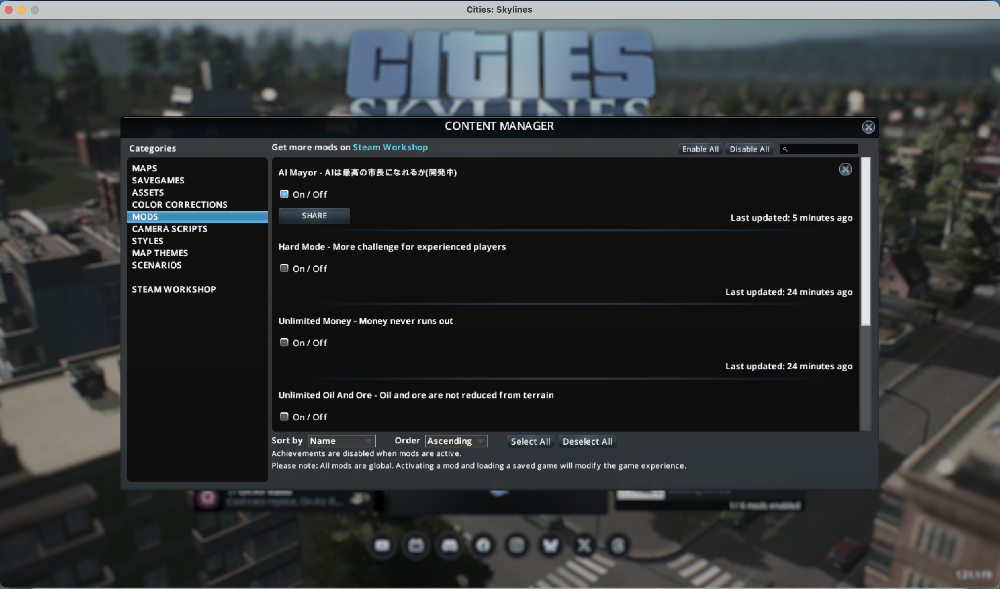
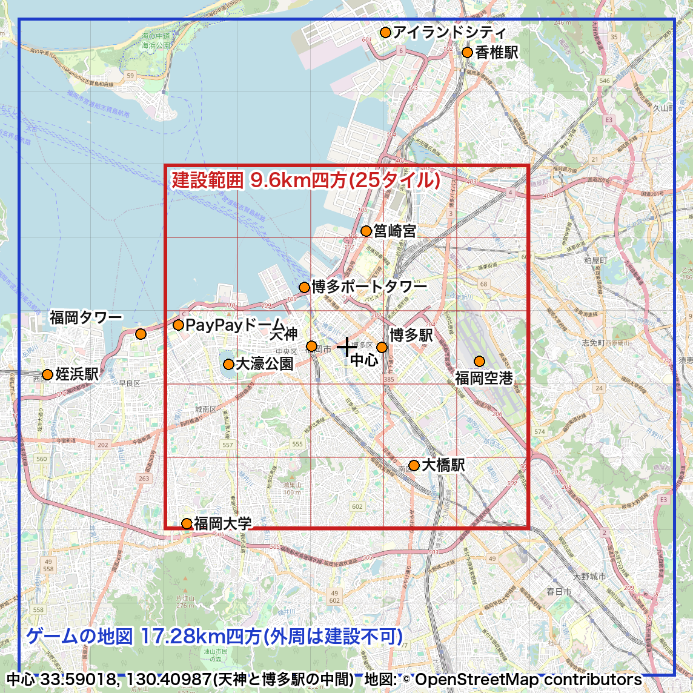
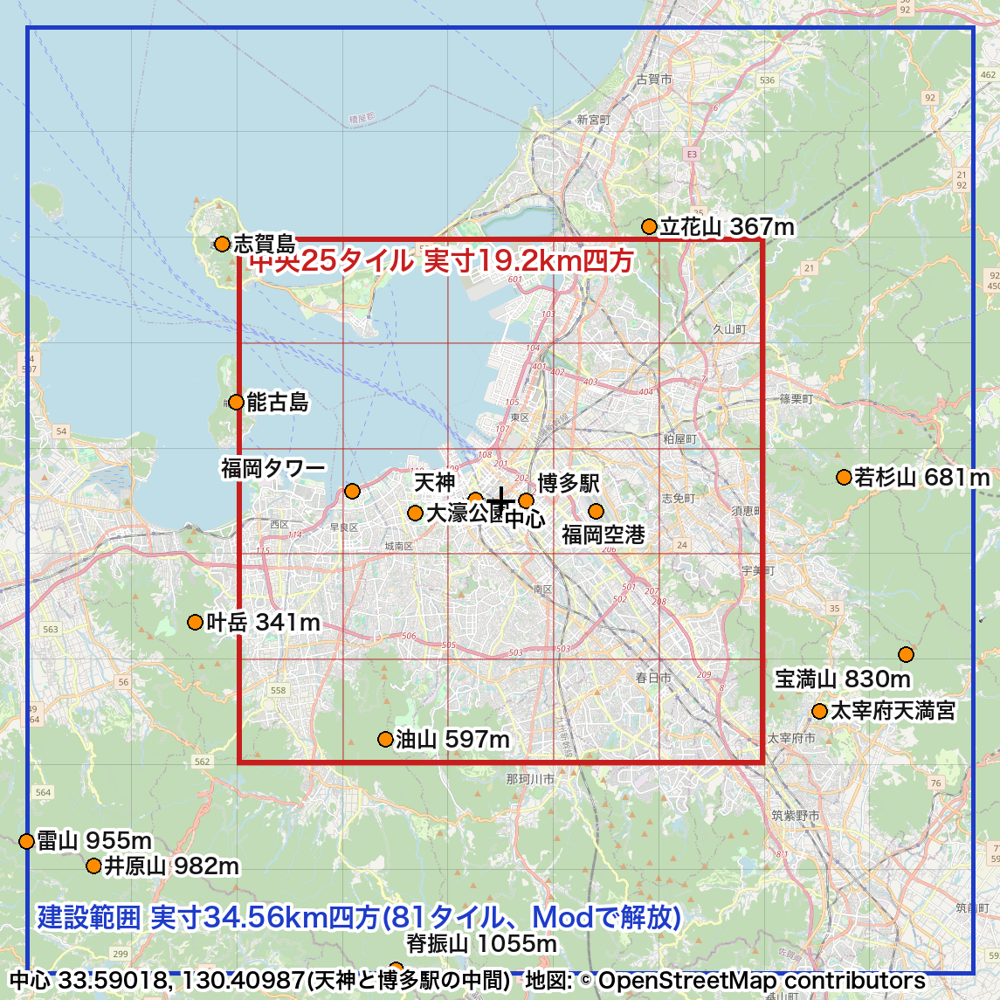
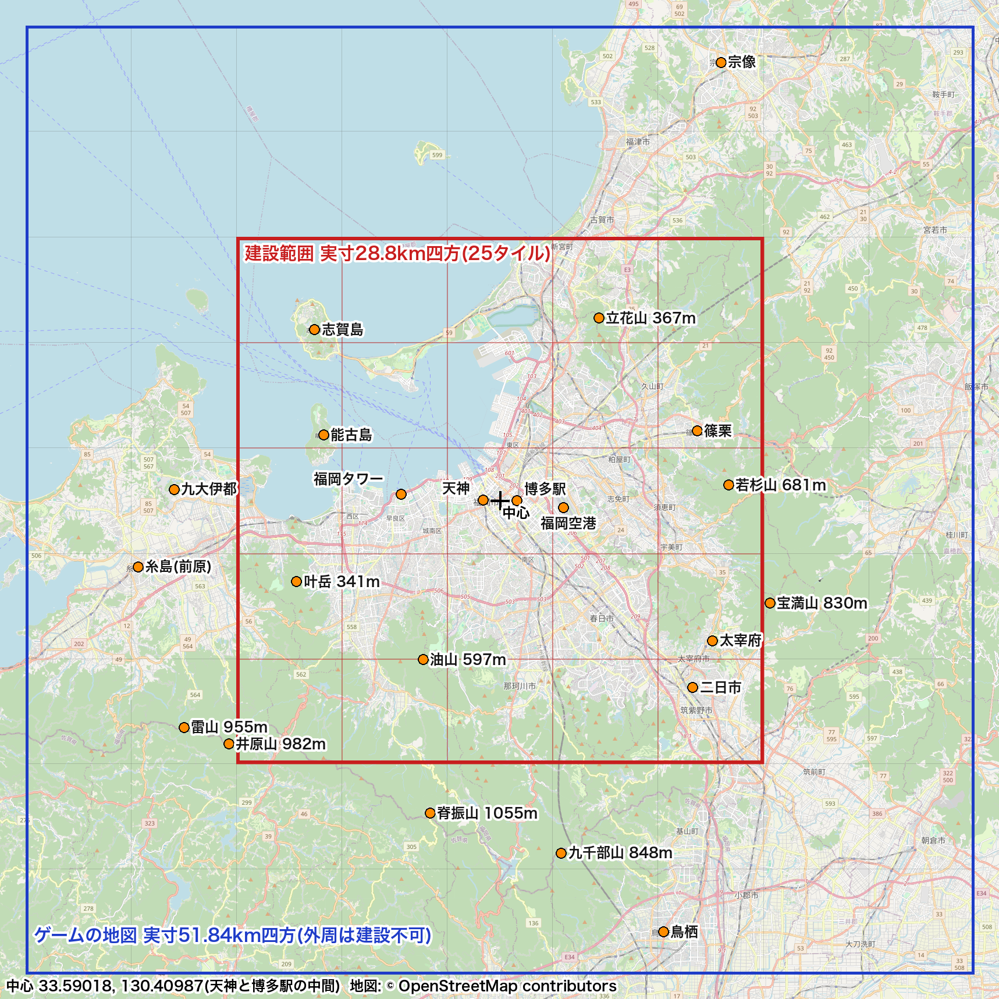

# AIにCities: Skylinesで福岡市長になってもらう

## シムシティを作る人になりたかった

やってみ太郎です。
普段は、へんてこ商事という会社で、中小企業のDX(業務をデジタルで変えること)やAI導入の相談に乗っています。

今日から新しい連載を始めます。題は「AIは最高の市長になれるか」です。

若い頃、プログラマを目指したきっかけは、シムシティのような街づくりゲームを作る人になりたかったからでした。
結局、ゲームを作る側には行きませんでした。
でも今は、AIにマインクラフトを遊ばせる研究や道具があります。
それなら街づくりゲームでも、AIに判断させられるんじゃないか。
ゲームを作る側ではなく、ゲームの中で判断するAIを作る側として、昔の夢にもう一度向き合ってみたくなりました。

もう1つ、きっかけがあります。福岡市長選挙です。11月1日に告示、15日に投票です。
市長の判断で街の行方が変わるなら、その判断をAIに任せたらどうなるのか。
そこで、ゲームの中に福岡市を作って、AIに市長をやらせてみることにしました。

使うのは「Cities: Skylines」(シティーズ・スカイライン)の初代です。
道路を引き、住宅地や商業地を指定し、税や予算を決めて街を育てるゲームです。
AIとゲームをつなぐには、Mod(ゲームの改造部品)を自分で作る必要があります。

この回は、その準備の2日分です。
1日目はMacでModが作れるかを確かめ、2日目は福岡のどこをゲームに入れるかを決めました。
2日目の途中で、最初に決めていた前提を自分でひっくり返すことになります。

## MacでModは作れるのか

最初の心配は、私のパソコンがMacだということでした。
Modの作り方を調べると、ほとんどがWindows前提なんです。
ここが通らなければ、連載そのものが始まりません。
2日やってダメなら、Windowsに乗り換えると決めて始めました。

ゲーム本体を調べると、Intel製のチップ向けにしか作られていませんでした。
私のMacはApple M5です。
それでも、Rosetta 2(Intel向けのアプリをAppleのチップで動かす仕組み)の上で、普通に起動しました。

Modは、C#というプログラミング言語で書きます。
まずは何もしないModを1つ作って、ゲームが読み込むかだけを見ることにしました。
中身は、名前と説明を名乗るだけです。

```csharp
public class AIMayorMod : IUserMod
{
    public string Name => "AI Mayor";
    public string Description => "AIは最高の市長になれるか(開発中)";
}
```

最初につまずいたのは、ビルド(プログラムをゲームが読める形にすること)の道具を入れる所でした。
いつもの方法で入れようとしたら、管理者のパスワードを求められて止まってしまいます。
Claude Code(ファイルを直接操作できるAIの開発ツール)に任せていたので、AIはパスワードを入力できません。
別の公式の入れ方に切り替えて、自分のフォルダの中だけに入れて解決しました。

ゲームを起動して、ゲームの記録(ログ)を見てもらいました。
「AIMayor を読み込みました」という1行がありました。
画面を開く前に、成功が分かったんです。



最後に、ゲームの「コンテンツマネージャー」でModを有効にしました。
MacでもModは作れる。連載の最初の関門は、思ったよりあっさり越えられました。

1つ、AIの言葉を信じて空振りしたことがあります。
持っている追加コンテンツ(DLC)を確かめようとしたら、Claudeは「コンテンツマネージャーのDLCタブを見てください」と言いました。
そんなタブは、ありませんでした。
結局、Steamの管理画面で確かめました。私はDLCを1つも持っていませんでした。

## 9.6km四方に、福岡はどこまで入るか

次の日は、福岡市のどこをゲームに入れるかを決めました。

このゲームの地図は、1辺17.28kmの正方形です。
ただ、建物を建てられるのは中央の9.6km四方だけ。周りは景色です。
福岡市の全部は、到底入りません。

中心は、天神駅と博多駅のちょうど中間にしました。
福岡の街の真ん中といえば、ここしかないと思ったんです。

天神、博多駅、中洲、キャナルシティ。博多港、那珂川、大濠公園。
主な場所の座標を調べて枠に重ねると、街の中心はきれいに収まりました。
空港も入ります。東の端までの余裕は、70mしかありませんでしたが。



地図: © [OpenStreetMap contributors](https://www.openstreetmap.org/copyright)

## 空港か、タワーか

困ったのは、福岡タワーでした。
建てられる範囲から、600mはみ出しています。

中心を西へ0.7kmずらせば、タワーは入ります。
その代わり、今度は空港の東側が切れます。
空港の東の端からタワーまでは、東西に約10.1km。
9.6kmの枠には、両方は入らないんです。

福岡らしさを残すなら、空港かタワーか。
空港は面積が大きく、街の形そのものを決めます。タワーは建物1つです。
空港を取ろう、とほぼ決めかけていました。

さらに、前提の数字にもずれが見つかりました。
追加のModなしで買える土地は、9区画(ゲーム上5.76km四方)までだったんです。
9.6km四方は、その9区画を選べる範囲でした。
全部を建てるには、追加の設定かModが要ります。
思っていたより、もっと狭かったわけです。

## いま考えている、AI市長の縛り

空港かタワーかで迷いながら、ふと手が止まりました。
そもそもこのゲームで、AI市長は何をして、何をしないのか。
そこを決めないまま、枠に入る建物を数えていたんです。

いま考えている決まりは、次のとおりです。

- AI市長ができるのは、プレイヤーと同じ操作だけ。道路を引く、区画(住宅地や商業地など)を指定する、税と予算を決める、地区ごとの政策を決める、時間を進める。
- 建物は選べない。どこに何が建つかは、ゲームの中の住民や会社の動きで決まる。
- 地形と、空港・鉄道・高速道路・港の骨格は、人(私)が作る。AIに任せるのは土地の使い方。ここが実験の本体。
- AIが考えている間は、ゲームを止める。判断の前には必ずセーブする。
- 市長は架空の人物にする。性格は変えても、価値観は変えない。現実の政治の立場を比べているように見せない。
- 現実の福岡とは、人口や予算を実数ではなく比率で比べる。

並べてみて、引っかかったのは2つめでした。
タワーを枠に入れても、ゲームの中に福岡タワーは建ちません。
空港かタワーか、という悩みは、AI市長にとっては意味がなかったんです。

じゃあ、人が作るもののうち、再現する価値が一番あるのは何か。
地形だと思いました。
海岸線、川、そして山です。

ところが今の枠の中は、平らな市街地ばかりでした。
起伏と呼べるものがほとんどありません。
福岡は、海に開いて、三方を山に囲まれた街です。
その山が、1つも入っていなかったんです。

そこで、地図の縮尺を変えることにしました。
ゲーム上の1mを、実際の2mにする。つまり、福岡を半分に縮めます。



地図: © [OpenStreetMap contributors](https://www.openstreetmap.org/copyright)

見違えました。
赤い枠の中央部分は実際の19.2km四方になり、空港とタワーが両方入ります。能古島と油山(597m)も入りました。
青い枠の地図全体には、立花山、若杉山、宝満山、雷山、井原山。南の端には、脊振山(1055m)がぎりぎり乗っています。
空港かタワーか、で悩んでいた問題は、縮尺を変えたら消えてしまいました。

欲が出て、1/3も試しました。



地図: © [OpenStreetMap contributors](https://www.openstreetmap.org/copyright)

山並みの向こう側や、玄界灘まで入ります。地図としては壮観です。
ただ、細かい所が消えてしまいます。
那珂川のような幅数十mの川は、地形の画像の上で1画素前後になります。
天神から博多駅までの約2kmは、ゲーム上で約670mに縮みます。
街の形が残る、ぎりぎりの所として、1/2に決めました。

ここまで来ると、もう一つ欲が出ました。
せっかく山が入ったのに、そこは「景色」です。建てられるのは真ん中の赤い枠だけ。
AI市長が、山のふもとまで街を広げるかどうか。それも見てみたいんです。

調べると、「81 Tiles 2」というModがありました。
地図の81区画を、ボタン1つで全部建てられるようにしてくれます。
これを使って、青い枠の全体を建てられる範囲にすると決めました。
Macで動くかどうかは、まだ分かりません。

## AI市長を動かすまでの準備

舞台の範囲は決まりました。
でも、AI市長が最初の道路を引くまでには、まだかなり距離があります。

まず、舞台を仕上げます。
国土地理院の標高データを、ゲームが読める地形の画像に変換する。
その地形をゲームに読み込んで、海と川を整える。
81区画を解放して、空港、鉄道、高速道路の骨格を置く。

次に、AIに街を見せる仕組みを作ります。
今のAIは、ゲームの中の街を直接は見られません。
Modで人口や予算などの数字を書き出し、外から問い合わせられるようにします。
それをMCP(AIに道具を使わせる共通規格)でClaudeにつなぎます。
その手前で一度、画面写真だけを見せて市長をさせてみるつもりです。
数字なしで、AIがどこまで判断できるのかを先に見ておきたいんです。

判断の型と、判断の記録の残し方も決めます。
AIが何を見て、なぜそう決めたのか。後から読み返せないと、比べようがないからです。

そこまでできてやっと、道路、区画、税と予算、政策、と1つずつAIに任せていきます。

次の回は、地形の画像づくりです。
ここで一つ、悩むことになりました。
横だけ半分に縮めると、山の斜面は実物の2倍の急さになります。
高さも半分にすれば、形は自然です。でも油山は300mほどの丘になってしまいます。
迫力を取るか、自然さを取るか。
画像にして見比べた末に、高さも半分にしました。
なぜ迫力を手放したのかは、次の回に書きます。

プログラムと記録は、リポジトリに置いています。
https://github.com/h-takeshita-henteco-shoji-com/tried/tree/main/code/ai-mayor

## 今日の学び

- 最初の関門は、思ったより低かった。MacでもModは作れて、成功はゲームの記録で先に分かった。
- AIの説明も、画面で確かめるまでは仮説だった。DLCのタブは、Claudeが言った場所になかった。
- 前提の数字は、版と設定まで確かめる。「9.6km四方」は、全部建てられる広さではなかった。
- 何を再現するかは、AI市長に何を任せるかから逆算する。建物はAI市長にも選べない。だから地形を取った。
- 縮尺を変えたら、空港かタワーかの悩みは消えた。悩みの答えは、悩んでいた枠の外にあった。
