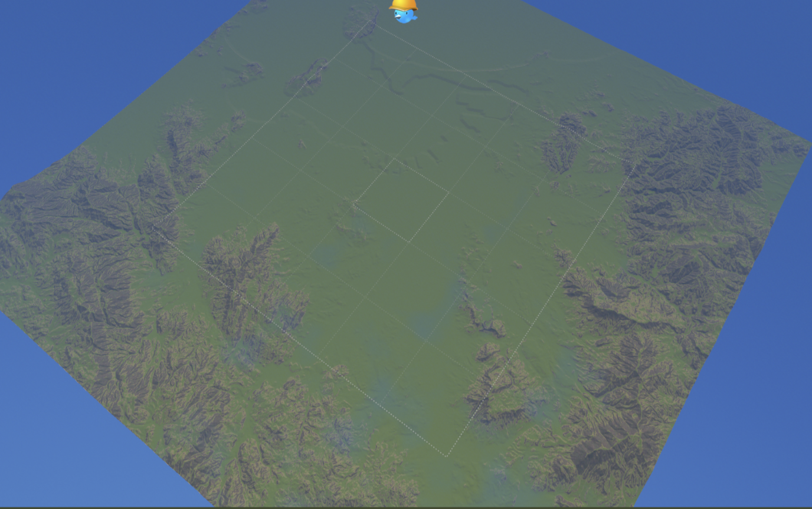
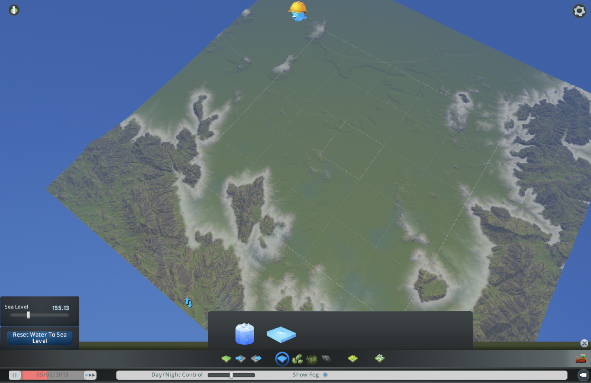
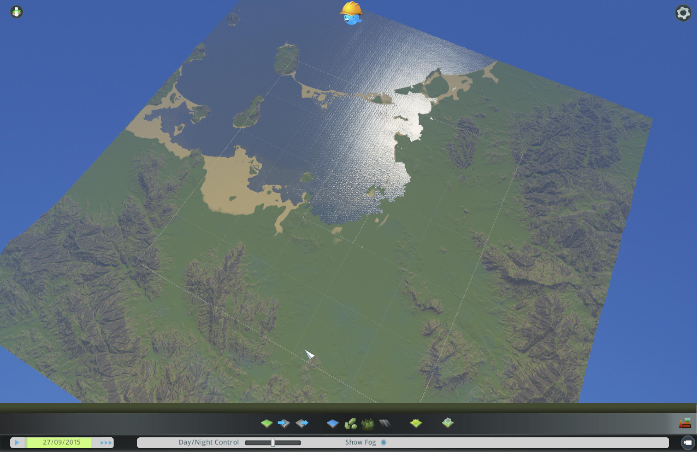
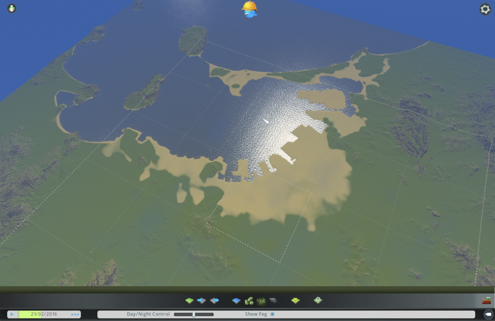
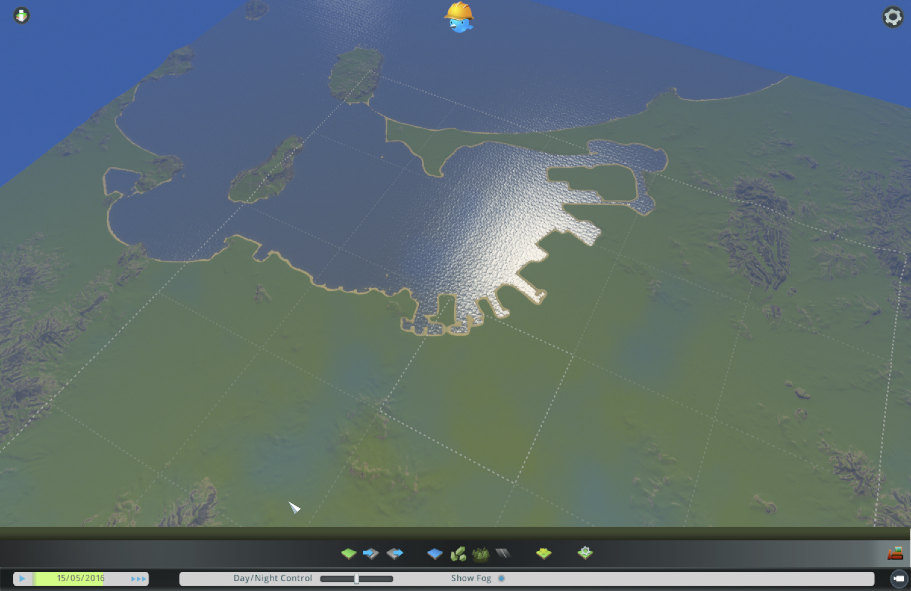
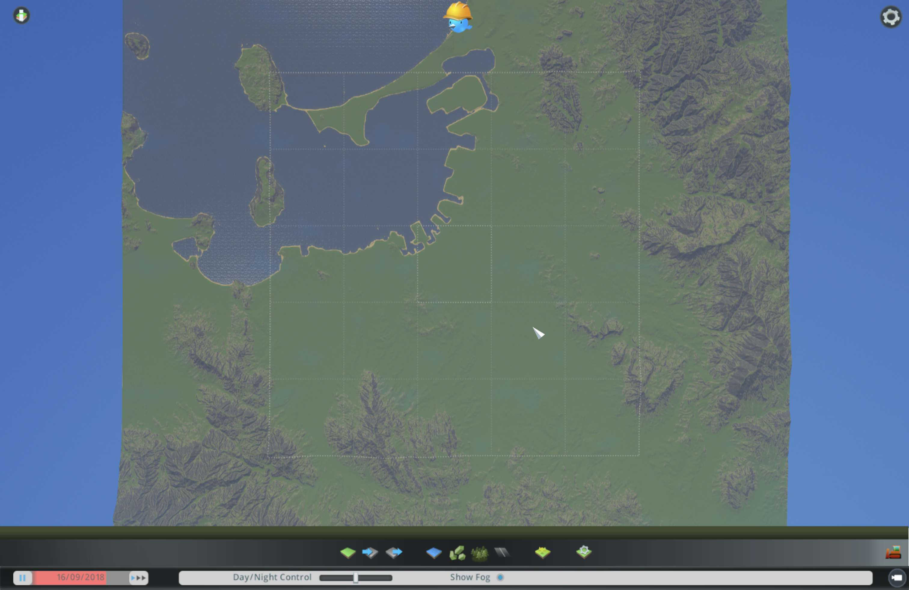
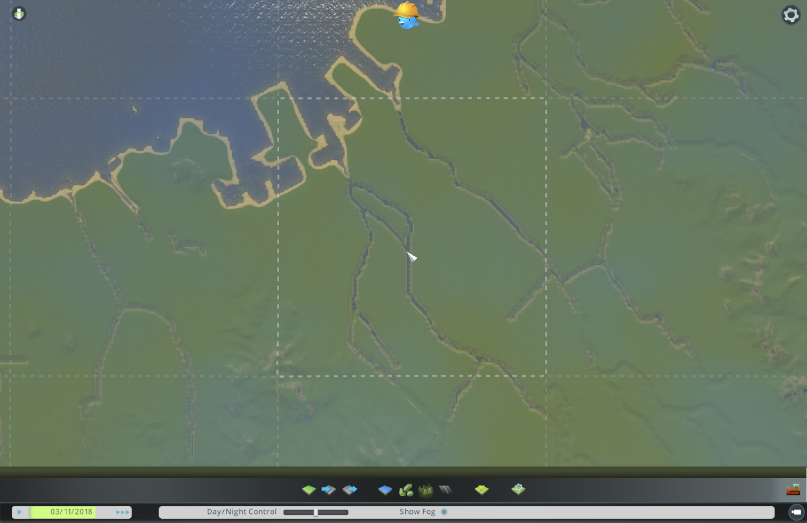
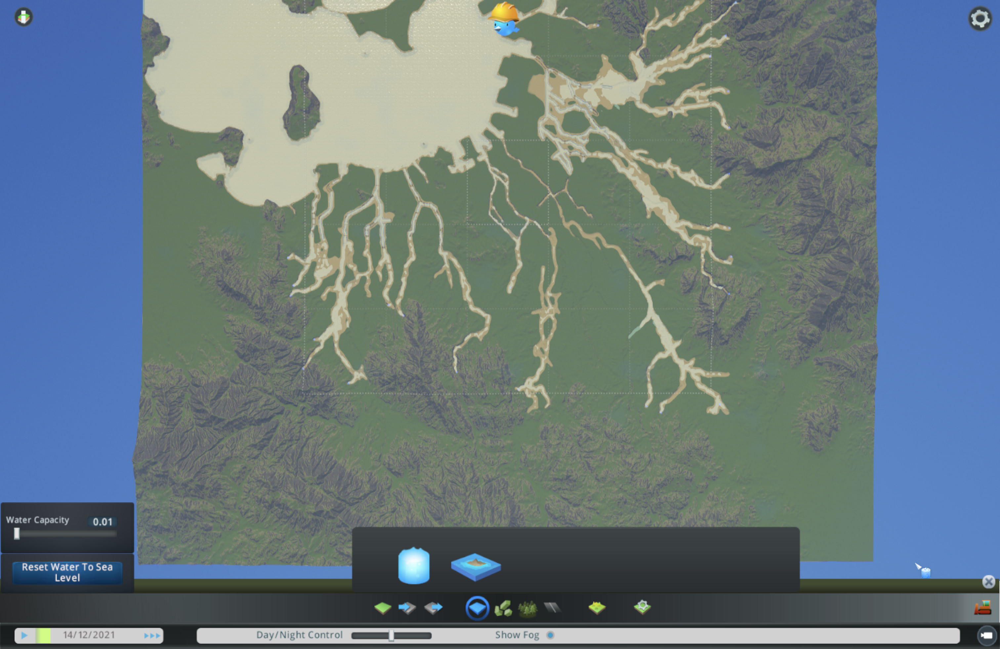

# AIを使って、Cities: Skylinesの福岡のマップを作った

## 前回の宿題

やってみ太郎です。連載「AIは最高の市長になれるか」の2回目です。

前回は、Cities: Skylines(シティーズ・スカイライン)の地図に、福岡のどこを入れるかを決めました。
地形を主役にするため、福岡を半分に縮めて、平野を囲む山まで入れることにしました。

そして最後に、こう書きました。
横だけ半分に縮めると、山の斜面は実物の2倍の急さになる。高さも半分にすれば自然だけど、油山は300mほどの丘になる。
見比べた末に、高さも半分にした。なぜ迫力を手放したのかは、次の回に書く、と。

今回は、その答えから始めます。
そして、その答えのせいで、福岡を一度沈めることになります。

## 迫力か、自然さか

国土地理院の標高データ(地面の高さを細かい格子で記録したもの)を、ゲームが読める白黒の画像に変換しました。
白いほど高く、黒いほど低い。ゲームはこの濃淡を読んで、地面の起伏を作ります。

高さの縮め方を3通り作って、斜面の急さを比べました。

- 高さそのまま: 陸地の46%が、20度を超える急斜面になる。脊振山(1055m)は、ゲームで表せる高さの上限を超えて山頂が削れる
- 高さ0.75倍: 20度を超える斜面は39%
- 高さ0.5倍: 20度を超える斜面は24%。山の形の比率は実物どおり

数字だけ見れば、そのままのほうが迫力はあります。
でも、陸地の半分近くが急斜面というのは、福岡ではありません。
福岡の山は、街の背景にゆったり並んでいる山です。
それに、このゲームでは急な斜面には道路も家も作りにくい。AI市長が街を広げる余地まで削ってしまいます。

横を半分にしたなら、高さも半分にする。そうすれば、形は福岡のままです。
これが、迫力を手放した理由でした。

このとき私は、山のことしか考えていませんでした。

## 読み込んだのに、何も変わらない

できた画像を、ゲームのマップエディター(地図を作る画面)に読み込みます。
最初は、読み込むボタンが見つかりませんでした。一時停止のメニューを探していたんですが、正解は画面下の地形ツールの中でした。

ボタンを押しても、画面は何も変わりません。
失敗かと思いました。でも、カメラが見ていたのは天神のあたりです。もともと平らな所なので、何も変わらなくて当然でした。
カメラを大きく引くと、山並みが現れました。



本当に正しい高さで入ったのか。画面を眺めても分かりません。
そこで、自作のMod(ゲームの改造部品)に、キーを押すと7か所の高さを書き出す機能を足しました。

```csharp
float ground = terrain.SampleRawHeightSmooth(pos);
float water = terrain.SampleRawHeightSmoothWithWater(pos, false, 0f);
```

天神41.8m、油山336.7m、博多湾20.0m。
変換のときに計算しておいた値と、1〜2mの差で一致しました。
高さの対応も、北の向きも合っている。画面を見るより、数字のほうがずっと早く確かめられました。

MacでF9キーを押すには、fnキーも一緒に押す必要がある、というのはここで覚えました。

## 海を入れたら、博多が沈んだ

次は海です。読み込んだだけでは、博多湾は水のない窪みのままです。
水の設定を開くと、海面の高さが155mになっていました。このままでは福岡平野が丸ごと沈みます。
40mに直して、水を入れました。



博多湾に水が満ちていきます。能古島、志賀島、海の中道。見慣れた形が現れて、ちょっと感動しました。

ところが、しばらく進めると様子がおかしい。
港の奥のほうが、光っています。



博多のあたりが、水につかっていました。
書き出してみると、湾の水面は42.9m。天神の地面は41.8mです。
海のほうが、天神より高くなっていました。

原因は、さっきの「高さも半分」でした。
天神の標高は3.6mです。半分にすると1.8m。
海面すれすれの街を、波のある海の隣に置いていたんです。
高さを半分にしたとき、縮んだのは山だけではありませんでした。海沿いの低い土地も、一緒に縮んでいたんです。
数えてみると、陸地の9%が、海面から3mもありませんでした。

## 福岡を4m持ち上げる

直し方は単純です。陸地全体を、海面から4m持ち上げます。
海岸でいきなり4mの崖にならないよう、波打ち際から内陸へ64mかけて、なだらかに上げることにしました。

作り直して読み込むと、今度は港の奥一面が砂色になりました。



一瞬、また失敗かと思いました。
でも、砂色の所に水の反射はありません。前の地形で一度水につかった跡が、残っているだけでした。
時間を進めると、跡は消えていきました。



博多駅46.2m、中洲45.6m、一番低い百道でも42.2m。
湾の水面は40m前後で揺れていますが、どこも水につかっていません。
福岡は、4m持ち上げて、ようやく沈まなくなりました。

## 真北に向けたい

記事用に、北が上の写真を撮りたくなりました。前回の範囲の地図と見比べたいからです。
ところが、このゲームには、カメラをぴったり真北に向ける操作がありません。

これもModに頼むことにしました。
F10で、真上から北を上にして見下ろす。もう1つのキーで、北を向いて斜め45度から見下ろす。

斜め45度は、最初F11に割り当てました。押しても何も起きません。
MacではF11が「デスクトップを表示」に使われていて、ゲームまで届いていませんでした。
F7に変えると、今度は45度にはなったものの、ゲームのデバッグ用の窓まで一緒に開きました。
F7は、ゲームのほうで使われていたんです。
そこでShift+F10に変えました。こちらは、まだ試せていません。



## 川は、流れなかった

最後は川です。那珂川や室見川は、地形のデータでは細すぎて、ほとんど消えていました。

国土地理院の地図にある川の線を使って、地形に川筋を掘り込みました。
幅は約50m、周りより5m低く。海に近い所は、海面より低く掘って海の水が入るようにしました。



溝はできました。でも、水が入りません。
川を流すには、上流に「水源」を置く必要があります。
置いてみると、今度は川からあふれました。



水量を一番少なくすると、川筋に水が入りました。
でも、両岸にはあふれた跡が広く残っています。
幅50mほどの溝に、地図全体を見渡す倍率で水源を置くのは、思った以上に難しい作業でした。
平らな平野では、水はなかなか海の方へ流れてくれません。

川は諦めました。
水のない溝が残ると、AI市長が道路や区画を置くときの邪魔になります。
川を掘る前の地形に戻しました。

## 今日の学び

- 高さを半分にしたら、山だけでなく海沿いの街も縮んだ。迫力を手放した判断が、そのまま博多を沈めていた。
- 読み込めたかどうかは、画面より数字のほうが早く分かった。7か所の高さを書き出すだけで、向きまで確かめられた。
- 砂色の跡を見て、2回とも失敗かと思った。時間を進めて確かめるまでは、見た目で決めない。
- 溝を掘るだけでは、川は流れない。水源の場所と量まで決めて、初めて川になる。
- キーひとつ割り当てるのにも、MacとゲームとModの3者の都合があった。

## 次にやること

福岡は、海と山と海岸線までできました。川はありません。
次は、地図の81区画を全部建てられるようにするModを試します。Macで動くかどうかは、まだ分かりません。

川は、いつか再挑戦するかもしれません。
上流の水源を、Modで決めた場所と水量で置く方法なら、手で置くよりうまくいくはずです。
ただ、AI市長にとって川がどれだけ大事なのか。それは、街を作らせてみてから考えます。

地形は、国土地理院の標高データと河川中心線をもとに作りました。
プログラムと記録は、リポジトリに置いています。
https://github.com/h-takeshita-henteco-shoji-com/tried/tree/main/code/ai-mayor
