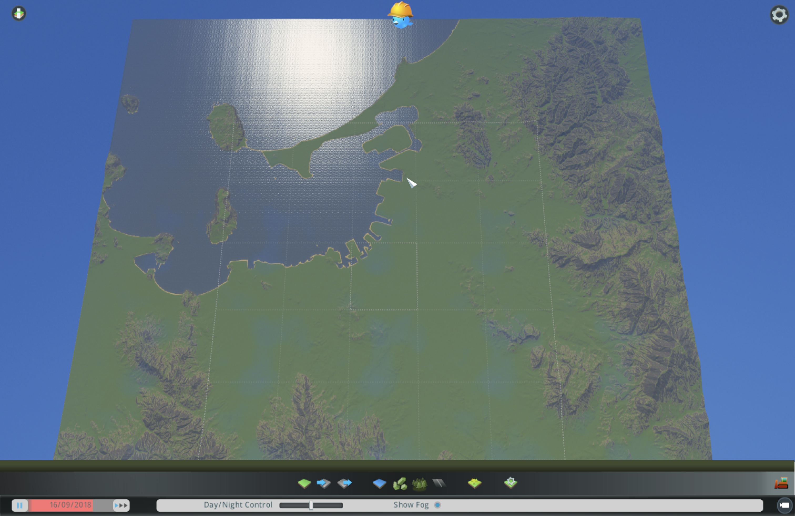
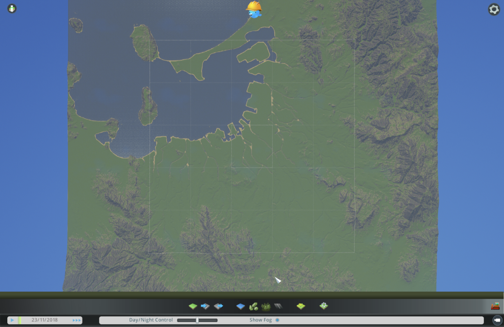
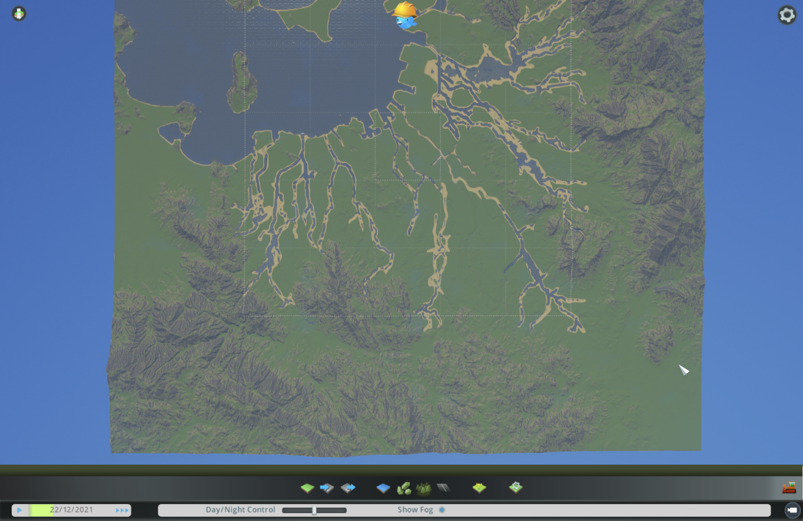

## 試したこと

#42 で作った高さマップを、マップエディターに読み込む。
海面の高さを合わせ、海岸線と博多湾の形を確かめる。
那珂川、御笠川、室見川など、高さマップでは細すぎて消える川を、エディターで掘り直す。
成果物は、福岡の地形を持つマップ(保存データ)と、読み込みで詰まった所の記録。

## 結果

### 高さマップの読み込み

- マップエディターで新しいマップ(テーマ: Temperate)を作り、`fukuoka_h2_v050.png` を読み込んだ
- 読み込みボタンは、一時停止メニューではなく、画面下の地形ツールの中にある
- 読み込み画面は「16-bits map」と表示し、プレビューに福岡の地形が出た
- Importを押しても、画面の中央(天神周辺)は平地なので、変化が見えなかった。引いて地図全体を見て、読み込めていると分かった

- ゲームの画面写真は公開してよいと決めた(2026-10-14)。位置座標を持たず、ゲームの見た目として描かれたものだから
- 公開しないのは、高さマップと陰影図など、標高の数値を取り出せる加工物だけ(#42 の方針のまま)

### 高さの確認

Modに、F9キーで7地点の高さをPlayer.logに書き出す機能を足した(`code/ai-mayor/src/HeightProbe.cs`)。
MacではfnキーとF9を一緒に押す。

ゲーム内の高さ(左)と、高さマップから計算した期待値(右)。海面40mを含む。

- 天神 41.8m / 41.8m
- 油山 336.7m / 336.9m
- 脊振山 564.7m / 563.7m
- 若杉山 377.4m / 375.0m
- 立花山 221.9m / 221.8m
- 能古島 119.6m / 120.3m
- 博多湾 20.0m / 20.0m

- 画素値65535が1024mに対応することを確かめた
- 画像の上がゲームの北(zが正)で、東西も反転していない
- 水面の高さは、どの地点も地面と同じ。読み込んだだけでは海に水は入らない

### 海を入れる

- 水のツール(画面下の青いひし形)の左下に「Sea Level」がある。最初は155.13だった
- 40に合わせ、Enterで確定し、「Reset Water To Sea Level」を押してから時間を進めると、水が入った
- 一時停止のままでは水は満ちない

- 湾の水面は設定の40mより高い42.9mまで上がった。天神の地面は41.8mで、水位より低かった
- 高さを0.5倍にしたため、海沿いの低地が海面すれすれになった。陸地の9%が海面から3m未満だった
- 砂色の部分は、一度水につかった跡

### 陸地を4m持ち上げる

- `make_heightmap.py` で、陸地を海面から4m持ち上げた。海岸から内陸へ4画素(ゲーム上64m)かけて、なだらかに上げる
- 出力は `fukuoka_h2_v050_o4.png`。陸地で海面から3m未満は0.6%(海岸の斜面だけ)になった
- 天神は45.8m、湾の水面は41.0m→38.9mと、40m前後で揺れながら落ち着いた

- 博多港の埠頭、アイランドシティ、海の中道、志賀島、能古島が、福岡の形で見えた
- Modに海沿いの低地8地点を足したが、ゲームが読み込み直したModのF9は反応しなかった(古いModが応答した)。Modの変更は、ゲームを再起動して効かせる
- 再起動後のF9(地面 / 水面込み): 博多駅 46.2m、中洲 45.6m、博多港 42.8m、箱崎 43.5m、百道 42.2m、姪浜 45.8m、アイランドシティ 45.5m、香椎 48.5m。どこも水はない
- 博多湾の水面は38.3m。40m前後で揺れている。一番低い百道でも約4mの余裕がある

### 真北にそろえる

- 標準の操作には、カメラを真北にそろえる方法がない
- Modに、F10で真上から北を上に見下ろす機能を足した(`code/ai-mayor/src/CameraNorth.cs`)。カメラの向き0が北だった
- 斜め45度はF11に割り当てたが、MacではF11が「デスクトップを表示」に取られてゲームに届かない
- F7に変えると45度にはなったが、F7はゲームの「デバッグ出力」の表示と重なっていた
- Shift+F10に変えた。まだ試していない(Modの変更は次の起動から効く)
- F10の真上の視点は、引きを足して地図全体が収まるようにした

### 川を掘り込む

- OpenStreetMapの川の線はOverpass(取得用のサーバー)が混んでいて取れなかった。3か所とも504
- 国土地理院ベクトルタイルの河川中心線(ズーム16のGeoJSON)を使った。低いズームは配っていない
- 範囲全体だと約5000枚になるため、中央25タイル(実寸19.2km四方)に絞った。1681枚、約1分(`code/ai-mayor/tools/fetch_rivers.py`)
- 線は14489本。うち「河川中心線(通常部)」約1900本だけを掘った。細河川(約12000本)まで掘ると平野が溝だらけになる
- `make_heightmap.py` で、川筋を幅2画素、周りより5m低く掘った。両岸1画素は半分の深さ
- 5m掘るだけでは、海面より下になったのは212画素だけだった。陸を4m持ち上げたため
- 元の標高8m未満の低地では、川底を海面下2mにした(潮の入る川)。4560画素が海面下になった
- 出力は `fukuoka_h2_v050_o4_r.png`

- 川筋は谷の形になったが、水は入っていない。上流は水源がないので乾くのは予想どおり
- 海面下に掘った下流も、砂色の筋(一度水につかった跡)になって乾いていた
- 原因の候補: 川幅2画素(ゲーム上32m)が水の計算に対して細すぎる、海とのつながりが途中で切れている
- 海沿いの低地は今回も水につかっていない(F9)。湾の水面は40.0m

### 水源を置く、そして川を諦める

- 川幅を3画素、下流の川底を海面下4mにして作り直した。海面下の川筋6977画素のうち5653画素(81%)が海とつながった
- 那珂川、室見川、御笠川の上流に水源を置く場所を計算し、真上の写真に印を付けた(`assets/water-sources-plan.png`)
- 水のツールの水源(青い円筒)を置くと、川からあふれた
- 水量は、水源を選んだときの左下「Water Capacity」で変える。最小は0.01
- Macのトラックパッドでは、2本指クリックが右クリックになる

- 幅50mほどの溝に、全体を見渡す倍率で水源を置くのは難しかった
- 川は諦めた(2026-10-14)。乾いた溝が残ると、AI市長が道路や区画を置く邪魔になるため、川を掘る前の地形(`fukuoka_h2_v050_o4.png`)に戻す
- 川を掘る処理はスクリプトに残し、既定では使わない(`RIVERS=1` で有効)
- 水源をModで決めた座標と水量で置く方法なら、再挑戦できるかもしれない

## 学び

- 読み込みの成否は、画面より数値で確かめるほうが早かった。F9で7地点を書き出すだけで、高さの対応と向きが確定した
- 高さを縮めると、山だけでなく海沿いの低地も縮む。海面すれすれの土地は、水を入れると沈む
- 砂色の跡は、地形を直しても少しの間残る。見た目だけで判断せず、時間を進めて確かめる
- 川は、溝を掘るだけでは流れない。水源の位置と水量まで決めて、初めて川になる。平らな平野では、その調整が特に難しい
