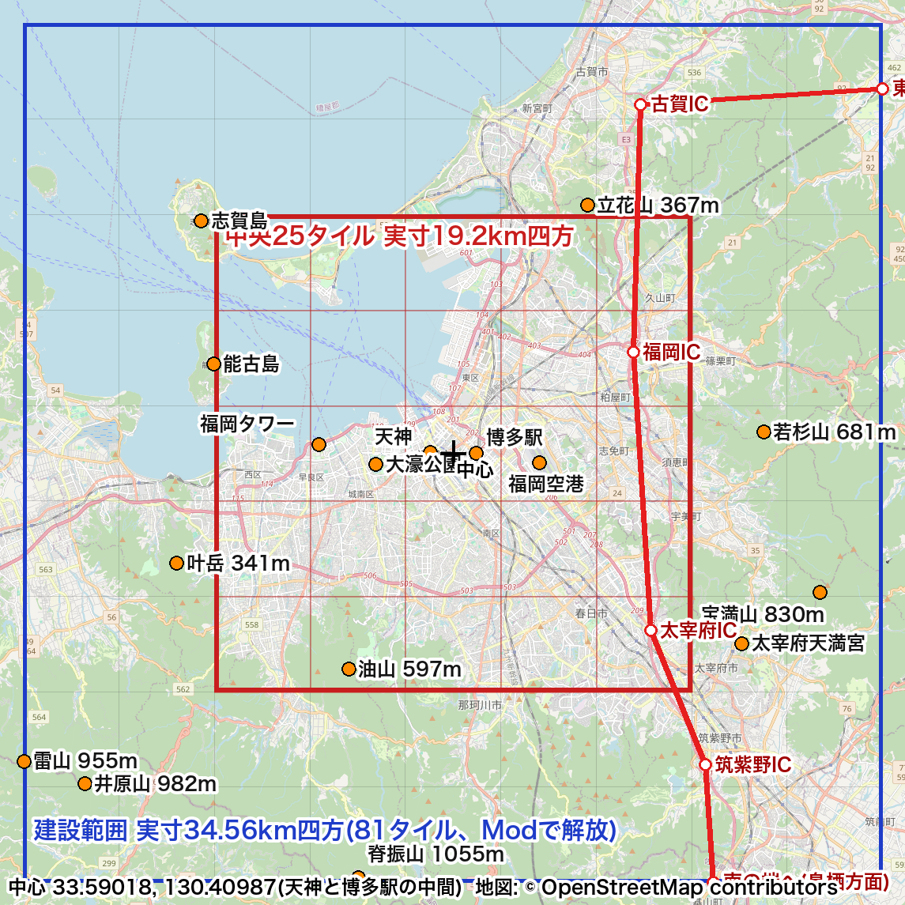
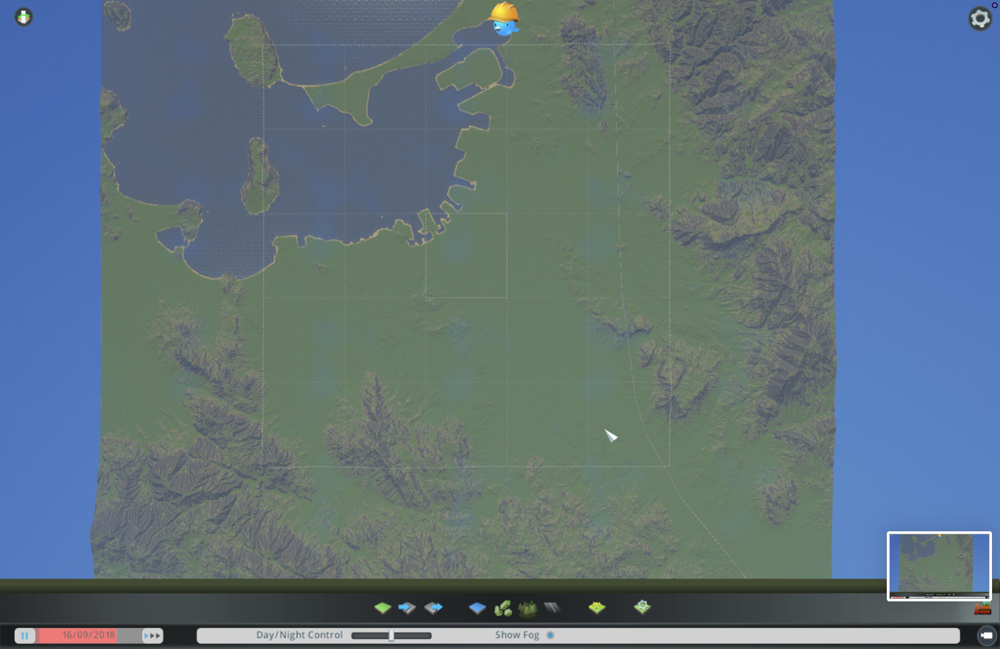
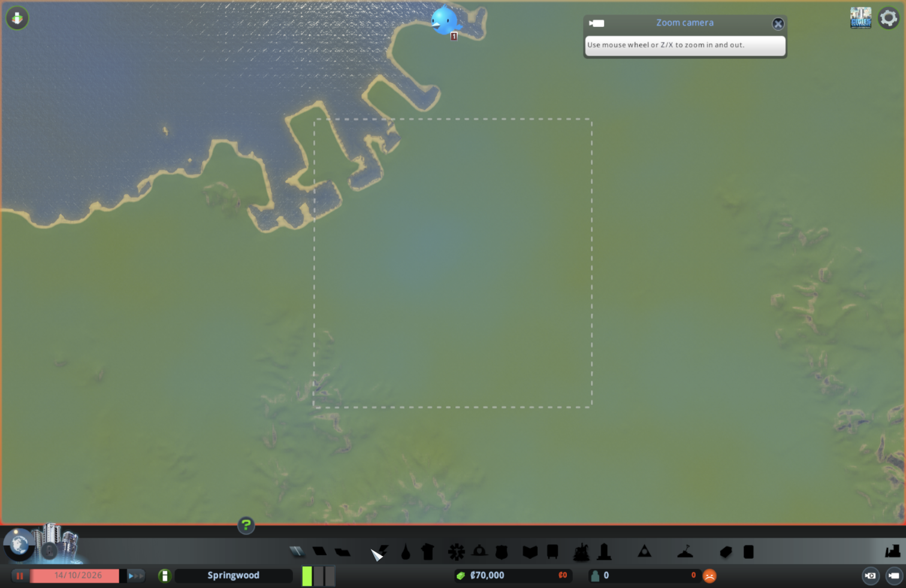
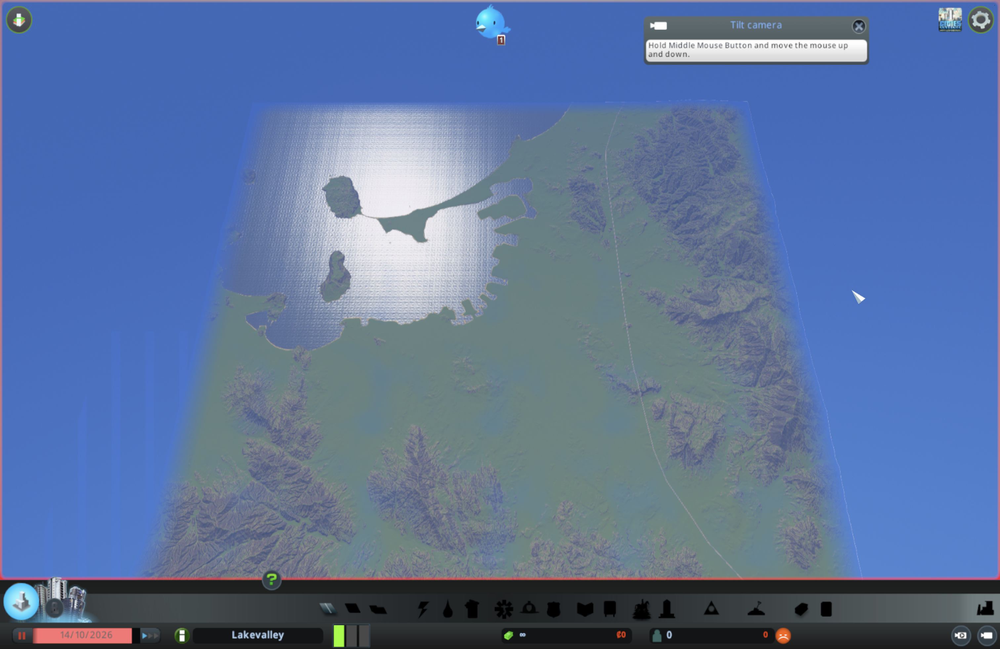

記事は #70(ModとMCP)に含める。`url` には #70 の記事の URL を入れる。

## 試したこと

初代 Cities: Skylines で、地図全体の81タイル(ゲーム上17.28km四方、実寸34.56km四方)を全部建てられるようにする。
Mod「81 Tiles 2」(1.0.5)と、前提のMod「Harmony」を入れ、Macで動くかを確かめる。
福岡の高さマップを読み込んだマップで、外周のタイルに道路や区画を置けるかを試す。
成果物は、解放の手順と、使ったModの版、Macで詰まった所の記録。

## 結果

### Modを入れる

- Steamワークショップで「Harmony 2.2.2-0」(ID 2040656402)と「81 tiles 2 1.0.5」(ID 2862121823)をサブスクライブした
- 1回目の起動では、Harmonyが読み込まれなかった。サブスクライブ直後に起動したため、Steam側の登録が間に合わなかったとみられる
  - 81 Tiles 2 だけが起動中に後から読み込まれ、`CitiesHarmony.Harmony` が見つからないというエラーで止まった
- 再起動すると、2つとも例外なく読み込まれた
- 再起動では、ゲームの前にParadox Launcher(販売元の起動画面)が開き、「プレイ」を押す必要があった
- 「別の版向けのModがある」という警告が出た。81 Tiles 2 の対応版が1.21.1-f5のため。手元は1.21.1-f9。動作に問題はなかった
- サブスクライブしただけではModはOffのまま。コンテンツマネージャーでHarmony、81 tiles 2 の順にOnにした

### 81 Tiles 2 の設定

- Ignore area unlocking progression(解放の順番を無視する): On。最初から81区画のどれでも買える
- Permit building outside of owned tiles(買っていない区画にも建てられる): Off。区画の買い足しをAI市長の判断として残すため
- 電気・水道を線や管なしで届ける設定は、ゲーム本来の遊び方から離れるのでOff
- 設定は `~/Library/Application Support/Colossal Order/Cities_Skylines/EightyOneTiles.xml` に保存される

### エディターとの行き来

- 81 Tiles 2 がOnの間は、エディターのボタンが押せない。エディターを使うときはOffにして再起動する
- エディターで保存した `fukuoka` マップが、NEW GAMEの一覧に出なかった
  - 保存のときに「Publish Map in New Game Panel」の印を付けないと、一覧に出ない
  - 印を付けるための必須条件: 始まりの区画に水の流れ、地図の外から入る高速道路、地図の外へ出る高速道路
  - 高速道路がなかったので、#69 の骨格のうち九州自動車道だけを先に引いた(上り・下りの一方通行2本)

- 印を付けて保存すると、NEW GAMEで福岡のマップを選べた

### 81区画を買う

- 最初の所持金70,000は、区画をいくつか買うとなくなった(1区画 約29,200)
- 確認のため、ゲーム標準のMod「Unlimited Money」をOnにして新しく始め直し、81区画すべてを購入できた
- 確認後、Unlimited MoneyはOffに戻した。AI市長に任せるときは、お金のやりくりも判断のうち

### 斜め45度のカメラ

- Shift+F10 で、北を向いた斜め45度の視点になった(#64 で作ったキー)

## 学び

- Modは、サブスクライブしてから起動するまでに間を空ける。直後の起動では、依存するModが読み込まれないことがある
- 81区画のModとエディターは同時に使えない。地形や骨格を直すたびに、Modを切って再起動する手間がかかる
- NEW GAMEにマップを出すには、高速道路の出入りが必須だった。骨格の作業は、マップを遊べる状態にするための条件でもあった
