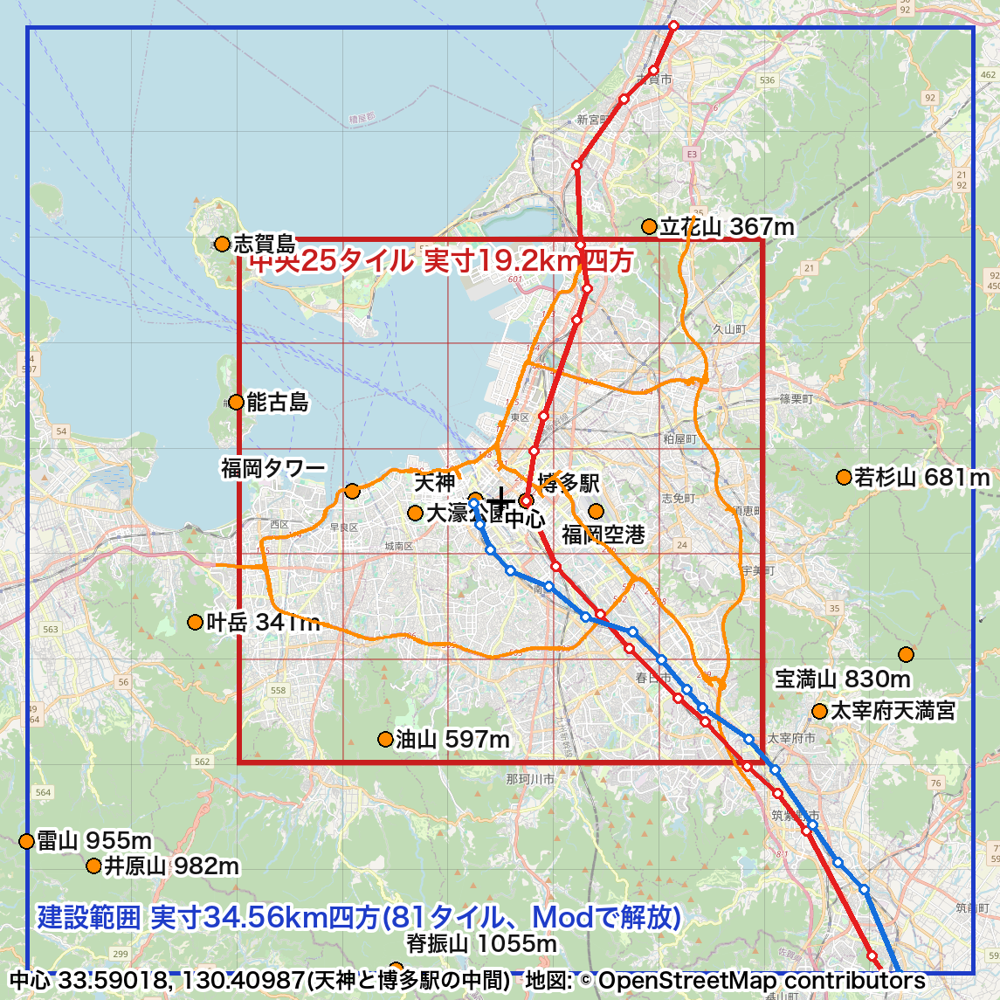

保留(2026-10-14)。手で骨格を置く代わりに、#70 で作るModとMCPで置く。記事にはしない。

## 試したこと

福岡のマップに、人が作る骨格を置く。AI市長には任せない部分。
- 高速道路: 福岡都市高速の主な路線と、九州自動車道との出入口(九州自動車道の本線は #65 で引いた)
- 鉄道: JR鹿児島本線を中心に、地図の外とつなぐ線路
- 空港: 福岡空港の位置に空港を置く
- 港: 博多港の位置に港を置く
位置は #41 の範囲図と、OpenStreetMapの地図を下敷きにして合わせる。
成果物は、骨格を置いたマップ(保存データ)と、真上からの画面写真(F10)。

着手前に調べること:
- マップエディターで置けるもの(道路、線路、地図の外とのつなぎ口)と、ゲームを始めてから置くもの(空港、港の建物)の区別
- 地下鉄や西鉄など、どこまでを骨格に含めるか

## 結果

### 着手前の調べ(保留までに分かったこと)

- 鉄道は、JR鹿児島本線と西鉄天神大牟田線の2本を骨格にする。地下鉄や西鉄貝塚線は、AI市長が街の中の交通として決める
- エディターで置けるのは、道路・線路・航路など。空港、港、駅の建物はゲーム本編で置く(未確認)
- OpenStreetMapのOverpassは引き続き応答がなかった
- 高速道路は、国土地理院ベクトルタイルの道路中心線から「高速自動車国道等」だけを取った(`code/ai-mayor/tools/fetch_expressways.py`)。中央25タイルで1337本
- 鉄道は駅の位置をNominatimで引いて、順につないだ。古賀駅と原田駅は別の場所に当たったので、前後の駅から推定した

## 学び

- 骨格を手で置くのは時間がかかる。座標がそろっているなら、Modで置くほうが正確で、作り直しもきく
