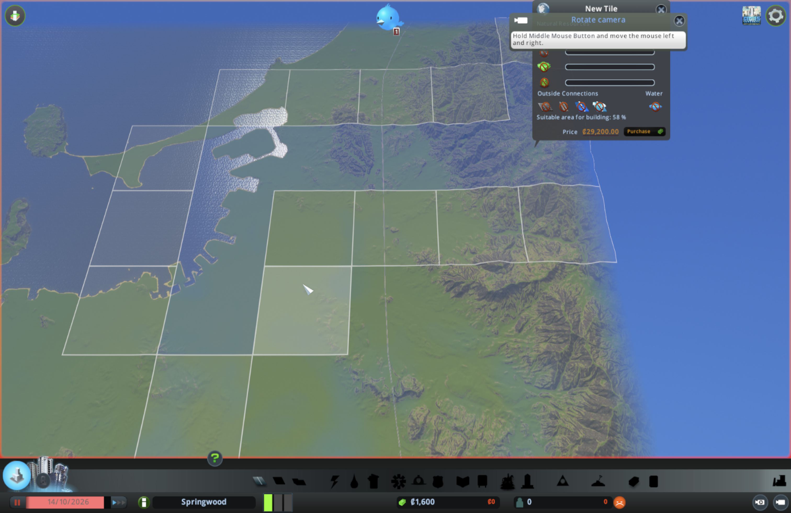
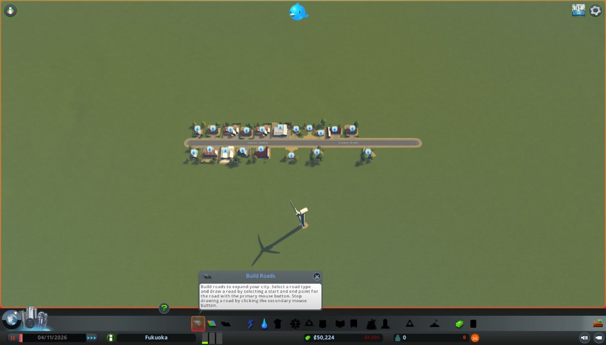
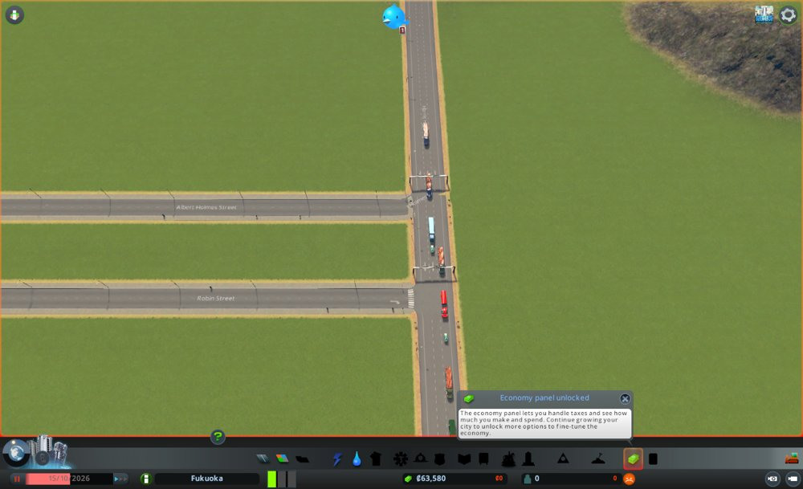

# AIがModとMCPを使ってCities: Skylinesを操作できるようにした

## AIは、まだゲームを触れない

やってみ太郎です。連載「AIは最高の市長になれるか」の3回目です。

前回までに、Cities: Skylines(シティーズ・スカイライン)の中に、福岡の地形を作りました。
博多湾があって、山に囲まれた平野がある。ここまでは、私が手で作ってきました。

でも、このままではAIに市長は任せられません。
AIは、ゲームの画面を見ることも、道路を引くことも、税率を変えることもできないからです。
このゲームには、外から命令を受け付ける公式の仕組みがありません。

そこで今回は、Claude(AI)がこのゲームを見て、操作できるようにする道具を作りました。
自作のMod(ゲームの改造部品)と、それをAIから使えるようにするMCP(AIに道具を使わせる共通規格)の組み合わせです。
最後には、AIの道具で、福岡に鉄道を2本敷きました。

## その前に、地図を全部使えるようにする

このゲームでは、街の土地を「区画」という単位で買い足していきます。
最初は1区画だけ。買い足せるのは、地図の中央の25区画までです。
でも福岡の地図は、まわりの山まで含めて81区画あります。全部を使いたい。

そこで、「81 Tiles 2」という、全区画を使えるようにするModを入れました。
入れてすぐに、いくつかつまずきました。

サブスクライブ(Steamでの登録)した直後にゲームを起動したら、前提になるModだけ読み込まれず、エラーで止まりました。
もう一度起動し直したら、動きました。

次に、このModを有効にしている間は、地図を作る画面(マップエディター)に入れないと分かりました。
地図を直すたびに、Modを切って、ゲームを再起動することになります。

さらに、作った福岡の地図が、新しい街を始める一覧に出てきません。
調べると、地図を「公開」の扱いで保存する必要があって、その条件が「地図の外から入ってくる高速道路と、出ていく高速道路があること」でした。
福岡の地図には、まだ高速道路がありません。
九州自動車道を先に引いて、ようやく福岡で街を始められました。



区画は、お金を払えば81区画すべて買えました。
ただ、ここで1つ考えが変わりました。
実際の市長は、「市の土地を買い足す」という判断をしません。市の範囲は最初から決まっています。
だから、AI市長にも、最初から全区画を持たせることにしました。

## ゲームの中に、小さな窓口を開く

さて、本題です。
AIとゲームをつなぐ方法として、Modの中に小さな「窓口」を開くことにしました。
自分のパソコンの中からだけ届く、HTTP(ウェブページを見るときと同じ通信の決まり)の窓口です。
AI側の道具がこの窓口に「今の街の数字をください」と頼むと、Modがゲームの中から数字を取り出して返します。

最初は、生きているかを確かめるだけの窓口を作りました。
ゲームを起動して呼んでみると、こう返ってきました。

```
{"ok":true,"mod":"AIMayor"}
```

Macのゲームに、外から話しかけられた瞬間です。

次に、街の数字を返す窓口を作りました。人口、所持金、需要(住宅や商業がどれだけ求められているか)などです。
これを、AIが使える道具の形に包んだのがMCPサーバーです。Pythonで書きました。
道具1つは、こんな短いコードです。

```python
@mcp.tool()
def city_info() -> dict:
    """街の基本の数字を返す。"""
    return call("/info")
```

これをClaude Code(私が使っているAIの開発ツール)につなぐと、私と話しているClaudeが、その場でゲームの数字を読めるようになりました。

画面写真を撮る道具も作りました。
Claudeが撮った最初の1枚が、これです。


それまでは、私が画面を撮ってClaudeに送っていました。
これからは、Claudeが自分で見られます。

## カメラが、言うことを聞かない

道具を作っていて、不思議なことがありました。
カメラを「斜め45度から見下ろして」と指示しても、真上に近い角度から動かないんです。

指示した値と、実際のカメラの値を並べて返すようにして、原因が分かりました。
45度を指示しても、実際は72度で止まっていました。
このゲームは、引けば引くほど、見下ろす角度を自動で真上に近づけていたんです。
いちばん引くと73度、半分くらいまで寄ると65度。それより浅い角度にはなりません。

壊れていたのではなく、ゲームがそういう作りでした。
指示したことと、実際に起きたことを並べて見るのは大事だと思いました。

## 線を引く

いよいよ、AIの道具で街に何かを作ります。
最初に作ったのは、座標の並びを渡すと、そのとおりに道路や線路を引く道具です。

試しに、短い線路を1本引いてみました。


枕木もレールも付いた、本物の線路です。
ゲームの中では、普通に手で引いた線路と区別がつきません。

ここで、お金の扱いを決めました。
AIが道具で建てたものも、ゲームで手で建てるのと同じように、建設費を市の予算から払います。
お金が足りなければ、建てずに断ります。
ただし、人が用意する骨組み(鉄道や高速道路)だけは、街の初期状態として、お金をかけずに置くことにしました。

## 福岡に、鉄道を2本敷く

福岡の骨組みとして、JR鹿児島本線と西鉄天神大牟田線を敷くことにしました。
駅の位置を地図データから調べて、ゲームの座標に直し、駅を順につないで線路にします。

線路が伸びていく様子を残したくて、道具に「コマ撮り」の機能を付けました。
線路を10区間ほどに分けて少しずつ引き、引くたびにカメラを線路の先端へ動かして写真を撮ります。
それをつなぐと、線路が伸びていくアニメーションになります。

最初のJRの撮影は失敗しました。
できたアニメーションの大半が、地図の外の真っ青な空間を写していたんです。
カメラを線路の先へ向けても、いつの間にか南西の端へ流れていきます。

原因は、私のマウスでした。
撮影中に画面を触らないよう、マウスを画面の左下の端に置いていたんです。
このゲームは、マウスが画面の端にあると、その方向へカメラを動かし続けます。
触らないつもりの置き場所が、カメラを押し流していました。
設定で、画面の端でのスクロールを切って、解決しました。

もう1つ、撮り直しの途中で、画面が真っ暗になりました。
ゲームの中が夜になったんです。昼と夜が入れ替わる設定も切りました。

そうして撮れたのが、この2本です。


天神と博多の上から見ると、2本の線路が並んでいます。右が博多駅で折れ曲がるJR、左が天神から南へ延びる西鉄です。


太宰府のあたりでは、2本が並んで走り、九州自動車道と交わります。


## 市長の道具をそろえる

線路を引けたところで、まとめて市長の道具をそろえることにしました。
Modを直すたびにゲームの再起動が要り、それがかなりの手間だったからです。

税率と予算を変える道具、政策をかける道具、区画を住宅地や商業地に指定する道具、建物を置く道具、取り壊す道具、時間を進める道具。この時点で24になりました。
ゲームの中の仕組みの名前を推測で書くと、動かずに再起動のやり直しになります。
そこで、ゲーム本体のプログラムの中身から、使える仕組みの名前を一覧にして確かめてから書きました。

途中で、私から1つ提案しました。
「住民の属性を取ったり、意見を聞いたりする道具はいらないのか」と。
実際の市長は、数字だけでなく、市民の声を聞いて判断するはずです。
そこで、市民の内訳、無作為に選んだ市民の姿、建物ごとの困りごとをまとめた苦情の地図を返す道具を足しました。道具は全部で27になりました。

試しに、博多駅の東に小さな町を作ってみました。
道路を引いて住宅地に指定し、風車を1本置き、リサイクルの政策をかけて、時間を20日進めます。



家が建ちました。
そして、市民のつぶやき(ゲームの中のSNS)には、こんな声が届いていました。

「ついにリサイクルが始まった! 電池は金属と一緒でいいの?」
「地元の発電所が動き出した! これでテレビが映るかも」

AIの道具でかけた政策が、市民に届いている。それが市民の声で確かめられました。

ところが、40日たっても住民は0人のままでした。
家は建つのに、誰も引っ越して来ないんです。
新しい住民は、地図の外から高速道路を通ってやって来ます。
試しの町の道路は、九州自動車道とつながっていませんでした。

道路を既存の道路の途中につなげる機能を足して、九州自動車道に道路を突き当てました。



30日後、人口は207人になりました。
市民の声の道具で1人を選ぶと、こう返ってきました。
「一戸建てに住む大人。失業中。体調はやや悪く、幸福度は低い。家に電気も水も来ていない」

まだ仕事も電気も水もない町です。幸福度が低いのは当然でした。
でも、この1人の姿は、AI市長が最初に向き合う市民の姿でもあります。

## 今日の学び

- ゲームに外から命令する公式の仕組みがなくても、Modの中に小さな窓口を開けば、AIとつなげられた。
- 指示した値と実際の値を並べて見ると、ゲームが勝手に補正しているところが見つかった。カメラの角度がそうだった。
- カメラが勝手に動く原因は、ゲームの外にあった。触らないつもりで置いたマウスだった。
- 実際の市長に合わせて、区画は最初から全部持たせ、建てるものには予算から払わせることにした。ゲームの決まりより、市長の現実に寄せた。
- 道具を作ったら、数字より先に市民の声が返ってきた。政策が届いたことも、困っていることも、つぶやきと市民の姿で分かった。

## 次にやること

道具はそろいました。
次は、骨組みの残り(都市高速、空港、港)を、同じ道具で置きます。
そしてその後、いよいよAIに市長を任せます。
まずは数字を渡さず、ゲームの画面だけを見せて、どんな街を作るのかを見るつもりです。

ModとMCPサーバーのコードは、リポジトリに置いています。
https://github.com/h-takeshita-henteco-shoji-com/tried/tree/main/code/ai-mayor
