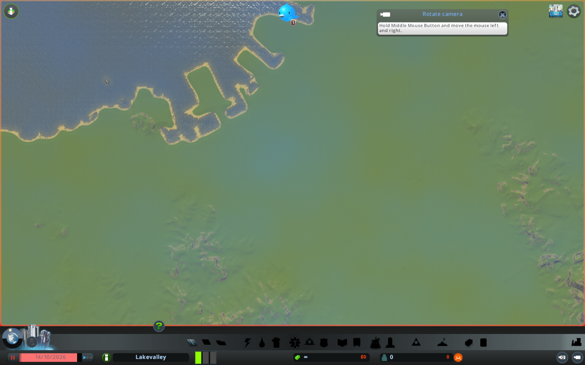
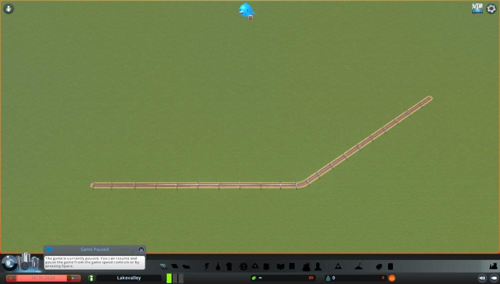
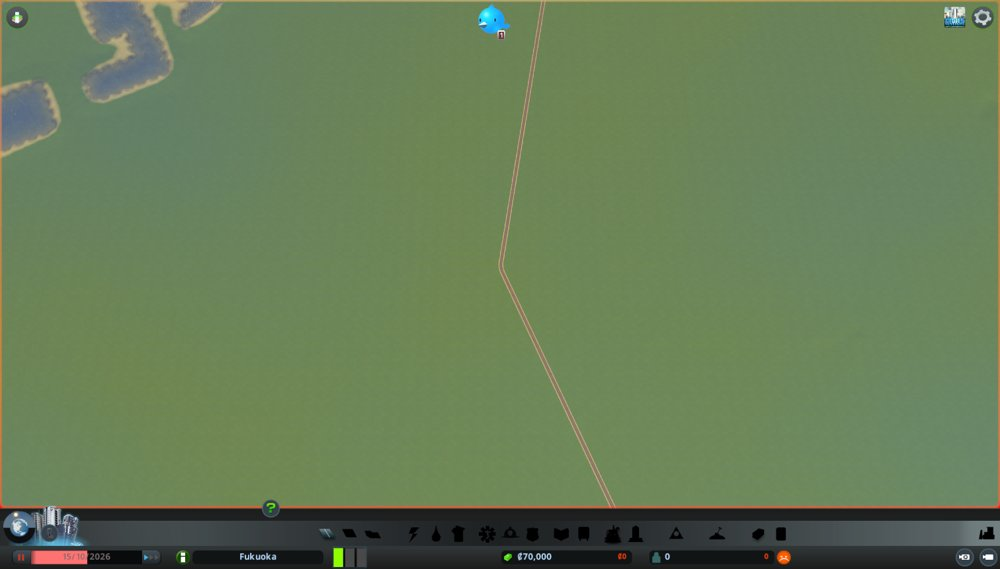
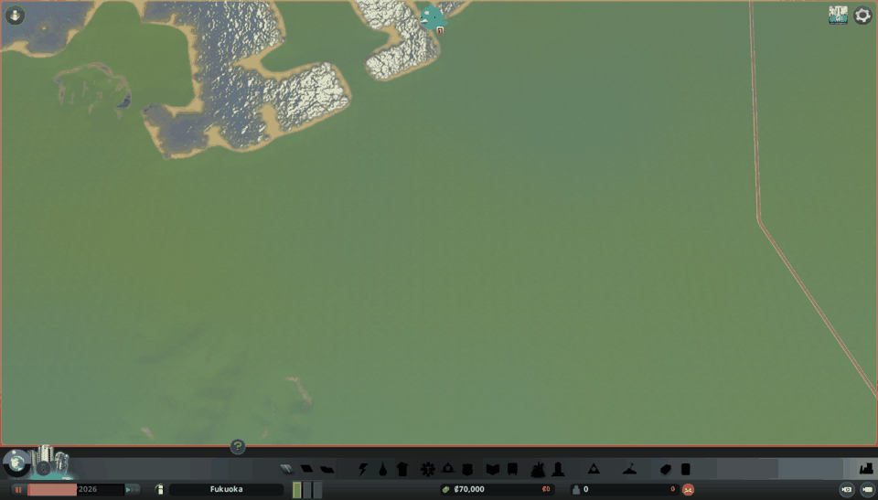
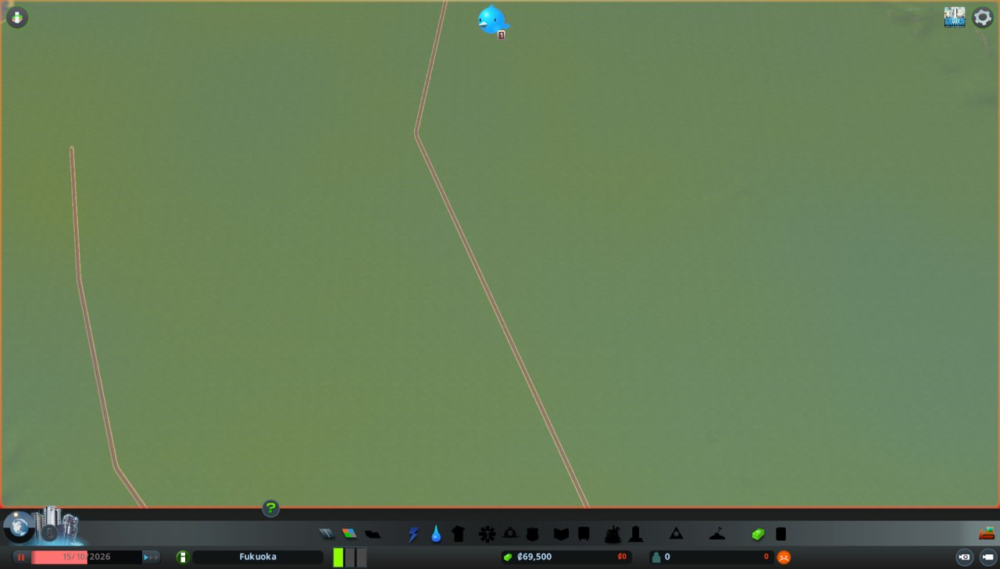
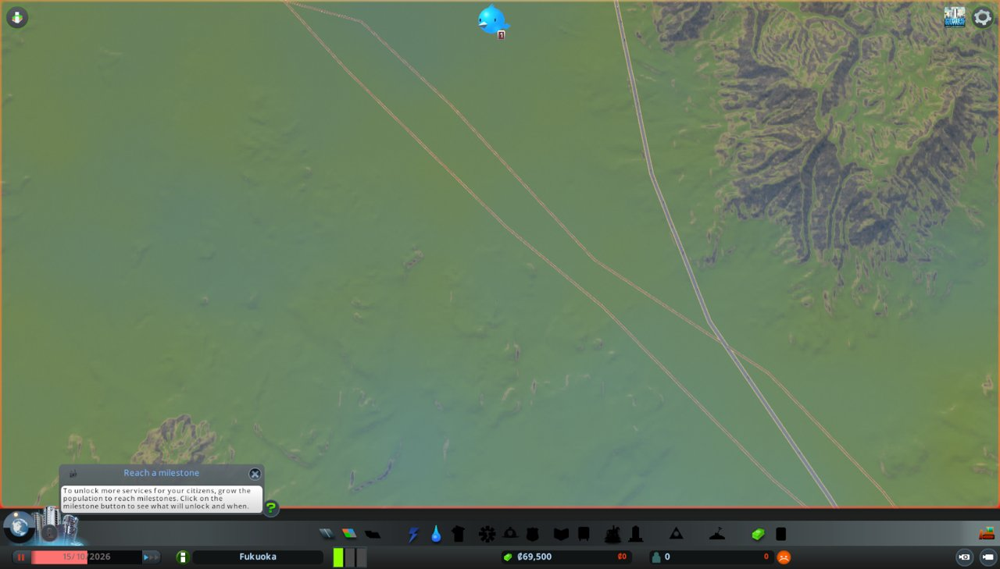
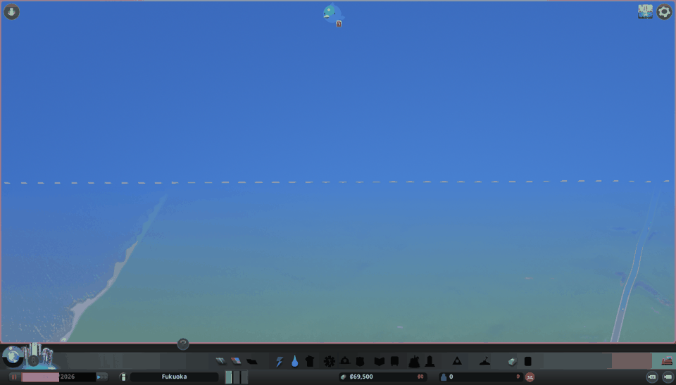

## 試したこと

自作のModと、それを包むMCPサーバーを作り、Claudeが Cities: Skylines の街を見て、市長として操作できるようにする。
計画の「10〜12. ModとMCPでClaudeと街をつなぐ」を1件にまとめたもの。

決めたこと(2026-10-14):
- つなぎ方: Modが自分のパソコン(127.0.0.1)からだけ受け付けるHTTPの窓口を開く。MCPサーバーはPythonで書き、その窓口を呼ぶ
- 範囲: 見る機能と、市長の操作すべて
  - 見る: 画面写真、街の数字(人口、予算、需要など)、地点の高さ
  - 操作: 道路・線路を引く、区画を指定する、建物を置く、税と予算、政策、時間の進め方
- できた仕組みで、保留中の #69 の骨格(都市高速、JR鹿児島本線、西鉄天神大牟田線、空港、港)を置く

段階に分けて進める。
1. Modの中にHTTPの窓口を開き、外から呼べることを確かめる(Macで動くか)
2. 見る機能(画面写真、街の数字、高さ)と、それを呼ぶMCPサーバー。Claude Codeにつなぐ
3. 道路・線路を引く操作。#69 の骨格をこれで置く
4. 区画、建物、税と予算、政策、時間の操作

成果物は、ModとMCPサーバーのコード(`code/ai-mayor/`)、動いた様子の記録、ゲーム内部のどこを使ったかのメモ。

## 結果

### 段階1: Modの中にHTTPの窓口を開く

- Modに `HttpBridge.cs` を足した。`System.Net.HttpListener` で `http://127.0.0.1:8781/` を受け付ける
  - 受付は別スレッドで行う。ゲームの中身に触る処理はメインスレッドの待ち行列に入れ、結果を待って返す(最大5秒)
  - 待ち行列は `ThreadingExtensionBase.OnUpdate` で毎フレーム処理する
  - .NET 3.5 には標準のJSONライブラリがないので、文字列の組み立ては手で書いた
- Modを有効にしたとき(`OnEnabled`)に窓口を開き、無効にしたとき(`OnDisabled`)に閉じる
- ゲームが起動中にModを作り直すと、ゲームは自動で読み込み直すが、`OnEnabled` は呼ばれず窓口は開かなかった。再起動が必要
- 再起動すると、Macで外から呼べた
  - `curl http://127.0.0.1:8781/ping` → `{"ok":true,"mod":"AIMayor"}`
  - 存在しないパス → `{"ok":false,"error":"not found: /nope"}`
  - `/info` はメインメニューでは「main thread timeout」。待ち行列を処理する仕組みは、街かエディターを開いてから動くため
- 起動中の記録(Player.log)が約150MBに膨らんでいた。被写界深度(Depth of Field)がMacの描画方式で使えず、毎フレーム警告が出ていた
- 街を開くと `/info` が返った。1回あたり約7〜16ミリ秒
  - `{"ok":true,"mode":"LoadGame","city":"Lakevalley","date":"2026-10-14","paused":true,"speed":1,"population":0,"money":92233720368547758,"ownedTiles":72}`
  - Unlimited Moneyで作った試しの街なので、所持金は上限の値になっている
  - 81区画すべて買ったはずだが、持っている区画の数は72だった(理由は未確認)

### 段階2: 見る機能とMCPサーバー

- Modに見る窓口を足した(`ViewApi.cs`)
  - `/screenshot?view=top|oblique|current`: 画面写真を撮り、保存した場所を返す。`Application.CaptureScreenshot` はフレームの終わりに書き出すので、ファイルができるまで待つ
  - `/camera`: カメラの場所、引き、角度を変える
  - `/height`: 地点の地面と水面の高さ
  - `/info` に需要、幸福度、週の収支を足した
- MCPサーバーをPythonで作った(`code/ai-mayor/mcp/server.py`、uvのプロジェクト)
  - 道具は `city_info`、`screenshot`(画像を返す)、`move_camera`、`height_at`
  - `mcp` ライブラリは2.3.0だった。2.xでは `FastMCP` が `MCPServer` に改名されていて、ネットの例どおりには動かなかった
  - リポジトリの `.mcp.json` に `cities-skylines` として登録した
- 試験の呼び出しで、`city_info` がゲームの数字を返した(古いModのまま)

### 段階2: Claude Codeから呼ぶ

- Claude Codeを再起動してMCPサーバーを読み込み、ゲームを起動して試しの街(Lakevalley)を開いた
- `city_info` で、需要(住宅100、商業0、工業0)、幸福度、収支まで返った
- `screenshot` で、Claude Codeがゲームの画面写真を直接見られた。写真は `~/Library/Application Support/Colossal Order/Cities_Skylines/AIMayor/screenshots/` に保存される

- `height_at` で油山の位置を読むと340.7m。#64 の値と一致
- 分かった制約と問題
  - ゲーム本編ではカメラの引きの上限が4000(4800を指定しても4000になる)。真上からだと地図の中央部分しか入らない
  - `move_camera` で引きを変えると画面に反映されたが、見下ろす角度(pitch)を45度にしても画面は真上のままだった。キーボードのShift+F10(同じ処理)では斜めになっていた。原因は未確認
  - ゲームのウィンドウを前面に出しても変わらなかった
  - 次回、カメラの今の値(`m_currentAngle` など)も返すようにして原因を探す

### カメラの角度の謎(2026-10-15)

- `/camera` の応答に、カメラの今の値(`m_currentAngle` など)を足して読んだ
- 見下ろす角度45度を指示しても、実際は72.7度で止まっていた
- ゲームは、引きの大きさに応じて見下ろす角度の下限を変えていた。引くほど真上に近づく
  - 引き4000(上限): 72.7度、3000: 69.5度、2000: 65度、1500: 61.9度、1000: 57.9度、600: 53.7度
- Shift+F10で「斜め」に見えていたのも、実際は72度前後だった
- コマ撮りは、引き2000〜3000(65〜70度)で撮る

### 段階3: 線を引く

- Modに `/net/prefabs`(引ける種類の一覧)と `/net/build`(座標の並びに沿って線を引く)を足した(`NetApi.cs`)
  - 道路や線路を作る処理は、ゲームの計算スレッド(`SimulationManager.AddAction`)で行う
  - `NetManager.CreateNode` で点を、`CreateSegment` で点と点の間の区間を作る
  - 区間が80mを超えるときは、間に点を足す
  - 端点の12m以内に同じ種類の点があれば、そこにつなぐ
- 引ける種類は227。線路は「Train Track」、高速道路は「Highway」
- 試しの街で、`curl -X POST --data "200,0;600,0;900,200" ".../net/build?prefab=Train%20Track"` を呼ぶと、線路ができた(点11、区間10)

- 曲がり角は、直線をつないだ折れ線になる
- MCPサーバーに `build_line`(区間ごとに引いて画面写真を撮り、GIFにまとめる)、`list_net_types`、`latlon_to_game` を足した

### お金と区画の決まり(2026-10-15 決定)

- Mod経由で建てたものも、ゲームの道具と同じく建設費を予算から差し引く
  - 区間ごとに `NetAI.GetConstructionCost` で建設費を計算し、合計を先に出す
  - `EconomyManager.PeekResource` で足りるか確かめ、足りるときだけ `FetchResource` で差し引いて建てる。途中で止まって中途半端にならないように
  - 人が置く骨格(#69)だけは、費用なし(`pay=false`)で置ける
- 区画は、街を始めた時点で全81区画を持っている状態にする。実際の市長には区画を買い足すという判断がないため
  - Modに `/areas/unlock_all` を足した。`GameAreaManager.UnlockArea` を、まだ持っていない区画すべてに呼ぶ
  - 区画はすべて持っている前提なので、区画を確かめる処理は作らない
  - 試しの街(72区画)で呼ぶと、81区画になった(9×9の格子)
- Unlimited Moneyは、街を始めたときの設定が保存データに残る。後からOffにしても、その街のお金は無限のまま
  - 試しの街では所持金が内部の上限値になっていて、建設費の「足りるか」の判定が働かなかった
  - 出発点の街は、Unlimited MoneyをOffにして始め直し、区画は `unlock_all_areas` で無料で解放する

### 福岡の街に鉄道を敷く(2026-10-15)

- Unlimited MoneyをOffにして、福岡のマップで新しい街「Fukuoka」を始めた(所持金70,000、区画1)
- `unlock_all_areas` を1回呼ぶと、1区画→35区画で止まった。ゲームは持っている区画の隣しか解放できない
  - 9回呼んで81区画になった。所持金は減らなかった
  - MCPの道具とModの両方を、増えなくなるまで繰り返すように直した
- 駅の位置(#69 で引いたもの)をゲームの座標に直し、`build_line` で費用なし(`pay=false`)で引いた
- JR鹿児島本線: 地図の北の端から南の端まで、10区間・点約260。区間どうしは端点でつながった。建設費は計算上約155,000(最初の所持金では払えない)
  - コマ撮りのGIFは、ほとんどのコマが地図の外の青い空間を写していた
  - 原因は、ゲームの「画面の端でのスクロール」。マウスが画面の左下にあり、カメラが南西へ流れ続けていた。OPTIONS → GAMEPLAY で Edge scrolling をOffにして直った
- `build_line` に `follow`(区間ごとにカメラを先端へ動かして撮る)を足した。引き4000でも約6〜7km四方しか写らず、17kmの線路は1枚に入らないため
- 西鉄天神大牟田線: 天神から南の端まで、10区間。線路の先端を追いかけるGIFが撮れた

- 後半のコマに、ゲームの案内の窓(Build Roads)が写り込んだ。撮り直すときは案内をOffにする
- 建設費の確認: 普通の街で、400mの道路を `pay=true` で引くと、建設費2,000が差し引かれ、所持金が70,000→68,000になった
- 確認用の道路は、ゲームのブルドーザー(Bキー)で消してもらった。建設費の一部(1,500)が戻り、所持金は69,500になった
- 鉄道を敷いた状態を、出発点の街として保存してもらった

- Modから直接作った線は、ほかの線と交わっても、つなぎ目も立体交差も作られず、重なって置かれるだけとみられる(未確認)

### 削除の窓口

- AI市長も取り壊しの判断をするので、MCPに削除の道具が要る。JRのGIFを撮り直すためにも、線路を消す必要がある
- Modに2つの窓口を足した
  - `/net/remove`: 座標の並び(線)に沿った区間を消す。区間の両端が線から指定の距離以内のもの。種類で絞れる
  - `/bulldoze`: 円の中の道路・線路と建物を消す(`NetManager.ReleaseSegment`、`BuildingManager.ReleaseBuilding`)
  - 取り壊しの払い戻しは入れていない
- MCPに `remove_line` と `bulldoze` を足した

### 段階4を先に作る(2026-10-15)

- ゲームの再起動を何度も挟まないよう、市長の操作の窓口を一度に設計して作った
- 設計は `code/ai-mayor/docs/mcp-interface.md` に書いた。見る・調べる・作る/消す・市政・時間の5つに分けた
- 推測でゲーム内部の名前を書かないよう、ゲーム本体のDLL(`Assembly-CSharp.dll`)の型と関数の一覧を、小さなプログラム(`System.Reflection.Metadata`)で書き出して確かめた
  - 税と予算は `EconomyManager.GetTaxRate/SetTaxRate/GetBudget/SetBudget`、政策は `DistrictManager.SetCityPolicy/UnsetCityPolicy`
  - 区画マスは `ZoneManager.m_blocks` の `ZoneBlock.SetZone`。マスの位置はゲームと同じ計算で出す
  - 建物は `BuildingManager.CreateBuilding`、建設費は `BuildingInfo.GetConstructionCost`
  - サービスの状況は、街全体の集計(`District`)の容量と使用量
  - 出来事は `MessageManager.GetRecentMessages`(つぶやき)
  - 時間は `SimulationManager.SimulationPaused` と `SelectedSimulationSpeed`
- 政策は、DLCなしで使える街全体の政策24種類に絞った
- 解放の節目(マイルストーン)は確かめない。区画と同じく、実際の市長にはない制約のため
- MCPの道具は全部で24になった。`advance`(日数だけ進めて止める)はMCPの側で、時間の窓口と日付の読み取りを組み合わせて作った
- 市民の声の道具を足した(ユーザーの提案)。実際の市長は数字だけでなく市民の声を聞いて判断するため
  - `citizens_summary`: 市民の内訳(年齢層、学歴、豊かさ、就業・失業、健康と幸福度の平均、電気や水が来ない市民の数)
  - `citizen_voices`: 無作為に選んだ市民の姿(属性、仕事、住まい、困りごとの長さ)
  - `complaints`: 建物の困りごとの印(60種類以上のうち、住民や商売の困りごと21種類)を数え、多い区画を返す
  - 市民一人ひとりは `CitizenManager.m_citizens` にあり、「電気が来ない」「失業している」期間の数字も持っていた
- MCPの道具は全部で27になった
- この時点では、ゲームでの動作は未確認

### 27の道具を試す(2026-10-15)

- 出発点の街を開き、試し終わったら保存せずに閉じる前提で、道具を順に試した
- 読み取り(`city_info`、`economy`、`services`、`list_policies`、`citizens_summary`、`complaints`、`events`)はすべて動いた
- 税(低密度住宅を12%)、予算(教育を120%)、政策(リサイクル)の変更が通った
- 博多駅の東に、道路を引き(2,000)、住宅地に指定し(400マス)、風車を置いた(6,000)
- `advance(20)` で20日進めると(約48秒)、住宅が20軒ほど建った。水道がないので「水が来ない」の印が付いた
  - `complaints` は「Water」19軒と、その場所を返した
  - `events` は、風車への反応(「発電所が動き出した!」「緑のエネルギーで鳥や植物が増えた」)と、リサイクルの政策への反応(「ついにリサイクルが始まった!」)を返した。政策の変更が市民に届いたことを、市民の声で確かめられた
- 市民は40日たっても0人のままだった。試しの道路が九州自動車道(外とのつなぎ口)とつながっておらず、誰も引っ越して来られないため
  - `build_line` は端点を既存の「点」にしかつなげない。既存の道路の途中に突き当てて交差点を作る機能が要る
- `bulldoze` で道路5区間と建物20棟を消せた
- `set_time(paused=true, speed=1)` で一時停止が効かなかった。速度を変えると一時停止が解除されるため。速度を先に変えるよう直した
- `remove_line` でJRの線路だけを消せた(266区間)
- ゲームの中が夜になり、画面が真っ暗で写真が撮れなかった。昼と夜の切り替えをOffにする必要がある

### JRを撮り直す(2026-10-15)

- 出発点の街を開き直し、`remove_line` でJRの線路だけを消した(266区間)。西鉄は残った
- ゲームの中の時刻を昼にして、`build_line` を12コマ、`follow`、引き1500で呼んだ。北の端から南の端まで、先端を追いかけるGIFが撮れた

- 後半のコマの左下に、ゲームの案内の小さな窓が写った
- 撮り終えた街を、出発点として上書き保存してもらった

### 道路の途中につなぐ(交差点を作る)

- `build_line` の端点の近くに点がなく、16m以内に同じサービスの区間があれば、その区間を途中で分けてつなぐようにした
  - 区間上のいちばん近い点と向きは `NetSegment.GetClosestPositionAndDirection` で求める
  - 元の区間を消し、その点に新しい点を作って、元の両端と2つの区間でつなぎ直す。元の向きと一方通行の向きは引き継ぐ
  - 両端の点に8m以内まで近いときは分けず、点につなぐ処理に任せる
- 出発点の街で試し、終わったら保存せずに開き直した
- 九州自動車道に西から道路を3本突き当てた
  - 1本目と2本目は、高速道路の既存の点に近く、点につながった(`snapped`)。T字の交差点になった
  - 3本目は、点のない所で高速道路の区間を途中で分けてつながった(`split: 1`)
  - 手で引いた高速道路は計画の線どおりの位置になく、最初は中心線まで届かず空振りした。画面で位置を確かめて延ばした
- 道路沿いを住宅地に指定し(607マス)、`advance(30)` で30日進めると(約74秒)、人口が207人になった。外とつながったので住民が引っ越して来た
  - `citizens_summary`: 209人。大人158、子ども21、10代11、若者19。全員が学校に行っておらず低所得。失業177。幸福度の平均17
  - `citizen_voices`: 「(3336, 1666)の一戸建てに住む大人。失業中。体調はやや悪く、幸福度は低い。家に電気も水も来ていない」など
  - `complaints`: 「Electricity」「Water」がそれぞれ28軒
- `set_time(paused=true, speed=2)` で、一時停止のまま速度が変わった。時間の修正が効いた

## 学び

- ゲームの外から数字を読む道は、Macでも `HttpListener` だけで開けた。ゲームの中身に触る処理を、ゲーム本体の流れに渡すのが要だった
- ゲームが起動中にModを作り直しても、窓口のような「有効にしたときの処理」は動かない。窓口を変えるたびに再起動が要る
- MCPのライブラリは版が変わると名前ごと変わる。ネットの例をそのまま使えないことがある
- 指示した値と、実際の値を並べて返すと、ゲームが勝手に補正している所が見つかる
- カメラが勝手に動く原因は、ゲームの外にあった。撮影中に触らないつもりで置いたマウスが、画面の端でスクロールを起こしていた
- ゲーム内部の名前は、推測せずにDLLの中身から機械的に書き出すと、再起動のやり直しが減る
