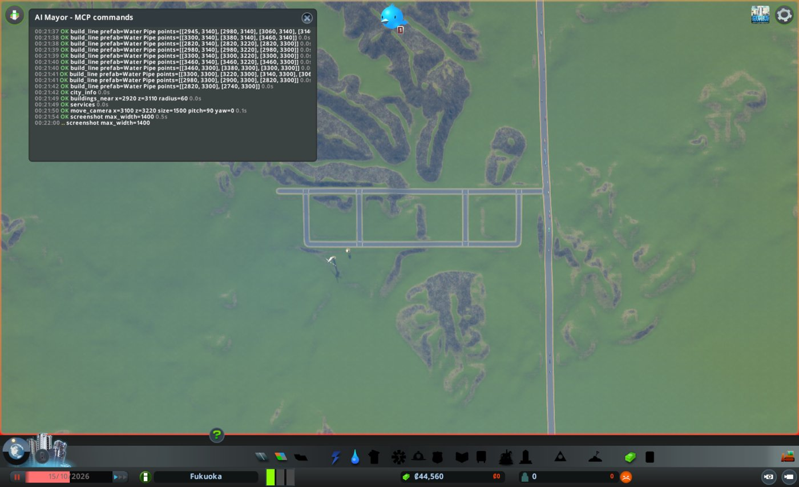
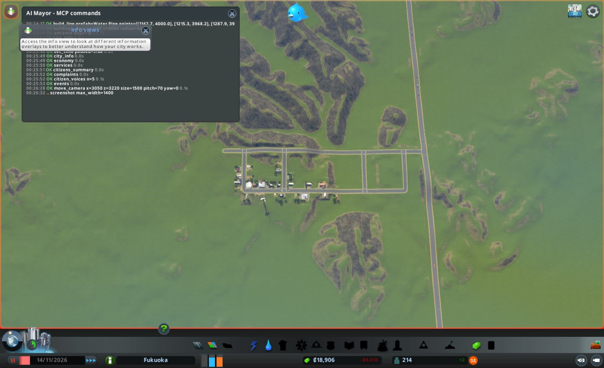
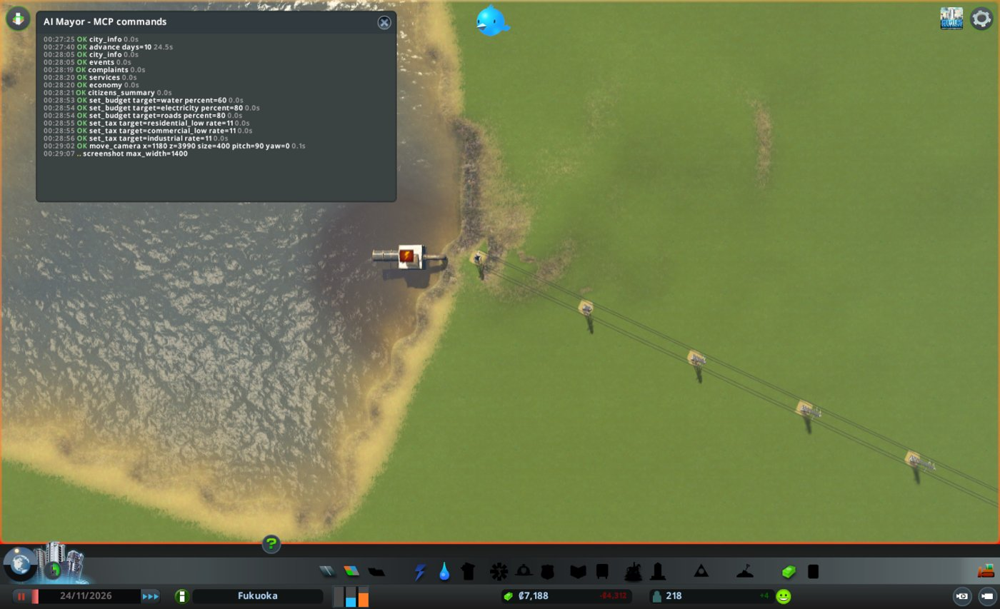
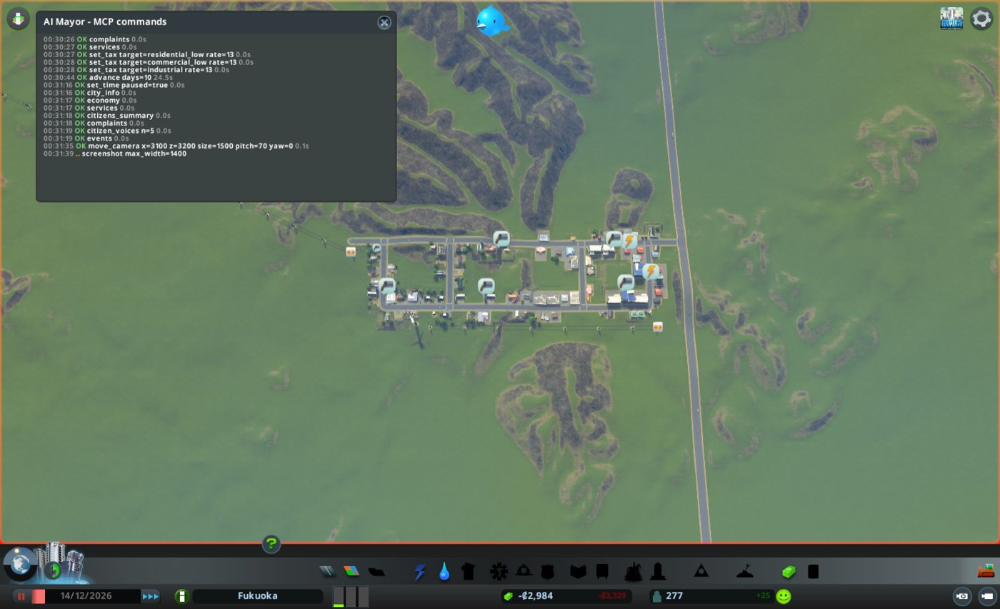
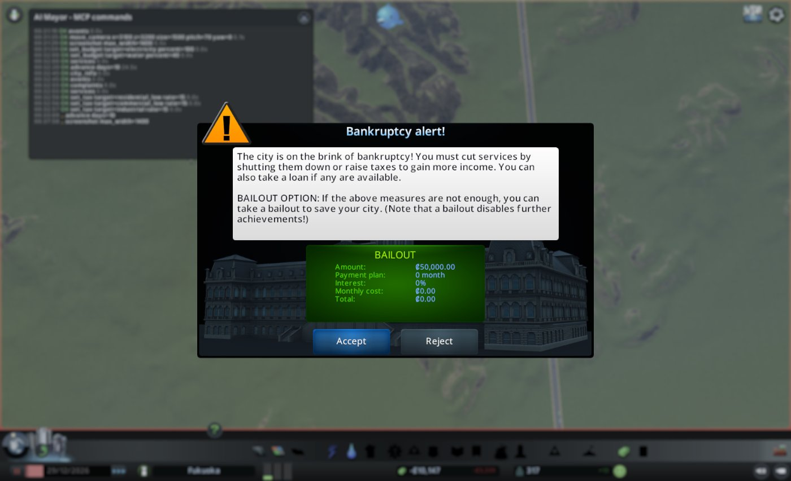

# 市政ノート

## 性格と公約

- 性格: なし。判断の型(`protocol.md`)にだけ従う
- 公約:
  1. 人口を毎月増やす(`city_info` の population。毎月の月例で、前の月例より増えていること)
  2. 電気・水・下水が来ない市民をなくす(`citizens_summary` の該当人数。任期の終わりに0)
  3. 赤字を続けない(`city_info` の週の収支。毎月の月例で、2回続けて赤字にしない)
- 任期: 3か月(2026-10-15 から)

## 申し送り(前の運営から)

なし

## 数字の表

| ゲーム内の日付 | 区切り | 人口 | 所持金 | 週の収支 | 幸福度 | 需要(住/商/工) | 失業 | 主な困りごと |
|---|---|---|---|---|---|---|---|---|
| 2026-10-15 | 月例 | 0 | 69,500 | 0 / 0 | 0 | 100 / 0 / 0 | 0 | なし(建物が0) |
| 2026-10-25 | 見回り | 0 | 38,616 | 0 / 4,374 | 0 | 56 / 0 / 0 | - | 下水(19軒) |
| 2026-11-04 | 見回り | 211 | 25,252 | 280 / 4,711 | 33 | 10 / 33 / 33 | - | - |
| 2026-11-14 | 月例 | 214 | 18,906 | 297 / 4,711 | 28 | 0 / 76 / 79 | 171 | 電気(1件、排水口) |
| 2026-11-24 | 見回り | 218 | 7,187 | 424 / 4,737 | 48 | 0 / 44 / 67 | 113 | 電気(1件、排水口) |
| 2026-12-04 | 見回り | 223 | 1,841 | 911 / 4,609 | 44 | 4 / 0 / 21 | - | 下水(57軒)、電気(1件) |
| 2026-12-14 | 月例 | 277 | -2,983 | 1,280 / 4,609 | 42 | 14 / -4 / -4 | 11 | 下水(72軒)、電気(18軒) |
| 2026-12-24 | 見回り | 322 | -7,679 | 1,300 / 4,569 | 43 | 11 / -4 / 0 | - | 下水(78軒)、働き手不足(2軒) |

## 判断の記録

### 2026-10-15 月例(1か月目)

#### 答え合わせ

なし(初回)

- 公約の進み具合
  1. 人口: 0人。まだ誰も住んでいない
  2. 電気・水・下水が来ない市民: 0人。市民がいないため
  3. 週の収支: 0 / 0

#### 気づいたこと

- 街に道路も建物もない。人が引っ越して来るには、九州自動車道(地図の外とのつなぎ口)に道路をつなぐ必要がある
- この地図には川がない(#64 で断念)。水を取るのも下水を流すのも、博多湾の海岸で行うしかない
- 九州自動車道から海岸までは、z=3300 付近で西へ約3km。所持金の半分(34,750)では、一度に海岸まで届かない

#### 施策

建設費の上限は 34,750(所持金の半分)。
維持費の上限「週の収支の黒字の範囲」は、収入が0のため守れない。人が住む最低限の施設に限って建てる。

1. 住宅地を作る
   - 公約: 1(人口)
   - 理由: 住宅の需要が100で、人が住める場所が1マスもない
   - 予想: 次の月例(11月中旬)までに、人口が200人を超える。#70 では30日で約200人だった
   - 操作: 九州自動車道(x≈3540, z=3300)から西へ本線を約840m。南へ通り4本、南の並行道路1本。道路沿いを低密度住宅に指定
   - 結果: 道路7本を引いた(成功、計10,400)。本線は九州自動車道の区間を途中で分けてつながった(split 1)。通りと並行道路は、端点がすべて既存の点につながった。低密度住宅を1,802マス指定した
   - 確かめ: `zones_at` で ResidentialLow 1,802マス。画面写真で、本線が九州自動車道に突き当たっている
   - 予定との差: 通りは5本の予定を4本にした。x=3140 付近に小さな尾根があるため
2. 電気を通す
   - 公約: 2(電気)
   - 理由: 電気が来ないと、建った家に「電気が来ない」の印が付き、人が出ていく
   - 予想: 次の見回りで、`services` の電気の容量が使用量を上回っている
   - 操作: 風車(6,000、維持費500)を1基、住宅地の南に置く
   - 結果: (2900, 3100) に置いた(成功、6,000)
   - 確かめ: `buildings_near` で置けた。`services` の電気の容量はまだ0。次の見回りで見る
3. 水を通す
   - 公約: 2(水)
   - 理由: #70 では水道がなく、「水が来ない」の印が19軒に付いた
   - 予想: 次の見回りで、`services` の水の容量が使用量を上回っている
   - 操作: 給水塔(3,500、維持費1,500)を1基と、道路沿いに水道管
   - 結果: 給水塔を (2945, 3122) に置いた(成功、3,500)。水道管を11本、すべての道路に沿って引いた(成功、計5,040)
   - 確かめ: 置いた直後の給水塔は「WaterNotConnected」。水道管を引いた後は「None」になった

#### 次にやること

- 下水を通す。海岸まで道路と水道管を延ばし、排水口を置く(2か月目)

建設費の合計は24,940(上限34,750の内)。所持金は44,560になった。

#### 画面写真

### 2026-10-25 見回り

境目: 当たった。週の収支が 0 / 0 から 0 / 4,374 になり、赤字になった

### 2026-10-25 臨時

- きっかけ: 週の収支の赤字(見回りの境目)
- 調べたこと
  - `complaints`: 困りごとは「Sewage」(下水)だけで19軒
  - `services`: 電気は容量6,880に使用592、水は容量60,000に使用352。下水は容量0に使用22
  - `buildings_near`: 半径450mに36件。家が建ち始めている。人口はまだ0
- 赤字の見立て: 住民がまだ越して来ず、税の収入が0のため。手当ての施策は打たない
- 施策: 下水を通す(「次にやること」から前倒し)
  - 公約: 2(下水)
  - 理由: 建った家のすべてに下水の印が付いた。放っておくと、住み始める前に不満がたまる
  - 予想: 次の見回り(11-04)で、`complaints` から「Sewage」が消え、`services` の下水の容量が使用量を上回る
  - 操作: z=3300 の線上は x=0 まで海がなかった(`height_at` で確かめた)。いちばん近い海は (1100, 4000)。そこに排水口を角度270で置き、町の西端 (2740, 3300) まで水道管を約1.7km引く
  - 結果: 排水口を (1120, 4000) に置いた(成功、2,500)。水道管22区間(成功、4,400)。管の両端が既存の点につながった(snapped 2)
  - 確かめ: 置いた直後の排水口は「WaterNotConnected」。管を引いた後は「None」になった。画面写真で、排水口の先が海に入っている
  - 型との差: 臨時の施策は、境目に当たった件(赤字)の手当てに使う決まり。今回は赤字を手当てせず、調べて見つけた下水に使った。維持費(2,000)が増え、赤字は少し広がる

### 2026-11-04 見回り

境目: 当たらずと判断した。週の収支は赤字のまま、前回より少し悪くなった(-4,374 から -4,431)
- 型の「前回より悪化して赤字になった」は、すでに赤字のときも当たるのか読めない。今回は、黒字から赤字に転じたときだけと読んだ
- 所持金は10日で約6,400減った。このままだと11月の末に10,000を下回る
- `events`: 「給水所ができた」のつぶやき1件

### 2026-11-14 月例(2か月目)

#### 答え合わせ

- 施策1(住宅地を作る): 予想どおり。人口は214人で、予想の200人を超えた。ただし家が建ったのは西半分だけで、東半分の区画は空いている
- 施策2(電気を通す): 予想どおり。電気は容量6,880に使用3,120。家に「電気が来ない」市民は0人
- 施策3(水を通す): 予想どおり。水は容量60,000に使用4,672。「水が来ない」市民は0人
- 臨時(下水を通す): 予想どおり。「Sewage」の困りごとは消え、下水は容量60,000に使用292。ただし排水口そのものに電気が来ておらず、「Electricity」の困りごとが1件ある。置く前に、排水口が電気を要るか確かめていなかった
- 前回の「次にやること」(下水): 臨時で前倒しして実行した
- 公約の進み具合
  1. 人口: 0 から 214。増えた
  2. 電気・水・下水が来ない市民: どれも0人。任期の終わりまで残り1か月
  3. 週の収支: 297 / 4,711 の赤字。月例で1回目の赤字。次の月例でも赤字なら、公約を破る

#### 気づいたこと

- お金が尽きかけている。週に約4,400の赤字で、所持金は18,906。今のままだと約1か月で底をつく
- 214人のうち171人が失業している。全員が学校に行っておらず低所得。働き口が0のため
- 住宅の需要は0、商業は76、工業は79。家を増やすより、働き口を作る番

#### 施策

建設費の上限は 9,453(所持金の半分)。

1. 働き口を作る
   - 公約: 3(赤字)、1(人口)
   - 理由: 失業が171人。商業と工業の需要が高い。空いている住宅の区画を指定し直せば、建設費はかからない
   - 予想: 次の月例までに、`services` の workplaces が100を超え、失業が100人を下回る。週の収入が1,000を超える
   - 操作: 東の区画(x 3300〜3500)を工業に、中の区画(x 3140〜3300)を低密度商業に指定し直す。建物のあるマスは変わらない。東まで電気が届くよう、風車から東へ送電線を引く
   - 結果: 工業411マス、低密度商業332マスに指定し直した(費用0。建物のある18マスは変わらず)。送電線を (2935, 3090) から (3470, 3090) まで7区間(成功、1,340)
   - 確かめ: `zones_at` で ResidentialLow 1,080、CommercialLow 332、Industrial 369(商業の円が工業の一部に重なった)
2. 支出を減らす
   - 公約: 3(赤字)
   - 理由: 水は容量60,000に使用4,672で、9割以上余っている
   - 予想: 週の支出が少し減る。水の容量は48,000になり、まだ足りる
   - 操作: 水の予算を100から80に下げる
   - 結果: 成功
   - 確かめ: 直後の `city_info` の週の支出は4,711のまま。次の見回りで見る
3. 排水口に電気を通す
   - 公約: 2(下水)
   - 理由: 排水口に電気が来ていない。今は下水が流れているが、止まると全戸に下水の印が付く
   - 予想: 次の見回りで、`complaints` から「Electricity」が消える
   - 操作: 町の西端から排水口まで送電線を約1.75km引く。費用が上限を超えるなら、来月に回す
   - 結果: 送電線を (2745, 3268) から (1165, 4000) まで22区間(成功、4,400)
   - 確かめ: 時間を進めないと分からない。次の見回りで `complaints` を見る

建設費の合計は5,740(上限9,453の内)。所持金は13,166になった。

#### 次にやること

- 失業が減らなければ、学校を検討する(全員が学校に行っていない)。ただし維持費が払えるようになってから

#### 画面写真

### 2026-11-24 見回り

境目: 当たった。所持金が7,187で、10,000を下回った

### 2026-11-24 臨時

- きっかけ: 所持金が10,000を下回った
- 調べたこと
  - `complaints`: 「Electricity」が1件。排水口のまま
  - `services`: 下水の容量が60,000から0に落ちた。電気は容量6,880に使用3,760。水は容量38,400に使用5,360
  - `citizens_summary`: 217人。働いている55人、失業113人。下水が来ない市民が23人
  - `economy`: 水の予算は80になっている
  - 所持金の減り方: 10日あたり約6,400(10月末)から約6,000(今回)に、少しだけ緩んだ
- 施策: 収支を立て直す
  - 公約: 3(赤字)
  - 理由: このままだと12月の初めに所持金が0を下回る。支出の大半は水の施設(給水塔と排水口)の維持費と見られる
  - 予想: 次の月例で、週の支出が4,000を下回り、所持金の減り方が10日あたり5,000より緩む
  - 操作: 予算を水80→60、電気100→80、道路100→80。税を低密度住宅、低密度商業、工業で9→11
  - 結果: すべて成功
  - 型との差: なし(税は各±2、予算は各-20の範囲)
- 分かったこと: 排水口に電気が来ないのは、送電線の端の電柱が建物から約13m離れているため。画面写真で確かめた。直すのは次の月例に回す(臨時の施策は1件まで)

### 2026-12-04 見回り

境目: 当たった。所持金が1,841で、10,000を下回ったまま

### 2026-12-04 臨時

- きっかけ: 所持金が10,000を下回った
- 調べたこと
  - 所持金は10日で約5,350減った。前回の約6,000より緩んだが、数日で0を下回る
  - 週の支出は4,737から4,609。予算を下げても、128しか減っていない
  - 週の収入は424から911に増えた。働き口ができ始めた
  - `complaints`: 「Sewage」57軒、「Electricity」1件(排水口)
  - `services`: 電気が容量4,400に使用4,544で、足りなくなった。前回、電気の予算を80に下げたため。下水の容量は0のまま
- 施策: 税を上げる
  - 公約: 3(赤字)
  - 理由: 境目に当たった件(お金)の手当て。収入が伸び始めたので、税率の効きが前回より大きい
  - 予想: 次の月例で、週の収入が1,100を超える
  - 操作: 税を低密度住宅、低密度商業、工業で11→13
  - 結果: すべて成功
- 打たなかった施策: 排水口の電柱を建物まで延ばす。費用は100足らずで、今なら払える。ただ臨時の施策は1件までで、境目の件(お金)を優先した。次の月例では所持金が0を下回り、建てられない見込み
- 自分の判断の誤り: 前回の臨時で電気の予算を下げたら、風車の発電が使用量を下回った。予算を下げる前に、容量の余りが2割を超えるかを確かめるべきだった(下げる前は容量6,880に使用3,760で、2割下げても足りる計算だった。工業が増えて使用量が伸びた)

### 2026-12-14 月例(3か月目)

#### 答え合わせ

- 施策1(働き口を作る): 予想どおり。働き口は326、働いている市民は194人、失業は171人から11人に減った。週の収入は297から1,280に増えた
- 施策2(水の予算を80に): 外れ。週の支出はほとんど減らなかった(4,711 から 4,609 までの全期間で -102)
- 施策3(排水口に電気): 外れ。電柱が建物から約13m離れていて、つながらなかった。下水の容量は0に落ちた
- 臨時(11-24、予算と税): 外れ。所持金の減り方は緩んだが、電気の予算を下げたことで電気が足りなくなった
- 臨時(12-04、税を13に): 予想どおり。週の収入は911から1,280に増え、予想の1,100を超えた
- 前回の「次にやること」(学校): しなかった。お金がない
- 公約の進み具合
  1. 人口: 214 から 277。増えた
  2. 電気・水・下水が来ない市民: 電気8人、水0人、下水268人。任期の終わりまで残り1か月
  3. 週の収支: 1,280 / 4,609 の赤字。月例で2回続けての赤字になり、公約を破った

#### 気づいたこと

- 所持金が -2,983 になった。建てる施策は、どれも打てない
- 下水が来ない市民が268人(ほぼ全員)。排水口に電気が来ず、止まっているため。直す費用は100足らずだが、払えない
- 電気が容量4,400に使用5,392で、足りない。前回の臨時で予算を下げた影響が残っている

#### 施策

建てる施策は打てない(所持金がマイナス)。お金のかからない予算だけを動かす。

1. 電気の不足を解く
   - 公約: 2(電気)
   - 理由: 電気が来ない市民が8人、印の付いた建物が18軒
   - 予想: 次の見回りで、電気の容量が5,300を超え、電気の印が10軒より減る
   - 操作: 電気の予算を80から100に戻す
   - 結果: 成功
2. 支出を減らす
   - 公約: 3(赤字)
   - 理由: 水は容量21,600に使用7,440で、まだ余っている
   - 予想: 週の支出が少し減る
   - 操作: 水の予算を60から40に下げる
   - 結果: 予算は50になった。ゲームの下限が50のため。道具の説明にも「50〜150」とあった。読み落とした
- 打たなかった施策
  - 排水口を直す: 費用が払えない
  - 排水口を取り壊す: 維持費は減るが、下水を通す手段がなくなる。お金が戻れば100足らずで直せるので、残す

#### 次にやること

- お金がプラスに戻ったら、すぐに排水口の電柱を建物まで延ばす

#### 画面写真

### 2026-12-24 見回り

境目: 当たった。所持金が -7,679

### 2026-12-24 臨時

- きっかけ: 所持金が10,000を下回ったまま
- 調べたこと
  - `complaints`: 「Sewage」78軒、「Electricity」1件(排水口)、「NoWorkers」2軒
  - `services`: 電気は容量6,880に使用5,952で、足りるようになった。水は容量14,992に使用8,560
  - `events`: 「トイレが流れない。下水はどうなっている?」のつぶやき1件
- 施策: 税を上げる
  - 公約: 3(赤字)
  - 理由: 建てる施策は打てない。お金のかからない手当ては税だけ
  - 予想: 次の見回りで、週の収入が1,450を超える
  - 操作: 税を低密度住宅、低密度商業、工業で13→15
  - 結果: すべて成功
- 月例の施策1(電気の予算を100に)の答え: 予想どおり。電気の容量は6,880に戻った

### 2026-12-29ごろ 中断

- 12-24 からの `advance(10)` の途中で、ゲームに「Bankruptcy alert!」のダイアログが出た。所持金は約 -10,147
- ダイアログは、サービスを止めるか税を上げるよう求め、救済(Bailout、50,000、返済なし)を勧めていた
- 市長(AI)はダイアログに気づけなかった。道具はゲームの画面のダイアログを読めない。人が画面を見て気づいた
- 人が運営を止めた。救済は受けていない

## 人が手を入れたこと

- 2026-12-29ごろ、破産の警告が出たため、人が運営を止めた

## 公約の結果

## 次の市長への申し送り
