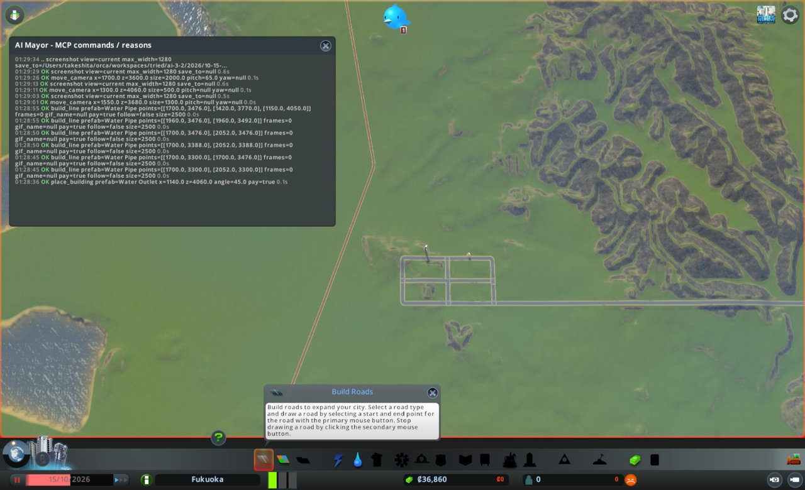
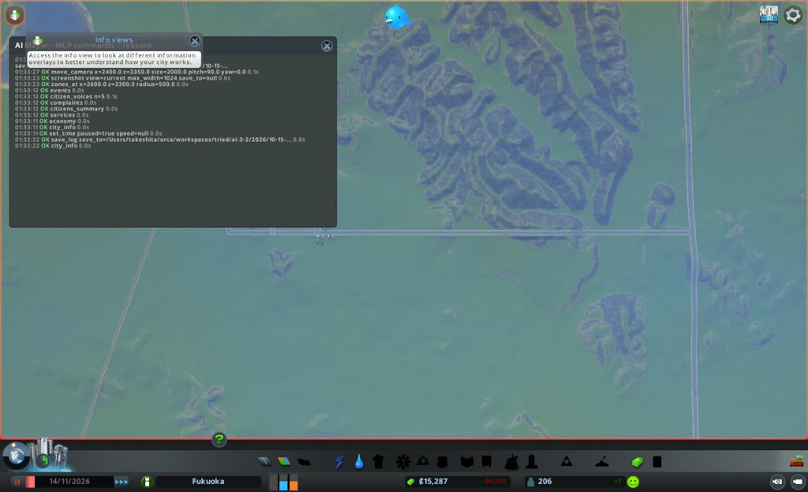
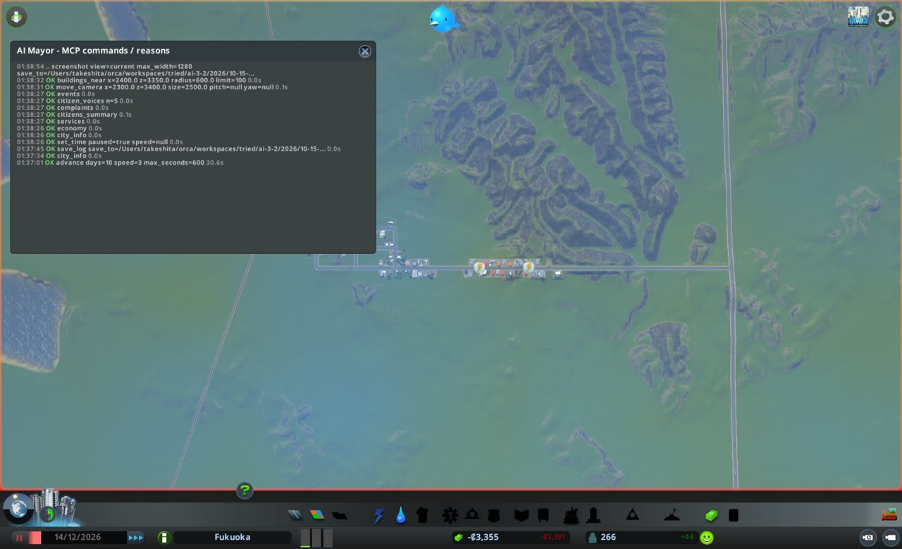

# 市政ノート

## 性格と公約

- 性格: なし。判断の型(`protocol.md`)にだけ従う
- 公約:
  1. 人口を毎月増やす(`city_info` の population。毎月の月例で前の月例より増えていること)
  2. 電気・水・下水が来ない市民をなくす(`citizens_summary` の来ない市民の数。任期の終わりに0)
  3. 赤字を続けない(`city_info` の週の収支。毎月の月例で2回続けて赤字にしない)
- 任期: 3か月(ゲーム内 2026-10-15 から)

## 申し送り(前の運営から)

なし

## 数字の表

月例と見回りのたびに1行足す。区切りは 月例・見回り・臨時。

| ゲーム内の日付 | 区切り | 人口 | 所持金 | 週の収支 | 幸福度 | 需要(住/商/工) | 失業 | 主な困りごと |
|---|---|---|---|---|---|---|---|---|
| 2026-10-15 | 月例 | 0 | 69,500 | +0(収入0/支出0) | 0 | 100/0/0 | 0 | なし(建物0) |
| 2026-10-25 | 見回り→臨時 | 0 | 30,435 | -4,735(収入0/支出4,735) | 0 | 56/0/0 | - | 下水22棟(吐き口が動かず) |
| 2026-11-04 | 見回り | 163 | 21,445 | -4,717(収入68/支出4,785) | 35 | 10/11/11 | - | (見回りのため complaints は見ていない) |
| 2026-11-14 | 月例 | 206 | 15,287 | -4,481(収入304/支出4,785) | 31 | 0/55/55 | 174(働き口0) | なし(困りごとの建物0) |
| 2026-11-24 | 見回り→臨時 | 211 | 6,649 | -4,242(収入440/支出4,682) | 45 | 0/34/28 | -(働き手76/働き口156) | 電気8棟(工業) |
| 2026-12-04 | 見回り→臨時 | 213 | 1,567 | -3,643(収入927/支出4,570) | 45 | 7/0/11 | -(働き手171/働き口324) | 電気23棟 |
| 2026-12-14 | 月例 | 266 | -3,355 | -3,391(収入1,179/支出4,570) | 45 | 5/0/0 | 12(働き手194/働き口364) | 電気26棟(すべて工業) |
| 2026-12-24 | 見回り→臨時 | 342 | -8,279 | -3,427(収入1,554/支出4,981) | 43 | 5/0/11 | 11(働き手252/働き口364) | 電気26棟 |
| 2026-12-27 | 中断(ダイアログ) | 376 | -10,173 | -3,395(収入1,573/支出4,968) | 43 | 6/0/12 | 19 | 破産の警告 |

## 判断の記録

### 2026-10-15 月例(1か月目)

#### 答え合わせ

なし(初回)

- 公約の進み具合
  1. 人口: 0 / 次の月例(11-15ごろ)までに増やす / 住宅地と電気・水を用意すれば届きそう
  2. 電気・水・下水が来ない市民: 0(住民0) / 任期の終わり(2027-01-15ごろ)に0 / 住宅を建てる前に電気と上下水を引く
  3. 週の収支: 0 / 毎月の月例 / 維持費を税収の見込みに合わせる

#### 気づいたこと

- 街は空で、建物も住民も0。住宅の需要だけが100
- 電気・水・下水・ごみの容量がすべて0。住民が入る前に用意しないと公約2が崩れる
- 所持金69,500のうち、建設に使えるのは半分の34,750まで
- 外とつながる道は九州自動車道だけ。x≈3542 を南北に走る(z=3300 で確かめた)
- 下水の吐き口は水辺が要る。いちばん近い水辺は博多湾の奥 (1165, 4035) 付近。JR は (1417,3429)〜(1572,3924) を通るので、街はその東 x=1700〜2052、z=3300〜3564 に置く

#### 施策

型の上限「維持費の増え分は週の黒字の範囲」は、収入0の出発点では守れない。住民を入れるのに要る最小の維持費だけを足し、来月の月例で収支を確かめる。

1. 住宅地を作る(道路と区画)
   - 公約: 1(人口)
   - 理由: 住宅の需要が100で、住める場所が0。外から人が来るには高速道路とつなぐ道が要る
   - 予想: 11-15の月例で人口300人以上。区画は住宅(低密度)を主に、z=3300沿いの東端に商業を少し
   - 操作: build_line Basic Road で (1700,3300)〜(3542,3300) と、x=1700/1788/1876/1964/2052 と z=3300/3388/3476/3564 の格子。zone_area で住宅
   - 結果: 高速への道 (2052,3300)〜(3542,3300) は成功、費用7,480、高速の区間を1つ分けてつないだ(split 1)。費用が見込みより高いので格子を縮めた。x=1700/1876/2052 × z=3300/3388/3476 の格子を6本、費用1,800+840+840+1,800+1,800+840。道路の合計15,400。zone_area residential_low 半径260で1,157マス
   - 確かめ: zones_at で ResidentialLow 1,157マス。画面写真で格子の交差点がつながり、東へ高速まで伸びているのを見た。所持金54,100
2. 電気を引く(風力発電2基)
   - 公約: 2(電気が来ない市民を0)
   - 理由: 電気の容量が0。住宅が建つ前に用意する。建設費6,000×2、維持費500×2
   - 予想: 次の見回りで services の電気の容量が0より大きく、使用量を上回る
   - 操作: place_building Wind Turbine を z≈3600、x=1750 と 1830
   - 結果: 格子を縮めたので、z=3476 の道の北 (1790,3510) に1基だけ置いた。成功、id 10268、費用6,000。2基目は電気の容量を見てから決める
   - 確かめ: buildings_near で置けた(problems None)。一時停止中のため services の電気の容量はまだ0のまま。次の見回りで見る
3. 上下水を引く(給水塔と吐き口と水道管)
   - 公約: 2(水・下水が来ない市民を0)
   - 理由: 水と下水の容量が0。給水塔(3,500、維持1,500)は街の中に、吐き口(2,500、維持2,000)は湾の岸に置く
   - 予想: 次の見回りで水と下水の容量が使用量を上回り、来ない市民が0
   - 操作: place_building Water Tower と Water Outlet、build_line Water Pipe を道路沿いと吐き口まで
   - 結果: Water Tower を (1960,3490) に置いた(id 2395、3,500)。Water Outlet を (1140,4060)、angle 45 に置いた(id 41221、2,500)。Water Pipe を z=3300/3388/3476 の道沿い(各900)、x=1700(420)、給水塔への枝(40)、吐き口まで (1700,3476)〜(1150,4050)(2,080)。管の合計5,240
   - 確かめ: 置く道具はすべて ok。画面写真で、吐き口らしい建物が湾の岸に見えた。一時停止中のため services の水と下水はまだ0。次の見回りで見る
- 建設費の合計: 32,640(上限34,750の内)。所持金36,860

#### 次にやること

- 電気の容量が足りなければ、風力発電の2基目を置く
- 商業の需要が出たら、z=3300 の道の東側に商業の区画を足す
- ごみの容量が0のまま。住民が増えたら埋立地を検討する
- 収支を見て、税率を動かすか決める

#### 画面写真

困りごとはまだ無いので、作った住宅地を写した(move_camera の pitch 65 は効かず、真上のまま)。

### 2026-10-25 見回り

境目: 当たった。週の収支が 0 から -4,735(収入0、支出4,735)へ悪化して赤字になった。臨時に切り替える

- city_info: 人口0、所持金30,435、需要 住56/商0/工0、ダイアログなし
- events: 初めての発電所の祝い、緑のエネルギーの声、産業の区画を求める声。火事などのつぶやきは0件

### 2026-10-25 臨時

- きっかけ: 週の収支が赤字になった(-4,735)。住宅は36棟のうち家が約30棟建ったが、人口はまだ0で税収がない
- 見たもの
  - services: 電気 容量7,680/使用864、水 容量60,000/使用384、下水 容量0/使用24、ごみ 容量0
  - complaints: 下水22棟、電気1棟、水がつながらない1棟
  - buildings_near (1140,4060): 吐き口 id 41221 の困りごとは「Electricity, WaterNotConnected」。吐き口の管の口は (1123.9,4076.1) にあり、引いた管の端 (1150,4050) から約37m離れている
- 判断: 赤字は住民が入る前の一時のもの。人が入れば税収が出る。いま住民を止めているのは下水の容量0なので、吐き口を動かすことを手当てにする
- 施策: 下水の吐き口をつなぐ(公約2)
  - 理由: 吐き口に電気が来ず、管もつながっていない。下水の困りごとが22棟
  - 予想: 11-05の見回りで、下水の容量が使用量を上回り、下水の困りごとが0に近づく。人口が0より増える
  - 操作: build_line Water Pipe (1150,4050)〜(1124,4076)。build_line Power Line で風力発電 (1790,3510) から吐き口まで
  - 結果: 管は両端とも既存の点につながった(snapped 2)、費用100。送電線 (1790,3545)〜(1450,3800)〜(1158,4064) は11区間、費用2,080。どちらも ok。つながったかは、時間を進めた後の見回りで見る
  - 確かめ(11-04): services の下水が 容量120,000/使用229 になった。吐き口が動いた

### 2026-11-04 見回り

境目: 当たらず

- city_info: 人口163、所持金21,445、週の収支 -4,717(収入68/支出4,785)、幸福度35、需要 住10/商11/工11、ダイアログなし
- 週の収支は前回の -4,735 より少し良くなった。所持金は10日で約9,000減っている。この速さだと11月中旬に1万台前半になる
- events: 給水塔の祝いが1件。困りごとのつぶやきは0件
- services(臨時の確かめ): 電気 容量5,200/使用2,592(風で容量が7,680から下がった)、水 60,000/3,664、下水 120,000/229、ごみ 容量0

### 2026-11-14 1か月目の終わり(2か月目の月例の前)

型の4つ目の `advance(10)` で 11-14 まで進め、止めた。2か月目の月例は次の呼び出しで行う。

- city_info(ダイアログの確かめ): 人口206、所持金15,287、週の収支 -4,481(収入304/支出4,785)、幸福度31、需要 住0/商55/工55、ダイアログなし
- 2か月目の月例への引き継ぎ(数字の表の行は、月例の8つの道具を見てから足す)
  - 週の支出4,785に対し収入304。所持金は10日で約6,000減る。11月下旬に10,000を割る見込み
  - 住宅の需要が0、商業と工業が55。働き口が0なので、人が増えない
  - ごみの容量が0のまま
  - 電気は風しだいで容量が5,200〜7,680。使用は2,592(11-04)

### 2026-11-14 月例(2か月目)

#### 答え合わせ

- 施策1 住宅地を作る: 予想は人口300人以上。結果は206人。外れた。住宅の需要が0になり、働き口が0のまま止まった
- 施策2 風力発電: 予想は容量が使用量を上回る。結果は容量5,200/使用3,040。当たった。電気が来ない市民0
- 施策3 上下水: 予想は来ない市民0。給水塔は当たった。吐き口は管と電気がつながらず外れ、臨時で直した。11-14で水・下水が来ない市民0
- 臨時 吐き口をつなぐ: 予想は下水の容量が使用量を上回り、人口が増える。当たった(下水120,000/283、人口206)
- 次にやることの実行
  - 風力の2基目: 容量が足りていたので置かなかった(見て決めた)
  - 商業の区画: 実行していない。商業の需要は55まで上がった。今月行う
  - ごみ: 実行していない。容量0のまま
  - 税率: 動かしていない
- 公約の進み具合
  1. 人口: 0 → 206。増えた(達成)。次の月例(12-14ごろ)までにさらに増やす
  2. 電気・水・下水が来ない市民: 0。任期の終わり(2027-01-15ごろ)まで0を保つ
  3. 週の収支: -4,481。1か月目も赤字(10-25以降)。今月の終わりにも赤字なら「2回続けて赤字」で破る。残り1か月

#### 気づいたこと

- 失業174人、就業0。働き口が0なので、収入は住宅の税だけ(週304)
- 商業と工業の需要が55。z=3300 の高速への道(x=2052〜3542)は、区画が809マス空いている
- 水は容量60,000/使用4,528、下水は120,000/283。大きく余っている
- 困りごとの建物0。市民の暮らし向きは平均10と低い。健康が悪い人が5人中2人
- 所持金は10日で約6,000減る。建設に使えるのは7,643まで
- ごみの容量0。埋立地は建設4,000、維持1,000。赤字のうちは置かない

#### 施策

1. 働き口を作る(商業と工業の区画、水道管)
   - 公約: 1(人口)と3(収支)
   - 理由: 失業174人で働き口0。商業・工業の需要55。空いた道沿いに区画を指定すれば費用は水道管だけ
   - 予想: 11-24の見回りで商業・工業の建物が建ち始める。12-14の月例で失業が100人以下、週の収入が1,500以上
   - 操作: zone_area commercial_low (2215,3300) 半径135、industrial (2625,3300) 半径270。build_line Water Pipe (2052,3300)〜(2900,3300)
   - 電気は、住宅から続けて建物が並べば伝わる見込み。見回りで電気の困りごとを見る
2. 水道の予算を下げる(100→80)
   - 公約: 3(収支)
   - 理由: 水の容量は使用の13倍、下水は400倍余っている。予算を下げると維持費が減る
   - 予想: 週の支出が約700減る。水・下水が来ない市民は0のまま
- 3件目は打たない。ごみは赤字のうちは置かず、電気の2基目も容量を見てから決める

#### 実行の結果

1. 働き口を作る: zone_area commercial_low は246マス(建物のある15マスは飛ばした)、industrial は446マス。Water Pipe (2052,3300)〜(2900,3300) は11区間、snapped 1、費用2,200
   - 確かめ: zones_at (2480,3300) 半径450で Industrial 446、CommercialLow 246、ResidentialLow 132。画面写真では区画の色は見えない(区画の道具を開いていないため)
2. 水道の予算: set_budget water 80 は ok。一時停止中のため、週の支出は4,785のまま。見回りで見る
- 建設費の合計: 2,200(上限7,643の内)。所持金13,087
- move_camera は current が前の値のまま返り、視点が動かなかったように見えた

#### 次にやること

- 見回りで、工業・商業の建物に電気が来ているか(complaints の電気)を見る。来なければ送電線を引く
- 電気の使用が容量の8割を超えたら、風力の2基目を置く
- 黒字に戻ったら、埋立地(建設4,000、維持1,000)を置く
- 住宅の需要が戻ったら、住宅地を広げる

#### 画面写真

### 2026-11-24 見回り

境目: 当たった。所持金が6,649で、10,000を下回った。臨時に切り替える

- city_info: 人口211、所持金6,649、週の収支 -4,242(収入440/支出4,682)、幸福度45、需要 住0/商34/工28、ダイアログなし
- events: つぶやき0件

### 2026-11-24 臨時

- きっかけ: 所持金が10,000を下回った(6,649)。10日で6,638減った(うち水道管2,200)
- 見たもの
  - complaints: 電気8棟。すべて工業(buildings_near で x=2480〜2600 の工場)
  - services: 電気 容量5,200/使用3,856、水 38,400/5,392、下水 76,800/337、働き手76/働き口156
  - buildings_near (2450,3300): 商業9棟、工業17棟が建った。電気が来ないのは東寄りの工業8棟
- 判断: 今の減り方(建設を除き10日で約4,400)だと、12月上旬に所持金が0を割る。いちばん急ぐのは支出を減らすこと。水道の予算を80にしても週の支出は103しか減っていないが、水の容量は使用の7倍ある
- 施策: 水道の予算をさらに下げる(80→60)(公約3)
  - 理由: 水38,400/5,392、下水76,800/337で余っている
  - 予想: 12-04の見回りで週の支出が4,300以下。水・下水が来ない市民は0のまま
  - 電気の来ない工場は、臨時の施策が1件までのため今回は手当てしない。次の月例で送電線か風力の2基目を決める
  - 結果: set_budget water 60 は ok。費用0

### 2026-12-04 見回り

境目: 当たった。所持金が1,567で、10,000を下回ったまま。events に停電のつぶやき1件。臨時に切り替える

- city_info: 人口213、所持金1,567、週の収支 -3,643(収入927/支出4,570)、幸福度45、需要 住7/商0/工11、ダイアログなし
- events: 停電のつぶやき1件(3件未満)

### 2026-12-04 臨時

- きっかけ: 所持金1,567。この減り方だと数日で0を割る
- 見たもの
  - services: 電気 容量5,200/使用5,136(ほぼ満杯)、水 21,600/6,416、下水 43,200/401、働き手171/働き口324
  - complaints: 電気23棟(11-24の8棟から増えた)
  - list_building_types Water: 給水塔の維持1,500、吐き口2,000
- 臨時の答え合わせ(11-24 水道60): 予想は週の支出4,300以下。結果は4,570。外れた。水道の予算を100→60にしても、週の支出は4,785→4,570で215しか減っていない。水の維持費は支出の大きな部分ではないか、数字に遅れがある
- 判断: 収入は304→927と伸びている。支出を一度に3,600減らす手は無い。建設はできない(所持金1,567、風力6,000)。下げても困りごとの少ない予算を1つ下げる
- 施策: 道路の予算を下げる(100→80)(公約3)
  - 理由: 拡張なしのゲームでは、道路の予算を下げても困りごとが出にくい。費用0
  - 予想: 12-14の月例で週の支出が4,500以下。所持金は0を割る見込みで、破産の警告が出るかもしれない
  - 結果: set_budget roads 80 は ok。費用0

### 2026-12-14 2か月目の終わり(3か月目の月例の前)

3つ目の `advance(10)` で 12-14 まで進め、止めた。3か月目の月例は次の呼び出しで行う。advance の dialogs は空。

- city_info: 人口266、所持金 -3,355、週の収支 -3,391(収入1,179/支出4,570)、幸福度45、需要 住5/商0/工0、ダイアログなし
- 週の支出は4,570のまま。道路の予算を下げた効果はこの数字にはまだ出ていない
- 所持金が0を割ったが、ダイアログは出ていない
- 3か月目の月例への引き継ぎ(数字の表の行は、月例の8つの道具を見てから足す)
  - 公約3: 11-14 も 12-14 も週の収支が赤字。「2回続けて赤字にしない」は破れた
  - 電気は 12-04 に容量5,200/使用5,136で満杯、電気の来ない建物23棟。所持金がマイナスで風力(6,000)は置けない
  - 週の支出の内訳を見る道具が無い。水道の予算を40ポイント下げても支出は215しか減らなかった
  - 収入は 304→440→927→1,179 と伸びている

### 2026-12-14 月例(3か月目)

#### 答え合わせ

- 施策1 働き口を作る: 予想は失業100人以下、週の収入1,500以上。失業は12人で当たった。収入は1,179で外れた。工業の建物はすべて電気が来ていない
- 施策2 水道の予算80: 予想は週の支出が約700減る。結果は4,785→4,570(60に下げた分を含む)。外れた。水・下水が来ない市民は0で、そこは当たった
- 臨時 11-24 水道60: 予想は週の支出4,300以下。結果4,570。外れた
- 臨時 12-04 道路80: 予想は週の支出4,500以下。結果4,570。外れた。所持金は予想どおり0を割った(-3,355)。破産の警告はまだ出ていない
- 次にやることの実行
  - 工業の電気を見て、来なければ送電線: 見た(電気23→26棟)。送電線は所持金がなく引いていない
  - 電気の使用が8割を超えたら風力の2基目: 超えた(使用6,336/容量5,200)。所持金がなく置いていない
  - 黒字なら埋立地: 黒字にならず、置いていない
  - 住宅の需要が戻ったら住宅地を広げる: 需要5で、広げていない(建設もできない)
- 公約の進み具合
  1. 人口: 206 → 266。増えた(達成)。任期の終わり(01-14)までにさらに増やす
  2. 電気・水・下水が来ない市民: 0。ただし電気は使用6,336が容量5,200を超えた。任期の終わりまで0を保てるかが危うい
  3. 週の収支: -3,391。11-14と12-14の2回続けて赤字。破れた。赤字の幅は-4,481→-3,391と縮んでいる

#### 気づいたこと

- 所持金 -3,355。10日で約4,900減っている。この速さだと12月下旬に -10,000 を割り、破産の警告が出そう
- 建設はできない。打てる手は税、予算、政策だけ
- 電気: 使用6,336が容量5,200を超えた。電気の来ない建物26棟はすべて x=2366〜2770 の工業。住宅と商業には来ている
- 画面写真では、商業(x≈2100〜2220)と工業(x≈2366〜)の間に建物の切れ目がある。工業が電気の網から外れているのかもしれない
- 失業12人。働き手194に働き口364で、働き口は余っている
- 市民は全員が学歴なし・低所得。暮らし向き13。健康51
- ごみ・医療・警察・教育の容量はすべて0。建物がないので、予算を下げても支出は変わらないはず
- events は0件

#### 施策

1. 節電の政策をかける(PowerSaving)
   - 公約: 2(電気が来ない市民を0)
   - 理由: 電気の使用6,336が容量5,200を超えた。風力を足す所持金がない。節電で使用を減らす
   - 予想: 12-24の見回りまでに電気の使用が容量を下回る。電気が来ない市民は0のまま。政策の費用で週の支出は少し増える
2. 商業と工業の税を上げる(低密度商業・工業 9→11%)
   - 公約: 3(収支)
   - 理由: 商業と工業の需要は0で、働き口も余っている。住宅の税は人口のために据え置く
   - 予想: 01-14までに週の収入が1,300以上。人口は減らない
3. 道路の予算を下げる(80→60)
   - 公約: 3(収支)
   - 理由: 12-04に下げた効果はまだ数字に出ていないが、道路は支出の大きな部分と見る。費用0
   - 予想: 01-14までに週の支出が4,400以下

#### 実行の結果

1. set_policy PowerSaving active=true は ok。費用0
2. set_tax commercial_low 11、industrial 11 はどちらも ok
3. set_budget roads 60 は ok
- 建設費の合計: 0。所持金 -3,355
- 政策は月例で1つまでの上限内。税は±2、予算は-20の上限内

#### 画面写真

### 2026-12-24 見回り

境目: 当たった。所持金 -8,279 で10,000を下回ったまま。週の収支が -3,391 から -3,427 へ悪化し、赤字のまま。臨時に切り替える

- city_info: 人口342、所持金 -8,279、週の収支 -3,427(収入1,554/支出4,981)、幸福度43、需要 住5/商0/工11、ダイアログなし
- events: 節電の政策の声が1件。困りごとのつぶやきは0件

### 2026-12-24 臨時

- きっかけ: 所持金 -8,279。週の収支が少し悪化した
- 見たもの
  - services: 電気 容量5,200/使用6,560、水 21,600/10,080、下水 43,200/630、働き手252/働き口364
  - complaints: 電気26棟(12-14と同じ)
  - citizens_summary: 電気・水・下水が来ない市民0。失業11
- 月例の施策の途中の様子(答え合わせは任期の終わりに)
  - 節電: 電気の使用は6,336→6,560で、容量を下回らなかった。ただし人口が266→342(+29%)なのに使用は+4%だけ。節電は効いているように見える
  - 税: 週の収入が1,179→1,554に増えた。人口の増えた分も含む
  - 道路60: 週の支出は4,570→4,981に増えた。節電の政策の費用が乗ったと見る(道具で内訳は見られない)
- 判断: 週の支出が411増えたが、節電を外すと電気の使用が増え、住宅の停電が心配。節電は残す。所持金は数日で -10,000 を割る見込みで、止める手はない。困りごとの出ない予算を1つ下げる
- 施策: 水道の予算を下げる(60→50)(公約3)
  - 理由: 水は容量21,600/使用10,080。50%にしても容量は使用を上回る見込み
  - 予想: 01-03の見回りで、水・下水が来ない市民0のまま。週の支出が少し(100前後)減る
  - 結果: set_budget water 50 は ok。費用0

### 2026-12-27 ダイアログで中断

`advance(10)` が 12-27 で止まり、dialogs を返した。型どおり運営を止め、親に戻る。ボタンは押していない。

- ダイアログ: 「Bankruptcy alert!」(BailoutPanel、seq 2、12-27に開いた、まだ開いている)
  - 本文: 破産の寸前。サービスを止めるか税を上げよ。救済(bailout)を受けると実績が無効になる
  - 救済の額: ₡50,000、利子0%、返済0か月
  - ボタン: Accept / Reject
- city_info: 人口376、所持金 -10,173、週の収支 -3,395(収入1,573/支出4,968)、幸福度43、需要 住6/商0/工12
- citizens_summary: 電気・水・下水が来ない市民0。失業19
- 1回目の試運転と同じく、所持金が約 -10,000 で警告が出た

## 公約の結果

任期は 2027-01-14 までだが、2026-12-27 に破産の警告で止まった。ここまでの事実で書く。

1. 人口を毎月増やす: 守れた(12-27時点)
   - 月例ごとの人口: 0(10-15)→206(11-14)→266(12-14)。12-27は376
   - 3か月目の月例(01-14)には届いていない
2. 電気・水・下水が来ない市民をなくす: 12-27時点で0
   - ただし電気は使用6,560が容量5,200を超えたまま(12-24)。工業26棟に電気が来ていない
   - 任期の終わり(01-14)の数字は見ていない
3. 赤字を続けない: 破れた
   - 週の収支: -4,481(11-14)→-3,391(12-14)→-3,395(12-27)。10-25から一度も黒字にならなかった
   - 所持金は 69,500 から -10,173 になり、破産の警告が出た

## 次の市長への申し送り

- 出発点の所持金69,500では、高速道路へ1.5kmの道(7,480)と格子の道で、道路の維持費が重くなった。最初の道を短くするか、高速の近くに街を置く
- 週の支出は約4,600で、最後まで下がらなかった。水道を100→50、道路を100→60に下げても、支出は215しか減らなかった(節電の政策で411増えた分は除く)。支出の内訳を見る道具がないので、何が重いのか分からなかった
- 働き口がないと人が増えない。1か月目に住宅だけを作り、11月に需要0で止まった。住宅と同時に商業・工業の区画を指定する
- 工業を住宅や商業から150mほど離して置いたら、電気が届かなかった。建物を切れ目なく並べるか、送電線を同時に引く
- 風力1基(容量5,200〜7,680、風しだい)では、人口300人台で足りなくなった
- ごみ・医療・警察・教育は最後まで0のまま。困りごとにはまだ出ていない
- 所持金が約 -10,000 で破産の警告が出る(2回の試運転で同じ)

