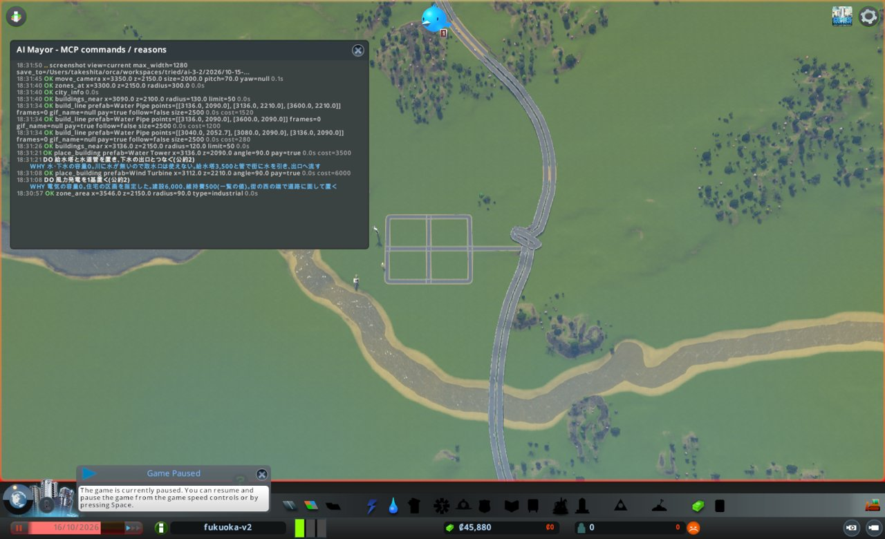
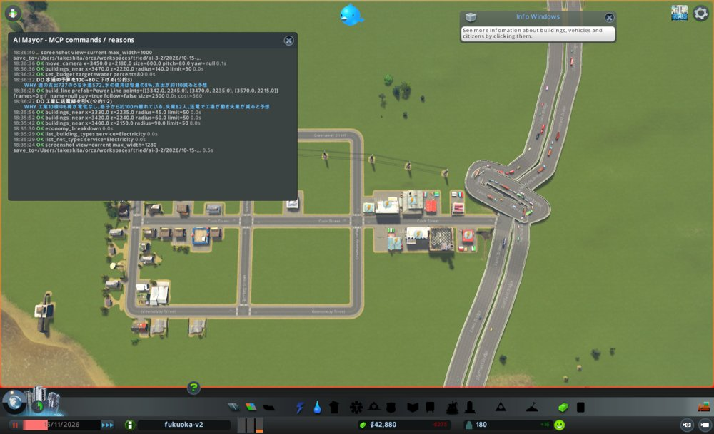
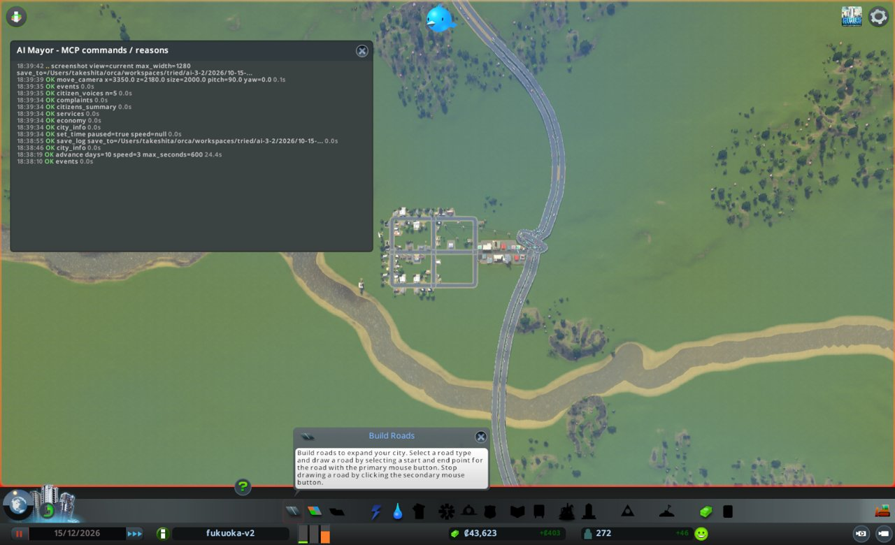
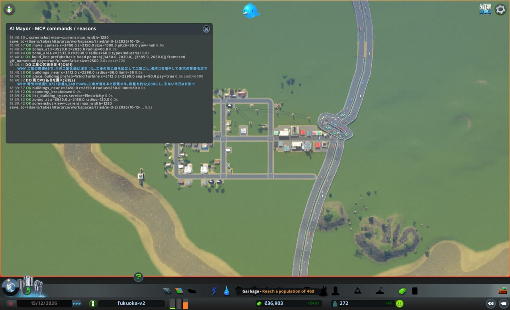
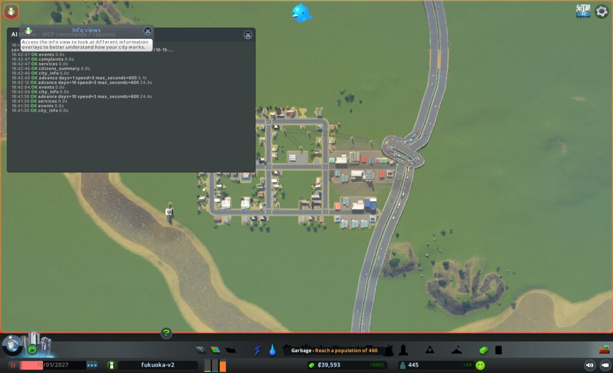

# 市政ノート

## 性格と公約

- 性格: なし。判断の型(`protocol.md`)にだけ従う
- 公約:
  1. 人口を毎月増やす(`city_info` の population。毎月の月例で、前の月例より増えていること)
  2. 電気・水・下水が来ない市民をなくす(`citizens_summary` の、電気・水・下水が来ない市民の数。任期の終わりに0)
  3. 赤字を続けない(`city_info` の週の収支。毎月の月例で、2回続けて赤字にしない)
- 任期: 3か月(ゲーム内 2026-10-16 から)

## 申し送り(前の運営から)

- 出発点の所持金69,500では、高速道路へ1.5kmの道(7,480)と格子の道で、道路の維持費が重くなった。最初の道を短くするか、高速の近くに街を置く
- 週の支出は約4,600で、最後まで下がらなかった。水道を100→50、道路を100→60に下げても、支出は215しか減らなかった(節電の政策で411増えた分は除く)。支出の内訳を見る道具がないので、何が重いのか分からなかった
- 働き口がないと人が増えない。1か月目に住宅だけを作り、11月に需要0で止まった。住宅と同時に商業・工業の区画を指定する
- 工業を住宅や商業から150mほど離して置いたら、電気が届かなかった。建物を切れ目なく並べるか、送電線を同時に引く
- 風力1基(容量5,200〜7,680、風しだい)では、人口300人台で足りなくなった
- ごみ・医療・警察・教育は最後まで0のまま。困りごとにはまだ出ていない
- 所持金が約 -10,000 で破産の警告が出る(2回の試運転で同じ)

## 数字の表

月例と見回りのたびに1行足す。区切りは 月例・見回り・臨時。

| ゲーム内の日付 | 区切り | 人口 | 所持金 | 週の収支 | 幸福度 | 需要(住/商/工) | 失業 | 主な困りごと |
|---|---|---|---|---|---|---|---|---|
| 2026-10-16 | 月例 | 0 | 70,000 | 0(0/0) | 0 | 100/0/0 | 0 | なし(建物0) |
| 2026-10-26 | 見回り | 0 | 44,895 | -737(0/737) | 0 | 58/12/6 | - | なし |
| 2026-10-26 | 臨時 | 0 | 44,895 | -737(0/737) | 0 | 58/12/6 | 0 | なし(困りごとの建物0) |
| 2026-11-05 | 見回り | 112 | 43,915 | -657(80/737) | 37 | 12/29/12 | - | なし |
| 2026-11-15 | 月例 | 180 | 43,440 | -275(462/737) | 45 | 0/0/18 | 82 | 電気(工業6棟) |
| 2026-11-25 | 見回り | 198 | 42,816 | +98(741/643) | 67 | 8/0/50 | - | なし(complaints 0) |
| 2026-12-05 | 見回り | 226 | 43,090 | +218(861/643) | 67 | 5/0/46 | - | なし |
| 2026-12-15 | 月例 | 272 | 43,623 | +402(1,045/643) | 66 | 8/0/66 | 35 | なし(complaints 0) |
| 2026-12-25 | 見回り | 331 | 37,490 | +424(1,152/728) | 65 | 2/0/73 | - | なし |
| 2027-01-04 | 見回り | 357 | 38,312 | +601(1,329/728) | 67 | 10/0/64 | - | なし |
| 2027-01-15 | 任期の終わり | 445 | 39,593 | +862(1,590/728) | 69 | 6/2/82 | 51 | なし(complaints 0) |

## 判断の記録

### 2026-10-16 月例(1か月目)

#### 答え合わせ

なし(初回)。

- 公約の進み具合
  1. 人口: 0。11-16の月例までに増やす
  2. 電気・水・下水が来ない市民: 0(市民0)
  3. 週の収支: 0(収入0/支出0)

#### 気づいたこと

- 更地。所持金70,000、税はすべて9%、予算はすべて100%。需要は住宅100、商業0、工業0
- `economy_breakdown` では、線の維持費はすべて0(高速・船・飛行機の線は費用なし)。前の運営で重かった鉄道の線はもう無い
- 九州自動車道は、見た範囲ではすべて高架(Bridge)。川(z≈2000付近)はどこも水面=地面で、水が無い。下水の出口(Water Outlet)を置ける水辺が近くに無いかもしれない

#### 施策

施策を打つ前にノートを書く決まりだが、施策1の最初の道(試しの1本)は、ノートを作る前に引いた。順番を誤った。

1. 高速道路の近くに、住宅・商業・工業を同時に作る
   - 公約: 1(人口)
   - 理由: 住宅の需要100、人口0。申し送りにより、高速の近くに置き、商業・工業も同時に指定する
   - 予想: 11-16の月例で人口150以上。商業・工業の働き口が100以上
   - 操作: build_line Basic Road で高速(西の車線、x≈3642, z=2150)への道と、x=3150〜3450, z=2030〜2390 の格子。zone_area で住宅・商業・工業
   - 結果: build_line はすべて ok。高速への道 960(西の車線を split 1 で分けて交差点)、東西3本 1,440×3、南北6本 640×6。道の費用の合計9,120。zone_area は住宅(低)1,272マス、商業(低)70+70マス、工業181マス
   - 確かめ: zones_at(3300,2150,半径300) は 住宅1,009 / 商業140 / 工業163 / 未指定19。画面写真で、格子が高速の交差点につながっている
2. 電気を作る(風力1基)
   - 公約: 2
   - 理由: 電気の容量0。住宅の区画を指定したので、建物が建つ前に電気を用意する
   - 予想: 10-26の見回りで services の電気の容量が5,000前後。電気が来ない市民0
   - 操作: place_building Wind Turbine (3112, 2210) angle 90。建設6,000、維持費500(一覧の値)
   - 結果: ok、費用6,000
   - 確かめ: buildings_near で problems None
3. 水と下水を作る(給水塔、下水の出口、水道管)
   - 公約: 2
   - 理由: 水・下水の容量0。川は水面=地面で水が無く、取水口は使えないと見た。地下水をくむ給水塔にした。下水の出口は試しに川床へ置いた
   - 予想: 10-26の見回りで services の水と下水の容量が0より大きい。水・下水が来ない市民0。ただし下水の出口は、水の無い川床で働かないかもしれない
   - 操作: place_building Water Outlet (3040, 2030) angle 0、Water Tower (3136, 2090) angle 90。build_line Water Pipe 3本(出口→給水塔、z=2090 と z=2210 を x=3600 まで)
   - 結果: すべて ok。出口2,500、給水塔3,500、管 280+1,200+1,520
   - 確かめ: buildings_near で、管をつなぐ前は出口と給水塔が WaterNotConnected、つないだ後は problems None
- 建設費の合計: 24,120(判断の時点の所持金70,000の半分以下)。所持金45,880
- 維持費の見積もり: 一覧の値で 風力500、給水塔1,500、出口2,000。週の収支はまだ0で、黒字の範囲に収める決まりは守れない。人口0から始めるため、維持費は先に出る

#### 次にやること

- 10-26の見回りで、下水の容量が0のままなら、下水の出口を置き直す場所を探す(臨時)
- 商業・工業の需要が出てきたか見る。出たら区画を足す
- 電気の使用が容量の8割を超えたら、風力の2基目

#### 画面写真

### 2026-10-26 見回り

境目: 当たった。週の収支が 0 から -737 になり、赤字に変わった。臨時に切り替える

- city_info: 人口0、所持金44,895、週の収支 -737(収入0/支出737)、幸福度0、需要 住58/商12/工6、ダイアログなし
- events: 3件(工業の区画を望む声、水が来た、初めての発電所)。困りごとのつぶやきは0件

### 2026-10-26 臨時

- きっかけ: 週の収支が赤字に変わった(-737)
- 見たもの
  - services: 電気 容量6,240/使用800、水 60,000/320、下水 120,000/20。ごみ・医療・警察・教育は0
  - complaints: 困りごとのある建物0
  - buildings_near(3300,2150,半径350): 住宅(低)の建物が約27棟、工業1棟が建っている。人口はまだ0
- 判断: 赤字は、入居の前に維持費が先に出ているため。建物は建ち始め、電気・水・下水の困りごとも無い。施策は打たない
- 下水の出口は、水の無い川床でも容量120,000を返した(月例の予想「働かないかもしれない」は外れ、働いた)
- 施策: なし

### 2026-11-05 見回り

境目: 当たらず。週の収支は -737 から -657 へ良くなった(赤字のまま)。所持金43,915

- city_info: 人口112、幸福度37、需要 住12/商29/工12、ダイアログなし
- events: 2件(再生可能エネルギーをほめる声、医療の話題)。困りごとのつぶやきは0件

### 2026-11-15 1か月目の終わり

3つ目の `advance(10)` で 11-15 まで進め、止めた。2か月目の月例は次の呼び出しで行う。advance の dialogs は空。

- city_info: 人口180、所持金43,440、週の収支 -275(収入462/支出737)、幸福度45、需要 住0/商0/工18、ダイアログなし
- 数字の表の行は、2か月目の月例で8つの道具を見てから足す
- 2か月目の月例への引き継ぎ
  - 週の支出は737のまま動いていない。収入は 0→80→462 と伸びている
  - 住宅と商業の需要が0になり、工業の需要18だけが残った。工業の区画は入口の道沿い(x≈3456〜3636)だけ
  - 下水の出口は水の無い川床でも容量120,000を返している

### 2026-11-15 月例(2か月目)

#### 答え合わせ

- 施策1(街を作る): 予想「人口150以上、働き口100以上」→ 人口180、働き口121。当たり
- 施策2(風力1基): 予想「容量5,000前後、電気が来ない市民0」→ 容量6,240、電気が来ない市民0。当たり。ただし工業6棟が電気の困りごと(Electricity)を出している。市民は0でも建物には届いていない
- 施策3(水と下水): 予想「容量が0より大きい、来ない市民0。出口は働かないかもしれない」→ 水60,000、下水120,000、来ない市民0。当たり(出口が働かない予想は外れた)
- 次にやることの実行
  - 下水の容量0なら出口を置き直す → 容量120,000で不要。実行せず
  - 商業・工業の需要が出たら区画を足す → 1か月目のうちは見回りで施策を打てないため未実行。今は商業0、工業18
  - 電気の使用が8割を超えたら風力2基目 → 使用3,616/6,240(58%)で不要
- 公約の進み具合
  1. 人口: 180(前の月例0)。増えた。次は12-15の月例で180より多く
  2. 電気・水・下水が来ない市民: 0/0/0。任期の終わり(2027-01-15ごろ)まで0を保つ
  3. 週の収支: -275(収入462/支出737)。前の月例は0で赤字ではなかったので、これが1回目の赤字。12-15の月例で赤字なら公約を破る

#### 気づいたこと

- 失業82人、働き手66人、働き口121。働き口はあるのに失業が多い
- 工業の建物10棟のうち6棟が電気の困りごと。工業は入口の道沿い(x≈3466〜3600)で、住宅・商業の格子の東端(店 x=3363)から約100m離れている。申し送り「150m離すと電気が届かない」と同じことが起きた
- 電気の来ない工場は動かず、働き口が埋まらないと見た。住宅・商業の需要0もここから来ていると見た
- economy_breakdown: 週の支出737のうち水道572、道路85、電気80。支出の大半は水道。水の使用4,688/容量60,000、下水293/120,000で大きく余っている
- ごみ・医療・警察・教育はまだ0。困りごとには出ていない

#### 施策

1. 工業に電気を届ける(送電線)
   - 公約: 1(人口。工場が動けば働き口が埋まり、住宅の需要が戻る)。2にもつながる
   - 理由: 工業6棟が電気の困りごと。格子の東端から約100m離れている
   - 予想: 11-25の見回りまでに電気の困りごとが0。12-15の月例で失業が82より減り、住宅の需要が0より大きい。電気の使用は容量の8割以下
   - 操作: build_line Power Line で、格子の東(3342,2245)から工業の北(3570,2215)まで
2. 水道の予算を100→80に下げる
   - 公約: 3(赤字)
   - 理由: 支出737のうち水道572。水の使用は容量の8%、下水は0.2%で大きく余る
   - 予想: 週の支出が約110減って約620。水・下水が来ない市民は0のまま
   - 操作: set_budget water 80
- 施策は2件にとどめる。住宅・商業の需要0は施策1の結果を見てから扱う。税は動かさない(需要0で上げると入居がさらに止まる)

#### 実行の結果

- 施策1: build_line Power Line ok。4区間、費用560。画面写真で、西端(3342,2245)が建物の無い区画にあり、電気の来ている建物から離れていると見えた。同じ施策の続きとして、西端から店(3363,2174)の北(3385,2200)へ1区間を足した。ok、費用160(snapped 1)。合計720
  - 確かめ: buildings_near で電柱5本を確認。工業6棟の困りごとは一時停止中のため Electricity のまま。次の見回りで見る
- 施策2: set_budget water 80 ok
- 建設費の合計720(所持金43,440の半分以下)。送電線の維持費は一覧に無く、economy_breakdown で次に見る
- 画面写真: 格子は西側に家が多く、東側の区画は空きが多い

#### 次にやること

- 11-25の見回りで、complaints の電気が0になったか見る。残っていれば送電線のつなぎ方を見直す(境目に当たれば臨時)
- 12-15の月例で、失業と住宅の需要を見る。需要が戻らなければ、税か区画を考える
- 12-15の月例で、週の収支が赤字なら公約3を破る。economy_breakdown で水道の支出が下がったか確かめる

### 2026-11-25 見回り

境目: 当たらず。週の収支は -275 から +98 へ黒字に変わった。advance の dialogs は空

- city_info: 人口198、所持金42,816、週の収支 +98(収入741/支出643)、幸福度67、需要 住8/商0/工50、ダイアログなし
- events: 0件
- 次にやることの確かめとして complaints を見た: 困りごとのある建物0(工業6棟の電気の困りごとが消えた)

### 2026-12-05 見回り

境目: 当たらず。advance の dialogs は空

- city_info: 人口226、所持金43,090、週の収支 +218(収入861/支出643)、幸福度67、需要 住5/商0/工46、ダイアログなし
- events: 0件

### 2026-12-15 2か月目の終わり

3つ目の `advance(10)` で 12-15 まで進め、止めた。3か月目の月例は次の呼び出しで行う。advance の dialogs は空。

- city_info: 人口272、所持金43,623、週の収支 +402(収入1,045/支出643)、幸福度66、需要 住8/商0/工66、ダイアログなし
- 数字の表の行は、3か月目の月例で8つの道具を見てから足す
- 3か月目の月例への引き継ぎ
  - 週の支出は水道の予算を下げた後 737→643(-94)で止まっている。予想の約-110より少し小さい
  - 工業の需要が 18→50→46→66 と伸び続けている。工業の区画は入口の道沿いだけ。足すなら、電気が届くように格子に接して置くか、送電線を同時に引く
  - 住宅の需要は一桁、商業は0のまま。格子の東側には空いた区画が多い
  - 電気の使用は11-15で3,616/6,240。工場が動き出した後の値はまだ見ていない

### 2026-12-15 月例(3か月目)

#### 答え合わせ

- 施策1(送電線): 予想「11-25までに電気の困りごと0。失業が82より減る。住宅の需要が0より大きい。電気の使用は8割以下」
  - 困りごと0: 当たり(11-25に0、今も0)
  - 失業 82→35: 当たり
  - 住宅の需要 0→8: 当たり(ただし一桁)
  - 電気の使用 5,872/6,240(94%): 外れ。8割を超えた
- 施策2(水道80%): 予想「支出が約110減って約620。来ない市民0」→ 支出737→643(-94)。来ない市民0。おおむね当たり。水の容量は60,000→38,400、下水は120,000→76,800に下がったが、使用は7,648と478で余っている
- 次にやることの実行
  - complaints の電気を見る → 11-25に見て0。実行した
  - 失業と住宅の需要を見る → 見た。失業35、住宅の需要8
  - economy_breakdown で水道の支出 → 見た。水道460、電気97、道路85
- 公約の進み具合
  1. 人口: 272(前の月例180)。増えた。任期の終わり(01-15)に272より多く
  2. 電気・水・下水が来ない市民: 0/0/0。ただし電気の使用が容量の94%で、このままでは足りなくなる
  3. 週の収支: +402。前の月例の -275 から黒字に戻した。2回続けての赤字にはならなかった

#### 気づいたこと

- 電気 5,872/6,240(94%)。工場が動き出して使用が伸びた。風が弱まれば容量が下がり、停電の恐れがある
- 働き手169、働き口185。働き口が16余る。失業35は学歴0(全員 uneducated)と通勤の都合と見た
- 工業の需要66。工業の区画(入口の道沿い)は建物で埋まっている
- 市民の平均の健康49、暮らし向き12、幸福度31。citizen_voices の5人のうち4人が PoorHealth。医療は0のまま。ただし complaints は0
- events は0件

#### 施策

1. 風力の2基目を置く
   - 公約: 2(電気が来ない市民を0に保つ)
   - 理由: 電気の使用が容量の94%。工業を足せばさらに増える
   - 予想: 12-25の見回りまでに容量が約12,000。01-15の月例で電気が来ない市民0
   - 操作: place_building Wind Turbine (3112, 2290) angle 90。建設6,000、維持費は一覧で500(1基目の実際の週の支出は約80)
2. 工業の区画を足す(南の道を東へ延ばす)
   - 公約: 1(人口。働き口が増えれば住宅の需要が戻る)
   - 理由: 工業の需要66で、今の工業区画は埋まっている。既存の工場の南に接して置き、電気が届くようにする
   - 予想: 01-15の月例で工業の建物が増え、働き口が185より多い。住宅の需要が8より大きく、人口が272より多い
   - 操作: build_line Basic Road (3450,2030)→(3585,2030)。zone_area で x≥3480 を工業
- 施策は2件にとどめる。医療は維持費が黒字402を食う恐れがあり、困りごとにも出ていないので見送る
- 建設費の見積もり: 約6,700(所持金43,623の半分以下)

#### 実行の結果

- 施策1: place_building Wind Turbine ok、費用6,000。buildings_near で problems None
- 施策2: build_line Basic Road ok、2区間、費用720(snapped 1、西端が格子の南の道の角につながった)。zone_area industrial ok、105マス
  - 確かめ: zones_at(3520,2030,半径80) は 工業108 / 住宅(低)31 / 未指定14。画面写真で、新しい道が格子の南の道から東へ延びている
- 建設費の合計6,720。所持金36,903
- 画面写真で、高速の出入口の交差点に車が詰まって見えた。complaints には出ていない

#### 次にやること

- 12-25の見回りで、電気の容量が約12,000になったか見る(境目には無いが、services を1回だけ確かめる)
- 01-15の月例で、工業の建物と働き口、住宅の需要、人口を見る
- 出入口の渋滞が events や complaints に出たら、臨時で扱う

### 2026-12-25 見回り

境目: 当たらず。advance の dialogs は空

- city_info: 人口331、所持金37,490、週の収支 +424(収入1,152/支出728)、幸福度65、需要 住2/商0/工73、ダイアログなし
- events: 0件
- 次にやることの確かめとして services を見た: 電気 容量11,440/使用6,624(58%)。働き手189、働き口225

### 2027-01-04 見回り

境目: 当たらず。advance の dialogs は空

- city_info: 人口357、所持金38,312、週の収支 +601(収入1,329/支出728)、幸福度67、需要 住10/商0/工64、ダイアログなし
- events: 0件

### 2027-01-15 任期の終わり

3つ目の `advance(10)` は 01-14 で止まった。任期の終わりの日にそろえるため `advance(1)` で 01-15 まで進めた。dialogs はどちらも空。

- city_info: 人口445、所持金39,593、週の収支 +862(収入1,590/支出728)、幸福度69、需要 住6/商2/工82、ダイアログなし
- citizens_summary: 住民444、就業276、失業51。電気・水・下水が来ない市民 0/0/0。体調が悪い6。平均の健康48、暮らし向き11、幸福度30
- services: 電気 容量11,360/使用9,584(84%)。水 38,400/12,576。下水 76,800/786。働き手276、働き口279
- complaints: 困りごとのある建物0。events: 0件
- 12-15の施策の答え合わせ
  - 施策1(風力2基目): 予想「容量が約12,000、来ない市民0」→ 12-25に11,440、01-15に11,360。来ない市民0。当たり。ただし使用が58%→84%に伸び、8割を超えた
  - 施策2(工業の区画): 予想「工業の建物が増え、働き口が185より多い。住宅の需要が8より大きく、人口が272より多い」→ 働き口279、人口445。住宅の需要は6で8より小さい。働き口と人口は当たり、住宅の需要は外れ
  - 出入口の渋滞: events と complaints に出なかった

## 人が手を入れたこと

- 月の境目ごとに、人がサブエージェントを呼び直した(1か月ずつ)。街の保存や再起動は、この市政ノートに記録のある範囲では無い

## 公約の結果

1. 人口を毎月増やす: 守れた。月例ごとに 0 → 180 → 272、任期の終わりに445
2. 電気・水・下水が来ない市民をなくす: 守れた。任期の終わりに 0/0/0。ただし電気の使用は容量の84%
3. 赤字を続けない: 守れた。11-15の月例で1回だけ赤字(-275)。12-15は +402、任期の終わりは +862

## 次の市長への申し送り

- 効いた施策
  - 工業へ送電線を引くと、電気の困りごとが10日で消え、週の収支が黒字に変わった
  - 埋まった工業の区画の隣に道を延ばして工業を足すと、30日で働き口185→279、人口272→445になった。住宅の需要は一桁のままでも人口は伸びた
  - 水道の予算100→80で、週の支出が94減った。水・下水の容量はまだ大きく余る
- 急ぐこと
  - 電気の使用が容量の84%(9,584/11,360)。人口が増えると10日ほどで足りなくなる。風力の3基目を最初に置く
  - 工業の需要82。住宅の需要は6、商業は2で、働き口に人が追いついていない
- まだ手を付けていないこと
  - ごみ・医療・警察・教育は任期を通して0。市民の平均の健康48、暮らし向き11で、5人のうち4人が PoorHealth。困りごとの印には出ていない。人口460でごみの施設が使えるようになる(画面の表示)
  - 全員が uneducated。学校が無い
- 気になったこと
  - 高速の出入口の交差点に車が詰まって見えた。events と complaints には出ていない
  - 風力の容量は風で動く(2基で11,360〜11,440)
- 足りなかった道具や情報
  - 維持費の一覧の値(風力500)と週の支出(1基約80)の単位が違い、施設を建てたときの週の支出の増え分を前もって読みにくい
  - move_camera で指定した視点と、実際の視点がずれることがあった

