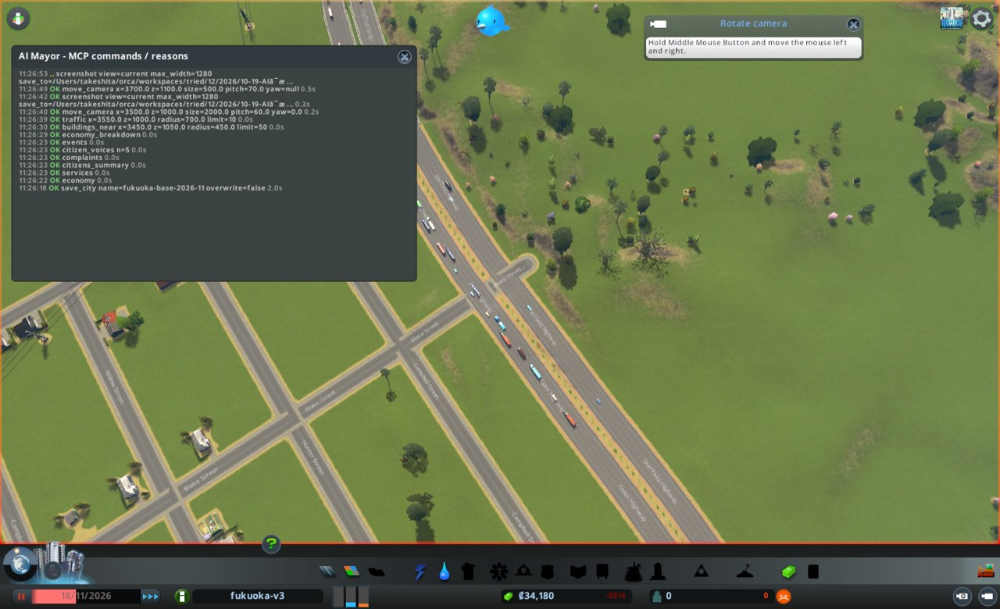
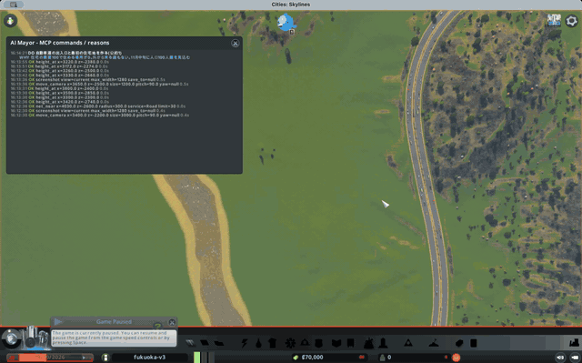
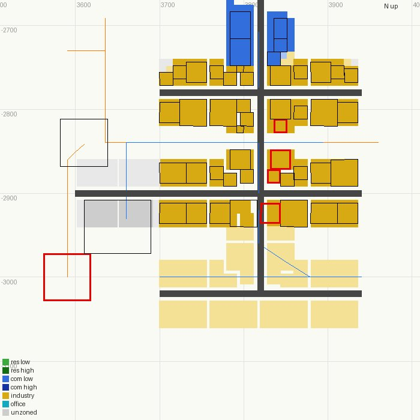
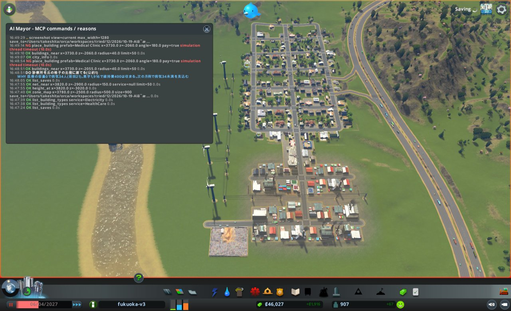
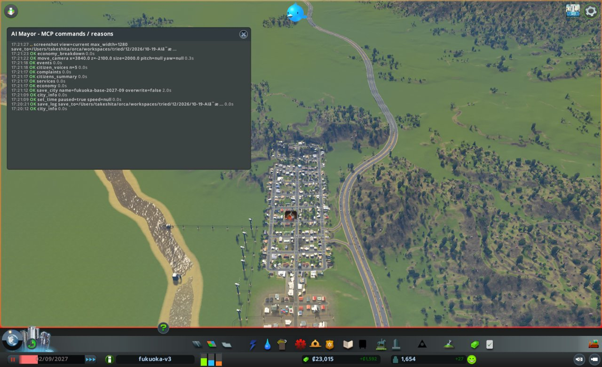

# AI市長に福岡を12か月任せた

## 予想を書いてから始める

やってみ太郎です。連載「AIは最高の市長になれるか」の6回目です。

前回は、Claude(AI)に Cities: Skylines(シティーズ・スカイライン)の福岡を3か月だけ任せました。
3つの公約は守ったのに、市民の5人のうち4人が体調を崩していた。そんな終わり方でした。

今回が本番です。任期は1年、12か月。
始める前に、点の付け方を決めておきました。結果を見てから物差しを決めると、つい都合のよい見方をしてしまうからです。
公約が守れたかとは別に、どの市長にも同じ6つの項目で点を付けます。人口、お金、電気や水、健康、教育、交通です。12点満点です。

もう1つ、結果の予想も先に書きました。Claude 自身に書かせた予想です。

- 人口は2,000人くらい
- 公約は3つのうち2つ。破るなら「人口を毎月増やす」
- 6項目は12点中6点。健康は0点。困った印が出るまで、病院は建てないはず

市長役は Claude Opus 5.5。性格は与えない、比べるときの物差しになる「基準の市長」です。
実時間で90分ほどの見込みでした。結局、丸1日かかりました。

## 2か月たっても人口が0

最初の1か月、AI市長は手際よく動きました。
九州自動車道のそばに道路の格子を引き、住宅の区画を塗る。風車と給水塔を置く。家も建ち始めました。

ところが、ゲームの人口が0のままです。
市民を数える道具では、51人が住んでいることになっています。なのに、画面の人口表示も0。週の税収も0です。
2か月目が終わると、住民は33人に減っていました。

ゲームのプログラムを読んで、ようやく分かりました。
引っ越してくる人は、外の町から家まで車でたどり着けたとき、初めて人口に数えられます。
33人は全員、まだ引っ越しの途中だったのです。

原因は、たった1か所でした。
AI市長が引いた道路が、九州自動車道につながっていなかったのです。
高速道路は、上り車線と下り車線が別々の道になっています。AI市長は、道路の端をその間の中央分離帯に置いていました。

画面写真では、きれいにT字につながって見えます。私も気づきませんでした。
道路を引く道具は「既存の道にはつながっていない」と、数字では返していました。でも、AI市長はその意味を読み取れませんでした。

ここで止めて、AI市長がゲームを動かすためのMOD(ゲームに足す改造プログラム)を直しました。
引っ越しの途中の人数を返すこと。外の町から車で来られない建物を探せること。この2つが中心です。

## 「足りない」と2か月書かれる

2回目は、出だしから人口が増えました。
1か月目の終わりに197人、3か月目には410人。お金も2か月目から黒字です。

でも、AI市長が毎月書く報告の最後に、同じ文が並びました。

> 送電線や管が建物につながったかを返す道具がありません。

送電線のつなぎ忘れで、工場と店の19棟に、約20日も電気が来ていませんでした。
AI市長はそれに気づいてはいたのです。ただ、どこがつながっていないのかを確かめる手段がありませんでした。

2か月続けて同じことを書かれたら、もう放っておけません。
3か月目の途中で止めて、MODをもう一度直しました。

- 線を引いたら、その端が建物につながったかを返す
- 建物ごとに、電気・水・下水が来ているかを返す
- 住宅・商業・工業の区画を、色分けした地図で見せる

直したあと、試しの街で確かめていて、あれ、と思いました。
建物のつなぎ口の位置が、前後逆に出ていたのです。ゲームの中では、建物の奥行きの向きが、正面と逆に数えられていました。
AI市長が手探りで見つけた「排水口のつなぎ口は、中心から23m北」と照らし合わせて、やっと気づきました。

そして、また最初からやり直しです。
途中で道具が変わると、12か月をひとつの結果として採点できないからです。

## 3回目、12か月を通す

3回目は、道具がそろった状態で始まりました。

1か月目、AI市長は交差点が1つつながっていないことに、自分で気づきました。
新しく足した「外から来られるか」を確かめる道具の結果を見て、道路を引き直したのです。
1回目は2か月気づけなかったことに、今度はその場で気づいています。

驚いたのは、4か月目でした。
AI市長が、小学校を建てたのです。
公約は、人口・電気や水・お金の3つだけです。学校のことは、どこにも書いていません。
それでも AI市長は、子どもが86人いるのに学校が0、という数字を見て、自分から建てました。
3か月の試運転の市長は、約束にない病院には手を出しませんでした。そこが違いました。

その後も、7か月目に診療所、10か月目に警察署、11か月目に消防署。
犯罪率は、警察署を建てて10日で34から11に下がりました。

## 道具のせいで起きたこと

順調に見えて、MODの側のつまずきは続きました。

7か月目の初め、街を保存する処理が終わらなくなりました。
保存が終わるまで、建物を置く命令も通りません。AI市長は無理に続けず、止まって私に知らせてくれました。
ゲームの一時停止を外すと、保存は数秒で終わりました。原因は、まだ分かっていません。

ほっとしたのも、つかの間でした。
保存が止まっている間、AI市長は診療所を建てようとして、「間に合わなかった」という返事を2回受け取っていました。
ところが実際には、2回とも、あとから建っていたのです。同じ場所に、診療所がふたつ。

9か月目には、火事の印が4つ出ました。
消防署はまだ高くて建てられないので、AI市長は「火災報知器を配る政策」を選びます。
予想では、週に200もかからないはずでした。実際は、週に約1,700。8倍です。
政策にいくらかかるか、前もって教える道具がなかったのです。

それでも、AI市長は次の月に直しました。
お金がたまった11か月目に消防署を建て、高い政策をやめる。週の支出は1,379減りました。
予想は「約1,300減る」。ぴったりでした。

## 最後の日の6人

12か月目、AI市長は西に住宅地を広げました。
10日で家が10棟建ち、人口は1,801人になりました。

そして任期の最後の日、北西の区画で水が切れました。
6人の市民に、水が届いていません。
AI市長は、西の住宅地を同じ水道管の網につないだせいかもしれない、と書いていました。
でも、それを確かめる前に、任期が終わりました。

予想と比べると、こうなりました。

- 人口は1,801人。予想の2,000人に近い
- 公約は3つのうち2つ。数は予想どおり。でも、破ったのは「人口」ではなく「水」だった
- 6項目は、私が付けた点で12点中7点。予想より1点上
- 健康は1点。予想では0点だった。AI市長は、困った印が出る前に診療所を建てていた

## ぬめとどんに見てもらう

録画は83分ありました。AIが考えている間はゲームが止まるので、半分以上は動きません。
動きのない所を切ると30分。台詞のない所を4倍速にすると、16分ほどになりました。

今回も、ナメクジの「ぬめ」とカピバラの「どん」に、AI市長の1年を見てもらっています。
台本は、市政ノートとゲームの記録にある事実だけで書きました。

> ぬめ: どん、こどもが、86人もいるよ。どこで、あそんでるの?
> どん: ……んー。遊んでるかもしれないねぇ。学校が、まだ1つもなかったんだ。

## 今日の学び

- 画面で見えることと、つながっていることは違う。1回目の道路は、写真ではT字にしか見えなかった。AIも人も、見た目を信じて2か月を失った。
- AIの報告は、道具の注文書になる。「つながったか分からない」と2か月続けて書かれて、直すべき所がはっきりした。
- 道具を足すと、AIの振る舞いが変わる。外から来られるかを確かめられるようになった市長は、つながっていない交差点にその場で気づいた。
- 約束の外の市民を見るかどうかは、市長の性格だけでは決まらない。数字が見えていれば、今回の市長は学校も診療所も、自分から建てた。
- 道具の失敗は、AIの失敗に見える。診療所が2つ建ったのも、政策の費用を8倍見誤ったのも、元をたどればMODの側の穴だった。

## 次にやること

まず、今回見つかったMODの穴をふさぎます。
保存が止まる原因、命令が時間切れのあとに動いてしまうこと、まだ使えない建物が一覧に混ざること。それから、政策の費用を前もって返すことです。

そのうえで、性格の違う市長を同じ出発点から走らせます。
今回の「基準の市長」の7点が、その物差しになります。

市政ノートと台本は、リポジトリに置いています。
https://github.com/h-takeshita-henteco-shoji-com/tried/tree/main/2026/10-19-AIは最高の市長になれるか-12-基準の市長に12か月任せる
