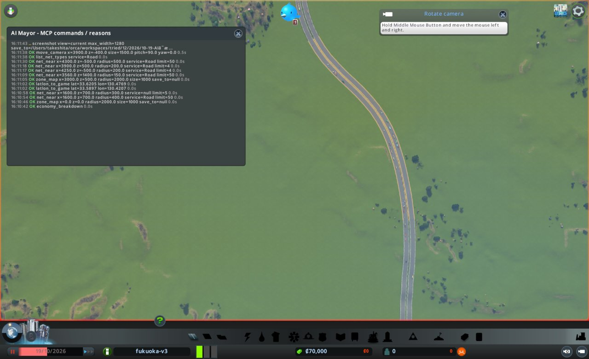
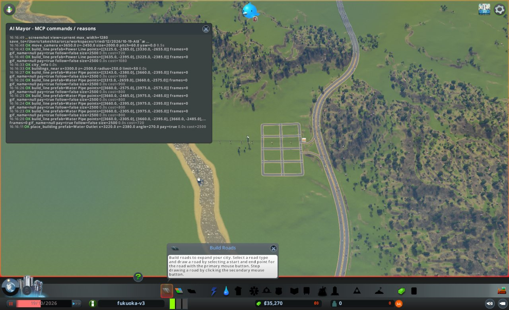
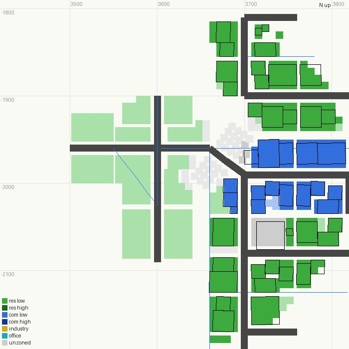
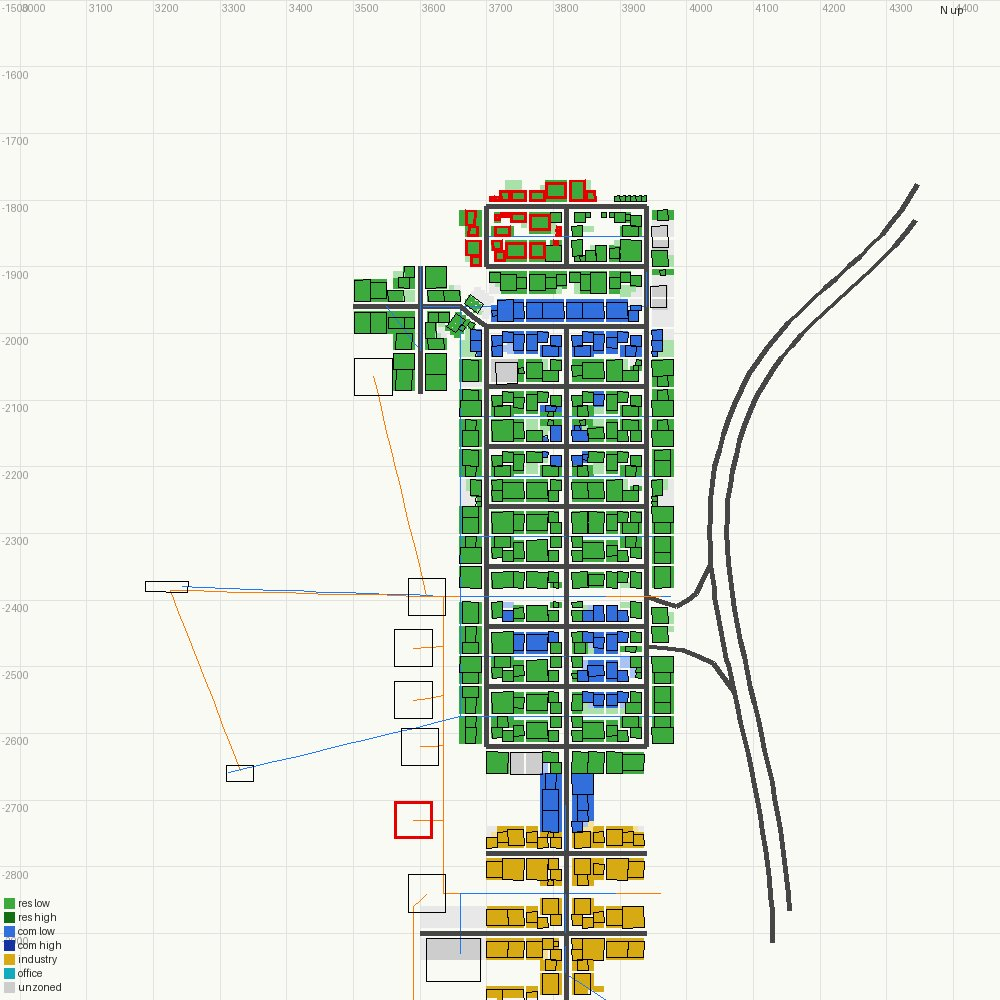

# 市政ノート

## 性格と公約

- 性格: なし。判断の型(`protocol.md`)にだけ従う
- 公約:
  1. 人口を毎月増やす(`city_info` の population。毎月の月例で、前の月例より増えていること)
  2. 電気・水・下水が来ない市民をなくす(`citizens_summary` の電気・水・下水が来ない市民の数。任期の終わりに0)
  3. 赤字を続けない(`city_info` の週の収支。毎月の月例で、2回続けて赤字にしない)
- 任期: 12か月(2026-10-19 から)

## 申し送り(前の運営から)

なし

## 数字の表

| ゲーム内の日付 | 区切り | 人口 | 所持金 | 週の収支 | 幸福度 | 需要(住/商/工) | 失業 | 主な困りごと |
|---|---|---|---|---|---|---|---|---|
| 2026-10-19 | 月例 | 0 | 70,000 | 0 / 0 | 0 | 100 / 0 / 0 | 0 | なし(建物0) |
| 2026-10-29 | 見回り→臨時 | 61 | 34,125 | 13 / 836 | 19 | 56 / 14 / 12 | - | 赤字。困りごとの印は0件 |
| 2026-11-08 | 見回り | 189 | 33,465 | 297 / 724 | 38 | 10 / 36 / 58 | - | 赤字(-427、前回-823より改善) |
| 2026-11-18 | 月例 | 203 | 33,054 | 458 / 724 | 42 | 0 / 0 / 100 | 136 | 困りごとの印0件。働き口16に対し失業136 |
| 2026-11-28 | 見回り | 203 | 19,574 | 533 / 774 | 53 | 4 / 21 / 62 | - | 赤字(-241、前回-266より改善) |
| 2026-12-08 | 見回り | 213 | 19,653 | 880 / 774 | 61 | 7 / 9 / 18 | - | 黒字(+106)。困りごとのつぶやきなし |
| 2026-12-18 | 月例 | 267 | 20,089 | 1,109 / 774 | 61 | 9 / 26 / 0 | 15 | 困りごとの印0件。ごみ・医療・教育の容量0。暮らし向きの平均13 |
| 2026-12-28 | 見回り | 353 | 15,887 | 1,423 / 939 | 62 | 4 / 13 / 0 | - | 黒字(+484)。困りごとのつぶやきなし |
| 2027-01-07 | 見回り | 399 | 17,007 | 1,766 / 939 | 64 | 9 / 8 / 13 | - | 黒字(+827)。困りごとのつぶやきなし |
| 2027-01-16 | 月例 | 463 | 38,341 | 1,979 / 939 | 65 | 9 / 22 / 5 | 29 | 困りごとの印0件。電気の使用69%。医療・葬祭・警察・教育の容量0。子ども86人 |
| 2027-01-26 | 見回り | 501 | 23,580 | 2,157 / 1,181 | 65 | 9 / 8 / 6 | - | 黒字(+976)。困りごとのつぶやきなし |
| 2027-02-05 | 見回り | 585 | 25,236 | 2,380 / 1,181 | 67 | 3 / 35 / 28 | - | 黒字(+1,199)。つぶやき0件 |
| 2027-02-15 | 月例 | 633 | 27,209 | 2,570 / 1,181 | 68 | 13 / 50 / 21 | 22 | 困りごとの印0件。電気の使用70%(容量20,320に下がった)。医療・葬祭・警察の容量0。健康の平均51 |
| 2027-02-25 | 見回り | 677 | 23,229 | 2,809 / 1,264 | 68 | 14 / 20 / 29 | - | 黒字(+1,545)。つぶやき0件 |
| 2027-03-07 | 見回り | 723 | 25,774 | 3,052 / 1,264 | 68 | 30 / 25 / 28 | - | 黒字(+1,788)。騒音のつぶやき1件 |
| 2027-03-17 | 月例 | 764 | 28,353 | 3,042 / 1,264 | 69 | 60 / 50 / 38 | 4 | 騒音の印1件。区画がほぼ埋まった。電気の使用61%、水51%。医療・葬祭・警察の容量0 |
| 2027-03-27 | 見回り | 808 | 23,200 | 3,033 / 1,316 | 69 | 16 / 50 / 42 | - | 黒字(+1,717)。病気のつぶやき1件 |
| 2027-04-06 | 見回り | 896 | 25,904 | 3,226 / 1,316 | 70 | 12 / 50 / 66 | - | 黒字(+1,910)。つぶやき0件 |
| 2027-04-06 | 月例 | 907 | 46,027 | 3,232 / 1,316 | 70 | 10 / 50 / 66 | 58 | 騒音の印3件。電気の使用72%、水60%。医療の容量0で病気34。工業の区画が埋まった |
| 2027-04-08 | 月例(やり直し) | 918 | 26,242 | 3,226 / 1,466 | 71 | 6 / 50 / 63 | 57 | 騒音の印4件。電気の使用77%、水62%。診療所が同じ場所に2つ建っていた(医療の容量200、病気34) |
| 2027-04-18 | 見回り | 988 | 18,754 | 3,684 / 2,226 | 74 | 6 / 50 / 33 | - | 黒字(+1,458、前回 +1,760)。支出が760増えた(診療所2つ分の維持費と見られる)。困りごとのつぶやきなし |
| 2027-04-28 | 見回り | 1,045 | 21,132 | 3,905 / 2,226 | 74 | 7 / 50 / 28 | - | 黒字(+1,679)。つぶやき1件(ニュースの声) |
| 2027-05-08 | 月例 | 1,117 | 23,803 | 4,117 / 2,226 | 75 | 16 / 50 / 30 | 11 | 犯罪の印2件(犯罪率13、警察の容量0)。電気の使用82%、水79%(予算60%)。区画は全部埋まった |
| 2027-05-18 | 見回り | 1,128 | 16,157 | 4,167 / 2,447 | 73 | 22 / 9 / 15 | - | 黒字(+1,720)。火事への苦情1件。犯罪率16 |
| 2027-05-28 | 見回り | 1,155 | 18,870 | 4,323 / 2,447 | 72 | 43 / 23 / 10 | - | 黒字(+1,876)。つぶやき0件 |
| 2027-06-07 | 月例 | 1,192 | 21,780 | 4,487 / 2,447 | 72 | 79 / 20 / 9 | 10 | 犯罪の印6件(犯罪率25)、火事の印4件、働き手不足2件。電気の使用73%、水47%。警察・消防・葬祭の容量0 |
| 2027-06-17 | 見回り | 1,270 | 17,305 | 4,810 / 4,192 | 71 | 37 / 23 / 14 | - | 黒字(+618、前回 +2,040)。政策の費用1,704。困りごとのつぶやきなし |
| 2027-06-27 | 見回り | 1,373 | 18,810 | 5,374 / 4,273 | 73 | 21 / 28 / 34 | - | 黒字(+1,101、前回 +618)。つぶやき0件 |
| 2027-07-04 | 月例 | 1,405 | 39,945 | 5,451 / 4,316 | 73 | 18 / 20 / 31 | 18 | 犯罪の印23件(犯罪率34)、火事の印5件。電気の使用81%。政策の費用1,829。警察・消防・葬祭の容量0 |
| 2027-07-14 | 見回り | 1,455 | 22,996 | 5,811 / 4,920 | 76 | 24 / 31 / 28 | - | 黒字(+891、前回 +1,135)。困りごとのつぶやきなし。犯罪率11 |
| 2027-07-24 | 見回り | 1,497 | 24,526 | 6,100 / 4,968 | 77 | 43 / 35 / 31 | - | 黒字(+1,132、前回 +891)。つぶやき1件(猫の救助。困りごとではない) |
| 2027-08-03 | 月例 | 1,536 | 26,002 | 5,984 / 4,989 | 76 | 60 / 44 / 34 | 18 | 火事の印5件(3840,-1920)。犯罪率6。電気の使用77%、水59%。政策の費用1,939。住宅の区画が埋まった |
| 2027-08-13 | 見回り | 1,597 | 17,317 | 6,032 / 3,610 | 79 | 55 / 39 / 31 | - | 黒字(+2,422、前回 +995)。困りごとのつぶやきなし |
| 2027-08-23 | 見回り | 1,627 | 20,574 | 5,828 / 3,610 | 78 | 61 / 50 / 38 | - | 黒字(+2,218、前回 +2,422)。つぶやき0件 |
| 2027-09-02 | 月例 | 1,654 | 23,014 | 5,202 / 3,610 | 74 | 63 / 44 / 37 | 22 | 火事の印5件(焼け跡5棟)。電気の使用77%、水61%。住宅の区画は埋まった。高校なし(十代350) |
| 2027-09-12 | 見回り | 1,693 | 15,146 | 5,278 / 3,730 | 76 | 17 / 50 / 40 | - | 黒字(+1,548、前回 +1,592)。困りごとのつぶやきなし |
| 2027-09-22 | 見回り | 1,752 | 17,266 | 5,248 / 3,730 | 75 | 18 / 50 / 52 | - | 黒字(+1,518、前回 +1,548)。つぶやき0件 |
| 2027-10-02 | 任期の終わり | 1,801 | 19,768 | 5,447 / 3,730 | 73 | 43 / 50 / 56 | 96 | 水が来ない市民6人(北西の区画の14棟が water false)。困りごとの印0件。電気の使用75% |

## 判断の記録

### 2026-10-19 月例(1か月目)

保存: `fukuoka-base-2026-10`

#### 答え合わせ

なし(初回)

- 公約の進み具合
  1. 人口: 0 / 来月の月例までに1人以上 / 道路と区画がまだないので、今月作らないと届かない
  2. 電気・水・下水が来ない市民: 0(市民がいない) / 任期の終わりまで12か月 / 発電と上下水を今月作る
  3. 週の収支: 収入0・支出0 / 毎月 / 建てると維持費だけが先に出るので、来月は赤字の見込み

#### 気づいたこと

- 街は空。道路は九州自動車道だけ(地面の区間16.6km、高架19.2km)。外とのつなぎ口は4つ。税は全部9%、予算は全部100%
- 自動車道は x≈4050〜4150、z≈-2300〜-2900 で地面を通る。北行きは西側の車線、南行きは東側の車線
- その西 600m に川がある(z=-2660 で x≈3330、水深2.5m。北へ流れる)。川と自動車道の間は平らな草地で、街を置ける

#### 施策

1. 自動車道の出入口と、最初の住宅地を作る
   - 公約: 1(人口)
   - 理由: 住宅の需要が100で、住める場所が0。外から車で来られる道もない
   - 予想: 次の月例(11月中旬)までに人口が100人を超える。net_reach の notReachable は0
   - 操作: build_line(HighwayRamp で北行きの車線から出る道と入る道)、build_line(Basic Road で格子)、zone_area(住宅を主に、自動車道側を工業)
   - 結果: Basic Road の格子(x=3700/3820/3940、z=-2260〜-2620、約2.2km)を引いた。x=3820 の南北の道は、途中の点が東西の道とつながらず、net_reach で8区間が notEnterable になった。8区間を remove_line で消し(理由: つながっていない道を残すと区画が使えないため)、交差点ごとに4本に分けて引き直した(無駄になった費用 1,920)。HighwayRamp 2本(出口 600、入口 510)。道路の費用の合計 15,190。区画は低密度住宅 1,417マス、低密度商業 55マス(z=-2440 と x=3880 の交差点のまわり)。工業は、住宅との間を空ける場所がないため今月は見送った
   - 確かめ: net_reach(半径400)で道路75区間、notEnterable 0、notLeavable 0。zone_map で区画を確かめた(assets/m1-zones.jpg)。出入口は北行きの車線だけ。南行きからは入れない
2. 風力発電と送電線を作る
   - 公約: 2(電気が来ない市民をなくす)
   - 理由: 発電の容量が0。家が建っても電気が来ない
   - 予想: 次の見回りで services の electricity の capacity が0より大きい
   - 操作: place_building(Wind Turbine 2基、1基6,000、週80)、build_line(Power Line)
   - 結果: 建設費の上限に収めるため1基にした。Wind Turbine を (3610,-2395) に置いた(id 45887、6,000)。送電線を (3635,-2395)〜(3960,-2395) に引いた(840)
   - 確かめ: 送電線の端が風車の中(insideBuilding 45887)。電気の容量は次の見回りで見る
3. 川から取水し、下水を流す
   - 公約: 2(水・下水が来ない市民をなくす)
   - 理由: 水と下水の容量が0
   - 予想: 次の見回りで services の water と sewage の capacity が0より大きい
   - 操作: place_building(Water Intake を上流、Water Outlet を下流)、build_line(Water Pipe で住宅地へ)
   - 結果: Water Intake を (3330,-2660) に(id 34085、2,500)、Water Outlet を (3220,-2380) に(id 37831、2,500)置いた。水道管は x=3660 の幹と、z=-2305/-2395/-2485/-2575 の4本、取水口と排水口からの2本(5,900)。置いた後、取水と排水にも電気が要ると気づき、送電線を風車〜排水口〜取水口に足した(1,800)
   - 確かめ: buildings_near で取水口と排水口の port が connected: true。建物の grid は、時間を進める前なので電気・水・下水とも false

建設費の上限は 35,000(所持金70,000の半分)。使った建設費は 34,730(所持金 35,270)。
維持費の見積もりは週に約890(道路約90、風車80、取水240、排水320、送電線約60、水道管約60、ランプ約10)。収入が0なので、型の「維持費の増え分は週の黒字の範囲に収める」は守れない。建てないと人口も収入も0のままなので、初月は例外として建てた。

#### 次にやること

- 工業の区画を、住宅から離れた場所(自動車道の東側か、格子の南)に作る。働き口の需要が出てから
- 南行きの車線からの出入口を作る(今は北行きだけ)
- 電気・水の容量が使用量に追いつくか見る。足りなければ風車を足す

#### 画面写真

### 2026-10-29 見回り

境目: 当たった。週の収支が、前回(月例、収入0・支出0)より悪化して赤字になった(収入13、支出836)。ほかの境目は当たらず(所持金34,125、人口0→61、幸福度0→19、events に困りごとのつぶやきなし、dialog なし)

### 2026-10-29 臨時

- きっかけ: 週の収支が 13 - 836 = -823 の赤字
- 見たもの: complaints は0件。services は電気 容量6,800・使用1,520、水 容量120,000・使用1,632、下水 容量120,000・使用102。赤字の原因は、月例で建てた施設と道路の維持費で、収入はまだ人口61人分
- 施策: 水道の予算を100%から80%に下げる
  - 公約: 3(赤字を続けない)
  - 理由: 水の容量が使用量の約70倍あり、予算を下げても足りる
  - 予想: 次の見回りで、週の支出が約110減る(取水240+排水320の2割)。水の容量は約96,000に下がるが、使用量を大きく上回る
  - 操作: set_budget(water, 80)
  - 結果: 成功(water 80%)
  - 記録の順: explain の後、ノートに書く前に実行した。型では「実行の前にノートに書く」なので、順が逆になった

### 2026-11-08 見回り

境目: 当たらず。週の収支は -427 で赤字だが、前回の -823 より良くなった。人口 61→189、幸福度 19→38、所持金 33,465。events に困りごとのつぶやきなし。dialog なし。需要は住宅10、商業36、働き口58に変わった

### 2026-11-18 1か月目の終わり(advance の後、dialog の有無だけ確かめた)

city_info: 人口203、所持金33,054、週の収入458・支出724(-266)、幸福度42、需要 住宅0・商業0・働き口100、dialog なし。次の月例はここから始める。数字の表の行は次の月例で足す。
働き口の需要が100で、住宅の需要が0に落ちた。働き口(工業かオフィス)がないことが、人口の伸びを止めはじめている。

### 2026-11-18 月例(2か月目)

保存: `fukuoka-base-2026-11`

#### 答え合わせ

- 月例の施策1(出入口と住宅地): 予想「人口100人超、notReachable 0」→ 人口203。当たった
- 月例の施策2(風車): 予想「電気の capacity > 0」→ 容量6,800・使用3,072。当たった
- 月例の施策3(取水と排水): 予想「水と下水の capacity > 0」→ 水 76,800・使用4,768、下水 76,800・使用298。当たった
- 臨時の施策(水道の予算80%): 予想「支出が約110減る」→ 支出は836→724(-112)。当たった。水の容量は予想の約96,000より低い76,800だったが、使用量を大きく上回る
- 次にやることの実行
  - 工業の区画: 今月実行する(働き口の需要が100になったため)
  - 南行きの出入口: 未実行。今月も見送る(建設費を工業に回す)
  - 電気と水の容量: 見た。電気は使用が容量の45%。工業を足すと足りなくなる見込み
- 公約の進み具合
  1. 人口: 0 → 203。増えた(達成)。ただし住宅の需要が0で、来月も増やすには働き口が要る
  2. 電気・水・下水が来ない市民: 0 / 任期の終わりまで残り10か月
  3. 週の収支: -266。月例では1回目の赤字(前の月例は0/0)。来月の月例で赤字だと「2回続けて」になる

#### 気づいたこと

- 失業136人に対し、働き口は16(商業だけ)。働き口の需要が100、住宅と商業の需要は0
- 市民203人は全員が学歴なし・低所得。学校がないので、まずは工業(学歴を問わない働き口)が合う
- ごみ・医療・葬祭・警察・教育の容量は0。困りごとの印はまだ0件。ごみが最初に印になる見込み
- 格子の空き区画は多い。区画を足すより、働き口を作れば住宅の需要が戻ると見る

#### 施策

1. 格子の南に工業地を作る
   - 公約: 1(人口)、3(赤字)
   - 理由: 働き口の需要100、失業136人。働き口ができれば住宅の需要が戻り、工業の税も入る
   - 予想: 次の月例までに、働き口が100を超え、失業が80以下、人口が230を超える。週の収入が700を超える
   - 操作: build_line(Basic Road。x=3820 を -2620 から -2900 へ延ばし、z=-2780 と z=-2900 に東西の道 x=3700〜3940)、build_line(Water Pipe。x=3818 を -2575 から -2840 へ、z=-2840 に東西)、zone_area(industrial)
   - 住宅との間: 住宅の区画の南端 z≈-2660 と、工業の北端 z≈-2740 の間を約80m空ける
2. 風車をもう1基建て、工業地まで送電線を引く
   - 公約: 2(電気が来ない市民をなくす)
   - 理由: 電気は使用3,072/容量6,800。工業は電気を多く使うので、今の容量では足りなくなる
   - 予想: 次の見回りで電気の容量が約13,600。工業の建物に電気が来る(zone_map で赤い枠がない)
   - 操作: place_building(Wind Turbine を (3610,-2840)、6,000、週80)、build_line(Power Line を (3635,-2395)→(3635,-2840)→(3960,-2840))
3. 水道の予算を80%から60%に下げる
   - 公約: 3(赤字)
   - 理由: 水の使用は4,768で容量76,800の6%。施策1・2の維持費の増え分(週約140)を埋める
   - 予想: 週の支出が約110減る。水の容量は約57,000に下がるが、使用を大きく上回る

建設費の上限は 16,527(所持金33,054の半分)。見積もりは約13,800(道路約3,800、水道管約2,000、風車6,000、送電線約2,000)。
維持費の増え分は週約140(道路約30、風車80、管と線約30)。週の収支は赤字なので、型の「黒字の範囲」は守れない。施策3で同じくらい減らし、差し引きをほぼ0にする。

#### 結果

1. 工業地: Basic Road を6本に分けて引いた(4,000)。水道管を3本(1,240)。zone_area で工業 483マス。zones_at(3820,-2840、半径150)で工業466・未指定52
   - 確かめ: net_reach(半径400)で道路80区間、notEnterable 0、notLeavable 0。zone_map(assets/m2-zones.jpg)で、新しい道は格子の x=3820 とつながって見える
   - 水道管の交点 (3818,-2840) で、build_line が insideBuilding 3101 を返した。buildings_near(半径60)では建物0件。何の建物かは分からない
2. 風車: Wind Turbine を (3610,-2840) に置いた(id 38253、6,000)。送電線を (3635,-2395)→(3635,-2840)(1,080)と (3635,-2840)→(3960,-2840)(800)に引いた。両端とも風車の中に入った
   - 確かめ: zone_map で新しい風車は赤い枠(時間を進める前なので、まだ網に入っていない)。容量は次の見回りで services を見る
3. 水道の予算: set_budget(water, 60) 成功

使った建設費は 13,120。所持金は 33,054 → 19,934。

#### 次にやること

- 見回りで、電気の容量が約13,600になったか、工業の建物に赤い枠がないかを見る
- ごみの容量が0。困りごとの印に出たら、次の月例でごみ処理場を建てる
- 南行きの車線からの出入口を作る(工業のトラックが増えたら)

### 2026-11-28 見回り

境目: 当たらず。人口203(前回203)、所持金19,574、週の収支 533 - 774 = -241(前回の月例 -266 より改善)、幸福度42→53。events は1件(風車をほめる声)。dialog なし
建てた後の確かめ: services で電気の容量 14,000・使用4,064(予想13,600)。水の容量 43,200・使用5,440(予想約57,000より低い)。働き口 16→184、働き手 16→61。需要は住宅4、商業21、働き口62

### 2026-12-08 見回り

境目: 当たらず。人口213(前回203)、所持金19,653、週の収支 880 - 774 = +106(黒字に転じた)、幸福度53→61。events は0件。dialog なし。需要は住宅7、商業9、働き口18

### 2026-12-18 2か月目の終わり(advance の後、dialog の有無だけ確かめた)

city_info: 人口267、所持金20,089、週の収入1,109・支出774(+335)、幸福度61、需要 住宅9・商業26・働き口0、dialog なし。次の月例はここから始める。数字の表の行は次の月例で足す。
働き口の需要は0になり、商業の需要が26に上がった。住宅の需要は9と低いまま。

### 2026-12-18 月例(3か月目)

保存: `fukuoka-base-2026-12`

#### 答え合わせ

- 施策1(工業地): 予想「働き口100超、失業80以下、人口230超、週の収入700超」→ 働き口322、失業15、人口267、週の収入1,109。全部当たった
- 施策2(風車2基目): 予想「電気の容量約13,600、工業に赤い枠なし」→ 容量13,920・使用6,736。zone_map で工業の建物に赤い枠なし。当たった
- 施策3(水道の予算60%): 予想「支出が約110減り、容量約57,000」→ 支出は施策1・2の増え分と合わせて724→774(+50)。水の容量は43,200(予想より低い)、使用8,128で足りている。容量の予想は外れた(予算と容量の関係を甘く見ていた)
- 次にやることの実行
  - 電気と赤い枠の確かめ: 見回りで実行した
  - ごみ: 困りごとの印はまだ0件。ただし人口が増え、容量0のままでは近く印が出るので、今月建てる
  - 南行きの出入口: 未実行。交通の困りごとが出ていないため見送る
- 公約の進み具合
  1. 人口: 203 → 267。増えた(達成)
  2. 電気・水・下水が来ない市民: 0 / 任期の終わりまで残り9か月
  3. 週の収支: +335。黒字に戻った(前の月例は -266)。「2回続けて赤字」は避けた

#### 気づいたこと

- 失業15、働き手171に対し働き口322。働き口は余っている
- 住宅の需要は9と低い。空いた住宅の区画は多い。商業の需要は26
- 市民266人は全員が学歴なし・低所得。子ども50、十代21で、学校がない。暮らし向きの平均13、幸福度の平均33(city_info は61)
- ごみ・医療・葬祭・警察・教育の容量は0。困りごとの印は0件
- 週の収入の内訳は住宅498、工業375、商業234、市民234。支出は水364、電気268、道路141

#### 施策

1. 工業地の西に埋立地(Landfill Site)を作る
   - 公約: 1(人口)。ごみがたまると建物が捨てられ、人口が減るのを防ぐ
   - 理由: ごみの容量が0で、人口267。印が出てからでは遅い
   - 予想: 次の見回りで services の garbage の capacity が0より大きい。今月の困りごとに「ごみ」が出ない
   - 操作: build_line(Basic Road を (3700,-2900) から (3600,-2900) へ、約500)、place_building(Landfill Site を道の南 (3650,-2940)、4,000、週160)
2. 低密度商業の区画を足す
   - 公約: 1(人口)、3(赤字)
   - 理由: 商業の需要が26。住宅の空き区画は多いので、一部を商業に変える
   - 予想: 次の月例までに商業の建物が増え、商業の週の収入が234から300を超える
   - 操作: zone_area(commercial_low、中心 (3760,-2440)、半径50。空いたマスだけ変わる)

建設費の上限は 10,044(所持金20,089の半分)。見積もりは約4,500。
維持費の増え分は週約165(埋立地160、道路約4)。週の黒字335の範囲に収まる。

#### 結果

1. 埋立地: Basic Road を (3700,-2900)→(3600,-2900) に引いた(480)。Landfill Site を (3650,-2940) に置いた(id 29231、4,000)。入口は北向きで、新しい道に面した(distance 0)。buildings_near で電気 true、水 false だったので、水道管を (3700,-2840)→(3660,-2840)→(3660,-2930) に足した(340)。端は埋立地の中に入った
   - 確かめ: net_reach(半径150)で道路 notEnterable 0、notLeavable 0。noRoad 1件は風車 38253(道路の要らない建物)。zone_map(assets/m3-zones-after.jpg)では埋立地と風車38253が赤い枠。時間を進める前なので、見回りでもう一度見る
2. 商業の区画: zone_area で (3760,-2440) 半径50 を commercial_low に(34マス変わり、建物のある49マスはそのまま)。続けて (3880,-2520) 半径45 も commercial_low に(63マス)。合わせて97マス
   - 予定の半径50の1か所では34マスと少なかったので、2か所目を足した

使った建設費は 4,820。所持金は 20,089 → 15,269。

#### 次にやること

- 見回りで、ごみの容量が0より大きいか、埋立地の赤い枠が消えたかを見る
- 電気の使用が容量の6割を超えた。8割を超えたら風車を足す
- 子ども50人に学校がない。黒字が維持費160を超えて続けば、小学校(10,000、週160)を建てる

### 2026-12-28 見回り

境目: 当たらず。人口353(前回267、+32%)、所持金15,887、週の収支 1,423 - 939 = +484(前回 +335)、幸福度62(前回61)。events は1件(ごみ出しが楽になったという声)。dialog なし。需要は住宅4、商業13、働き口0
建てた後の確かめ: services でごみの容量 8,000,000・使用0。電気は容量13,920・使用8,336(60%)。働き口355、働き手221

### 2027-01-07 見回り

境目: 当たらず。人口399(前回353)、所持金17,007、週の収支 1,766 - 939 = +827(前回 +484)、幸福度64(前回62)。events は1件(ニュースの声。困りごとではない)。dialog なし。需要は住宅9、商業8、働き口13

### 2027-01-16 ダイアログで止まった(3か月目の終わりの手前)

advance(10) は 2027-01-07 から 2027-01-16 まで進み、ダイアログで止まった(reached: false。予定の 2027-01-17 の1日前)。型の「途中で親に戻るとき」に当たるので、運営を止めて親に戻る。

- ダイアログ: UnlockingPanel(seq 1)。人口460の節目「Little Hamlet」に届いた知らせ。解禁: 税、借入、ごみ・医療・教育のサービス、埋立地・小学校・診療所
- ボタン: Milestones / Unique Buildings / Monuments / Achievements。押すかどうかは人が決める
- city_info: 人口463、所持金38,341(前回17,007から+21,334。節目の報酬と見られる)、週の収支 1,979 - 939 = +1,040、幸福度65、需要 住宅9・商業22・働き口5
- 気づいたこと: 月例で置いた Landfill Site は、この節目で解禁と出ている。place_building は解禁前の建物も置けたことになる。型の「ゲームの仕組みの外の操作」に当たるかもしれない。人の判断を仰ぐ
- 数字の表の行は、次の月例で足す

### 2027-01-16 月例(4か月目)

保存: `fukuoka-base-2027-01`

#### 答え合わせ

- 施策1(埋立地): 予想「次の見回りで garbage の capacity > 0、今月の困りごとに『ごみ』が出ない」→ 容量 8,000,000。complaints は0件。当たった
- 施策2(商業の区画97マス): 予想「商業の建物が増え、商業の週の収入が234から300を超える」→ zone_map で商業の建物は増えた。商業の収入は今回 economy_breakdown を見ていないので確かめていない
- 次にやることの実行
  - ごみの容量と埋立地の赤い枠: 見回りで容量を見た(実行)
  - 電気が8割を超えたら風車: 今は69%。来月までに8割を超える見込みなので、今月建てる
  - 小学校: 黒字が維持費160を超えて続いた(+484、+827、+1,040)。節目で解禁されたので、今月建てる
- 公約の進み具合
  1. 人口: 267 → 463。増えた(達成)
  2. 電気・水・下水が来ない市民: 0 / 任期の終わりまで残り8か月
  3. 週の収支: +1,040。黒字(2回続けて黒字)

#### 気づいたこと

- 節目「Little Hamlet」で所持金が 17,007 → 38,341 に増えた。小学校と診療所が解禁された
- 電気は容量15,600・使用10,768(69%)。人口は10日で約1割ずつ増えている
- 子ども86人、十代39人に学校がない。全員が学歴なし・低所得。暮らし向きの平均14、健康の平均52
- 医療・葬祭・警察の容量は0。困りごとの印は0件
- 住宅の需要は9と低い。空いた住宅の区画は多い(zone_map、assets/m4-zones.jpg)。区画を足しても効かない
- 商業の空いた区画も残っている。商業の需要22には区画を足さずに待つ

#### 施策

1. 小学校を建てる
   - 公約: 1(人口)。学校がないと暮らし向きと住宅の需要が上がらない
   - 理由: 子ども86人、教育の容量0。黒字1,040で維持費160は収まる
   - 予想: 次の見回りで services の elementary が0より大きい。次の月例で人口が520を超える
   - 操作: place_building(Elementary School を住宅地の南の空き区画、z=-2620 の道の南 (3760,-2645) に、10,000、週160)
2. 風車を1基足す
   - 公約: 2(電気が来ない市民をなくす)
   - 理由: 電気の使用69%。人口の伸びから、次の月例までに8割を超える
   - 予想: 次の見回りで電気の容量が約22,000に増え、使用率が6割を切る
   - 操作: place_building(Wind Turbine を (3600,-2620) に、6,000、週80)、build_line(Power Line で x=3635 の線へ)

建設費の上限は 19,170(所持金38,341の半分)。見積もりは約16,300。
維持費の増え分は週約245(小学校160、風車80、線約5)。週の黒字1,040の範囲に収まる。
診療所(10,000、週400)は上限を超えるので来月にする。

#### 結果

1. 小学校: Elementary School を (3760,-2645) に置いた(id 18455、10,000)。入口は北向きで、z=-2620 の Basic Road に面した(distance 1)
   - 確かめ: buildings_near で水 true・下水 true・電気 false。時間を進める前なので、見回りでもう一度見る
2. 風車: Wind Turbine を (3600,-2620) に置いた(id 9087、6,000)。送電線を (3600,-2620)→(3635,-2618) に引いた(80)。風車側の端は風車の中、反対の端は x=3635 の線の点につながった
   - 確かめ: buildings_near で電気 false(時間を進める前)。容量は見回りで services を見る

使った建設費は 16,080。所持金は 38,341 → 22,261。

#### 次にやること

- 見回りで、電気の容量が増えたか、小学校に電気が来たかを見る
- 診療所(10,000、週400)を建てる。健康の平均52。黒字が続けば次の月例で
- 葬祭の容量が0。高齢者8人。墓地が解禁されたら建てる
- 南行きの車線からの出入口(交通の困りごとが出たら)

### 2027-01-26 見回り

境目: 当たらず。人口501(前回463)、所持金23,580、週の収支 2,157 - 1,181 = +976(黒字。前回 +1,040)、幸福度65(前回65)。events は3件(教育と風車をほめる声、流行の話)。困りごとのつぶやきなし。dialog なし。需要は住宅9、商業8、働き口6
建てた後の確かめ: services で電気の容量 22,480・使用11,456(51%。予想の約22,000・6割未満に当たった)。elementary の容量 300(0より大きい。当たった)

### 2027-02-05 見回り

境目: 当たらず。人口585(前回501)、所持金25,236、週の収支 2,380 - 1,181 = +1,199(前回 +976)、幸福度67(前回65)。events は0件。dialog なし。需要は住宅3、商業35、働き口28(商業と働き口が上がった)

### 2027-02-15 4か月目の終わり(advance の後、dialog の有無だけ確かめた)

city_info: 人口633、所持金27,209、週の収入2,570・支出1,181(+1,389)、幸福度68、需要 住宅13・商業50・働き口21、dialog なし。次の月例はここから始める。数字の表の行は次の月例で足す。
商業の需要が50に上がった。空いた商業の区画が足りているかを、次の月例で zone_map で見る。

### 2027-02-15 月例(5か月目)

保存: `fukuoka-base-2027-02`

#### 答え合わせ

- 施策1(小学校): 予想「次の見回りで elementary > 0、次の月例で人口520超」→ elementary 300、人口633。当たった
- 施策2(風車3基目): 予想「次の見回りで電気の容量約22,000、使用率6割未満」→ 見回りで容量22,480・使用51%。当たった。ただし今日は容量20,320・使用14,128(70%)。風車の出力は日によって変わる
- 前々月の施策2(商業の区画): 商業の収入は今回も economy_breakdown で見ていない。確かめていない
- 次にやることの実行
  - 電気の容量と小学校の電気: 見回りで容量を見た(実行)。小学校の容量300が出たので電気は来ている
  - 診療所: 未実行。今月は風車を先にしたので、建設費の上限(13,604)に収まらない。来月に回す
  - 墓地: 解禁の知らせに墓地がなかったので見送る(解禁前の建物を置かないため)
  - 南行きの出入口: 交通の困りごとが出ていないので見送る
- 公約の進み具合
  1. 人口: 463 → 633。増えた(達成)
  2. 電気・水・下水が来ない市民: 0 / 任期の終わりまで残り7か月
  3. 週の収支: +1,389。黒字(3回続けて黒字)

#### 気づいたこと

- 電気の容量が見回りの22,480から20,320に下がった。風車の出力が風で変わるため。使用は14,128(70%)で、人口の伸び(月に約3割)から、来月は8割を超える見込み
- 商業の需要50。zone_map(assets/m5-zones.jpg)で商業の区画はほぼ埋まっている。住宅と工業のあいだ(x=3760〜3840、z=-2650〜-2740)に、未指定のマスが残っている
- 工業の区画もほぼ埋まった。働き口の需要は21
- 子ども121、十代56。小学校の定員300に対し学生112。全員が低所得、暮らし向きの平均14、健康の平均51、病気8人
- 医療・葬祭・警察の容量は0。困りごとの印はまだ0件

#### 施策

1. 風車を1基足す
   - 公約: 2(電気が来ない市民をなくす)
   - 理由: 電気の使用70%。風で容量が約1割上下する。来月の伸びで8割を超え、風の弱い日に足りなくなる
   - 予想: 次の見回りで電気の容量が25,000を超え、使用率が6割前後になる
   - 操作: place_building(Wind Turbine を (3590,-2730) に、6,000、週80)、build_line(Power Line を (3590,-2730)→(3635,-2730))
2. 住宅と工業のあいだに低密度商業の区画を足す
   - 公約: 1(人口)、3(赤字)
   - 理由: 商業の需要50で、商業の空き区画がほぼない。未指定のマスが道沿いに残っている
   - 予想: 次の月例までに、このあいだに商業の建物が建ち、商業の需要が30を下回る
   - 操作: zone_area(commercial_low、中心 (3810,-2695)、半径60)

建設費の上限は 13,604(所持金27,209の半分)。見積もりは約6,100。
維持費の増え分は週約85(風車80、線約5)。週の黒字1,389の範囲に収まる。
診療所(10,000、週400)は、風車と合わせると上限を超えるので来月にする。

#### 結果

1. 風車: Wind Turbine を (3590,-2730) に置いた(id 46805、6,000)。送電線を (3590,-2730)→(3635,-2730) に引いた(120)。風車側の端は風車の中、反対の端は x=3635 の線を分けてつながった(split)
   - 確かめ: zone_map(assets/m5-zones-after.jpg)で新しい風車は赤い枠(時間を進める前)。容量は見回りで services を見る
2. 商業の区画: zone_area で commercial_low に89マス変わった(建物のある25マスはそのまま)
   - 確かめ: zone_map で、x=3820 の道の両側、z≈-2650〜-2740 が商業(薄い青)になった

使った建設費は 6,120。所持金は 27,209 → 21,089。

#### 次にやること

- 見回りで、電気の容量が25,000を超えたか、新しい風車の赤い枠が消えたかを見る
- 診療所(10,000、週400)を次の月例で建てる。健康の平均51
- 商業の収入を economy_breakdown で見て、商業の区画の効き目を確かめる
- 墓地は解禁の知らせが出てから。南行きの出入口は交通の困りごとが出てから

### 2027-02-25 見回り

境目: 当たらず。人口677(前回633)、所持金23,229、週の収支 2,809 - 1,264 = +1,545(前回 +1,389)、幸福度68(前回68)。events は0件。dialog なし。需要は住宅14、商業20、働き口29
建てた後の確かめ: services で電気の容量 27,040・使用15,664(58%。予想の25,000超・6割前後に当たった)。商業の需要は50→20に下がった

### 2027-03-07 見回り

境目: 当たらず。人口723(前回677)、所持金25,774、週の収支 3,052 - 1,264 = +1,788(前回 +1,545)、幸福度68(前回68)。events は1件(騒音のつぶやき。境目の種類には入らない)。dialog なし。需要は住宅30、商業25、働き口28

### 2027-03-17 5か月目の終わり(advance の後、dialog の有無だけ確かめた)

city_info: 人口764、所持金28,353、週の収入3,042・支出1,264(+1,778)、幸福度69、需要 住宅60・商業50・働き口38、dialog なし。次の月例はここから始める。数字の表の行は次の月例で足す。
住宅の需要が60、商業が50、働き口が38に上がった。空いた区画が足りているかを、次の月例で zone_map で見る。

### 2027-03-17 月例(6か月目)

保存: `fukuoka-base-2027-03`

#### 答え合わせ

- 施策1(風車4基目): 予想「次の見回りで電気の容量25,000超、使用率6割前後」→ 見回りで容量27,040・使用58%。当たった。今日も容量27,040・使用16,624(61%)
- 施策2(住宅と工業のあいだの商業89マス): 予想「次の月例までに商業の建物が建ち、商業の需要が30を下回る」→ zone_map(assets/m6-zones.jpg)で、あいだの区画に商業の建物が建った。商業の需要は見回りで20まで下がったが、今日は50に戻った。半分当たった
- 前々々月の施策2(商業の区画97マス)の積み残し: economy_breakdown で商業の週の収入1,084(当時234。予想は300超)。当たった
- 次にやることの実行
  - 電気の容量と赤い枠: 見回りで容量を見た(実行)。zone_map では風車46805がまだ赤い枠。容量は増えているので、電気は網に入っている。赤い枠の理由は分からない
  - 診療所: 未実行。今月は住宅地を先にする(住宅の需要60で、空き区画がほぼない)。建設費の上限に2つは収まらない
  - 商業の収入: economy_breakdown で見た(実行)
  - 墓地と南行きの出入口: 条件が来ていないので見送る
- 公約の進み具合
  1. 人口: 633 → 764。増えた(達成)
  2. 電気・水・下水が来ない市民: 0 / 任期の終わりまで残り6か月
  3. 週の収支: +1,778。黒字(4回続けて黒字)

#### 気づいたこと

- 住宅の需要60、商業50、働き口38と、3つとも高い。zone_map で住宅・商業・工業の区画はほぼ埋まった
- 市民764人。働き手508・働き口572・失業4。子ども152、十代83。小学校の定員300に学生141
- 全員が低所得。暮らし向きの平均14、健康の平均52、病気21。医療の容量0は5か月続いている
- 困りごとの印は騒音1件だけ(中心 3840,-1920 の区画)。events は0件
- 週の支出の内訳は電気433、水365、ごみ160、教育160、道路144

#### 施策

1. 格子の北に住宅地を広げる
   - 公約: 1(人口)
   - 理由: 住宅の需要60で、空いた住宅の区画がほぼない
   - 予想: 次の月例までに北の区画に家が建ち、人口が900を超える。net_reach の notEnterable は0
   - 操作: build_line(Basic Road。x=3700/3820/3940 を z=-2260 から -2080 へ、z=-2170 と -2080 に東西の道。交差点ごとに分けて引く)、build_line(Water Pipe。x=3660 を -2305 から -2125 へ、z=-2215 と -2125 に東西)、zone_area(residential_low。中心付近の (3820,-2170) だけ commercial_low)
   - 見積もり: 道路約1,020m(約5,100、週約41)、水道管約810m(約2,500、週約10)

建設費の上限は 14,176(所持金28,353の半分)。見積もりは約7,600。維持費の増え分は週約50で、黒字1,778の範囲に収まる。
診療所(10,000、週400)は、合わせると上限を超えるので来月にする。風車は今の使用61%なので、見回りで8割に近づいたら来月に足す。

#### 結果

1. 北の住宅地: Basic Road を10本に分けて引いた(縦6本 各480、横4本 各640、計5,440)。全部の端が既存か新しい点につながった。水道管を3本(x=3660 の幹 480、z=-2215 800、z=-2125 800、計2,080)。幹と z=-2125 の端が insideBuilding 25530 / 10039 を返した(何の建物かは分からない。前にも 3101 があった)
   - 区画: zone_area(3820,-2150、半径170)で residential_low に571マス(建物のある254マスはそのまま)。zone_area(3820,-2170、半径35)で commercial_low に34マス
   - 確かめ: net_reach(半径200)で道路32区間、notEnterable 0、notLeavable 0、建物38件に問題なし。zone_map(assets/m6-zones-after.jpg)で新しい格子に区画が付いた
   - 気づいたこと: 水道管を引いた直後、z≈-2236 の既存の家8軒が赤い枠になり、buildings_near で水 false・下水 false になった。advance(1) で1日だけ進めて確かめると、水 true・下水 true に戻った。型の10日の区切りから1日ずれる。公約2の確かめを先にしたため

使った建設費は 7,520。所持金は 28,353 → 20,833(見積もり約7,600)。

#### 次にやること

- 見回りで、北の区画に家が建ち始めたか、赤い枠がないかを zone_map で見る
- 診療所(10,000、週400)を次の月例で建てる。健康の平均52、病気21
- 電気の使用が8割に近づいたら、次の月例で風車を足す
- 商業と働き口の需要(50、38)。北の区画で足りなければ、工業地の南か西に広げる
- 1日進めたので、最初の見回りまでは advance(9) にして、日付の区切りをそろえる

### 2027-03-27 見回り

境目: 当たらず。人口808(前回764)、所持金23,200、週の収支 3,033 - 1,316 = +1,717(前回 +1,778)、幸福度69(前回69)。events は1件(医療がないという声。病気のつぶやき1件で、3件に届かない)。dialog なし。需要は住宅16、商業50、働き口42
建てた後の確かめ: zone_map で北の区画に家と商業が建ち始めた。赤い枠はない

### 2027-04-06 見回り

境目: 当たらず。人口896(前回808)、所持金25,904、週の収支 3,226 - 1,316 = +1,910(前回 +1,717)、幸福度70(前回69)。events は0件。dialog なし。需要は住宅12、商業50、働き口66(働き口が上がった)

### 2027-04-06 ダイアログで止まった(6か月目の終わりの手前)

advance(10) は 2027-04-06 から進んですぐ、同じ日にダイアログで止まった(reached: false。予定の 2027-04-16 の10日前)。型の「途中で親に戻るとき」に当たるので、運営を止めて親に戻る。

- ダイアログ: UnlockingPanel(seq 2)。人口900の節目「Worthy Village」に届いた知らせ。解禁: 2km四方の新しい土地、地区、政策、2回目の借入、消防と警察(Police Station、Fire House)、林業と農業の特化、政策(Power Usage、Water Usage、Smoke Detector Distribution)
- ボタン: Milestones / Unique Buildings / Monuments / Achievements。押すかどうかは人が決める
- city_info: 人口907、所持金46,027(前回25,904から+20,123。節目の報酬と見られる)、週の収支 3,232 - 1,316 = +1,916、幸福度70、需要 住宅10・商業50・働き口66
- 数字の表の行は、次の月例で足す
- 次の月例への覚え: 所持金が増えたので、診療所と、働き口(工業地の拡張)を並べて検討できる。警察と消防が解禁された

### 2027-04-06 月例(7か月目)

保存: できなかった。`save_city("fukuoka-base-2027-04")` は「60秒で終わらない(isSaving=True)」で失敗した。2回目は「別の保存が進行中」で失敗した。画面の右上に Saving の印が回り続け、list_saves にも出ない。3回目は呼ばず、月例を続けた(3回続けて失敗したら親に戻る決まりのため)。時間を進めた後に list_saves で確かめる

#### 答え合わせ

- 施策1(北の住宅地): 予想「次の月例までに北の区画に家が建ち、人口900超、notEnterable 0」→ 人口907(月例の日付は予定より10日早い 2027-04-06)。zone_map(assets/m7-zones.jpg)で北の格子に家と商業が建った。net_reach は月例のときに0。当たった
- 次にやることの実行
  - 北の区画と赤い枠: 見回りで見た(実行)。今日の zone_map でも新しい区画に赤い枠はない。風車46805だけが赤い枠のまま
  - 診療所: 今月実行する(節目の報酬で所持金が46,027になったため)
  - 電気が8割に近づいたら風車: 使用72%。今月足す
  - 商業と働き口: 働き口の需要66。工業地の南に広げる
  - advance(9) で区切りをそろえる: 実行した(見回りの日付は 03-27、04-06)
- 公約の進み具合
  1. 人口: 764 → 907。増えた(達成)
  2. 電気・水・下水が来ない市民: 0 / 任期の終わりまで残り5か月
  3. 週の収支: +1,916。黒字(5回続けて黒字)

#### 気づいたこと

- 働き口の需要66、失業58。働き手571・働き口590。zone_map で工業の区画は全部埋まった
- 医療の容量0のまま、病気34(前回21)。健康の平均52。citizen_voices の5人のうち2人が体調不良
- 電気は容量26,960・使用19,392(72%)。風の弱い日は8割を超える
- 水は容量43,200・使用25,744(60%)。予算60%のまま。使用は前の月例の約1.5倍。来月は予算を戻す必要が出そう
- 騒音の印3件(中心 3840,-1920 の区画)。events は1件(ほめる声)
- 学歴: 小学校卒65人、残りは学歴なし。全員が低所得

#### 施策

1. 診療所を建てる
   - 公約: 1(人口)。病気の市民が増えると、亡くなる人や出ていく人が増える
   - 理由: 医療の容量0で病気34(前回21)。所持金46,027、黒字1,916で維持費400は収まる
   - 予想: 次の見回りで services の healthcare の capacity が0より大きい。次の月例で病気が34を下回る
   - 操作: place_building(Medical Clinic を北の格子の北側 (3730,-2058) に、z=-2080 の道に向けて。10,000、週400)
2. 工業地を南に広げる
   - 公約: 1(人口)、3(赤字)
   - 理由: 働き口の需要66で、工業の区画が埋まった
   - 予想: 次の月例までに新しい区画に工場が建ち、働き口の需要が40を下回る。人口が1,000を超える
   - 操作: build_line(Basic Road。x=3820 を -2900 から -3020 へ、z=-3020 を x=3700〜3940)、build_line(Water Pipe。x=3818 を -2840 から -3020 へ、z=-3020 を x=3700〜3940)、zone_area(industrial、中心 (3820,-3010)、半径130)
   - 見積もり: 道路約360m(約1,900、週約15)、水道管約420m(約1,300、週約5)
3. 風車を1基足す
   - 公約: 2(電気が来ない市民をなくす)
   - 理由: 電気の使用72%。施策1・2で使用が増え、風の弱い日に足りなくなる
   - 予想: 次の見回りで電気の容量が32,000を超え、使用率が7割を下回る
   - 操作: place_building(Wind Turbine を (3590,-3000) に、6,000、週80)、build_line(Power Line を (3590,-3000)→(3635,-3000)→(3635,-2840))

建設費の上限は 23,013(所持金46,027の半分)。見積もりは約20,000。
維持費の増え分は週約500(診療所400、風車80、道路と管約20)。週の黒字1,916の範囲に収まる。

#### 結果

1. 診療所: explain を出した後、place_building(Medical Clinic、(3730,-2060)、angle 180)が2回続けて「simulation thread timeout」で失敗した。所持金は46,027のまま、buildings_near(半径40)で建物0件。建っていない
2. 工業地: 実行していない
3. 風車: 実行していない

#### 止めた理由

保存が終わらず、ゲームのシミュレーションの処理が止まっていると見られる。画面の右上の Saving の印は回り続けている(assets/m7-saving-stuck.jpg)。読む道具(city_info、services など)と画面写真は動くが、建てる道具はシミュレーションの処理を待って時間切れになる。
save_city が2回、place_building が2回続けて失敗した。このまま建てたり advance したりしても、同じく失敗するか、保存の途中の状態を壊すおそれがある。型の「ゲームの窓口につながらない」に近いと判断し、運営を止めて親に戻る。見回りは行っていない。

- 人に頼みたいこと: 保存が止まった原因を確かめ、ゲームを動ける状態に戻す(読み込みや再起動は人が行う)
- 次の月例への覚え: 上の3つの施策は決めたまま実行していない。再開したら、保存から始め、数字を見直してから実行する

### 2027-04-08 月例(7か月目のやり直し)

保存: 人が済ませた `fukuoka-base-2027-04`(04-06の街)。今回は save_city を呼ばない(親の指示)

#### 答え合わせ

- 前回の途中の記録(04-06)の施策は、決めかけた施策として読み直した。答え合わせは6か月目の施策について 04-06 の月例で済んでいる
- 前回失敗と記録した診療所: buildings_near(3730,-2060、半径80)で Medical Clinic が2つ(id 13612 と 30003)、同じ座標に建っていた。時間切れを返した place_building の2回が、どちらも後で実行されたと見られる。所持金は 46,027 → 26,242(2日分の収入を除き、約20,000が2つ分の建設費)。前回の結果の欄「建っていない」は、事実と違っていた
- 公約の進み具合
  1. 人口: 907(04-06) → 918。前の月例(03-17、764)より増えた(達成)
  2. 電気・水・下水が来ない市民: 0 / 任期の終わりまで残り5か月
  3. 週の収支: 3,226 - 1,466 = +1,760。黒字(6回続けて黒字)

#### 気づいたこと

- 診療所が2つ重なって建っている。ゲームの道具では同じ場所に2つは置けないので、仕組みの外の状態に近い。医療の容量200、使用34。週の維持費は診療所1つ400で、2つで800になる見込み(今の医療の支出は150で、まだ週の途中)。800でも黒字は約1,100残る
- bulldoze は円の中の建物を全部消すので、片方だけは消せない。両方消して1つ建て直すと、さらに10,000かかる。今月は消さずに残し、人の判断を仰ぐ
- 働き口の需要63、失業57。働き手581・働き口656。工業の区画は全部埋まっている
- 電気は容量26,960・使用20,864(77%)。8割に近い
- 水は容量43,200・使用26,640(62%)。予算60%のまま。来月の月例で予算を上げるか見る
- 騒音の印4件(中心 3840,-1920 の区画)。citizen_voices の5人のうち2人が体調不良、1人は失業
- 子ども166、十代116。小学校の定員300に学生152。高校はまだない
- 画面(assets/m7-town.jpg)では、格子と工業地のまわりに車の詰まりは見えない

#### 施策

診療所(前回の施策1)は建ってしまったので、今月の施策の1件目と数える。残りの2件を行う。

2. 工業地を南に広げる
   - 公約: 1(人口)、3(赤字)
   - 理由: 働き口の需要63で、工業の区画が埋まった。失業57
   - 予想: 次の月例までに新しい区画に工場が建ち、働き口の需要が40を下回る。人口が1,000を超える
   - 操作: build_line(Basic Road。x=3820 を -2900 から -3020 へ、z=-3020 を x=3700〜3940)、build_line(Water Pipe。x=3818 を -2840 から -3020 へ、z=-3020 を x=3700〜3940)、zone_area(industrial、中心 (3820,-3010)、半径130)
   - 見積もり: 道路約360m(約1,900、週約15)、水道管約420m(約1,300、週約5)
3. 風車を1基足す
   - 公約: 2(電気が来ない市民をなくす)
   - 理由: 電気の使用77%。施策2の工場で使用が増え、風の弱い日に足りなくなる
   - 予想: 次の見回りで電気の容量が32,000を超え、使用率が7割を下回る
   - 操作: place_building(Wind Turbine を (3590,-3000) に、6,000、週80)、build_line(Power Line を (3590,-3000)→(3635,-3000)→(3635,-2840))

建設費の上限は 13,121(所持金26,242の半分)。見積もりは約9,600。
維持費の増え分は週約100(風車80、道路と管約20)。2つ目の診療所の400を足しても、週の黒字の範囲に収まる。

#### 結果

2. 工業地: Basic Road を3本に分けて引いた(x=3820 の -2900〜-3020、z=-3020 の西半分と東半分。各640、計1,920)。全部の継ぎ目が node につながった。水道管は x=3818 の幹(400)と z=-3000 の東西(600)。幹の南端と東西の管が同じ座標で別の点になり、つながらなかった(net_near で node 7566 と 24414)。(3818,-2960)→(3879,-3000) の斜めの管を足してつないだ(180、split)。幹の北端は今回も insideBuilding 3101 を返した
   - 区画: zone_area(3820,-3000、半径130)で工業に248マス(建物のある130マスはそのまま)。zones_at で工業378マス
   - 確かめ: net_reach(半径200)で道路13区間、notEnterable 0、notLeavable 0、建物30件に問題なし。zone_map(assets/m7-zones-after.jpg)で z=-3020 の両側に工業の空き区画が付いた
   - 予定との差: 水道管は z=-3020 ではなく、道路の北の z=-3000 に引いた
3. 風車: Wind Turbine を (3590,-3000) に置いた(id 21329、6,000)。送電線は (3635,-3000)→(3635,-2840) の予定だったが、埋立地(10x8マス、x≈3610〜3690)を横切るので、x=3590 を通して風車38253の中へ引いた(420)。両端とも風車の中(21329 と 38253)
   - 確かめ: zone_map で新しい風車は赤い枠(時間を進める前)。既存の工場3軒も赤い枠。容量と赤い枠は見回りで見る

使った建設費は 9,520(見積もり約9,600)。所持金は 26,242 → 16,722。

#### 次にやること

- 見回りで、電気の容量が32,000を超えたか、風車21329と工場の赤い枠が消えたかを見る
- 重なって建った診療所2つの扱いを人に仰ぐ。次の月例で、医療の週の支出が800になったか economy_breakdown で見る
- 水の使用62%(予算60%)。次の月例で7割を超えていたら、水道の予算を上げる
- 商業の需要50が3か月続く。空いた商業の区画を zone_map で見て、足りなければ区画を足す
- 警察と消防が解禁された。犯罪率1、火事の印0。印が出たら検討する
- 墓地(Cemetery、8,000、週160)が一覧にある。高齢者15人。解禁されたか分からないので、解禁の知らせを待つ

### 2027-04-18 見回り

境目: 当たらず。人口988(前回918)、所持金18,754、週の収支 3,684 - 2,226 = +1,458(黒字。前回 +1,760)、幸福度74(前回71)。events は2件(医療と風車をほめる声)。dialog なし。需要は住宅6、商業50、働き口33(63から下がった)
建てた後の確かめ: services で電気の容量 33,600・使用23,264(69%。予想の32,000超・7割未満に当たった)。水は使用29,328/容量43,200(68%)。犯罪率1→5

### 2027-04-28 見回り

境目: 当たらず。人口1,045(前回988)、所持金21,132、週の収支 3,905 - 2,226 = +1,679(前回 +1,458)、幸福度74(前回74)。events は1件(医療のニュースの声。困りごとではない)。dialog なし。需要は住宅7、商業50、働き口28

### 2027-05-08 7か月目の終わり(advance の後、dialog の有無だけ確かめた)

city_info: 人口1,117、所持金23,803、週の収入4,117・支出2,226(+1,891)、幸福度75、需要 住宅16・商業50・働き口30、dialog なし。次の月例(8か月目)はここから始める。初めに `fukuoka-base-2027-05` で保存する。数字の表の行は次の月例で足す。
人口は1,000を超えた。働き口の需要は30で、予想の40未満に入っている(答え合わせは次の月例で行う)。

### 2027-05-08 月例(8か月目)

保存: `fukuoka-base-2027-05`(成功、2.0秒)

#### 答え合わせ

- 施策2(工業地を南に広げる): 予想「新しい区画に工場が建ち、働き口の需要が40未満、人口1,000超」→ zone_map(assets/m8-zones.jpg)で z=-3020 の両側に工場が建った。働き口の需要30、人口1,117。当たった
- 施策3(風車6基目): 予想「次の見回りで容量32,000超、使用率7割未満」→ 見回りで33,600・69%。当たった。ただし今日は使用27,536(82%)
- 次にやることの実行
  - 電気の容量と赤い枠: 見回りで容量を見た(実行)。zone_map では風車46805と21329が赤い枠のまま。容量は増えているので網に入っている
  - 診療所2つの扱い: 人の判断で2つとも残す。economy_breakdown で医療の週の支出800を確かめた(実行)
  - 水の使用が7割を超えたら予算を上げる: 79%。今月上げる
  - 商業の需要50: zone_map で商業の空き区画はない。今月、区画を足す
  - 警察と消防: 犯罪率 1→13、犯罪の印2件。Police Station は12,000で、風車と合わせると建設費の上限11,901を超える。来月にする
  - 墓地: 解禁の知らせがないので見送る
- 公約の進み具合
  1. 人口: 918(04-08) → 1,117。増えた(達成)
  2. 電気・水・下水が来ない市民: 0 / 任期の終わりまで残り4か月。ただし電気82%、水79%で余裕が小さい
  3. 週の収支: 4,117 - 2,226 = +1,891。黒字(7回続けて黒字)

#### 気づいたこと

- 電気は容量33,600・使用27,536(82%)。風の弱い日は足りなくなるおそれがある
- 水は容量43,200・使用33,936(79%)。予算60%のまま。下水は使用2,121で余裕が大きい
- 犯罪率13(前回5)。警察の容量0。困りごとは犯罪の印2件だけ(中心 3840,-1920 の区画)
- 失業11、働き手728・働き口874。住宅16・商業50・働き口30の需要。区画は住宅・商業・工業とも全部埋まった
- 健康の平均73(前回52)、病気29(前回34)。診療所が効いている。暮らし向きの平均21、中所得32人
- 週の支出は医療800、電気523、水378、道路203、ごみ160、教育160
- events は0件。citizen_voices の5人に困りごとはない(1人は体調不良)
- 画面(assets/m8-town.jpg)で車の詰まりは見えない

#### 施策

1. 風車を1基足す
   - 公約: 2(電気が来ない市民をなくす)
   - 理由: 電気の使用82%。風で容量が約1割下がる日に足りなくなる
   - 予想: 次の見回りで電気の容量が39,000を超え、使用率が75%を下回る
   - 操作: place_building(Wind Turbine を (3590,-2550) に、6,000、週80)、build_line(Power Line を (3590,-2550)→(3635,-2550))
2. 水道の予算を60%から80%に上げる
   - 公約: 2(水が来ない市民をなくす)
   - 理由: 水の使用79%。人口の伸びで来月は容量を超えるおそれ
   - 予想: 次の見回りで水の容量が55,000を超え、使用率が7割を下回る。水の支出が約120増える
   - 操作: set_budget(water, 80)
3. 格子の北に商業地を作る
   - 公約: 1(人口)、3(赤字)
   - 理由: 商業の需要50が4か月続き、商業の空き区画がない。働き口が増えれば住宅の需要も上がる
   - 予想: 次の月例までに新しい区画に商業の建物が建ち、商業の需要が30を下回る。人口が1,250を超える
   - 操作: build_line(Basic Road。x=3700/3820/3940 を z=-2080 から -1990 へ、z=-1990 を x=3700〜3940)、build_line(Water Pipe。x=3660 を -2125 から -1960 へ、z=-1960 を x=3660〜3940)、zone_area(commercial_low、中心 (3820,-1970)、半径150)
   - 見積もり: 道路約510m(約2,600、週約26)、水道管約445m(約1,400、週約5)

建設費の上限は 11,901(所持金23,803の半分)。見積もりは約10,000。
維持費の増え分は週約230(水道の予算の増え分約120、風車80、道路と管約30)。週の黒字1,891の範囲に収まる。

#### 結果

1. 風車: Wind Turbine を (3590,-2550) に置いた(id 4332、6,000)。送電線を (3590,-2550)→(3635,-2543) に引いた(120)。風車側の端は風車の中、反対の端は x=3635 の線の点につながった
   - 確かめ: 容量は見回りで services を見る
2. 水道の予算: set_budget(water, 80) 成功
3. 北の商業地: Basic Road を5本に分けて引いた(縦3本 各480、横2本 各640、計2,720)。全部の継ぎ目が node につながった。水道管を2本(x=3660 の -2125→-1960 が420、z=-1960 の x=3660→3940 が720、計1,140)。幹の南端は既存の点につながった(insideBuilding 6947 を返した。何の建物かは分からない)
   - 区画: zone_area(3820,-1970、半径150)で commercial_low に234マス(建物のある161マスはそのまま)
   - 確かめ: net_reach(半径200)で道路25区間、notEnterable 0、notLeavable 0、建物47件に問題なし。zone_map(assets/m8-zones-after.jpg)で z=-1990 の道の両側が商業の空き区画になった
   - 予定との差: 半径150が既存の格子(z≈-2100)の空いた住宅のマスにもかかり、数マスが商業に変わった

使った建設費は 9,980(見積もり約10,000)。所持金は 23,803 → 13,823。

#### 次にやること

- 見回りで、電気の容量が39,000を超えたか、水の容量が55,000を超えたかを見る
- 警察署(Police Station、12,000、週480)を次の月例で建てる。犯罪率13。所持金が24,000を超えていれば上限に収まる
- 北の商業地に建物が建ったか、赤い枠がないかを zone_map で見る
- 住宅の需要が上がったら、住宅地を広げる(北の商業地のさらに北か、西)

### 2027-05-18 見回り

境目: 当たらず。人口1,128(前回1,117)、所持金16,157、週の収支 4,167 - 2,447 = +1,720(黒字。前回 +1,891)、幸福度73(前回75)。events は1件(火事への苦情。3件に届かない)。dialog なし。需要は住宅22、商業9(50から下がった)、働き口15
建てた後の確かめ: services で電気の容量 40,320・使用27,888(69%。予想の39,000超・75%未満に当たった)。水の容量 76,800・使用34,400(45%。予想の55,000超・7割未満に当たった)。犯罪率16(前回13)

### 2027-05-28 見回り

境目: 当たらず。人口1,155(前回1,128)、所持金18,870、週の収支 4,323 - 2,447 = +1,876(前回 +1,720)、幸福度72(前回73)。events は0件。dialog なし。需要は住宅43(22から上がった)、商業23、働き口10

### 2027-06-07 8か月目の終わり(advance の後、dialog の有無だけ確かめた)

city_info: 人口1,192、所持金21,780、週の収入4,487・支出2,447(+2,040)、幸福度72、需要 住宅79・商業20・働き口9、dialog なし。次の月例(9か月目)はここから始める。初めに `fukuoka-base-2027-06` で保存する。数字の表の行は次の月例で足す。
住宅の需要が79に上がった。住宅の空き区画はほぼないので、次の月例で住宅地を広げるか、警察署を先にするかを決める。

### 2027-06-07 月例(9か月目)

保存: `fukuoka-base-2027-06`(成功、2.0秒)

#### 答え合わせ

- 施策1(風車7基目): 予想「次の見回りで容量39,000超、使用率75%未満」→ 見回りで40,320・69%。当たった。今日は使用29,456(73%)
- 施策2(水道の予算80%): 予想「容量55,000超、使用率7割未満、水の支出約120増」→ 見回りで容量76,800・45%。容量と使用率は当たった。支出の増え分は economy_breakdown を見ていないので確かめていない(週の支出は2,226→2,447で、施策1・3と合わせて+221)
- 施策3(北の商業地): 予想「新しい区画に商業が建ち、商業の需要30未満、人口1,250超」→ zone_map(assets/m9-zones.jpg)で z=-1990 の北側に商業が建った。商業の需要20。人口1,192。商業は当たり、人口は外れた(1,250に58足りない)
- 次にやることの実行
  - 電気と水の容量: 見回りで見た(実行)
  - 警察署: 未実行。所持金21,780で建設費の上限10,890。12,000の警察署は収まらない
  - 北の商業地の建物と赤い枠: 今日の zone_map で見た(実行)。新しい区画に赤い枠はない
  - 住宅の需要が上がったら住宅地: 需要79。今月実行する
- 公約の進み具合
  1. 人口: 1,117 → 1,192。増えた(達成)
  2. 電気・水・下水が来ない市民: 0 / 任期の終わりまで残り3か月
  3. 週の収支: 4,487 - 2,447 = +2,040。黒字(8回続けて黒字)

#### 気づいたこと

- 住宅の需要79。zone_map で住宅の空き区画はない。人口の伸びが月+75に鈍った。住む場所が足りないためと見る
- 犯罪率25(前回13、その前5)。犯罪の印6件。警察の容量0。来月の月例では警察署を最優先にする
- 火事の印4件(中心 3840,-1920 の区画)。消防の容量0。Fire House は12,000・週560
- 働き手不足の印2件(工業地の南、3840,-3840 の区画)。働き手755・働き口973・失業10
- 健康の平均73、病気23。暮らし向きの平均20、中所得40人。子ども217、十代190。小学校の定員300に学生205
- events は0件。citizen_voices の5人は全員元気、1人は失業中
- 画面(assets/m9-town.jpg)で車の詰まりは見えない

#### 施策

1. 北の商業地のさらに北に住宅地を作る
   - 公約: 1(人口)
   - 理由: 住宅の需要79で、住宅の空き区画がない。人口の伸びが鈍った
   - 予想: 次の月例までに新しい区画に家が建ち、人口が1,350を超える。net_reach の notEnterable は0
   - 操作: build_line(Basic Road。x=3940 を -1990 から -1810 へ、z=-1900 と z=-1810 を x=3700〜3940、x=3700 と x=3820 を -1900〜-1810。交差点ごとに分けて引く)、build_line(Water Pipe。x=3940 を -1960 から -1855 へ、z=-1855 を x=3700〜3940)、zone_area(residential_low、中心 (3820,-1855)、半径130)
   - 商業の帯(z≈-1954〜-1978、x≈3700〜3912)の建物を避けるため、北へ延ばす縦の道は x=3940 だけにする
   - 見積もり: 道路約840m(約4,500、週約34)、水道管約345m(約1,100、週約5)
2. 政策「SmokeDetectors」(火災報知器の配布)をかける
   - 公約: 1(人口)。家が燃えると住む人が減る
   - 理由: 火事の印4件、消防の容量0。消防署12,000は今月の上限に収まらない
   - 予想: 次の月例で火事の印が4件以下。政策の費用は economy_breakdown の policyExpenses で見て、週200未満

建設費の上限は 10,890(所持金21,780の半分)。見積もりは約5,600。
維持費の増え分は週約40と政策の費用。週の黒字2,040の範囲に収まる。
警察署(12,000)と風車(6,000)は上限に収まらないので来月にする。所持金は来月の月例で約25,000の見込み。

#### 結果

1. 北の住宅地: Basic Road を8本に分けて引いた(縦4本 各480、横4本 各640、計4,480)。全部の継ぎ目が node につながった。水道管を2本(x=3940 の -1960→-1855 が280、z=-1855 の x=3940→3700 が600、計880)。管の端が insideBuilding 43898 / 18050 を返した(何の建物かは分からない)
   - 区画: zone_area(3820,-1855、半径130)で residential_low に348マス(建物のある61マスはそのまま)
   - 確かめ: net_reach(半径200)で道路24区間、notEnterable 0、notLeavable 0。noRoad 1件は既存の店 18952(3716,-2011。区画の内側で、今回の工事とは関係ない)。zone_map(assets/m9-zones-after.jpg)で z=-1900 と z=-1810 の両側に住宅の空き区画が付いた。商業の帯の空きマスは、一部が住宅に変わった
2. 政策: set_policy(SmokeDetectors, true) 成功

使った建設費は 5,360(見積もり約5,600)。所持金は 21,780 → 16,420。

#### 次にやること

- 見回りで、北の住宅地に家が建ち始めたか、赤い枠がないかを zone_map で見る
- 警察署(Police Station、12,000、週480)を次の月例で最優先に建てる。犯罪率25
- 電気の使用73%。8割を超えたら風車を足す(警察署と合わせて上限に収まるかを見る)
- 次の月例で、SmokeDetectors の費用を economy_breakdown の policyExpenses で見る。火事の印の数も見る
- 店 18952 が道路に面していない。放棄されたら区画を見直す

### 2027-06-17 見回り

境目: 当たらず。人口1,270(前回1,192)、所持金17,305、週の収支 4,810 - 4,192 = +618(黒字。前回 +2,040 から悪化したが赤字ではない)、幸福度71(前回72)。events は1件(火災報知器をほめる声)。dialog なし。需要は住宅37(79から下がった)、商業23、働き口14
気づいたこと: 週の支出が1,745増えた。economy_breakdown で policyExpenses 1,704。SmokeDetectors の費用で、予想の週200未満は大きく外れた。消防署 Fire House の維持費560の約3倍。見回りでは施策を打たない決まりなので、次の月例で外すかを決める

### 2027-06-27 見回り

境目: 当たらず。人口1,373(前回1,270)、所持金18,810、週の収支 5,374 - 4,273 = +1,101(前回 +618)、幸福度73(前回71)。events は0件。dialog なし。需要は住宅21、商業28、働き口34(上がった)

### 2027-07-03 ダイアログで止まった(9か月目の終わりの手前)

advance(10) は 2027-06-27 から 2027-07-03 まで進み、ダイアログで止まった(reached: false。予定の 2027-07-07 の4日前)。型の「途中で親に戻るとき」に当たるので、運営を止めて親に戻る。

- ダイアログ: UnlockingPanel(seq 3)。人口1,400の節目「Tiny Town」に届いた知らせ。解禁: 公園と広場、高校(High School)、図書館、4車線道路と一方通行の道路、運河、政策(Pet Ban、Smoking Ban)など
- ボタン: Milestones / Unique Buildings / Monuments / Achievements。押すかどうかは人が決める
- city_info: 人口1,404、所持金39,801(前回18,810から+20,991。節目の報酬と見られる)、週の収支 5,435 - 4,310 = +1,125、幸福度73、需要 住宅15・商業21・働き口30
- 数字の表の行は、次の月例で足す
- 次の月例への覚え: 所持金が約40,000になった。警察署(12,000)を最優先にし、SmokeDetectors(週1,704)を外すかを決める。働き口の需要30。高校が解禁された(十代190人)

### 2027-07-04 月例(10か月目)

保存: `fukuoka-base-2027-07`。save_city は「60秒で終わらない」を返した。親の指示どおり set_time(paused=false) → set_time(paused=true) とすると、list_saves に載った(保存は終わった)。その間にゲーム内で1日進み、07-04 になった

#### 答え合わせ

- 施策1(北の住宅地): 予想「新しい区画に家が建ち、人口1,350超、notEnterable 0」→ zone_map(assets/m10-zones.jpg)で z=-1900 と z=-1810 の両側に家が建った。人口1,405。当たった(notEnterable は実行の日に0を確かめ済み)
- 施策2(SmokeDetectors): 予想「火事の印4件以下、費用週200未満」→ 火事の印5件、policyExpenses 1,829。どちらも外れた。画面に「建物が焼け落ちた」の知らせが出ている(assets/m10-town.jpg。dialog の道具では null で、ゲームの案内の窓)
- 次にやることの実行
  - 北の住宅地の家と赤い枠: 今日の zone_map で見た(実行)。新しい区画に赤い枠はない
  - 警察署: 今月行う(下の施策1)
  - 電気の使用が8割を超えたら風車: 81%。今月行う(下の施策2)
  - SmokeDetectors の費用と火事の印: 見た(実行)。費用1,829、印5件
  - 店18952: buildings_near で放棄されていない、困りごとなし(実行)
- 公約の進み具合
  1. 人口: 1,192 → 1,405。増えた(達成)
  2. 電気・水・下水が来ない市民: 0 / 任期の終わりまで残り2か月。電気81%で余裕が小さい
  3. 週の収支: 5,451 - 4,316 = +1,135。黒字(9回続けて黒字)。ただし SmokeDetectors の1,829が支出の4割

#### 気づいたこと

- 犯罪率34(前回25、その前13)。犯罪の印23件(前回6件)。19件は北の区画(3840,-1920)。警察の容量0
- 火事の印5件(同じ区画)。消防の容量0。焼け落ちた建物が出た
- 電気は容量40,320・使用32,496(81%)。水は76,800・41,600(54%)。下水は余裕が大きい
- 週の支出の内訳: 政策1,829、医療800、電気606、水499、道路261、ごみ160、教育160
- 失業18、働き手876・働き口1,012。需要は住宅18・商業20・働き口31
- 子ども236、十代244。小学校の定員300に学生214。高校は解禁されたが、まだない
- citizen_voices の5人は全員元気で、困りごとはない。events は1件(街の伸びをほめる声)
- 画面で車の詰まりは見えない

#### 施策

所持金39,945で、建設費の上限は19,972。警察署と消防署(各12,000)の両方は収まらない。
犯罪の印が23件と多く、電気は公約2に直結するため、警察署と風車を先にする。
SmokeDetectors は、消防署を建てる来月まで残す。外すと消防の手当てがなくなるため。

1. 北の区画のそばに警察署を建てる
   - 公約: 1(人口)。犯罪で家が放棄されると住む人が減る
   - 理由: 犯罪率34、犯罪の印23件(19件は 3840,-1920 の区画)。警察の容量0
   - 予想: 次の月例で犯罪率が34を下回り、犯罪の印が23件より少ない
   - 操作: place_building(Police Station を (3960,-1855) に、angle 90 で西の x=3940 の道へ向ける。12,000、週480)
   - 向きの根拠: 診療所は (3730,-2060)・angle 180 で南の z=-2080 の道に面している。angle 0 が北向きなら、90 は西向きと見る
2. 風車を1基足す
   - 公約: 2(電気が来ない市民をなくす)
   - 理由: 電気の使用81%。施策1の警察署と人口の伸びで使用が増える
   - 予想: 次の見回りで電気の容量が46,000を超え、使用率が75%を下回る
   - 操作: place_building(Wind Turbine を (3590,-2472) に、6,000、週80)、build_line(Power Line を (3590,-2472)→(3635,-2469))

見積もりは約18,100。上限19,972に収まる。
維持費の増え分は週約560(警察署480、風車80)。週の黒字1,135の範囲に収まる。

#### 結果

1. 警察署: place_building 成功(id 23182、12,000)。入口は (3948,-1855)、facing west、道路 segment 33619 に距離0で面した。angle 90 で西向きの見立ては当たった
   - 確かめ: buildings_near で警察署1件。grid は電気・水・下水とも true
2. 風車: place_building 成功(id 40203、(3590,-2472)、6,000)。送電線 (3590,-2472)→(3635,-2469) を引いた(120)。風車側は風車の中、反対の端は x=3635 の線の点につながった
   - 確かめ: 容量は見回りで services を見る

使った建設費は 18,120(見積もり約18,100)。所持金は 39,945 → 21,825。

#### 次にやること

- 見回りで、電気の容量が46,000を超えたかを見る
- 次の月例で消防署(Fire House、12,000、週560)を建て、SmokeDetectors(週約1,829)を外す。所持金が24,000を超えていれば上限に収まる
- 次の月例で、犯罪率と犯罪の印が減ったかを見る
- 高校(High School)を検討する。十代244人。費用と維持費を list_building_types で見てから
- 焼け落ちた建物は、放棄・焼失の扱いを buildings_near で見て、残っていれば片づけを考える

### 2027-07-14 見回り

境目: 当たらず。人口1,455(前回1,405)、所持金22,996、週の収支 5,811 - 4,920 = +891(黒字。前回 +1,135)、幸福度76(前回73)。events は3件(警察・風車・火災報知器をほめる声。困りごとではない)。dialog なし。需要は住宅24、商業31、働き口28
建てた後の確かめ: services で電気の容量 47,040・使用35,168(75%。容量は予想の46,000超に当たり、使用率75%未満はちょうど境で外れた)。警察の容量20。犯罪率11(月例の34から下がった)

### 2027-07-24 見回り

境目: 当たらず。人口1,497(前回1,455)、所持金24,526、週の収支 6,100 - 4,968 = +1,132(前回 +891)、幸福度77(前回76)。events は1件(猫の救助の話。困りごとではない)。dialog なし。需要は住宅43(24から上がった)、商業35、働き口31

### 2027-08-03 10か月目の終わり(advance の後、dialog の有無だけ確かめた)

city_info: 人口1,536、所持金26,002、週の収入5,984・支出4,989(+995)、幸福度76、需要 住宅60・商業44・働き口34、dialog なし。次の月例(11か月目)はここから始める。初めに `fukuoka-base-2027-08` で保存する。数字の表の行は次の月例で足す。
住宅の需要が60に上がった。所持金26,002なら、建設費の上限は約13,000。消防署(12,000)と SmokeDetectors を外すことを先にするか、住宅地を広げるかを次の月例で決める。

### 2027-08-03 月例(11か月目)

保存: `fukuoka-base-2027-08`(save_city 成功、2.0秒)

#### 答え合わせ

- 施策1(警察署): 予想「次の月例で犯罪率が34を下回り、犯罪の印が23件より少ない」→ 犯罪率6、犯罪の印0件。当たった
- 施策2(風車7基目): 予想「次の見回りで容量46,000超、使用率75%未満」→ 見回りで容量47,040・使用75%。容量は当たり、使用率はちょうど境で外れた。今日は容量47,040・使用36,304(77%)
- 次にやることの実行
  - 電気の容量: 見回りで見た(実行)
  - 消防署と SmokeDetectors を外す: 今月行う(下の施策1)。所持金26,002で上限13,001に収まる
  - 犯罪率と犯罪の印: 見た(実行)。犯罪率6、印0件
  - 高校: 未実行。消防署で建設費の上限をほぼ使うため、見送る
  - 焼け落ちた建物: 未実行。zone_map で建物の抜けは目立たない。今月は見ていない
- 公約の進み具合
  1. 人口: 1,405 → 1,536。増えた(達成)
  2. 電気・水・下水が来ない市民: 0 / 任期の終わりまで残り1か月。電気77%
  3. 週の収支: 5,984 - 4,989 = +995。黒字(10回続けて黒字)

#### 気づいたこと

- 住宅の需要60。zone_map(assets/m11-zones.jpg)で住宅の区画は全部埋まった。道沿いの外側に未指定のマスが残る(zones_at で (3670,-1880) に35マス、(3955,-1900) に91マス)
- 火事の印5件(3840,-1920 の区画)。消防の容量0。政策の費用1,939は支出の約4割
- 犯罪率6、警察の容量20・使用7。医療の容量200・使用22、病気21
- 失業18。働き手933・働き口1,052。子ども231、十代308。小学校の定員300に学生211、高校なし
- 暮らし向きの平均29、中所得181人(前は0)。citizen_voices の5人は元気で、困りごとなし
- events は1件(流行の話。困りごとではない)。画面(assets/m11-town.jpg)で車の詰まりは見えない

#### 施策

1. 消防署を建て、SmokeDetectors を外す
   - 公約: 1(人口)、3(赤字)。火事で家が焼けると住む人が減る。政策の費用が支出の4割を占める
   - 理由: 火事の印5件、消防の容量0。政策の費用1,939に対し、Fire House は週560
   - 予想: 次の見回りで週の支出が約1,300減る(1,939 - 560)。次の月例で火事の印が5件より少ない
   - 操作: place_building(Fire House を (3958,-1945)、angle 90 で西の x=3940 の道へ向ける。12,000、週560)、set_policy(SmokeDetectors, false)
   - 場所の根拠: 警察署 (3960,-1855)・angle 90 と同じ並び。x=3940 の東の -1900〜-1990 は buildings_near で建物なし
2. 道沿いの未指定のマスを、低密度住宅にする
   - 公約: 1(人口)
   - 理由: 住宅の需要60で、住宅の区画が埋まった。建設費の上限の残りは約1,000で、道路は引けない
   - 予想: 次の月例で人口が1,600を超える
   - 操作: zone_area(residential_low。(3670,-1880)、(3955,-1900) などの未指定のマスがある場所)

建設費の上限は 13,001(所持金26,002の半分)。見積もりは12,000。
維持費の増え分は週560。政策を外す分(1,939)と差し引くと、支出は約1,380減る。

#### 結果

1. 消防署: place_building 成功(id 42542、12,000)。入口は (3946,-1945)、facing west、道路 segment 33621 に距離0で面した。set_policy(SmokeDetectors, false) 成功
   - 確かめ: buildings_near で消防署1件、grid は電気・水・下水とも true
2. 住宅の区画: zone_area を6か所で行い、residential_low に計107マス変わった((3675,-1825) 20、(3675,-1895) 12、(3680,-2040) 24、(3962,-2045) 28、(3962,-1810) 8、(3962,-1895) 15)
   - 確かめ: zone_map(assets/m11-zones-after.jpg)で、x=3700 の西と x=3940 の東の道沿いが薄い緑になった。(3680,-2040) と (3962,-2045) の円には、空いた商業のマスが含まれていた可能性がある(商業の需要44)

使った建設費は 12,000(見積もり12,000)。所持金は 26,002 → 14,002。

#### 次にやること

- 見回りで、週の支出が約1,300減ったかを見る
- 次の月例(任期の最後)で、火事の印の数と人口1,600超を見る
- 電気の使用77%。8割を超えたら風車を足す
- 高校(十代308人)を、所持金が戻ったら list_building_types で費用を見て検討する
- 住宅の需要が残れば、道路を引いて住宅地を広げる(北の z=-1810 の先か、西)

### 2027-08-13 見回り

境目: 当たらず。人口1,597(前回1,536)、所持金17,317、週の収支 6,032 - 3,610 = +2,422(前回 +995)、幸福度79(前回76)。events は2件(消防車をほめる声、警察の広告。困りごとではない)。dialog なし。需要は住宅55、商業39、働き口31
建てた後の確かめ: 週の支出が4,989 → 3,610(-1,379)。予想の約1,300減に当たった

### 2027-08-23 見回り

境目: 当たらず。人口1,627(前回1,597)、所持金20,574、週の収支 5,828 - 3,610 = +2,218(黒字。前回 +2,422)、幸福度78(前回79)。events は0件。dialog なし。需要は住宅61、商業50、働き口38

### 2027-09-02 11か月目の終わり(advance の後、dialog の有無だけ確かめた)

city_info: 人口1,654、所持金23,014、週の収入5,202・支出3,610(+1,592)、幸福度74、需要 住宅63・商業44・働き口37、dialog なし。次の月例(12か月目、任期の最後)はここから始める。初めに `fukuoka-base-2027-09` で保存する。数字の表の行は次の月例で足す。
週の収入が見回りごとに下がっている(6,032 → 5,828 → 5,202)。幸福度も79 → 74。次の月例で economy_breakdown と complaints で原因を見る。住宅の需要63は残っている。

### 2027-09-02 月例(12か月目、任期の最後)

保存: `fukuoka-base-2027-09`(save_city 成功、2.0秒)

#### 答え合わせ

- 施策1(消防署、SmokeDetectors を外す): 予想「見回りで支出が約1,300減る。次の月例で火事の印が5件より少ない」→ 支出は4,989 → 3,610(-1,379)で当たった。火事の印は5件のままで外れた。buildings_near で見ると、印の5棟は「Fire, FatalProblem」の焼け跡で、新しい火事ではない
- 施策2(未指定のマスを住宅に): 予想「次の月例で人口1,600超」→ 1,654。当たった
- 次にやることの実行
  - 支出の減り: 見回りで見た(実行)
  - 火事の印と人口1,600超: 見た(実行)
  - 電気の使用: 77%のまま。8割を超えていないので風車は足していなかった。今月、住宅を広げるのに合わせて足す
  - 高校: 未実行。下の住宅地と風車で建設費の上限を使うため、任期中は見送る
  - 住宅地を広げる: 今月行う(下の施策2)。北(z=-1810 の先)は height_at で 91m → 126m の急な坂と分かり、西にした
- 公約の進み具合
  1. 人口: 1,536 → 1,654。増えた(達成)
  2. 電気・水・下水が来ない市民: 0 / 任期の終わりまで残り1か月
  3. 週の収支: 5,202 - 3,610 = +1,592。黒字(11回続けて黒字)

#### 気づいたこと

- 週の収入が下がった(6,032 → 5,202)が、economy_breakdown では住宅2,236・商業1,898・工業1,067。支出3,610に対して黒字は保てている
- 火事の印5件は焼け跡5棟(id 2821、21528、12132、26665、46521)。区画をふさいでいる。住宅の需要63なのに建て替わらない
- 幸福度74(前回78)。citizens_summary の幸福度の平均は45、健康51、病気39。citizen_voices の5人のうち3人が PoorHealth。医療の容量200・使用38で余っている
- 画面(assets/m12-town.jpg)で車の詰まりは見えない。events は0件

#### 施策

1. 焼け跡5棟を取り壊す
   - 公約: 1(人口)
   - 理由: 焼け跡が区画をふさぎ、火事の印になっている。住宅の需要63
   - 取り壊しの理由: 焼けた建物は人が住めず、残すと建て替わらないため
   - 予想: 次の見回りで complaints の火事の印が0件。月末までに跡地に家が建つ
   - 操作: bulldoze(what=building、半径4を各棟の中心に)
2. 西に住宅地を広げる
   - 公約: 1(人口)
   - 理由: 住宅の需要63で、区画は埋まった。西の (3500〜3660, -1950〜-2050) は高さ78〜86mで平ら
   - 予想: 月末(10-02)の人口が1,750を超える
   - 操作: build_line(Basic Road。(3700,-1990) → (3660,-1960) → (3500,-1960)、x=3600 の -1900〜-2090)、zone_area(residential_low)、build_line(Water Pipe。(3660,-1960) の管から道沿いに)
   - 見積もり: 道路 約400m で約2,000、週16。水道管 約350m で約900、週4
3. 風車を1基足し、西の住宅地に送電線をつなぐ
   - 公約: 2(電気が来ない市民をなくす)
   - 理由: 電気の使用77%。西の住宅地は既存の家から20m以上離れ、電気が届かないおそれがある
   - 予想: 次の見回りで電気の容量が約53,000、使用率75%未満。西の家の grid の電気が true
   - 操作: place_building(Wind Turbine。6,000、週80)、build_line(Power Line)
   - 見積もり: 風車6,000、送電線 約300mで約750、週約20

建設費の上限は 11,507(所持金23,014の半分)。見積もりは約9,700。維持費の増え分は週約120で、黒字1,592の範囲に収まる。

#### 結果

1. 焼け跡: bulldoze を5回(半径3〜4)。どれも removedBuildings 1。費用0
   - 確かめ: complaints の印は0件になった。人口は1,654のまま(焼け跡に住む人はいなかった)
2. 西の住宅地: build_line(Basic Road)を3回。(3700,-1990)→(3660,-1960)→(3500,-1960) が1,040、x=3600 の -1900〜-1960 が320、-1960〜-2090 が680。zone_area(residential_low)を4か所で計250マス(147、60、17、26)。水道管は (3660,-1960)→(3500,-1960) が400、x=3600 が480
   - 確かめ: net_reach(半径150)で道路10区間、notEnterable 0、notLeavable 0。zone_map(assets/m12-zones-west.jpg)で薄い緑の区画が付いた。net_near で x=3600 の水道管が (3600,-1960) で別の点(16995 と 20278)になり、つながっていなかった。(3600,-2025)→(3550,-1960) に管を足してつないだ(200)
3. 風車: place_building(Wind Turbine を (3530,-2065)、id 47288、6,000)。送電線 (3530,-2065)→(3570,-2230)→(3610,-2395)(840)。両端が風車 47288 と 45887 の中
   - 確かめ: buildings_near で風車1件。grid はまだ false(時間を進める前)。容量は次の見回りで見る

使った建設費は 9,960(見積もり約9,700)。所持金は 23,014 → 13,054。

#### 次にやること

- 見回りで、電気の容量(約53,000)と、西の区画に家が建ったかを見る
- 月末(10-02)の人口1,750超を見る
- 任期の最後なので、月末に公約の結果と申し送りを書く

#### 画面写真

### 2027-09-12 見回り

境目: 当たらず。人口1,693(前回1,654)、所持金15,146、週の収支 5,278 - 3,730 = +1,548(前回 +1,592)、幸福度76(前回74)。events は1件(風力をほめる声。困りごとではない)。dialog なし。需要は住宅17(63から下がった)、商業50、働き口40
建てた後の確かめ: services で電気の容量56,320・使用39,312(70%)。容量は予想の約53,000を上回り、使用率75%未満に当たった。buildings_near で西の区画に家10棟と風車 47288。どれも grid の電気・水・下水が true

### 2027-09-22 見回り

境目: 当たらず。人口1,752(前回1,693)、所持金17,266、週の収支 5,248 - 3,730 = +1,518(前回 +1,548)、幸福度75(前回76)。events は0件。dialog なし。需要は住宅18、商業50、働き口52

### 2027-10-02 任期の終わり(advance の後、公約の数字を確かめた)

施策は打っていない(月例の3件を使い切り、型に任期の終わりの判断の区切りがないため)。

- city_info: 人口1,801、所持金19,768、週の収入5,447・支出3,730(+1,717)、幸福度73、需要 住宅43・商業50・働き口56、dialog なし
- citizens_summary: 住民1,800。電気が来ない0、水が来ない6、下水が来ない0。失業96(前回22)、長く失業35。病気77。健康の平均52
- services: 電気の容量52,240・使用39,088(75%)。水の容量76,800・使用50,368(66%)
- complaints: 印0件。events は1件(気候の話。困りごとではない)
- 答え合わせ: 施策1(焼け跡)は、見回りで complaints を見ていないが、月末に印0件。当たった。施策2(西の住宅地)の予想「月末の人口1,750超」は1,801で当たった。施策3(風車)は見回りで当たった
- 水が来ない原因を探した: zone_map(assets/m12-zones-end.jpg)で、北西の区画 (3670〜3760, -1790〜-1890) の建物が赤い枠。buildings_near で14棟が water false(電気と下水は true)。古い家(id 2413、4007)も含む。水道管の形は net_near で月例の前と同じ。この区画は、管の末端((3940,-1960) から北へ回り、z=-1855 を西へ (3700,-1855) まで)にある。今月、同じ管の網の上流 (3660,-1960) に西の住宅地の管をつないだ。上流で水を使う家が増え、末端まで水が届かなくなったと見る(確かめてはいない)。水の予算は80%のまま

### 2027-04-08 運営の途中で人に仰ぎたいこと

- 診療所が同じ座標に2つ建った(id 13612、30003)。前回、時間切れを返した place_building が後で両方とも実行されたため。市長の意図は1つ。bulldoze では片方だけ消せないので、今は残した

## 人が手を入れたこと

- 2027-01-16: 節目のダイアログ(UnlockingPanel)を人が閉じた
- 2027-01-16: 解禁前に置いた埋立地(Landfill Site)は、人の判断で残した。道具の一覧にある建物を置いただけなので、市長の落ち度とはしない。解禁済みかを返さない道具の穴として記録した
- 2027-04-06: 節目のダイアログ(UnlockingPanel、Worthy Village)を人が閉じた
- 2027-04-06: 7か月目の月例の初めの保存が終わらなかった。人が一時停止を解くと保存は終わった(`fukuoka-base-2027-04`、04-06の街)。その間にゲーム内で2日進み、04-08になった。7か月目の月例は、ここからやり直す
- 2027-05-08: 時間切れの後に二重に建った診療所(id 13612、30003)は、人の判断で2つとも残す。壊さなくてよい
- 2027-07-03: 人口1,400の節目のダイアログ(UnlockingPanel、seq 3)を人が閉じた

## 公約の結果

1. 人口を毎月増やす: 守れた。月例ごとに 0 → 203 → 267 → 463 → 633 → 764 → 918 → 1,117 → 1,192 → 1,405 → 1,536 → 1,654 と増え、任期の終わり(2027-10-02)は1,801
2. 電気・水・下水が来ない市民をなくす: 守れなかった。任期の終わりに、水が来ない市民が6人(電気0、下水0)。北西の区画の14棟が water false。12か月目の月例(09-02)では0人だった。最後の月に上流へ管をつなぎ足し、末端の区画に水が届かなくなったと見ている。見回りで見るのは city_info と events だけで、月末まで気づかなかった
3. 赤字を続けない: 守れた。月例で赤字だったのは2026-11-18(458 - 724)の1回だけ。その後は11回続けて黒字。任期の終わりは +1,717

## 次の市長への申し送り

- 効いた施策
  - 警察署(2027-07)で犯罪率が34 → 6、印が23件 → 0件
  - 消防署を建て、SmokeDetectors を外した(2027-08)。週の支出が1,379減った。政策の費用は支出の4割を占めていた
  - 焼け跡の取り壊し(2027-09)。bulldoze の半径3〜4で1棟ずつ消せた。火事の印5件が0件になった
  - 住宅の需要が残るうちに道路を足すと、10日で家が建つ。西の住宅地は10日で10棟
- 外れた予想
  - 消防署で火事の印が減ると見たが、印は焼け跡のもので、取り壊すまで残った。印の建物は buildings_near の problems で中身を見る
  - 水道管を交点で引くと、同じ座標に別の点ができて、つながらないことがある(2027-09、(3600,-1960))。引いたら net_near で node の番号を見る
  - 管をつなぎ足すと、末端の区画で水が切れた。直すなら、x=3660 の管を (3660,-1960) から北へ延ばし、(3700,-1855) につないで北西の区画を両側から送る。水の予算80%を100%に戻すことも試す
- 街の今の形
  - 住宅地は x=3500〜3970、z=-1790〜-2650。北は急な坂(z=-1810 の先で 91m → 126m)。西の (3500〜3660) は平ら
  - 工業は z=-2700 より南。発電は風車8基(容量52,240)。取水と排水は川沿い
  - 高校がない(十代371人)。学歴は中学まで。所持金19,768、週 +1,717 なら、高校を建てられる
  - 失業が22 → 96に増えた。働き口の需要56。工業か商業の区画を足す時期
- 足りなかった道具や情報
  - 見回りで、電気・水・下水が来ない市民の数が見えない。公約2を守るには、見回りで citizens_summary も見る型が要る
  - place_building が時間切れを返した後に、ゲームの側で実行されることがある(診療所が二重に建った)
  - 道具の一覧に、まだ解禁されていない建物が混ざる(埋立地)

## 採点

任期の終わり(2027-10-02)の数字。保存は `fukuoka-base-end`。点は採点表(`code/ai-mayor/mayor/scorecard.md`)に当てた案で、人が確かめて決める。

- 公約の達成: 2 / 3(破ったもの: 公約2。任期の終わりに水が来ない市民が6人。12か月目に西の住宅地を同じ管の網につないだ後、北西の区画で水が切れた)
- 共通の採点: 7 / 12
  - 人口: 1,801 → 1点
  - 財政: 所持金 19,768(出発点70,000未満)、週の収支 +1,717、破産の警告なし → 1点
  - 暮らしの基盤: 電気0人、水6人、下水0人(市民の0.3%) → 1点
  - 健康: 平均52、体調が悪い市民11人(0.6%)、病気77人 → 1点。医療の容量200は、時間切れで二重に建った診療所2つ分
  - 教育: 小学校の定員300 / 子ども248人、高校の定員0 / 10代371人 → 1点
  - 交通: flow 94% → 2点
- 参考
  - 幸福度73、暮らし向きの平均39、失業96人(長く失業35人)、困りごとの印0件、止まっている車0台
  - 施策の数: 月例で計27件ほど(ノートの判断の記録による)。破った公約1
  - 実時間: 70分37秒(13回の呼び出し)。トークン: 1,156,191
