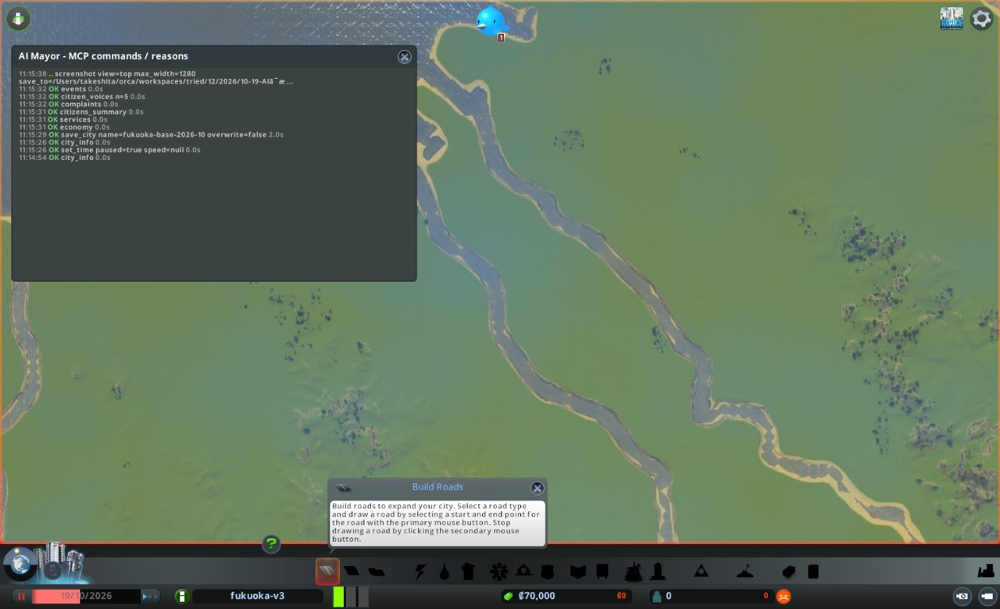
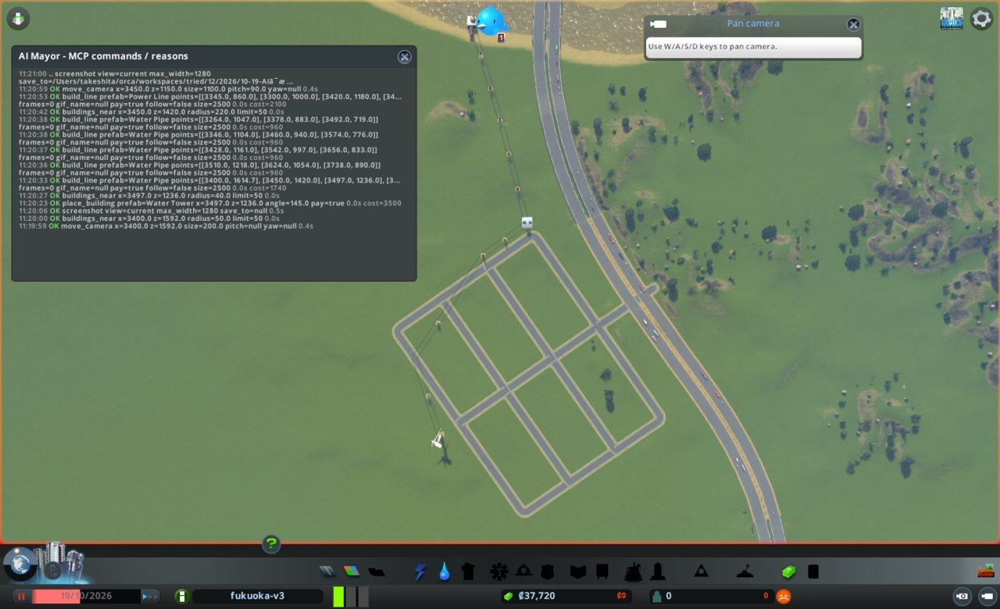
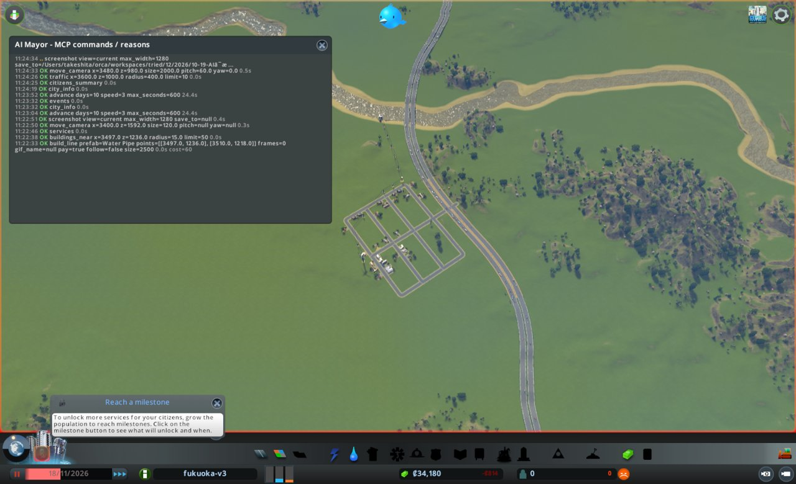
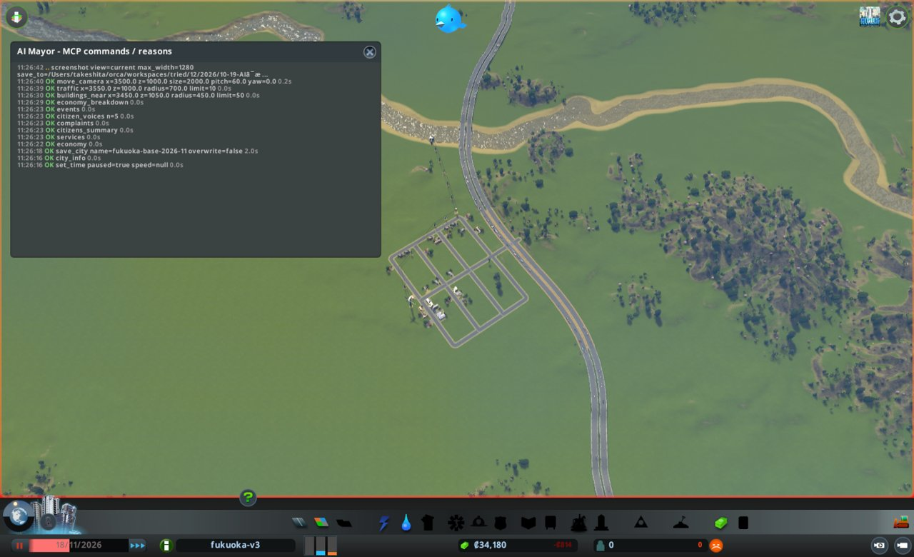
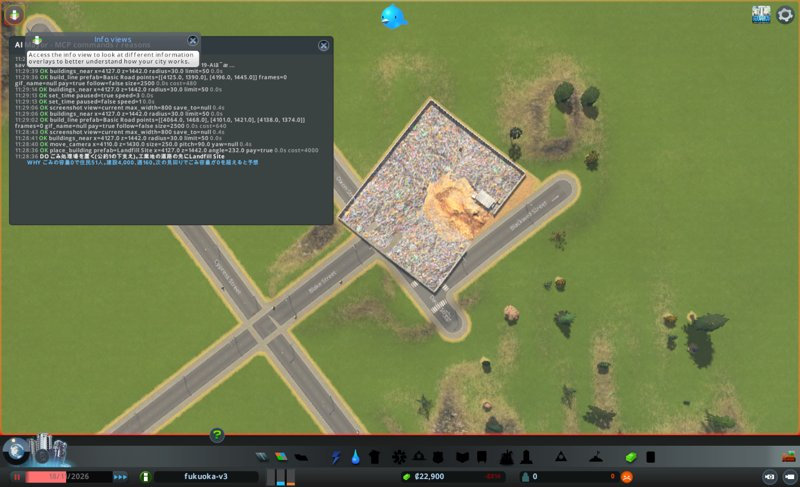
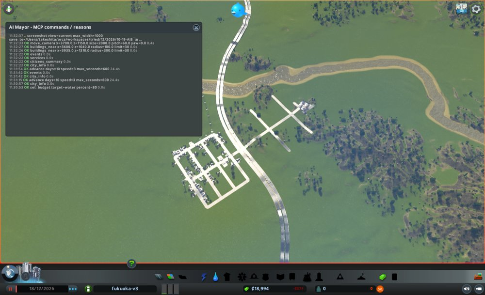

# 市政ノート

## 性格と公約

市長の定義 `mayors/base.md`(version 1)から写す。任期中は書き換えない。

- 性格: なし。判断の型(`protocol.md`)にだけ従う
- 公約:
  1. 人口を毎月増やす(`city_info` の population。毎月の月例で、前の月例より増えていること)
  2. 電気・水・下水が来ない市民をなくす(`citizens_summary` の、電気・水・下水が来ない市民の数。任期の終わりに0)
  3. 赤字を続けない(`city_info` の週の収支。毎月の月例で、2回続けて赤字にしない)
- 任期: 12か月

## 申し送り(前の運営から)

なし

## 数字の表

月例と見回りのたびに1行足す。区切りは 月例・見回り・臨時。

| ゲーム内の日付 | 区切り | 人口 | 所持金 | 週の収支 | 幸福度 | 需要(住/商/工) | 失業 | 主な困りごと |
|---|---|---|---|---|---|---|---|---|
| 2026-10-19 | 月例 | 0 | 70,000 | 0(収入0/支出0) | 0 | 100/0/0 | 0 | なし(建物0) |
| 2026-10-29 | 見回り | 0 | 36,580 | -813(収入0/支出813) | 0 | 54/10/8 | 0 | 水(住宅24棟)、給水塔 WaterNotConnected |
| 2026-10-29 | 臨時 | 0 | 36,580 | -813 | 0 | 54/10/8 | 0 | 水の容量0、下水の容量0。電気は容量7,520/使用864 |
| 2026-11-08 | 見回り | 0 | 35,350 | -813(収入0/支出813) | 0 | 8/25/19 | 0 | events は給水施設の完成だけ |
| 2026-11-18 | 月末(参考) | 0(住民51) | 34,180 | -813(収入0/支出813) | 0(住民平均36) | 0/23/17 | 41 | 働き口0。人口の数字が食い違う |
| 2026-11-18 | 月例 | 0(住民51) | 34,180 | -813(収入0/支出813) | 0(住民平均36) | 0/23/17 | 41 | complaints 0件。働き口0、ごみ・医療・警察の容量0 |
| 2026-11-28 | 見回り | 0 | 21,508 | -1,017(収入15/支出1,032) | 8 | 7/7/0 | - | 収支の悪化で境目に当たった |
| 2026-11-28 | 臨時 | 0(住民33) | 21,508 | -1,017 | 8(住民平均31) | 7/7/0 | 21 | complaints 0件。住民が51→33人に減った |
| 2026-12-08 | 見回り | 0 | 20,250 | -875(収入45/支出920) | 6 | 11/0/0 | - | events なし。境目に当たらず |
| 2026-12-18 | 月末(参考) | 0(住民33) | 18,994 | -874(収入46/支出920) | 5(住民平均37) | 4/0/0 | 13 | 工業の建物0棟。働き口36 |

## 判断の記録

### 2026-10-19 月例(1か月目)

保存: `fukuoka-base-2026-10`(save_city 成功、2.0秒)

#### 答え合わせ

なし(初回)

- 公約の進み具合
  1. 人口: 0 / 次の月例(11月中旬)で1人以上 / 住む場所を作れば届く
  2. 電気・水・下水が来ない市民: 0(市民がいない) / 任期の終わりに0 / 施設を先に置けば届く
  3. 週の収支: 0 / 次の月例で黒字 / 建設直後は維持費だけかかるので、来月は赤字になりうる

#### 気づいたこと

- 街は空。道路は九州自動車道(費用なしの骨格)だけ。住宅の需要は100、商業と工業は0
- 電気・水・下水・ごみなどのサービスは容量0。人が住み始める前に電気と水を用意する必要がある
- 自動車道は (3706, 1111) 付近で地面の高さ(高架ではない)。周りは平らな草地(高さ57〜59m)。ここを入口にする

#### 施策

型の上限に合わせる。建設費の合計は所持金の半分(35,000)まで。
週の収支は0なので、「維持費の増え分を黒字の範囲に収める」は守れない。施設なしでは人が住まず、収入も生まれないため。維持費が小さいものを選んで、例外として記録する。

1. 住宅地を作る(道路を自動車道につなぎ、区画を指定する)
   - 公約: 1
   - 理由: 住宅の需要が100で、住める場所が0
   - 予想: 次の月例(2026-11-18ごろ)に人口100人以上。建設費は約13,000、道路の維持費は週約105
   - 操作: build_line(Basic Road)で自動車道の両側の車線に平面交差でつなぎ、南西へ幹線1本と横道4本、縦道2本。zone_area(residential_low)
   - 結果: build_line 7回とも成功。費用 2,040 + 1,920×4 + 1,440×2 = 12,600。zone_area は 1,936マスを residential_low に変えた(中心 3500, 970、半径380)
   - 確かめ: zones_at で ResidentialLow 1,936。画面写真で、幹線が自動車道の両車線と交差点でつながり、格子の道路どうしもつながっている
2. 電気を作る(風力発電を1基置く)
   - 公約: 2
   - 理由: 電気の容量が0。風力発電は建設6,000、維持費週80で最も安い
   - 予想: 次の見回りで電気の容量が0より大きくなる。住宅に電気が届き、停電の市民0
   - 操作: place_building(Wind Turbine)を住宅地の端の道路沿いに置く
   - 結果: Wind Turbine を (3345, 860)、angle 55 に置いた。費用 6,000。さらに給水塔と排水口へ電気を届けるため、Power Line を風車→給水塔→排水口に引いた。費用 2,100(同じ施策の中の追加)
   - 確かめ: buildings_near で風車 id 12088、problems None。画面写真で送電線が3つの施設を結んでいる。電気の容量は次の見回りの services で見る
3. 水と下水を作る(給水塔と排水口、水道管)
   - 公約: 2
   - 理由: 水と下水の容量が0。給水塔(3,500、週240)と排水口(2,500、週320)が最も安い
   - 予想: 次の見回りで水と下水の容量が0より大きくなる。断水の市民0
   - 操作: place_building(Water Tower、Water Outlet)、build_line(Water Pipe)を道路に沿って引く
   - 結果: Water Outlet を川の南岸 (3400, 1592)、angle 0 に置いた(2,500)。Water Tower を住宅地の北の角 (3497, 1236)、angle 145 に置いた(3,500)。Water Pipe を排水口→給水塔→縦道と、横道4本に引いた(1,740 + 960×4 = 5,580)。合計 11,580
   - 確かめ: buildings_near で排水口は problems None(管をつなぐ前は WaterNotConnected)。給水塔は WaterNotConnected のまま。電気がまだ来ていないためか、時間が止まっているためかは分からない。次の見回りで確かめる
   - 気になる点: 排水口の長い管が陸側に伸びて見える。向きが逆かもしれない。下水の容量が出なければ、向きを直す

建設費の合計は 32,280(上限35,000の内)。所持金は 37,720。
維持費の見積もりは週約810(道路 約2.5km×40 = 100、風車80、送電線 約0.8km×60 = 50、給水塔240、排水口320、水道管 約2.2km×10 = 22、ほかは不明)。

#### 次にやること

- 人が住み始めたら、商業と工業の需要を見て、区画を一部変える(働き口を作るため)
- ごみ・医療・消防・警察は、人口が数百人になってから維持費と収入を見て置く
- 排水口の向きと、給水塔に電気と水が届いたかを確かめる

#### 画面写真

### 2026-10-29 見回り

境目: 当たった。週の収支が、前回(月例)の0から -813 に悪化して赤字になった。所持金36,580、人口0、幸福度0、events に困りごとのつぶやきなし。

### 2026-10-29 臨時

- きっかけ: 週の収支が赤字になった(-813)。収入0のまま、維持費だけがかかっている
- 見たもの: services で電気は容量7,520/使用864。水は容量0/使用384、下水は容量0/使用24。complaints で Water が住宅24棟、WaterNotConnected が1棟(給水塔)。buildings_near で住宅が建ち始めている(低密度住宅 約20棟、まだ入居0人)
- 原因の見立て: 赤字は建てた直後なので想定どおり。急ぎは、給水塔が水道管につながっていないこと。水道管の途中の点が給水塔の接続点に付いていなかった
- 施策: 給水塔と水道管をつなぎ直す(公約2)
  - 理由: 水がないと入居が進まず、収入も生まれない
  - 予想: 次の見回り(11-08)で水の容量が0より大きく、断水の住宅が0に近づく。下水の容量も0より大きくなる
  - 操作: build_line(Water Pipe、(3497, 1236)→(3510, 1218))
  - 結果: 成功。snapped 2、費用60。buildings_near で給水塔の problems が WaterNotConnected から None に変わった
  - 気になる点: 排水口は problems None で、画面では川の中にある。だが下水の容量は0のまま(時間が止まっているので更新されていない可能性)。次の見回りで確かめる

### 2026-11-08 見回り

境目: 当たらず。週の収支は -813 で前回と同じ(悪化していない)。人口0のまま(減っていない)。所持金35,350。困りごとのつぶやきなし。
気になる点: 住宅は建ち始めて20日たつのに、人口が0のまま。住宅の需要は54から8に下がった。見回りでは施策を打たないので、次の月例で原因を調べる(外とつながる道、入居の動き、水と下水の容量)。

### 2026-11-18 1か月目の終わり(advance(10) の後)

次の月例の前の数字。施策は打っていない。

- city_info: 人口0、所持金34,180、週の収入0/支出813、需要 住0/商23/工17、幸福度0、ダイアログなし
- citizens_summary: 住民51人(子4、10代6、若者5、大人36)。全員が低学歴・低所得。就業0、失業41。電気・水・下水が来ない市民はいずれも0。幸福度の平均36
- traffic(3600, 1000、半径400): 流れ92%、車41台、止まっている車0
- 食い違い: citizens_summary では51人が住んでいるのに、city_info の人口とゲーム画面の人口表示は0。週の収入も0のまま。原因は分からない
- 次の月例への申し送り
  - 人口0と住民51人の食い違いを、まず確かめる(buildings_near で住宅の入居、economy_breakdown で税収)
  - 失業41人に対して働き口0。商業23・工業17の需要があるので、働き口の区画を作る
  - 週の収支 -813 が2か月続くと公約3に反する。次の月例で黒字に向かう手を打つ

### 2026-11-18 月例(2か月目)

保存: `fukuoka-base-2026-11`(save_city 成功、2.0秒)

#### 答え合わせ

- 施策1 住宅地を作る: 外れ。予想は人口100人以上。city_info の人口は0。citizens_summary の住民は51人。住宅は buildings_near で約30棟建った
- 施策2 風力発電: 当たり。電気の容量7,520/使用912。停電の市民0
- 施策3 水と下水: 当たり(臨時でつなぎ直した後)。水 60,000/432、下水 120,000/27。断水・下水なしの市民0。排水口の向きの心配は外れた
- 臨時 給水塔のつなぎ直し: 当たり。給水塔の problems None、水の容量が出た
- 次にやることの実行
  - 商業と工業の区画を作る: 今月の施策1と2で行う
  - ごみ・医療・消防・警察: ごみだけ今月の施策3で行う。ほかは人口が増えてから
  - 排水口と給水塔の確かめ: 実行した。どちらも problems None
- 公約の進み具合
  1. 人口: 0(前の月例 0) / 増えていない。住民51人は数字に出ていない / 未達
  2. 電気・水・下水が来ない市民: 0 / 任期の終わりに0 / 今は届いている
  3. 週の収支: -813(前の月例 0) / 1回目の赤字。次の月例も赤字だと公約違反 / 働き口からの税収が要る

#### 気づいたこと

- 人口0と住民51人の食い違いは解けない。economy_breakdown の収入はどのサービスも0。住民は全員低学歴・低所得で、就業0。働き口がないので税収が出ないと見る
- traffic(3550, 1000、半径700)は流れ92%、止まった車0。自動車道との交差点は画面でつながっている(m2-junction.jpg)
- 住宅区画 ResidentialLow 1,766マスのうち、建物はまだ一部。住宅の需要は0
- 週の支出の内訳は Water 582、Electricity 130、Road 100

#### 施策

建設費の上限は所持金の半分(17,090)。週の収支は赤字なので、維持費の増え分を黒字の範囲に収めることはできない。先月と同じく例外として記録する。働き口を作らないと収入が生まれないため。

1. 工業地を作る(自動車道の東に道路を伸ばし、工業の区画を指定する)
   - 公約: 3(税収)、1(働き口で人を呼ぶ)
   - 理由: 失業41人、働き口0。工業の需要17。住宅から自動車道を挟んで離し、汚染を避ける
   - 予想: 次の月例で働き口が0より大きく、失業が41より減る。週の収入が0より大きくなる。建設費 約6,400、道路の維持費 週約50
   - 操作: build_line(Basic Road)で交差点の東の行き止まりから北東へ約480m、横道2本。zone_area(industrial)
2. 商業地を作る(住宅地の幹線沿いの空いた区画を商業に変える)
   - 公約: 3、1
   - 理由: 商業の需要23。区画の指定だけなので建設費0、維持費0
   - 予想: 次の月例で商業の建物が建ち、働き口が増える
   - 操作: zone_area(commercial_low)を幹線沿いに小さい半径で数か所。建物があるマスは変わらない
3. ごみ処理場を置く(Landfill Site)
   - 公約: どれにも直接はつながらない。ごみがたまると住宅が放棄され、公約1に響くため
   - 理由: ごみの容量0。住民51人。建設4,000、維持費 週160
   - 予想: 次の見回りで services のごみの容量が0より大きくなる。ごみの苦情が出ない
   - 操作: place_building(Landfill Site)を工業地の道路沿いに置く

#### 実行の結果

1. 工業地: build_line 3回とも成功。幹線 (3722, 1128)→(4101, 1421) は snapped 1 で既存の行き止まりにつながった(2,320)。横道2本(1,920×2)。zone_area(中心 3935, 1310、半径290)で 1,049マスを industrial に変えた。zones_at で Industrial 1,049。画面で十字の交差点ができている
2. 商業地: zone_area(commercial_low、半径45)を (3640, 1068) と (3565, 1015) に。63 + 64 = 127マス。zones_at(3600, 1040、半径120)で CommercialLow 127、ResidentialLow 304。費用0
3. ごみ処理場: Landfill Site を (4127, 1442)、angle 232 に置いた(4,000、id 10689)。buildings_near で RoadNotConnected。幹線の端で道路に面していなかった
   - 直し1: 南西の面に沿って道路 (4064, 1468)→(4138, 1374) を引いた(640)。RoadNotConnected のまま
   - 直し2: 南東の面に沿って道路 (4125, 1390)→(4196, 1445) を引いた(480、split 1)。problems None になった
   - 分かったこと: angle 232 で正面は南東(方位142度)を向いた。正面の方位 = angle − 90 と見られる
   - 直し1の道路は今は役に立たない。工業区画の延長に使えるので残す

建設費の合計は 11,280(上限17,090の内)。所持金は 22,900。
維持費の増え分の見積もりは週約220(道路 約1.5km×40 = 60、ごみ処理場160)。

#### 次にやること

- 工業と商業の建物が建ったか、働き口と失業を見る(services の workplaces、citizens_summary)
- 週の収入が0から動くかを見る。動かなければ、人口0の食い違いと合わせて economy_breakdown で原因を探す
- ごみの容量が出たかを見る
- 医療・消防・警察は、収支が黒字に近づいてから維持費を見て置く

#### 画面写真

### 2026-11-28 見回り

境目: 当たった。週の収支が、前回(月例)の -813 から -1,017(収入15/支出1,032)に悪化した。所持金21,508、人口0、幸福度8(前回0)、需要 住7/商7/工0。events はごみ処理のつぶやき1件だけ(困りごとではない)。

### 2026-11-28 臨時

- きっかけ: 週の収支の悪化(-813 → -1,017)
- 見たもの
  - complaints: 0件
  - services: 電気 7,520/1,040、水 60,000/560、下水 120,000/35、ごみ 8,000,000/0、働き口 34
  - economy_breakdown: 収入は Commercial 15。支出は Water 582、Road 159、Garbage 160、Electricity 130
  - citizens_summary: 住民33人(前回51人)、就業6、失業21、電気・水・下水が来ない市民0
- 原因の見立て: 悪化は月例で足した道路(週約59)とごみ処理場(週160)の維持費。想定どおり。収入は商業から出始めた
- 気になる点: 住民が51人から33人に減った。city_info の人口は0のままなので、境目の「人口5%減」には当たらない。暮らし向きの平均が24から14に下がった
- 施策: 水道の予算を100%から80%に下げる(公約3)
  - 理由: 水の容量60,000に対して使用560。容量を2割減らしても十分に余る。支出の最大はWater 582
  - 予想: 次の見回りで週の支出が約110減る(1,032 → 約920)。断水の市民は0のまま
  - 結果: set_budget 成功(water 80%)。止めたままなので、city_info の支出は1,032のまま。効果は次の見回りで見る

### 2026-12-08 見回り

境目: 当たらず。週の収支は -875(収入45/支出920)で、前回の -1,017 より良くなった。支出は予想どおり約110減った(1,032 → 920)。所持金20,250、人口0、幸福度6(前回8、2下がった)。events なし。

### 2026-12-18 2か月目の終わり(advance(10) の後)

次の月例の前の数字。施策は打っていない。

- city_info: 人口0、所持金18,994、週の収入46/支出920、需要 住4/商0/工0、幸福度5、ダイアログなし
- citizens_summary: 住民33人(高齢2人)。就業14、失業13。電気・水・下水が来ない市民はいずれも0。幸福度の平均37
- services: 電気 8,000/1,232、水 38,400/944(予算80%で容量が減った)、下水 76,800/59、ごみ 8,000,000/0、働き口36
- buildings_near: 工業区画(3935, 1310、半径300)の建物はごみ処理場だけ。工業は1棟も建っていない。商業は幹線沿いに4棟建った
- 画面写真 m2-town-end.jpg: 雪で白い。工業地の道路に建物は見えない
- 次の月例への申し送り
  - 週の収支は2回の月例で続けて赤字になる見込み(-813 → 約-874)。公約3に反する。次の月例で、支出を減らすか収入を増やす手を最優先にする
  - 工業の需要は11-28から0。工業区画に建物が建たない。工業地には電気と水道管が届いていない。需要が戻ったときに備え、送電線と水道管をつなぐか判断する
  - 住民は51人から33人に減り、その後は横ばい。city_info の人口は0のまま。公約1は数字の上で未達が続く
  - 商業の4棟が建ち、収入は0から46になった。失業は41から13に減った

## 人が手を入れたこと

なし

## 公約の結果

1.
2.
3.

## 次の市長への申し送り

-
