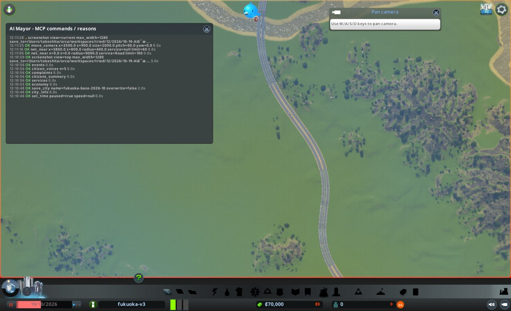
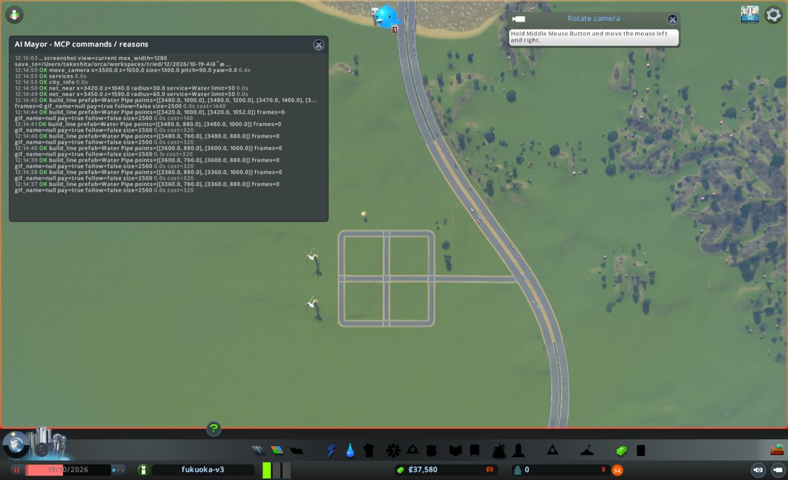
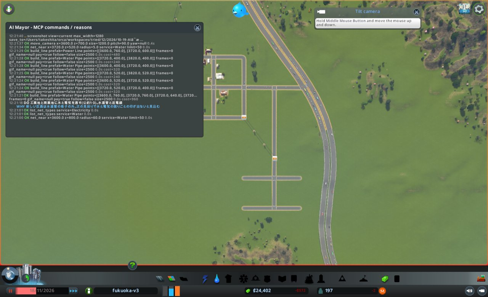
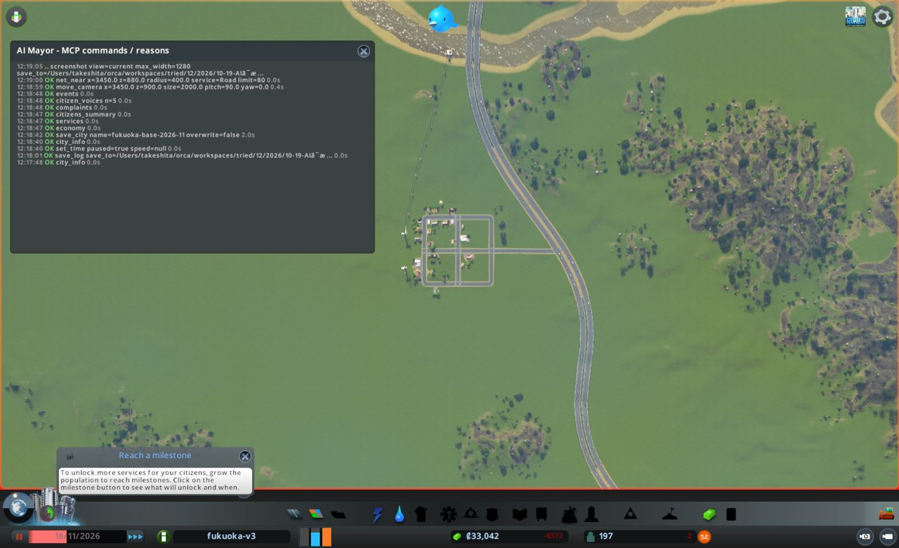
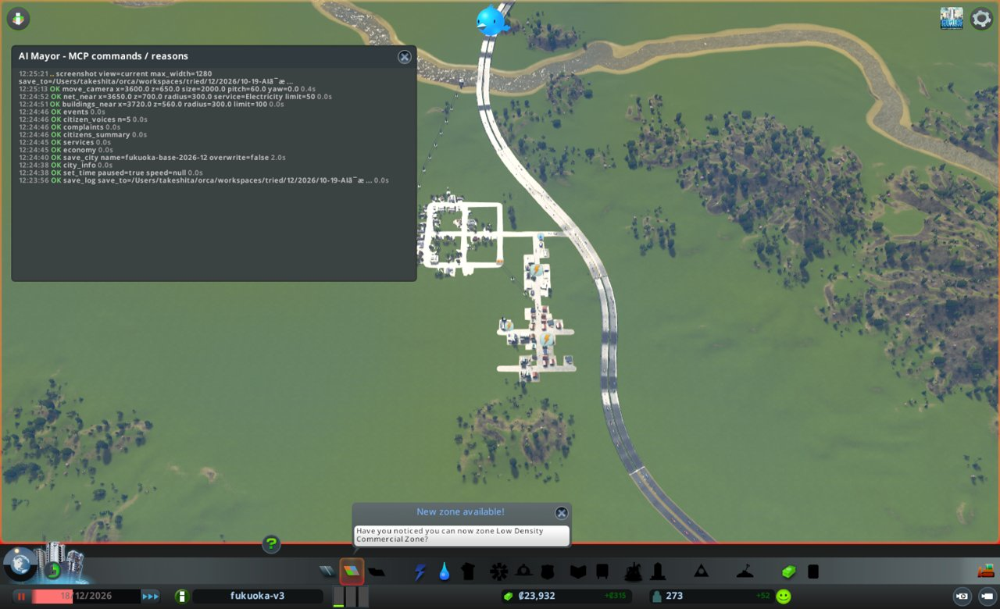

# 市政ノート

## 性格と公約

- 性格: なし。判断の型(`protocol.md`)にだけ従う
- 公約:
  1. 人口を毎月増やす(`city_info` の population。毎月の月例で、前の月例より増えていること)
  2. 電気・水・下水が来ない市民をなくす(`citizens_summary` の電気・水・下水が来ない市民の数。任期の終わりに0)
  3. 赤字を続けない(`city_info` の週の収支。毎月の月例で、2回続けて赤字にしない)
- 任期: 12か月

## 申し送り(前の運営から)

なし

## 数字の表

| ゲーム内の日付 | 区切り | 人口 | 所持金 | 週の収支 | 幸福度 | 需要(住/商/工) | 失業 | 主な困りごと |
|---|---|---|---|---|---|---|---|---|
| 2026-10-19 | 月例 | 0 | 70,000 | 0 | 0 | 100/0/0 | 0 | なし(建物0) |
| 2026-10-29 | 見回り→臨時 | 141 | 36,561 | -757(収入56/支出813) | 23 | 58/16/16 | - | 下水19棟、電気1、水1 |
| 2026-11-08 | 見回り | 192 | 33,868 | -591(収入264/支出855) | 24 | 10/64/64 | - | (見回りでは見ない) |
| 2026-11-18 | 月例 | 197 | 33,041 | -573(収入282/支出855) | 24 | 0/74/100 | 147 | なし(困りごとの印0。働き口0) |
| 2026-11-28 | 見回り | 196 | 23,622 | -507(収入407/支出914) | 34 | 6/47/68 | - | 電気19棟(工業と商業) |
| 2026-12-08 | 見回り | 205 | 23,559 | +29(収入943/支出914) | 37 | 12/1/22 | - | (見回りでは見ない) |
| 2026-12-18 | 月例 | 273 | 23,932 | +315(収入1,229/支出914) | 41 | 9/0/0 | 27 | 電気41棟(工業と商業すべて)、水1 |
| 2026-12-28 | 見回り | 315 | 19,625 | +385(収入1,478/支出1,093) | 62 | 13/0/12 | - | (見回りでは見ない。確かめで電気0棟) |
| 2027-01-07 | 見回り | 366 | 20,461 | +610(収入1,703/支出1,093) | 64 | 20/0/13 | - | (見回りでは見ない) |

## 判断の記録

### 2026-10-19 月例(1か月目)

保存: `fukuoka-base-2026-10`

#### 答え合わせ

なし(初回)

- 公約の進み具合
  1. 人口: 0 / 次の月例で1人以上 / 住宅地ができれば届く
  2. 電気・水・下水が来ない市民: 0(住民がいない) / 任期の終わりまで12か月
  3. 週の収支: 0 / 初回は判定なし

#### 気づいたこと

- 街に建物と一般道がない。道路は九州自動車道(x 3300〜5500 を南北)だけ
- 住宅の需要は100、商業と工業は0。まず住宅地を作る
- 収入が0なので、維持費の増え分を黒字の範囲に収める決まりは守れない。維持費の小さい施設を選び、税収で埋める

#### 施策

場所は、自動車道の西側の平地(x 3360〜3600、z 760〜1000)。高さは51〜59mで平ら。
北の川(z 約1600)は西へ流れる(水面が東49.9m、西48.9m)。

1. 住宅地を作る(自動車道につなぐ道路の格子と、低密度住宅の区画)
   - 公約: 1
   - 理由: 住宅の需要が100で、住める場所が0
   - 予想: 次の月例(11月中旬)に人口200人以上
   - 操作: `build_line`(Basic Road、約1.7km、約8,400)、`zone_area`(residential_low)
   - 結果: 道路は成功。費用合計9,000(東西3本、南北3本、自動車道の上下線をつなぐ短い区間)。区画は1,046マスを低密度住宅にした
   - 確かめ: `net_reach` で区間56、入れない0、出られない0(外へのつなぎ口4)。`zones_at` で ResidentialLow 1,046。画面写真で自動車道とつながった
2. 電気を作る(風力発電2基)
   - 公約: 2
   - 理由: 電気の容量が0。石炭(19,000、維持費560)より安く、維持費も小さい(1基6,000、維持費80)
   - 予想: 次の見回りで電気の容量が使用量を上回る
   - 操作: `place_building`(Wind Turbine ×2)、必要なら Power Line
   - 結果: 成功。(3290, 820) と (3290, 940) に置いた。費用12,000。送電線は引いていない
   - 確かめ: `buildings_near` で2基を確認。時間が止まっているため、`services` の電気の容量はまだ0。次の見回りで見る
3. 水と下水を通す(給水塔、川への排水口、水道管)
   - 公約: 2
   - 理由: 水と下水の容量が0。給水塔は川がいらず、排水口は川の下流側(西)に置く
   - 予想: 次の見回りで水と下水の容量が使用量を上回る。水が来ない市民0
   - 操作: `place_building`(Water Tower 3,500、Water Outlet 2,500)、`build_line`(Water Pipe 約2km、約5,000)
   - 結果: 成功。給水塔 (3420, 1052)、排水口 (3450, 1585)。水道管は道路の格子に沿って引き、給水塔と排水口までつないだ。費用は施設6,000、管5,420
   - 確かめ: `net_near` で管の端が給水塔と排水口の位置にあることを確認。容量は時間を進めてから見る

実際の建設費の合計は32,420。所持金は37,580。

建設費の見込みは合計約31,400(所持金の半分35,000以内)。週の維持費の増え分は約800。

#### 次にやること

- 電気・水・下水の容量が出たか、家に届いているかを確かめる。届かなければ送電線や管を足す
- 住民が増えたら、商業と工業の需要を見て、働く場所の区画を作る
- ごみの収集が要るようになったら、処分場を置く

#### 画面写真

### 2026-10-29 見回り

境目: 当たった。週の収支が0から-757に悪化して赤字。ダイアログなし。
`events` は発電所の稼働と工業を求める声で、困りごとのつぶやきは3件未満。

### 2026-10-29 臨時

- きっかけ: 週の収支の悪化(-757)
- 原因を見た結果
  - `services`: 電気15,040/2,304、水60,000/3,216 で足りている。下水は容量0、使用201
  - `complaints`: 下水19棟、電気1棟、水がつながらない1棟
  - `buildings_near`: 排水口に「電気、水がつながらない」の印。管の端 (3450, 1585) と、排水口のつなぎ口 (3450, 1607.7) がずれている
  - 赤字は、住民が入り始めたばかりで税収が56しかないため。維持費813は月例の見込み(約800)どおり。税収が育つのを待つ
- 判断: 赤字は時間で埋まる見込み。急ぐのは、公約2に直接かかわる下水の止まりと考え、こちらを手当てする
- 施策: 排水口を動かす(管を排水口のつなぎ口まで延ばし、風力発電から送電線を引く)
  - 公約: 2(と3。下水が止まると住民が出ていき、税収が育たない)
  - 理由: 下水の容量0。排水口に電気が来ず、管もつながっていない
  - 予想: 次の見回り(11月8日)に下水の容量が使用量を上回り、下水の困りごとが0になる
  - 操作: `build_line`(Water Pipe (3450,1585)→(3450,1608))、`build_line`(Power Line 風力発電 (3290,940)→排水口、約0.7km、約1,700、維持費 約40/週)
  - 結果: 管は成功(両端がつながった、費用60)。送電線は成功(10区間、費用1,720)。ただし端の snapped は0で、建物につながったかは道具からは分からない
  - 確かめ: 次の見回りで `services` の下水の容量と、排水口の困りごとの印を見る

### 2026-11-08 見回り

境目: 当たらず。週の収支は-591で赤字だが、前回の-757より良くなった。人口は141→192、幸福度は23→24。ダイアログなし。
`events` は水道を喜ぶ声1件。
臨時の施策の確かめとして `services` を見た。下水は容量120,000、使用267。排水口が動き出した。
需要は住宅10、商業64、工業64に移った。働く場所の区画が次の月例の候補。

### 2026-11-18 1か月目の終わり(次の月例の直前)

`advance(10)` の後に `city_info` だけを見た。ダイアログなし。
人口197、所持金33,041、週の収支-573(収入282/支出855)、幸福度24、需要は住宅0、商業74、工業100。
この数字は2か月目の月例で、`city_info` から改めて表に入れる。

申し送り(2か月目の自分へ)
- 住宅の需要が0になり、人口の伸びが止まりかけている(192→197)。働く場所がないため。商業と工業の区画が要る
- 週の収支は2回の見回りとも赤字。2か月目の月例で赤字なら、公約3の「2回続けて赤字にしない」の1回目になる
- 排水口の管は、建物の中心ではなく、つなぎ口(建物の端)まで引く必要があった。送電線は建物の中心に端を置けばつながった
- 幸福度24は低い。ごみ、医療、教育などのサービスが何もない

### 2026-11-18 月例(2か月目)

保存: `fukuoka-base-2026-11`

#### 答え合わせ

- 施策1(住宅地): 予想は人口200人以上。結果は197人。わずかに外れた。住宅の需要が0になり、伸びが止まった
- 施策2(風力発電): 予想は電気の容量が使用量を上回る。結果は容量15,040、使用2,896。当たった
- 施策3(給水塔と排水口): 予想は水と下水の容量が使用量を上回る。水は当たった(60,000/4,320)。下水は排水口のつなぎ違いで外れ、臨時で直した
- 臨時(排水口を動かす): 予想は11月8日に下水の容量が使用量を上回る。結果は容量120,000、使用270。当たった
- 次にやること
  - 電気・水・下水の確かめ: 実行した。電気・水・下水が来ない市民は0
  - 働く場所の区画: 今月の施策にする
  - ごみの処分場: まだ。今は困りごとの印0。維持費160/週で赤字が増えるため見送る
- 公約の進み具合
  1. 人口: 197(前の月例0)。増えた / 来月は197より多いこと
  2. 電気・水・下水が来ない市民: 0 / 任期の終わりまで11か月
  3. 週の収支: -573。赤字1回目 / 来月の月例で黒字にしないと公約を破る

#### 気づいたこと

- 働き口が0。市民197人のうち失業147人。全員が学歴なしで低所得
- 需要は住宅0、商業74、工業100。住宅の需要が0なのは働く場所がないため
- 困りごとの印は0。医療・ごみ・警察・教育の施設は何もない
- 赤字の原因は、税収282に対し維持費855。働く場所ができれば税収が増える
- 道路の格子は x 3360/3480/3600、z 760/880/1000。z=880 の道が東の自動車道(x 3836)につながる
- 自動車道は z 400 付近では x 約3910 の高架。工業は自動車道の西、住宅から南へ離した場所に置く

#### 施策

1. 工業地を作る(住宅の南東に道路と工業の区画)
   - 公約: 1と3
   - 理由: 工業の需要100、働き口0、失業147。働く場所ができれば住宅の需要が戻り、税収も増える
   - 予想: 次の月例で働き口100以上、失業100未満。週の収支が-300より良くなる
   - 操作: `build_line`(Basic Road。x=3720 を z 879→400、z=520 と z=400 を x 3600→3820。約920m、約4,600、維持費 約37/週)、`zone_area`(industrial)
   - 住宅(z 760 が南の端)から工業の北の端(z 約560)まで約200m離す
2. 商業地を作る(自動車道へのつなぎ道と、工業への道の北側に商業の区画)
   - 公約: 1と3
   - 理由: 商業の需要74で、商業の区画が0
   - 予想: 次の月例で商業の建物が5棟以上。働き口にも足される
   - 操作: `zone_area`(commercial_low)。道路は施策1の道を使う。建設費0

建設費の見込みは約4,600(所持金の半分16,500以内)。週の維持費の増え分は約37。
赤字の中で維持費を足すため、決まり(黒字の範囲)は守れない。道路の維持費は小さく、税収で埋まる見込みとして進める。

#### 実行の結果

- 施策1の道路: x=3720 の南北(費用2,560、元の道 (3720,879) につながった)、z=520(1,120)、z=400(1,120)
  - `net_near` で、(3720,520) と (3720,400) に点が2つずつ重なり、南北の道と東西の道がつながっていないと分かった(南北を先に引くと、途中の点に東西の端がつながらない)
  - 取り壊しの理由: 南北の道の z 580→400 の3区間を消して、東西の道の点に端を合わせて引き直す。つながらないと工業の区画に車が来られない
  - 引き直し: `remove_line` で3区間を消し、(3720,580)→(3720,520)(320)、(3720,520)→(3720,400)(640)を引いた。どちらも両端がつながった(snapped 2)
  - `net_reach`(中心 (3720,550)、半径400): 区間64、入れない0、出られない0
  - 区画: `zone_area` で工業479マス
  - 道路の費用の合計: 5,760
- 施策2: `zone_area` で商業(低密度)280マス。費用0

追加の施策(3件目)

3. 工業地と商業地に水と電気を通す(水道管と送電線)
   - 公約: 1と3(働く場所が動くため。公約2は住民の数なので直接は関わらない)
   - 理由: 新しい区画は管の格子(x 3360〜3600)の外にある。水が来ないと工場が動かない
   - 予想: 次の見回りで、工業と商業の建物に水と電気の困りごとの印が出ない
   - 操作: `build_line`(Water Pipe 約920m、約2,300、維持費 約9/週)、`build_line`(Power Line (3600,760)→(3720,600) 約200m、約500、維持費 約12/週)
   - 管は、つなぎ目ごとに線を分けて引く(施策1の道路のつながらない失敗を繰り返さないため)
   - 結果: 管は6本に分けて引き、費用2,400。`net_near` で (3720,520) の点が1つにまとまり、4区間がつながったことを確認。送電線は費用480、端の snapped は0(建物がまだないため)
   - 確かめ: 次の見回りで `complaints` の水と電気を見る

建設費の合計は8,640(見込み約7,400。道路の引き直し960と、管と送電線の分)。所持金は24,402。
週の維持費の増え分の見込みは約58。

#### 次にやること

- 工業と商業の建物が建ったか、水と電気が届いているか(`complaints`)を見る。電気が届かなければ、送電線の端を建物に合わせる
- 来月の月例で赤字なら公約3を破る。税収が足りなければ、税を上げることを考える(1回に2ポイントまで)
- ごみの処分場(建設4,000、維持費160/週)。ごみの困りごとが出るか、黒字になったら置く
- 線を引くときは、交差する点ごとに線を分けて引く。途中の点には、後から引いた線の端がつながらない

#### 画面写真

### 2026-11-28 見回り

境目: 当たらず。週の収支は-507で、前回(-573)より良くなった。人口197→196(-0.5%)、幸福度24→34。ダイアログなし。`events` は0件。
施策の確かめとして `services` と `complaints` と `buildings_near` を見た。
- 働き口190、働き手65。工業と商業の建物が55棟の円の中に建った
- 電気の困りごと19棟。工業の z 470〜600 と、商業の z 630〜720 の建物。送電線の端 (3720,600) が建物につながっていないとみる
- 水の困りごとは出ていない
- 見回りでは施策を打たない決まりのため、電気は次の月例で直す。放っておくと工場が放棄される恐れがある

### 2026-12-08 見回り

境目: 当たらず。週の収支が+29で、初めて黒字になった(収入943)。人口196→205、幸福度34→37。ダイアログなし。
`events` は電気への不満1件(3件未満)。需要は住宅12、商業1、工業22。

### 2026-12-18 2か月目の終わり(次の月例の直前)

`advance(10)` の後に `city_info` だけを見た。ダイアログなし。
人口273、所持金23,932、週の収支+315(収入1,229/支出914)、幸福度41、需要は住宅9、商業0、工業0。
この数字は3か月目の月例で、`city_info` から改めて表に入れる。

申し送り(3か月目の自分へ)
- 11月28日に、工業と商業の19棟で電気が来ていなかった。送電線 (3600,760)→(3720,600) の端が建物につながっていない。月例で `complaints` を見て、残っていれば最初に直す
- 週の収支は12月8日から黒字。公約3は、3か月目の月例で黒字なら守れる
- 人口は11月の月例197から273に増えた。働き口ができて住宅の需要が戻った
- 線は、交差する点ごとに分けて引く。途中の点には後から引いた線の端がつながらない(今月の道路で失敗した)
- ごみ、医療、教育の施設はまだ何もない。黒字が続けば、ごみの処分場(維持費160/週)から置く

### 2026-12-18 月例(3か月目)

保存: `fukuoka-base-2026-12`

#### 答え合わせ

- 施策1(工業地): 予想は働き口100以上、失業100未満、週の収支が-300より良い。結果は働き口325、失業27、収支+315。当たった
- 施策2(商業地): 予想は商業の建物5棟以上。結果は円の中に商業14棟ほど。当たった
- 施策3(水と電気を通す): 予想は工業と商業に水と電気の困りごとが出ない。水は当たった(困りごと1棟だけ)。電気は外れた。工業と商業の41棟すべてに電気が来ていない
- 次にやること
  - 建物と水・電気の確かめ: 実行した(見回りで19棟、今日41棟の電気の困りごとを見つけた)。直すのは今月の施策
  - 赤字なら税を上げる: 黒字なので要らなかった
  - ごみの処分場: 黒字になったので今月置く
  - 交差点ごとに線を分ける: 今月の送電線で守る
- 公約の進み具合
  1. 人口: 273(前の月例197)。増えた / 来月は273より多いこと
  2. 電気・水・下水が来ない市民: 0 / 任期の終わりまで10か月
  3. 週の収支: +315。黒字。赤字は1回で止まった / 来月も黒字を保つ

#### 気づいたこと

- 送電線3区間 (3600,760)→(3640,707)→(3680,653)→(3720,600) が、どの電源ともつながっていない。始点 (3600,760) は水道管のつなぎ目で、発電所の網に入っていない。電気の困りごとの原因はこれとみる
- 働き手180、働き口325。失業27。働き口の方が多い
- 全員が学歴なし・低所得。健康の平均43、暮らし向き11。病気の子どもがいる。医療・ごみ・教育・警察の施設は0
- 住宅の需要9、商業と工業は0。電気のない工場が動いていないため、と考える
- 税はすべて9%、予算はすべて100%
- `events` は0件

#### 施策

1. 工業と商業に電気を通す(風力発電 (3290,820) から送電線を (3600,760) まで引く)
   - 公約: 1と3
   - 理由: 工業と商業の41棟に電気が来ていない。送電線が電源とつながっていない
   - 予想: 次の見回り(12月28日)に電気の困りごとが5棟以下。働き口が埋まり、週の収支が+400より良くなる
   - 操作: `build_line`(Power Line、約320m、約770、維持費 約18/週)。風力発電の中心から既存の送電線の始点へ
2. ごみの処分場を置く(工業地の南、z=400 の道の南側)
   - 公約: 1(ごみがたまると住民が出ていく)
   - 理由: ごみの容量0。住民282人と工場がごみを出している。今は困りごとの印0だが、出てからでは遅い
   - 予想: 次の月例で `services` のごみの容量が0より大きい。ごみの困りごとが0のまま
   - 操作: `place_building`(Landfill Site、4,000、維持費160/週)。中心 (3775,364)
   - 維持費160は、週の黒字315の範囲に収まる

建設費の見込みは約4,800(所持金の半分11,966以内)。週の維持費の増え分は約178(黒字315の範囲)。

3件目は打たない。医療(診療所、維持費400/週)は黒字315を超えるため、電気が直って税収が増えてから考える。

#### 実行の結果

- 施策1: 成功。4区間、費用800。終点が既存の点 (3600,760) につながった(snapped 1)。`net_near` で、(3290,820) から (3600,760) を経て (3720,600) まで、点の番号が続いていることを確認
  - 始点の風力発電は snapped に数えられない。電気が届いたかは、次の見回りで `complaints` を見る
- 施策2: 成功。費用4,000。入口 (3775,396) は北向きで、z=400 の道(区間5579)に面した(距離0)。`buildings_near` で困りごとの印なし
- 所持金は23,932から19,132。建設費の合計4,800

#### 次にやること

- 見回りで、電気の困りごとが減ったかを見る。減らなければ、送電線の始点を風力発電のどこにつなぐかを調べ直す
- ごみの処分場に電気が来ているかを見る
- 電気が直って黒字が増えたら、医療(診療所)と教育(小学校)を考える。全員が学歴なしで、健康の平均43
- 住宅の需要が戻ったら、住宅地を広げる

#### 画面写真

### 2026-12-28 見回り

境目: 当たらず。人口273→315、幸福度41→62、週の収支+385(収入1,478/支出1,093)。ダイアログなし。
`events` はごみ出しが楽になった声1件。困りごとのつぶやきなし。
施策の確かめとして `complaints` を見た。電気の困りごとは41棟から0棟になった。残りは水1棟、働き手が足りない3棟。
需要は住宅13、商業0、工業12。

### 2027-01-07 見回り

境目: 当たらず。人口315→366、幸福度62→64、週の収支+610(収入1,703/支出1,093)。ダイアログなし。`events` は0件。
需要は住宅20、商業0、工業13。

### 2027-01-17 3か月目の終わり(次の月例の直前)

`advance(10)` の後に `city_info` だけを見た。ダイアログなし。
人口410、所持金21,633、週の収支+867(収入1,960/支出1,093)、幸福度65、需要は住宅11、商業0、工業5。
この数字は4か月目の月例で、`city_info` から改めて表に入れる。

申し送り(4か月目の自分へ)
- 電気の困りごとは、送電線を風力発電 (3290,820) から既存の線の始点 (3600,760) につないで0になった。送電線は、電源の建物から網の点まで切れ目なく続いている必要がある
- 週の収支は+867まで増えた。医療(診療所、維持費400/週)と教育(小学校)を置く余裕ができた。全員が学歴なしで、健康の平均43(12月18日)
- 12月28日に「働き手が足りない」3棟、水の困りごと1棟。働き口325に対し働き手180(12月18日)。住宅地を広げる候補
- 電気の容量15,120に対し使用6,208(12月18日)。工場が動き出して使用が増えている。月例で `services` を見て、足りなくなりそうなら発電を足す
- ごみの処分場 (3775,364) は12月18日に置いた。容量と困りごとを月例で確かめる

## 人が手を入れたこと

なし

## 公約の結果

1.
2.
3.

## 次の市長への申し送り

-
