# 市政ノート

## 性格と公約

- 性格: なし。判断の型(`protocol.md`)にだけ従う
- 公約:
  1. 人口を毎月増やす(`city_info` の population。毎月の月例で、前の月例より増えていること)
  2. 電気・水・下水が来ない市民をなくす(`citizens_summary` の電気・水・下水が来ない市民の数。任期の終わりに0)
  3. 赤字を続けない(`city_info` の週の収支。毎月の月例で、2回続けて赤字にしない)
- 任期: この試運転は3か月(1〜3か月目)

## 申し送り(前の運営から)

なし

## 数字の表

| ゲーム内の日付 | 区切り | 人口 | 所持金 | 週の収支 | 幸福度 | 需要(住/商/工) | 失業 | 主な困りごと |
|---|---|---|---|---|---|---|---|---|
| 2026-10-19 | 月例 | 0 | 70,000 | 0 / 0 | 0 | 100 / 0 / 0 | 0 | なし(建物0) |
| 2026-10-29 | 見回り→臨時 | 137 | 33,799 | 55 / 853(-798) | 31 | 58 / 11 / 11 | - | なし。来ない市民 電0・水0・下水0 |
| 2026-11-08 | 見回り | 207 | 33,171 | 313 / 741(-428) | 39 | 12 / 30 / 57 | - | なし。来ない市民 電0・水0・下水0 |
| 2026-11-18 | 月例 | 223 | 32,842 | 537 / 741(-204) | 45 | 0 / 0 / 100 | 151 | 困りごとの印0件。失業151(働き手177のうち) |
| 2026-11-28 | 見回り | 223 | 32,524 | 585 / 635(-50) | 56 | 0 / 1 / 59 | - | なし。来ない市民 電0・水0・下水0 |
| 2026-12-08 | 見回り | 225 | 32,812 | 869 / 635(+234) | 64 | 12 / 10 / 21 | - | なし。来ない市民 電0・水0・下水0 |
| 2026-12-18 | 月例 | 271 | 33,360 | 1,039 / 635(+404) | 62 | 8 / 38 / 0 | 19 | 困りごとの印0件。電気の使用74% |
| 2026-12-28 | 見回り | 347 | 27,771 | 1,164 / 719(+445) | 65 | 13 / 43 / 23 | - | なし。来ない市民 電0・水0・下水0 |
| 2027-01-07 | 見回り | 451 | 28,746 | 1,478 / 719(+759) | 68 | 12 / 21 / 52 | - | なし。来ない市民 電0・水0・下水0 |
| 2027-01-17 | 運営の終わり(4か月目の月例の前) | 535 | 50,137 | 1,719 / 719(+1,000) | 69 | 10 / 48 / 80 | - | なし。来ない市民 電0・水0・下水0 |
| 2027-01-17 | 月例(4か月目) | 535 | 50,137 | 1,719 / 719(+1,000) | 69 | 10 / 48 / 80 | 70 | ごみ1棟。水67%・電気69%。病人8、医療0 |
| 2027-01-27 | 見回り | 590 | 35,849 | 2,052 / 1,405(+647) | 74 | 10 / 57 / 68 | - | なし。来ない市民 電0・水0・下水0 |
| 2027-02-06 | 見回り | 669 | 36,923 | 2,158 / 1,405(+753) | 73 | 9 / 64 / 88 | - | なし。来ない市民 電0・水0・下水0 |
| 2027-02-16 | 月例(5か月目) | 701 | 38,039 | 2,196 / 1,405(+791) | 73 | 1 / 63 / 97 | 118 | 困りごとの印0件。電気93% |
| 2027-02-26 | 見回り | 667 | 24,535 | 2,160 / 1,586(+574) | 72 | 16 / 41 / 69 | - | なし。来ない市民 電0・水0・下水0。人口 -4.9% |
| 2027-03-08 | 見回り | 689 | 25,891 | 2,625 / 1,586(+1,039) | 73 | 28 / 17 / 55 | - | なし。来ない市民 電0・水0・下水0 |
| 2027-03-18 | 月例(6か月目) | 723 | 27,434 | 2,667 / 1,586(+1,081) | 74 | 46 / 50 / 53 | 30 | 困りごとの印0件。病人38(前の月例16)。学校0 |
| 2027-03-28 | 見回り | 753 | 17,772 | 2,645 / 1,752(+893) | 73 | 46 / 50 / 49 | - | なし。来ない市民 電0・水0・下水0 |
| 2027-04-07 | 見回り | 782 | 19,103 | 2,668 / 1,752(+916) | 73 | 52 / 50 / 48 | - | なし。来ない市民 電0・水0・下水0 |
| 2027-04-17 | 運営の終わり(7か月目の月例の前) | 791 | 20,354 | 2,620 / 1,752(+868) | 73 | 50 / 50 / 50 | 25 | なし。来ない市民 電0・水0・下水0。病人58 |
| 2027-04-17 | 月例(7か月目) | 791 | 20,354 | 2,620 / 1,752(+868) | 73 | 50 / 50 / 50 | 25 | 困りごとの印0件。病人58。空いた区画がない |
| 2027-04-27 | 見回り | 824 | 18,614 | 2,695 / 1,773(+922) | 71 | 40 / 41 / 46 | - | なし。来ない市民 電0・水0・下水0 |
| 2027-05-07 | 見回り | 884 | 20,498 | 3,137 / 1,773(+1,364) | 71 | 41 / 50 / 56 | - | なし。来ない市民 電0・水0・下水0 |
| 2027-05-17 | 月例(8か月目) | 902 | 42,480 | 3,155 / 1,773(+1,382) | 72 | 46 / 50 / 53 | 34 | 困りごとの印0件。病人65。消防・警察0 |
| 2027-05-27 | 見回り | 949 | 28,884 | 3,430 / 2,353(+1,077) | 74 | 22 / 50 / 43 | - | なし。来ない市民 電0・水0・下水0 |
| 2027-06-06 | 見回り | 1,040 | 30,803 | 3,731 / 2,353(+1,378) | 75 | 38 / 50 / 49 | - | なし。来ない市民 電0・水0・下水0 |
| 2027-06-16 | 月例(9か月目) | 1,057 | 32,818 | 3,763 / 2,353(+1,410) | 74 | 55 / 50 / 45 | 41 | 犯罪1棟(犯罪率15)。電気80%・水81%。長く失業23 |
| 2027-06-26 | 見回り | 1,120 | 26,706 | 3,753 / 2,560(+1,193) | 74 | 34 / 50 / 37 | - | なし。来ない市民 電0・水0・下水0 |
| 2027-07-06 | 見回り | 1,195 | 28,597 | 3,888 / 2,560(+1,328) | 75 | 40 / 50 / 59 | - | なし。来ない市民 電0・水0・下水0 |
| 2027-07-16 | 運営の終わり(10か月目の月例の前) | 1,202 | 30,440 | 3,830 / 2,560(+1,270) | 74 | 42 / 50 / 58 | 78 | 来ない市民 電0・水0・下水0。犯罪率28。病人75。長く失業42 |
| 2027-07-16 | 月例(10か月目) | 1,202 | 30,440 | 3,830 / 2,560(+1,270) | 74 | 42 / 50 / 58 | 78 | 犯罪8棟(犯罪率28)。警察0。病人75 |
| 2027-07-26 | 見回り | 1,237 | 18,576 | 3,817 / 3,047(+770) | 77 | 46 / 50 / 49 | - | なし。来ない市民 電0・水0・下水0 |
| 2027-08-05 | 見回り | 1,290 | 19,725 | 3,849 / 3,047(+802) | 77 | 46 / 50 / 54 | - | なし。来ない市民 電0・水0・下水0 |
| 2027-08-15 | 月例(11か月目) | 1,317 | 20,800 | 3,795 / 3,047(+748) | 77 | 42 / 50 / 58 | 93 | 困りごとの印0件。犯罪率7。電気73%。病人81。長く失業68 |
| 2027-08-25 | 見回り | 1,340 | 14,609 | 3,764 / 3,137(+627) | 77 | 44 / 50 / 56 | - | なし。来ない市民 電0・水0・下水0 |
| 2027-09-04 | 見回り | 1,375 | 15,513 | 3,768 / 3,137(+631) | 77 | 43 / 50 / 57 | - | なし。来ない市民 電0・水0・下水0 |
| 2027-09-14 | 月例(12か月目) | 1,390 | 16,447 | 3,792 / 3,137(+655) | 77 | 37 / 50 / 63 | 116 | 困りごとの印0件。長く失業79。区画がほぼ埋まった |
| 2027-09-24 | 見回り | 1,420 | 36,215 | 3,824 / 3,145(+679) | 77 | 41 / 50 / 57 | - | なし。来ない市民 電0・水0・下水0。節目 Tiny Town |
| 2027-10-04 | 見回り | 1,460 | 37,382 | 4,003 / 3,145(+858) | 78 | 42 / 50 / 58 | - | なし。来ない市民 電0・水0・下水0 |
| 2027-10-14 | 運営の終わり(13か月目の月例の前) | 1,478 | 38,642 | 4,020 / 3,145(+875) | 78 | 40 / 50 / 60 | 94 | 来ない市民 電0・水0・下水0。電気74%。病人67。長く失業67 |
| 2027-10-14 | 月例(13か月目) | 1,478 | 38,642 | 4,020 / 3,145(+875) | 78 | 40 / 50 / 60 | 94 | 困りごとの印0件。電気74%。10代324・高校0。住宅の区画が埋まった |
| 2027-10-24 | 見回り | 1,533 | 31,710 | 4,061 / 3,242(+819) | 77 | 20 / 50 / 46 | - | なし。来ない市民 電0・水0・下水0 |
| 2027-11-03 | 見回り | 1,609 | 33,150 | 4,275 / 3,242(+1,033) | 77 | 35 / 50 / 64 | - | なし。来ない市民 電0・水0・下水0 |
| 2027-11-13 | 月例(14か月目) | 1,645 | 34,697 | 4,312 / 3,242(+1,070) | 77 | 31 / 50 / 69 | 103 | 困りごとの印0件。水75%・電気70%。10代352・高校0。長く失業55 |
| 2027-11-23 | 見回り | 1,710 | 34,730 | 4,390 / 3,252(+1,138) | 77 | 23 / 50 / 62 | - | なし。来ない市民 電0・水0・下水0。水77% |
| 2027-12-03 | 見回り | 1,761 | 36,564 | 4,541 / 3,252(+1,289) | 78 | 31 / 50 / 69 | - | なし。来ない市民 電0・水0・下水0 |
| 2027-12-13 | 月例(15か月目) | 1,772 | 38,346 | 4,543 / 3,252(+1,291) | 77 | 33 / 50 / 67 | 115 | 困りごとの印0件。水80%・電気75%。10代388・高校0。長く失業72 |
| 2027-12-23 | 見回り | 1,803 | 34,361 | 4,525 / 3,509(+1,016) | 77 | 31 / 50 / 68 | - | なし。来ない市民 電0・水0・下水0。水40% |
| 2028-01-02 | 見回り | 1,865 | 35,990 | 4,659 / 3,509(+1,150) | 77 | 32 / 50 / 68 | - | なし。来ない市民 電0・水0・下水0 |
| 2028-01-12 | 運営の終わり(16か月目の月例の前) | 1,894 | 37,717 | 4,714 / 3,509(+1,205) | 77 | 29 / 50 / 71 | 141 | 来ない市民 電0・水0・下水0。電気72%・水42%。10代398・高校0。長く失業78 |
| 2028-01-12 | 月例(16か月目) | 1,894 | 37,717 | 4,714 / 3,509(+1,205) | 77 | 29 / 50 / 71 | 141 | 困りごとの印0件。電気72%。10代398・高校0。長く失業78 |
| 2028-01-22 | 見回り | 1,912 | 37,353 | 4,770 / 3,523(+1,247) | 76 | 34 / 50 / 54 | - | なし。来ない市民 電0・水0・下水0 |
| 2028-02-01 | 見回り | 1,957 | 39,331 | 4,925 / 3,523(+1,402) | 77 | 43 / 50 / 53 | - | なし。来ない市民 電0・水0・下水0 |
| 2028-02-11 | 月例(17か月目) | 1,966 | 41,364 | 4,923 / 3,523(+1,400) | 77 | 41 / 50 / 59 | 90 | 困りごとの印0件。電気85%。10代411・高校0。長く失業66 |
| 2028-02-21 | 見回り | 2,010 | 35,996 | 4,903 / 3,614(+1,289) | 77 | 39 / 50 / 60 | - | なし。来ない市民 電0・水0・下水0。電気76% |
| 2028-03-02 | 見回り | 2,051 | 37,958 | 4,994 / 3,614(+1,380) | 77 | 35 / 50 / 65 | - | なし。来ない市民 電0・水0・下水0 |
| 2028-03-12 | 月例(18か月目) | 2,077 | 39,995 | 5,040 / 3,614(+1,426) | 77 | 31 / 50 / 69 | 132 | 困りごとの印0件。電気78%。働き口1,166のまま。10代445・高校0。長く失業84 |
| 2028-03-22 | 見回り | 2,121 | 40,493 | 5,044 / 3,624(+1,420) | 77 | 27 / 50 / 65 | - | なし。来ない市民 電0・水0・下水0 |
| 2028-04-01 | 見回り | 2,172 | 42,706 | 5,121 / 3,624(+1,497) | 77 | 26 / 50 / 74 | - | なし。来ない市民 電0・水0・下水0 |
| 2028-04-11 | 運営の終わり(19か月目の月例の前) | 2,205 | 44,811 | 5,151 / 3,624(+1,527) | 77 | 25 / 50 / 75 | 160 | 来ない市民 電0・水0・下水0。電気82%。働き口1,210。10代477・高校0。長く失業116 |
| 2028-04-11 | 月例(19か月目) | 2,205 | 44,811 | 5,151 / 3,624(+1,527) | 77 | 25 / 50 / 75 | 160 | 困りごとの印0件。電気82%。10代477・高校0。長く失業116 |
| 2028-04-21 | 見回り | 2,224 | 39,182 | 5,171 / 3,719(+1,452) | 76 | 29 / 50 / 63 | - | なし。来ない市民 電0・水0・下水0。電気73% |
| 2028-05-01 | 見回り | 2,267 | 41,380 | 5,258 / 3,719(+1,539) | 77 | 26 / 50 / 73 | - | なし。来ない市民 電0・水0・下水0 |
| 2028-05-11 | 月例(20か月目) | 2,302 | 43,652 | 5,305 / 3,719(+1,586) | 77 | 22 / 50 / 76 | 176 | 困りごとの印0件。電気76%。働き口1,270。10代489・高校0。長く失業129 |
| 2028-05-21 | 見回り | 2,338 | 44,047 | 5,343 / 3,732(+1,611) | 76 | 22 / 37 / 73 | - | なし。来ない市民 電0・水0・下水0。商業の需要 50 → 37 |
| 2028-05-31 | 見回り | 2,368 | 46,783 | 5,669 / 3,732(+1,937) | 76 | 20 / 50 / 79 | - | なし。来ない市民 電0・水0・下水0 |
| 2028-06-10 | 月例(21か月目) | 2,418 | 84,622 | 5,700 / 3,732(+1,968) | 76 | 21 / 50 / 79 | 207 | 困りごとの印0件。電気77%。働き口1,323。10代474・高校0。長く失業154。節目 Boom Town |
| 2028-06-20 | 見回り | 2,440 | 60,632 | 5,717 / 4,305(+1,412) | 75 | 37 / 50 / 58 | - | なし。来ない市民 電0・水0・下水0。電気80%。高校の定員1,000 |
| 2028-06-30 | 見回り | 2,445 | 62,994 | 5,971 / 4,305(+1,666) | 75 | 43 / 50 / 57 | - | なし。来ない市民 電0・水0・下水0 |
| 2028-07-10 | 運営の終わり(22か月目の月例の前) | 2,452 | 65,447 | 6,022 / 4,305(+1,717) | 75 | 44 / 50 / 56 | 75 | 来ない市民 電0・水0・下水0。電気81%。働き口1,543。学生678。長く失業85。人口の伸び +34/月 |
| 2028-07-10 | 月例(22か月目) | 2,452 | 65,447 | 6,022 / 4,305(+1,717) | 75 | 44 / 50 / 56 | 75 | Death 2棟(葬祭0)。電気81%。住宅の区画が埋まった |
| 2028-07-20 | 見回り | 2,488 | 49,737 | 6,153 / 4,574(+1,579) | 75 | 17 / 50 / 49 | - | なし。来ない市民 電0・水0・下水0。電気77%。葬祭 3,000 |
| 2028-07-30 | 見回り | 2,583 | 52,203 | 6,303 / 4,574(+1,729) | 76 | 22 / 50 / 61 | - | なし。来ない市民 電0・水0・下水0 |
| 2028-08-09 | 月例(23か月目) | 2,642 | 54,764 | 6,356 / 4,574(+1,782) | 76 | 35 / 50 / 60 | 63 | 困りごとの印0件。電気79%。働き口1,573(働き手+21)。高齢者254 |
| 2028-08-19 | 見回り | 2,679 | 48,930 | 6,338 / 4,672(+1,666) | 75 | 46 / 50 / 51 | - | なし。来ない市民 電0・水0・下水0。電気63% |
| 2028-08-29 | 見回り | 2,736 | 51,475 | 6,454 / 4,672(+1,782) | 75 | 44 / 50 / 52 | - | なし。来ない市民 電0・水0・下水0 |
| 2028-09-08 | 月例(24か月目) | 2,774 | 54,092 | 6,494 / 4,672(+1,822) | 75 | 44 / 50 / 56 | 61 | ごみ1棟・騒音1棟。診療所 100/79、病人80。電気66% |
| 2028-09-18 | 見回り | 2,824 | 45,119 | 6,570 / 5,079(+1,491) | 76 | 45 / 50 / 53 | - | なし。来ない市民 電0・水0・下水0。電気78%。医療 200/80 |
| 2028-09-28 | 見回り | 2,873 | 47,349 | 6,633 / 5,079(+1,554) | 76 | 41 / 50 / 59 | - | なし。来ない市民 電0・水0・下水0。ごみの苦情1件 |
| 2028-10-08 | 運営の終わり(25か月目の月例の前) | 2,894 | 49,614 | 6,653 / 5,079(+1,574) | 77 | 41 / 50 / 59 | 70 | 来ない市民 電0・水0・下水0。騒音1棟。電気78%。警察 20/19。長く失業32 |
| 2028-10-08 | 月例(25か月目) | 2,894 | 49,614 | 6,653 / 5,079(+1,574) | 77 | 41 / 50 / 59 | 70 | 騒音1棟。電気78%。警察 20/19。高齢者325 |
| 2028-10-18 | 見回り | 2,904 | 43,635 | 6,649 / 5,176(+1,473) | 75 | 36 / 50 / 49 | - | なし。来ない市民 電0・水0・下水0。電気73%。犯罪率9 |
| 2028-10-28 | 見回り | 2,991 | 45,940 | 6,803 / 5,176(+1,627) | 76 | 42 / 50 / 58 | - | なし。来ない市民 電0・水0・下水0 |
| 2028-11-07 | 月例(26か月目) | 2,988 | 48,335 | 6,844 / 5,176(+1,668) | 76 | 45 / 50 / 55 | 57 | ごみ1棟。電気75%。子ども280・小学校300 |
| 2028-11-17 | 見回り | 3,001 | 39,454 | 6,866 / 5,342(+1,524) | 75 | 44 / 50 / 53 | - | なし。来ない市民 電0・水0・下水0。小学校 600 |
| 2028-11-27 | 見回り | 3,035 | 41,690 | 6,905 / 5,342(+1,563) | 76 | 42 / 50 / 58 | - | なし。来ない市民 電0・水0・下水0 |
| 2028-12-07 | 月例(27か月目) | 3,055 | 43,886 | 6,935 / 5,342(+1,593) | 76 | 44 / 50 / 56 | 60 | ごみ2棟(南東の工業)。電気76% |
| 2028-12-17 | 見回り | 3,074 | 45,128 | 6,908 / 5,381(+1,527) | 76 | 41 / 50 / 56 | - | なし。来ない市民 電0・水0・下水0。困りごとの印0 |
| 2028-12-27 | 見回り | 3,108 | 47,462 | 6,946 / 5,381(+1,565) | 76 | 38 / 50 / 62 | - | なし。来ない市民 電0・水0・下水0 |
| 2029-01-06 | 運営の終わり(28か月目の月例の前) | 3,116 | 49,779 | 6,989 / 5,381(+1,608) | 76 | 41 / 50 / 59 | 81 | 来ない市民 電0・水0・下水0。汚染1棟。電気77%。長く失業57。高齢者409 |
| 2029-01-06 | 月例(28か月目) | 3,116 | 49,779 | 6,989 / 5,381(+1,608) | 76 | 41 / 50 / 59 | 81 | Pollution 1棟(場所は見つからず)。電気77%。高齢者409 |
| 2029-01-16 | 見回り | 3,171 | 46,068 | 7,037 / 5,420(+1,617) | 75 | 12 / 49 / 62 | - | なし。来ない市民 電0・水0・下水0。電気78% |
| 2029-01-26 | 見回り | 3,302 | 48,654 | 7,255 / 5,420(+1,835) | 74 | 13 / 50 / 68 | - | なし。来ない市民 電0・水0・下水0 |
| 2029-02-05 | 月例(29か月目) | 3,411 | 51,462 | 7,380 / 5,420(+1,960) | 74 | 20 / 50 / 75 | 245 | Pollution 1棟。失業 81 → 245。電気70%。犯罪率8 |
| 2029-02-15 | 見回り | 3,494 | 49,748 | 7,463 / 5,451(+2,012) | 73 | 16 / 47 / 41 | - | なし。来ない市民 電0・水0・下水0。traffic flow 92 |
| 2029-02-25 | 見回り | 3,530 | 53,202 | 7,912 / 5,451(+2,461) | 74 | 41 / 50 / 22 | - | なし。来ない市民 電0・水0・下水0 |
| 2029-03-07 | 月例(30か月目) | 3,563 | 56,828 | 7,979 / 5,451(+2,528) | 73 | 52 / 50 / 48 | 69 | Crime 1棟。電気90%(容量が風で 96,000 → 81,040) |
| 2029-03-17 | 見回り | 3,634 | 38,297 | 7,961 / 5,763(+2,198) | 73 | 20 / 50 / 48 | - | なし。来ない市民 電0・水0・下水0。電気73%。Fire 1棟 |
| 2029-03-27 | 見回り | 3,696 | 41,378 | 8,013 / 5,763(+2,250) | 74 | 20 / 50 / 54 | - | なし。来ない市民 電0・水0・下水0 |
| 2029-04-06 | 運営の終わり(31か月目の月例の前) | 3,777 | 44,657 | 8,062 / 5,763(+2,299) | 74 | 26 / 50 / 56 | 67 | 来ない市民 電0・水0・下水0。Crime 1棟・Garbage 1棟。水82%・電気76%。長く失業14 |
| 2029-04-06 | 月例(31か月目) | 3,777 | 44,657 | 8,062 / 5,763(+2,299) | 74 | 26 / 50 / 56 | 67 | Crime 1棟・Garbage 1棟。水82%・電気76%。z=-620 の西の住宅が埋まった |
| 2029-04-16 | 見回り | 3,834 | 41,915 | 8,155 / 6,018(+2,137) | 74 | 31 / 39 / 55 | - | なし。来ない市民 電0・水0・下水0。水55%(給水塔の分) |
| 2029-04-26 | 見回り | 3,886 | 45,300 | 8,413 / 6,018(+2,395) | 73 | 22 / 50 / 58 | - | なし。来ない市民 電0・水0・下水0 |
| 2029-05-06 | 月例(32か月目) | 3,968 | 48,836 | 8,487 / 6,018(+2,469) | 72 | 35 / 50 / 63 | 144 | Garbage 12棟(工業に多い)・Crime 2・Pollution 1・Noise 1。ごみ75%。電気78% |
| 2029-05-16 | 見回り | 3,998 | 42,371 | 8,456 / 6,158(+2,298) | 71 | 43 / 50 / 19 | - | 来ない市民 電0・水0・下水0。Garbage 19棟(悪化)。ごみのつぶやき1件 |
| 2029-05-26 | 見回り | 3,998 | 45,797 | 8,526 / 6,158(+2,368) | 70 | 54 / 50 / 35 | - | なし。来ない市民 電0・水0・下水0。人口が10日で0 |
| 2029-06-05 | 月例(33か月目) | 4,009 | 49,013 | 8,483 / 6,158(+2,325) | 68 | 58 / 50 / 42 | 34 | Garbage 47棟・DirtyWater 1・Fire 1。病人 89 → 144。ごみ79% |
| 2029-06-15 | 見回り | 4,058 | 39,402 | 8,497 / 6,413(+2,084) | 69 | 19 / 50 / 41 | - | 来ない市民 電0・水0・下水0。Garbage 31棟(47から減)。医療 200/165 |
| 2029-06-25 | 見回り | 4,157 | 42,562 | 8,618 / 6,413(+2,205) | 69 | 14 / 50 / 50 | - | なし。来ない市民 電0・水0・下水0 |
| 2029-07-05 | 運営の終わり(34か月目の月例の前) | 4,200 | 45,848 | 8,714 / 6,413(+2,301) | 71 | 25 / 50 / 50 | 56 | 来ない市民 電0・水0・下水0。電気95%(容量が風で 88,912)。医療 200/217。Garbage 17・DirtyWater 4 |
| 2029-07-05 | 月例(34か月目) | 4,200 | 45,848 | 8,714 / 6,413(+2,301) | 71 | 25 / 50 / 50 | 56 | Garbage 17・DirtyWater 4・Death 2。電気95%。医療 200/217、病人219 |
| 2029-07-15 | 見回り | 4,248 | 26,464 | 9,021 / 7,017(+2,004) | 72 | 36 / 50 / 50 | - | なし。来ない市民 電0・水0・下水0。電気96%(上位の風車を足したのに)。医療 300/225 |
| 2029-07-25 | 見回り | 4,303 | 29,558 | 9,179 / 7,017(+2,162) | 72 | 48 / 50 / 50 | - | なし。来ない市民 電0・水0・下水0 |
| 2029-08-04 | 月例(35か月目) | 4,303 | 32,644 | 9,173 / 7,017(+2,156) | 72 | 51 / 50 / 49 | 56 | DirtyWater 7・Crime 3。電気95%。人口が10日で0。Garbage 0 |
| 2029-08-14 | 見回り | 4,368 | 21,461 | 9,323 / 7,134(+2,189) | 75 | 48 / 50 / 50 | - | なし。来ない市民 電0・水0・下水0。電気94% |
| 2029-08-24 | 見回り | 4,418 | 24,751 | 9,432 / 7,134(+2,298) | 75 | 41 / 50 / 53 | - | なし。来ない市民 電0・水0・下水0 |
| 2029-09-03 | 月例(36か月目) | 4,570 | 28,145 | 9,504 / 7,134(+2,370) | 74 | 42 / 50 / 57 | 160 | Crime 10(西)・Pollution 3。DirtyWater 0。電気97%。失業 56 → 160 |
| 2029-09-13 | 見回り→臨時 | 4,647 | 19,244 | 9,569 / 7,274(+2,295) | 74 | 38 / 50 / 62 | - | 来ない市民 電0・水0・下水21(z=-390 の家)。電気88%。Crime 14 |
| 2029-09-23 | 見回り→臨時 | 4,669 | 22,305 | 9,609 / 7,276(+2,333) | 74 | 36 / 50 / 64 | - | 来ない市民 電0・水0・下水77。赤い枠は給水塔 3817 の近くの家8棟に減った |
| 2029-10-03 | 運営の終わり(37か月目の月例の前) | 4,708 | 25,309 | 9,555 / 7,277(+2,278) | 74 | 36 / 50 / 64 | 191 | 来ない市民 電0・水0・下水96。電気87%。長く失業132。医療 300/174 |
| 2029-10-03 | 月例(37か月目) | 4,708 | 25,309 | 9,555 / 7,277(+2,278) | 74 | 36 / 50 / 64 | 191 | 下水96人(sewage false の家は3棟)。Noise 2・Death 2・Crime 1・Fire 1・Pollution 1。失業の高校卒119 |
| 2029-10-13 | 見回り | 4,775 | 24,256 | 9,705 / 7,305(+2,400) | 74 | 23 / 49 / 65 | - | 来ない市民 電0・水0・下水88。sewage false の建物は11棟に広がった |
| 2029-10-23 | 見回り→臨時 | 4,853 | 68,164 | 10,068 / 7,305(+2,763) | 74 | 19 / 50 / 64 | - | 来ない市民 電0・水0・下水170。Sewage 29棟(北の端)。節目 Busy Town |
| 2029-11-02 | 月例(38か月目) | 4,938 | 69,860 | 10,141 / 7,314(+2,827) | 73 | 32 / 50 / 68 | 242 | 下水290。Sewage 36棟(北は0、西の端に移った)。電気90% |
| 2029-11-12 | 見回り | 4,971 | 53,989 | 10,258 / 7,874(+2,384) | 74 | 33 / 50 / 22 | - | 来ない市民 電0・水0・下水1。下水の容量 240,000。電気83% |
| 2029-11-22 | 見回り | 4,978 | 57,499 | 10,319 / 7,874(+2,445) | 74 | 39 / 50 / 25 | - | 来ない市民 電0・水0・下水1 |
| 2029-12-02 | 月例(39か月目) | 4,984 | 61,128 | 10,399 / 7,874(+2,525) | 74 | 43 / 50 / 13 | 134 | 下水1(印の建物0)。Crime 5・Garbage 3・Pollution 2・Fire 1。住宅の区画が埋まった |
| 2029-12-12 | 見回り | 5,065 | 60,363 | 10,400 / 7,904(+2,496) | 73 | 22 / 50 / 37 | - | 来ない市民 電0・水0・下水1。ごみのつぶやき1件 |
| 2029-12-22 | 見回り | 5,135 | 63,858 | 10,430 / 7,904(+2,526) | 73 | 16 / 50 / 59 | - | 来ない市民 電0・水0・下水1 |
| 2030-01-01 | 運営の終わり(40か月目の月例の前) | 5,179 | 67,482 | 10,430 / 7,904(+2,526) | 72 | 32 / 50 / 62 | 188 | 来ない市民 電0・水0・下水1。Garbage 21棟(南東の工業)。電気85% |
| 2030-01-01 | 月例(40か月目) | 5,179 | 67,482 | 10,430 / 7,904(+2,526) | 72 | 32 / 50 / 62 | 188 | Garbage 21(南東の工業)・Pollution 2・Crime 1・NoEducatedWorkers 1・Fire 1。電気85%。ごみ62% |
| 2030-01-11 | 見回り | 5,281 | 61,839 | 10,450 / 8,130(+2,320) | 72 | 13 / 50 / 64 | - | 来ない市民 電0・水0・下水1。events 1件(土の汚染) |
| 2030-01-21 | 見回り | 5,343 | 65,302 | 10,551 / 8,130(+2,421) | 73 | 6 / 50 / 67 | - | 来ない市民 電0・水0・下水1 |
| 2030-01-31 | 月例(41か月目) | 5,417 | 68,848 | 10,595 / 8,130(+2,465) | 73 | 7 / 50 / 69 | 295 | Garbage 6・Crime 6(南の住宅)・NoEducatedWorkers 2・Noise/Fire/Pollution/Death 各1。失業 188 → 295(高校卒189)。電気87% |
| 2030-02-10 | 見回り | 5,505 | 55,117 | 10,778 / 8,642(+2,136) | 73 | 8 / 50 / 23 | - | 来ない市民 電0・水0・下水1。ごみのつぶやき1件 |
| 2030-02-20 | 見回り | 5,566 | 58,442 | 10,964 / 8,642(+2,322) | 73 | 14 / 50 / 14 | - | 来ない市民 電0・水0・下水1 |
| 2030-03-02 | 月例(42か月目) | 5,613 | 61,674 | 11,015 / 8,642(+2,373) | 73 | 18 / 50 / 13 | 269 | 印8棟(NoEducatedWorkers 2・Noise 2・Garbage/Crime/Death/Fire 各1)。電気90%。警察 40/9 |
| 2030-03-12 | 見回り | 5,675 | 48,397 | 11,190 / 8,875(+2,315) | 72 | 24 / 24 / 24 | - | 来ない市民 電0・水0・下水1 |
| 2030-03-22 | 見回り | 5,731 | 52,506 | 11,781 / 8,875(+2,906) | 72 | 30 / 50 / 55 | - | 来ない市民 電0・水0・下水1 |
| 2030-04-01 | 運営の終わり(43か月目の月例の前) | 5,785 | 56,825 | 11,900 / 8,875(+3,025) | 72 | 36 / 50 / 64 | 228 | 来ない市民 電0・水0・下水1。電気63%(容量 173,712)。Garbage 6(北東の工業)。焼け跡1棟 |
| 2030-04-01 | 月例(43か月目) | 5,785 | 56,825 | 11,900 / 8,875(+3,025) | 72 | 36 / 50 / 64 | 228 | 印19棟(Garbage 6 北東の工業・NoEducatedWorkers 4・LandValueLow 3・Pollution 3)。水81%・下水61%(used×16)・電気63% |
| 2030-04-11 | 見回り | 5,847 | 52,416 | 11,847 / 9,149(+2,698) | 72 | 10 / 50 / 63 | - | なし。来ない市民 電0・水0・下水1。水61% |
| 2030-04-21 | 見回り | 5,931 | 56,512 | 11,873 / 9,149(+2,724) | 72 | 21 / 50 / 68 | - | なし。来ない市民 電0・水0・下水1 |
| 2030-05-01 | 月例(44か月目) | 5,977 | 60,210 | 11,833 / 9,149(+2,684) | 72 | 13 / 50 / 70 | 360 | 印11棟(NoEducatedWorkers 3・LandValueLow 3・Pollution 2)。失業 228 → 360(高校卒258)。働き口 3,284 で増えず |
| 2030-05-11 | 見回り | 6,053 | 59,979 | 12,091 / 9,178(+2,913) | 71 | 20 / 22 / 37 | - | なし。来ない市民 電0・水0・下水1 |
| 2030-05-21 | 見回り(05-17 に人が止め、再開) | 6,085 | 64,638 | 12,438 / 9,178(+3,260) | 71 | 34 / 48 / 66 | - | なし。来ない市民 電0・水0・下水1 |
| 2030-05-31 | 月例(45か月目) | 6,099 | 69,214 | 12,338 / 9,178(+3,160) | 71 | 37 / 50 / 61 | 251 | 印18棟(Death 10 東の古い街・LandValueLow 3・Pollution 2)。電気66%・水64%・下水64%(used×16) |
| 2030-06-10 | 見回り | 6,159 | 58,467 | 12,334 / 9,391(+2,943) | 71 | 8 / 50 / 65 | - | なし。来ない市民 電0・水0・下水1。葬祭 6,000 |
| 2030-06-20 | 見回り | 6,290 | 62,847 | 12,436 / 9,391(+3,045) | 71 | 9 / 35 / 70 | - | なし。来ない市民 電0・水0・下水1 |
| 2030-06-30 | 運営の終わり(46か月目の月例の前) | 6,376 | 66,889 | 12,329 / 9,391(+2,938) | 70 | 17 / 32 / 74 | 432 | 来ない市民 電0・水0・下水0。印8棟(Death 3・Fire 2・DirtyWater/Garbage/NoEducatedWorkers 各1)。失業 251 → 432 |
| 2030-06-30 | 月例(46か月目) | 6,376 | 66,889 | 12,329 / 9,391(+2,938) | 70 | 17 / 32 / 74 | 432 | 印8棟(Death 3・Fire 2(焼け跡の家21712)・DirtyWater/Garbage/NoEducatedWorkers 各1)。失業432(高校卒275・学歴なし137)。電気68%・水66%・下水66%(used×16) |
| 2030-07-10 | 見回り | 6,455 | 67,495 | 12,373 / 9,419(+2,954) | 70 | 28 / 38 / 42 | - | なし。来ない市民 電0・水0・下水0。働き口 3,527 → 3,648 |
| 2030-07-20 | 見回り | 6,476 | 71,888 | 12,500 / 9,419(+3,081) | 70 | 29 / 28 / 43 | - | なし。来ない市民 電0・水0・下水0 |
| 2030-07-30 | 月例(47か月目) | 6,494 | 76,254 | 12,436 / 9,419(+3,017) | 70 | 29 / 28 / 71 | 369 | 印17棟(Fire 5(焼け跡4)・DirtyWater 3・Garbage 3・Crime 2・Death 2・Pollution/NoEducatedWorkers 各1)。失業369(高校卒329)。病人197 |
| 2030-08-09 | 見回り | 6,496 | 77,362 | 12,349 / 9,439(+2,910) | 70 | 34 / 36 / 38 | - | なし。来ない市民 電0・水0・下水0。人口 +2 |
| 2030-08-19 | 見回り | 6,488 | 81,493 | 12,316 / 9,439(+2,877) | 70 | 37 / 40 / 31 | - | なし。来ない市民 電0・水0・下水0。人口 -8。ごみのつぶやき1件 |
| 2030-08-29 | 月例(48か月目) | 6,477 | 85,357 | 12,232 / 9,439(+2,793) | 69 | 39 / 37 / 53 | 258 | 印17棟(Garbage 8 北の住宅・DirtyWater 4・Pollution 2・Crime/Fire/NoEducatedWorkers 各1)。人口が月例で初めて減った。病人224・医療 300/224 |
| 2030-09-08 | 見回り | 6,485 | 78,256 | 12,226 / 9,826(+2,400) | 69 | 36 / 42 / 62 | - | なし。来ない市民 電0・水0・下水0。水 300,000(54%)。Garbage 8 → 3 |
| 2030-09-18 | 見回り | 6,544 | 81,859 | 12,339 / 9,826(+2,513) | 69 | 28 / 38 / 64 | - | なし。来ない市民 電0・水0・下水0 |
| 2030-09-28 | 運営の終わり(49か月目の月例の前) | 6,637 | 85,361 | 12,247 / 9,826(+2,421) | 69 | 11 / 33 / 66 | 346 | 来ない市民 電0・水0・下水0。DirtyWater 8(南東と西の住宅)・Pollution 4・Fire 2・Crime 2。医療 300/288、病人287 |
| 2030-09-28 | 月例(49か月目) | 6,637 | 85,361 | 12,247 / 9,826(+2,421) | 69 | 11 / 33 / 66 | 346 | DirtyWater 8・Pollution 4・Fire 2・Crime 2。医療 300/288。下水 163,504/240,000(68%。直った値)。消防署は東に1つだけ |
| 2030-10-08 | 見回り | 6,752 | 58,269 | 12,940 / 10,798(+2,142) | 72 | 16 / 28 / 67 | - | なし。来ない市民 電0・水0・下水0。水 300,000(57%)、下水72%。医療 400/265 |
| 2030-10-18 | 見回り | 6,938 | 61,923 | 13,384 / 10,798(+2,586) | 72 | 17 / 41 / 73 | - | なし。来ない市民 電0・水0・下水0。騒音のつぶやき1件 |
| 2030-10-28 | 月例(50か月目) | 7,021 | 65,708 | 13,435 / 10,798(+2,637) | 72 | 19 / 47 / 76 | 529 | 印6棟(Pollution 3・NoEducatedWorkers 1・Fire 1(焼け跡22423)・NoCustomers 1)。DirtyWater 0。失業 346 → 529。電気81%・下水73% |
| 2030-11-07 | 見回り | 7,115 | 49,995 | 13,664 / 11,272(+2,392) | 72 | 24 / 38 / 38 | - | なし。来ない市民 電0・水0・下水0。下水 360,000(49%)。電気 176,032(77%)。働き口4,137 |
| 2030-11-17 | 見回り | 7,165 | 53,759 | 13,932 / 11,272(+2,660) | 72 | 28 / 45 / 23 | - | なし。来ない市民 電0・水0・下水0 |
| 2030-11-27 | 月例(51か月目) | 7,226 | 57,712 | 14,187 / 11,272(+2,915) | 72 | 31 / 50 / 25 | 432 | 印5棟(Pollution 2・NoEducatedWorkers 1・Fire 1(焼け跡22423)・NoCustomers 1)。失業 529 → 432(高校卒407、学歴なし15)。電気80% |
| 2030-12-07 | 見回り→臨時 | 7,250 | 43,236 | 14,217 / 11,434(+2,783) | 72 | 14 / 42 / 41 | - | 来ない市民 電0・水1・下水0(新しい通りの家 46431、cellNow true)。Garbage 5(西の工業)。電気 186,944(75%) |
| 2030-12-17 | 見回り | 7,314 | 47,498 | 14,453 / 11,434(+3,019) | 72 | 14 / 38 / 66 | - | なし。来ない市民 電0・水0・下水0(水の1人は0に戻った)。土の汚染のつぶやき1件 |
| 2030-12-27 | 運営の終わり(52か月目の月例の前) | 7,380 | 52,181 | 14,712 / 11,434(+3,278) | 72 | 17 / 32 / 65 | 375 | 来ない市民 電0・水0・下水0。印10棟(Garbage 5・Fire 1・Death 1・Pollution 1 など)。電気76%・水62%・下水52%。医療 400/182 |
| 2030-12-27 | 月例(52か月目) | 7,380 | 52,181 | 14,712 / 11,434(+3,278) | 72 | 17 / 32 / 65 | 375 | 印10棟(Garbage 5・Fire 1(家 3705、焼け跡でない)・Death/Pollution/NoEducatedWorkers/NoCustomers 各1)。失業の高校卒330。電気76%・ごみ73% |
| 2031-01-06 | 見回り | 7,439 | 52,892 | 14,818 / 11,462(+3,356) | 72 | 18 / 36 / 19 | - | なし。来ない市民 電0・水0・下水0。ごみは10日で +300,000 |
| 2031-01-16 | 見回り | 7,470 | 57,696 | 14,970 / 11,462(+3,508) | 72 | 17 / 31 / 10 | - | なし。来ない市民 電0・水0・下水0 |
| 2031-01-26 | 月例(53か月目) | 7,518 | 108,183 | 15,125 / 11,462(+3,663) | 72 | 35 / 23 / 9 | 290 | 節目 Big Town(01-21、autoClosed)で所持金 +約5万。Fire 2(焼け跡の工場 1825)・Crime 2。電気78%・ごみ76% |
| 2031-02-05 | 見回り | 7,614 | 102,121 | 15,180 / 11,732(+3,448) | 72 | 9 / 34 / 26 | - | なし。来ない市民 電0・水0・下水0。ごみ 32,000,000(58%)。ごみのつぶやき1件 |
| 2031-02-15 | 見回り | 7,752 | 107,212 | 15,265 / 11,732(+3,533) | 72 | 15 / 32 / 27 | - | なし。来ない市民 電0・水0・下水0 |
| 2031-02-25 | 月例(54か月目) | 7,820 | 112,139 | 15,141 / 11,732(+3,409) | 72 | 9 / 28 / 58 | 385 | 印8棟(Pollution 2・Death 2・Garbage 2(東の住宅)・NoEducatedWorkers 1・Noise 1)。学歴なしの失業 45 → 126。電気81% |
| 2031-03-07 | 見回り | 7,892 | 101,981 | 15,209 / 11,871(+3,338) | 72 | 10 / 35 / 49 | - | なし。来ない市民 電0・水0・下水0。電気77%(容量 195,008) |
| 2031-03-17 | 見回り | 7,948 | 106,976 | 15,387 / 11,871(+3,516) | 72 | 16 / 36 / 50 | - | なし。来ない市民 電0・水0・下水0。土の汚染のつぶやき1件 |
| 2031-03-27 | 運営の終わり(55か月目の月例の前) | 8,020 | 111,929 | 15,489 / 11,871(+3,618) | 72 | 22 / 29 / 49 | 302 | 来ない市民 電0・水0・下水0。印8棟(LandValueLow 2・NoEducatedWorkers 2・Garbage 2・Pollution 1・Crime 1)。電気80%・水68%・下水56%・ごみ62%。失業の高校卒280 |
| 2031-03-27 | 月例(55か月目) | 8,020 | 111,929 | 15,489 / 11,871(+3,618) | 72 | 22 / 29 / 49 | 302 | 印8棟(LandValueLow 2・NoEducatedWorkers 2・Garbage 2・Pollution 1・Crime 1)。電気80%。住宅の区画が埋まった |
| 2031-04-06 | 見回り | 8,037 | 87,662 | 15,575 / 12,146(+3,429) | 72 | 9 / 40 / 58 | - | なし。来ない市民 電0・水0・下水0。電気71%(容量 221,472) |
| 2031-04-16 | 見回り | 8,082 | 92,618 | 15,613 / 12,146(+3,467) | 72 | 12 / 50 / 54 | - | なし。来ない市民 電0・水0・下水0。ごみのつぶやき1件 |
| 2031-04-26 | 月例(56か月目) | 8,141 | 97,747 | 15,733 / 12,146(+3,587) | 72 | 25 / 48 / 57 | 218 | 印9棟(Death 2・NoEducatedWorkers 2・Garbage 2(東の住宅)・Crime/Pollution/NoCustomers 各1)。電気72%。失業 302 → 218 |
| 2031-05-06 | 見回り | 8,237 | 98,364 | 15,847 / 12,177(+3,670) | 72 | 21 / 43 / 59 | - | なし。来ない市民 電0・水0・下水0。火事の苦情のつぶやき1件 |
| 2031-05-16 | 見回り | 8,317 | 103,893 | 16,088 / 12,177(+3,911) | 72 | 25 / 32 / 59 | - | なし。来ない市民 電0・水0・下水0。遺体のつぶやき1件 |
| 2031-05-26 | 月例(57か月目) | 8,400 | 109,951 | 16,448 / 12,177(+4,271) | 72 | 22 / 19 / 60 | 252 | 印17棟(Garbage 5(北の街)・Pollution 4(東の家)・LandValueLow 2・Fire 2・Crime 2・NoEducatedWorkers/NoCustomers 各1)。処理場 24905 が LandfillFull。電気73% |
| 2031-06-05 | 見回り | 8,496 | 98,212 | 16,791 / 12,968(+3,823) | 73 | 40 / 21 / 60 | - | なし。来ない市民 電0・水0・下水0。ごみの容量 40,000,000(54%)。土の汚染のつぶやき1件 |
| 2031-06-15 | 見回り | 8,559 | 104,252 | 16,994 / 12,968(+4,026) | 73 | 38 / 20 / 61 | - | なし。来ない市民 電0・水0・下水0 |
| 2031-06-25 | 運営の終わり(58か月目の月例の前) | 8,595 | 109,741 | 16,961 / 12,968(+3,993) | 73 | 39 / 26 / 61 | 303 | 来ない市民 電0・水0・下水0。印9棟(Pollution 5(東の家)・LandValueLow 2・Fire 1(南の家)・NoCustomers 1)。Garbage 0。電気75% |
| 2031-06-25 | 月例(58か月目) | 8,595 | 109,741 | 16,961 / 12,968(+3,993) | 73 | 39 / 26 / 61 | 303 | 印9棟(Pollution 5 東の家・LandValueLow 2・Fire 1・NoCustomers 1)。電気75%。北の住宅の区画が埋まった |
| 2031-07-05 | 見回り | 8,607 | 110,084 | 16,987 / 13,005(+3,982) | 72 | 33 / 24 / 35 | - | なし。来ない市民 電0・水0・下水0 |
| 2031-07-15 | 見回り | 8,696 | 115,966 | 17,130 / 13,005(+4,125) | 72 | 26 / 21 / 38 | - | なし。来ない市民 電0・水0・下水0。ごみのつぶやき1件 |
| 2031-07-25 | 月例(59か月目) | 8,807 | 122,103 | 17,263 / 13,005(+4,258) | 72 | 38 / 22 / 62 | 364 | 印9棟(Garbage 5 中央の工業・LandValueLow 2・Pollution 1・Crime 1)。処理場 41905・24905 が LandfillFull。電気76% |
| 2031-08-04 | 見回り | 8,848 | 114,137 | 17,195 / 13,046(+4,149) | 72 | 32 / 36 / 31 | - | なし。来ない市民 電0・水0・下水0。Garbage 5 → 0 |
| 2031-08-14 | 見回り | 8,951 | 120,111 | 17,196 / 13,046(+4,150) | 71 | 18 / 33 / 27 | - | なし。来ない市民 電0・水0・下水0。土の汚染のつぶやき1件 |
| 2031-08-24 | 月例(60か月目) | 9,043 | 126,180 | 17,276 / 13,046(+4,230) | 71 | 38 / 33 / 58 | 381 | 印6棟(Pollution 3 東の家・Death 2(警察署 14846)・Crime 1)。Garbage 0。電気78% |
| 2031-09-03 | 見回り | 9,090 | 125,447 | 17,233 / 13,090(+4,143) | 71 | 29 / 40 / 32 | - | なし。来ない市民 電0・水0・下水0 |
| 2031-09-13 | 見回り | 9,215 | 131,558 | 17,359 / 13,090(+4,269) | 71 | 33 / 36 / 34 | - | なし。来ない市民 電0・水0・下水0 |
| 2031-09-23 | 任期の終わり(60か月目まで) | 9,268 | 137,667 | 17,338 / 13,090(+4,248) | 71 | 39 / 37 / 59 | 398 | 来ない市民 電0・水0・下水0。印8棟(Pollution 3 東の家・Crime/NoEducatedWorkers/NoWorkers/Death/Garbage 各1)。電気79% |

## 判断の記録

### 2026-10-19 月例(1か月目)

保存: `fukuoka-modtest-2026-10`(seconds 2.0、nudged false)

#### 答え合わせ

なし(初回)

- 公約の進み具合
  1. 人口: 0 / 次の月例まで / 道路と区画しだい
  2. 電気・水・下水が来ない市民: 0(住民0) / 任期の終わりまで
  3. 週の収支: 0 / 0

#### 気づいたこと

- 街は空。道路は九州自動車道(高速道路)だけ。外へのつなぎ口は4つ
- 高速道路が地面の高さを走るのは、x≈4350, z≈-500〜-640 などに限られる。それ以外は高架
- 近くの川は (2450, -1560) 付近。下水の排水口はここに置くしかない。給水は給水塔(地下水)にする

#### 施策

1. 高速道路とつなぐ道路と住宅地を作る
   - 公約: 1
   - 理由: 住宅の需要100、住める場所0
   - 予想: 次の月例(11月中旬)に人口200人以上
   - 操作: `build_line`(Basic Road)で高速の地面の区間 (4368,-546)・(4343,-550) から西へ幹線、南北の通りを80m間隔で4本。`zone_area` で住宅(低密度)と、工業を少し
   - 結果: 幹線 (4368,-546)→(4000,-555)、南北の通り x=4000/4080/4160/4240(z -350〜-750)。費用 計10,400。
     - 1回目の幹線は、途中の点 (4343,-550)(西行き車線の点)につながらず、同じ位置に別の点ができた(snapped 1)。`remove_line` で2区間消し、2区間に分けて引き直した(両端 snapped 2)。消した区間の払い戻しなし
     - 区画: 住宅(低密度)1,708マス、幹線の中央に商業(低密度)124マス。工業は、働き口の需要0なので見送った
   - 確かめ: `zones_at` 住宅1,573・商業124。`net_reach`(半径350)で道路54区間、入れない・出られない区間0
2. 風力発電を建てて送電する
   - 公約: 2
   - 理由: 電気の容量0。安い順に1基
   - 予想: 次の見回りで電気の容量 > 使用量
   - 操作: `place_building`(Wind Turbine)
   - 結果: 風車を (3920,-450) に置いた(6,000)。送電線 (3920,-450)→(3985,-470)(180)。始点は風車の敷地内(insideBuilding)、終点は住宅区画の中
   - 確かめ: `buildings_near` で置けた。grid は電気 false(時間を進める前)。風車と給水塔のあいだは送電線を引かず、通り x=4000 の西側の家がつなぐと見込んだ。次の見回りで確かめる
3. 給水塔と排水口を建て、水道管でつなぐ
   - 公約: 2
   - 理由: 水と下水の容量0
   - 予想: 次の見回りで水・下水の容量 > 使用量、水の来ない市民0
   - 操作: `place_building`(Water Tower、Water Outlet)、`build_line`(Water Pipe)
   - 結果:
     - 排水口を (2575,-1525) に置いた(2,500)。angle=60 で facing northwest(bearing 300)。`explain` を出す前に置いてしまい、後から出した(型に従えなかった)
     - 給水塔を (3945,-680) に置いた(3,500)
     - 水道管: 給水塔→幹線→各通り(計 4,420)、排水口のつなぎ口 (2555,-1514)→給水塔(3,960)。両端とも building に connected
     - 排水口と給水塔は電気が要るので、送電線を給水塔→排水口に引いた(3,960)
     - 建設費の合計は 35,080(所持金 70,000 → 34,920)。上限35,000を80超えた。管1本分を数え落とした
   - 確かめ: `buildings_near` で両方の管のつなぎ口が connected true。grid は時間を進める前なので false

建設費の見積もり: 道路約2km 10,000、風車 6,000、給水塔 3,500、排水口 2,500、管約3km 7,500。合計約29,500(所持金の半分35,000以内)。
維持費の見積もり: 週 約750。今は収入0なので、黒字の範囲に収める決まりは守れない。街を始めるのに要る最小限として建てる。

#### 次にやること

- 風車→給水塔の電気が家でつながったかを確かめる。つながらなければ送電線を足す
- 働き口の需要が出たら、工業区画を高速の近く(住宅から離して)に置く
- 人口が増えたら、ごみ・医療・消防などのサービスを足す

#### 画面写真

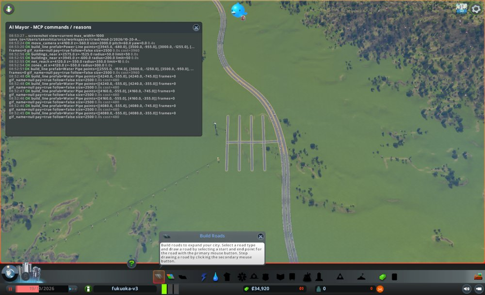

### 2026-10-29 見回り

境目: 当たった。週の収支が 0 → -798 で赤字になった。ダイアログなし(advance の dialogs 空、seconds 24.4)。来ない市民は 電0・水0・下水0

### 2026-10-29 臨時

- きっかけ: 週の収支 -798(収入55、支出853)
- 見たもの: `services` 電気 7,840/2,288、水 60,000/3,104、下水 120,000/194。`complaints` 0件。`economy_breakdown` 支出は水594・電気179・道路80
- 施策: 水道の予算を 100% → 80% に下げる(公約3)
  - 理由: 水の容量が使用量の約19倍。支出の7割が水道
  - 予想: 次の見回りで水道の支出が約120下がる。水の容量は約48,000で、使用量を上回ったまま
  - 操作: `set_budget(water, 80)`
  - 結果: ok(water 80%)

### 2026-11-08 見回り

境目: 当たらず。週の収支は -798 → -428 で改善。来ない市民 0。ダイアログなし(seconds 24.3)。働き口の需要が57に上がった

### 2026-11-18 月例(2か月目)

保存: `fukuoka-modtest-2026-11`(seconds 2.0、nudged false)

#### 答え合わせ

- 施策1(道路と住宅地): 予想どおり。人口 0 → 223(予想200以上)
- 施策2(風車): 予想どおり。電気 7,840/3,200。電気の来ない市民0。風車→給水塔は家がつないだ(給水塔が水を出している)
- 施策3(給水塔・排水口): 予想どおり。水 38,400/5,088、下水 76,800/318。来ない市民0
- 臨時(水道の予算80%): 予想どおり。水道の支出 594 → 482(-112、予想 -120)
- 前回の「次にやること」
  - 風車→給水塔の電気: 確かめた。つながっている
  - 工業区画: 働き口の需要100になったので、今回行う
  - ごみ・医療など: ごみの建物はまだ解禁されていない(`list_building_types(Garbage)` が空)。行わなかった
- 公約の進み具合
  1. 人口: 223(前の月例0から増えた) / 毎月 / 達成
  2. 電気・水・下水が来ない市民: 0 / 任期の終わりまで / 達成中
  3. 週の収支: -204 / 赤字1回目。次の月例も赤字だと公約違反 / 危うい

#### 気づいたこと

- 失業151人に対し、働き口26。働き口の需要100、住宅の需要0。人が増えない理由は働き口
- 赤字 -204。支出の65%が水道(482)。水の容量は使用量の約7.5倍
- 市民の平均の暮らし向き10、健康49。体調の悪い人が多い(5人中4人 PoorHealth)。医療はまだない

#### 施策

1. 東の通り(x=4240)と幹線の東の端を工業区画にする
   - 公約: 1(働き口を作って人を呼ぶ)、3(工業の税収)
   - 理由: 失業151、働き口の需要100。通り x=4160 の東と x=4240 の両側は空き地で、区画の付け替えは無料
   - 予想: 次の月例までに工業の建物が建ち、働き口が26 → 100以上、失業が100未満。週の収入が増える
   - 操作: `zone_area(industrial)` を x=4262 の線上に半径55で並べる。工業の区画の電気は、家から送電線を引いてつなぐ
   - 結果: `zone_area` を10回(z -370〜-730、40m間隔)。工業に変えたマス 計361、建物のあるマス0。送電線 店(id 6899、4136,-578)→工業区画 (4222,-590)(240)
   - 確かめ: `zone_map` で x=4240 の東側と幹線の東の端が工業(黄)になった。x=4240 の西側は一部が住宅のまま残った
2. 水道の予算を 80% → 60% に下げる
   - 公約: 3
   - 理由: 水の容量 38,400 に対し使用量 5,088。支出の65%が水道
   - 予想: 水道の支出が約120下がり、週の収支が -204 → -80前後。水の容量は約28,800で、使用量を上回ったまま
   - 操作: `set_budget(water, 60)`
   - 結果: ok(water 60%)

施策は2件。3件目は打たない(赤字のため、維持費の増える施策を控えた)。

#### 次にやること

- 工業の建物に電気・水が来たかを確かめる(赤い枠がないか `zone_map`)
- ごみ・医療が解禁されたら、維持費を見て置く
- 赤字が続くなら、住宅の税を +1〜2 する

#### 画面写真

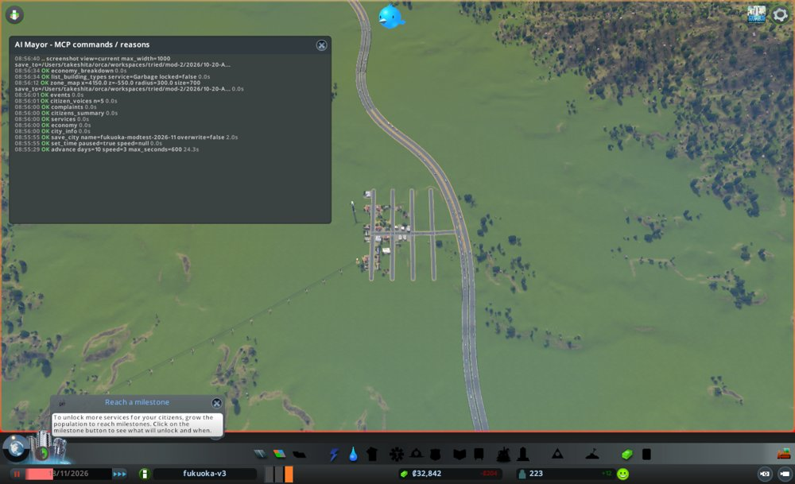
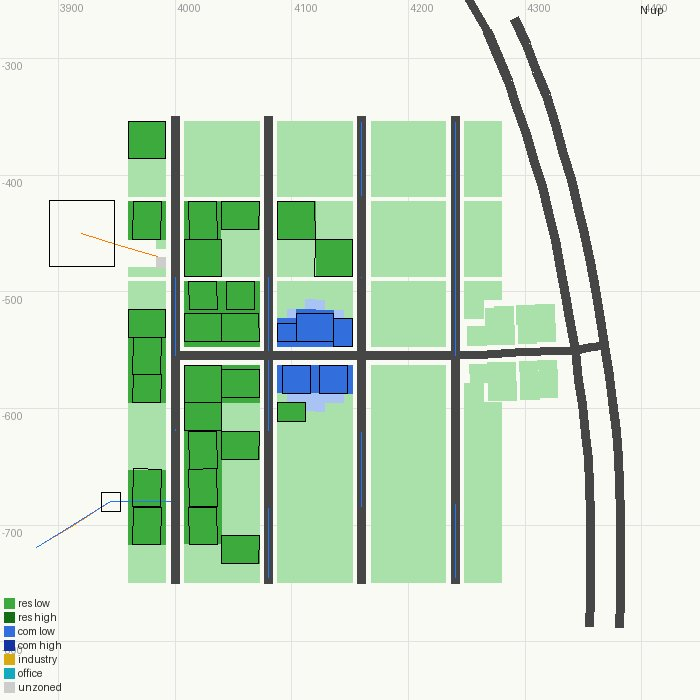

### 2026-11-28 見回り

境目: 当たらず。週の収支 -204 → -50 で改善。来ない市民0。ダイアログなし(seconds 24.3)。`zone_map` で工業の建物が約20棟建ち、赤い枠なし

### 2026-12-08 見回り

境目: 当たらず。週の収支が +234 で黒字になった。来ない市民0。ダイアログなし(seconds 24.4)

### 2026-12-18 月例(3か月目)

保存: `fukuoka-modtest-2026-12`(seconds 2.0、nudged false)

#### 答え合わせ

- 施策1(工業区画): 予想どおり。働き口 26 → 297(予想100以上)、失業 151 → 19(予想100未満)。工業の税収 340
- 施策2(水道の予算60%): ほぼ予想どおり。水道の支出 482 → 370(-112、予想 -120)。水 21,600/7,504 で足りている。週の収支は -204 → +404(予想 -80前後より良い。工業の税収が効いた)
- 前回の「次にやること」
  - 工業の建物の電気・水: 確かめた(11-28 の見回りで赤い枠なし。来ない市民0)
  - ごみ・医療: 行わなかった。まだ解禁されていない。診療所は人口460で解禁(`list_building_types(locked=true)`)
  - 住宅の税: 黒字になったので上げなかった
- 公約の進み具合
  1. 人口: 271(前の月例223から +48) / 毎月 / 達成
  2. 電気・水・下水が来ない市民: 0 / 任期の終わりまで / 達成中
  3. 週の収支: +404 / 前の月例の赤字は1回で止まった / 達成

#### 気づいたこと

- 働き口297に働き手184。仕事は余っているのに、住宅の需要は8と低い。人口の伸びが鈍った(+48)
- 商業の需要38。商業は幹線の中央にしかない
- 電気 7,760/5,728(74%)。工業が増えると足りなくなる

#### 施策

1. 風車をもう1基建てる
   - 公約: 2
   - 理由: 電気の使用が容量の74%。足りなくなる前に足す
   - 予想: 次の見回りで電気の容量が約15,500になり、使用率50%以下。来ない市民0のまま
   - 操作: `place_building(Wind Turbine)` を1基目の北 (3920,-380)。建設6,000、週80
   - 結果: (3920,-375) に置いた(id 34739、6,000)。送電線で1基目とつないだ(180。始点は新しい風車の敷地内、終点は既存の点)
   - 確かめ: `place_building` が ok。容量の変化は次の見回りで見る
2. 幹線の x=4160〜4240 の空き地を商業区画にする
   - 公約: 1、3
   - 理由: 商業の需要38。そこは住宅区画のまま空いている。付け替えは無料
   - 予想: 次の月例までに商業の建物が増え、商業の需要が20未満になる。商業の税収が増える
   - 操作: `zone_area(commercial_low)` を (4200,-555) 半径40
   - 結果: 商業に変えたマス32、建物のあるマス52で変えず
   - 確かめ: `zone_map` で幹線の北側 x≈4180〜4200 が商業(薄い青)。思ったより狭い。空き地の多くは工業の建物で埋まっていた
3. 住宅(低密度)の税を 9% → 7% に下げる
   - 公約: 1
   - 理由: 住宅の需要8と低いが、働き口は113余っている。週の収支は +404 で余裕がある
   - 予想: 次の見回りで住宅の需要が20以上に上がる。住宅の税収は約110減る。次の月例で人口300以上
   - 操作: `set_tax(residential_low, 7)`
   - 結果: ok(residential_low 7%)

維持費の増え分: 風車80、税の減収 約110。合計約190で、黒字 +404 の範囲に収まる。建設費 6,180(所持金の半分16,680以内)。

#### 次にやること

- 人口460で診療所が解禁される。解禁されたら維持費(週400)と収支を見て置く
- 商業の需要が残るなら、住宅地の外側に商業の通りを足す
- 住宅の需要が上がらなければ、税を戻すか、別の原因(サービス不足)を探す

#### 画面写真

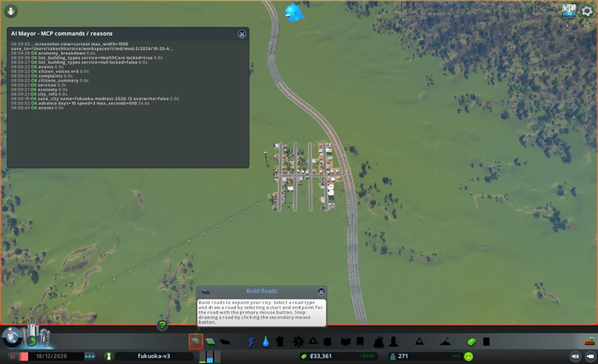
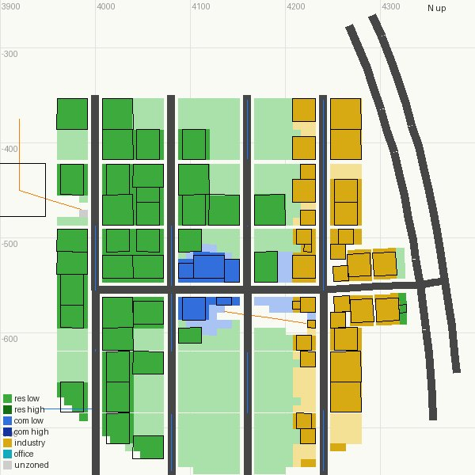

### 2026-12-28 見回り

境目: 当たらず。人口 271 → 347、週の収支 +445。来ない市民0。ダイアログなし(seconds 24.3)
- 風車の確かめ: `services` 電気 15,520/7,536(49%)。予想どおり
- 水 21,600/9,808(45%)。水道の予算60%のままだと、人口が倍になる前に足りなくなる。次の月例で見る

### 2027-01-07 見回り

境目: 当たらず。人口 451(診療所の解禁460の手前)、週の収支 +759。来ない市民0。ダイアログなし(seconds 24.4)

### 2027-01-17 運営の終わり

- 2027-01-07 に人口の節目「Little Hamlet」(460)のお知らせが出て、MOD が同じ日に閉じた(advance の dialogs に seq 1、UnlockingPanel、autoClosed true)。境目に数えない。ごみ処理場・小学校・診療所・税・借入が解禁された
- 所持金が 10日で 28,746 → 50,137(+21,391)。週の収支(+759〜+1,000)では説明できない。節目の報酬と思われるが、道具では確かめられない
- `city_info` の dialog は null、dialogSeq 1

### 2027-01-17 月例(4か月目)

保存: `fukuoka-modtest-2027-01`(seconds 2.0、nudged false)

#### 答え合わせ

- 施策1(風車2基目): 予想どおり。12-28 に電気 15,520/7,536(49%)。今は 15,440/10,624(69%)
- 施策2(商業区画32マス): 外れ。商業の需要 38 → 48 で、20未満にならなかった
- 施策3(住宅の税 9→7%): 外れ。住宅の需要は 8 → 10 で、20以上にならなかった。人口は 271 → 535 で、予想の300以上は超えた
- 前回の「次にやること」
  - 診療所: 解禁された(人口460)。今回置く
  - 商業の通りを足す: 行わなかった(今回も見送る。下の理由)
  - 住宅の需要: 上がらなかった。サービス不足(ごみ0、医療0)が原因と見て、今回手当てする
- 公約の進み具合
  1. 人口: 535(前の月例271から +264) / 毎月 / 達成
  2. 電気・水・下水が来ない市民: 0 / 任期の終わりまで / 達成中
  3. 週の収支: +1,000 / 達成

#### 気づいたこと

- 水 14,416/21,600(67%)。水道の予算60%のまま。1か月で人口が倍になった。このままだと次の月例までに足りなくなる
- ごみの容量0。ごみの困りごとが1棟に出た(4104,-438 の家)
- 医療の容量0、病人8、健康の平均48
- 働き口358に働き手343、失業70。商業の需要48、働き口の需要80、住宅の需要10
- 学歴は全員なし(学校0)

#### 施策

1. 水道の予算を 60% → 80% に戻す
   - 公約: 2
   - 理由: 水の使用が容量の67%。人口が月に倍のペース
   - 予想: 次の見回りで水の容量が約28,800になり、使用率60%未満。水道の支出は約120増える
2. ごみ処理場(Landfill Site)を、通り x=4240 を南へ100m延ばした先に置く
   - 公約: 1(サービス不足を埋めて住宅の需要を上げる)
   - 理由: ごみの容量0。困りごとが出始めた。住宅地から離すため、道路を延ばす
   - 予想: 次の見回りで `services` のごみの容量が0より大きい。次の月例でごみの困りごと0
   - 費用: 建設4,000+道路約500、週160+道路約5
3. 診療所(Medical Clinic)を、住宅地の南西の空き地 (4020,-725) に置く
   - 公約: 1
   - 理由: 医療の容量0、病人8、健康の平均48
   - 予想: 次の見回りで医療の容量が0より大きい。次の月例で健康の平均が55以上、住宅の需要が20以上
   - 費用: 建設10,000、週400

建設費の合計 約14,500(所持金の半分25,068以内)。維持費の増え分 約685(水120+ごみ165+診療所400)。黒字 +1,000 の範囲に収まる。
商業の区画は、空き地が少ないため今回は見送る。

結果:

1. `set_budget(water, 80)`: ok
2. 道路 (4240,-750)→(4240,-850)(480、snapped 1)。ごみ処理場 id 24905 を (4240,-890) angle 0 に置いた(4,000)。入口 (4240,-858) facing north、道路まで0m
   - `buildings_near` で grid が電気・水・下水とも false だった。水道管 (4240,-745)→(4240,-875)(320、終点は敷地内)と、送電線 工場 15645 の敷地→処理場の敷地(360)を足した
3. 診療所 id 13241 を (4021,-725) angle 90 に置いた(10,000)。入口 (4005,-725) facing west、道路まで0m。grid は電気・水・下水とも true

建設費の合計 15,160。所持金 50,137 → 約34,977。

#### 次にやること

- ごみ処理場に電気と水が来たかを見回りで確かめる(`buildings_near` の grid)
- 商業の需要48・働き口の需要80が残るなら、新しい通りを引いて商業と工業の区画を足す
- 小学校(週160)は、収支を見て次の月例で考える

#### 画面写真

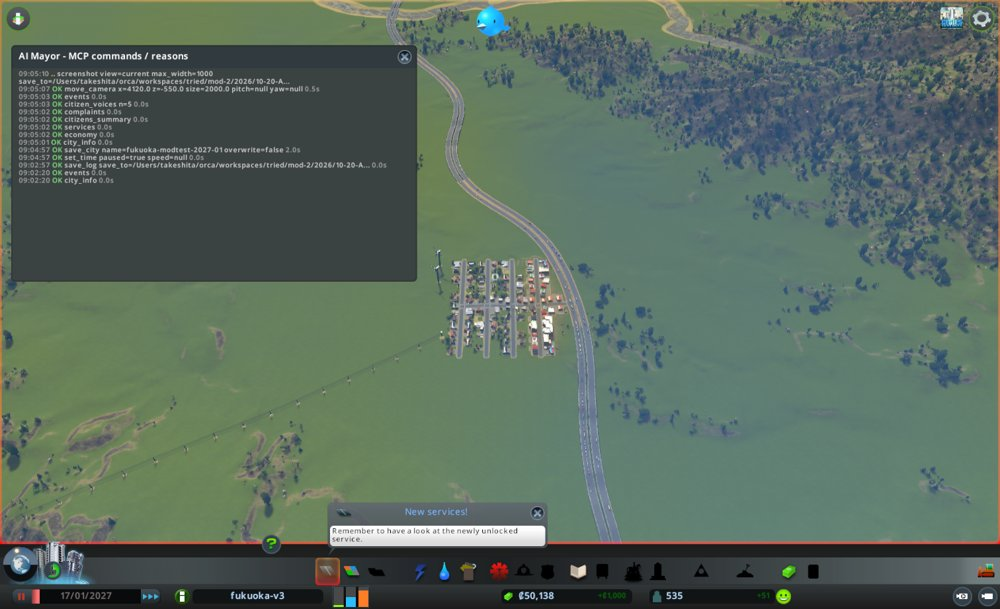
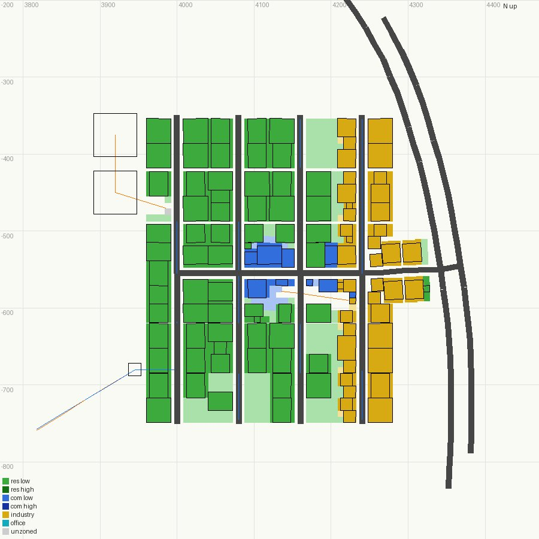

### 2027-01-27 見回り

境目: 当たらず。人口 590、週の収支 +647(支出 719 → 1,405)。来ない市民0。ダイアログなし(seconds 24.4)
- ごみ処理場の grid は電気・水・下水とも true になった。events に、ごみ収集と医療が始まったつぶやき

### 2027-02-06 見回り

境目: 当たらず。人口 669、週の収支 +753。来ない市民0。events 0件。ダイアログなし(seconds 24.4)。商業の需要64・働き口の需要88に上がった

### 2027-02-16 月例(5か月目)

保存: `fukuoka-modtest-2027-02`(seconds 2.0、nudged false)

#### 答え合わせ

- 施策1(水道の予算80%): 予想どおり。水 38,400/18,944(49%、予想60%未満)。容量は予想28,800より多い
- 施策2(ごみ処理場): 予想どおり。ごみの容量 8,000,000/125,438。ごみの困りごと 1 → 0
- 施策3(診療所): 半分当たり。健康の平均 48 → 65(予想55以上)。住宅の需要は 10 → 1 で、予想の20以上は外れた
- 前回の「次にやること」
  - ごみ処理場の電気と水: 確かめた(01-27 に grid すべて true)
  - 商業と工業の区画を足す: 今回行う
  - 小学校: 見送る。建設費の上限(所持金の半分 19,019)を風車と道路に使うため
- 公約の進み具合
  1. 人口: 701(前の月例535から +166) / 毎月 / 達成
  2. 電気・水・下水が来ない市民: 0 / 任期の終わりまで / 達成中。ただし電気が容量の93%
  3. 週の収支: +791 / 達成

#### 気づいたこと

- 電気 14,352/15,440(93%)。このままだと次の見回りまでに停電する
- 失業 118(前の月例70)。働き口413に働き手389。働き口の需要97、商業の需要63、住宅の需要1
- 人が増えても仕事が足りず、住宅の需要が上がらない。働き口を作るのが先
- 幸福度: city_info 73、citizens_summary の平均41

#### 施策

1. 風車を2基足す
   - 公約: 2
   - 理由: 電気の使用が容量の93%
   - 予想: 次の見回りで電気の容量が約30,000、使用率50%前後。来ない市民0のまま
   - 費用: 建設12,000+送電線、週160
2. 住宅地の北に通りを足し、商業と工業の区画にする
   - 公約: 1(働き口を作り、失業を減らして住宅の需要を上げる)、3
   - 理由: 失業118、働き口の需要97、商業の需要63。空き地がない
   - 操作: 4本の通りの北の端 z=-350 をつなぐ東西の通り(240m)と、x=4240 を北へ160m延ばす通り。東西の通りの北側を商業、x=4240 の延長を工業にする
   - 予想: 次の月例までに商業と工業の建物が建ち、失業が60未満、住宅の需要が10以上
   - 費用: 道路約400m 約1,900、週約20

建設費の合計 約14,000(所持金の半分19,019以内)。維持費の増え分 約180(黒字 +791 の範囲)。

結果:

1. 風車 id 4630 を (3850,-450)、id 28916 を (3850,-375) に置いた(各6,000)。送電線 28916→4630(160、両端とも敷地内)、4630→既存の風車 (3920,-450)(160、snapped 2)
2. 東西の通りを3区間に分けて引いた((4000,-350)→(4080,-350)→(4160,-350)→(4240,-350)、各400、各 snapped 2)
   - x=4240 の北への延長 (4240,-350)→(4240,-190)(800)は、終点が九州自動車道の本線の点 (4240,-182)(node 4676)につながってしまった(snapped 2)。高速の上り線に平面でつながり、途中で本線をまたいでいたため、`remove_line` で (4240,-270)→(4240,-182) の1区間を消した(払い戻しなし)。延長は (4240,-350)→(4240,-270) の80mだけ残った。高速の区間は消えていない(`net_near` で確かめた)
   - 区画: 東西の通りの北側を商業(低密度)117マス、x=4240 の延長の両側を工業 45マス
   - 確かめ: `zone_map` で北側が商業(薄い青)、延長の両側が工業(薄い黄)。建物のあるマスは変えていない

建設費の合計 14,320。所持金 38,039 → 約23,719。

画面写真は、型の順(8番目、施策の前)ではなく施策の後に撮った。困りごとの印が0件で、撮る場所を決めかねたため。

#### 次にやること

- 新しい区画の建物に電気・水が来たか(`zone_map` の赤い枠、来ない市民の数)を見回りで確かめる。来なければ東西の通りに水道管を引く
- 風車の容量の増え分を見回りで確かめる(`services`)
- 小学校(建設10,000、週160)を、所持金が戻ったら置く

#### 画面写真

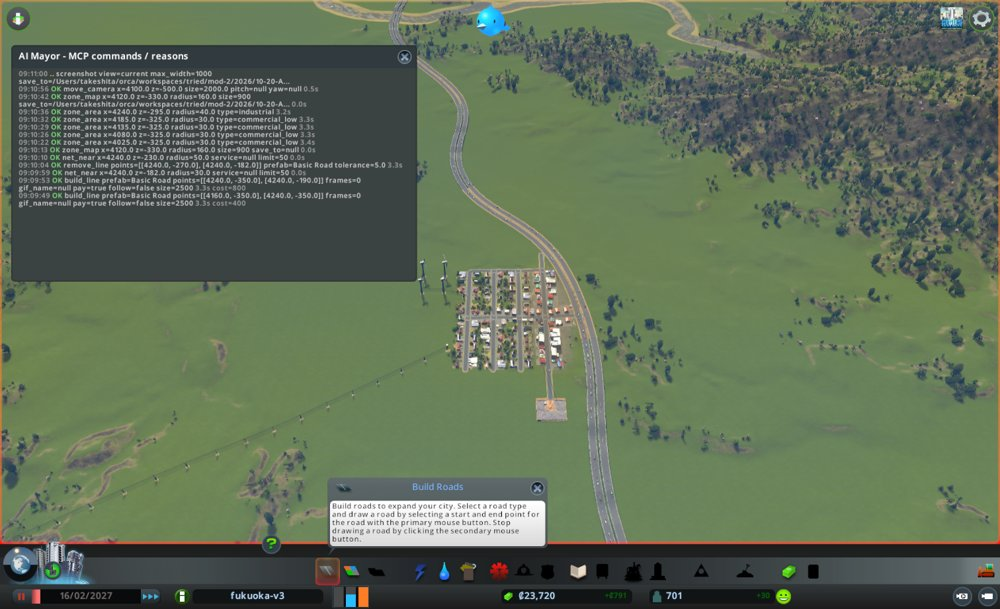
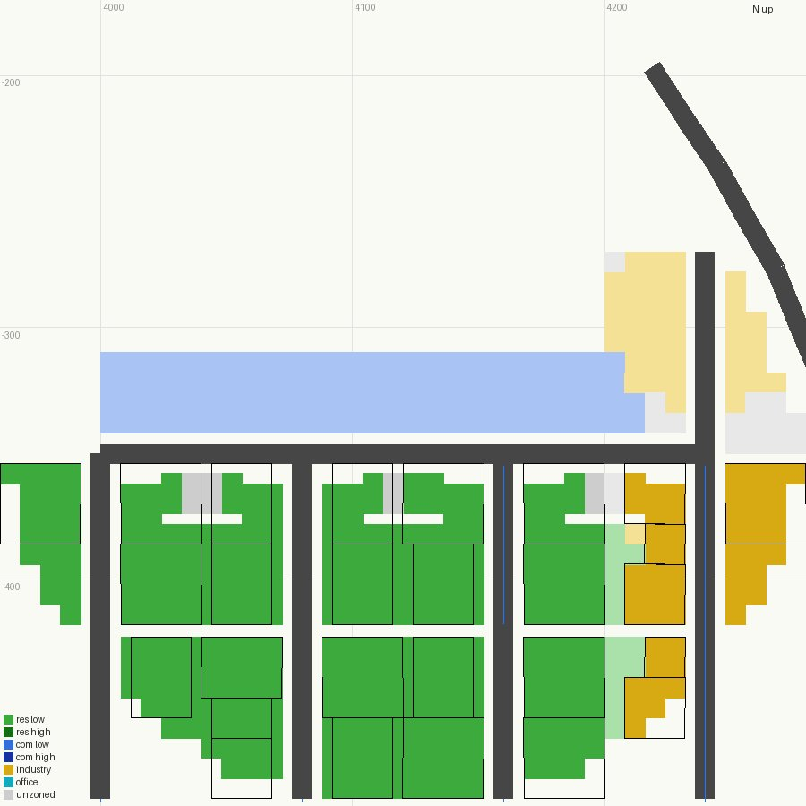

### 2027-02-26 見回り

境目: 当たらず。人口 701 → 667(-4.9%、境目の5%に届かない)。週の収支 +574。来ない市民0。ダイアログなし(seconds 24.4)
- 電気 30,640/14,416(47%)。風車2基の予想どおり
- 北の通り沿いに商業7棟・工業約10棟が建った。赤い枠なし
- 人口が減ったわけ: `zone_map` で、4本の通りの北の端(z≈-355〜-390)の家が数棟なくなり、空いた住宅区画(薄い緑)になっていた。東西の通り z=-350 を引いたとき、端の家に重なって取り壊されたと見る。道具の戻り値には、建物を壊したことが出ていない

### 2027-03-08 見回り

境目: 当たらず。人口 689、週の収支 +1,039。来ない市民0。events 0件。ダイアログなし(seconds 24.3)。住宅の需要が 1 → 28 に上がった

### 2027-03-18 月例(6か月目)

保存: `fukuoka-modtest-2027-03`(seconds 2.0、nudged false)

#### 答え合わせ

- 施策1(風車2基): 予想どおり。電気 30,640/15,728(51%、予想50%前後)。来ない市民0
- 施策2(北の通りと商業・工業の区画): 半分当たり。失業 118 → 30(予想60未満)、住宅の需要 1 → 46(予想10以上)。ただし通りを引いたときに北の端の家が数棟なくなり、02-26 に人口が 701 → 667 に減った
- 前回の「次にやること」
  - 新しい区画の電気・水: 確かめた(02-26 に赤い枠なし、来ない市民0)。水道管は引かなかった
  - 風車の容量: 確かめた(02-26 に 30,640)
  - 小学校: 今回置く
- 公約の進み具合
  1. 人口: 723(前の月例701から +22) / 毎月 / 達成(わずか)
  2. 電気・水・下水が来ない市民: 0 / 任期の終わりまで / 達成中
  3. 週の収支: +1,081 / 達成

#### 気づいたこと

- 住宅の需要46に上がった。失業30まで下がり、仕事のある人が住める家が足りない
- 空いた住宅区画は北の端の数区画だけ
- 子ども139・10代85で、学校0。events に学校を建ててという署名のつぶやき
- 病人 16 → 38、体調の悪い市民41。診療所は 100/37 で余っている
- 水 53%、電気 51%。まだ余裕がある

#### 施策

1. 小学校を、通り x=4080 の南の端 (4080,-768) に北向きで置く
   - 公約: 1
   - 理由: 子ども139で学校0。署名のつぶやき。住む場所としての魅力を上げる
   - 予想: 次の見回りで `services` の小学校の定員が0より大きい。次の月例で学生が0より多い
   - 費用: 建設10,000、週160
2. 通り x=4000 を南へ120m延ばし、両側を住宅(低密度)にする
   - 公約: 1
   - 理由: 住宅の需要46、空いた住宅区画が少ない
   - 予想: 次の月例で人口800以上
   - 費用: 道路約600、水道管約400、週約10

建設費の合計 約11,000(所持金の半分13,717以内)。維持費の増え分 約170(黒字 +1,081 の範囲)。

結果:

1. 小学校 id 15841 を (4080,-768) angle 0 に置いた(10,000)。入口 (4080,-752) facing north、道路まで0m。`zone_map` では時間を進める前なので赤い枠(電気・水が未反映)
2. 道路 (4000,-750)→(4000,-870)(640、snapped 1)。水道管 (4000,-745)→(4000,-865)(320、snapped 1)。住宅(低密度)94マス
   - 確かめ: `zone_map` で延長の両側が住宅(薄い緑)

建設費の合計 10,960。所持金 27,434 → 約16,474。

#### 次にやること

- 小学校に電気・水が来たか、定員が出たかを見回りで確かめる
- 病人が増えている(16 → 38)。原因(工業の汚染か)を `complaints` と画面で見る
- 道路を既存の通りの端につなぐときは、端の家に重ならないかを先に見る(5か月目に家を壊した)

#### 画面写真

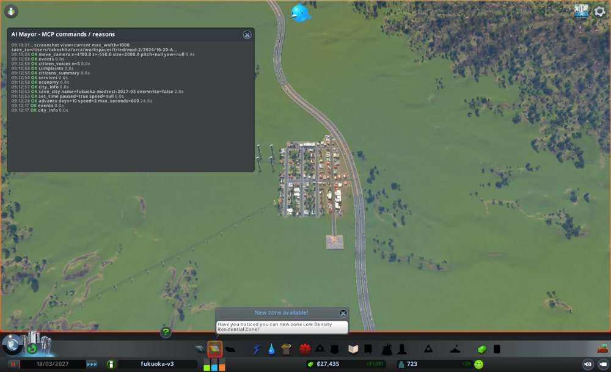
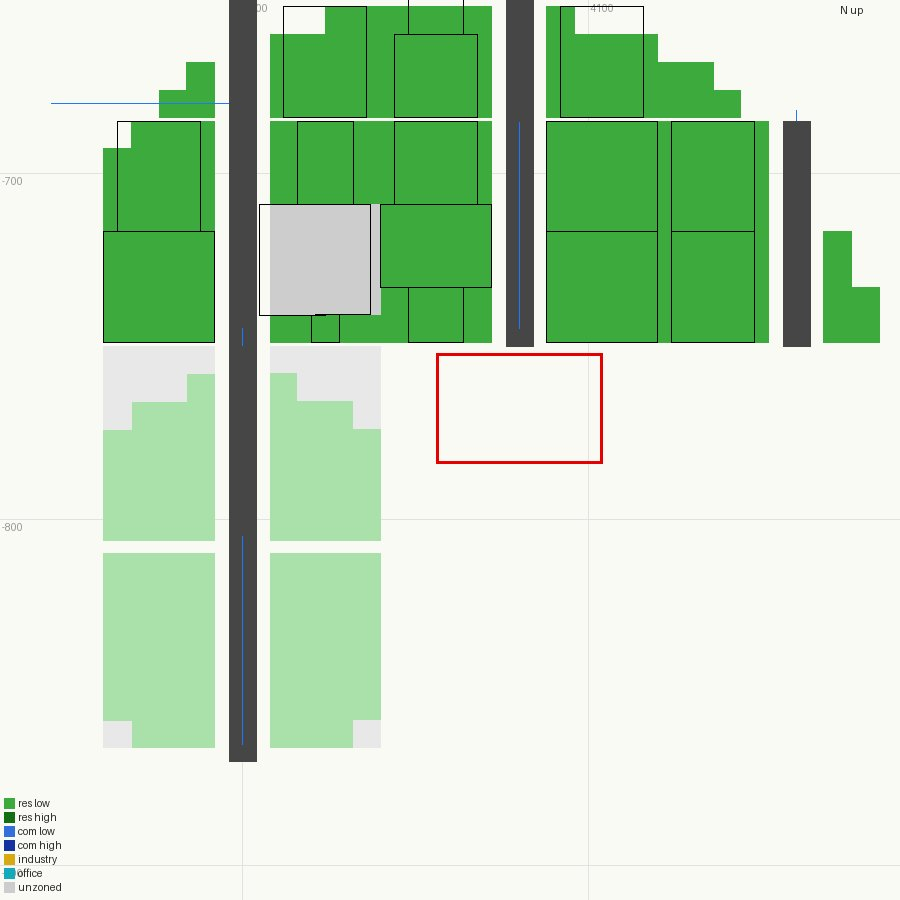

### 2027-03-28 見回り

境目: 当たらず。人口 753、週の収支 +893。来ない市民0。ダイアログなし(seconds 24.4)
- 小学校: grid は電気・水・下水とも true。`services` の小学校の定員 300。events に教育を喜ぶつぶやき

### 2027-04-07 見回り

境目: 当たらず。人口 782、週の収支 +916。来ない市民0。ダイアログなし(seconds 24.4)。住宅の需要52

### 2027-04-17 運営の終わり(6か月目まで)

- advance(10) は seconds 24.4、dialogs 空。dialogSeq は 1 のまま(4〜6か月目にダイアログは一度も出ていない)
- 学生 143、小学校を出た市民 18。学校は効き始めた
- 南の延長の住宅区画は約8棟建ち、ほぼ埋まった
- 病人 58、体調の悪い市民 63(前の月例 38・41)。診療所 100/57。増え続けている。原因は確かめていない
- 水 57%、電気 56%

### 2027-04-17 月例(7か月目)

保存: `fukuoka-modtest-2027-04`(seconds 2.0、nudged false)

#### 答え合わせ

- 6か月目の施策1(小学校): 予想どおり。03-28 に定員300、04-17 に学生143
- 6か月目の施策2(x=4000 を南へ延ばし住宅): 予想どおり。人口 723 → 791(予想800以上には9人届かず、ほぼ当たり)
- 前回の「次にやること」
  - 小学校の電気・水と定員: 確かめた(03-28)
  - 病人の原因: 今回 `complaints` を見た。困りごとの印0件。原因はまだ分からない(下に記す)
  - 道路を既存の端につなぐ前に家を見る: 今回 `buildings_near` で見てから決めた
- 公約の進み具合
  1. 人口: 791(前の月例723から +68) / 毎月 / 達成
  2. 電気・水・下水が来ない市民: 0 / 任期の終わりまで / 達成中
  3. 週の収支: +868 / 達成

#### 気づいたこと

- 需要は住宅・商業・工業とも50。失業25、働き手491・働き口527
- 空いた住宅区画はほぼない。西側(x=4000 の西)は家で埋まり、東西の通りを西へ延ばすと家に重なる(`buildings_near` で (3976,-527/-555/-583) に家)
- 病人58、体調の悪い市民63。診療所 100/57 で余っている。complaints は0件。診療所を足しても(建設10,000、週400)効く見込みが薄いので見送る
- 水 57%、電気 56%、下水 2%
- `zone_map` で、新しい風車2基 (3850,-450)・(3850,-375) が赤い枠(電気・水・下水のどれかが来ない)。風車は水が要らないので、表示だけの問題と見る
- 公園は、`list_building_types`(Beautification)に Industry Park など1万以上のものと岩しかない

#### 施策

1. 通り x=4000 をさらに南へ160m延ばし、z=-950 に東西の通り(西へ120m)を足して、住宅(低密度)にする
   - 公約: 1
   - 理由: 住宅の需要50、空いた住宅区画がほぼない。延長の端 (4000,-870) の先に家はない
   - 予想: 次の月例で人口870以上
   - 費用: 道路約280m 約1,400、水道管約280m 約800、週約12
2. z=-950 の東西の通りの東側(x=4000〜4120、120m)を商業(低密度)にする
   - 公約: 1、3(働き口と税収)
   - 理由: 商業の需要50。商業区画の空きがない
   - 予想: 次の月例で商業の建物が3棟以上増え、商業の需要が40以下
   - 費用: 道路約120m 約600、水道管約120m 約350、週約5

建設費の合計 約3,200(所持金の半分10,177以内)。維持費の増え分 約17(黒字 +868 の範囲)。

結果:

1. 道路 (4000,-870)→(4000,-950)→(4000,-1030)(800、snapped 1)、(4000,-950)→(3880,-950)(640、snapped 1)
   - 水道管 (4000,-865)→(4000,-1025): 道具が "Connection closed" を返した。`sim_health` は応答あり。`net_near` で見ると管は引けていた(3区間)。費用は所持金の差から約380
   - 水道管 (4000,-950)→(3885,-950)(280、snapped 1)
   - 区画: 住宅(低密度)210マス + 36マス
2. 道路 (4000,-950)→(4120,-950)(640、snapped 1)、水道管(280)。商業(低密度)86マス
   - 確かめ: `zone_map` で南の延長と西の通りが住宅(薄い緑)、東の通りが商業(薄い青)

建設費の合計 3,020。所持金 20,354 → 17,334。

#### 次にやること

- 新しい区画の建物に電気・水が来たか(赤い枠、来ない市民の数)を見回りで確かめる。延長の先は家で電気がつながる見込み。来なければ送電線を足す
- 病人が増え続けるなら、診療所の2つ目(建設10,000、週400)を所持金と収支を見て考える
- 人口1,000の節目で解禁される施設(警察・消防など)を `list_building_types` で見る

#### 画面写真

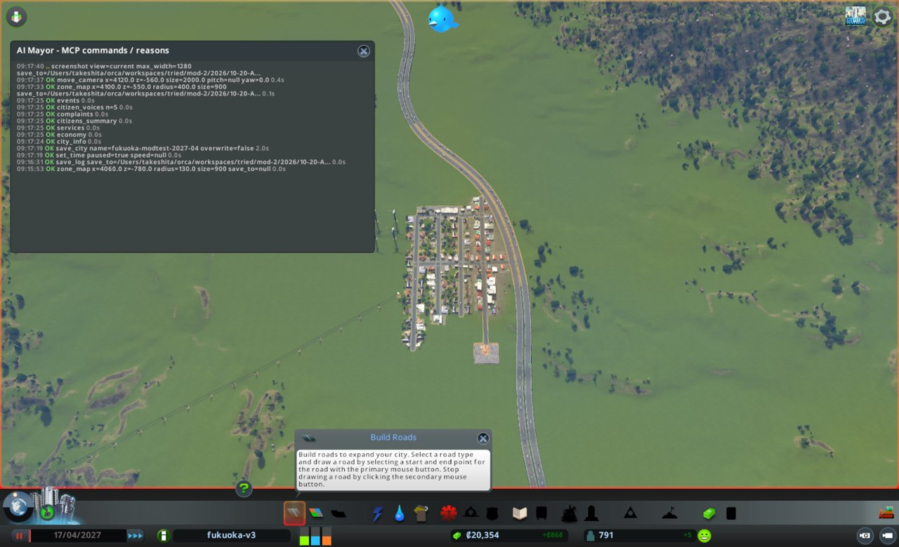
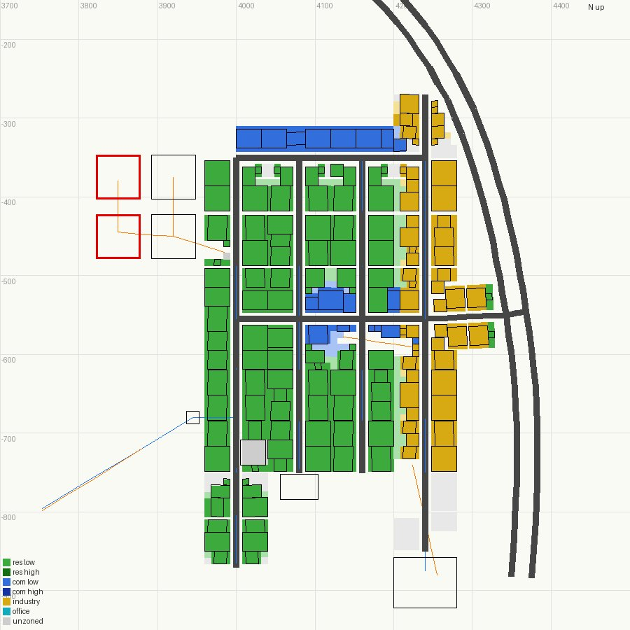
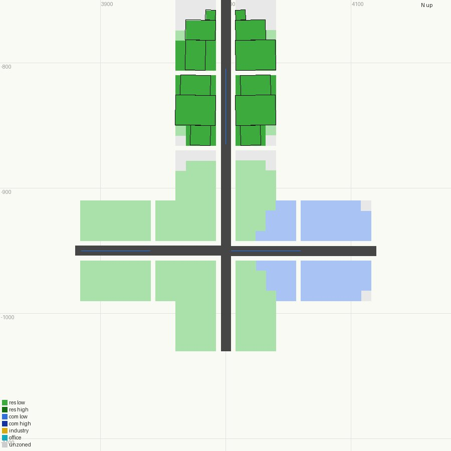

### 2027-04-27 見回り

境目: 当たらず。人口 824、週の収支 +922。来ない市民0。events 0件。ダイアログなし(seconds 24.4、dialogs 空)
- 南の区画に住宅約14棟・商業6棟が建った。西の端の2棟 (3920,-930)・(3920,-970) が赤い枠。来ない市民は0なので、まだ人が住んでいないと見る。次の見回りで見る

### 2027-05-07 見回り

境目: 当たらず。人口 884、週の収支 +1,364。来ない市民0。events 0件。ダイアログなし(seconds 24.4、dialogs 空)
- 西の端の2棟(id 6893、19734)は grid が電気・水・下水とも true になった。送電線は足さずに済んだ

### 2027-05-17 月例(8か月目)

保存: `fukuoka-modtest-2027-05`(seconds 2.0、nudged false)

人口の節目: 2027-05-13 に Worthy Village(900)。advance の dialogs に UnlockingPanel が autoClosed true で入り、止まらずに10日進んだ。消防・警察・地区・政策が解禁された

#### 答え合わせ

- 7か月目の施策1(南の延長と西の通りの住宅): 予想どおり。人口 791 → 902(予想870以上)
- 7か月目の施策2(東の通りの商業): 半分当たり。商業が6棟以上建った(予想3棟以上)。ただし商業の需要は 50 → 50 で下がらなかった(予想40以下)
- 前回の「次にやること」
  - 新しい区画の電気・水: 確かめた(05-07 に西の端の2棟が true)
  - 診療所の2つ目: 見送り。診療所 100/65 でまだ余っている
  - 解禁された施設: 確かめた。Fire House(12,000、週560)、Police Station(12,000、週480)
- 公約の進み具合
  1. 人口: 902(前の月例791から +111) / 毎月 / 達成
  2. 電気・水・下水が来ない市民: 0 / 任期の終わりまで / 達成中
  3. 週の収支: +1,382 / 達成

#### 気づいたこと

- 所持金が 20,498(05-07)→ 42,480(05-17)。10日の黒字は約2,000なので、残りの約2万は節目の報酬と見る。道具の戻り値には報酬の額が出ない
- 需要 住46 / 商50 / 工53。働き手520・働き口564、失業34
- 病人65(前の月例58)、体調の悪い市民55(63)。`citizen_voices` で病人の家が (4184,-701)。工業の区画(x≈4200〜4300)の隣
- 犯罪率1。消防はない。火事はまだ一度も出ていない
- 水 66%、電気 62%

#### 施策

1. 西の通りを (3880,-950)→(3760,-950) に延ばし、通り x=4000 を (4000,-1110) まで延ばして、住宅(低密度)にする
   - 公約: 1
   - 理由: 住宅の需要46。前回の延長は2週間で埋まった。延ばす先は通りの端で、家はない
   - 予想: 次の月例で人口980以上
   - 費用: 道路200m 1,000、水道管200m 約560、週約8
2. 消防署(Fire House)を、通り x=4240 の西の空き地 (4220,-805) に東向きで置く
   - 公約: 1(火事で家を失わないため)
   - 理由: 人口900で消防が解禁された。木造の低密度住宅が密集し、消防が0
   - 予想: 次の見回りで grid が電気・水・下水とも true。火事が出ても家が焼け広がらない
   - 費用: 建設12,000、週560
3. 東の通りを (4120,-950)→(4200,-950) に延ばし、x=4200 を南へ (4200,-1070) まで引いて、工業にする
   - 公約: 1、3(働き口と税収)
   - 理由: 働き口の需要53。工業は住宅から商業をはさんで約150m離す。西側は給水塔に近いので置かない
   - 予想: 次の月例で工業が3棟以上建ち、働き口の需要が45以下
   - 費用: 道路200m 1,000、水道管200m 約560、週約8

建設費の合計 約15,100(所持金の半分21,240以内)。維持費の増え分 約576(黒字 +1,382 の範囲)。

結果:

1. 道路 (3880,-950)→(3760,-950)(640、snapped 1)、(4000,-1030)→(4000,-1110)(400、snapped 1)。水道管 320 + 200(各 snapped 1)。住宅(低密度)108 + 78マス
2. 消防署 id 23135 を (4220,-808) angle 270 に置いた(12,000)。入口 (4232,-808) facing east、道路まで0m(segment 33796)
3. 道路 (4120,-950)→(4200,-950)→(4200,-1070)(1,040、snapped 1)。水道管(480、snapped 1)。工業145マス
   - 確かめ: `zone_map` で西と南が住宅(薄い緑)、x=4200 の両側が工業(薄い黄)。消防署と南の端の新しい家2棟は赤い枠(時間を進める前)

建設費の合計 15,080。所持金 42,480 → 27,400。

#### 次にやること

- 消防署に電気・水が来たか(grid)を見回りで見る。来なければ x=4240 の水道管から引くか、送電線を足す
- 工業の建物が建ったか、働き手が足りるかを見る(働き口の需要と失業)
- 病人の家が工業の隣か、もう一度 `citizen_voices` で見る。工業の隣の住宅が原因なら、次の手を考える

#### 画面写真

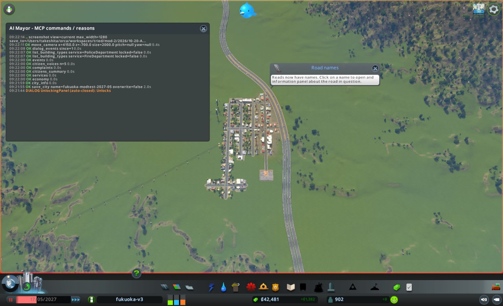
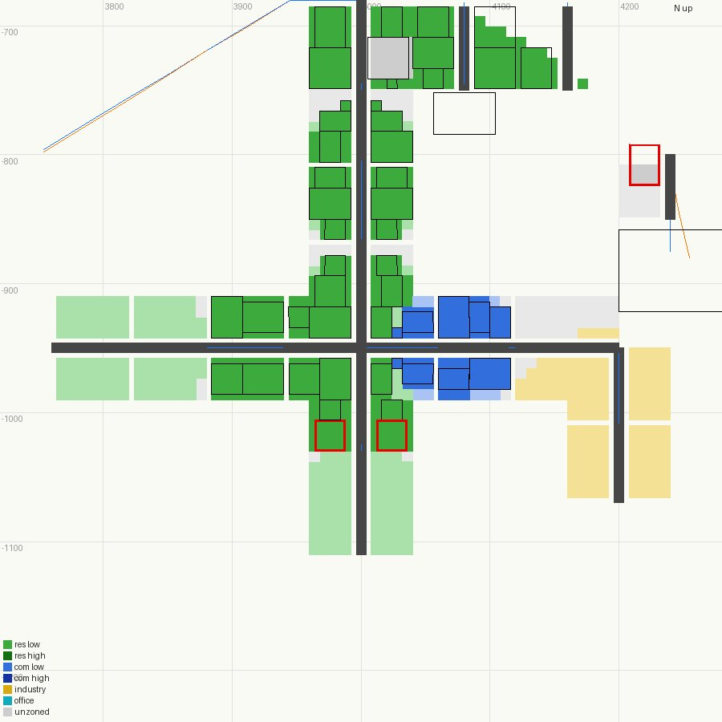

### 2027-05-27 見回り

境目: 当たらず。人口 949、週の収支 +1,077(支出 1,773 → 2,353。消防署の分)。来ない市民0。ダイアログなし(seconds 24.3、dialogs 空)
- 消防署 id 23135 は grid が電気・水・下水とも true。events に初めての消防車のつぶやき
- 住宅の需要 46 → 22、働き口の需要 53 → 43

### 2027-06-06 見回り

境目: 当たらず。人口 1,040、週の収支 +1,378。来ない市民0。events 1件(街と関係のないつぶやき)。ダイアログなし(seconds 24.4、dialogs 空)

### 2027-06-16 月例(9か月目)

保存: `fukuoka-modtest-2027-06`(seconds 2.0、nudged false)

#### 答え合わせ

- 8か月目の施策1(西と南の住宅): 予想どおり。人口 902 → 1,057(予想980以上)。`zone_map` で西と南の区画はほぼ埋まった
- 8か月目の施策2(消防署): 半分確かめた。05-27 に grid が true、消防車のつぶやき。火事はまだ出ていないので、焼け広がらないかは確かめられない
- 8か月目の施策3(南の工業): 当たり。x=4200 の両側に工業が約8棟建った(予想3棟以上)。働き口の需要 53 → 45(予想45以下)
- 前回の「次にやること」
  - 消防署の電気・水: 確かめた(05-27)
  - 工業と働き手: 確かめた。働き手610・働き口695、失業41。長く失業している市民が 0 → 23
  - 病人の家: `citizen_voices` の5人に病人がいなかった。確かめられず
- 公約の進み具合
  1. 人口: 1,057(前の月例902から +155) / 毎月 / 達成
  2. 電気・水・下水が来ない市民: 0 / 任期の終わりまで / 達成中
  3. 週の収支: +1,410 / 達成

#### 気づいたこと

- 電気 24,400/30,640(80%)、水 31,056/38,400(81%)。前の月例の62%・66%から急に上がった。このまま増えると来月に足りなくなる
- 犯罪率 1 → 15。`complaints` に犯罪1棟(区画の中心 (3840,0))。警察は0
- 住宅の需要55。空いた住宅区画はほぼない
- 病人61、体調の悪い市民63。横ばい
- 所持金 32,818。建設費の上限 16,409

#### 施策

1. 風車を1基、既存の風車の西 (3780,-450) に置き、送電線で (3850,-450) の風車につなぐ
   - 公約: 2
   - 理由: 電気の使用80%。人口が月に150人増えている
   - 予想: 次の見回りで電気の容量が約38,000、使用率65%前後
   - 費用: 建設6,000、送電線70m 約100、週80
2. 水道の予算を 80% → 100% に戻す
   - 公約: 2
   - 理由: 水の使用81%。3か月目に下げた予算を戻すと、容量が約25%増える見込み
   - 予想: 次の見回りで水の容量が約48,000、使用率65%前後。週の支出が約120増える
   - 費用: 週約120
3. 西の通りを (3760,-950)→(3640,-950) に、通り x=4000 を (4000,-1190) まで延ばして、住宅(低密度)にする
   - 公約: 1
   - 理由: 住宅の需要55、空いた住宅区画がほぼない。延ばす先は通りの端
   - 予想: 次の月例で人口1,150以上
   - 費用: 道路200m 1,000、水道管200m 約520、週約8

建設費の合計 約7,600(所持金の半分16,409以内)。維持費の増え分 約210(黒字 +1,410 の範囲)。警察署(12,000、週480)は来月に回す。

結果:

1. 風車 id 13501 を (3780,-450) に置いた(6,000)。送電線 (3780,-450)→(3850,-445)(180)。始点は 13501 の敷地内、終点は風車 4630 の点に snapped
   - `zone_map` では新しい風車も赤い枠。4630・28916 と同じ(7か月目に記した表示の問題)
2. 水道の予算 80 → 100%(`economy` で day・night とも100を確かめた)
3. 道路 (3760,-950)→(3640,-950)(640、snapped 1)、(4000,-1110)→(4000,-1190)(400、snapped 1)。水道管 320 + 200(各 snapped 1)。住宅(低密度)108 + 78マス
   - 確かめ: `zone_map` で西と南の延長が住宅(薄い緑)

建設費の合計 7,740。所持金 32,818 → 25,078。

#### 次にやること

- 風車と水道の予算の効き目を見回りで見る(`services` の電気と水の容量)
- 警察署(12,000、週480)を置く。犯罪率15。置き場所は街の中ほどの空き地を `zone_map` で探す
- 長く失業している市民23の行き先を見る。働き口695は働き手610より多いので、学歴や距離の食い違いか

#### 画面写真

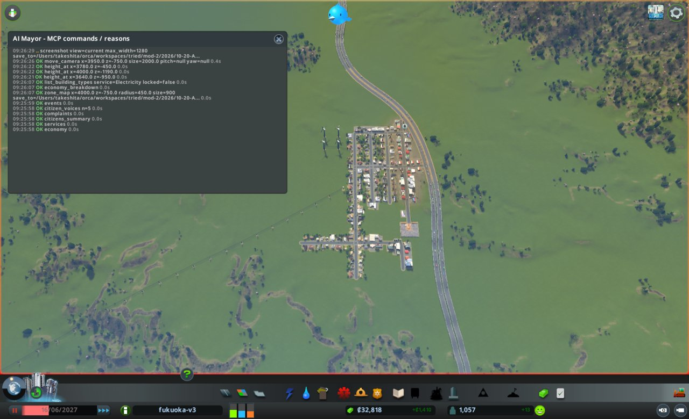
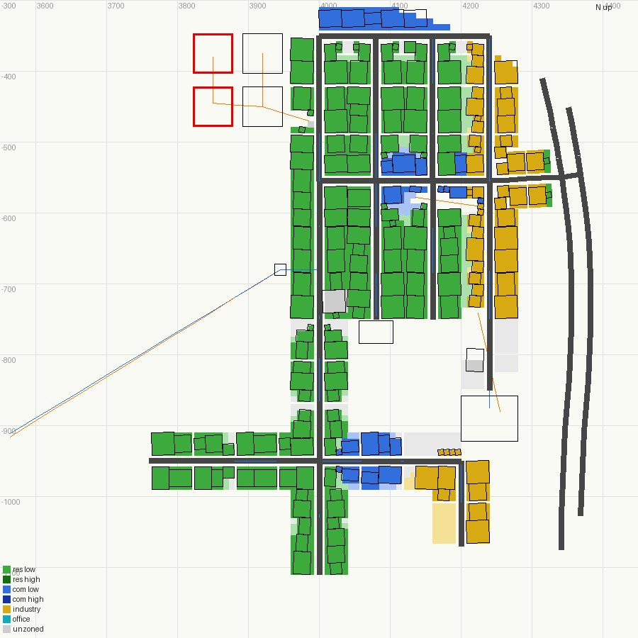
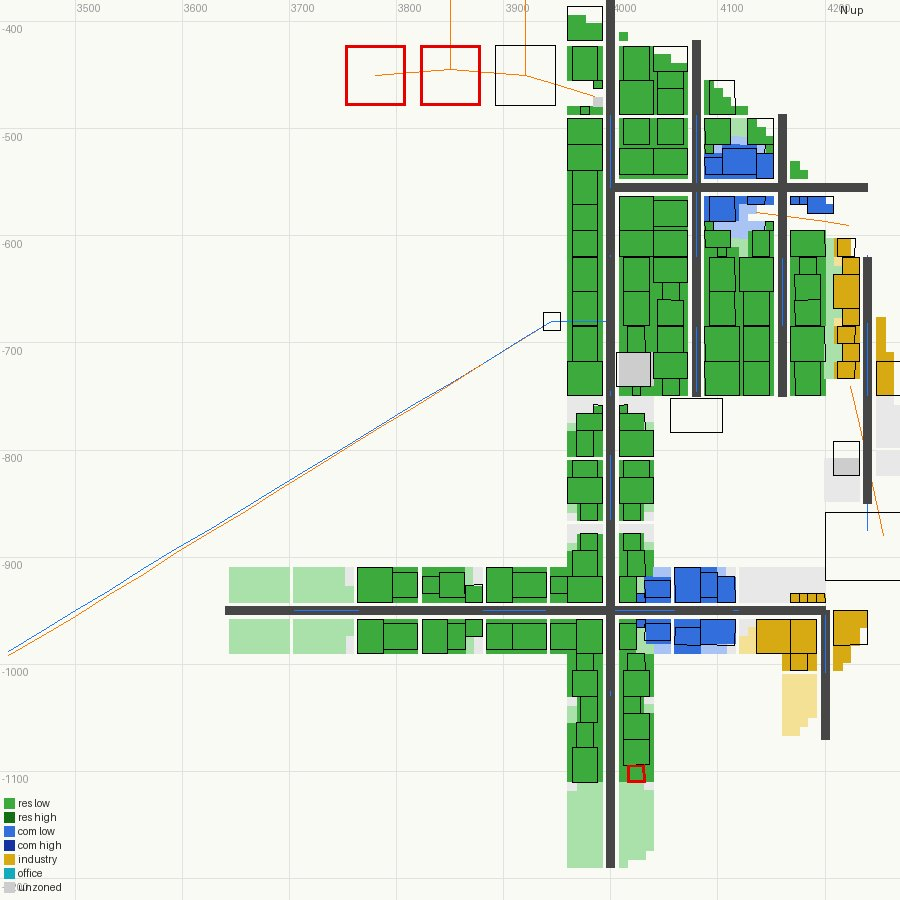

### 2027-06-26 見回り

境目: 当たらず。人口 1,120、週の収支 +1,193(支出 2,353 → 2,560)。来ない市民0。events 1件(風車を喜ぶつぶやき)。ダイアログなし(seconds 24.4、dialogs 空)
- `services`: 電気 25,536/40,000(64%)。予想どおり。水 32,464/60,000(54%)。容量は 38,400 → 60,000 で、予想(約48,000)より大きく増えた。下水の容量も 76,800 → 120,000 に増えた
- 犯罪率 15 → 18

### 2027-07-06 見回り

境目: 当たらず。人口 1,195、週の収支 +1,328。来ない市民0。events 0件。ダイアログなし(seconds 24.3、dialogs 空)

### 2027-07-16 運営の終わり(9か月目まで)

- advance(10) は seconds 24.3、dialogs 空。dialogSeq は 2 のまま
- 人口 1,202(`citizens_summary` の residents は 1,209)。06-26 → 07-16 の伸びは 1,120 → 1,202 で、西と南の延長はまだ埋まりきっていない
- 犯罪率 15 → 18 → 28。警察は0のまま
- 失業 41 → 78、長く失業している市民 23 → 42。働き口723 > 働き手663 なのに失業が増えた
- 病人 75、体調の悪い市民79。診療所 100/75
- 中くらいの豊かさの市民が初めて出た(47人)
- 電気 67%、水 57%

### 2027-07-16 月例(10か月目)

保存: `fukuoka-modtest-2027-07`(seconds 2.0、nudged false)

#### 答え合わせ

- 9か月目の施策1(風車): 予想どおり。06-26 に電気 40,000、使用率64%(予想 約38,000・65%前後)。今は67%
- 9か月目の施策2(水道の予算 100%): 容量は予想より大きく増えた。60,000(予想 約48,000)。使用率57%
- 9か月目の施策3(西と南の住宅): 予想どおり。人口 1,057 → 1,202(予想1,150以上)
- 前回の「次にやること」
  - 風車と水道の効き目: 確かめた(06-26)
  - 警察署: まだ。今回置く
  - 長く失業している市民の行き先: 確かめていない。市民は学歴なし1,051、小学校卒158。働き口の学歴の要求は道具で見えない
- 公約の進み具合
  1. 人口: 1,202(前の月例1,057から +145) / 毎月 / 達成
  2. 電気・水・下水が来ない市民: 0 / 任期の終わりまで / 達成中
  3. 週の収支: +1,270 / 達成

#### 気づいたこと

- 犯罪率 28(前の月例15)。`complaints` は犯罪8棟だけ(前の月例1棟)。警察は0
- 需要 住42 / 商50 / 工58。働き手663・働き口723、失業78、長く失業42
- 病人75、診療所 100/75
- 電気 26,672/40,000(67%)、水 34,160/60,000(57%)
- 所持金 30,440。建設費の上限 15,220
- `dialog_events(since=2)` に PauseMenu と OptionsPanel が3件(seq 3〜5)。前回の運営の後に人が開いたもの。`city_info` の dialog は null

#### 施策

1. 警察署を、通り x=4240 の東の空き地 (4262,-790) に西向きで置く
   - 公約: 1(犯罪で人が出ていかないため)
   - 理由: 犯罪率 1 → 15 → 28、犯罪の印 1 → 8棟。警察は0
   - 予想: 次の見回りで grid が電気・水・下水とも true。次の月例で犯罪率20以下、犯罪の印3棟以下
   - 費用: 建設12,000、週480
2. 西の通りを (3640,-950)→(3520,-950) に延ばし、水道管も延ばして、住宅(低密度)にする
   - 公約: 1
   - 理由: 住宅の需要42。通りの端の先は家がない(`zone_map`)
   - 予想: 次の月例で人口1,330以上
   - 費用: 道路120m 約600、水道管120m 約300、週約5

建設費の合計 約12,900(所持金の半分15,220以内)。維持費の増え分 約485(黒字 +1,270 の範囲)。
2つ目の診療所(10,000、週400)は、建設費の上限を超えるので来月に回す。

結果:

1. 警察署 id 43897 を (4262,-790) angle 90 に置いた(12,000)。入口 (4250,-790) facing west、道路まで2m(segment 28850)。`buildings_near` で grid は電気・水・下水とも true(置いた直後から)
2. 道路 (3640,-950)→(3520,-950)(640、snapped 1)。水道管 (3645,-950)→(3518,-939)(320、snapped 1、split 1)。終点は、排水口へ向かう管(segment 4481 の続き)を分けてつながり、指定の (3525,-950) から約13mずれた。住宅(低密度)91マス(skippedOccupied 2)
   - 確かめ: `zone_map` で西の延長の両側が住宅(薄い緑)

建設費の合計 12,960。所持金 30,440 → 17,480。

#### 次にやること

- 犯罪率と犯罪の印の数を、見回りと次の月例で見る
- 2つ目の診療所(10,000、週400)。病人75、診療所 100/75
- 長く失業している市民42の原因。働き口723 > 働き手663 のまま

#### 画面写真

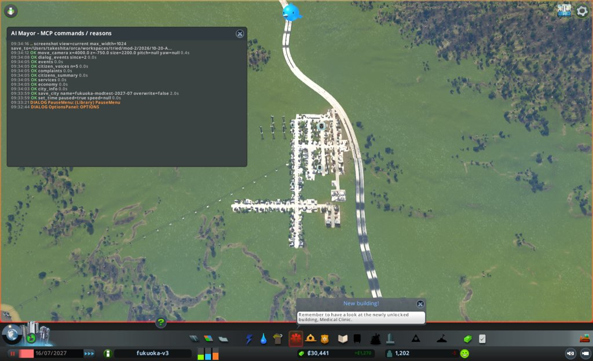
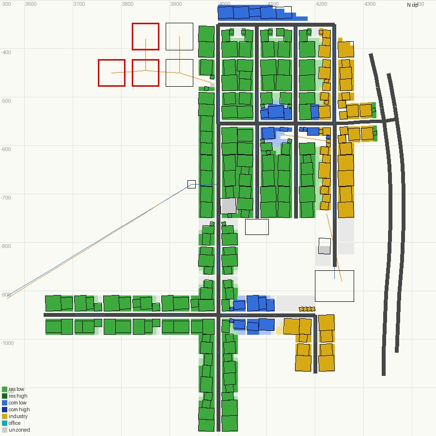
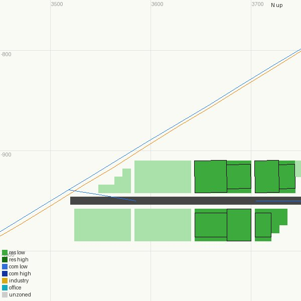

### 2027-07-26 見回り

境目: 当たらず。人口 1,237、週の収支 +770(支出 2,560 → 3,047。警察署の分)。来ない市民0。events 2件(警察を喜ぶつぶやき1件)。ダイアログなし(seconds 24.4、dialogs 空、dialogSeq 5 のまま)

### 2027-08-05 見回り

境目: 当たらず。人口 1,290、週の収支 +802。来ない市民0。events 0件。ダイアログなし(seconds 24.4、dialogs 空)

### 2027-08-15 月例(11か月目)

保存: `fukuoka-modtest-2027-08`(seconds 2.0、nudged false)

#### 答え合わせ

- 10か月目の施策1(警察署): 当たり。犯罪率 28 → 7(予想20以下)、犯罪の印 8 → 0棟(予想3棟以下)。grid は置いた直後から true
- 10か月目の施策2(西の住宅): 少し外れ。人口 1,202 → 1,317(予想1,330以上)。`zone_map` で西の延長は半分ほど建った
- 前回の「次にやること」
  - 犯罪率: 確かめた(上のとおり)
  - 2つ目の診療所: まだ。今月も建設費の上限(10,400)の内で電気を先にする
  - 長く失業している市民: 原因は確かめきれない。42 → 68 に増えた。10代266人に対し高校がない(高校は人口1,400で解禁)。`citizen_voices` の10代2人は job "none"・unemployed 0
- 公約の進み具合
  1. 人口: 1,317(前の月例1,202から +115) / 毎月 / 達成
  2. 電気・水・下水が来ない市民: 0 / 任期の終わりまで / 達成中
  3. 週の収支: +748 / 達成

#### 気づいたこと

- 支出が警察署の分で 2,560 → 3,047。黒字は +748 に縮んだ
- 電気 29,264/40,000(73%)。前の月例から +2,600。来月に80%を超える
- 水 36,928/60,000(62%)
- 病人81、診療所 100/79
- 失業93、長く失業68。働き手690・働き口763
- 中くらいの豊かさの市民 47 → 100
- 図書館・高校・研究図書館は人口1,400で解禁(`list_building_types(locked=true)`)
- 所持金 20,800。建設費の上限 10,400

#### 施策

1. 風車を1基、(3780,-375) に置き、送電線で (3780,-450) の風車につなぐ
   - 公約: 2
   - 理由: 電気の使用73%。月に約2,600ずつ増えている
   - 予想: 次の見回りで電気の容量が約49,000、使用率60%前後
   - 費用: 建設6,000、送電線 約100、週80
2. 西の通りを (3520,-950)→(3400,-950) に延ばし、水道管も延ばして、住宅(低密度)にする
   - 公約: 1
   - 理由: 住宅の需要42。西の延長は半分ほど埋まった。端の先は家がない
   - 予想: 次の月例で人口1,420以上(1,400の節目を越える)
   - 費用: 道路120m 約640、水道管 約320、週約5

建設費の合計 約7,100(所持金の半分10,400以内)。維持費の増え分 約85(黒字 +748 の範囲)。
2つ目の診療所(10,000、週400)は、上限の内に入らないので来月に回す。

結果:

1. 風車 id 34967 を (3780,-375) に置いた(6,000)。送電線 (3780,-375)→(3780,-450)(180)。始点は 34967 の敷地内、終点は風車 13501 の点に snapped。`buildings_near` で grid は電気 true・水 false・下水 false(風車は水が要らない)
2. 道路 (3520,-950)→(3400,-950)(640、snapped 1)。水道管 (3500,-950)→(3405,-950)(240、snapped 1)。住宅(低密度)73マス(skippedOccupied 1)
   - 確かめ: `zone_map` で北側は住宅(薄い緑)。南側は送電線と排水の管が斜めに通るところだけ区画にならず、三角に欠けた

建設費の合計 7,060。所持金 20,800 → 13,740(画面の表示)。

#### 次にやること

- 風車の効き目を見回りで見る(`services` の電気)
- 2つ目の診療所(10,000、週400)。病人81、診療所 100/79
- 人口1,400の節目の後、高校(24,000、週560)を考える。10代266人。週の黒字 +748 に収まるかを先に見る

#### 画面写真

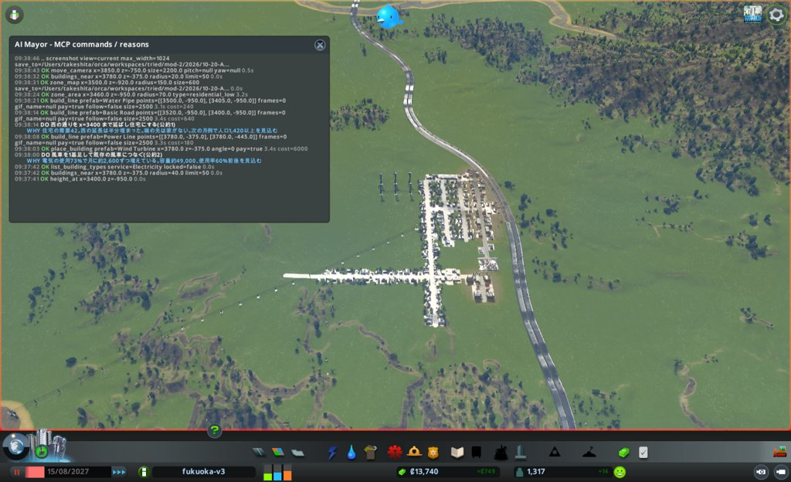
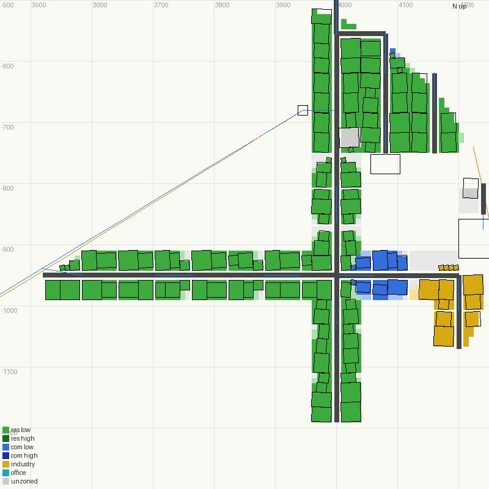
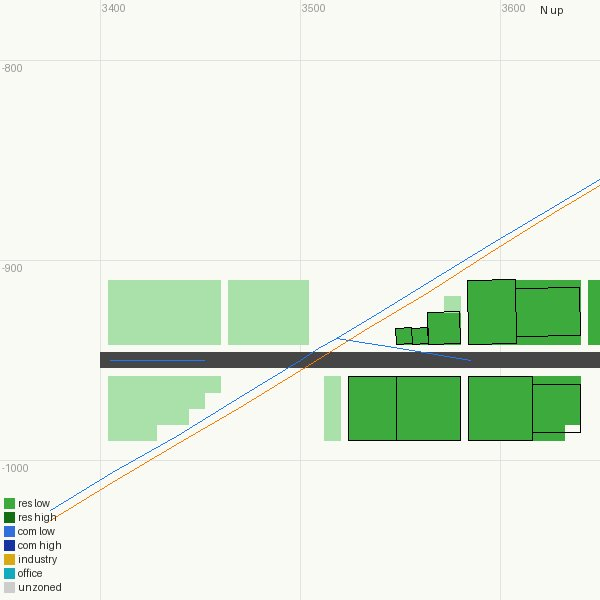

### 2027-08-25 見回り

境目: 当たらず。人口 1,340、週の収支 +627(支出 3,047 → 3,137)。来ない市民0。events 1件(風車を喜ぶつぶやき)。ダイアログなし(seconds 24.4、dialogs 空)
- `services`: 電気 29,520/48,000(62%)。予想(約49,000・60%前後)どおり

### 2027-09-04 見回り

境目: 当たらず。人口 1,375、週の収支 +631。来ない市民0。events 0件。ダイアログなし(seconds 24.3、dialogs 空)

### 2027-09-14 月例(12か月目)

保存: `fukuoka-modtest-2027-09`(seconds 1.5、nudged false)

#### 答え合わせ

- 11か月目の施策1(風車): 予想どおり。08-25 に電気 48,000、使用率62%。今日は容量 46,000(風で変わる)、使用率65%
- 11か月目の施策2(西の住宅、2回目): 外れ。人口 1,317 → 1,390(予想1,420以上)。`zone_map` で西の延長はほぼ埋まったが、伸びは +73 で前の月(+115)より小さい。住宅の需要も 42 → 37 に下がった
- 前回の「次にやること」
  - 風車の効き目: 確かめた
  - 2つ目の診療所: まだ。建設費の上限 8,223 に入らない。診療所 100/71 で、前の月例(79)より空いた
  - 高校: まだ。人口1,400の節目を越えていない(1,390)
- 公約の進み具合
  1. 人口: 1,390(前の月例1,317から +73) / 毎月 / 達成
  2. 電気・水・下水が来ない市民: 0 / 任期の終わりまで / 達成中
  3. 週の収支: +655 / 達成

#### 気づいたこと

- 失業 93 → 116、長く失業 68 → 79。働き手は 690 → 691、働き口は 763 のまま20日以上動かない
- 働き口の需要 58 → 63。工業の区画は埋まっている(`zone_map`)
- 住宅の区画もほぼ埋まった。空きは西の端の数マスだけ
- 犯罪率 4、困りごとの印0件。病人71
- 所持金 16,447。建設費の上限 8,223

#### 施策

1. 通り x=4200 を (4200,-1070)→(4200,-1150) に延ばし、水道管も延ばして、工業にする
   - 公約: 1、3(働き口と税収)
   - 理由: 働き口の需要63、失業116。工業の区画が埋まり、働き口が増えていない
   - 予想: 次の見回り(09-24)までに工業が2棟以上建つ。働き口が800以上に増える
   - 費用: 道路80m 約400、水道管80m 約160、週約4
2. 通り x=4000 を (4000,-1190)→(4000,-1270) に延ばし、水道管も延ばして、住宅(低密度)にする
   - 公約: 1
   - 理由: 住宅の需要37。住宅の区画が埋まった。端の先は家がない。登り坂(67.8m → 74.6m)
   - 予想: 次の見回り(10-04)で人口1,450以上
   - 費用: 道路80m 約400、水道管80m 約160、週約4

建設費の合計 約1,100(所持金の半分8,223以内)。維持費の増え分 約8(黒字 +655 の範囲)。

結果:

1. 道路 (4200,-1070)→(4200,-1150)(400、snapped 1)。水道管 (4200,-1065)→(4200,-1145)(200、snapped 1)。工業70マス
2. 道路 (4000,-1190)→(4000,-1270)(400、snapped 1)。水道管 (4000,-1185)→(4000,-1265)(200、snapped 1)。住宅(低密度)70マス
   - 確かめ: `zone_map` で x=4200 の両側が工業(薄い黄)、x=4000 の南の延長の両側が住宅(薄い緑)
   - `zone_map` で、既存の家 id 35635 (4024,-1174) が赤い枠。`buildings_near` で grid は電気 true・水 false・下水 false。`city_info` の citizensWithoutService は 水0・下水0。次の見回りで見る

建設費の合計 1,200。所持金 16,447 → 15,248(画面の表示)。

#### 次にやること

- 家 id 35635 に水が来たかを見回りで見る。来なければ水道管を足す
- 人口1,400の節目の後、高校(24,000、週560)と2つ目の診療所(10,000、週400)。週の黒字 +655 では片方しか収まらない
- 工業が建ったか、働き口と失業の数を見る

#### 画面写真

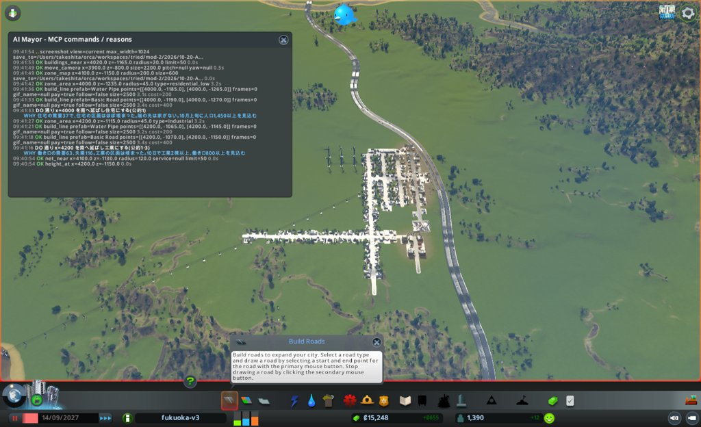
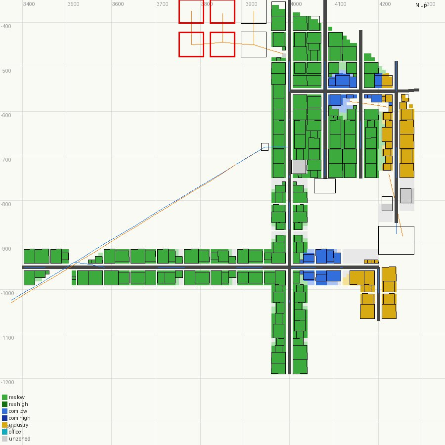
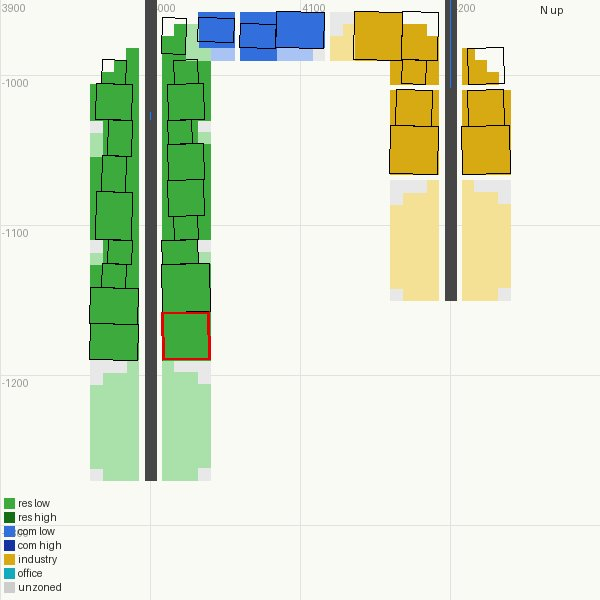

### 2027-09-24 見回り

境目: 当たらず。人口 1,420、週の収支 +679。来ない市民0。events 2件(街をほめるつぶやき1件)。ダイアログなし(seconds 24.3)
- 人口の節目: 2027-09-21 に UnlockingPanel(Tiny Town 1,400)が autoClosed true で dialogs に入った。止まらずに10日進んだ。dialogSeq 5 → 6。高校・図書館・公園などが解禁
- 所持金 15,248 → 36,215。10日の黒字は約1,000なので、約2万は節目の報酬と見る
- 家 id 35635 は grid が電気・水・下水とも true になった(9-14 は水・下水 false)
- `services`: 働き手 691 → 735、働き口 763 → 829。施策1の予想(働き口800以上)は当たり。電気の容量 46,000 → 43,520(風)、使用率71%

### 2027-10-04 見回り

境目: 当たらず。人口 1,460(施策2の予想1,450以上は当たり)、週の収支 +858。来ない市民0。events 0件。ダイアログなし(seconds 24.3、dialogs 空)

### 2027-10-14 運営の終わり(12か月目まで)

- advance(10) は seconds 24.4、dialogs 空。dialogSeq は 6 のまま
- 人口 1,478(`citizens_summary` の residents は 1,481)
- 週の収支 +875。所持金 38,642
- 電気 32,320/43,440(74%)。容量は風で 48,000 → 43,440 に下がった。水 40,832/60,000(68%)
- 働き手769・働き口831。失業 116 → 94、長く失業 79 → 67
- 病人67、診療所 100/67。犯罪率5
- 中くらいの豊かさの市民 152 → 252。10代324人、高校0

### 2027-10-14 月例(13か月目)

保存: `fukuoka-modtest-2027-10`(seconds 2.0、nudged false)

#### 答え合わせ

- 12か月目の施策1(南の工業): 当たり。09-24 に働き口 763 → 829(予想800以上)。`zone_map` で x=4200 の延長に工業が建った
- 12か月目の施策2(南の住宅): 当たり。10-04 に人口1,460(予想1,450以上)
- 前回の「次にやること」
  - 家 id 35635 の水: 確かめた(09-24 に true)
  - 高校と2つ目の診療所: まだ。高校 24,000 は建設費の上限 19,321 を超える。診療所 100/67 で空きがある
  - 工業と働き口: 確かめた。働き口831・働き手769、失業 116 → 94
- 公約の進み具合
  1. 人口: 1,478(前の月例1,390から +88) / 毎月 / 達成
  2. 電気・水・下水が来ない市民: 0 / 任期の終わりまで / 達成中
  3. 週の収支: +875 / 達成

#### 気づいたこと

- 困りごとの印0件。events 0件
- 電気 32,320/43,440(74%)。容量は風で動く
- 水 68%、下水 2%、診療所 100/67、犯罪率5
- 需要 住40 / 商50 / 工60。住宅の区画は `zone_map` で全部埋まった
- 10代324人、高校0。高校(24,000)は上限に入らない
- `citizen_voices` の大人 id 166386 は job "none"・unemployed 0、health "PoorHealth"・badHealth 0
- 所持金 38,642。建設費の上限 19,321

#### 施策

1. 風車を1基、(3920,-375) に置き、送電線で (3920,-450) の風車につなぐ
   - 公約: 2
   - 理由: 電気の使用74%。容量は風で 48,000 → 43,440 に下がる
   - 予想: 次の見回りで電気の容量が約52,000、使用率65%前後
   - 費用: 建設6,000、送電線 約200、週80
2. 通り x=4000 を (4000,-1270)→(4000,-1350) に、西の通りを (3400,-950)→(3300,-950) に延ばし、水道管も延ばして、住宅(低密度)にする
   - 公約: 1
   - 理由: 住宅の需要40。住宅の区画が埋まった。どちらの端の先も家がない
   - 予想: 次の月例で人口1,560以上
   - 費用: 道路180m 約900、水道管 約450、週約8
3. 通り x=4200 を (4200,-1150)→(4200,-1230) に延ばし、水道管も延ばして、工業にする
   - 公約: 1、3(働き口と税収)
   - 理由: 働き口の需要60、失業94。前回の延長は10日で埋まった
   - 予想: 次の月例で働き口870以上
   - 費用: 道路80m 約400、水道管 約200、週約4

建設費の合計 約8,200(所持金の半分19,321以内)。維持費の増え分 約92(黒字 +875 の範囲)。高校は来月以降、所持金が48,000を超えたら考える。

結果:

1. (3920,-375) には風車 id 34739 がすでにあった(`buildings_near`)。置き場所を (3710,-450) に変えた。風車 id 7517(6,000)。送電線 (3710,-450)→(3780,-450)(180)。始点は 7517 の敷地内、終点は風車 13501 の点に snapped
2. 道路 (4000,-1270)→(4000,-1350)(400、snapped 1)、(3400,-950)→(3300,-950)(480、snapped 1)。水道管 200 + 240(各 snapped 1)。住宅(低密度)70 + 90マス
3. 道路 (4200,-1150)→(4200,-1230)(400、snapped 1)。水道管(200、snapped 1)。工業70マス
   - 確かめ: `zone_map` で南と西の延長が住宅(薄い緑)、x=4200 の延長が工業(薄い黄)

建設費の合計 8,100。所持金 38,642 → 30,542。

#### 次にやること

- 風車の効き目を見回りで見る(`services` の電気)
- 新しい区画が埋まるか、働き口が増えるかを見る
- 高校(24,000、週560)。所持金が48,000を超え、週の黒字が+900以上なら置く

#### 画面写真

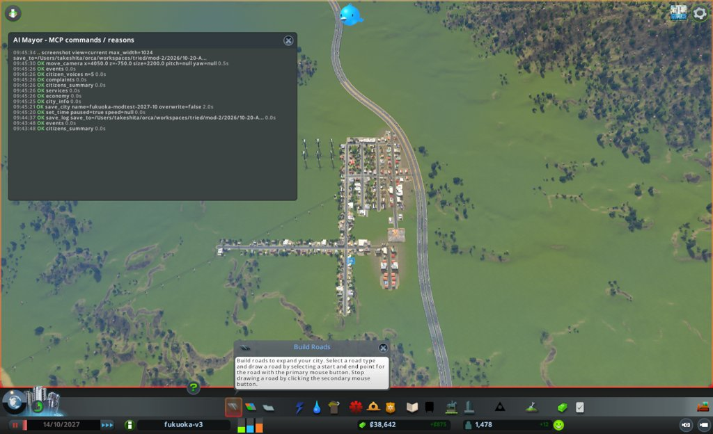
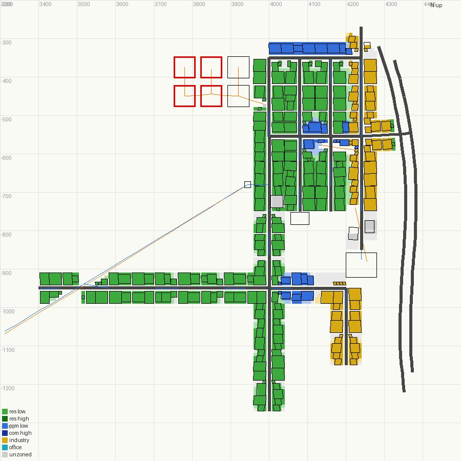
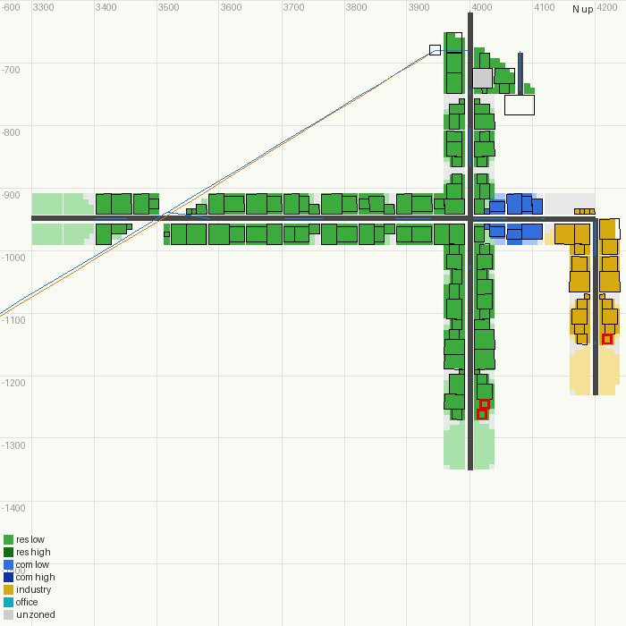

### 2027-10-24 見回り

境目: 当たらず。人口 1,533、週の収支 +819(支出 3,145 → 3,242)。来ない市民0。events 2件(風車を喜ぶつぶやき1件)。ダイアログなし(seconds 24.4、dialogs 空、dialogSeq 6 のまま)
- `services`: 電気 33,952/50,480(67%)。予想(約52,000・65%前後)にほぼ近い。働き手803・働き口873(施策3の予想870以上は早くも到達)

### 2027-11-03 見回り

境目: 当たらず。人口 1,609、週の収支 +1,033。来ない市民0。events 0件。ダイアログなし(seconds 24.4、dialogs 空)

### 2027-11-13 月例(14か月目)

保存: `fukuoka-modtest-2027-11`(seconds 1.5、nudged false)。直前の advance(10) は seconds 24.4、dialogs 空

#### 答え合わせ

- 13か月目の施策1(風車): ほぼ予想どおり。10-24 に電気 50,480、使用率67%(予想 約52,000・65%前後)。今日は70%
- 13か月目の施策2(南と西の住宅): 当たり。人口 1,478 → 1,645(予想1,560以上)。`zone_map` で延長は全部埋まった
- 13か月目の施策3(南の工業): 当たり。働き口 831 → 899(予想870以上)。延長に工業が建った
- 前回の「次にやること」
  - 風車の効き目: 確かめた(10-24)
  - 新しい区画: 確かめた(上のとおり)
  - 高校: まだ。所持金 34,697 で、上限 17,348 に 24,000 が入らない
- 公約の進み具合
  1. 人口: 1,645(前の月例1,478から +167) / 毎月 / 達成
  2. 電気・水・下水が来ない市民: 0 / 任期の終わりまで / 達成中
  3. 週の収支: +1,070 / 達成

#### 気づいたこと

- 困りごとの印0件。events 0件
- 電気 35,392/50,480(70%)。水 44,896/60,000(75%)。水は月に約4,000ずつ増えている(10-14 は40,832)
- 需要 住31 / 商50 / 工69。働き手863・働き口899、失業103、長く失業55
- 10代352人、高校0。`citizen_voices` の5人のうち4人が10代で job "none"
- 病人60、診療所 100/61。犯罪率5
- 住宅・工業の区画は全部埋まった
- 所持金 34,697。建設費の上限 17,348

#### 施策

1. 西の通りを (3300,-950)→(3180,-950) に延ばし、水道管も延ばして、住宅(低密度)にする
   - 公約: 1
   - 理由: 住宅の需要31。区画が全部埋まった。端の先に建物はない(`buildings_near` 0件)。下り坂(66.8m → 58.5m)
   - 予想: 次の月例で人口1,750以上
   - 費用: 道路120m 約560、水道管 約280、週約5
2. 通り x=4200 を (4200,-1230)→(4200,-1310) に延ばし、水道管も延ばして、工業にする
   - 公約: 1、3(働き口と税収)
   - 理由: 働き口の需要69、失業103。前の2回の延長は10日で埋まった
   - 予想: 次の月例で働き口940以上
   - 費用: 道路80m 約400、水道管 約200、週約4

建設費の合計 約1,500(所持金の半分17,348以内)。維持費の増え分 約9(黒字 +1,070 の範囲)。南の住宅 (4000,-1350) の先は登り坂(80m)なので見送った。給水塔(3,500、週240)は、水が80%を超えたら置く。

結果:

1. 道路 (3300,-950)→(3180,-950)(640、snapped 1)。水道管 (3305,-950)→(3185,-950)(320、snapped 1)。住宅(低密度)104マス
2. 道路 (4200,-1230)→(4200,-1310)(400、snapped 1)。水道管(200、snapped 1)。工業70マス
   - 確かめ: `zone_map` で西の延長が住宅(薄い緑)、x=4200 の延長が工業(薄い黄)

建設費の合計 1,560。所持金 34,697 → 33,137。

#### 次にやること

- 水の使用率を見回りで見る。80%を超えたら給水塔(3,500、週240)
- 高校(24,000、週560)。所持金が48,000を超えたら置く
- 住宅の端はまだ西 (3180,-950) の先が下り坂で延ばせる

#### 画面写真

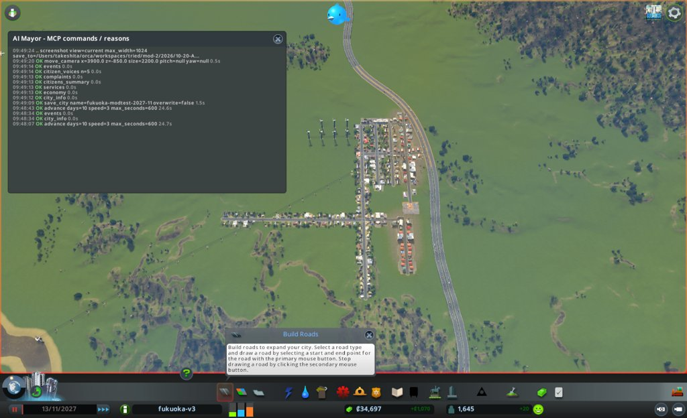
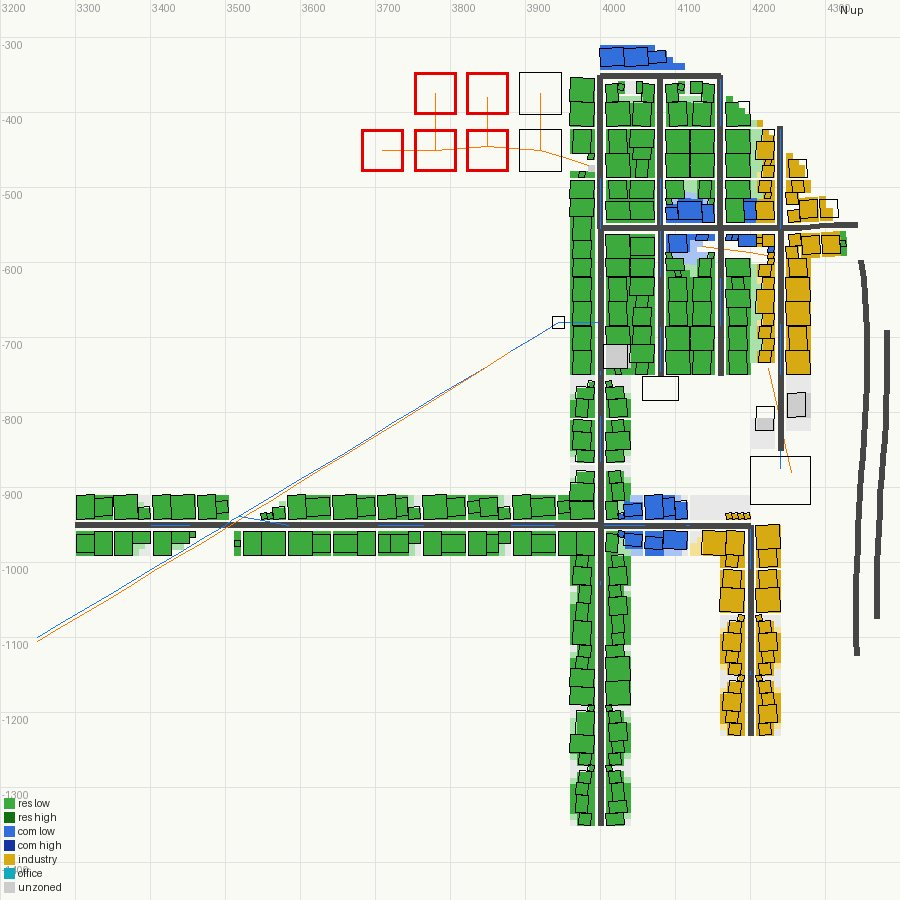
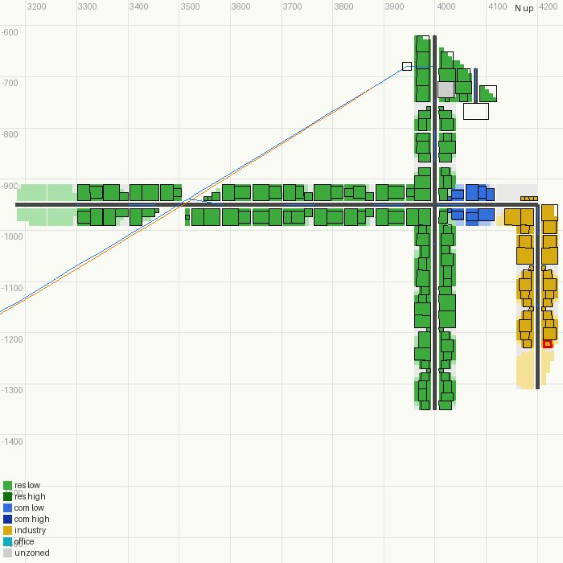

### 2027-11-23 見回り

境目: 当たらず。人口 1,710、週の収支 +1,138。来ない市民0。events 1件(街と関係のないつぶやき)。ダイアログなし(seconds 24.4、dialogs 空)
- `services`: 水 46,448/60,000(77%)、電気 36,800/50,560(73%)。働き手902・働き口957(施策2の予想940以上は到達)

### 2027-12-03 見回り

境目: 当たらず。人口 1,761、週の収支 +1,289。来ない市民0。events 0件。ダイアログなし(seconds 24.3、dialogs 空)

### 2027-12-13 月例(15か月目)

保存: `fukuoka-modtest-2027-12`(seconds 2.0、nudged false)。直前の advance(10) は seconds 24.4、dialogs 空

#### 答え合わせ

- 14か月目の施策1(西の住宅): 当たり。人口 1,645 → 1,772(予想1,750以上)。ただし 12-03 → 12-13 は +11 だけ。`zone_map` で西の延長は埋まった
- 14か月目の施策2(南の工業): 当たり。働き口 899 → 968(予想940以上)
- 前回の「次にやること」
  - 水の使用率: 確かめた。77%(11-23)→ 80%(今日)。今回、給水塔を置く
  - 高校: まだ。所持金 38,346 で上限 19,173
  - 西の端: 今回延ばす
- 公約の進み具合
  1. 人口: 1,772(前の月例1,645から +127) / 毎月 / 達成
  2. 電気・水・下水が来ない市民: 0 / 任期の終わりまで / 達成中
  3. 週の収支: +1,291 / 達成

#### 気づいたこと

- 困りごとの印0件。events 0件
- 水 47,808/60,000(80%)。電気 37,984/50,560(75%)
- 需要 住33 / 商50 / 工67。働き手936・働き口968、失業115、長く失業72(前の月例55)
- 10代388人、高校0。中くらいの豊かさの市民 389 → 600
- 病人56、診療所 100/57。犯罪率4
- 住宅・工業の区画は全部埋まった。人口の伸びは 12-03 → 12-13 で +11 に落ちた
- 所持金 38,346。建設費の上限 19,173

#### 施策

1. 給水塔を (3900,-770) に置き、水道管を (3881,-719) の管の点に、送電線を給水塔 27662 (3945,-680) につなぐ
   - 公約: 2
   - 理由: 水の使用80%。月に約3,000ずつ増えている。水道の予算はすでに100%
   - 予想: 次の見回りで水の容量が60,000より増え、使用率70%前後。週の支出が約240増える
   - 費用: 建設3,500、管と送電線 約300、週240
2. 西の通りを (3180,-950)→(3060,-950) に延ばし、水道管も延ばして、住宅(低密度)にする
   - 公約: 1
   - 理由: 住宅の需要33。区画が全部埋まり、人口の伸びが10日で+11に落ちた。高さ 58.5m → 60.3m で平ら
   - 予想: 次の月例で人口1,860以上
   - 費用: 道路120m 約640、水道管 約320、週約5
3. 通り x=4200 を (4200,-1310)→(4200,-1390) に延ばし、水道管も延ばして、工業にする
   - 公約: 1、3(働き口と税収)
   - 理由: 働き口の需要67、失業115。前の3回の延長は10日で埋まった。高さ 59m → 66m
   - 予想: 次の月例で働き口1,020以上
   - 費用: 道路80m 約400、水道管 約200、週約4

建設費の合計 約5,400(所持金の半分19,173以内)。維持費の増え分 約250(黒字 +1,291 の範囲)。

結果:

1. 給水塔 id 48985 を (3900,-770) に置いた(3,500)。水道管 (3900,-770)→(3881,-719)(140、snapped 2、始点は 48985 のつなぎ口に connected)。送電線 (3900,-770)→(3945,-680)(240、snapped 1)。始点は 48985 の敷地内、終点は給水塔 27662 の敷地内の点に snapped
   - 確かめ: `buildings_near` で port は connected true。grid は電気・水・下水とも false(時間を進める前)。`zone_map` でも赤い枠
2. 道路 (3180,-950)→(3060,-950)(640、snapped 1)。水道管(320、snapped 1)。住宅(低密度)94マス
3. 道路 (4200,-1310)→(4200,-1390)(400、snapped 1)。水道管(200、snapped 1)。工業66マス
   - 確かめ: `zone_map` で西の延長が住宅(薄い緑)、x=4200 の延長が工業(薄い黄)

建設費の合計 5,440。所持金 38,346 → 32,906。

#### 次にやること

- 給水塔 48985 の grid と、`services` の水の容量を見回りで見る
- 人口の伸びが戻るか(12-03 → 12-13 は +11)。戻らなければ、住宅の需要以外の原因(高校がない、働き口の場所)を探す
- 高校(24,000、週560)。所持金が48,000を超えたら置く

#### 画面写真

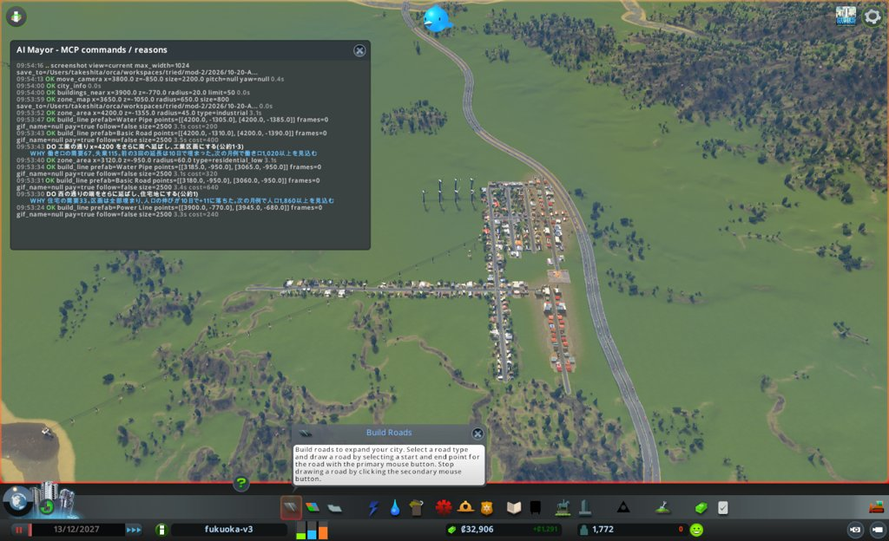
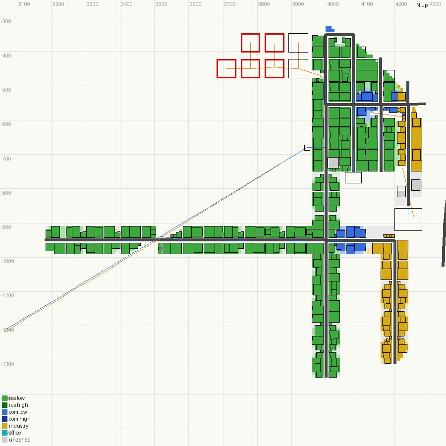
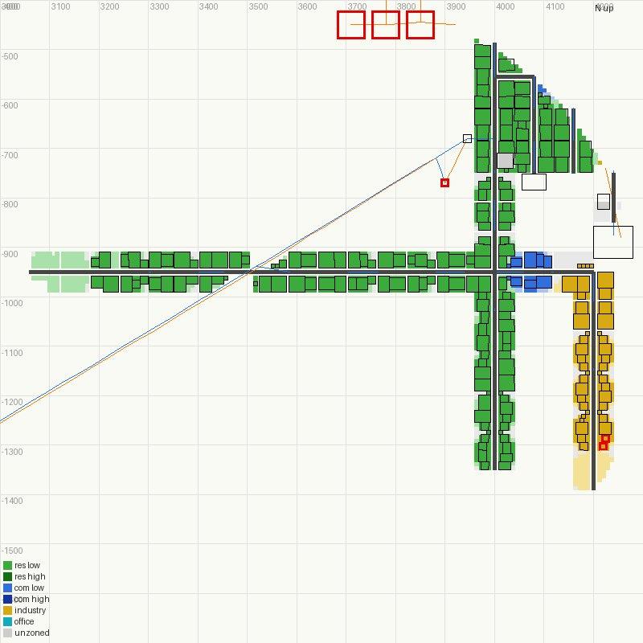

### 2027-12-23 見回り

境目: 当たらず。人口 1,803、週の収支 +1,016(支出 3,252 → 3,509。給水塔の分)。来ない市民0。events 0件。ダイアログなし(seconds 24.4、dialogs 空)
- 給水塔 48985 は grid が電気・水・下水とも true
- `services`: 水 48,480/120,000(40%)。容量は 60,000 → 120,000 で、予想(使用率70%前後)より大きく増えた。給水塔1つで60,000
- 働き手954・働き口1,004。電気 38,880/56,000(69%)

### 2028-01-02 見回り

境目: 当たらず。人口 1,865、週の収支 +1,150。来ない市民0。events 0件。ダイアログなし(seconds 24.4、dialogs 空)

### 2028-01-12 運営の終わり(15か月目まで)

- advance(10) は seconds 24.4、dialogs 空。dialogSeq は 6 のまま
- 人口 1,894(`citizens_summary` の residents は 1,896)
- 週の収支 +1,205。所持金 37,717
- 電気 40,352/56,000(72%)。水 50,624/120,000(42%)
- 働き手995・働き口1,031。失業 115 → 141、長く失業 72 → 78
- 病人66、診療所 100/65。犯罪率6
- 10代398人、高校0。中くらいの豊かさの市民 600 → 671

### 2028-01-12 月例(16か月目)

保存: `fukuoka-modtest-2028-01`(seconds 2.0、nudged false)

#### 答え合わせ

- 15か月目の施策1(給水塔): 外れ(よい方へ)。12-23 に水の容量 120,000、使用率40%(予想70%前後)。今日は42%
- 15か月目の施策2(西の住宅): 当たり。人口 1,772 → 1,894(予想1,860以上)。`zone_map` で西の延長は埋まった
- 15か月目の施策3(南の工業): 当たり。働き口 968 → 1,031(予想1,020以上)
- 前回の「次にやること」
  - 給水塔 48985 の grid と水の容量: 確かめた(12-23 に true、120,000)
  - 人口の伸び: 戻った。12-13 → 01-12 で +122
  - 高校: まだ。所持金 37,717 で、上限 18,858 に 24,000 が入らない
- 公約の進み具合
  1. 人口: 1,894(前の月例1,772から +122) / 毎月 / 達成
  2. 電気・水・下水が来ない市民: 0 / 任期の終わりまで / 達成中
  3. 週の収支: +1,205 / 達成

#### 気づいたこと

- 困りごとの印0件。events 0件
- 電気 40,352/56,000(72%)。水 42%、下水 3%。診療所 100/65。犯罪率6
- 需要 住29 / 商50 / 工71。働き手995・働き口1,031、失業141、長く失業78
- 10代398人、高校0。学生246、小学校の定員300
- `citizen_voices` の5人は全員 troubles 0。3人が工業で働く
- 次の節目は Boom Town(2,400)。墓地などが解禁される(`list_building_types` locked)
- 工業の通り x=4200 の南は登り坂(-1390 で66m、-1470 で94m)。東の (4330,-1415) は62mで平ら
- 商業と工業のあいだ (4140,-945) に、未指定のマスが35ある(`zones_at`)
- 所持金 37,717。建設費の上限 18,858

#### 施策

1. 西の通りを (3060,-950)→(2940,-950) に延ばし、水道管も延ばして、住宅(低密度)にする
   - 公約: 1
   - 理由: 住宅の需要29。区画が全部埋まった。端の先に建物はない。高さ 60.3m → 63.5m で平ら
   - 予想: 次の月例で人口2,000以上
   - 費用: 道路120m 約640、水道管 約320、週約5
2. 工業の通りを (4200,-1390)→(4200,-1415)→(4330,-1415) に東へ曲げて延ばし、水道管も延ばして、工業にする
   - 公約: 1、3(働き口と税収)
   - 理由: 働き口の需要71、失業141。南は登り坂なので東へ曲げる。高架の高速の点から50m以上離れる
   - 予想: 次の月例で働き口1,100以上、失業120以下
   - 費用: 道路約155m 約800、水道管 約400、週約7
3. (4140,-945) の未指定のマスを工業にする
   - 公約: 1、3
   - 理由: 働き口の需要71。費用0で区画を足せる
   - 予想: 次の見回りまでに工業が1棟以上建つ
   - 費用: 0

建設費の合計 約2,200(所持金の半分18,858以内)。維持費の増え分 約12(黒字 +1,205 の範囲)。高校(24,000)のために、ほかの建設は控えて所持金を貯める。

結果:

1. 道路 (3060,-950)→(2940,-950)(640、snapped 1)。水道管 (3065,-950)→(2945,-950)(320、snapped 1)。住宅(低密度)97マス
   - 確かめ: `zones_at` で住宅(低密度)94マス。`zone_map` で延長の両側が薄い緑
2. 道路 (4200,-1390)→(4200,-1415)→(4330,-1415)(760、snapped 1)。水道管 (4200,-1385)→(4205,-1420)→(4325,-1420)(420、snapped 1)。工業101マス(建物のあるマス10を飛ばした)
   - 確かめ: `zone_map` で新しい通りの両側が薄い黄
   - 管を引いた直後、隣の工場 id 18256 (4220,-1378) の grid が水 false・下水 false になった(`zone_map` でも赤い枠)。`city_info` の citizensWithoutService は 0。次の見回りで見る
3. (4140,-945) の未指定35マスを工業にした(費用0)。`zones_at` で商業16・工業73。商業のマスは変わっていない

建設費の合計 2,140。所持金 37,717 → 35,577(`city_info`)。

#### 次にやること

- 工場 id 18256 の水と下水が戻ったかを見回りで見る。戻らなければ管を足す
- 新しい3つの区画が埋まるか、働き口と失業の数を見る
- 高校(24,000、週560)。所持金が48,000を超えたら置く

#### 画面写真

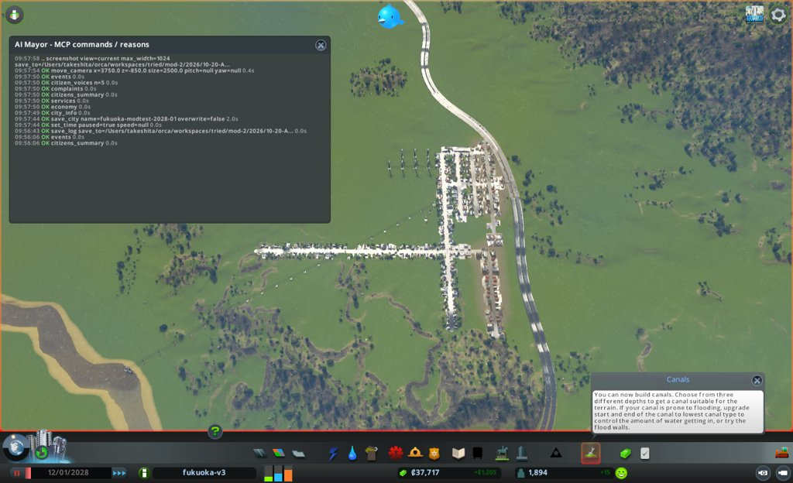
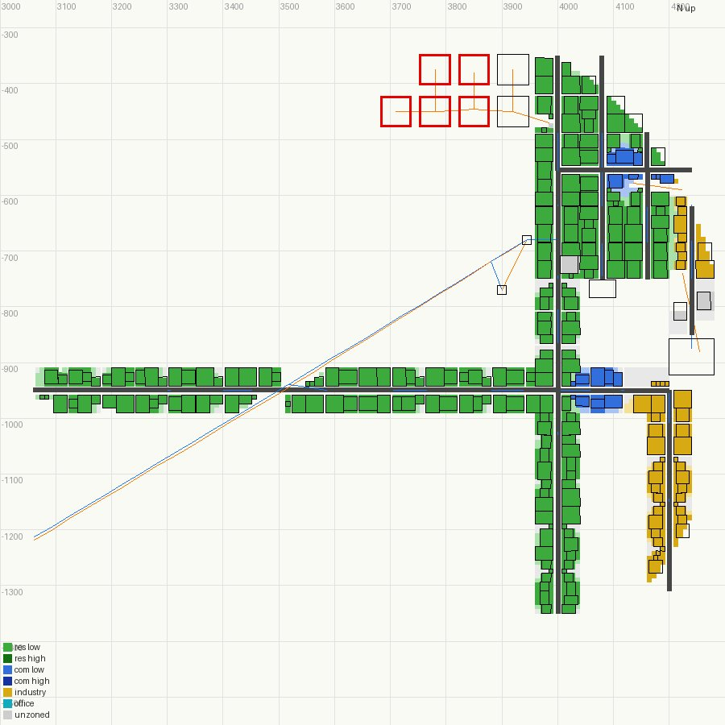
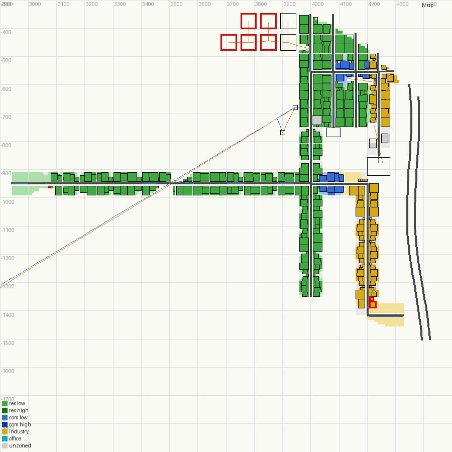

### 2028-01-22 見回り

境目: 当たらず。人口 1,912、週の収支 +1,247。来ない市民0。events 0件。ダイアログなし(seconds 24.3、dialogs 空、dialogSeq 6 のまま)
- 工場 id 18256 は grid が電気・水・下水とも true に戻った。新しい通りの角に工場2棟(id 21064、41672)が建った
- 働き口の需要 71 → 54

### 2028-02-01 見回り

境目: 当たらず。人口 1,957、週の収支 +1,402。来ない市民0。events 0件。ダイアログなし(seconds 24.4、dialogs 空)

### 2028-02-11 月例(17か月目)

保存: `fukuoka-modtest-2028-02`(seconds 2.0、nudged false)。直前の advance(10) は seconds 24.4、dialogs 空

#### 答え合わせ

- 16か月目の施策1(西の住宅): 外れ。人口 1,894 → 1,966(予想2,000以上)。`zone_map` で西の延長は埋まった。02-01 → 02-11 は +9 だけ
- 16か月目の施策2(南東の工業): 当たり。働き口 1,031 → 1,166(予想1,100以上)、失業 141 → 90(予想120以下)
- 16か月目の施策3(中央の工業): 当たり。`zone_map` で (4140,-945) に工業が建った
- 前回の「次にやること」
  - 工場 id 18256 の水と下水: 確かめた(01-22 に true)
  - 新しい区画: 確かめた(上のとおり)
  - 高校: まだ。所持金 41,364 で、上限 20,682 に 24,000 が入らない
- 公約の進み具合
  1. 人口: 1,966(前の月例1,894から +72) / 毎月 / 達成
  2. 電気・水・下水が来ない市民: 0 / 任期の終わりまで / 達成中
  3. 週の収支: +1,400 / 達成

#### 気づいたこと

- 困りごとの印0件。events 1件(公園がほしいというつぶやき)
- 電気 42,752/50,400(85%)。容量は風で 56,000 → 50,400 に下がった。使用は1か月で +2,400
- 水 44%、下水 3%、診療所 100/58、犯罪率6
- 需要 住41 / 商50 / 工59。働き手1,109・働き口1,166、失業90、長く失業66
- 10代411人、高校0
- 住宅・工業の区画は全部埋まった。人口の伸びは 02-01 → 02-11 で +9
- 西の端 (2940,-950) の先は、(2820,-950) で 64.4m と平ら。建物なし
- 所持金 41,364。建設費の上限 20,682

#### 施策

1. 風車を1基、(3710,-375) に置き、送電線で (3710,-450) の風車 7517 につなぐ
   - 公約: 2
   - 理由: 電気の使用85%。容量が風で下がると100%を超えるおそれがある
   - 予想: 次の見回りで電気の容量が約57,000〜63,000、使用率75%前後。週の支出が約80増える
   - 費用: 建設6,000、送電線 約200、週80
2. 西の通りを (2940,-950)→(2820,-950) に延ばし、水道管も延ばして、住宅(低密度)にする
   - 公約: 1
   - 理由: 住宅の需要41。区画が全部埋まり、伸びが10日で+9に落ちた
   - 予想: 次の月例で人口2,060以上
   - 費用: 道路120m 約640、水道管 約320、週約5

建設費の合計 約7,200(所持金の半分20,682以内)。維持費の増え分 約85(黒字 +1,400 の範囲)。工業は需要59・失業90で、今月は足さない。

結果:

1. 風車 id 30679 を (3710,-375) に置いた(6,000)。送電線 (3710,-375)→(3710,-450)(180、snapped 1)。始点は 30679 の敷地内、終点は風車 7517 の敷地内の点に snapped
   - 確かめ: `zone_map` で 30679 と 7517 は赤い枠(風車の赤い枠は7〜9か月目に記したもの)。容量は次の見回りの `services` で見る
2. 道路 (2940,-950)→(2820,-950)(640、snapped 1)。水道管 (2945,-950)→(2825,-950)(320、snapped 1)。住宅(低密度)110マス
   - 確かめ: `zones_at` で住宅(低密度)92マス。`zone_map` で延長の両側が薄い緑。端の家 (2945,-975) が赤い枠(管を引いた直後。前の月の工場 18256 と同じ)

建設費の合計 7,140。所持金 41,364 → 34,224(`city_info`)。

#### 次にやること

- 風車の効き目を見回りで見る(`services` の電気)
- 西の延長が埋まるか。人口の伸びが戻らなければ、住宅の需要以外の原因を探す
- 高校(24,000、週560)。所持金が48,000を超えたら置く

#### 画面写真

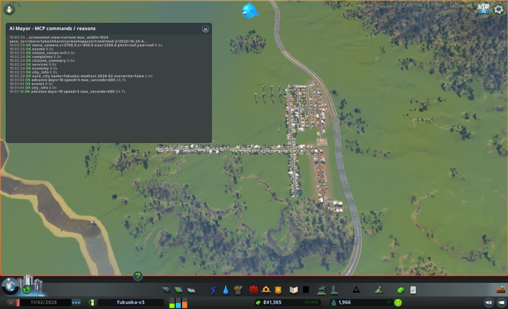
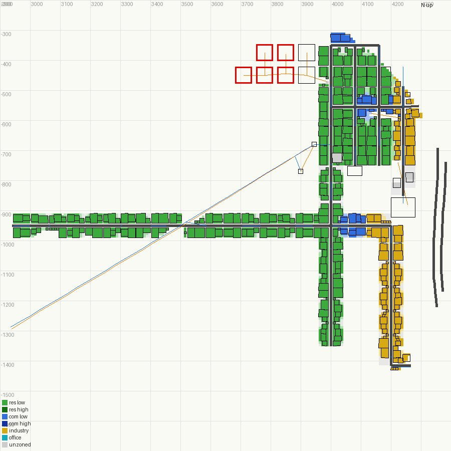
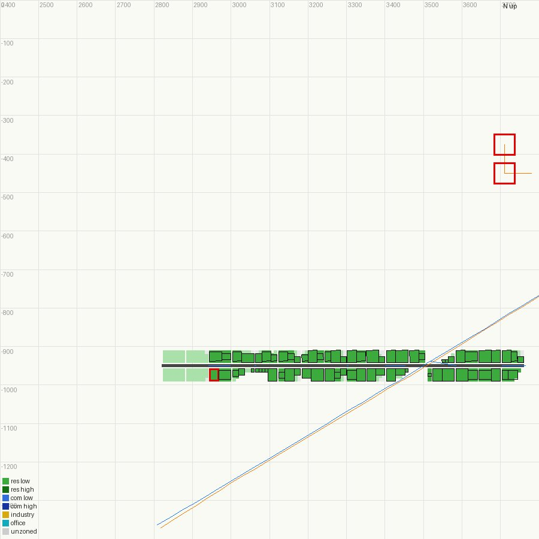

### 2028-02-21 見回り

境目: 当たらず。人口 2,010、週の収支 +1,289(支出 3,523 → 3,614。風車の分)。来ない市民0。events 2件(風車を喜ぶつぶやき1件)。ダイアログなし(seconds 24.3、dialogs 空)
- `services`: 電気 43,424/57,040(76%)。施策1の予想(約57,000〜63,000、75%前後)どおり。犯罪率 6 → 9

### 2028-03-02 見回り

境目: 当たらず。人口 2,051、週の収支 +1,380。来ない市民0。events 0件。ダイアログなし(seconds 24.4、dialogs 空)

### 2028-03-12 月例(18か月目)

保存: `fukuoka-modtest-2028-03`(seconds 1.5、nudged false)。直前の advance(10) は seconds 24.4、dialogs 空

#### 答え合わせ

- 17か月目の施策1(風車): 当たり。02-21 に電気 57,040、使用率76%(予想 約57,000〜63,000・75%前後)。今日は78%
- 17か月目の施策2(西の住宅): 当たり。人口 1,966 → 2,077(予想2,060以上)
- 前回の「次にやること」
  - 風車の効き目: 確かめた(02-21)
  - 西の延長: 埋まり、人口の伸びは +111 に戻った
  - 高校: まだ。所持金 39,995 で、上限 19,997 に 24,000 が入らない
- 公約の進み具合
  1. 人口: 2,077(前の月例1,966から +111) / 毎月 / 達成
  2. 電気・水・下水が来ない市民: 0 / 任期の終わりまで / 達成中
  3. 週の収支: +1,426 / 達成

#### 気づいたこと

- 困りごとの印0件。events 1件(街と関係のないつぶやき)
- 電気 44,256/57,040(78%)。水 46%、下水 3%、診療所 100/56、犯罪率4
- 需要 住31 / 商50 / 工69
- 働き口は 1,166 のまま1か月動かない(02-11 から)。働き手 1,109 → 1,144。失業 90 → 132、長く失業 66 → 84
- `citizen_voices` の若者 id 412791 が job "unemployed"、troubles.unemployed 6
- 10代445人、高校0
- 工業の東の通りの端 (4330,-1415) の先は、(4330,-1495) で 71.8m(+10m)。高架の高速から約60m
- 西の端 (2820,-950) の先は、(2700,-950) で 59.6m と平ら。建物なし
- 所持金 39,995。建設費の上限 19,997

#### 施策

1. 工業の通りを (4330,-1415)→(4330,-1495) に南へ延ばし、水道管も延ばして、工業にする
   - 公約: 1、3(働き口と税収)
   - 理由: 働き口の需要69。働き口が1か月増えず、失業 90 → 132
   - 予想: 次の月例で働き口1,230以上、失業110以下
   - 費用: 道路80m 約400、水道管 約200、週約4
2. 西の通りを (2820,-950)→(2700,-950) に延ばし、水道管も延ばして、住宅(低密度)にする
   - 公約: 1
   - 理由: 住宅の需要31。前の2回の延長は1か月で埋まった
   - 予想: 次の月例で人口2,180以上
   - 費用: 道路120m 約640、水道管 約320、週約5

建設費の合計 約1,600(所持金の半分19,997以内)。維持費の増え分 約9(黒字 +1,426 の範囲)。

結果:

1. 道路 (4330,-1415)→(4330,-1495)(400、snapped 1)。水道管 (4325,-1420)→(4325,-1495)(180、snapped 1)。工業54マス(建物のあるマス15を飛ばした)
   - 確かめ: `zone_map` で新しい通りの両側が薄い黄
   - 角の工場 id 13363 (4317,-1439、3x3)の枠が、新しい道路に数m重なって描かれた。`buildings_near` で建物は残り、grid は電気・水・下水とも true
2. 道路 (2820,-950)→(2700,-950)(640、snapped 1)。水道管 (2825,-950)→(2705,-950)(320、snapped 1)。住宅(低密度)97マス
   - 確かめ: `zone_map` で延長の両側が薄い緑。端の家 (2835,-975) が赤い枠(管を引いた直後。前の2か月と同じ)

建設費の合計 1,540。所持金 39,995 → 38,455(`city_info`)。

#### 次にやること

- 工場 13363 が残るか、働き口が増えるかを見る
- 西の延長が埋まるか
- 高校(24,000、週560)。所持金が48,000を超えたら置く

#### 画面写真

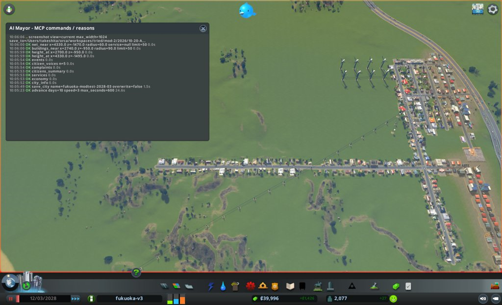
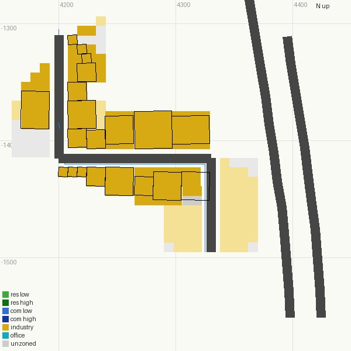
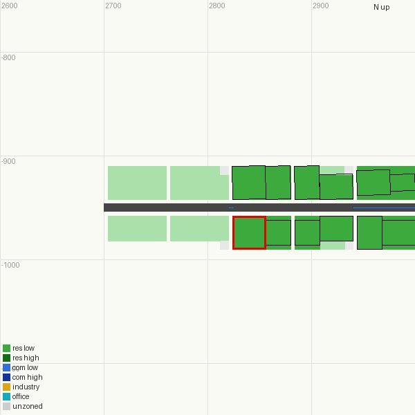

### 2028-03-22 見回り

境目: 当たらず。人口 2,121、週の収支 +1,420。来ない市民0。events 0件。ダイアログなし(seconds 24.4、dialogs 空)
- 工場 id 13363 はなくなり、同じ場所に小さな工場2棟(id 3181、20826)が建っていた。道路に重なった建物が、時間を進めた後に建て替わった
- `services`: 働き手1,143・働き口1,184(1,166 から +18)。電気78%

### 2028-04-01 見回り

境目: 当たらず。人口 2,172、週の収支 +1,497。来ない市民0。events 0件。ダイアログなし(seconds 25.4、dialogs 空。節目のお知らせはなく、ほかの回より約1秒長い)

### 2028-04-11 運営の終わり(18か月目まで)

- advance(10) は seconds 24.4、dialogs 空。dialogSeq は 6 のまま
- 人口 2,205(`citizens_summary` の residents は 2,206)
- 週の収支 +1,527。所持金 44,811
- 電気 46,688/57,040(82%)。水 58,304/120,000(49%)
- 働き手1,194・働き口1,210(施策1の予想1,230以上には届いていない)。失業 132 → 160、長く失業 84 → 116
- `zone_map` で南東の工業の延長は埋まった
- 病人69、診療所 100/68。犯罪率3
- 10代477人、高校0。中くらいの豊かさの市民 825 → 923

### 2028-04-11 月例(19か月目)

保存: `fukuoka-modtest-2028-04`(seconds 2.0、nudged false)

#### 答え合わせ

- 18か月目の施策1(南東の工業): 外れ。働き口 1,166 → 1,210(予想1,230以上)、失業 132 → 160(予想110以下)
- 18か月目の施策2(西の住宅): 当たり。人口 2,077 → 2,205(予想2,180以上)
- 前回の「次にやること」
  - 工場 13363: 確かめた。なくなり、小さな工場2棟に建て替わった(03-22)
  - 西の延長: 埋まった(端の家 id 18934 (2716,-926) が建っている)
  - 高校: まだ。所持金 44,811 で、上限 22,405 に 24,000 が入らない
- 公約の進み具合
  1. 人口: 2,205(前の月例2,077から +128) / 毎月 / 達成
  2. 電気・水・下水が来ない市民: 0 / 任期の終わりまで / 達成中
  3. 週の収支: +1,527 / 達成

#### 気づいたこと

- 困りごとの印0件。events 0件
- 電気 46,688/57,040(82%)。水 49%、下水 3%。診療所 100/68。犯罪率3
- 需要 住25 / 商50 / 工75。働き手1,194・働き口1,210、失業160、長く失業116
- 10代477人、高校0。学歴は高校卒0。`citizen_voices` の5人は全員 troubles 0(10代2人は job "none")
- 南東の工業の端 (4330,-1495) の先 (4330,-1575) は 82.0m(+10m)。高架の高速 (4397,-1551) から約67m
- 西の端 (2700,-950) の先 (2580,-950) は 52.4m(-7m)。建物なし
- 風車は (3710,-450)・(3710,-375) が西の端。その西 (3640,-450) は空いている(`buildings_near`)
- 所持金 44,811。建設費の上限 22,405

#### 施策

1. 風車を1基、(3640,-450) に置き、送電線で風車 7517 (3710,-450) につなぐ
   - 公約: 2
   - 理由: 電気の使用82%。使用は月に約2,000〜2,400ずつ増える
   - 予想: 次の見回りで電気の容量が約62,000〜65,000、使用率75%前後。週の支出が約80増える
   - 費用: 建設6,000、送電線 約200、週80
2. 西の通りを (2700,-950)→(2580,-950) に延ばし、水道管も延ばして、住宅(低密度)にする
   - 公約: 1
   - 理由: 住宅の需要25。前の3回の延長は1か月で埋まった
   - 予想: 次の月例で人口2,320以上
   - 費用: 道路120m 約640、水道管 約320、週約5
3. 工業の通りを (4330,-1495)→(4330,-1575) に南へ延ばし、水道管も延ばして、工業にする
   - 公約: 1、3(働き口と税収)
   - 理由: 働き口の需要75、失業160。工業の区画が全部埋まった
   - 予想: 次の月例で働き口1,260以上
   - 費用: 道路80m 約400、水道管 約200、週約4

建設費の合計 約7,800(所持金の半分22,405以内)。維持費の増え分 約90(黒字 +1,527 の範囲)。

結果:

1. 風車 id 35927 を (3640,-450) に置いた(6,000)。送電線 (3640,-450)→(3710,-450)(180、snapped 1)。始点は 35927 の敷地内、終点は風車 7517 の敷地内の点に snapped
2. 道路 (2700,-950)→(2580,-950)(640、snapped 1)。水道管 (2705,-950)→(2585,-950)(320、snapped 1)。住宅(低密度)107マス
3. 道路 (4330,-1495)→(4330,-1575)(400、snapped 1)。水道管 (4325,-1495)→(4325,-1570)(180、snapped 1)。工業58マス
   - 確かめ: `zone_map`(半径150)で新しい通りの両側が薄い黄。坂のため、ところどころ区画のないマスがある。端の工場 id 6769 (4310,-1487) が赤い枠(管を引いた直後。前の3か月と同じ)
   - `zone_map`(中心 (3450,-1100)、半径950)では、新しい道路 (4330,-1495)→(4330,-1575) が描かれなかった。区画の色だけ描かれた

建設費の合計 7,720。所持金 44,811 → 37,091(`city_info`)。

#### 次にやること

- 風車の効き目を見回りで見る(`services` の電気)
- 新しい住宅と工業の区画が埋まるか。働き口と失業の数を見る
- 高校(24,000、週560)。所持金が48,000を超えたら置く
- 人口2,400の節目(Boom Town)。来月に越えそう。報酬と解禁を見る

#### 画面写真

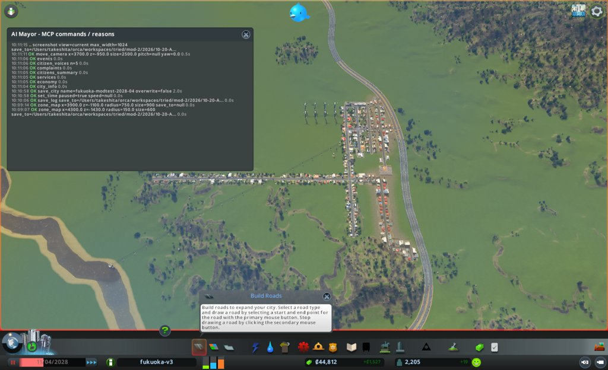
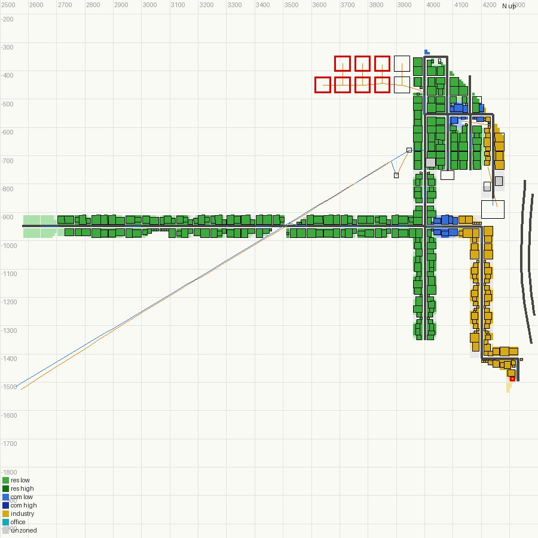
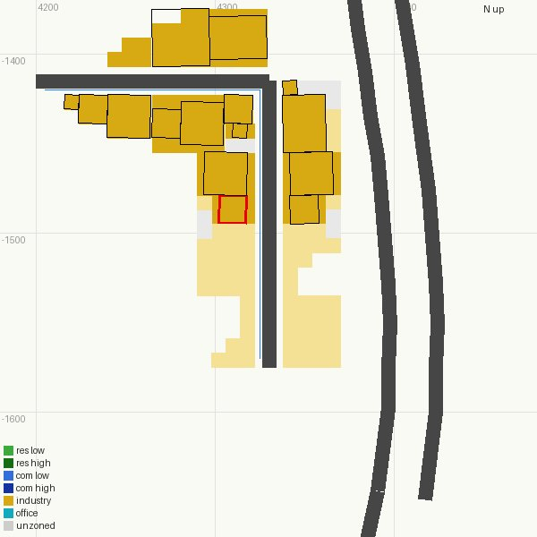

### 2028-04-21 見回り

境目: 当たらず。人口 2,224、週の収支 +1,452(支出 3,624 → 3,719)。来ない市民0。events 2件(風車を喜ぶつぶやき1件)。ダイアログなし(seconds 24.4、dialogs 空、dialogSeq 6 のまま)
- `services`: 電気 46,944/64,160(73%)。施策1の予想(約62,000〜65,000、75%前後)どおり。働き手1,203・働き口1,260(施策3の予想1,260以上に到達)。犯罪率 3 → 7

### 2028-05-01 見回り

境目: 当たらず。人口 2,267、週の収支 +1,539。来ない市民0。events 0件。ダイアログなし(seconds 24.4、dialogs 空)

### 2028-05-11 月例(20か月目)

保存: `fukuoka-modtest-2028-05`(seconds 2.0、nudged false)。直前の advance(10) は seconds 24.4、dialogs 空

#### 答え合わせ

- 19か月目の施策1(風車): 当たり。04-21 に電気 64,160、使用率73%(予想 約62,000〜65,000・75%前後)。今日は76%
- 19か月目の施策2(西の住宅): 外れ。人口 2,205 → 2,302(予想2,320以上)。`zone_map` で延長は埋まった
- 19か月目の施策3(南東の工業): 半分当たり。働き口 1,210 → 1,270(予想1,260以上)。ただし失業は 160 → 176 に増えた
- 前回の「次にやること」
  - 風車の効き目: 確かめた(04-21)
  - 新しい区画: 住宅・工業とも埋まった(`zone_map` 半径150)
  - 高校: まだ。所持金 43,652 で、上限 21,826 に 24,000 が入らない
  - 人口2,400の節目: まだ越えていない(2,302)
- 公約の進み具合
  1. 人口: 2,302(前の月例2,205から +97) / 毎月 / 達成
  2. 電気・水・下水が来ない市民: 0 / 任期の終わりまで / 達成中
  3. 週の収支: +1,586 / 達成

#### 気づいたこと

- 困りごとの印0件。events 1件(街と関係のないつぶやき)
- 電気 48,688/64,160(76%)。水 51%、下水 3%。診療所 100/67。犯罪率4
- 需要 住22 / 商50 / 工76。働き手1,254・働き口1,270、失業176、長く失業129
- 働き口は働き手より16多いだけ。失業176は、働き口の数そのものが足りないと見る
- 商業の需要は50のまま、少なくとも8か月動いていない。商業の区画は中央の226マスだけ(`zones_at`)
- `citizen_voices` の若者2人が job "unemployed"(troubles.unemployed 1 と 7)
- `citizens_summary` の movingIn は total 12・traveling 0。`city_info` の population 2,302 と residents 2,312 が10人ずれる
- 南東の工業の端 (4330,-1575) の先 (4330,-1655) は 97.5m(+15m)。延ばさない
- 西の端 (2580,-950) の先は、(2460,-950) で 50.3m、(2340,-950) で 48.9m と平ら
- 所持金 43,652。建設費の上限 21,826

#### 施策

1. 西の通りを (2580,-950)→(2460,-950) に延ばし、水道管も延ばして、住宅(低密度)にする
   - 公約: 1
   - 理由: 住宅の需要22。前の4回の延長は1か月で埋まった
   - 予想: 次の月例で人口2,400以上(節目を越える)
   - 費用: 道路120m 約640、水道管 約320、週約5
2. その先 (2460,-950)→(2340,-950) を延ばし、水道管も延ばして、商業(低密度)にする
   - 公約: 1、3(働き口と税収)
   - 理由: 働き口の需要76、失業176。工業の端は坂で延ばせない。商業の需要は50で、区画が空いていない
   - 予想: 次の月例で商業が2棟以上建ち、働き口1,300以上
   - 費用: 道路120m 約640、水道管 約320、週約5

建設費の合計 約2,000(所持金の半分21,826以内)。維持費の増え分 約10(黒字 +1,586 の範囲)。高校のために、ほかの建設は控える。

結果:

1. 道路 (2580,-950)→(2460,-950)(640、snapped 1)。水道管 (2585,-950)→(2465,-950)(320、snapped 1)。住宅(低密度)102マス
2. 道路 (2460,-950)→(2340,-950)(640、snapped 1)。水道管 (2465,-950)→(2345,-950)(320、snapped 1)。商業(低密度)102マス
   - 確かめ: `zone_map`(半径200)で、x=2460〜2580 の両側が薄い緑、x=2340〜2450 の両側が薄い青。道路は西の通りとひと続き
   - `zone_map` の水道管の青い線は、新しい管4区間のうち2区間((2400〜2460) と (2520〜2585))だけ描かれ、残りの2区間は描かれなかった

建設費の合計 1,920。所持金 43,652 → 41,732(`city_info`)。

#### 次にやること

- 西の住宅と商業が埋まるか。商業の需要が50から動くか。働き口と失業の数を見る
- 人口2,400の節目(Boom Town)。報酬と解禁を見る
- 高校(24,000、週560)。所持金が48,000を超えたら置く
- 電気76%。80%を超えたら風車を足す

#### 画面写真

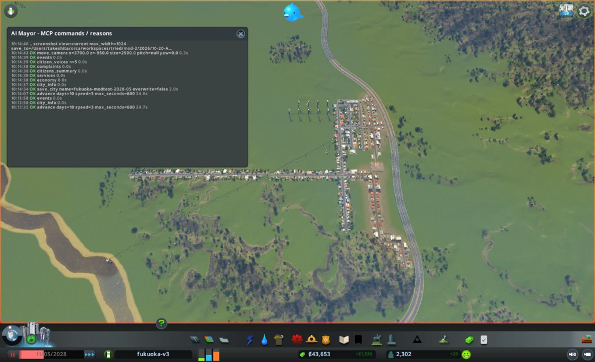

### 2028-05-21 見回り

境目: 当たらず。人口 2,338、週の収支 +1,611。来ない市民0。events 0件。ダイアログなし(seconds 24.4、dialogs 空、dialogSeq 6 のまま)
- 商業の需要が 50 → 37 に動いた。少なくとも8か月ぶり

### 2028-05-31 見回り

境目: 当たらず。人口 2,368、週の収支 +1,937(収入 5,343 → 5,669)。来ない市民0。events 1件(商店が地元の工業を求めるつぶやき)。ダイアログなし(seconds 24.4、dialogs 空)
- 商業の需要は 37 → 50 に戻った

### 2028-06-10 月例(21か月目)

保存: `fukuoka-modtest-2028-06`(seconds 1.5、nudged false)。直前の advance(10) は seconds 24.4

- 人口の節目: 2028-06-05 に UnlockingPanel(Boom Town 2,400)が autoClosed true で dialogs に入った。止まらずに10日進んだ。dialogSeq 6 → 7。新しい区域(2km四方)、バス、墓地、上位の風車、ごみの再利用の政策などが解禁

#### 答え合わせ

- 20か月目の施策1(西の住宅): 当たり。人口 2,302 → 2,418(予想2,400以上)。節目も越えた
- 20か月目の施策2(西の商業): 当たり。`zone_map` で商業が5棟以上建った(2棟以上の予想)。働き口 1,270 → 1,323(予想1,300以上)。ただし失業は 176 → 207 に増えた
- 前回の「次にやること」
  - 西の住宅と商業: 埋まった。商業の需要は 50 → 37 → 50 と動いて戻った
  - 人口2,400の節目: 越えた。所持金 46,783(05-31)→ 84,622。10日の黒字は約2,800なので、約3.5万が報酬と見る
  - 高校: 今回置く。所持金 84,622 で上限 42,311
  - 電気: 77%。80%を超えていないので見送る
- 公約の進み具合
  1. 人口: 2,418(前の月例2,302から +116) / 毎月 / 達成
  2. 電気・水・下水が来ない市民: 0 / 任期の終わりまで / 達成中
  3. 週の収支: +1,968 / 達成

#### 気づいたこと

- 困りごとの印0件。events 2件(市長をほめるつぶやき、区域を広げられるようになったつぶやき)
- 電気 49,520/64,160(77%)。水 53%、下水 3%。診療所 100/60。犯罪率4。警察 20/15
- 需要 住21 / 商50 / 工79。働き手1,303・働き口1,323、失業207、長く失業154
- 失業は3か月で 132 → 160 → 176 → 207。働き口を足しても、働き口は働き手より約20多いだけで、失業は減らない
- 10代474人、高校0。学歴は高校卒0
- 葬祭 0/0。高齢者 121 → 164。困りごとの印はまだない
- 西の端 (2340,-950) の先は、(2220,-950) で 49.1m、(2100,-950) で 48.8m と平ら。建物なし。空の路線(Airplane Connection Path)が (2156,-914)〜(2184,-989) を通るが、地面の線ではない
- 所持金 84,622。建設費の上限 42,311

#### 施策

1. 西の通りを (2340,-950)→(2220,-950) に延ばし、北側に高校を置く。南側は商業(低密度)にする
   - 公約: 1、3(この施策は公約の数字に直接は効かない。10代474人に高校がなく、働き手の学歴が上がらないと、建物の格が上がらず税収が伸びないと見る)
   - 理由: 10代474人・高校0。所持金が節目の報酬で 84,622 になり、上限に入った。週の黒字 +1,968 に維持費560が収まる
   - 予想: 次の見回りで `services` の education.high が0より大きくなる。週の支出が約570増え、黒字は +1,300 以上を保つ
   - 費用: 高校24,000、道路120m 約640、水道管 約320、週 約565
2. その先 (2220,-950)→(2100,-950) を延ばし、水道管も延ばして、工業にする
   - 公約: 1、3(働き口と税収)
   - 理由: 働き口の需要79、失業207。南東の工業は坂で延ばせない。西は平ら。住宅から120m以上離れる
   - 予想: 次の月例で働き口1,380以上、失業190以下
   - 費用: 道路120m 約640、水道管 約320、週約5

建設費の合計 約26,000(所持金の半分42,311以内)。維持費の増え分 約570(黒字 +1,968 の範囲)。

結果:

1. 道路 (2340,-950)→(2220,-950)(640、snapped 1)。水道管 (2345,-950)→(2225,-950)(320、snapped 1)。高校 id 48164 を (2280,-922)、angle 180 に置いた(24,000)。entrance は (2280,-942)、facing south、road は segment 3423(distance 0)。南側を商業(低密度)53マス(建物のあるマス11を飛ばした)
   - 確かめ: `buildings_near` で高校は grid が電気・水・下水とも false(置いた直後)。`zone_map` でも赤い枠。次の見回りで見る
   - 高校の両脇 (2220〜2250)・(2310〜2340) の北側は未指定のまま
2. 道路 (2220,-950)→(2100,-950)(640、snapped 1)。水道管 (2225,-950)→(2105,-950)(320、snapped 1)。工業98マス
   - 確かめ: `zone_map`(半径200)で x=2100〜2210 の両側が薄い黄、x=2250〜2330 の南側が薄い青

建設費の合計 25,920。所持金 84,622 → 58,702(`city_info`)。

#### 次にやること

- 高校 48164 の grid と、`services` の education.high を見る
- 西の工業と商業が埋まるか。働き口と失業の数を見る。西の通りはひと筋なので、`traffic` で詰まりを見る
- 電気77%。80%を超えたら風車を足す。上位の風車(Advanced Wind Turbine)が解禁された
- 葬祭 0。高齢者164。墓地が解禁された。困りごとの印が出たら置く

#### 画面写真

### 2028-06-20 見回り

境目: 当たらず。人口 2,440、週の収支 +1,412(支出 3,732 → 4,305。高校の分)。来ない市民0。events 2件(学校を喜ぶつぶやき1件)。ダイアログなし(seconds 24.3、dialogs 空、dialogSeq 7 のまま)
- 高校 48164 は grid が電気・水・下水とも true。`services` の education.high 0 → 1,000。施策1の予想(high が0より大、黒字 +1,300 以上)どおり。支出の増え分は573
- `services`: 働き手1,378・働き口1,513(1,323 から +190)。施策2の予想(1,380以上)は10日で到達。働き口の需要 79 → 58
- 電気 51,168/64,160(80%)。警察 20/19

### 2028-06-30 見回り

境目: 当たらず。人口 2,445(10日で +5)、週の収支 +1,666。来ない市民0。events 0件。ダイアログなし(seconds 24.4、dialogs 空)
- 住宅の需要 37 → 43。住宅の区画が埋まり、人口の伸びが止まりかけている

### 2028-07-10 運営の終わり(21か月目まで)

- advance(10) は seconds 24.4、dialogs 空。dialogSeq は 7 のまま
- 人口 2,452(`citizens_summary` の residents も 2,452)。06-10 から +34 で、伸びが落ちた。住宅の需要44
- 週の収支 +1,717。所持金 65,447
- 電気 51,984/64,160(81%)。水 64,864/120,000(54%)
- 働き手1,462・働き口1,543。失業 207 → 75、長く失業 154 → 85。学生 250 → 678、高校卒48
- 病人70、診療所 100/70。犯罪率6、警察 20/16
- `traffic`: flow 89、blocked 0。いちばん混むのは高速とのつなぎ目 (4355,-548) の一般道(density 100)と、その先の高速 (4346,-576)(88)。西の通りは上位10に入っていない

### 2028-07-10 月例(22か月目)

保存: `fukuoka-modtest-2028-07`(seconds 2.0、nudged false)

#### 答え合わせ

- 21か月目の施策1(高校と西の商業): 当たり。06-20 に education.high 1,000、週の支出 +573、黒字 +1,412(予想 +1,300 以上)。学生 250 → 678
- 21か月目の施策2(西の工業): 当たり。働き口 1,323 → 1,543(予想1,380以上)、失業 207 → 75(予想190以下)
- 前回の「次にやること」
  - 高校の grid と education.high: 確かめた(06-20)
  - 西の工業と商業: 埋まった。`traffic` は flow 89、西の通りは上位10の外
  - 電気: 81%。今回、風車を足す
  - 葬祭: 今回、困りごとの印(Death)が2棟に出た。墓地を置く
- 公約の進み具合
  1. 人口: 2,452(前の月例2,418から +34) / 毎月 / 達成。ただし伸びが落ちた
  2. 電気・水・下水が来ない市民: 0 / 任期の終わりまで / 達成中
  3. 週の収支: +1,717 / 達成

#### 気づいたこと

- 困りごとの印は Death が2棟(初めて)。葬祭 0/0、高齢者186
- 電気 51,984/64,160(81%)。水 54%、下水 3%。診療所 100/70。犯罪率6、警察 20/16
- 需要 住44 / 商50 / 工56。住宅の区画は全部埋まった(`zone_map`)。人口の伸びは +34
- 働き手1,462・働き口1,543、失業75、長く失業85。学生678
- `citizen_voices` の5人は全員 troubles 0
- 西の通りの北側 (2228〜2256, -950) は未指定で建物なし。その北 (2235,-860) は 48.6m、(2470,-860) は 50.8m、(2700,-860) は 65.5m
- 風車の西 (3570,-450) は空いている
- 所持金 65,447。建設費の上限 32,723

#### 施策

1. 西の通りの (2236,-950) から北へ (2236,-860) まで引き、そこから東へ (2640,-860) まで新しい通りを引く。水道管も引き、x≥2300 の両側を住宅(低密度)にする
   - 公約: 1
   - 理由: 住宅の需要44、区画が全部埋まり、伸びが +34 に落ちた。北は空き地でゆるい登り
   - 予想: 次の月例で人口2,560以上
   - 費用: 道路約500m 約2,700、水道管 約1,300、週約25
2. 新しい通りの西 (2195,-830) に墓地を、東向きに置く
   - 公約: 1(高齢者の死で家が空き、困りごとが増えるのを防ぐ)
   - 理由: Death の印が2棟、葬祭0、高齢者186
   - 予想: 次の見回りで `services` の deathcare が0より大きく、Death の印が0に
   - 費用: 建設8,000、週160
3. 風車を1基、(3570,-450) に置き、送電線で風車 35927 (3640,-450) につなぐ
   - 公約: 2
   - 理由: 電気の使用81%
   - 予想: 次の見回りで電気の容量が約70,000、使用率75%前後
   - 費用: 建設6,000、送電線 約200、週80

建設費の合計 約18,200(所持金の半分32,723以内)。維持費の増え分 約265(黒字 +1,717 の範囲)。

結果:

1. 道路 (2236,-950)→(2236,-860)→(2640,-860)(2,520、8区間、始点は split 1、終点は none)。水道管 (2240,-950)→(2240,-865)→(2635,-865)(1,160、始点 split 1)。住宅(低密度)325マス(zone_area 6回、skippedOccupied 0)
   - 確かめ: `zones_at`(中心 (2460,-860)、半径190)で住宅443・商業115・未指定87。`zone_map` で新しい通りの両側が薄い緑、西の通りとひと続き
   - 水道管を分けた直後、高校 48164 と西の通りの商店数棟が `zone_map` で赤い枠になった(前の月と同じ現象)。次の見回りで見る
2. 墓地を置く場所を変えた。(2195,-830) は東向きにすると、正面の道路が (2236,-860) で終わり、面しない。新しい通りの北側 (2284,-820)、angle 180 に置いた。墓地 id 15063(8,000)。entrance (2284,-852)、facing south、road は segment 14040(distance 0)
   - 確かめ: `buildings_near` で置けた。grid は電気・水・下水とも false(置いた直後)
3. 風車 id 20393 を (3570,-450) に置いた(6,000)。送電線 (3570,-450)→(3640,-450)(180、snapped 1)。始点は 20393 の敷地内、終点は風車 35927 の敷地内の点に snapped

建設費の合計 17,860。所持金 65,447 → 47,587(`city_info`)。

#### 次にやること

- 墓地 15063 の grid と、`services` の deathcare、Death の印を見回りで見る
- 高校 48164 の grid(管を分けた後)
- 風車の効き目(`services` の電気)
- 新しい住宅の区画が埋まるか。人口の伸びが戻るか

#### 画面写真

### 2028-07-20 見回り

境目: 当たらず。人口 2,488、週の収支 +1,579(支出 4,305 → 4,574)。来ない市民0。events 3件(墓地を喜ぶ1件、風車1件、死のにおい1件)。ダイアログなし(seconds 24.3、dialogs 空、dialogSeq 7 のまま)
- 墓地 15063 と高校 48164 は grid が電気・水・下水とも true。`services` の deathcare 0 → 3,000(used 0)
- 電気 53,200/69,360(77%)。施策3の予想(約70,000・75%前後)どおり
- 住宅の需要 44 → 17

### 2028-07-30 見回り

境目: 当たらず。人口 2,583(10日で +95)、週の収支 +1,729。来ない市民0。events 0件。ダイアログなし(seconds 24.4、dialogs 空)

### 2028-08-09 月例(23か月目)

保存: `fukuoka-modtest-2028-08`(seconds 2.0、nudged false)。直前の advance(10) は seconds 24.4、dialogs 空

#### 答え合わせ

- 22か月目の施策1(北の新しい通りの住宅): 当たり。人口 2,452 → 2,642(予想2,560以上)。`zone_map` で北の通りの区画はほぼ埋まった(北側に空きが数区画)
- 22か月目の施策2(墓地): 当たり。07-20 に deathcare 0 → 3,000、grid true。今日は困りごとの印0件(Death 2 → 0)
- 22か月目の施策3(風車): 当たり。07-20 に電気 69,360、使用率77%(予想 約70,000・75%前後)。今日は79%
- 前回の「次にやること」: 墓地・高校の grid、風車、新しい区画、どれも確かめた
- 公約の進み具合
  1. 人口: 2,642(前の月例2,452から +190) / 毎月 / 達成
  2. 電気・水・下水が来ない市民: 0 / 任期の終わりまで / 達成中
  3. 週の収支: +1,782 / 達成

#### 気づいたこと

- 困りごとの印0件。events 1件(公園を求めるつぶやき)
- 電気 54,992/69,360(79%)。水 58%、下水 4%。診療所 100/70。葬祭 3,000/10。犯罪率3
- 需要 住35 / 商50 / 工60。働き手1,552・働き口1,573、失業63、長く失業34(85 から減った)
- 高齢者 186 → 254。高校卒 48 → 94
- 北の通りの東の端 (2640,-860) は 62.2m、(2780,-860) は 69.8m。端の先に建物なし(南に家 18934 (2716,-926) があるが、通りから60m離れる)
- 西の通りの西の端 (2100,-950) の先 (1980,-950) は 48.6m で平ら。建物なし
- 所持金 54,764。建設費の上限 27,382

#### 施策

1. 北の通りを (2640,-860)→(2780,-860) に延ばし、水道管も延ばして、住宅(低密度)にする
   - 公約: 1
   - 理由: 住宅の需要35。北の通りは1か月でほぼ埋まった。ゆるい登り(+8m)
   - 予想: 次の月例で人口2,750以上
   - 費用: 道路140m 約750、水道管 約350、週約6
2. 西の通りを (2100,-950)→(1980,-950) に延ばし、水道管も延ばして、工業にする
   - 公約: 1、3(働き口と税収)
   - 理由: 働き口の需要60。働き口は働き手より21多いだけ。前の西の工業は10日で埋まった
   - 予想: 次の月例で働き口1,650以上
   - 費用: 道路120m 約640、水道管 約320、週約5
3. 風車を1基、(3500,-450) に置き、送電線で風車 20393 (3570,-450) につなぐ
   - 公約: 2
   - 理由: 電気の使用79%。使用は月に約2,000〜3,000ずつ増える
   - 予想: 次の見回りで電気の容量 約75,000、使用率75%前後
   - 費用: 建設6,000、送電線 約200、週80

建設費の合計 約8,300(所持金の半分27,382以内)。維持費の増え分 約91(黒字 +1,782 の範囲)。

結果:

1. 道路 (2640,-860)→(2780,-860)(720、snapped 1)。水道管 (2635,-865)→(2775,-865)(360、snapped 1)。住宅(低密度)60 + 54マス(前の端のマスも数に入っていると見る)
2. 道路 (2100,-950)→(1980,-950)(640、snapped 1)。水道管 (2105,-950)→(1985,-950)(320、snapped 1)。工業106マス
   - 確かめ: `zone_map`(中心 (2380,-900)、半径450)で、北の通りの延長の両側が薄い緑、西の通りの延長の両側が薄い黄。端の工場1棟が赤い枠(管を延ばした直後。前の月と同じ)
3. 風車 id 33944 を (3500,-450) に置いた(6,000)。送電線 (3500,-450)→(3570,-450)(180、snapped 1)。始点は 33944 の敷地内、終点は風車 20393 の敷地内の点に snapped

建設費の合計 8,220。所持金 54,764 → 46,544(`city_info`)。

画面写真(型の8番)は、施策の後に撮った。施策の前に撮り忘れた。

#### 次にやること

- 風車の効き目(`services` の電気)
- 北の延長の住宅と、西の工業が埋まるか。働き口と失業
- 高齢者254、診療所 100/70。病人が増えたら2つ目の診療所(10,000、週400)
- 公園を求める声が1件。困りごとの印はない

#### 画面写真

### 2028-08-19 見回り

境目: 当たらず。人口 2,679、週の収支 +1,666(支出 4,574 → 4,672)。来ない市民0。events 1件(風車を喜ぶつぶやき)。ダイアログなし(seconds 24.4、dialogs 空、dialogSeq 7 のまま)
- `services`: 電気 55,776/88,000(63%)。容量は予想(約75,000)より大きい。風車1基で +18,640 は、これまでの1基 約5,000〜7,000 より多く、風が強いと見る
- 働き手1,557・働き口1,641(1,573 から +68)

### 2028-08-29 見回り

境目: 当たらず。人口 2,736、週の収支 +1,782。来ない市民0。events 1件(街と関係のないつぶやき)。ダイアログなし(seconds 24.3、dialogs 空)

### 2028-09-08 月例(24か月目)

保存: `fukuoka-modtest-2028-09`(seconds 1.5、nudged false)。直前の advance(10) は seconds 24.4、dialogs 空

#### 答え合わせ

- 23か月目の施策1(北の通りの東の住宅): 当たり。人口 2,642 → 2,774(予想2,750以上)。`zone_map` で延長は埋まった
- 23か月目の施策2(西の工業): 当たり。働き口 1,573 → 1,673(予想1,650以上)。失業 63 → 61
- 23か月目の施策3(風車): 外れ(よい方へ)。08-19 に電気 88,000、使用率63%(予想 約75,000・75%前後)。今日は66%
- 前回の「次にやること」
  - 風車の効き目: 確かめた(08-19)
  - 北と西の延長: 埋まった
  - 診療所: 今回置く。診療所 100/79、病人80(前の月例69)
  - 公園: 困りごとの印に出ていないので見送る
- 公約の進み具合
  1. 人口: 2,774(前の月例2,642から +132) / 毎月 / 達成
  2. 電気・水・下水が来ない市民: 0 / 任期の終わりまで / 達成中
  3. 週の収支: +1,822 / 達成

#### 気づいたこと

- 困りごとの印は Garbage 1棟、Noise 1棟
- 電気 58,112/88,000(66%)。水 61%、下水 4%。ごみ 3,404,593/8,000,000(43%)。葬祭 3,000/25。犯罪率7、警察 20/15
- 診療所 100/79。病人 69 → 80、badHealth 75。高齢者 254 → 304。`citizen_voices` に VerySick の10代(badHealth 3)
- 需要 住44 / 商50 / 工56。働き手1,629・働き口1,673、失業61、長く失業30
- 住宅の区画は全部埋まった(`zone_map`)
- 北の通りの東の端 (2780,-860) の先 (2900,-860) は 60.4m。建物なし
- 西の通りと北の通りのつなぎ (2236,-860〜-950) の西側 (2196〜2230, -862〜-905) に、未指定の空き地(約34×43m)がある。建物なし
- 所持金 54,092。建設費の上限 27,046

#### 施策

1. 北の通りを (2780,-860)→(2920,-860) に延ばし、水道管も延ばして、住宅(低密度)にする
   - 公約: 1
   - 理由: 住宅の需要44。北の通りの延長は1か月で埋まった。下り(69.8m → 60.4m)
   - 予想: 次の月例で人口2,880以上
   - 費用: 道路140m 約720、水道管 約360、週約6
2. 診療所を、つなぎの通りの西 (2213,-884) に東向きに置く
   - 公約: 1(病人が増えると人口の伸びと幸福度が落ちるのを防ぐ)
   - 理由: 診療所 100/79、病人 69 → 80、高齢者 254 → 304。西の住宅の近くに医療がない
   - 予想: 次の見回りで `services` の healthcare の容量が200になる。次の月例で病人80以下
   - 費用: 建設10,000、週400

建設費の合計 約11,100(所持金の半分27,046以内)。維持費の増え分 約406(黒字 +1,822 の範囲)。ごみの印1棟は、処理場が43%なので様子を見る。

結果:

1. 道路 (2780,-860)→(2920,-860)(720、snapped 1)。水道管 (2775,-865)→(2915,-865)(360、snapped 1)。住宅(低密度)66 + 52マス
   - 確かめ: `zone_map`(中心 (2600,-880)、半径400)で、x=2770〜2910 の両側が薄い緑。道路は北の通りとひと続き
2. 診療所 id 32923 を (2213,-884)、angle 270 に置いた(10,000)。entrance (2229,-884)、facing east、road は segment 20293(distance 0)
   - 確かめ: `buildings_near` で、置いた直後に grid が電気・水・下水とも true

建設費の合計 11,080。所持金 54,092 → 43,012(`city_info`)。

#### 次にやること

- 診療所 32923 の効き目(`services` の healthcare、病人の数)
- 北の通りの延長が埋まるか
- ごみの印。増えたら、ごみ収集の範囲か処理場の台数を確かめる
- 北の通りの端は今 (2920,-860)。その先も延ばせるかを `height_at` で見る

#### 画面写真

### 2028-09-18 見回り

境目: 当たらず。人口 2,824、週の収支 +1,491(支出 4,672 → 5,079。診療所の分)。来ない市民0。events 1件(街と関係のないつぶやき)。ダイアログなし(seconds 25.5、dialogs 空、dialogSeq 7 のまま)
- `services`: healthcare 100 → 200(used 80)。施策2の予想どおり。電気 60,192/77,600(78%)。容量は風で 88,000 → 77,600 に下がった

### 2028-09-28 見回り

境目: 当たらず。人口 2,873、週の収支 +1,554。来ない市民0。events 1件(ごみ収集への苦情。境目の3件に届かない)。ダイアログなし(seconds 24.4、dialogs 空)

### 2028-10-08 運営の終わり(24か月目まで)

- advance(10) は seconds 24.4、dialogs 空。dialogSeq は 7 のまま
- 人口 2,894(`citizens_summary` の residents は 2,895)。09-08 から +120
- 週の収支 +1,574。所持金 49,614
- 電気 60,816/77,600(78%)。水 76,112/120,000(63%)。ごみ 3,875,970/8,000,000(48%)
- 医療 200/72、病人 80 → 72。葬祭 3,000/25。犯罪率6、警察 20/19
- 働き手1,695・働き口1,706。失業70、長く失業32。高校卒201
- 困りごとの印は Noise 1棟だけ。Garbage の印は消えた
- events 0件

### 2028-10-08 月例(25か月目)

保存: `fukuoka-modtest-2028-10`(seconds 2.0、nudged false)

#### 答え合わせ

- 24か月目の施策1(北の通りの延長): 当たり。人口 2,774 → 2,894(予想2,880以上)
- 24か月目の施策2(診療所): 当たり。09-18 に healthcare 100 → 200。病人 80 → 72(予想80以下)
- 前回の「次にやること」
  - 診療所の効き目: 確かめた(上のとおり)
  - 北の通りの延長: 埋まった(端の先 (2960〜3044,-926) に家が並ぶ。`buildings_near`)
  - ごみの印: 消えた。ごみ 48%
  - 北の通りの端の先: (3040,-860) は 58.0m で平ら。今回延ばす
- 公約の進み具合
  1. 人口: 2,894(前の月例2,774から +120) / 毎月 / 達成
  2. 電気・水・下水が来ない市民: 0 / 任期の終わりまで / 達成中
  3. 週の収支: +1,574 / 達成

#### 気づいたこと

- 困りごとの印は Noise 1棟。events 0件
- 電気 60,816/77,600(78%)。水 63%、下水 4%。ごみ 48%。医療 200/72。葬祭 3,000/25。犯罪率6、警察 20/19
- 需要 住41 / 商50 / 工59。働き手1,695・働き口1,706、失業70、長く失業32
- 10代537・学生748。高校卒201。高齢者325
- `citizen_voices` の5人は全員 troubles 0
- 西の通りの西の端 (1980,-950) の先 (1860,-950) は 48.6m で平ら。建物なし
- 風車の西 (3430,-450) は空いている
- 所持金 49,614。建設費の上限 24,807

#### 施策

1. 北の通りを (2920,-860)→(3040,-860) に延ばし、水道管も延ばして、住宅(低密度)にする
   - 公約: 1
   - 理由: 住宅の需要41。北の通りの延長は3回とも1か月で埋まった
   - 予想: 次の月例で人口3,000以上
   - 費用: 道路120m 約640、水道管 約320、週約5
2. 西の通りを (1980,-950)→(1860,-950) に延ばし、水道管も延ばして、工業にする
   - 公約: 1、3(働き口と税収)
   - 理由: 働き口の需要59。働き口は働き手より11多いだけ
   - 予想: 次の月例で働き口1,780以上
   - 費用: 道路120m 約640、水道管 約320、週約5
3. 風車を1基、(3430,-450) に置き、送電線で風車 33944 (3500,-450) につなぐ
   - 公約: 2
   - 理由: 電気の使用78%。風で容量が下がると80%を超える
   - 予想: 次の見回りで電気の容量 約85,000〜95,000、使用率70%前後
   - 費用: 建設6,000、送電線 約200、週80

建設費の合計 約8,200(所持金の半分24,807以内)。維持費の増え分 約90(黒字 +1,574 の範囲)。

結果:

1. 道路 (2920,-860)→(3040,-860)(640、snapped 1)。水道管 (2915,-865)→(3035,-865)(320、snapped 1)。住宅(低密度)102マス(skippedOccupied 6)
2. 道路 (1980,-950)→(1860,-950)(640、snapped 1)。水道管 (1985,-950)→(1865,-950)(320、snapped 1)。工業102マス
   - 確かめ: `zone_map`(中心 (2450,-900)、半径650)で、北の通りの x=2920〜3040 の両側が薄い緑、西の通りの x=1860〜1980 の両側が薄い黄。端の工場1棟 (1980,-975) が赤い枠(管を延ばした直後。前の月と同じ)
3. 風車 id 24221 を (3430,-450) に置いた(6,000)。送電線 (3430,-450)→(3500,-450)(180、snapped 1)。始点は 24221 の敷地内、終点は風車 33944 の敷地内の点に snapped

建設費の合計 8,100。所持金 49,614 → 41,514(`city_info`)。

#### 次にやること

- 風車の効き目(`services` の電気)
- 北の通りと西の工業の延長が埋まるか。働き口と失業
- 警察 20/19。犯罪率が10を超えたら2つ目の警察署(12,000、週480)を考える
- 騒音の印1棟。増えたら場所を `buildings_near` で探す

#### 画面写真

### 2028-10-18 見回り

境目: 当たらず。人口 2,904(10日で +10)、週の収支 +1,473(支出 5,079 → 5,176)。来ない市民0。events 2件(風車を喜ぶ1件、騒音の話1件)。ダイアログなし(seconds 24.4、dialogs 空、dialogSeq 7 のまま)
- `services`: 電気 60,976/83,920(73%)。施策3の予想(約85,000〜95,000、70%前後)の下の端。働き口 1,706 → 1,794(施策2の予想1,780以上に到達)。犯罪率 6 → 9

### 2028-10-28 見回り

境目: 当たらず。人口 2,991、週の収支 +1,627。来ない市民0。events 1件(街と関係のないつぶやき)。ダイアログなし(seconds 24.4、dialogs 空)

### 2028-11-07 月例(26か月目)

保存: `fukuoka-modtest-2028-11`(seconds 1.5、nudged false)。直前の advance(10) は seconds 24.4、dialogs 空

#### 答え合わせ

- 25か月目の施策1(北の通りの延長): 外れ(わずか)。人口 2,894 → 2,988(予想3,000以上)。`zone_map` で延長は埋まった。10-28 → 11-07 は -3
- 25か月目の施策2(西の工業): 当たり。働き口 1,706 → 1,806(予想1,780以上)。失業 70 → 57
- 25か月目の施策3(風車): ほぼ当たり。10-18 に電気 83,920、使用率73%(予想 約85,000〜95,000・70%前後)。今日は75%
- 前回の「次にやること」
  - 風車の効き目: 確かめた(10-18)
  - 延長: 住宅・工業とも埋まった
  - 警察: 犯罪率 6 → 9 → 5。10を超えていないので見送る
  - 騒音の印: 消えた。代わりにごみの印1棟
- 公約の進み具合
  1. 人口: 2,988(前の月例2,894から +94) / 毎月 / 達成
  2. 電気・水・下水が来ない市民: 0 / 任期の終わりまで / 達成中
  3. 週の収支: +1,668 / 達成

#### 気づいたこと

- 困りごとの印は Garbage 1棟。events 0件
- 電気 63,008/83,920(75%)。水 66%、下水 4%。ごみ 52%。医療 200/70。葬祭 3,000/45。犯罪率5、警察 20/18
- 需要 住45 / 商50 / 工55。働き手1,766・働き口1,806、失業57、長く失業40
- 子ども280、小学校の定員300。10代533・学生759。高齢者351
- `citizen_voices` の5人は全員 troubles 0。北の延長の家 (3024,-836) の大人は工業で働く
- 北の通りの端 (3040,-860) の先 (3160,-860) は 57.0m で平ら。近くの建物は西の通りの家 (3092,-926) だけ
- 所持金 48,335。建設費の上限 24,167

#### 施策

1. 北の通りを (3040,-860)→(3160,-860) に延ばし、水道管も延ばす。北側に小学校を置き、残りを住宅(低密度)にする
   - 公約: 1(住宅の区画を足す。小学校は、子どもが定員に近づき、家族が住まなくなるのを防ぐ)
   - 理由: 住宅の需要45、区画が埋まった。子ども280・小学校の定員300
   - 予想: 次の見回りで education.elementary が600。次の月例で人口3,080以上
   - 費用: 小学校10,000、道路120m 約640、水道管 約320、週 約165

建設費の合計 約11,000(所持金の半分24,167以内)。維持費の増え分 約165(黒字 +1,668 の範囲)。ごみの印1棟は、処理場が52%なので様子を見る。

結果:

1. 道路 (3040,-860)→(3160,-860)(640、snapped 1)。水道管 (3035,-865)→(3155,-865)(320、snapped 1)。小学校 id 5804 を (3125,-836)、angle 180 に置いた(10,000)。entrance (3125,-852)、facing south、road は segment 33386(distance 0)。住宅(低密度)82マス(skippedOccupied 27。小学校の下のマスと見る)
   - 確かめ: `zone_map`(中心 (3050,-880)、半径200)で、延長の両側が薄い緑、小学校は赤い枠。`buildings_near` で grid は電気・水・下水とも false(置いた直後)。次の見回りで見る

建設費の合計 10,960。所持金 48,335 → 37,375(`city_info`)。

#### 次にやること

- 小学校 5804 の grid と、`services` の education.elementary
- 北の延長が埋まるか。人口の伸び(10-28 → 11-07 は -3)が戻るか
- ごみの印。増えたら処理場の台数か範囲を見る
- 電気75%。80%を超えたら風車(西の端は今 (3430,-450))

#### 画面写真

### 2028-11-17 見回り

境目: 当たらず。人口 3,001、週の収支 +1,524(支出 5,176 → 5,342。小学校の分 +166)。来ない市民0。events 1件(街と関係のないつぶやき)。ダイアログなし(seconds 24.5、dialogs 空、dialogSeq 7 のまま)
- 小学校 5804 は grid が電気・水・下水とも true。`services` の education.elementary 300 → 600(予想どおり)
- 電気 64,096/83,920(76%)。働き手1,769・働き口1,832

### 2028-11-27 見回り

境目: 当たらず。人口 3,035、週の収支 +1,563。来ない市民0。events 0件。ダイアログなし(seconds 24.4、dialogs 空)

### 2028-12-07 月例(27か月目)

保存: `fukuoka-modtest-2028-12`(seconds 1.5、nudged false)。直前の advance(10) は seconds 24.4、dialogs 空

#### 答え合わせ

- 26か月目の施策1(北の延長と小学校): 半分当たり。小学校は 11-17 に elementary 300 → 600(予想どおり)。人口は 2,988 → 3,055 で、予想3,080以上に届かない。`zone_map` で延長の区画は大半が埋まった
- 前回の「次にやること」
  - 小学校の grid と定員: 確かめた(11-17 に true、600)
  - 北の延長: 大半が埋まった。人口の伸びは +67/月 で、前の月(+94)より落ちた
  - ごみの印: 1 → 2棟に増えた。今回手当てする
  - 電気: 76%。80%を超えていないので見送る
- 公約の進み具合
  1. 人口: 3,055(前の月例2,988から +67) / 毎月 / 達成
  2. 電気・水・下水が来ない市民: 0 / 任期の終わりまで / 達成中
  3. 週の収支: +1,593 / 達成

#### 気づいたこと

- 困りごとの印は Garbage 2棟。`buildings_near` で、南東の工業の工場 16968 (4281,-1391) と 47072 (4313,-1391)。`complaints` の hotspot は (3840,-1920)
- ごみ 4,392,484/8,000,000(55%)。処理場のたまり具合は半分。印は収集が追いつかないことと見る
- events 1件(工業の廃棄物が土に出たというつぶやき)
- 電気 63,872/83,920(76%)。水 67%、下水 4%。医療 200/62。葬祭 3,000/52。犯罪率4、警察 20/16
- 需要 住44 / 商50 / 工56。働き手1,805・働き口1,832、失業60、長く失業40
- `citizen_voices` の大人 id 446715 は job "works:Industrial" なのに troubles.unemployed 3(1〜3か月目に記した食い違いと同じ)
- 画面に「New building! Eldercare」の吹き出し。節目のお知らせ(autoClosed)はなく、dialogSeq 7 のまま
- 西の通りの端 (1860,-950) の先 (1740,-950) は水の中(地面 41.4m、水面 45.0m)。西へは延ばせない
- 北の通りの端 (3160,-860) の先 (3280,-860) は 59.5m で平ら。建物は西の通りの家 (3212〜3252,-926) だけ
- 所持金 43,886。建設費の上限 21,943

#### 施策

1. ごみの予算を 100 → 120% に上げる
   - 公約: 1(ごみの印が増えると、建物が放棄され、人口が減るのを防ぐ)
   - 理由: Garbage の印 1 → 2棟。処理場は55%で空きがあり、収集の車が足りないと見る
   - 予想: 次の見回りで Garbage の印0。週の支出が約30〜40増える
   - 費用: 週 約32(処理場の維持費160の20%)
2. 北の通りを (3160,-860)→(3280,-860) に延ばし、水道管も延ばして、住宅(低密度)にする
   - 公約: 1
   - 理由: 住宅の需要44。前の延長は1か月で大半が埋まった
   - 予想: 次の月例で人口3,150以上
   - 費用: 道路120m 約640、水道管 約320、週約5

建設費の合計 約960(所持金の半分21,943以内)。維持費の増え分 約40(黒字 +1,593 の範囲)。

結果:

1. `set_budget`(garbage, 120): ok。`economy` で garbage が昼夜とも120。`city_info` の週の支出は 5,342 のまま(時間を進める前)
2. 道路 (3160,-860)→(3280,-860)(640、snapped 1)。水道管 (3155,-865)→(3275,-865)(320、snapped 1)。住宅(低密度)106マス(skippedOccupied 5)
   - 確かめ: `zone_map`(中心 (3200,-880)、半径200)で、x=3160〜3280 の両側が薄い緑。前の延長 (3040〜3160) は小学校の両脇まで家が建った

建設費の合計 960。所持金 43,886 → 42,926(`city_info`)。

#### 次にやること

- ごみの印が消えたか。週の支出の増え分
- 北の延長 (3160〜3280) が埋まるか。人口の伸び
- 北の通りの先 (3400,-860) の高さと建物
- 電気76%。80%を超えたら風車(西の端は今 (3430,-450))
- Eldercare(高齢者の施設)が解禁された。高齢者369。費用と維持費を `list_building_types` で見る

#### 画面写真

### 2028-12-17 見回り

境目: 当たらず。人口 3,074、週の収支 +1,527(支出 5,342 → 5,381。ごみの予算の分 +39)。来ない市民0。events 1件(街と関係のないつぶやき)。ダイアログなし(seconds 24.4、dialogs 空、dialogSeq 7 のまま)
- `complaints`: 困りごとの印0件。施策1の予想(Garbage の印0、支出 +30〜40)どおり

### 2028-12-27 見回り

境目: 当たらず。人口 3,108、週の収支 +1,565。来ない市民0。events 0件。ダイアログなし(seconds 25.4、dialogs 空)

### 2029-01-06 運営の終わり(27か月目まで)

- advance(10) は seconds 24.4、dialogs 空。dialogSeq は 7 のまま
- 人口 3,116(`citizens_summary` の residents は 3,119、movingIn total 3・traveling 0)。12-07 から +61
- 週の収支 +1,608。所持金 49,779
- 電気 64,624/83,920(77%)。水 80,944/120,000(67%)。ごみ 4,884,535/8,000,000(61%)
- 医療 200/56、病人56。葬祭 3,000/52。犯罪率4、警察 20/16
- 働き手1,811・働き口1,832。失業 60 → 81、長く失業 40 → 57。高校卒369。高齢者409
- 困りごとの印は Pollution 1棟(hotspot (3840,0))。events 1件(街と関係のないつぶやき)
- 需要 住41 / 商50 / 工59

### 2029-01-06 月例(28か月目)

保存: `fukuoka-modtest-2029-01`(seconds 2.0、nudged false)

#### 答え合わせ

- 27か月目の施策1(ごみの予算120%): 当たり。12-17 に Garbage の印0、支出 +39。今日も Garbage の印0
- 27か月目の施策2(北の延長 3160〜3280): 外れ。人口 3,055 → 3,116(予想3,150以上)。`zone_map` で延長の区画はほぼ埋まった
- 前回の「次にやること」
  - ごみの印: 消えた(12-17)
  - 北の延長: ほぼ埋まった。伸びは +61/月 で、3か月続けて落ちている
  - 北の通りの先 (3400,-860): 54.8m で平ら。南の家 (3292〜3496,-926) は西の通り(z=-950)の家で、通りの予定地には建物なし
  - 電気77%。80%を超えていないので見送る
  - Eldercare: `list_building_types` で 22,000・週600。建設費の上限 24,889 にはぎりぎり入るが、住宅を足す分が残らない。見送る
- 公約の進み具合
  1. 人口: 3,116(前の月例3,055から +61) / 毎月 / 達成
  2. 電気・水・下水が来ない市民: 0 / 任期の終わりまで / 達成中
  3. 週の収支: +1,608 / 達成

#### 気づいたこと

- 困りごとの印は Pollution 1棟。hotspot (3840,0)。中央の工業 (4140,-900) の半径120 と、北の延長 (3400,-880) の半径130 には印の建物がない。場所は分からないまま
- events 0件
- 電気 64,624/83,920(77%)。水 67%、下水 4%。ごみ 61%。医療 200/56。葬祭 3,000/52。犯罪率4、警察 20/16
- 需要 住41 / 商50 / 工59。働き手1,811・働き口1,832、失業81、長く失業57
- `citizen_voices` の5人は全員 troubles 0
- 北の通り(z=-860)の家は北側が z≈-822 まで。その北 z=-770 は、x=2600 で 81.4m(丘)、2850 で 63.7m、3050 で 58.5m、3200 で 61.6m、3400 で 54.8m。x≥2850 は平ら
- 所持金 49,779。建設費の上限 24,889

#### 施策

1. 北の通りを (3280,-860)→(3400,-860) に延ばし、(3400,-770) へ北に折れ、z=-770 を西へ (2860,-770) まで新しい通りを引く。水道管も同じ道すじに引き、z=-770 の両側と延長を住宅(低密度)にする
   - 公約: 1
   - 理由: 住宅の需要41。通りの延長は1回120mで +60人前後に落ちた。一度に約540mの両側を足す
   - 予想: 次の月例で人口3,250以上
   - 費用: 道路約750m 約4,000、水道管 約2,000、週約40
2. 折れた通り x=3400(z -860〜-770)の両側を商業(低密度)にする
   - 公約: 1、3(働き口と税収)
   - 理由: 商業の需要50、働き口の需要59。失業81。前の西の商業は10日で埋まった
   - 予想: 次の月例で働き口1,860以上
   - 費用: 施策1の道路に含む(区画の指定は無料)

建設費の合計 約6,000(所持金の半分24,889以内)。維持費の増え分 約40(黒字 +1,608 の範囲)。

結果:

1. 道路 (3280,-860)→(3400,-860)→(3400,-770)→(2860,-770)(4,000、12区間、始点 snapped、終点 none)。水道管 (3275,-865)→(3405,-865)→(3405,-765)→(2865,-765)(1,920、12区間、始点 snapped)。住宅(低密度)177 + 171 + 150 + 77マス(zone_area 4回、skippedOccupied 54 / 58 / 9 / 3。円が北の通りの家にかかった分)
2. 商業(低密度)55マス(中心 (3400,-815)、半径42、skippedOccupied 0)
   - 確かめ: `zone_map`(中心 (3130,-820)、半径300)で、z=-770 の両側が薄い緑、x=3400 の両側が薄い青。新しい道路は北の通りとひと続きに描かれた

建設費の合計 5,920。所持金 49,779 → 43,859(`city_info`)。

#### 次にやること

- 新しい通り(z=-770)と商業が埋まるか。人口の伸びが戻るか
- 電気77%。新しい住宅で使用が増える。80%を超えたら風車(西の端 (3430,-450))
- 汚染の印の建物を探す(南東の工業の近くの家を `buildings_near` で)
- Eldercare(22,000、週600)。所持金が44,000を超え、ほかの建設がない月に検討する

#### 画面写真

### 2029-01-16 見回り

境目: 当たらず。人口 3,171、週の収支 +1,617(支出 5,381 → 5,420)。来ない市民0。events 0件。ダイアログなし(seconds 24.3、dialogs 空、dialogSeq 7 のまま)
- 住宅の需要 41 → 12。電気 65,168/83,920(78%)。働き手1,821・働き口1,840

### 2029-01-26 見回り

境目: 当たらず。人口 3,302(10日で +131)、週の収支 +1,835。来ない市民0。events 1件(公園を求めるつぶやき)。ダイアログなし(seconds 24.4、dialogs 空)

### 2029-02-05 月例(29か月目)

保存: `fukuoka-modtest-2029-02`(seconds 2.0、nudged false)。直前の advance(10) は seconds 24.4、dialogs 空

#### 答え合わせ

- 28か月目の施策1(北の新しい通り z=-770): 当たり。人口 3,116 → 3,411(予想3,250以上)。+295 は26か月目以来の大きな伸び
- 28か月目の施策2(x=3400 の商業): 外れ。働き口 1,832 → 1,855(予想1,860以上)。`zone_map` で商店は3〜4棟建った
- 前回の「次にやること」
  - 新しい通りと商業: 住宅は大半が埋まった。人口の伸びは戻った
  - 電気: 70%(容量が風で 83,920 → 96,000 に上がった)。足さない
  - 汚染の印の建物: 探していない。印は1棟のまま
  - Eldercare: 今回も見送る(下の施策で上限に入らない)
- 公約の進み具合
  1. 人口: 3,411(前の月例3,116から +295) / 毎月 / 達成
  2. 電気・水・下水が来ない市民: 0 / 任期の終わりまで / 達成中
  3. 週の収支: +1,960 / 達成

#### 気づいたこと

- 困りごとの印は Pollution 1棟(hotspot (3840,0) のまま)。events 0件
- 失業 81 → 245、長く失業 57 → 92。働き手1,841・働き口1,855。住民が +295 増えたのに、働き口は +23 だけ。働き口の需要 59 → 75
- `citizen_voices` の若者 id 87119(高校卒)が job "unemployed"、troubles.unemployed 7
- 電気 67,280/96,000(70%)。水 72%、下水 5%。ごみ 63%。医療 200/66。犯罪率 4 → 8、警察 20/16
- 工業を置ける空き地を探した。風車の列(z=-450)の南、x=3450〜3860、z=-500〜-700 は空き地で平ら(3450 で 52.9m、3650 で 53.7m、3850 で 53.9m)。東の x=4000 の通りの西側の家 (3976,-607)・(3976,-636) まで約100m
- 東の x=4000 の通り(点 14771 (4000,-620))につなぐと、家2棟 (33330、41172) にかかる。つながず、x=3400 から入る
- 所持金 51,462。建設費の上限 25,731

#### 施策

1. x=3400 の通りを (3400,-770)→(3400,-620) に北へ延ばし、z=-620 を東へ (3860,-620) まで新しい通りを引く。水道管も引き、z=-620 の x≥3470 の両側を工業、x=3400 の延長の両側を商業(低密度)にする
   - 公約: 1、3(働き口と税収)
   - 理由: 失業 81 → 245、働き口の需要75。西の端は水、南東は坂で、工業を足せる端がない。ここは平らで、家から80〜100m離れる
   - 予想: 次の月例で働き口1,950以上、失業180以下
   - 費用: 道路約610m 約3,300、水道管 約1,600、週約35
   - 心配: 工業の車が北の通り・西の通りを回って高速へ出る。次の見回りで `traffic` を見る

建設費の合計 約4,900(所持金の半分25,731以内)。維持費の増え分 約35(黒字 +1,960 の範囲)。

結果:

1. 道路 (3400,-770)→(3400,-620)→(3860,-620)(3,120、8区間、始点 snapped、終点 none)。水道管 (3405,-765)→(3405,-615)→(3855,-615)(1,440、8区間、始点 snapped)。工業 170 + 186マス、商業(低密度)97マス(skippedOccupied 0)
   - 確かめ: `zone_map`(中心 (3600,-650)、半径300)で、z=-620 の両側 x≈3470〜3860 が薄い黄、x=3400 の延長の両側が薄い青。`net_reach`(同じ円)で道路11区間、入れない・出られない0。noRoad 7 は風車だけ

建設費の合計 4,560。所持金 51,462 → 46,902(`city_info`)。

#### 次にやること

- 工業の区画が埋まるか。働き口と失業の数
- 工業の車の道すじ。見回りで `traffic` を見る
- 電気70%。工場で使用が増える。80%を超えたら風車
- 汚染の印の建物を探す

#### 画面写真

### 2029-02-15 見回り

境目: 当たらず。人口 3,494、週の収支 +2,012(支出 5,420 → 5,451)。来ない市民0。events 1件(工業の廃棄物が土に出たつぶやき)。ダイアログなし(seconds 24.4、dialogs 空、dialogSeq 7 のまま)
- 働き口の需要 75 → 41
- `traffic`: flow 92(前回 89)、blocked 0。混むのは高速とのつなぎ目 (4346,-576)(100)・(4355,-548)(90)で、前と同じ場所。新しい工業の道すじ(北の通り・西の通り)は上位10に入っていない

### 2029-02-25 見回り

境目: 当たらず。人口 3,530、週の収支 +2,461(収入 7,463 → 7,912)。来ない市民0。events 1件(街と関係のないつぶやき)。ダイアログなし(seconds 24.3、dialogs 空)
- 働き口の需要 41 → 22、住宅の需要 16 → 41

### 2029-03-07 月例(30か月目)

保存: `fukuoka-modtest-2029-03`(seconds 2.0、nudged false)。直前の advance(10) は seconds 24.3、dialogs 空

#### 答え合わせ

- 29か月目の施策1(風車の南の工業): 当たり。働き口 1,855 → 2,238(予想1,950以上)、失業 245 → 69(予想180以下)。働き口の需要 75 → 48
- 前回の「次にやること」
  - 工業の区画: 働き口が +383。埋まったと見る
  - 工業の車の道すじ: 02-15 の `traffic` で flow 92、新しい道すじは上位10の外
  - 電気: 90% に上がった。今回足す
  - 汚染の印: 消えた。代わりに Crime 1棟
- 公約の進み具合
  1. 人口: 3,563(前の月例3,411から +152) / 毎月 / 達成
  2. 電気・水・下水が来ない市民: 0 / 任期の終わりまで / 達成中。ただし電気90%で、風が弱まると足りなくなるおそれ
  3. 週の収支: +2,528 / 達成

#### 気づいたこと

- 電気 73,136/81,040(90%)。容量は風で 96,000(02-05)→ 81,040 に下がった。使用は1か月で 67,280 → 73,136(+5,856。工場の分)
- 困りごとの印は Crime 1棟(hotspot (3840,0))。犯罪率6、警察 20/15
- 需要 住52 / 商50 / 工48。働き手2,077・働き口2,238、失業69、長く失業62
- 水 92,528/120,000(77%)。ごみ 69%。医療 200/64。葬祭 3,000/75
- `citizen_voices` の5人は全員 troubles 0。2人は工業の通りの東の家 (3976,-636) に住む
- events 0件
- 発電所の一覧: Wind Turbine 6,000・週80、Advanced Wind Turbine 12,000・週200、Coal Power Plant 19,000・週560。発電量は一覧に出ない
- 風車の西 (3350,-450)・(3280,-450) は空き地(`buildings_near` 半径60 で0棟)
- z=-620 の通りの西 (3400 から西) は空き地。高さは 3200 で 62.9m、3050 で 56.7m、2950 で 56.9m。z=-770 の北側の家は z≈-746(奥は約 -714)まで
- 所持金 56,828。建設費の上限 28,414

#### 施策

1. 上位の風車を (3350,-450)、風車を (3280,-450) に置き、送電線で風車 24221 (3430,-450) につなぐ
   - 公約: 2
   - 理由: 電気の使用90%。風で容量が月に1万以上動く。工場で使用が1か月に約5,900増えた
   - 予想: 次の見回りで電気の容量が約100,000、使用率75%前後。週の支出が約280増える
   - 費用: 建設18,000、送電線 約300、週280
2. z=-620 の通りを (3400,-620)→(2950,-620) に西へ延ばし、水道管も延ばして、両側を住宅(低密度)にする
   - 公約: 1
   - 理由: 住宅の需要52。前の月の z=-770 の通り(約540m)で、1か月に +295 人。工業の端 (3470) から住宅まで約100m 以上離す
   - 予想: 次の月例で人口3,750以上
   - 費用: 道路約450m 約2,400、水道管 約1,200、週約25

建設費の合計 約21,900(所持金の半分28,414以内)。維持費の増え分 約305(黒字 +2,528 の範囲)。

結果:

1. 上位の風車 id 33762 を (3350,-450) に置いた(12,000)。風車 id 9466 を (3270,-450) に置いた(6,000)。送電線 (3270,-450)→(3350,-450)→(3430,-450)(400、2区間、snapped 1)。始点は 9466 の敷地内、終点は風車 24221 の敷地内の点に snapped。途中の点は 33762 の敷地の中央
   - 確かめ: `buildings_near` で2基とも置けた。置いた直後の grid は、33762 が electricity true、9466 が false。次の見回りで `services` の電気と 9466 の grid を見る
2. 道路 (3400,-620)→(2950,-620)(2,160、6区間、始点 snapped、終点 none)。水道管 (3405,-615)→(2955,-615)(1,140、6区間、始点 snapped)。住宅(低密度)182 + 174マス(skippedOccupied 0)
   - 確かめ: `zone_map`(中心 (3250,-580)、半径300)で、z=-620 の両側 x≈2950〜3330 が薄い緑。x=3400 の角とつながっている。工業の区画の西の端 (3470) との間は未指定の灰

建設費の合計 21,700。所持金 56,828 → 35,128(`city_info`)。

#### 次にやること

- 風車 9466 の grid と、`services` の電気。上位の風車の発電量を、容量の増え分から読む
- 新しい住宅の区画(z=-620 の西)が埋まるか。人口3,750以上
- Crime の印。警察 20/15。印が増えたら警察署を考える
- 画面の右(高速のそば、(4200,-700) あたり)に炎のような印が見えた(m30-town.jpg)。火事か、消防署の印かを次の見回りで確かめる

### 2029-03-17 見回り

境目: 当たらず。人口 3,634、週の収支 +2,198(支出 5,451 → 5,763、+312)。来ない市民0。events 2件(風力を喜ぶ1件、街と関係のない1件)。ダイアログなし(seconds 24.4、dialogs 空、dialogSeq 7 のまま)
- `services`: 電気 74,496/101,760(73%)。施策1の予想(約100,000・75%前後)どおり。容量は 81,040 → 101,760(+20,720。風車1基 約7,000 とすると、上位の風車は約13,000〜14,000。風も動くので幅がある)
- 風車 9466 は grid の electricity が false → true(10日後)。33762 は置いた直後から true
- `complaints`: Fire 1棟(hotspot (3840,-1920))。Crime の印は消えた。火事のつぶやきはなく、境目(3件)に当たらない。犯罪率7

### 2029-03-27 見回り

境目: 当たらず。人口 3,696、週の収支 +2,250。来ない市民0。events 0件。ダイアログなし(seconds 24.3、dialogs 空)

### 2029-04-06 運営の終わり(30か月目まで)

- advance(10) は seconds 24.4、dialogs 空。dialogSeq は 7 のまま
- 人口 3,777(`citizens_summary` の residents は 3,772、movingIn total 9・traveling 0)。03-07 から +214
- 週の収支 +2,299。所持金 44,657
- 電気 76,880/101,760(76%)。水 97,824/120,000(82%)。下水 5%。ごみ 5,714,212/8,000,000(71%)
- 医療 200/65、病人65。葬祭 3,000/85。犯罪率5、警察 20/11
- 働き手2,215・働き口2,257。失業67、長く失業 62 → 14。高校卒546。高齢者540
- 困りごとの印は Crime 1棟・Garbage 1棟(hotspot はどちらも (3840,0))。Fire の印は消えた。events 1件(消防が猫を助けたつぶやき)
- 需要 住26 / 商50 / 工56

### 2029-04-06 月例(31か月目)

保存: `fukuoka-modtest-2029-04`(seconds 2.0、nudged false)

#### 答え合わせ

- 30か月目の施策1(上位の風車と風車): 当たり。03-17 に電気 101,760、使用率73%(予想 約100,000・75%前後)。今日は76%
- 30か月目の施策2(z=-620 の西の住宅): 当たり。人口 3,563 → 3,777(予想3,750以上)。`zone_map` で x=2950〜3330 の両側が埋まった
- 前回の「次にやること」
  - 風車 9466 の grid: 03-17 に true
  - z=-620 の西の住宅: 埋まった
  - Crime の印: 1棟のまま(03-17 に消え、04-06 にまた1棟)。犯罪率5、警察 20/11。警察署は見送る
  - 画面の炎の印: 03-17 に Fire 1棟、04-06 には消えた
- 公約の進み具合
  1. 人口: 3,777(前の月例3,563から +214) / 毎月 / 達成
  2. 電気・水・下水が来ない市民: 0 / 任期の終わりまで / 達成中
  3. 週の収支: +2,299 / 達成

#### 気づいたこと

- 水 97,824/120,000(82%)。1か月で約+5,000ずつ増える。2か月で満ちる
- 需要 住26 / 商50 / 工56。働き手2,215・働き口2,257、失業67、長く失業14
- z=-620 の通りの x≈3340〜3460 は未指定の灰のまま(住宅と工業の間)
- z=-620 の西の端 (2950,-620) の先は平ら(2800 で 58.4m、2720 で 59.9m、2650 で 63.6m)。半径150 に建物0
- 電気76%、ごみ71%、医療 200/65、葬祭 3,000/85、犯罪率5
- `citizen_voices` の5人は全員 troubles 0
- events 0件
- 所持金 44,657。建設費の上限 22,328

#### 施策

1. 給水塔を (3850,-705) に置き、水道管で点 24135 (3881,-719) につなぐ
   - 公約: 2
   - 理由: 水82%。月に約+5,000 増え、2か月で満ちる
   - 予想: 次の見回りで水の容量 約180,000、使用率55%前後。週の支出 +240
   - 費用: 3,500、管 約100、週240
2. z=-620 の通りを (2950,-620)→(2650,-620) に西へ延ばし、水道管も延ばして、両側を住宅(低密度)にする
   - 公約: 1
   - 理由: 住宅の需要26。前の2本の通りは、1か月で +214〜295人
   - 予想: 次の月例で人口3,950以上
   - 費用: 道路約300m 約1,600、水道管 約800、週約20
3. z=-620 の通りの未指定のマス(x≈3340〜3460)を商業(低密度)にする
   - 公約: 1、3(働き口と税収)
   - 理由: 商業の需要50、働き口の需要56
   - 予想: 次の月例で働き口2,290以上
   - 費用: 0(区画の指定)

建設費の合計 約6,000(所持金の半分22,328以内)。維持費の増え分 約260(黒字 +2,299 の範囲)。

結果:

1. 給水塔 id 23758 を (3850,-705) に置いた(3,500)。entrance の road は null(給水塔は道路が要らない)。ports は (3850,-705)、connected false。水道管 (3850,-705)→(3881,-719)(80、snapped 2)。始点は 23758 のつなぎ口(building 23758)
2. 道路 (2950,-620)→(2650,-620)(1,440、4区間、始点 snapped、終点 none)。水道管 (2955,-615)→(2655,-615)(760、4区間、始点 snapped)。住宅(低密度)286マス(skippedOccupied 8)
3. 商業(低密度)89マス(中心 (3400,-610)、半径65、skippedOccupied 24)
   - 確かめ: `zone_map`(中心 (3050,-650)、半径450)で、z=-620 の x≈2650〜2940 の両側が薄い緑、x≈3340〜3460 の両側が薄い青。新しい道路は z=-620 の通りとひと続き

建設費の合計 5,780。所持金 44,657 → 38,877(`city_info`)。

#### 次にやること

- 給水塔 23758 の効き目(`services` の水)と grid
- z=-620 の西の延長と商業が埋まるか。人口3,950以上、働き口2,290以上
- ごみ71%。処理場が満ちるまで約6か月。80%を超えたら2つ目の処理場(4,000、週160)
- 電気76%。80%を超えたら風車(西の端は (3270,-450))

#### 画面写真

### 2029-04-16 見回り

境目: 当たらず。人口 3,834、週の収支 +2,137(支出 5,763 → 6,018、+255)。来ない市民0。events 1件(街と関係のないつぶやき)。ダイアログなし(seconds 24.5、dialogs 空、dialogSeq 7 のまま)
- `services`: 水 99,088/180,000(55%)。施策1の予想(約180,000・55%前後)どおり。働き口 2,257 → 2,295(施策3の予想2,290以上に到達)。電気 77,760/101,760(76%)

### 2029-04-26 見回り

境目: 当たらず。人口 3,886、週の収支 +2,395。来ない市民0。events 0件。ダイアログなし(seconds 24.3、dialogs 空、dialogSeq 7 のまま)

### 2029-05-06 月例(32か月目)

保存: `fukuoka-modtest-2029-05`(seconds 1.5、nudged false)。直前の advance(10) は seconds 24.3、dialogs 空

#### 答え合わせ

- 31か月目の施策1(給水塔): 当たり。04-16 に水 180,000、使用率55%(予想どおり)。今日は 102,208/180,000(57%)
- 31か月目の施策2(z=-620 の西の延長): 当たり。人口 3,777 → 3,968(予想3,950以上)
- 31か月目の施策3(z=-620 の商業): 当たり。働き口 2,257 → 2,306(予想2,290以上)。商店 9218・13694・19038・19878・26450 などが建った
- 前回の「次にやること」
  - 給水塔: 確かめた(上のとおり)
  - 延長と商業: 埋まった
  - ごみ: 71% → 75%。Garbage の印が 1 → 12棟に増えた。今回手当てする
  - 電気: 78%。80%を超えていないが、工業を足すので今回足す
- 公約の進み具合
  1. 人口: 3,968(前の月例3,777から +191) / 毎月 / 達成
  2. 電気・水・下水が来ない市民: 0 / 任期の終わりまで / 達成中
  3. 週の収支: +2,469 / 達成

#### 気づいたこと

- Garbage の印12棟。`buildings_near`(中心 (3640,-500)、半径260)で、風車の南の工業の6棟(7686、10346、16778、27241、37558 など)に印。画面写真では、北西の住宅の列にもごみの印が見える。処理場は 6,025,159/8,000,000(75%)で、1か月に約+4ポイント
- 失業 67 → 144、長く失業 14 → 37。働き手2,286・働き口2,306。働き口の需要63
- 風車の列(z=-450)と工業の北の端(z≈-580)の間は空き地で平ら(3490 で 52.1m、3670 で 52.8m、(3860,-560) で 53.9m)
- 電気 79,808/101,760(78%)。医療 200/88(病人89)。犯罪率6、警察 20/6
- `citizen_voices` の5人は全員 troubles 0
- events 1件(街と関係のないつぶやき)
- 所持金 48,836。建設費の上限 24,418

#### 施策

1. ごみの予算を 120 → 140% に上げる
   - 公約: 1(ごみで建物が放棄され、人口が減るのを防ぐ)
   - 理由: Garbage の印 1 → 12棟。前に 100 → 120% にしたとき、10日で印 2 → 0
   - 予想: 次の見回りで Garbage の印3棟以下。週の支出 +約40
   - 費用: 週 約40
2. 工業の通りの東の端 (3860,-620) から北へ (3860,-530)、西へ (3480,-530) まで通りを引き、水道管も引いて、両側を工業にする
   - 公約: 1、3(働き口と税収)
   - 理由: 失業 67 → 144、働き口の需要63。前の工業の通り(29か月目)は1か月で働き口 +383
   - 予想: 次の月例で働き口2,450以上、失業100以下
   - 費用: 道路約470m 約2,500、水道管 約1,200、週約30
3. 風車を1基 (3190,-450) に置き、送電線で風車 9466 (3270,-450) につなぐ
   - 公約: 2
   - 理由: 電気78%。工場が増えると使用が1か月に約5,000〜6,000増える
   - 予想: 次の見回りで電気の容量 約107,000〜110,000(風で動く)。使用率80%未満
   - 費用: 建設6,000、送電線 約200、週80

建設費の合計 約10,000(所持金の半分24,418以内)。維持費の増え分 約150(黒字 +2,469 の範囲)。

結果:

1. `set_budget`(garbage, 140): ok。`economy` で garbage が昼夜とも140。週の支出は 6,018 のまま(時間を進める前)
2. 道路 (3860,-620)→(3860,-530)→(3670,-530)→(3480,-530)(2,400、8区間、始点 snapped、終点 none)。水道管 (3855,-615)→(3865,-535)→(3670,-535)→(3485,-535)(1,160、8区間、始点 snapped)。工業344マス(中心 (3670,-530)、半径195、skippedOccupied 311。円が z=-620 の工場にかかった分)
   - 確かめ: `zone_map`(中心 (3650,-560)、半径280)で、新しい通りの両側 x≈3480〜3850 が薄い黄。x=3860 の東側は未指定のまま(家から離すため)。`net_reach`(同じ円、半径250)で道路14区間、入れない・出られない0。noRoad 9 は風車と給水塔だけ
3. 風車 id 23148 を (3190,-450) に置いた(6,000)。送電線 (3190,-450)→(3270,-450)(200、snapped 1)。始点は 23148 の敷地内(insideBuilding)、終点は風車 9466 の敷地内の点に snapped

建設費の合計 9,760。所持金 48,836 → 39,076(`city_info`)。

#### 次にやること

- Garbage の印が減ったか。週の支出の増え分
- 新しい工業の通り(z=-530)が埋まるか。働き口2,450以上、失業100以下
- 風車 23148 の grid と、`services` の電気
- ごみの処理場が75%。1か月に約+4ポイントで、約6か月で満ちる。2つ目の処理場(4,000、週160、10×8マス)の置き場所を探す。今の処理場の場所はノートの読む範囲になく、まだ見つけていない
- Crime 2棟。警察 20/6 で容量は空いている

#### 画面写真

### 2029-05-16 見回り

境目: 当たらず。人口 3,998、週の収支 +2,298(支出 6,018 → 6,158、+140)。来ない市民0。events 2件(風力を喜ぶ1件、ごみ収集への苦情1件。境目の3件に届かない)。ダイアログなし(seconds 24.3、dialogs 空、dialogSeq 7 のまま)
- `complaints`: Garbage 12 → 19棟(悪化)。DirtyWater 1棟。施策1の予想(3棟以下)は今のところ外れ。境目に当たらないので施策は打たず、次の月例で手当てする
- `services`: 電気 81,104/106,112(76%)。施策3の予想(約107,000〜110,000、80%未満)のほぼ下の端。働き口 2,306 → 2,484(施策2の予想2,450以上に到達)。働き口の需要 63 → 19
- 風車 23148 の grid は electricity true

### 2029-05-26 見回り

境目: 当たらず。人口 3,998(10日で0)、週の収支 +2,368。来ない市民0。events 0件。ダイアログなし(seconds 24.5、dialogs 空、dialogSeq 7 のまま)。住宅の需要 43 → 54

### 2029-06-05 月例(33か月目)

保存: `fukuoka-modtest-2029-06`(seconds 2.0、nudged false)。直前の advance(10) は seconds 24.4、dialogs 空

#### 答え合わせ

- 32か月目の施策1(ごみの予算140%): 外れ。Garbage の印 12 → 19(05-16)→ 47棟(予想3棟以下)。週の支出は +140(風車の分を含む)。処理場のたまり具合は10日ごとに +80,000 前後で、予算を上げる前と変わらない
- 32か月目の施策2(z=-530 の工業): 当たり。働き口 2,306 → 2,643(予想2,450以上)、失業 144 → 34(予想100以下)
- 32か月目の施策3(風車): ほぼ当たり。05-16 に電気 106,112、使用率76%(予想 約107,000〜110,000、80%未満)。今日は 81,408/106,032(77%)
- 前回の「次にやること」
  - Garbage の印: 減らず、47棟に増えた
  - 工業の通り: 埋まった(働き口 +337)
  - 風車 23148: grid true(05-16)
  - 2つ目の処理場の置き場所: 今回探した(下の気づいたこと)
  - Crime: 印は消えた。犯罪率5
- 公約の進み具合
  1. 人口: 4,009(前の月例3,968から +41) / 毎月 / 達成。ただし 05-16 → 06-05 はほぼ横ばい
  2. 電気・水・下水が来ない市民: 0 / 任期の終わりまで / 達成中
  3. 週の収支: +2,325 / 達成

#### 気づいたこと

- Garbage の印 47棟(hotspot (3840,0) に28棟)。病人 89 → 144、健康の平均 59 → 55。医療 200/145。ごみが病人を増やしていると見る。ごみの予算では足りず、処理場を足す
- 住宅の需要 58、人口が横ばい。住宅の区画は z=-620 の西の延長まで埋まった(`zone_map` 中心 (2700,-850)、半径700)
- 工業の通り z=-530 の東の角 x=3860 の東側(x 3868〜3960、z -535〜-615)は空き地。`buildings_near`(中心 (3910,-575)、半径55)で0棟。東の x=4000 の通りの家は x=3976
- z=-620 の通りの北側の家は z≈-580 まで。その北 z=-490 は、x=2650 で 69.2m、2850 で 64.4m、3000 で 56.9m。風車 23148 (3190,-450) の西
- `zone_map` の黒い細線は Airplane Connection Path(`net_near`、(2129,-839)→(2238,-1140) など)
- `citizen_voices` の高齢者 id 482969 は PoorHealth・happiness Poor だが、troubles.badHealth は0
- events 1件(消防が猫を助けたつぶやき)
- 所持金 49,013。建設費の上限 24,506

#### 施策

1. ごみの処理場を、工業の通りの東の角 (3900,-575) に西向き(x=3860 の通りに面して)で置く
   - 公約: 1(ごみで病人が増え、建物が放棄されて人口が減るのを防ぐ)
   - 理由: Garbage の印 12 → 47棟。予算140%でも減らない。収集の車を増やすには処理場を足す。処理場も79%で、約5か月で満ちる
   - 予想: 次の見回りで garbage の容量 16,000,000、Garbage の印20棟以下。週の支出 +約220(予算140%)
   - 費用: 4,000、週160(予算100%のとき)
2. z=-620 の西の端 (2650,-620) から北へ (2650,-490)、東へ (3130,-490) まで通りを引き、水道管も引いて、両側を住宅(低密度)にする
   - 公約: 1
   - 理由: 住宅の需要58、区画が埋まり、人口が横ばい。前の約450〜540mの通りは1か月で +200〜300人
   - 予想: 次の月例で人口4,200以上
   - 費用: 道路約610m 約3,300、水道管 約1,600、週約40

建設費の合計 約8,900(所持金の半分24,506以内)。維持費の増え分 約260(黒字 +2,325 の範囲)。

結果:

1. 処理場 id 10846 を (3900,-575)、angle 270 で置いた(4,000)。entrance は (3932,-575)、facing east(bearing 90)、road null。西向きのつもりが東向きになった(angle は時計と逆回り。1か月目の angle=60 → bearing 300 と同じ)。東は家の裏で道路がなく、このままでは働かない
   - 取り壊しの理由: 入口が道路に面さず、処理場が働かないため。`bulldoze`(中心 (3900,-575)、半径20、building)で 10846 だけを壊し、angle 90 で置き直す。払い戻しなし(4,000 を失う)
   - `bulldoze`: removedBuildings 1、removedSegments 0
   - 処理場 id 41905 を (3900,-575)、angle 90 で置き直した(4,000)。entrance (3868,-575)、facing west(bearing 270)、road は segment 16162(distance 0)
2. 道路 (2650,-620)→(2650,-490)→(2900,-490)→(3130,-490)(3,120、9区間、始点 snapped、終点 none)。水道管 (2655,-615)→(2655,-495)→(2900,-495)→(3125,-495)(1,500、9区間、始点 snapped)。住宅(低密度)462 + 37マス(skippedOccupied 395 / 3。円が z=-620 の家にかかった分)
   - 確かめ: `zone_map`(中心 (2950,-520)、半径350)で、z=-490 の両側 x≈2660〜3120 と x=2650 の両側が薄い緑。新しい道路は z=-620 の西の端とひと続き。`net_reach`(中心 (2890,-540)、半径280)で道路19区間、入れない・出られない0、建物54棟で問題0

建設費の合計 12,620(処理場の置き直しの 4,000 を含む。所持金の半分24,506以内)。所持金 49,013 → 36,393(`city_info`)。

#### 次にやること

- 処理場 41905 の効き目。`services` の garbage の容量(16,000,000 になるか)と Garbage の印の数
- 病人(144)と医療 200/145。ごみの印が減っても病人が減らなければ、3つ目の診療所(10,000、週400)を考える
- ごみの予算140%。処理場が2つになり印が消えたら、120% に戻して支出を減らす
- 新しい通り z=-490 が埋まるか。人口4,200以上
- 電気77%。80%を超えたら風車。西の端は今 (3190,-450)。その西 (3110,-450) は z=-490 の通りの家に近いので、置く前に確かめる

#### 画面写真

### 2029-06-15 見回り

境目: 当たらず。人口 4,058、週の収支 +2,084(支出 6,158 → 6,413、+255)。来ない市民0。events 1件(公園を求めるつぶやき)。ダイアログなし(seconds 24.3、dialogs 空、dialogSeq 7 のまま)
- `services`: garbage の容量 8,000,000 → 16,000,000(施策1の予想どおり)。使用 6,425,159(40%)
- `complaints`: Garbage 47 → 31棟。施策1の予想(20棟以下)には届かない。hotspot は北のマス (3840,0) から南のマス (3840,-1920) に移った(18棟)。ほかに Death 2、NoWorkers 1、DirtyWater 1
- 医療 200/165(病人が増え続けている)。電気 81,888/105,952(77%)

### 2029-06-25 見回り

境目: 当たらず。人口 4,157(10日で +99)、週の収支 +2,205。来ない市民0。events 0件。ダイアログなし(seconds 24.4、dialogs 空、dialogSeq 7 のまま)

### 2029-07-05 運営の終わり(33か月目まで)

- advance(10) は seconds 24.4、dialogs 空。dialogSeq は 7 のまま。31〜33か月目の9回の advance で、autoClosed のお知らせ(人口の節目)は0件
- 人口 4,200(`citizens_summary` の residents は 4,199、movingIn total 4・traveling 0)。06-05 から +191。33か月目の施策2の予想(4,200以上)にちょうど届いた
- 週の収支 +2,301。所持金 45,848
- 電気 84,288/88,912(95%)。容量が風で 105,952(06-15)→ 88,912 に下がった。来ない市民はまだ0
- 水 108,048/180,000(60%)。下水 6%。ごみ 6,825,159/16,000,000(43%)
- 医療 200/217(定員を超えた)。病人 144 → 219、健康の平均 54。葬祭 3,000/125。犯罪率8、警察 20/4
- 働き手2,552・働き口2,669。失業56、長く失業17
- 困りごとの印: Garbage 17(31 から減)、DirtyWater 4、Death 2、Noise 1、Crime 1。events 1件(騒音の苦情)
- 需要 住25 / 商50 / 工50

### 2029-07-05 月例(34か月目)

保存: `fukuoka-modtest-2029-07`(seconds 2.0、nudged false)

#### 答え合わせ

- 33か月目の施策1(2つ目の処理場): ほぼ当たり。06-15 に garbage の容量 16,000,000(予想どおり)。Garbage の印 47 → 31(予想20棟以下は外れ)→ 17(07-05)
- 33か月目の施策2(z=-490 の住宅): 当たり。人口 4,009 → 4,200(予想4,200以上にちょうど)
- 前回の「次にやること」
  - 処理場の効き目: 確かめた(上のとおり)
  - 病人と医療: 病人 144 → 219、医療 200/217。今回、3つ目の診療所を置く
  - ごみの予算140%: 印が17棟残るので、まだ戻さない
  - z=-490 の通り: 北側に空きが数区画(`zone_map`)
  - 電気: 95%。今回、上位の風車を置く
- 公約の進み具合
  1. 人口: 4,200(前の月例4,009から +191) / 毎月 / 達成
  2. 電気・水・下水が来ない市民: 0 / 任期の終わりまで / 達成中。ただし電気95%
  3. 週の収支: +2,301 / 達成

#### 気づいたこと

- 困りごとの印24棟: Garbage 17、DirtyWater 4、Death 2、Noise 1、Crime 1。hotspot はどれも (3840,0)
- 電気 84,288/88,912(95%)。水 60%、下水 6%。ごみ 43%。医療 200/217。葬祭 3,000/125。犯罪率8、警察 20/4
- 病人219、badHealth 102、健康の平均54。高齢者575
- 需要 住25 / 商50 / 工50。働き手2,552・働き口2,669、失業56、長く失業17
- `citizen_voices` の5人は全員 troubles 0(1人は PoorHealth)
- events 0件
- 風車の列の北 (3570,-375) は 52.3m、建物0、線は z=-450 の送電線だけ
- z=-490 の通りの北側 (2745,-462) は空いた住宅の区画で、建物0
- 所持金 45,848。建設費の上限 22,924

#### 施策

1. 上位の風車を (3570,-375) に置き、送電線で風車の列の点 (3570,-450) につなぐ
   - 公約: 2
   - 理由: 電気95%。風で容量が1か月に約1.7万下がった。止まれば来ない市民が出る
   - 予想: 次の見回りで電気の容量が約100,000以上、使用率85%未満(風で動く)
   - 費用: 建設12,000、送電線 約200、週200
2. 3つ目の診療所を、z=-490 の通りの北側 (2745,-462) に南向き(angle 180)で置く
   - 公約: 1(病人が増えると人口の伸びと幸福度が落ちるのを防ぐ)
   - 理由: 医療 200/217、病人 89 → 144 → 219
   - 予想: 次の見回りで healthcare の容量300。次の月例で病人200以下
   - 費用: 建設10,000、週400

建設費の合計 約22,200(所持金の半分22,924以内)。維持費の増え分 約600(黒字 +2,301 の範囲)。

結果:

1. 上位の風車 id 5989 を (3570,-375)、angle 0 に置いた(12,000)。送電線 (3570,-375)→(3570,-450)(180、snapped 1)。始点は 5989 の敷地内、終点は風車 20393 の敷地内の点(node)
   - 確かめ: `buildings_near` で 5989 は置いた直後に electricity true
2. 診療所 id 47523 を (2745,-466)、angle 180 に置いた(10,000)。entrance (2745,-482)、facing south、road は segment 28637(distance 0)
   - 確かめ: `buildings_near` で置いた直後に grid が電気・水・下水とも true

建設費の合計 22,180。所持金 45,848 → 23,668(`city_info`)。

#### 次にやること

- 電気の容量と使用率(上位の風車の効き目)
- 診療所 47523 の効き目(healthcare の容量300、病人の数)
- Garbage の印が消えたら、ごみの予算を140 → 120% に戻す
- DirtyWater 4棟。給水塔 23758 (3850,-705) の近くの汚染を確かめる
- 所持金が 23,668 に減った。来月は建設を小さくする

#### 画面写真

### 2029-07-15 見回り

境目: 当たらず。人口 4,248、週の収支 +2,004(支出 6,413 → 7,017、+604)。来ない市民0。events 2件(風力を喜ぶ1件、水が臭うつぶやき1件)。ダイアログなし(seconds 24.5、dialogs 空、dialogSeq 7 のまま)
- `services`: healthcare 200 → 300(used 225)。施策2の予想どおり
- `services`: 電気 88,304/92,384(96%)。施策1の予想(約100,000以上、85%未満)は外れ。容量は +3,472 だけ。上位の風車を足したのに、風で容量が下がったと見る。来ない市民はまだ0。境目に当たらないので施策は打たず、次の月例で手当てする
- 水が臭うつぶやきが1件。DirtyWater の印と同じ根と見る

### 2029-07-25 見回り

境目: 当たらず。人口 4,303、週の収支 +2,162。来ない市民0。events 0件。ダイアログなし(seconds 24.4、dialogs 空、dialogSeq 7 のまま)

### 2029-08-04 月例(35か月目)

保存: `fukuoka-modtest-2029-08`(seconds 1.5、nudged false)。直前の advance(10) は seconds 24.4、dialogs 空

#### 答え合わせ

- 34か月目の施策1(上位の風車): 外れ。07-15 に電気 88,304/92,384(96%)(予想 約100,000以上、85%未満)。容量は +3,472 だけ。今日も 88,144/92,384(95%)
- 34か月目の施策2(3つ目の診療所): 半分当たり。07-15 に healthcare 300(予想どおり)。病人 219 → 247(予想200以下は外れ)。ただし badHealth 102 → 90、健康の平均 54 → 58
- 前回の「次にやること」
  - 電気: 上のとおり。今回、風車を足す
  - 診療所: 上のとおり
  - Garbage の印: 17 → 0。ごみの予算は、施策の枠が足りないので来月 120% に戻す
  - DirtyWater: 4 → 7棟。給水塔 23758 (3850,-705) は工場 (3795〜3839,-644) から約60m。今回、置き換える
  - 建設を小さく: 所持金 32,644。上限の内で3件にする
- 公約の進み具合
  1. 人口: 4,303(前の月例4,200から +103) / 毎月 / 達成。ただし 07-25 → 08-04 は0
  2. 電気・水・下水が来ない市民: 0 / 任期の終わりまで / 達成中。電気95%
  3. 週の収支: +2,156 / 達成

#### 気づいたこと

- 困りごとの印15棟: DirtyWater 7、Crime 3、Noise 2、Death 2、Pollution 1。Garbage は0
- 電気 88,144/92,384(95%)。水 62%、下水 6%。ごみ 47%。医療 300/246。葬祭 3,000/145。犯罪率9、警察 20/2
- 病人247、badHealth 90、健康の平均58。高齢者589
- 需要 住51 / 商50 / 工49。人口は 07-25 から横ばい。z=-490 の通りの区画は埋まった
- 働き手2,581・働き口2,702、失業56、長く失業26
- `citizen_voices` の5人のうち1人が失業(unemployed 4)。ほかは troubles 0
- events 1件(街と関係のないつぶやき)
- 風車の列の西の端 23148 の北 (3150〜3250,-330〜-400) は空き地。工業(x≥3510)から約300m。(3185,-375) は 59.5m、(3145,-390) は 68.3m
- z=-490 の北側の家は z≈-450〜-482。その北 z=-390 は x=2650 で 73.8m、2850 で 63.4m、3050 で 65.9m。x=2650 を北へ延ばすと家 27025 (2666,-466) にかかるので、東の端 (3130,-490) から北へ回す
- (3640,-375) は空き地(建物0)
- 所持金 32,644。建設費の上限 16,322

#### 施策

1. 風車を1基 (3640,-375) に置き、送電線で風車 35927 の点 (3640,-450) につなぐ
   - 公約: 2
   - 理由: 電気95%が1か月続いている。止まれば来ない市民が出る
   - 予想: 次の見回りで電気の容量が約97,000以上、使用率92%未満(風で動く)
   - 費用: 建設6,000、送電線 約180、週80
2. 給水塔を、工業から離れた (3185,-375) に置き直し、工場の近くの給水塔 23758 (3850,-705) を取り壊す
   - 公約: 2(汚れた水は「来ない」に数えられないが、水の公約の中身と見る)
   - 理由: DirtyWater の印 1 → 4 → 7棟、水が臭うつぶやき。23758 は工場から約60m。地面の汚染で水が汚れていると見る
   - 取り壊しの理由: 汚れた水を汲み続けるため。新しい塔が水の容量を埋め合わせる(容量180,000 のまま)
   - 予想: 次の月例で DirtyWater の印3棟以下。水の容量 180,000、週の支出はほぼ同じ
   - 費用: 建設3,500、水道管と送電線 約300、週240(23758 の240が減るので差し引き0)
3. z=-490 の東の端 (3130,-490) から北へ (3145,-390)、西へ (2700,-390) まで通りを引き、水道管も引いて、両側を住宅(低密度)にする
   - 公約: 1
   - 理由: 住宅の需要51、区画が埋まり、人口が10日で0。前の z=-490(約610m)は1か月で +191人
   - 予想: 次の月例で人口4,450以上
   - 費用: 道路約560m 約3,000、水道管 約1,500、週約35

建設費の合計 約14,500(所持金の半分16,322以内)。維持費の増え分 約115(黒字 +2,156 の範囲)。

結果(実行は 1 → 3 → 2 の順。新しい塔を新しい通りの管につなぐため):

1. 風車 id 40156 を (3640,-375) に置いた(6,000)。送電線 (3640,-375)→(3640,-450)(180、snapped 1)。始点は 40156 の敷地内、終点は風車 35927 の敷地内の点(node)
3. 道路 (3130,-490)→(3145,-470)→(3145,-390)→(2950,-390)→(2700,-390)(2,760、9区間、始点 node、終点 none)。水道管 (3125,-495)→(3140,-475)→(3140,-395)→(2950,-395)→(2705,-395)(1,380、9区間、始点 node)。住宅(低密度)438マス(中心 (2920,-390)、半径230、skippedOccupied 467。円が z=-490 の家にかかった分)
   - 確かめ: `zone_map`(中心 (2930,-430)、半径280)で、z=-390 の両側 x≈2700〜3130 が薄い緑。道路は z=-490 の東の端の角とひと続き。x=3145 の東側は未指定のまま
2. 給水塔 id 3817 を (3185,-375) に置いた(3,500)。水道管 (3185,-375)→(3140,-395)(120、snapped 2、始点は 3817 のつなぎ口)。送電線 (3185,-375)→(3190,-450)(180、終点は風車 23148 の敷地内の点)。`bulldoze`(中心 (3850,-705)、半径8、building)で 23758 を壊した(removedBuildings 1)
   - 確かめ: `buildings_near` で 3817 は electricity true・water false・sewage false、ports の connected true。給水塔 48985 (3900,-770) は残っている

建設費の合計 14,120。所持金 32,644 → 18,524(`city_info`)。

#### 次にやること

- 電気の容量(風車 40156 の効き目)
- 給水塔 3817 が水を出しているか(`services` の water の容量が180,000 のままか)。DirtyWater の印
- z=-390 の通りが埋まるか。人口4,450以上
- ごみの予算 140 → 120%(Garbage の印0のまま続けば)
- 病人247、医療 300/246。病人の数え方(sick と badHealth の差)が分からないので、badHealth も見る

#### 画面写真

### 2029-08-14 見回り

境目: 当たらず。人口 4,368、週の収支 +2,189(支出 7,017 → 7,134、+117)。来ない市民0。events 1件(風力を喜ぶつぶやき)。ダイアログなし(seconds 24.4、dialogs 空、dialogSeq 7 のまま)
- `services`: 電気 91,024/96,944(94%)。施策1の予想(約97,000以上、92%未満)は容量がほぼ届き、使用率は外れ。使用が 88,144 → 91,024 と増えた
- `services`: 水の容量 180,000 のまま(used 114,240、63%)。新しい塔 3817 が古い塔 23758 の分を埋めた。犯罪率 9 → 12

### 2029-08-24 見回り

境目: 当たらず。人口 4,418、週の収支 +2,298。来ない市民0。events 1件(消防が猫を助けたつぶやき)。ダイアログなし(seconds 24.4、dialogs 空、dialogSeq 7 のまま)

### 2029-09-03 月例(36か月目)

保存: `fukuoka-modtest-2029-09`(seconds 1.5、nudged false)。直前の advance(10) は seconds 24.4、dialogs 空

#### 答え合わせ

- 35か月目の施策1(風車): 半分当たり。08-14 に電気の容量 96,944(予想 約97,000以上)。使用率94%(予想92%未満は外れ)。使用が1か月で 88,144 → 93,600 と増え、今日は97%
- 35か月目の施策2(給水塔の置き直し): 当たり。水の容量 180,000 のまま。DirtyWater の印 7 → 0(予想3棟以下)
- 35か月目の施策3(z=-390 の住宅): 当たり。人口 4,303 → 4,570(予想4,450以上)
- 前回の「次にやること」
  - 風車 40156: 上のとおり。容量は足りない
  - 給水塔 3817: 水を出している(容量が変わらない)。DirtyWater 0
  - z=-390 の通り: +267人
  - ごみの予算: Garbage の印は1か月0。今回 120% に戻す
  - 病人: sick 247 → 203、badHealth 90 → 84、健康の平均 58 → 65
- 公約の進み具合
  1. 人口: 4,570(前の月例4,303から +267) / 毎月 / 達成
  2. 電気・水・下水が来ない市民: 0 / 任期の終わりまで / 達成中。電気97%
  3. 週の収支: +2,370 / 達成

#### 気づいたこと

- 困りごとの印15棟: Crime 10(hotspot (1920,0) に6棟。西の住宅)、Pollution 3、Noise 2。Garbage・DirtyWater・Death は0
- 電気 93,600/96,944(97%)。水 66%、下水 6%。ごみ 50%。医療 300/205。葬祭 3,000/227。犯罪率11、警察 20/4
- 需要 住42 / 商50 / 工57。働き手2,642・働き口2,702(1か月変わらず)、失業 56 → 160、長く失業32
- `citizen_voices` の5人は全員 troubles 0
- events 1件(庭から光る樽が出たつぶやき。汚染の印3棟と同じ根か)
- 風車の列の北 (3500,-375) は空き地。z=-450 の送電線の点 (3500,-450) がある
- 画面の下に「Build Roads」の吹き出しが出ている(m36-west.jpg)
- 所持金 28,145。建設費の上限 14,072。警察署(12,000、週480)と風車を同時には置けない

#### 施策

1. 上位の風車を (3500,-375) に置き、送電線で風車の列の点 (3500,-450) につなぐ
   - 公約: 2
   - 理由: 電気97%。使用は1か月に約5,000増える。風で容量が下がれば止まる
   - 予想: 次の見回りで電気の容量 約105,000以上、使用率90%未満(風で動く)
   - 費用: 建設12,000、送電線 約180、週200
2. ごみの予算を 140 → 120% に戻す
   - 公約: 3
   - 理由: Garbage の印が1か月0。処理場2つで容量の50%
   - 予想: 週の支出が約40〜80減る。次の月例で Garbage の印3棟以下
   - 費用: なし

建設費の合計 約12,200(所持金の半分14,072以内)。維持費の増え分 約+200 − 約60(黒字 +2,370 の範囲)。犯罪(Crime 10棟)は、次の月例で西に警察署を考える。

結果:

1. 上位の風車 id 17399 を (3500,-375) に置いた(12,000)。送電線 (3500,-375)→(3500,-450)(180、snapped 1)。始点は 17399 の敷地内、終点は風車 33944 の敷地内の点(node)
   - 確かめ: `buildings_near` で 17399 は置いた直後に electricity true
2. `set_budget`(garbage, 120): ok。週の支出は 7,134 のまま(時間を進める前)

建設費の合計 12,180。所持金 28,145 → 15,965(`city_info`)。

#### 次にやること

- 電気の容量と使用率(上位の風車 17399 の効き目)
- ごみの予算を下げた後の週の支出と Garbage の印
- Crime 10棟(西)。犯罪率11。警察署は1つ(20/4)。西に2つ目の警察署(12,000、週480)。所持金が24,000を超えたら
- 失業 56 → 160、働き口の需要57。働き口は1か月 2,702 のまま。工業の区画を足す
- Pollution 3棟

#### 画面写真

### 2029-09-13 見回り → 臨時

境目: 当たった。`city_info` の citizensWithoutService の下水が 0 → 21。人口 4,647、週の収支 +2,295(支出 7,134 → 7,274、+140)。events 1件(風力を喜ぶつぶやき)。ダイアログなし(seconds 24.4、dialogs 空、dialogSeq 7 のまま)
- `services`: 電気 95,392/108,736(88%)。施策1の予想(約105,000以上、90%未満)どおり。下水 7,534/120,000(6%)で、容量は足りている
- `complaints`: Crime 10 → 14棟(hotspot (1920,0) に8棟)、Pollution 2、Noise 1。Sewage の印はまだない
- `citizens_summary`: noSewage 21。失業168、長く失業 32 → 54
- `zone_map`(中心 (2930,-430)、半径280): z=-390 の通りの両側の家のほぼ全部と、給水塔 3817 が赤い枠。`buildings_near`(2900,-410)で家 1730・13772 が water true・sewage false
- `net_near`(water): z=-395 の管は (3140,-395)→(2705,-395) までひと続きで、(3140,-475)→(3125,-495) で z=-495 の管につながっている。管は切れていない。水は来て、下水だけが出ていかない。この通りの管は東の端の1か所だけで網につながる行き止まり。その根元に、新しい給水塔 3817 がある
- 見立て: 原因は確かめられない。行き止まりの枝の付け根に給水塔があり、下水の流れが通りにくいと見る。西の端から z=-495 の管へもう1本つなぎ、輪にする

#### 施策(臨時)

1. 水道管を z=-390 の西の端 (2705,-395) から z=-495 の西の端 (2655,-495) まで引き、管の網を輪にする
   - 公約: 2
   - 理由: 下水が来ない市民 0 → 21。z=-390 の家は水 true・下水 false。管は東の端の1か所だけでつながる
   - 予想: 次の見回りで下水が来ない市民0、z=-390 の家の赤い枠が消える
   - 費用: 管 約110m 約300、週 約3

結果: 水道管 (2705,-395)→(2655,-495)(280、2区間、snapped 2。両端とも既存の点 node)

### 2029-09-23 見回り → 臨時

境目: 当たった。下水が来ない市民 21 → 77(悪化)。人口 4,669、週の収支 +2,333。events 1件(木と防音壁を勧めるつぶやき)。ダイアログなし(seconds 24.4、dialogs 空、dialogSeq 7 のまま)
- 臨時の施策(輪の管)の予想(来ない市民0)は外れ
- `zone_map`(中心 (3000,-550)、半径450): 赤い枠は、z=-390 の通りの東の端の家8棟(x≈3020〜3130 の両側)と、給水塔 3817 だけに減った。西の家の赤い枠は消えた。東の街(中心 (3900,-900)、半径700)と西(中心 (2300,-850)、半径500)の家に赤い枠はない(風車は前からの赤い枠)
- 来ない市民の数(77)は増えたのに、赤い枠の家は減った。数え方の食い違いは確かめられない
- `services`: 下水 7,531/120,000。電気 95,056/108,736(87%)。犯罪率9
- `complaints`: Crime 14 → 6、Pollution 2、Noise 2、Fire 1
- 見立て: 輪にしたら西の家は直った。残りは給水塔 3817 の根元 (3140,-395) に近い家。根元の近くにもう1本、z=-495 の管へのつなぎを足す

#### 施策(臨時)

1. 水道管を (3077,-395) から z=-495 の管の点 (3050,-495) まで引く
   - 公約: 2
   - 理由: 下水が来ない家が、給水塔の根元の近く8棟に残った。西の端を輪にしたら西の家は直った
   - 予想: 次の月例で下水が来ない市民0
   - 費用: 管 約105m 約280、週 約3

結果: 水道管 (3077,-395)→(3050,-495)(280、2区間、snapped 2。両端とも既存の点 node)

### 2029-10-03 運営の終わり(36か月目まで)

- advance(10) は seconds 24.4、dialogs 空。dialogSeq は 7 のまま。34〜36か月目の9回の advance で、autoClosed のお知らせ(人口の節目)は0件。人口は4,708で、次の節目4,800に届いていない
- 人口 4,708(`citizens_summary` の residents 4,709、movingIn total 8・traveling 4)。09-03 から +138
- 週の収支 +2,278。所持金 25,309
- 下水が来ない市民 77 → 96。臨時の施策(2本目のつなぎ)の予想(0)は、月例の前の時点で外れ
  - `zone_map`(中心 (2930,-430)、半径280、m36-sewage-end.jpg): 赤い枠は、z=-390 の東の端の北側3棟、x=3145 の通りの西側の家2〜3棟、z=-490 の東の端の南側1棟(3110,-535)と、給水塔 3817。どれも給水塔 3817 の根元 (3140,-395) から約100m以内。前の見回りでは赤くなかった z=-490 の家にも広がった
  - 赤い枠の家は約7棟なのに、来ない市民は96人。ほかの場所の赤い枠は、この時点では探していない
- 電気 94,160/108,736(87%)。水 120,256/180,000(67%)。下水 7,516/120,000(6%)。ごみ 54%
- 医療 300/174、病人174。葬祭 3,000/237。犯罪率7、警察 20/4
- 働き手2,657・働き口2,690。失業191、長く失業 32 → 132
- 困りごとの印7棟: Noise 2、Death 2、Crime 1、Fire 1、Pollution 1。Crime は 14 → 1
- 需要 住36 / 商50 / 工64

### 2029-10-03 月例(37か月目)

保存: `fukuoka-modtest-2029-10`(seconds 2.5、nudged false)。ゲームを再起動して `fukuoka-modtest-y3-end` を読み込み直した後の最初の月例。MOD の道具が直っている

#### 答え合わせ

- 36か月目の施策1(上位の風車): 当たり。09-13 に電気の容量 108,736、使用率88%(予想 約105,000以上・90%未満)。今日は87%
- 36か月目の施策2(ごみの予算 120%): 当たり。Garbage の印は0のまま(予想3棟以下)。週の支出は施策の前後で他の変化と混ざり、減りは確かめられない
- 臨時の施策(輪の管2本): 外れ。下水が来ない市民 21 → 77 → 96
- 前回の「次にやること」
  - 上位の風車: 確かめた
  - ごみ: Garbage の印0。events にごみのつぶやき1件(再起動前のものかもしれない)
  - Crime: 14 → 1 棟。警察署は置いていない(所持金が24,000を超えたが、下水を先にする)
  - 失業: 191。工業の区画はまだ足していない
  - Pollution: 1棟 (4180,-531) の家
- 公約の進み具合
  1. 人口: 4,708(前の月例4,570から +138) / 毎月 / 達成
  2. 電気・水・下水が来ない市民: 下水96 / 任期の終わりまで / 未達
  3. 週の収支: +2,278 / 達成

#### 気づいたこと

- `water_trace`(新しい道具): 下水の来ない家 8854 (3097,-366) も、来る家 7503 (3121,-410) も、同じ1つの網(195区間)にある。網には給水塔3つ(3817、27662、48985)と排水口 41336 (2575,-1525) がつながる。網は切れていない。nearestPipe は来ない家が31m、来る家が20m
- `buildings_near`(半径60): sewage false は z=-366(z=-390 の通りの北側)の家 16407 (3068)・8854 (3097)・35766 (3129) の3棟。同じ北側でも西の 3447 (3048)・5149 (3028) は true。どれも problems "None"
- `zone_map`(半径1000): 赤い枠は z=-366 の東の3棟と (3100,-430) あたりの1棟だけ。風車は赤い枠でなくなった(直った)。西 (2100,-900) の地図にも赤い枠はない
- 赤い枠の家は3〜4棟(1棟あたり5人ほどで20人以下)なのに、来ない市民は96人。前の月から、人の数と家の数が逆に動いている
- 失業191のうち高校卒119(`unemployedDetail`)。学歴の合う働き口が足りない
- 需要 住36 / 商50 / 工64。電気87%、水67%、下水6%
- z=-390 の通りの北 (2750〜3150,-300) は 69〜59m で空き地
- 所持金 25,309。建設費の上限 12,654

#### 施策

1. z=-390 の通りの北の家の裏(z=-335)に水道管を通し、(3140,-395) と (2950,-395) の2か所で網につなぐ
   - 公約: 2
   - 理由: 下水の来ない3棟は、管から約30m。管を家の裏に通して近づける。西の輪で西の家は直った
   - 予想: 次の見回りで、z=-366 の3棟が sewage true。次の月例で下水が来ない市民30以下
   - 費用: 管 約560m 約1,400、週 約6
2. z=-390 の通りの東の角 (3145,-390) から北へ、z=-300 で西へ (2700,-300) まで通りを引く。西は住宅(低密度)、東 (2980〜3145) は商業(低密度)
   - 公約: 1、3(住宅の需要36、商業の需要50。失業の高校卒119に働き口)
   - 理由: 前の平行の通りは1か月で +200〜300人。商業の需要は50のまま
   - 予想: 次の月例で人口4,900以上(節目4,800を越える)。働き口 2,690 → 2,750以上
   - 費用: 道路 約535m 約2,700、週 約21

建設費の合計 約4,100(上限12,654以内)。維持費の増え分 約27(黒字 +2,278 の範囲)。

結果:

1. 水道管 (3140,-395)→(3140,-335)→(2700,-335)(1,240、7区間、始点 node・終点 none)。つなぎ (2950,-335)→(2950,-395)(160、始点 split・終点 node)
2. 1回目の道路 (3145,-390)→(3145,-300)→(2700,-300) は、`build_line` が断った(error "the line overlaps buildings. They would be demolished. Pass demolish=true to build anyway"、overlaps に家 35766 (3129,-366))。家を壊さないよう、角を (3162,-372) に逃がして引き直した: (3145,-390)→(3162,-372)→(3162,-300)→(2700,-300)(2,880、8区間、始点 node)。overlaps 空。住宅(低密度)255マス、商業(低密度)148マス
   - 確かめ: `zone_map`(m37-zones-new.jpg)で、新しい通りの両側が x 2700〜2975 で薄い緑、2975〜3145 で薄い青。管は z=-335 に描かれた。赤い枠は z=-366 の3棟と (3120,-440) の1棟のまま(時間を進める前)

建設費の合計 4,280。所持金 25,309 → 21,029(`city_info`)。dialogSeq は再起動で 7 → 3 に戻っている

#### 次にやること

- z=-366 の3棟の sewage と、下水が来ない市民の数
- 新しい通りが埋まるか。人口4,800の節目(autoClosed のお知らせ)
- 失業191(高校卒119)。働き口が増えるか
- 電気87%。90%を超えたら風車
- 警察署(12,000、週480)は所持金24,000を超え、Crime が増えたら

#### 画面写真

### 2029-10-13 見回り

境目: 当たらず。人口 4,775、週の収支 +2,400。下水が来ない市民 96 → 88(減った)。events 0件。ダイアログなし(seconds 26.7、dialogs 空、dialogSeq 3 のまま)
- `buildings_near`(3080,-380、半径80): sewage false が 3棟 → 11棟に広がった。z=-366 の北側の家5棟、z=-414 の南側の家4棟、新しい商業4棟(うち3棟は problems "Sewage")。施策1の予想(3棟が true)は外れ。管を家に近づけても直らない。数(88)と家(11棟)はまた逆に動いた

### 2029-10-23 見回り → 臨時

境目: 当たった。下水が来ない市民 88 → 170。人口 4,853、週の収支 +2,763。所持金 68,164。events 2件(火事の不満1件、市長をほめる1件)。city_info の dialog は null
- 人口の節目: 2029-10-19 に UnlockingPanel(Busy Town 4,800)が autoClosed true で dialogs に入った(seq 4)。止まらずに10日進んだ(seconds 24.4)。所持金 24,256 → 68,164。解禁は Police Headquarters、Hospital、Oil Power Plant、Fire Station、Tropical Garden、政策(Free Public Transport、Heavy Traffic Ban)など
- `complaints`: Sewage 29棟(hotspot (3031.7,-316.7) に20棟)、Pollution 4((4184,-439〜-648) の家)、Noise 1、Fire 1
- `buildings_near`(problem="Sewage"、半径1500): 29棟の全部が z=-300 の新しい通り(家と商業、x 2721〜3130)と、z=-390 の通りの東の端 (3097〜3121,-366〜-434)。どれも water true・sewage false
- `services`: 下水 7,780/120,000。電気 97,088/108,736(89%)。水 124,480/180,000(69%)。働き口 2,690 → 2,754
- 新しい通りの家は z=-335 の管から約10m。z=-390 の通りの北側の西の家(管 z=-395 から約30m)は sewage true のまま。管の近さではない
- 見立て: 下水が来ないのは、網の北東の端(排水口 (2575,-1525) から管でいちばん遠いところ)。水は近くの給水塔 3817 から来る。排水口は1つで、北の街へは東の (3880,-720) まで回る遠い道しかない。排水口の点から北の街の南西の角 (2655,-615) へ、直に管を引いて道のりを縮める。北に水辺はなく(`height_at` (2300,-450)・(2100,-650)・(1800,-950) など、どれも水なし)、2つ目の排水口は置けない

#### 施策(臨時)

1. 水道管を排水口の点 (2619,-1476) から北の街の角 (2655,-615) まで直に引く
   - 公約: 2
   - 理由: 下水が来ない29棟は、網の北の端に集まる。水は来ている。排水口からの道のりが長い
   - 予想: 次の月例で、z=-300 の通りの家の sewage が true になり、Sewage の印10棟以下
   - 費用: 管 約860m 約2,200、週 約9

結果: 水道管 (2619,-1476)→(2655,-615)(2,200、11区間・10点、snapped 2。両端とも既存の点 node)。overlaps 空

### 2029-11-02 月例(38か月目)

保存: `fukuoka-modtest-2029-11`(seconds 2.0、nudged false)。直前の advance(10) は seconds 25.5、dialogs 空

#### 答え合わせ

- 37か月目の施策1(家の裏の管): 外れ。10日後に sewage false の家は 3 → 11棟に広がった
- 37か月目の施策2(北の通り z=-300): 当たり。人口 4,708 → 4,938(予想4,900以上)。節目4,800も越えた。働き口 2,690 → 2,766(予想2,750以上)
- 臨時の施策(排水口から直の管): 北は当たり、全体は外れ。北の街 (2950,-350)・半径300 の Sewage の印は 29 → 0棟。ところが西の端に Sewage の印が出て、下水が来ない市民は 170 → 290 に増えた
- 前回の「次にやること」
  - z=-366 の家: 直った(印0)
  - 新しい通り: 家と商業が建った。節目は 10-19 に越えた(autoClosed)
  - 失業: 191 → 242(高校卒 119 → 159)
  - 電気: 87% → 90%
  - 警察署: Crime 2棟。置いていない
- 公約の進み具合
  1. 人口: 4,938(前の月例4,708から +230) / 毎月 / 達成
  2. 電気・水・下水が来ない市民: 下水290 / 任期の終わりまで / 未達(悪化)
  3. 週の収支: +2,827 / 達成

#### 気づいたこと

- `complaints`: Sewage 36棟(hotspot (2267.6,-884.3) に24棟)。examples に西の工場 (2028,-926)・(2072,-926) と家 (2388〜2468,-840〜-880)。Garbage 1、Pollution 2、Noise 1、Crime 2、Fire 3
- `zone_map`(中心 (2700,-800)、半径800、m38-sewage-west.jpg): 赤い枠は、西の通り z=-950 の西の工業 (1900〜2120) と、z=-860 の通りの西の端の家 (2260〜2390)。北の街の赤い枠は消えた
- 北を直すと西が切れた。下水の届く範囲が、排水口1つで決まった広さしかないように見える。下水の used は 7,878/120,000 で、容量は余って見える
- 排水口 41336 (2575,-1525) のまわりは浅い水(`height_at` (2500,-1580) 地面46.2・水面49.6、(2530,-1620) 48.1・50.4)。2つ目の排水口を置ける
- `list_building_types`: Water Outlet は capacity sewage 120,000、建設2,500、週320。Advanced Wind Turbine は capacity electricity 20,000(variesWithWind true)、建設12,000、週200
- 電気 97,808/108,736(90%)
- 失業242(高校卒159、若者126)。働き口の需要68、商業50。働き手2,740・働き口2,766
- events 1件(公園がほしい)
- 所持金 69,860。建設費の上限 34,930

#### 施策

1. 2つ目の排水口を (2500,-1590) に置き、管で今の排水口の点 (2555,-1514) につなぐ
   - 公約: 2
   - 理由: 北を直すと西が切れた。下水の届く範囲が排水口1つ分しかないと見る
   - 予想: 次の見回りで Sewage の印10棟以下。次の月例で下水が来ない市民50以下
   - 費用: 建設2,500、管 約100m 約250、週 約321
2. 上位の風車を (3430,-375) に置き、送電線で風車 17399 (3500,-375) につなぐ
   - 公約: 2
   - 理由: 電気90%。使用は1か月で約3,600増えた
   - 予想: 次の見回りで電気の容量 約120,000以上、使用率85%未満(風で動く)
   - 費用: 建設12,000、送電線 約180、週200
3. 北の通りの東の端 (3162,-300) から北へ、z=-210 で西へ (2700,-210) まで通りを引き、オフィスにする。管も通す
   - 公約: 1、3(失業242のうち高校卒159。オフィスは学歴の高い働き手を使う。住宅を足さないので、下水の来ない市民を増やさない)
   - 理由: 働き口の需要68、失業 191 → 242
   - 予想: 次の月例で働き口2,850以上、失業200以下
   - 費用: 道路 約540m 約2,700、管 約560m 約1,400、週 約27

建設費の合計 約18,800(上限34,930以内)。維持費の増え分 約550(黒字 +2,827 の範囲)。

結果:

1. 排水口 id 11202 を (2500,-1590)、facing 300 で置いた(2,500)。戻り値は angleUsed 60、entrance facing "northwest"(bearing 300)、needsRoad false、needs は電気だけ true。ports は (2480,-1579)、connected false。水道管 (2480,-1579)→(2555,-1514)(240、両端 node。始点 building 11202、終点 building 41336)。電気が要るので、送電線 (2505,-1593)→(2575,-1525)(240。始点は 11202 の敷地内、終点は 41336 の敷地内の送電線の点)
2. 上位の風車 id 41238 を (3430,-375)、facing north で置いた(12,000。angleUsed 0、bearing 0、needs は全部 false)。送電線 (3430,-375)→(3500,-375)(180。終点は風車 17399 の敷地内の点)
3. 道路 (3162,-300)→(3162,-210)→(2700,-210)(2,880、始点 node)。水道管 (3140,-335)→(3145,-215)→(2705,-215)(1,400、始点 node)。オフィス 347マス(半径40の円を7つ)
   - 確かめ: `zone_map`(m38-zones-office.jpg)で、z=-210 の両側が水色。円の端で灰のマスが少し残った

建設費の合計 19,440。所持金 69,860 → 50,420(`city_info`)。

#### 次にやること

- 2つ目の排水口の効き目。西の Sewage の印と、下水が来ない市民の数
- 電気の容量(風車 41238)
- オフィスが建つか。働き口と失業(高校卒)
- 人口が伸びるか(住宅の需要32)

#### 画面写真

### 2029-11-12 見回り

境目: 当たらず。下水が来ない市民 290 → 1。人口 4,971、週の収支 +2,384(支出 7,314 → 7,874、+560)。events 1件(風力を喜ぶ)。ダイアログなし(seconds 27.5、dialogs 空、dialogSeq 4 のまま)
- `services`: 下水の容量 120,000 → 240,000(used 7,977)。施策1の予想(Sewage の印10棟以下)は、来ない市民1人で当たりと見る。容量の used はずっと7%以下だったのに、排水口を足すと直った。used を見て「容量は足りている」と判断していたのは誤り
- `services`: 電気 99,728/119,776(83%)。施策2の予想(約120,000以上、85%未満)どおり
- 働き手2,779・働き口2,829(+63)。働き口の需要 68 → 22

### 2029-11-22 見回り

境目: 当たらず。人口 4,978(10日で +7)、週の収支 +2,445。下水が来ない市民1のまま。events 1件(街と関係のないつぶやき)。ダイアログなし(seconds 24.4、dialogs 空、dialogSeq 4 のまま)
- 住宅の需要 33 → 39。住宅の区画が埋まり、伸びが止まりかけている

### 2029-12-02 月例(39か月目)

保存: `fukuoka-modtest-2029-12`(seconds 2.0、nudged false)。直前の advance(10) は seconds 24.4、dialogs 空

#### 答え合わせ

- 38か月目の施策1(2つ目の排水口): 当たり。下水が来ない市民 290 → 1(11-12)→ 1。Sewage の印 36 → 0棟(`buildings_near` problem="Sewage"、半径1600)。下水の容量 120,000 → 240,000
- 38か月目の施策2(上位の風車): 当たり。11-12 に電気 99,728/119,776(83%)。予想(約120,000以上、85%未満)どおり。今日も83%
- 38か月目の施策3(オフィス): 当たり。働き口 2,766 → 2,904(予想2,850以上)、失業 242 → 134(予想200以下)。`zone_map`(m39-north.jpg)で z=-210 の両側にオフィスが建った
- 前回の「次にやること」
  - 排水口: 上のとおり
  - 電気: 上のとおり
  - オフィス: 上のとおり
  - 人口: 4,938 → 4,984。伸びは +46 に落ちた
- 公約の進み具合
  1. 人口: 4,984(前の月例4,938から +46) / 毎月 / 達成(伸びは小さい)
  2. 電気・水・下水が来ない市民: 下水1 / 任期の終わりまで / ほぼ達成。Sewage の印のある建物は0
  3. 週の収支: +2,525 / 達成

#### 気づいたこと

- 困りごとの印11棟: Crime 5(hotspot (4022,-1284)、南の住宅)、Garbage 3(北東の工場 (4216〜4305,-282〜-528))、Pollution 2、Fire 1
- 需要 住43 / 商50 / 工13。住宅の区画が埋まった。movingIn 0
- 失業134(高校卒120)。長く失業 148 → 116
- 電気 83%、水 71%、下水 3%、ごみ 60%、医療 300/125。犯罪率6、警察 20/7
- `citizen_voices` の5人は全員 troubles 0
- 下水が来ない市民の残り1人は、Sewage の印の建物が0で、場所が分からない
- z=-210 の北 (2750〜3150,-120) は 65〜51m で空き地
- 所持金 61,128。建設費の上限 30,564

#### 施策

1. オフィスの通りの東の端 (3162,-210) から北へ、z=-120 で西へ (2700,-120) まで通りを引き、住宅(低密度)にする。管も通す
   - 公約: 1
   - 理由: 住宅の需要43。区画が埋まり、人口の伸びが +230 → +46 に落ちた。前の平行の通りは1か月で +230
   - 予想: 次の月例で人口5,150以上。下水が来ない市民は10以下のまま
   - 費用: 道路 約550m 約2,800、管 約550m 約1,400、週 約28

建設費の合計 約4,200(上限30,564以内)。維持費の増え分 約28(黒字 +2,525 の範囲)。Garbage 3棟と Crime 5棟は、増えたら次の月例で見る。

結果:

1. 1回目の道路 (3162,-210)→(3162,-120)→(2700,-120) は、`build_line` が断った(error "the line overlaps buildings. They would be demolished. Pass demolish=true to build anyway"、overlaps にオフィス 1101 (3154,-194))。角を東へ逃がして引き直した: (3162,-210)→(3185,-200)→(3185,-120)→(2700,-120)(3,040、9区間、始点 node)。overlaps 空。水道管 (3145,-215)→(3150,-125)→(2705,-125)(1,320、始点 node。オフィスの下を通ったが断られなかった)。住宅(低密度)376マス(半径38〜40の円を7つ)
   - 確かめ: `zone_map`(m39-zones-new.jpg)で z=-120 の両側が薄い緑。オフィス 1101 は残っている

建設費の合計 4,360。所持金 61,128 → 56,768(`city_info`)。

#### 次にやること

- z=-120 の通りが埋まるか。人口5,150以上。新しい家に下水が来るか
- Garbage 3棟(北東の工場)、Crime 5棟(南)
- 電気83%。使用は1か月ほぼ横ばい

#### 画面写真

### 2029-12-12 見回り

境目: 当たらず。人口 5,065(+81)、週の収支 +2,496。下水が来ない市民1のまま。events 1件(ごみの収集の不満)。ダイアログなし(seconds 25.4、dialogs 空、dialogSeq 4 のまま)

### 2029-12-22 見回り

境目: 当たらず。人口 5,135(+70)、週の収支 +2,526。下水が来ない市民1のまま。events 1件(消防が猫を助けた)。ダイアログなし(seconds 24.3、dialogs 空、dialogSeq 4 のまま)
- 働き口の需要 13 → 37 → 59

### 2030-01-01 運営の終わり(39か月目まで)

- advance(10) は seconds 24.4、dialogs 空。dialogSeq は 4 のまま
- 人口 5,179(`citizens_summary` の residents 5,181、movingIn total 13・traveling 0)。12-02 から +195。39か月目の施策の予想(5,150以上)に届いた
- 週の収支 +2,526。所持金 67,482
- 下水が来ない市民1(`city_info` と `citizens_summary` で同じ)。電気 101,072/119,584(85%)。水 131,136/180,000(73%)。下水 8,196/240,000
- 働き手2,890・働き口2,927。失業 134 → 188(高校卒125)、長く失業93
- 困りごとの印26棟: Garbage 21(hotspot (4264.3,-1379.4) に15棟。南東の工業の工場)、Pollution 2、Crime 1、NoEducatedWorkers 1(オフィス 20437)、Fire 1
- ごみ 9,926,214/16,000,000(62%)。ごみの予算120%

### 2030-01-01 月例(40か月目)

保存: `fukuoka-modtest-2030-01`(seconds 2.0、nudged false)。ゲームは前の呼び出しの終わりのまま一時停止していた

#### 答え合わせ

- 39か月目の施策1(北の通り z=-120 の住宅): 当たり。人口 4,984 → 5,179(予想5,150以上)。下水が来ない市民は1のまま(予想10以下)
- 前回の「次にやること」
  - z=-120 の通り: 南側は建った。北側はまだ空きが多い(`zone_map`)
  - Garbage: 3棟(北東)→ 21棟(南東の工業)に増えた。Crime 5 → 1
  - 電気: 83% → 85%
- 公約の進み具合
  1. 人口: 5,179(前の月例4,984から +195) / 毎月 / 達成
  2. 電気・水・下水が来ない市民: 下水1 / 任期の終わりまで / 未達(あと1人)
  3. 週の収支: +2,526 / 達成

#### 気づいたこと

- `complaints`: Garbage 21(hotspot (4264,-1379) に15棟。examples は南東の工場 (4176〜4293,-1186〜-1439))。Pollution 2(北東の家)、Crime 1・NoEducatedWorkers 1(北のオフィス)、Fire 1
- ごみ 62%。処理場は2つとも北 (3900,-575) 付近。南東の工業は x=4200 の一本道の奥で、北から約800〜900m
- Landfill Site は 4,000・週160・容量 8,000,000。焼却場は一覧にない
- 失業188(高校卒125、若者85)。働き口の需要62。住宅の需要32。電気 101,072/119,584(85%)、水73%、医療 300/120
- `citizen_voices` の5人は全員 troubles 0。`events` は0件
- (4150,-1480) は 100.7m、(4200,-1530) は 105.5m。x=4200 の通りの南の端 (4200,-1415) の先は空き地
- z=-30 は (2720) 69.5m、(2950) 52.3m、(3185) 51.2m
- 所持金 67,482。建設費の上限 33,741

#### 施策

1. x=4200 の通りを (4200,-1415) から南へ (4200,-1530) まで延ばし、その西に処理場を東向きに置く
   - 公約: 1(ごみの印は幸福度と人口の伸びを下げる)
   - 理由: Garbage 21棟が南東の工業に集まった。処理場は62%で空きがあり、収集が北から届いていないと見る。33か月目は処理場を足して直った
   - 予想: 次の見回りで Garbage の印10棟以下。次の月例で5棟以下
   - 費用: 道路 約115m 約600、処理場4,000、週 約165
2. z=-120 の通りの東の角 (3185,-120) から北へ、z=-30 で西へ (2720,-30) まで通りを引き、住宅(低密度)にする。管も通す
   - 公約: 1
   - 理由: 住宅の需要32。平行の通りは1か月で +195〜230人
   - 予想: 次の月例で人口5,350以上。下水が来ない市民は10以下のまま
   - 費用: 道路 約555m 約2,800、管 約555m 約1,400、週 約28

建設費の合計 約8,800(上限33,741以内)。維持費の増え分 約195(黒字 +2,526 の範囲)。

結果:

1. 道路 (4200,-1415)→(4200,-1530) は `build_line` が断った(overlaps に工場 46503 "H1 1x1 Facility01" (4204,-1427))。(4200,-1415)→(4170,-1445)→(4170,-1540) も同じ 46503 で断られた。西へ逃がして (4200,-1415)→(4165,-1425)→(4165,-1535) で引けた(760、始点 node)。処理場 id 39536 を (4124,-1490)、facing east で置いた(4,000。angleUsed 270、bearing 90、entrance.road あり distance 1)。needsRoad true、needs は電気・水・下水とも false。直後の grid は全部 false
2. 道路 (3185,-120)→(3185,-30)→(2720,-30)(2,880、8区間、始点 node、overlaps 空)。水道管 (3150,-125)→(3160,-35)→(2725,-35)(1,320、始点 node)。住宅(低密度)の円を12個(changedCells 計412)
   - 確かめ: `zone_map`(m40-zones-new.jpg)で z=-30 の両側が薄い緑。1回目の円の間に残った灰のマスを、2回目の円で埋めた

建設費の合計 8,960。所持金 67,482 → 58,522(`city_info`)。

#### 次にやること

- 処理場 39536 が動くか。南東の Garbage の印。電気が来るか(needs は false と返った)
- z=-30 の通りが埋まるか。人口5,350以上。新しい家に下水が来るか
- 失業188(高校卒125)。働き口の需要62。次の月例でオフィスを考える
- 電気85%

#### 画面写真

### 2030-01-11 見回り

境目: 当たらず。人口 5,281(+102)、週の収支 +2,320(支出 7,904 → 8,130、+226)。下水が来ない市民1のまま。events 1件(工業の廃棄物が土から見つかった)。ダイアログなし(seconds 24.4、dialogs 空、dialogSeq 4 のまま)

### 2030-01-21 見回り

境目: 当たらず。人口 5,343(+62)、週の収支 +2,421。下水が来ない市民1のまま。events 1件(財布の落とし物。街と関係なし)。ダイアログなし(seconds 24.3、dialogs 空、dialogSeq 4 のまま)
- 住宅の需要 13 → 6。働き口の需要 64 → 67

### 2030-01-31 月例(41か月目)

保存: `fukuoka-modtest-2030-01b`(seconds 2.0、nudged false)。ゲーム内の年月がまだ1月のため、40か月目の `fukuoka-modtest-2030-01` と重ならないよう b を付けた。直前の advance(10) は seconds 24.4、dialogs 空

#### 答え合わせ

- 40か月目の施策1(南東の処理場 39536): 当たり。Garbage の印 21 → 6棟(予想5棟以下に1棟届かず。ただし南東の工業の印は0で、残り6棟は北の家と西の工場)。ごみの容量 16,000,000 → 24,000,000。needs は false と返ったが、容量に入った
- 40か月目の施策2(北の通り z=-30): 半ば当たり。人口 5,179 → 5,417(予想5,350以上)。`zone_map`(m41-north.jpg)で z=-30 の両側に家が建ち、空きも残る。住宅の需要 32 → 7。下水が来ない市民は1のまま
- 前回の「次にやること」
  - 処理場: 上のとおり
  - z=-30: 上のとおり
  - 失業: 188 → 295(高校卒 125 → 189)、長く失業 93 → 196。働き口は 2,927 → 2,947 で、ほぼ増えていない。オフィスは打っていない
  - 電気: 85% → 87%
- 公約の進み具合
  1. 人口: 5,417(前の月例5,179から +238) / 毎月 / 達成
  2. 電気・水・下水が来ない市民: 下水1 / 任期の終わりまで / 未達(あと1人)
  3. 週の収支: +2,465 / 達成

#### 気づいたこと

- `complaints`: Crime 6(hotspot (3991,-1227) に3棟。南の住宅 x≈3976〜4020)、Garbage 6(北の家 (2794〜2871,-276〜-324)、西の工場 (1880,-926))、NoEducatedWorkers 2(北のオフィス)、Noise 1、Fire 1、Pollution 1、Death 1
- 犯罪率 6 → 8。警察 20/9。警察署は1つ
- 失業295(若者140、大人155。高校卒189、学歴なし90)。働き手2,917・働き口2,947。働き口の需要69。住宅の需要7
- 電気 103,936/119,584(87%)。水76%。医療 300/112
- `citizen_voices` の5人は全員 troubles 0。`events` は0件
- z=60 は (2720) 65.7m、(2950) 51.0m、(3185) 51.4m。z=-30 の北の家は z≈-6 まで
- 南の住宅の通り x=4000 の南の端は (4000,-1350)。(4040,-1390) は 76.6m
- Police Station は 12,000・週480・容量20。Police Headquarters は 60,000・週1,600
- 所持金 68,848。建設費の上限 34,424

#### 施策

1. z=-30 の通りの東の角 (3185,-30) から北へ、z=60 で西へ (2720,60) まで通りを引き、オフィスにする。管も通す
   - 公約: 1、3(失業295のうち高校卒189。38か月目のオフィスで失業 242 → 134 に減った)
   - 理由: 働き口の需要69。働き口が1か月 +20 しか増えず、失業が 188 → 295
   - 予想: 次の月例で働き口3,100以上、失業200以下
   - 費用: 道路 約555m 約2,800、管 約555m 約1,400、週 約28
2. 南の住宅の通り x=4000 を (4000,-1420) まで延ばし、その東に警察署を西向きに置く
   - 公約: 1(犯罪の印が家に出ると、幸福度と人口の伸びが下がる)
   - 理由: Crime 6棟のうち南の住宅に3棟以上。警察署は1つで、南の端は遠いと見る
   - 予想: 次の見回りで警察の容量40。次の月例で Crime の印2棟以下
   - 費用: 道路 約70m 約360、建設12,000、週480

建設費の合計 約16,600(上限34,424以内)。維持費の増え分 約510(黒字 +2,465 の範囲)。

結果:

1. 道路 (3185,-30)→(3185,60)→(2720,60)(2,880、8区間、始点 node、overlaps 空)。水道管 (3160,-35)→(3175,55)→(2725,55)(1,320、始点 node)。オフィスの円を8個(changedCells 計378)
   - 確かめ: `zone_map`(m41-zones-office.jpg)で z=60 の両側が水色
2. 道路 (4000,-1350)→(4000,-1420)(360、始点 node)。警察署 id 14846 を (4021,-1395)、facing west で置いた(12,000。angleUsed 90、bearing 270、entrance.road あり distance 1)。needs は電気・水・下水とも true と返ったので、水道管 (4000,-1345)→(4005,-1415)(180、始点 node)を足した

建設費の合計 16,740。所持金 68,848 → 52,108(`city_info`)。

#### 次にやること

- 警察署 14846 が動くか(警察の容量40)。南の Crime の印
- z=60 のオフィスが建つか。働き口、失業(高校卒)
- 人口(住宅の需要7。z=-30 の空き)
- 電気87%。90%を超えたら風車

#### 画面写真

### 2030-02-10 見回り

境目: 当たらず。人口 5,505(+88)、週の収支 +2,136(支出 8,130 → 8,642、+512。警察署の分)。下水が来ない市民1のまま。events 1件(ごみが2週間でたまる)。ダイアログなし(seconds 25.5、dialogs 空、dialogSeq 4 のまま)
- 働き口の需要 69 → 23

### 2030-02-20 見回り

境目: 当たらず。人口 5,566(+61)、週の収支 +2,322。下水が来ない市民1のまま。events 1件(消防が猫を助けた)。ダイアログなし(seconds 27.3、dialogs 空、dialogSeq 4 のまま)

### 2030-03-02 月例(42か月目)

保存: `fukuoka-modtest-2030-03`(seconds 2.0、nudged false)。直前の advance(10) は seconds 24.3、dialogs 空

#### 答え合わせ

- 41か月目の施策1(オフィスの通り z=60): 半ば当たり。働き口 2,947 → 3,139(予想3,100以上は当たり)。失業 295 → 269(予想200以下は外れ)。高校卒の失業 189 → 172。`zone_map`(m42-north.jpg)で z=60 の両側にオフィスが建った
- 41か月目の施策2(南の警察署 14846): 当たり。警察の容量 20 → 40(02-10 の見回りの後、支出 +512)。Crime の印 6 → 1棟(予想2棟以下)。南の住宅の印は0。犯罪率 8 → 5
- 前回の「次にやること」
  - 警察署: 上のとおり
  - オフィス: 上のとおり
  - 人口: 5,417 → 5,613(+196)。z=-30 の両側は埋まった
  - 電気: 87% → 90%
- 公約の進み具合
  1. 人口: 5,613(前の月例5,417から +196) / 毎月 / 達成
  2. 電気・水・下水が来ない市民: 下水1 / 任期の終わりまで / 未達(あと1人)
  3. 週の収支: +2,373 / 達成

#### 気づいたこと

- `complaints`: 8棟。NoEducatedWorkers 2(北のオフィス)、Noise 2、Garbage 1、Crime 1(北のオフィス 13635)、Death 1、Fire 1(工場 36823。40か月目から同じ建物)
- 電気 107,984/119,584(90%)。1か月で約 +4,000
- 失業269(若者136、大人133。高校卒172、学歴なし86)。長く失業190。働き手3,071・働き口3,139。働き口の需要13。住宅の需要18、商業50
- `citizen_voices` で、失業の2人の job が "unemployed"(troubles.unemployed 3 と 7)。これまでは "none" と出ていた
- `zone_map`(m42-north.jpg): z=-30 と z=60 は埋まった。風車の上の列 z≈-375 は x 3240〜3380 が空き(`buildings_near` (3320,-375)・半径80 で建物0)。送電線の点 (3350,-450) が近い
- z=150 は (2720) 55.1m、(2950) 50.2m、(3185) 50.9m。z=60 の東の角 (3185,60) の北にオフィス 39139 (3181,72)
- 所持金 61,674。建設費の上限 30,837

#### 施策

1. 上位の風車を (3330,-370) に置き、送電線で (3350,-450) の点につなぐ
   - 公約: 2
   - 理由: 電気90%。使用は1か月で約4,000増える。38か月目の上位の風車は +11,040
   - 予想: 次の見回りで電気の容量 約130,000、使用率85%未満(風で動く)
   - 費用: 建設12,000、送電線 約80m 約160、週200
2. z=60 の通りの東の角から北へ、z=150 で西へ (2720,150) まで通りを引く。南側(オフィスの裏)を商業(低密度)、北側を住宅(低密度)にする。管も通す
   - 公約: 1(住宅で人口、商業で学歴の低い失業を減らす)
   - 理由: 住宅の需要18・商業50。z=-30 と z=60 は埋まった。商業の需要は長く50のまま
   - 予想: 次の月例で人口5,800以上、失業240以下
   - 費用: 道路 約560m 約2,900、管 約560m 約1,400、週 約28

建設費の合計 約16,500(上限30,837以内)。維持費の増え分 約230(黒字 +2,373 の範囲)。

結果:

1. 上位の風車 id 45636 を (3330,-370)、facing north で置いた(12,000。angleUsed 0、needsRoad false、needs 全部 false、entrance.road null)。送電線 (3330,-370)→(3350,-450)(200、2区間。始点は 45636 の敷地内、終点は既存の点 node で insideBuilding 33762)
2. 東の角からの道路は2回断られた。(3185,60)→(3205,78)→… はオフィス 39139 (3181,72)、(3185,60)→(3220,60)→… はオフィス 10366 (3197,51) と重なった。西の端から回して (2720,60)→(2700,78)→(2700,150)→(3170,150) で引けた(2,880、8区間、始点 node、overlaps 空)。水道管 (2725,55)→(2705,145)→(3165,145)(1,440、始点 node)。南側を商業(低密度)の円11個(changedCells 計221)、北側を住宅(低密度)の円11個(計208)
   - 確かめ: `zone_map`(m42-zones-new.jpg)で z=150 の南が薄い青、北が薄い緑。西の角の近くで、商業のマスが1つ南のオフィスの帯にはみ出した

建設費の合計 16,520。所持金 61,674 → 45,154(`city_info`)。

#### 次にやること

- 電気の容量(風車 45636)
- z=150 の商業と住宅が建つか。人口5,800以上、失業240以下
- 下水が来ない市民1人(場所が分からない)

#### 画面写真

### 2030-03-12 見回り

境目: 当たらず。人口 5,675(+62)、週の収支 +2,315(支出 8,642 → 8,875、+233)。下水が来ない市民1のまま。events 2件(風力を喜ぶ、警察の貸し倉庫)。ダイアログなし(seconds 31.7、dialogs 空、dialogSeq 4 のまま)
- 商業の需要 50 → 24(z=150 の商業の区画で下がった)

### 2030-03-22 見回り

境目: 当たらず。人口 5,731(+56)、週の収支 +2,906(収入 11,190 → 11,781)。下水が来ない市民1のまま。events 0件。ダイアログなし(seconds 30.7、dialogs 空、dialogSeq 4 のまま)
- 商業の需要 24 → 50、働き口の需要 24 → 55

### 2030-04-01 運営の終わり(42か月目まで)

- advance(10) は seconds 30.5、dialogs 空。dialogSeq は 4 のまま
- 人口 5,785(`citizens_summary` の residents 5,783、movingIn total 9・traveling 0)。03-02 から +172。42か月目の施策2の予想(次の月例で5,800以上)には、まだ15届かない
- 週の収支 +3,025。所持金 56,825
- 電気 110,080/173,712(63%)。上位の風車1基で容量 +54,128(名目 20,000 の約2.7倍。風で動く)。42か月目の施策1の予想(約130,000、85%未満)は、使用率は当たり、容量は大きく外れた
- 下水が来ない市民1。水 145,312/180,000(81%)
- 働き手3,228・働き口3,283。失業 269 → 228(高校卒185、学歴なし 86 → 36)。長く失業 190 → 148。施策2の予想(失業240以下)は今の時点で当たり
- 困りごとの印19棟: Garbage 6(北東の工業 (4264〜4278,-402〜-733))、NoEducatedWorkers 4(北のオフィス)、LandValueLow 3、Pollution 3、Death 2、Noise 1、Crime 1、Fire 1
- 工場 36823 (3844,-588) は `buildings_near` の problems が "Fire, FatalProblem"。40か月目の月例から3か月、Fire の印が同じ建物に出ている。焼け跡のまま残っていると見る
- 処理場 39536 の grid は electricity true・water false・sewage false(needs は全部 false)。ごみの容量 24,000,000 に入っている

### 2030-04-01 月例(43か月目)

保存: `fukuoka-modtest-m43`(seconds 6.3、nudged true)。型の新しい名前の決まり(m<2桁>)で保存した。これまでの最長(2.5秒)より長く、初めて nudged true になった。パネルのログに「DIALOG SaveNudge: save was stuck while paused; unpaused until the save finished」と出た

#### 答え合わせ

- 42か月目の施策1(上位の風車 45636): 使用率は当たり、容量は外れ(よい方へ)。電気 90% → 63%(予想85%未満)。容量 173,712(予想 約130,000)
- 42か月目の施策2(z=150 の商業と住宅): 半ば当たり。人口 5,613 → 5,785(予想5,800以上に15届かず)。失業 269 → 228(予想240以下は当たり)。`zone_map`(m43-north.jpg)で z=150 の両側はほぼ埋まった
- 前回の「次にやること」
  - 電気の容量: 上のとおり
  - z=150: 上のとおり
  - 下水が来ない市民1人: 1のまま。場所は分からない
- 公約の進み具合
  1. 人口: 5,785(前の月例5,613から +172) / 毎月 / 達成
  2. 電気・水・下水が来ない市民: 下水1 / 任期の終わりまで / 未達(あと1人)
  3. 週の収支: +3,025 / 達成

#### 気づいたこと

- `complaints` 19棟: Garbage 6(北東の工業 x=4264〜4278, z=-402〜-733)、NoEducatedWorkers 4(北のオフィス)、LandValueLow 3((3976,-555〜-607) の家)、Pollution 3、Death 2、Noise 1、Fire 1(焼け跡の工場 36823)、Crime 1
- 水 145,312/180,000(81%)。下水 used 9,082 × 16 = 145,312(容量 240,000 の61%)。親の知らせのとおり、16倍すると水の used とちょうど同じ値になる
- 電気 63%。ごみ 49%。医療 300/119。葬祭 3,000/356。警察 40/9。犯罪率6
- 失業228(若者149、大人79。高校卒185)。長く失業148。働き手3,228・働き口3,283
- 需要 住36 / 商50 / 工64
- `citizen_voices` の5人は全員 troubles 0。`events` は0件
- z=240 は (2720) 50.9m、(2950) 50.2m、(3170) 50.4m で平ら
- 画面の右下に「Low happiness」のチュートリアルの吹き出しが出た(m43-garbage-ne.jpg)。`city_info` の dialog は null
- 所持金 56,825。建設費の上限 28,412

#### 施策

1. z=150 の西の角 (2700,150) から北へ、z=240 で東へ (3170,240) まで通りを引き、住宅(低密度)にする。管も通す
   - 公約: 1
   - 理由: 住宅の需要36。z=150 は1か月で埋まった。平行の通りは1か月で +170〜240人
   - 予想: 次の月例で人口5,950以上
   - 費用: 道路 約560m 約2,900、管 約560m 約1,400、週 約28
2. 給水塔を z=240 の通りの西 (2660,195) に置き、管でつなぐ
   - 公約: 2
   - 理由: 水81%。1か月で約 +4,000〜6,000。工業から約1km離れた場所(31〜36か月目の DirtyWater の件)
   - 予想: 次の見回りで水の容量 240,000、使用率65%前後
   - 費用: 建設3,500、管 約50m、週240
3. 焼け跡の工場 36823 (3844,-588) を取り壊す
   - 公約: 1(焼け跡は働き口にならず、Fire の印を3か月出し続けている)
   - 理由: 40か月目から `buildings_near` の problems が "Fire, FatalProblem"。工業の需要64なので、取り壊せば区画に工場が建ち直ると見る
   - 予想: 次の月例で Fire の印0、その場所に新しい工場
   - 費用: なし(払い戻しもなし)

建設費の合計 約8,000(上限28,412以内)。維持費の増え分 約270(黒字 +3,025 の範囲)。北東の工業の Garbage 6 は、ごみ49%・予算120% で、今月は見送る。

結果:

1. 道路 (2700,150)→(2700,240)→(3170,240)(2,880、8区間、始点 node、overlaps 空)。水道管 (2705,145)→(2705,235)→(3165,235)(1,440、始点 node)。住宅(低密度)の円5個(changedCells 77/76/78/74/82、東の端だけ skippedOccupied 3)
   - 確かめ: `zone_map`(m43-zones-new.jpg)で z=240 の両側が薄い緑。道路は z=150 の西の角とひと続き
2. 給水塔 id 40210 を (2660,195)、facing east で置いた(3,500。angleUsed 270、bearing 90、needsRoad false、needs は電気だけ true、port connected false)。水道管 (2660,195)→(2705,195)(120、両端 snapped。始点は 40210 の port、終点は z=240 へ上る管の点 (2705,190))。送電線 (2660,195)→(2728,174)(180。始点は 40210 の敷地内、終点は家 34804 の敷地内。connectedTo は両端 none)
   - 確かめ: 置いた直後の `zone_map` で 40210 は赤い枠。次の見回りで `services` の水と grid を見る
3. `bulldoze`(中心 (3844,-588)、半径5、building)で工場 36823 を取り壊した。removedBuildings 1、戻り値に id 36823 と種類 "H1 2x2 Sweatshop06" が返った

建設費の合計 8,120。所持金 56,825 → 48,705(`city_info`)。

#### 次にやること

- 給水塔 40210 の水の容量と grid(電気が来るか)
- z=240 が埋まるか。人口5,950以上
- 36823 の跡に工場が建つか。Fire の印
- 北東の工業の Garbage 6。増えたら処理場を近くに足すか予算

#### 画面写真

### 2030-04-11 見回り

境目: 当たらず。人口 5,847(+62)、週の収支 +2,698(支出 8,875 → 9,149、+274)。下水が来ない市民1のまま。events 1件(死のにおい)。ダイアログなし(seconds 27.6、dialogs 空、dialogSeq 4 のまま)
- `services`: 水 147,072/240,000(61%)。施策2の予想(容量240,000、65%前後)どおり。給水塔 40210 の grid は電気・水・下水とも true、port connected true
- 住宅の需要 36 → 10

### 2030-04-21 見回り

境目: 当たらず。人口 5,931(+84)、週の収支 +2,724。下水が来ない市民1のまま。events 0件。ダイアログなし(seconds 26.5、dialogs 空、dialogSeq 4 のまま)

### 2030-05-01 月例(44か月目)

保存: `fukuoka-modtest-m44`(seconds 2.0、nudged false)。直前の advance(10) は seconds 24.4、dialogs 空

#### 答え合わせ

- 43か月目の施策1(z=240 の住宅): 当たり。人口 5,785 → 5,977(予想5,950以上)。`zone_map`(m44-north.jpg)で z=240 の両側はほぼ埋まった(北側に空きが数区画)
- 43か月目の施策2(給水塔 40210): 当たり。04-11 に水の容量 240,000、使用率61%(予想65%前後)。今日は62%
- 43か月目の施策3(焼け跡の取り壊し): 当たり。Fire の印 1 → 0。跡に同じ種類の工場 18479 が建ち、grid は全部 true
- 前回の「次にやること」
  - 給水塔・z=240・焼け跡: 上のとおり
  - 北東の工業の Garbage 6: 0 になった(手を打たずに消えた)。Garbage は北の家1棟だけ
- 公約の進み具合
  1. 人口: 5,977(前の月例5,785から +192) / 毎月 / 達成
  2. 電気・水・下水が来ない市民: 下水1 / 任期の終わりまで / 未達(あと1人)
  3. 週の収支: +2,684 / 達成

#### 気づいたこと

- `complaints` 11棟: NoEducatedWorkers 3(北のオフィス)、LandValueLow 3、Pollution 2、Death 1、Noise 1、Garbage 1
- 失業 228 → 360(若者176、大人184。高校卒258、学歴なし88)。長く失業 148 → 214。働き口は 3,283 → 3,284 で増えていない。働き手3,248。働き口の需要70
- 需要 住13 / 商50 / 工70
- 電気 113,488/173,712(65%)。水62%。下水 used 9,364 × 16 = 149,824(62%)。ごみ51%。医療 300/124。犯罪率7
- `citizen_voices` の5人は全員 troubles 0。`events` 1件(公園を求める声)
- z=330 は (2720) 49.9m、(2950) 50.0m、(3170) 50.4m で平ら。z=240 の北には建物なし
- 画面の下に「Build Roads」の吹き出しが出た(m44-town.jpg。36か月目に記したものと同じ)
- 所持金 60,210。建設費の上限 30,105

#### 施策

1. z=240 の西の角 (2700,240) から北へ、z=330 で東へ (3170,330) まで通りを引く。南側(z=240 の家の裏)を商業(低密度)、北側をオフィスにする。管も通す
   - 公約: 1、3(失業360、うち高校卒258。働き口が1か月増えていない)
   - 理由: 働き口の需要70・商業の需要50。z=60 のオフィスで働き口 +192、z=150 の商業で失業 269 → 228
   - 予想: 次の月例で働き口3,550以上、失業280以下
   - 費用: 道路 約560m 約2,900、管 約560m 約1,450、週 約28

建設費の合計 約4,400(上限30,105以内)。維持費の増え分 約28(黒字 +2,684 の範囲)。住宅の需要は13なので、住宅は足さない。

結果:

1. 道路 (2700,240)→(2700,330)→(3170,330)(2,880、8区間、始点 node、overlaps 空)。水道管 (2705,235)→(2705,325)→(3165,325)(1,440、始点 node)。南側を商業(低密度)の円12個(中心 z=306・半径25、changedCells 計212)、北側をオフィスの円12個(中心 z=354・半径25、計236)
   - 確かめ: `zone_map`(m44-zones-new.jpg)で z=330 の南が薄い青、北が薄い水色。z=240 の北の家の区画は塗り替わっていない

建設費の合計 4,320。所持金 60,210 → 55,890(`city_info`)。

#### 次にやること

- z=330 の商業とオフィスが建つか。働き口3,550以上、失業280以下
- 住宅の需要が戻ったら、住宅の通りを足す(z=330 の北はオフィスになったので、別の場所)
- 下水が来ない市民1人

#### 画面写真

### 2030-05-11 見回り

境目: 当たらず。人口 6,053(+76)、週の収支 +2,913。下水が来ない市民1のまま。events 1件(工業の廃棄物が土から見つかった)。ダイアログなし(seconds 25.0、dialogs 空、dialogSeq 4 のまま)
- 需要 商 50 → 22、工 70 → 37(z=330 の区画で下がった)

人が手を入れたこと: 05-11 → 05-21 の advance(10) の途中、2030-05-17 に人がゲームを一時停止し、前の市長の呼び出しを止めた。ここから新しい呼び出しで再開し、advance(4) で 05-21 まで進める

### 2030-05-21 見回り

境目: 当たらず。人口 6,085(+32)、週の収支 +3,260(収入 12,438、支出 9,178)。下水が来ない市民1のまま。events 0件。ダイアログなし。advance(4) は seconds 10.2、reached true、dialogs 空、dialogSeq 4 のまま
- 再開の直後(05-17、止まったまま)の city_info: 人口 6,078、所持金 62,818、dialog null
- 需要 住34 / 商48 / 工66(05-11 の 20 / 22 / 37 から戻った)

### 2030-05-31 月例(45か月目)

保存: `fukuoka-modtest-m45`(seconds 2.0、nudged false)。直前の advance(10) は seconds 31.7、reached true、dialogs 空

#### 答え合わせ

- 44か月目の施策1(z=330 の商業とオフィス): 半ば当たり。働き口 3,284 → 3,497(予想3,550以上に53届かず)。失業 360 → 251(予想280以下は当たり)
- 前回の「次にやること」
  - z=330: 上のとおり
  - 住宅の通り: 需要が 13 → 37 に戻った。今月、別の場所に足す
  - 下水が来ない市民1人: 1のまま
- 公約の進み具合
  1. 人口: 6,099(前の月例5,977から +122) / 毎月 / 達成
  2. 電気・水・下水が来ない市民: 下水1 / 任期の終わりまで / 未達(あと1人)
  3. 週の収支: +3,160 / 達成

#### 気づいたこと

- `complaints` 18棟: Death 10(東の古い街。hotspot (3994,-598) に9棟)、LandValueLow 3((3976,-555〜-607) の家)、Pollution 2、Noise 1、Crime 1、Fire 1
- 墓地は1つだけ(15063、西の端 (2284,-820))。東の街から約1.7km。葬祭 3,000/406 で、容量は余っている。届くのが遅いと見る
- 失業251(若者165、大人86。高校卒239)。長く失業216。働き手3,412・働き口3,497
- 需要 住37 / 商50 / 工61
- 電気 114,752/173,712(66%)。水 152,560/240,000(64%)。下水 used 9,535 × 16 = 152,560(64%)。ごみ54%。医療 300/130。警察 40/12。犯罪率6
- `citizens_summary` の average は health 64・wellbeing 27・happiness 46。`city_info` の happiness 71 と25離れている
- `citizen_voices` の5人は全員 troubles 0。`events` 1件(騒音のつぶやき)
- 東の街の北 (4000〜4200,-250) は空き地で 57.7〜58.7m。z=-350 の道路の東の角から北へ (4240,-270) まで道路がある。高速道路は (4245,-236) で近い
- z=150 と z=240 の東の端 (3170,150)・(3170,240) の先は空き地。(3300,195) 51.1m、(3420,150) 53.0m、(3420,240) 52.6m
- 所持金 69,214。建設費の上限 34,607

#### 施策

1. 東の街の北に墓地を置く。(4240,-270) から西へ z=-250 の道路を引き、北側に墓地を南向きに置く。管と送電線でつなぐ
   - 公約: 1(死の印の建物は住み替えが止まる)
   - 理由: Death 10棟が東の街に集まる。墓地は西の端の1つだけで約1.7km離れる
   - 予想: 次の月例で Death の印2棟以下。葬祭の容量 6,000
   - 費用: 建設8,000、道路 約270m 約1,400、管 約170m 約450、送電線 約200。週 約175
2. z=150 と z=240 を東へ (3420) まで延ばし、x=3420 で南北につなぐ。両側を住宅(低密度)にする。管も通す
   - 公約: 1
   - 理由: 住宅の需要37。北の住宅は埋まった。平行の通りは1か月で +170〜240人
   - 予想: 次の月例で人口6,250以上
   - 費用: 道路 約590m 約3,100、管 約590m 約1,500、週 約30

建設費の合計 約14,700(上限34,607以内)。維持費の増え分 約205(黒字 +3,160 の範囲)。失業は 360 → 251 に減ったので、今月は働き口を足さない。

結果:

1. 1回目の道路 (4240,-270)→(4215,-250)→(3990,-250) は、工場 2634 "H1 3x3 Sweatshop04" (4220,-282) への重なりで断られた。z=-350 の西の角 (4000,-350) から (3985,-330)→(3985,-250)→(4190,-250) に引き直した(1,600、5区間、始点 node、overlaps 空)。墓地 id 47315 を (4090,-210)、facing south で置いた(8,000。angleUsed 180、entrance (4090,-242)、road は segment 15685 distance 0)。水道管 (4080,-355)→(4080,-255)→(4180,-255)(480、始点 node)。送電線 (4090,-215)→(4048,-326)(320。始点は 47315 の敷地内、終点は店 17945 の敷地内)
   - 確かめ: `zone_map`(m45-cemetery.jpg)で 47315 は赤い枠(置いた直後)。隣の工場 2634 が赤い枠になり、grid は電気 true・水 false・下水 false(管を引いた直後。16・17か月目と同じ現象)。次の見回りで両方を見る
2. 道路 (3170,150)→(3420,150)→(3420,240)→(3170,240)(3,040、10区間、両端 node)。水道管 (3165,145)→(3415,145)→(3415,235)→(3165,235)(1,520、両端 node)。住宅(低密度)の円10個(changedCells 計428、skippedOccupied 0)
   - 確かめ: `zone_map`(m45-zones-new.jpg)で、延長の両側と x=3420 の東側が薄い緑。道路は z=150 と z=240 の東の角とひと続き

建設費の合計 14,960。所持金 69,214 → 54,254(`city_info`)。

#### 次にやること

- 墓地 47315 の grid と葬祭の容量、Death の印(2棟以下)
- 工場 2634 の水と下水が戻るか
- 東の延長が埋まるか。人口6,250以上
- 下水が来ない市民1人

#### 画面写真

### 2030-06-10 見回り

境目: 当たらず。人口 6,159(+60)、週の収支 +2,943(支出 9,178 → 9,391、+213)。下水が来ない市民1のまま。events 1件(落とし物の財布)。ダイアログなし(seconds 29.7、reached true、dialogs 空、dialogSeq 4 のまま)
- 建てた後の確かめ: 墓地 47315 と工場 2634 は grid が電気・水・下水とも true。`services` の deathcare 3,000 → 6,000(used 426)。施策1の予想の容量どおり
- 住宅の需要 37 → 8

### 2030-06-20 見回り

境目: 当たらず。人口 6,290(+131)、週の収支 +3,045。下水が来ない市民1のまま。events 0件。ダイアログなし(seconds 25.4、reached true、dialogs 空、dialogSeq 4 のまま)
- 需要 住9 / 商35 / 工70

### 2030-06-30 運営の終わり(46か月目の月例の前)

advance(10) は seconds 24.3、reached true、dialogs 空。dialogSeq 4 のまま。46か月目の月例はしない(親の指示)。保存はしていない(次の月例の初めに `fukuoka-modtest-m46`)
- `city_info`: 人口 6,376、所持金 66,889、週の収支 +2,938、幸福度70、需要 住17 / 商32 / 工74。来ない市民 電0・水0・下水0
- 下水が来ない市民が 1 → 0 になった(39か月目から続いた1人)。手は打っていない。`citizens_summary` の noSewage も0
- `citizens_summary`: 失業 251 → 432(若者212、大人220。高校卒275、学歴なし137)。長く失業266。病人147。働き手3,501・働き口3,527(1か月で +30)
- `complaints` 8棟: Death 3(北と西の街。東の街は0)、Fire 2(examples は (2871,-276) の家 21712 の1棟だけ)、DirtyWater 1 (3356,-884)、Garbage 1、NoEducatedWorkers 1
- `services`: 電気 118,048/173,632(68%)。水 158,256/240,000(66%)。下水 used 9,891 × 16 = 158,256(66%)。葬祭 6,000/461。医療 300/144。犯罪率8
- `events` 1件(ごみの量のつぶやき)

### 2030-06-30 月例(46か月目)

保存: `fukuoka-modtest-m46`(seconds 2.0、nudged false)。直前の advance(10)(前の呼び出し)は seconds 24.3、dialogs 空

#### 答え合わせ

- 45か月目の施策1(東の街の北の墓地 47315): 当たり。06-10 に葬祭 3,000 → 6,000。Death の印 10 → 3(予想2棟以下には1届かず。東の街は0)
- 45か月目の施策2(z=150・z=240 の東への延長): 当たり。人口 6,099 → 6,376(予想6,250以上)
- 前回の「次にやること」
  - 墓地の grid と容量: 06-10 に true、6,000
  - 工場 2634 の水と下水: 06-10 に true
  - 東の延長: `zone_map`(m46-zonemap.jpg)で大半が埋まった
  - 下水が来ない市民1人: 06-30 に0
- 公約の進み具合
  1. 人口: 6,376(前の月例6,099から +277) / 毎月 / 達成
  2. 電気・水・下水が来ない市民: 0 / 任期の終わりまで / 達成中
  3. 週の収支: +2,938 / 達成

#### 気づいたこと

- 失業432(若者212、大人220。高校卒275、学歴なし137)。長く失業266。働き手3,501・働き口3,527。働き口の需要74
- 需要 住17 / 商32 / 工74
- `complaints` 8棟: Death 3(北と西)、Fire 2(examples は家 21712 (2871,-276) の1棟。`buildings_near` の problems "Fire, FatalProblem"。05-31 から続く焼け跡)、DirtyWater 1(家 1625 (3356,-884))、Garbage 1、NoEducatedWorkers 1
- 電気 118,048/173,632(68%)。水 158,256/240,000(66%)。下水 used 9,891 × 16 = 158,256(66%)。ごみ56%。医療 300/144。警察 40/7。犯罪率8
- `traffic`: flow 92、blocked 0。混むのは高速とのつなぎ目 (4355,-548) と西のつなぎ (2236,-924)
- `citizen_voices` の5人は全員 troubles 0。`events` 0件
- 東の新しい道路の西の角 (3985,-250) から西は空き地。(3780,-250) 56.3m、(3560,-250) 52.9m。南の風車の列は z=-375(半径250に建物は風車5基だけ)
- 所持金 66,889。建設費の上限 33,444

#### 施策

1. 東の道路の西の角 (3985,-250) から西へ (3560,-250) まで通りを引き、管も通す。南側を工業、北側をオフィスにする
   - 公約: 1、3(失業432。学歴なし137は工業、高校卒275はオフィス)
   - 理由: 働き口の需要74。働き口は1か月で +30 だけ。z=330 の商業とオフィスで失業 360 → 251
   - 予想: 次の月例で働き口3,800以上、失業300以下
   - 費用: 道路 約425m 約2,200、管 約425m 約1,100、週 約25
2. 焼け跡の家 21712 (2871,-276) を取り壊す
   - 公約: 1(焼け跡は人が住めず、Fire の印を出し続ける)
   - 理由: 05-31 から problems "Fire, FatalProblem"。43か月目の工場の焼け跡は、取り壊すと建ち直った
   - 予想: 次の月例で Fire の印1以下、跡に家が建つ
   - 費用: なし(払い戻しもなし)

建設費の合計 約3,300(上限33,444以内)。維持費の増え分 約25(黒字 +2,938 の範囲)。住宅の需要は17なので、住宅は足さない。

結果:

1. 道路 (3985,-250)→(3560,-250)(2,160、6区間、始点 node、overlaps 空)。水道管 (4080,-255)→(3565,-255)(1,260、7区間、始点 node)。工業の円9個(中心 z=-274・半径25、changedCells 計196)、オフィスの円9個(中心 z=-226、計202)。送電線 (3570,-375)→(3600,-285)(240。始点は上位の風車 5989 の敷地内の点に snapped)
   - 確かめ: `zone_map`(m46-zones-new.jpg)で、南が薄い黄、北が薄い水色。道路は東の x=3985 の通りとひと続き。新しい管の青い線は描かれなかった(前に記した描き漏れ)
2. `bulldoze`(中心 (2871,-276)、半径5、building)で家 21712 "L1 3x3 Detached14" を取り壊した(removedBuildings 1)

建設費の合計 3,660。所持金 66,889 → 63,229(`city_info`)。

#### 次にやること

- z=-250 の工業とオフィスが建つか。働き口3,800以上、失業300以下。新しい建物の grid(電気)
- 21712 の跡に家が建つか。Fire の印
- DirtyWater 1棟 (3356,-884)。増えたら近くの給水塔と工業の距離を見る

#### 画面写真

### 2030-07-10 見回り

境目: 当たらず。人口 6,455(+79)、週の収支 +2,954(支出 9,391 → 9,419)。来ない市民 電0・水0・下水0。events 1件(猫と消防のつぶやき)。ダイアログなし(seconds 24.3、reached true、dialogs 空、dialogSeq 4 のまま)
- `services`: 働き口 3,527 → 3,648(+121)。働き口の需要 74 → 42。電気 119,792/170,864(70%)

### 2030-07-20 見回り

境目: 当たらず。人口 6,476(+21)、週の収支 +3,081。来ない市民 電0・水0・下水0。events 0件。ダイアログなし(seconds 24.4、reached true、dialogs 空、dialogSeq 4 のまま)

### 2030-07-30 月例(47か月目)

保存: `fukuoka-modtest-m47`(seconds 1.5、nudged false)。直前の advance(10) は seconds 24.4、reached true、dialogs 空

#### 答え合わせ

- 46か月目の施策1(z=-250 の工業とオフィス): 外れ。働き口 3,527 → 3,750(予想3,800以上に50届かず)。失業 432 → 369(予想300以下に届かず)。`buildings_near` で通りの両側に工場13棟・オフィス13棟が建ち、grid は全部 true。学歴なしの失業は 137 → 30 に減ったが、高校卒の失業が 275 → 329 に増えた
- 46か月目の施策2(焼け跡の家 21712 の取り壊し): 半ば当たり。家の Fire は消えたが、Fire の印は 2 → 5(工業に新しい焼け跡4棟)
- 前回の「次にやること」
  - z=-250: 上のとおり
  - 21712 の跡: Fire の印に出ない
  - DirtyWater: 1 → 3棟に増えた
- 公約の進み具合
  1. 人口: 6,494(前の月例6,376から +118) / 毎月 / 達成
  2. 電気・水・下水が来ない市民: 0 / 任期の終わりまで / 達成中
  3. 週の収支: +3,017 / 達成

#### 気づいたこと

- 人口の伸びが 07-10 → 07-30 で +39 に落ちた。住宅の需要29
- 失業369(若者242、大人127。高校卒329、学歴なし30)。長く失業293。働き手3,702・働き口3,750。働き口の需要71
- `complaints` 17棟: Fire 5、DirtyWater 3、Garbage 3(北東の工業と家)、Crime 2、Death 2、Pollution 1、NoEducatedWorkers 1
  - Fire は `buildings_near(problem="Fire")` で5棟。焼け跡(FatalProblem)は工場 21414 (4180,-1222)・44502 (4176,-1250)・31383 (3638,-596)・41913 (3609,-644)。22423 (4220,-1246) は MajorProblem(燃えている途中と見る)
  - DirtyWater は家 1774 (3020,-884)・36725 (3044,-930) ほか1棟。`water_trace` で網は1つ、給水塔4つ(27662 (3945,-680)、48985 (3900,-770)、40210、3817)
- 病人 147 → 197。医療 300/198。電気 121,008/170,576(71%)。水67%。下水 used 10,086 × 16 = 161,376(67%)。ごみ58%
- `list_building_types`: Fire House 12,000・週560、Fire Station 60,000・週1,440
- z=-250 の西の端 (3560,-250) から北の街の東の通り x=3162 の点 (3162,-255) まで空き地。間の建物は上位の風車 45636 (3330,-370) だけ。(3350,-250) 50.9m
- 所持金 76,254。建設費の上限 38,127

#### 施策

1. 焼け跡の工場4棟(21414、44502、31383、41913)を取り壊す
   - 公約: 1、3(焼け跡は働き口にならない)
   - 理由: 4棟とも problems "Fire, FatalProblem"。43か月目の焼け跡は取り壊すと工場が建ち直った
   - 予想: 次の月例で Fire の印2以下、跡に工場が建つ
   - 費用: なし
2. z=-250 を西へ (3560,-250)→(3162,-255) まで延ばし、北の街の東の通りにつなぐ。両側をオフィスにし、管も通す
   - 公約: 1、3(失業の大半が高校卒329。工業では減らなかった)
   - 理由: 働き口の需要71。z=60・z=330 のオフィスで失業が減った。北の街から東への2本目の道にもなる
   - 予想: 次の月例で働き口3,950以上、失業300以下
   - 費用: 道路 約400m 約2,100、管 約430m 約1,100、週 約25

建設費の合計 約3,200(上限38,127以内)。維持費の増え分 約25(黒字 +3,017 の範囲)。DirtyWater は場所を確かめてから手を打つ。消防は既存の署の場所を確かめていないので見送る。

結果:

1. `bulldoze`(半径4〜5、building)を4回。21414 "H1 2x2 Sweatshop03"、44502 "H1 1x1 Facility02"、31383 "H1 2x2 Sweatshop06"、41913 "H1 4x3 BigFactory06" を1棟ずつ取り壊した
2. 道路 (3560,-250)→(3162,-255)(2,000、5区間、両端 node、overlaps 空)。水道管 (3565,-255)→(3175,-260)→(3142,-275)(1,100、両端 node)。オフィスの円16個(北 z≈-228、南 z≈-277、半径25、changedCells 計317、skippedOccupied 0)
   - 確かめ: `zone_map`(m47-zones-new.jpg)で両側が薄い水色。道路は x=3162 の通りと z=-250 の東の部分にひと続き。角の店 (3175,-275) が赤い枠(管を引いた直後。前と同じ現象)

建設費の合計 3,100。所持金 76,254 → 73,154(`city_info`)。

#### 次にやること

- z=-250 の西のオフィスが建つか。働き口3,950以上、失業300以下
- 焼け跡の跡に工場が建つか。Fire の印。燃えている 22423 (4220,-1246)
- DirtyWater 3棟。給水塔 48985 (3900,-770) と工業の距離を見る
- 消防署の場所(焼け跡が続くなら Fire House 12,000・週560)
- 病人 147 → 197。医療 300/198

#### 画面写真

### 2030-08-09 見回り

境目: 当たらず。人口 6,496(+2)、週の収支 +2,910(支出 9,419 → 9,439)。来ない市民 電0・水0・下水0。events 0件。ダイアログなし(seconds 24.4、reached true、dialogs 空、dialogSeq 4 のまま)
- 人口がほぼ止まった。住宅の需要 29 → 34。働き口の需要 71 → 38

### 2030-08-19 見回り

境目: 当たらず。人口 6,488(-8、-0.1%)、週の収支 +2,877。来ない市民 電0・水0・下水0。events 1件(ごみ収集への苦情。3件に届かない)。ダイアログなし(seconds 24.3、reached true、dialogs 空、dialogSeq 4 のまま)
- 住宅の需要 34 → 37。住宅の区画が足りないと見る(次の月例で見る)

### 2030-08-29 月例(48か月目)

保存: `fukuoka-modtest-m48`(seconds 2.0、nudged false)。直前の advance(10) は seconds 24.4、reached true、dialogs 空

#### 答え合わせ

- 47か月目の施策1(焼け跡の工場4棟の取り壊し): 当たり。Fire の印 5 → 1(残りは燃えていた 22423)。予想2以下
- 47か月目の施策2(z=-250 の西のオフィス): 半ば当たり。働き口 3,750 → 3,931(予想3,950以上に19届かず)。失業 369 → 258(予想300以下は当たり)。`buildings_near` で北側にオフィス5棟以上が建った
- 前回の「次にやること」
  - オフィス・焼け跡: 上のとおり
  - DirtyWater: 3 → 4棟。給水塔 27662 (3945,-680) は工場 37558 (3839,-644) から約110m、48985 (3900,-770) は約150m。DirtyWater の家は (3020〜3356, -596〜-930) で、どの塔の水かは分からない
  - 消防署の場所: 確かめていない
  - 病人 197 → 224。医療 300/224
- 公約の進み具合
  1. 人口: 6,477(前の月例6,494から -17) / 毎月 / 未達(月例で初めて減った)
  2. 電気・水・下水が来ない市民: 0 / 任期の終わりまで / 達成中
  3. 週の収支: +2,793 / 達成

#### 気づいたこと

- 人口が 07-30 → 08-29 で 6,494 → 6,477。住宅の需要 29 → 39 で、住宅の区画が空いていない(北の延長は埋まった)。46〜47か月目は働き口だけを足し、住宅を足さなかった
- 失業258(若者183、大人75。高校卒249)。長く失業244。働き手3,809・働き口3,931
- `complaints` 17棟: Garbage 8(北の住宅。hotspot (2810,-30) に4棟)、DirtyWater 4((3261,-596)、(3272,-926) など)、Pollution 2(東の街 (3976,-555〜-607))、Crime 1、Fire 1(22423)、NoEducatedWorkers 1
- ごみ 14,791,809/24,000,000(62%)。処理場は北 (3900,-575) 付近と南東 (4124,-1490)。北の住宅 (2800,0) から北の処理場まで約1.1km。収集が届きにくいと見る
- 電気 120,576/201,056(60%。風で容量が上がった)。水 161,040/240,000(67%)。下水 used 10,065 × 16 = 161,040(67%)。葬祭 6,000/602。犯罪率6
- `events` 1件(火事への苦情)
- (3185,-120) の通りの東は空き地。(3580,0) 56.8m。半径180に建物は z=-228 のオフィスだけ
- 給水塔の候補 (2640,60) は空き地(半径45に建物なし、62.6m)。近くの管の点は (2725,55)。工業から約1km
- 所持金 85,357。建設費の上限 42,678

#### 施策

1. 北の街の東の通りの点 (3185,-120) から東へ (3580,-120)、北へ (3580,0)、西へ (3240,0) まで通りを引き、管も通す。両側を住宅(低密度)にする
   - 公約: 1
   - 理由: 人口が月例で初めて減った。住宅の需要39で、住宅の区画が空いていない。平行の通りは1か月で +170〜280人
   - 予想: 次の月例で人口6,700以上
   - 費用: 道路 約855m 約4,300、管 約860m 約2,200、週 約35
2. 給水塔を (2640,60) に置き、管と送電線でつなぐ
   - 公約: 2(DirtyWater の家が 1 → 4棟。水の来ない市民を出さない余裕も作る)
   - 理由: 今の給水塔2つは工場から110〜150m。31〜36か月目は工業から離れた塔に置き直すと DirtyWater が消えた。施策1で水の使用も増える
   - 予想: 次の見回りで水の容量 300,000、使用率55%前後。次の月例で DirtyWater 2棟以下
   - 費用: 建設3,500、管 約90m 約250、送電線 約200、週240
3. ごみの予算を 120 → 140% に上げる
   - 公約: 1(ごみの印が増えると、家が放棄されて人口が減る)
   - 理由: Garbage 8棟が北の住宅に集まる。処理場は62%で空きがあり、収集の不足と見る(27か月目は予算で消えた)
   - 予想: 次の見回りで Garbage の印4以下。週の支出 +60〜100
   - 費用: 週 約60〜100

建設費の合計 約10,500(上限42,678以内)。維持費の増え分 約350(黒字 +2,793 の範囲)。

結果:

1. 道路 (3185,-120)→(3580,-120)→(3580,0)→(3240,0)(4,440、12区間、始点 node、終点 none、overlaps 空)。水道管 (3150,-125)→(3575,-125)→(3575,-5)→(3245,-5)(2,200、13区間、始点 node)。住宅(低密度)の円16個(道路の中心・半径42、changedCells 計725、skippedOccupied 0)
   - 確かめ: `zone_map`(m48-zones-new.jpg)で、2本の通りの両側と x=3580 の両側が薄い緑。道路は x=3185 の通りとひと続き
2. 給水塔 id 16957 を (2640,60)、facing east で置いた(3,500。angleUsed 270、needsRoad false、needs は電気だけ true)。水道管 (2640,60)→(2725,55)(200、両端 node。始点は 16957 の port)。送電線 (2640,60)→(2737,44)(240。両端 none、始点は 16957 の敷地内、終点はオフィス 36662 の敷地内)
   - 確かめ: 置いた直後の `buildings_near` で port connected true、grid は電気 false(時間を進める前)。次の見回りで見る
3. `set_budget`(garbage, 140): ok

建設費の合計 10,580。所持金 85,357 → 74,777(`city_info`)。

#### 次にやること

- 新しい通り(z=-120、z=0)が埋まるか。人口6,700以上
- 給水塔 16957 の grid(電気)と水の容量。DirtyWater
- Garbage の印と、ごみの予算の週の支出の増え分
- 病人224・医療 300/224。4つ目の診療所を考える
- 消防署の場所。Fire の印

#### 画面写真

### 2030-09-08 見回り

境目: 当たらず。人口 6,485(+8)、週の収支 +2,400(支出 9,439 → 9,826、+387)。来ない市民 電0・水0・下水0。events 0件。ダイアログなし(seconds 27.5、reached true、dialogs 空、dialogSeq 4 のまま)
- 建てた後の確かめ: 給水塔 16957 は grid が電気・水・下水とも true。`services` の水 240,000 → 300,000(used 161,920、54%)。施策2の予想(30万、55%前後)どおり
- `complaints`: Garbage 8 → 3(北の住宅は0。西の工場 24533 (2180,-974) など)。施策3の予想(4以下)どおり。DirtyWater 4 → 3((3660,-926)、(3348,-750) など)
- 支出の増え分 +387 は、給水塔240・ごみの予算・道路と管の維持費の合計と見る(内訳は見ていない)

### 2030-09-18 見回り

境目: 当たらず。人口 6,544(+59)、週の収支 +2,513。来ない市民 電0・水0・下水0。events 1件(公園を求める声)。ダイアログなし(seconds 28.5、reached true、dialogs 空、dialogSeq 4 のまま)

### 2030-09-28 運営の終わり(48か月目まで)

advance(10) は seconds 24.4、reached true、dialogs 空。dialogSeq 4 のまま。49か月目の月例はしない(親の指示)。保存はしていない(次の月例の初めに `fukuoka-modtest-m49`)
- `city_info`: 人口 6,637、所持金 85,361、週の収支 +2,421、幸福度69、需要 住11 / 商33 / 工66。来ない市民 電0・水0・下水0
- 人口 6,477 → 6,637(+160)。`zone_map`(m48-end-east.jpg)で、48か月目の通り(z=-120・z=0)は西半分に家が建ち、東半分は空き
- `citizens_summary`: 失業 258 → 346(若者212、大人134。高校卒276、学歴なし61)。長く失業235。病人 224 → 287。movingIn 27
- `services`: 電気 121,888/164,416(74%。風で 201,056 から下がった)。水 163,504/300,000(55%)。下水 used 10,219 × 16 = 163,504(68%)。医療 300/288。ごみ64%。働き手3,874・働き口3,936
- `complaints` 16棟: DirtyWater 8(hotspot (3736,-1097)。南東の家 (3980〜4024,-1214〜-1226)、(3956,-974)、西の (2984,-974) など)、Pollution 4(東の街 (3976〜4184,-374〜-527))、Fire 2(家 24927 (2480,-974) ほか)、Crime 2(西 (2692〜2718,-880〜-934))。Garbage は0
- `events` 1件(工業の廃棄物が土から見つかった)
- DirtyWater は、給水塔を工業から離して足しても 4 → 3 → 8 と増えた。北西の塔では、南東と西の家の水は直らないと見る

### 2030-09-28 月例(49か月目)

人が、ゲームを再起動して `fukuoka-modtest-y4-end` を読み込み直した(MOD を直したため。街は同じ)。
保存: `fukuoka-modtest-m49`(ok、seconds 3.0、nudged false)

#### 答え合わせ

48か月目の施策は、48か月目の終わり(09-28)の記録で答え合わせした数字と同じ時点。ここでは結果だけを書く。

- 48か月目の施策1(z=-120・z=0 の住宅の通り): 当たり。人口 6,477 → 6,637(予想6,700以上には63届かず。東半分はまだ空き)
- 48か月目の施策2(給水塔 16957): 半ば当たり。水の容量 300,000(54〜55%)は予想どおり。DirtyWater は 4 → 8 で、予想(2棟以下)は外れた
- 48か月目の施策3(ごみの予算 140%): 当たり。Garbage 8 → 0
- 前回の「次にやること」
  - 新しい通り: 西半分に家が建った
  - 給水塔 16957: grid は全部 true
  - Garbage: 0
  - 病人 224 → 287、医療 300/288。4つ目の診療所は打っていない(今回打つ)
  - 消防署の場所: 今回 `buildings_near(service="FireDepartment")` で、Fire House 23135 (4220,-808) の1つだけと分かった
- 公約の進み具合
  1. 人口: 6,637(前の月例6,477から +160) / 毎月 / 達成
  2. 電気・水・下水が来ない市民: 0 / 任期の終わりまで / 達成中
  3. 週の収支: +2,421 / 達成

#### 気づいたこと

- `services`: 電気 121,888/164,416(74%)。水 163,504/300,000(55%)。下水 163,504/240,000(68%)。下水の used は水と同じ値になり、16倍せずに読めた。医療 300/288。葬祭 6,000/642。警察 40/7。ごみ64%。働き手3,874・働き口3,936
- `citizens_summary`: 失業346(高校卒276、学歴なし61)。長く失業235。病人287。badHealth 138。average.happiness 42
- `complaints` 16棟: DirtyWater 8(hotspot (3736,-1097))、Pollution 4(東の街)、Fire 2(家 24927 (2480,-974))、Crime 2(西 (2705,-907))
- `citizen_voices`: 5人とも困りごとなし。2人が PoorHealth
- `events` 16件: 火事への苦情2件、ごみの苦情2件、土の汚染2件、公園を求める声2件など。再起動の後なので、前に見たつぶやきも入っていると見る
- `water_trace` の cell に waterPollution が返る(説明にない値)。DirtyWater の家 317 (4024,-1226) は 26、16770 (2984,-974) は 13。北の家 5149 (3028,-366) は 0。南東の給水塔 48985・27662 の場所は、どちらも 14
  - 見立て: 南の水は、工業の近くの給水塔2つ(48985 (3900,-770)、27662 (3945,-680))から来ていて、汚れている。北の塔の水は汚れていない
- `buildings_near(service=...)`: FireDepartment 1棟、HealthCare 5棟(診療所3・墓地2)、Water 7棟(給水塔5・排水口2)
- 北の街の西の端 (2580〜2690, 60〜260) は空き地。管の点は (2705,145) と (2705,235)
- 西の z≈-860 の通りの西の端 (2300〜2345,-795〜-840) は未指定の空き地
- 所持金 85,361。建設費の上限 42,680

#### 施策

1. 南東の給水塔2つ(48985、27662)を、北の西の端に置き直す。先に北に2つ置いてつなぎ、後で南東の2つを取り壊す
   - 公約: 2(DirtyWater で病人が増えると、暮らしが下がる。水の容量は 300,000 のまま)
   - 理由: DirtyWater 8棟。汚れた水の家の cell は 13〜26、南東の塔の場所も14。北の塔の水は0
   - 予想: 次の見回りで水の容量 300,000、南東の家 317 の waterPollution が下がる。次の月例で DirtyWater 3棟以下
   - 費用: 建設 7,000、管と送電線 約1,000、維持費は差し引き0
2. 北の街の西の通り (x≈2700) に診療所を置く
   - 公約: 1、2(病人で人口と暮らしが落ちないように)
   - 理由: 医療 300/288、病人 224 → 287。北の街には診療所がない
   - 予想: 次の見回りで医療 400、病人 250 以下
   - 費用: 建設 10,000、週400
3. 西の z≈-860 の通りの西の端に Fire House を置く
   - 公約: 1(焼け跡で家と工場が減る)
   - 理由: 消防署は東の端 (4220,-808) に1つだけ。西の家 24927 (2480,-974) に Fire の印。火事の苦情のつぶやき2件
   - 予想: 次の月例で Fire の印1以下
   - 費用: 建設 12,000、週560

建設費の合計 約30,000(上限42,680以内)。維持費の増え分 約+960(黒字 +2,421 の範囲)。

結果:

1. 給水塔 9922 を (2600,135)、38634 を (2600,250) に facing east で置いた(3,500 × 2。angleUsed 270、needsRoad false)。水道管 (2600,135)→(2705,145)、(2600,250)→(2705,235)(280 × 2。両端 node、始点は塔の port)。送電線 (2600,135)→(2640,60)、(2600,250)→(2660,195)(200 × 2。終点は給水塔 16957・40210 の敷地内の点)。その後、`bulldoze`(半径5、building)で 48985 と 27662 を取り壊した(返った buildings は id と Water Tower)
2. 診療所 12648 を (2676,125)、facing east で置いた(10,000)。entrance.road は Basic Road 13789、distance 0
3. Fire House 32853 を (2253,-880)、facing west で置いた(12,000)。entrance.road は Basic Road 20293、distance 0。置いた直後の `buildings_near` で grid は全部 true。隣の家 48936・5538 は残った

建設費の合計 29,960。所持金 85,361 → 55,401(`city_info`)。

#### 次にやること

- 水の容量 300,000 に戻るか。新しい塔 9922・38634 の grid(電気)。南の家の waterPollution(家 317 は 26)と DirtyWater の印
- 診療所 12648 の効き目。医療 400、病人
- Fire House 32853。Fire の印
- 失業346、働き口の需要66。住宅の需要11。48か月目の通りの東半分が埋まるか
- 次の節目 Big Town(7,500)。あと約860人

#### 画面写真

### 2030-10-08 見回り

境目: 当たらず。人口 6,752(+115)、週の収支 +2,142(支出 9,826 → 10,798、+972)。来ない市民 電0・水0・下水0。events 0件。ダイアログなし(seconds 25.4、reached true、dialogs 空、dialogSeq 0 のまま)
- 建てた後の確かめ(`services`): 水 171,648/300,000(57%)。塔を2つ外して2つ足し、容量は同じ。下水 171,648/240,000(72%)。医療 400/265(施策2の予想どおり)
- `water_trace`(家 317 (4024,-1226)): cell の waterPollution 26 → 0。intakes は北の塔4つと 3817 だけになった
- 支出の増え分 +972 は、診療所400・Fire House 560 の見積もり(960)とほぼ同じ

### 2030-10-18 見回り

境目: 当たらず。人口 6,938(+186)、週の収支 +2,586。来ない市民 電0・水0・下水0。events 1件(騒音)。ダイアログなし(seconds 24.4、reached true、dialogs 空、dialogSeq 0 のまま)

### 2030-10-28 月例(50か月目)

保存: `fukuoka-modtest-m50`(ok、seconds 2.0、nudged false)。直前の advance(10) は seconds 24.3、reached true、dialogs 空

#### 答え合わせ

- 49か月目の施策1(給水塔の置き直し): 当たり。DirtyWater 8 → 0(予想3棟以下)。水の容量 300,000 のまま。家 317 の waterPollution 26 → 0
- 49か月目の施策2(北の診療所 12648): 当たり。医療 300 → 400。病人 287 → 242(予想250以下)
- 49か月目の施策3(西の Fire House 32853): 当たり。Fire の印 2 → 1(予想1以下)。残りは南東の焼け跡の工場 22423 (4220,-1246)、problems "Fire, FatalProblem"。西の家 24927 の印は消えた
- 前回の「次にやること」
  - 水・診療所・消防: 上のとおり
  - 失業: 346 → 529 に増えた。手を打っていない
  - 48か月目の通りの東半分: 見ていない(人口 +384 で埋まりつつあると見る)
- 公約の進み具合
  1. 人口: 7,021(前の月例6,637から +384) / 毎月 / 達成
  2. 電気・水・下水が来ない市民: 0 / 任期の終わりまで / 達成中
  3. 週の収支: +2,637 / 達成

#### 気づいたこと

- 失業529(若者298、大人231。高校卒361、学歴なし142)。長く失業 235 → 370。働き手3,955・働き口4,000。働き口の需要76。働き口は1か月 3,936 → 4,000 しか増えていない
- `services`: 電気 132,896/164,032(81%。1か月で +11,000)。水 175,632/300,000(59%)。下水 175,632/240,000(73%。1か月で +12,000)。医療 400/243。犯罪率4
- `complaints` 6棟: Pollution 3(東の街)、NoEducatedWorkers 1、Fire 1(22423)、NoCustomers 1(店 41211 (2947,306))
- `citizen_voices`: 5人とも困りごとなし、全員が VeryHealthy
- `events` 1件(ペットのロボット)
- 西の工業の通り z=-950 は西の端 (1860,-950) で終わる。西 (1600〜1750,-950) は水の中。南 (1880〜2000,-1060) は乾いた地面
- 風車の列 (3350〜3920, -375・-450) は埋まっている。普通の Wind Turbine が5基ある(13501、28916、30679、34967、34739)
- 排水口の2つは (2575,-1525)、(2500,-1590)。(2620,-1590) は水深約4m
- 所持金 65,708。建設費の上限 32,854

#### 施策

1. 西の工業の通り z=-950 の西の端から南へ回し、z=-1050 に工業の通りを足す。管も通す
   - 公約: 1(失業が長く続くと、人が出ていく)
   - 理由: 失業 346 → 529、学歴なし142。働き口の需要76。46か月目の工業で学歴なしの失業が減った
   - 予想: 次の月例で働き口4,300以上、失業400以下
   - 費用: 道路 約800m 約4,000、管 約450m 約1,200、週 約40
2. 3つ目の排水口を (2620,-1590) に置き、管と送電線でつなぐ
   - 公約: 2
   - 理由: 下水73%で、1か月に +12,000。used が容量に近づくと、網の端から届かなくなる(説明と37〜39か月目)
   - 予想: 次の見回りで下水の容量 360,000(使用率50%前後)
   - 費用: 建設2,500、管と送電線 約400、週320
3. 普通の風車 34739 (3920,-375) を取り壊し、同じ場所に上位の風車を置く
   - 公約: 2
   - 理由: 電気81%。使用は1か月に +11,000。容量は風で ±2割動き、164,000 の2割減で止まる。列に空きがない
   - 予想: 次の見回りで電気の容量 +6,000〜+20,000(風しだい)、使用率80%未満
   - 費用: 建設12,000、週 +120

建設費の合計 約20,000(上限32,854以内)。維持費の増え分 約+480(黒字 +2,637 の範囲)。焼け跡 22423 の取り壊しは、施策の上限のため次の月例に回す。

結果:

1. 道路 (1860,-950)→(1860,-1050)→… を1回目は断られた(overlaps に cargoyard 28869 (1880,-974)、width 32・length 32・angle 0)。西の角を (1842,-972) に逃がし、(1860,-950)→(1842,-972)→(1842,-1050)→(2220,-1050)→(2220,-950) で引いた(3,040、9区間、両端 node)。水道管 (1865,-950)→(1850,-975)→(1850,-1045)→(2214,-1045)(1,160、始点 node)。工業の円5つ(changedCells 68・72・72・53・38、skippedOccupied 0)
   - 確かめ: `zone_map`(m50-zones-industry.jpg)で通りの両側が薄い黄色。道路は z=-950 の両端とひと続き。cargoyard 28869 が赤い枠になり、`buildings_near` で water false・sewage false(管を引いた直後。前と同じ現象と見る。次の見回りで見る)
2. 排水口 44989 を (2620,-1590)、facing 300 で置いた(2,500。angleUsed 60、port (2600,-1579))。水道管 (2600,-1579)→(2555,-1514)(200、両端 node、両端とも排水口の port)。送電線 (2620,-1590)→(2575,-1525)(200。終点は排水口 41336 の敷地内の点)
3. `bulldoze`(半径5、building)で Wind Turbine 34739 を取り壊し、上位の風車 34043 を (3920,-375)、facing north で置いた(12,000)。送電線の点 (3920,-375) は残っていた。置いた直後の grid は electricity true

建設費の合計 19,100。所持金 65,708 → 46,608(`city_info`)。

画面写真は、施策の後に撮った(順番の8番を飛ばしていたため。施策の前の街とは家1棟も違わない)。

#### 次にやること

- 西の z=-1050 の工業が建つか。働き口4,300以上、失業400以下。cargoyard 28869 の水・下水
- 下水の容量 360,000。電気の容量と使用率
- 南東の焼け跡の工場 22423 を取り壊す
- Pollution 3棟(東の街)
- 次の節目 Big Town(7,500)。あと約480人

#### 画面写真

### 2030-11-07 見回り

境目: 当たらず。人口 7,115(+94)、週の収支 +2,392(支出 10,798 → 11,272、+474)。来ない市民 電0・水0・下水0。events 1件(風力を喜ぶ声)。ダイアログなし(seconds 24.4、reached true、dialogs 空、dialogSeq 0 のまま)
- 建てた後の確かめ(`services`): 下水 177,856/360,000(49%。施策2の予想どおり)。電気 135,600/176,032(77%。容量 +12,000 で、施策3の予想どおり)。働き口 4,000 → 4,137
- cargoyard 28869 は grid が全部 true に戻った
- 支出の増え分 +474 は、見積もり(約480)とほぼ同じ

### 2030-11-17 見回り

境目: 当たらず。人口 7,165(+50)、週の収支 +2,660。来ない市民 電0・水0・下水0。events 1件(落とし物)。ダイアログなし(seconds 24.4、reached true、dialogs 空、dialogSeq 0 のまま)

### 2030-11-27 月例(51か月目)

保存: `fukuoka-modtest-m51`(ok、seconds 2.0、nudged false)。直前の advance(10) は seconds 30.6、reached true、dialogs 空

#### 答え合わせ

- 50か月目の施策1(西の z=-1050 の工業): 半ば当たり。働き口 4,000 → 4,252(予想4,300以上に48届かず)。失業 529 → 432(予想400以下は外れ)。学歴なしの失業は 142 → 15。残りは高校卒407
- 50か月目の施策2(3つ目の排水口 44989): 当たり。下水 360,000、49〜51%
- 50か月目の施策3(上位の風車 34043 への建て替え): 当たり。電気の容量 164,032 → 176,032、77〜80%
- 前回の「次にやること」
  - 工業・下水・電気: 上のとおり
  - 焼け跡 22423: まだ取り壊していない(今回打つ)
  - Pollution: 3 → 2棟
- 公約の進み具合
  1. 人口: 7,226(前の月例7,021から +205) / 毎月 / 達成
  2. 電気・水・下水が来ない市民: 0 / 任期の終わりまで / 達成中
  3. 週の収支: +2,915 / 達成

#### 気づいたこと

- 人口の伸びが +384 → +205 に落ちた。住宅の需要 19 → 31、商業の需要 47 → 50。`zone_map` で48か月目の通り(z=-120・z=0)は埋まった
- 失業432(若者291)。高校卒407。働き口の需要 76 → 25
- `services`: 電気 140,016/176,032(80%)。水 181,872/300,000(61%)。下水 181,872/360,000(51%)。医療 400/204。犯罪率6。警察 40/25
- `complaints` 5棟: Pollution 2、NoEducatedWorkers 1、Fire 1(焼け跡 22423)、NoCustomers 1
- `citizen_voices`: 5人とも困りごとなし
- `events` 1件(火事への苦情)
- 東の空き地: (3580〜3800, -120〜100) は建物も線もない(半径130)。(3800,-60) 57.6m、(3700,100) 57.2m。北の街の点 (3420,150) と、48か月目の通りの角 (3580,-120) につなげる
- 所持金 57,712。建設費の上限 28,856

#### 施策

1. 南東の焼け跡の工場 22423 (4220,-1246) を取り壊す
   - 公約: 1、3(焼け跡は働き口にならない)
   - 理由: 2か月以上 problems "Fire, FatalProblem"。47か月目の取り壊しでは跡に工場が建ち直った
   - 予想: 次の月例で Fire の印0
   - 費用: なし
2. 北の街の点 (3420,150) から (3420,100)→(3800,100)→(3800,-120)→(3580,-120) まで通りを引き、管を通す。内側を住宅(低密度)、z=100 の北側と x=3800 の東側を商業(低密度)にする
   - 公約: 1
   - 理由: 住宅の需要31、商業の需要50。住宅の区画が埋まり、人口の伸びが +205 に落ちた。商業は高校卒の失業407の働き口にもなる
   - 予想: 次の月例で人口7,450以上、失業400以下
   - 費用: 道路 約870m 約4,400、管 約870m 約2,300、週 約40
3. 普通の風車 30679 (3710,-375) を上位の風車に建て替える
   - 公約: 2
   - 理由: 電気80%。施策2で家が増える。容量は風で±2割動く
   - 予想: 次の見回りで電気の容量 約188,000、使用率80%未満
   - 費用: 建設12,000、週 +120

建設費の合計 約18,700(上限28,856以内)。維持費の増え分 約+160(黒字 +2,915 の範囲)。

結果:

1. `bulldoze`(半径5、building)で 22423 "H1 2x2 Sweatshop03" を取り壊した
2. 道路 (3420,150)→(3420,100)→(3800,100)→(3800,-120)→(3580,-120) は断られた(overlaps に家 12553 (3596,-112)、width 16・length 16・angle 450)。南の端を (3800,-110)→(3650,-110) で止め、行き止まりにした(4,040、11区間、始点 node、終点 none)。水道管 (3575,-60)→(3795,-60)→(3795,95)→(3425,95)→(3425,140)(1,960、両端 node。始点は (3575,-65)、終点は (3415,145) につながった)と (3795,-60)→(3795,-105)→(3655,-105)(480)。住宅(低密度)の円9個(changedCells 計575、skippedOccupied 6)、商業(低密度)の円9個(z=100 の北側と x=3800 の東側、changedCells 計217)
   - 確かめ: `zone_map`(m51-zones-new.jpg)で、内側と z=100 の南側が薄い緑、北側と x=3800 の東側が薄い青。道路は (3420,150) で北の街とつながる。角の家 4931 (3398,166) が赤い枠で、`buildings_near` で water false・sewage false(管を引いた直後。前と同じ現象と見る)
3. `bulldoze`(半径5、building)で Wind Turbine 30679 を取り壊し、上位の風車 25840 を (3710,-375)、facing north で置いた(12,000)。置いた直後の grid は electricity true

建設費の合計 18,480。所持金 57,712 → 39,232(`city_info`)。画面写真は施策の後に撮った(m51-east.jpg)。

#### 次にやること

- 新しい通り (3420〜3800, -110〜100) が埋まるか。人口7,450以上。行き止まりなので、渋滞を `traffic` で見る
- 家 4931 の水・下水
- 電気の容量(約188,000)と使用率
- 失業(高校卒407)。働き口の需要25
- Fire の印0になったか。焼け跡 22423 の跡に工場が建つか

#### 画面写真

### 2030-12-07 見回り → 臨時

境目: 当たった。`city_info` の citizensWithoutService の水が 0 → 1。人口 7,250(+24)、週の収支 +2,783(支出 11,272 → 11,434、+162)。events 1件(風力を喜ぶ声)。ダイアログなし(seconds 24.4、reached true、dialogs 空、dialogSeq 0 のまま)
- `citizens_without_service(type="water")`: 1人、家 46431 "L1 2x2 Detached10" (3661,-90)。51か月目の行き止まりの通りに建った新しい家。grid は全部 true、cellNow true
- `services`: 電気 140,048/186,944(75%。施策3の予想どおり)。水 182,384/300,000(61%)。下水 51%
- `complaints` 9棟: Garbage 5(西の工業 (1880〜2180,-926)。50か月目の工業の通りの北の列)、Pollution 2、NoEducatedWorkers 1、NoCustomers 1。Fire は0(施策1の予想どおり)
- 家 4931 は grid が全部 true に戻った
- 見立て: 水の1人は、建ったばかりの家が数えの更新を待っているだけ。次の更新(7日以内)で0に戻る。施策は打たない
- Garbage 5 は境目ではない。次の月例で見る(西の工業に新しい工場が増え、ごみも増えたと見る)

### 2030-12-17 見回り

境目: 当たらず。人口 7,314(+64)、週の収支 +3,019。来ない市民 電0・水0・下水0。臨時の見立てどおり、水の1人は手を打たずに0に戻った。events 1件(土の汚染)。ダイアログなし(seconds 32.6、reached true、dialogs 空、dialogSeq 0 のまま)

### 2030-12-27 運営の終わり(51か月目まで)

advance(10) は seconds 33.9、reached true、dialogs 空。dialogSeq 0 のまま。52か月目の月例はしない(親の指示)。保存はしていない(次の月例の初めに `fukuoka-modtest-m52`)
- `city_info`: 人口 7,380、所持金 52,181、週の収支 +3,278、幸福度72、需要 住17 / 商32 / 工65。来ない市民 電0・水0・下水0
- 人口 7,226 → 7,380(+154)。51か月目の施策2の予想(7,450以上)には、次の月例の前の時点で70届かない。`zone_map`(m51-end-east.jpg)で、新しい通りは半分ほど建った
- `citizens_summary`: 失業 432 → 375(高校卒330、学歴なし43)。長く失業303。病人181
- `services`: 電気 142,864/186,944(76%)。水 185,824/300,000(62%)。下水 185,824/360,000(52%)。医療 400/182。警察 40/31。ごみ73%。働き手4,298・働き口4,389
- `complaints` 10棟: Garbage 5(北東の工業 (4264,-701〜-733) と北の街の南の家 (2911〜2947,-794))、Fire 1(家 3705 (2754,-10))、Death 1、Pollution 1、NoEducatedWorkers 1、NoCustomers 1
- `traffic`(中心 (3600,0)、半径300): flow 92、blocked 0。混むのは z=-250 のオフィスの通り(density 41〜58)。行き止まりの新しい通りは混んでいない

### 2030-12-27 月例(52か月目)

保存: `fukuoka-modtest-m52`(ok、seconds 2.0、nudged false)

#### 答え合わせ

- 51か月目の施策1(焼け跡 22423 の取り壊し): 当たり。12-07 に Fire の印0(予想どおり)。今の Fire 1 は別の家 3705 (2754,-10)。problems は "Fire" だけで、MajorProblem・FatalProblem は付いていない
- 51か月目の施策2(東の住宅と商業の通り): 外れ。人口 7,226 → 7,380(予想7,450以上)。失業 432 → 375(予想400以下は当たり)
- 51か月目の施策3(上位の風車 25840): 当たり。12-07 に電気の容量 186,944、75%
- 前回の「次にやること」
  - 新しい通り: 半分ほど建った。`traffic` で詰まりなし(12-27)
  - 家 4931: grid 全部 true に戻った
  - 電気: 上のとおり
  - 失業: 375(高校卒330)。今回手当てする
  - Fire: 22423 の印は消えた
- 公約の進み具合
  1. 人口: 7,380(前の月例7,226から +154) / 毎月 / 達成
  2. 電気・水・下水が来ない市民: 0 / 任期の終わりまで / 達成中
  3. 週の収支: +3,278 / 達成

#### 気づいたこと

- 失業375(若者241、大人134)。高校卒330、学歴なし43。長く失業303。働き手4,298・働き口4,389。働き口の需要65
- 需要 住17 / 商32 / 工65。住宅の需要は低い
- `services`: 電気 142,864/186,944(76%)。水 185,824/300,000(62%)。下水 52%。ごみ 17,597,570/24,000,000(73%)。医療 400/182。葬祭 6,000/754。警察 40/31。犯罪率4
- `citizens_summary`: 病人181、badHealth 151。average.happiness 49
- `complaints` 10棟: Garbage 5(北東の工業 (4264,-701〜-733)、北の街の南の家 (2911〜2947,-794))、Fire 1(家 3705、problems "Fire" のみ)、Death 1、Pollution 1、NoEducatedWorkers 1、NoCustomers 1
- `citizen_voices`: 5人とも困りごとなし
- `events` 0件
- 北の街の z=240 の通りは x=3420 の点 (3420,240) で東の端。その東 (3420〜3800, 140〜300) は空き地(建物は x=3444 の家の列と z=124 の店だけ)。(3600,240) 63.7m、(3800,240) 53.2m。x=3800 の通りの北の端は (3800,100)
- z=-250 のオフィスの通りの東 (3970〜4185) に未指定の区画が両側に残る(北側の真ん中は墓地 47315)
- ごみの処理場は1か月にどれだけたまるかを、今の手元の記録で測れない。今月の終わりに測る
- 所持金 52,181。建設費の上限 26,090

#### 施策

1. 働き口を足す。z=240 の東の端 (3420,240) から東へ (3800,240)、南へ (3800,100) まで通りと管を引き、両側をオフィスにする。z=-250 の東の未指定の区画もオフィスにする
   - 公約: 1、3(失業が長く続くと人が出ていく。働き口は税収にもなる)
   - 理由: 失業375のうち高校卒330、長く失業303。働き口の需要65。41・46か月目のオフィスの通りで高校卒の失業が減った。x=3800 につなぐと東の通りの行き止まりも解ける
   - 予想: 次の月例で働き口4,600以上、失業300以下
   - 費用: 道路 約520m 約2,500、管 約520m 約1,300、週 約30

施策は1件にする。住宅の需要17で、東の通りがまだ半分空いているため、住宅は足さない。ごみの処理場(73%)は、たまる速さを今月測ってから決める。

建設費の合計 約3,800(上限26,090以内)。維持費の増え分 約+30(黒字 +3,278 の範囲)。

結果:

1. 道路 (3420,240)→(3610,240)→… は断られた(overlaps に家 48097 (3444,227)、16×16)。(3420,240)→(3420,260)→… も断られた(家 24802 (3404,264)、32×32)。3回目に (3420,240)→(3470,260)→(3800,260)→(3800,100) で引いた(2,760、9区間、両端 node)。水道管 (3415,235)→(3470,255)→(3795,255)→(3795,95)(1,340、両端 node)。オフィスの円 z=260 と x=3800 に11個(changedCells 計321)、z=-250 の東に4個(changedCells 48・27・41・28)。skippedOccupied はすべて0
   - 確かめ: `zone_map`(m52-zones-office.jpg)で z=260 の両側と x=3800 の両側が薄い水色。`net_reach`(中心 (3620,150)、半径250)で道路24区間、入れない・出られない0、建物63棟で問題0。東の通りは x=3800 で南北がつながり、行き止まりでなくなった

建設費の合計 4,100。所持金 52,181 → 48,081(`city_info`)。

#### 次にやること

- オフィスが建つか。働き口4,600以上、失業300以下
- ごみの処理場のたまる速さ(12-27 は 17,597,570)。Garbage の印
- 家 3705 の Fire の印(焼け跡になるか)
- 電気76%。80%を超えたら残りの普通の風車(13501、28916、34967)を建て替える

#### 画面写真

### 2031-01-06 見回り

境目: 当たらず。人口 7,439(+59)、週の収支 +3,356(支出 11,434 → 11,462、+28)。来ない市民 電0・水0・下水0。events 1件(鳥)。ダイアログなし(seconds 24.4、reached true、dialogs 空、dialogSeq 0 のまま)
- `services`: 働き口 4,389 → 4,481。働き口の需要 65 → 19。ごみ 17,597,570 → 17,897,570(10日で +300,000。満ちるまで約6.8か月)。電気 144,192/186,352(77%)

### 2031-01-16 見回り

境目: 当たらず。人口 7,470(+31)、週の収支 +3,508。来ない市民 電0・水0・下水0。events 1件(留守の鉢植え)。ダイアログなし(seconds 24.4、reached true、dialogs 空、dialogSeq 0 のまま)。働き口の需要 19 → 10

### 2031-01-26 月例(53か月目)

直前の advance(10) は seconds 30.6、reached true。dialogs に UnlockingPanel(Big Town 7,500)が1件、openedAt・closedAt とも 2031-01-21、autoClosed true。止まらずに10日進んだ。dialogSeq 0 → 1

保存: `fukuoka-modtest-m53`(ok、seconds 2.0、nudged false)

#### 答え合わせ

- 52か月目の施策1(北のオフィスの通り z=260 と z=-250 の東): ほぼ当たり。失業 375 → 290(予想300以下)。働き口 4,389 → 4,553(予想4,600以上に47届かず)。`zone_map` で z=260 の両側と x=3800 の両側にオフィスがほぼ建った
- 前回の「次にやること」
  - オフィス: 上のとおり
  - ごみ: 10日ごとに約 +300,000〜350,000。今 18,249,227/24,000,000(76%)。満ちるまで約6か月
  - 家 3705 の Fire: 印は消えた
  - 電気: 78%。80%を超えていない
- 公約の進み具合
  1. 人口: 7,518(前の月例7,380から +138) / 毎月 / 達成
  2. 電気・水・下水が来ない市民: 0 / 任期の終わりまで / 達成中
  3. 週の収支: +3,663 / 達成

#### 気づいたこと

- 節目 Big Town で所持金が 57,696(01-16)→ 108,183。University、Incineration Plant、Metro、高密度の区画などが解禁された(お知らせの texts)
- 需要 住35 / 商23 / 工9。住宅の需要が 17 → 35 に上がった
- 失業290(高校卒242、学歴なし45)。長く失業 303 → 224。働き手4,455・働き口4,553
- `services`: 電気 146,384/186,944(78%)。水 190,560/300,000(64%)。下水 53%。ごみ76%。医療 400/168。警察 40/28。犯罪率5
- `complaints` 9棟: Fire 2(工場 1825 (3773,-506) は "Fire, FatalProblem" の焼け跡、家 41704 (3852,-926) は "Fire" のみ)、Crime 2、LandValueLow 1、Garbage 1(cargoyard 6093)、Death 1、Pollution 1、NoCustomers 1
- `citizen_voices`: 5人とも困りごとなし(1人は PoorHealth の10代)
- `events` 2件(節目の祝い)
- 北の端 z=330 の通りは東の端 (3170,330) で終わる。その北 (2900〜3420, 380〜460) は空き地。高さ 49.7〜50.9m
- 西の工業の通りの南東の角 (2220,-1050) の南 (2265,-1110) は空き地(建物0、49.5m)。Airplane Connection Path が通るだけ
- 所持金 108,183。建設費の上限 54,091

#### 施策

1. 北に住宅の通りを足す。z=330 を東の端 (3170,330) から (3420,330) まで延ばし、オフィスの通りの角 (3470,260) につなぐ。(3420,330) から北へ (3420,420)、西へ (2950,420) まで引く。管も通し、両側を住宅(低密度)にする
   - 公約: 1
   - 理由: 住宅の需要 17 → 35。住宅の区画は東の通りまで埋まった。前の約500mの通りは1か月で +150〜380人
   - 予想: 次の月例で人口7,750以上
   - 費用: 道路 約950m 約4,500、管 約950m 約2,500、週 約50
2. 焼け跡の工場 1825 (3773,-506) を取り壊す
   - 公約: 1、3(焼け跡は働き口にも税収にもならない)
   - 取り壊しの理由: problems "Fire, FatalProblem"。47・51か月目は、取り壊すと跡に工場が建ち直った
   - 予想: 次の月例で Fire の印1以下
   - 費用: なし
3. 4つ目のごみの処理場を、西の工業の南東の角から南へ延ばした通り (2220,-1050)→(2220,-1150) の東 (2265,-1110) に西向きで置く
   - 公約: 1(ごみで病人や放棄が出ると人口が減る)
   - 理由: ごみ76%で、約6か月で満ちる。西の工業は処理場(北と南東)から遠く、12-07 に Garbage 5棟
   - 予想: 次の見回りで garbage の容量 32,000,000。次の月例で Garbage の印1以下
   - 費用: 4,000、道路 約100m 約500、週 約224(予算140%)

建設費の合計 約11,500(上限54,091以内)。維持費の増え分 約+280(黒字 +3,663 の範囲)。

結果:

1. 道路 (3170,330)→(3420,330)→(3470,260) は断られた(overlaps にオフィス 32002 (3456,267) 8×8 と 18434 (3482,284) 24×32)。角 (3470,260) へのつなぎをやめ、(3170,330)→(3420,330)→(3420,420)→(2950,420) で引いた(4,160、12区間、始点 node、終点 none)。西の端 (2950,420) は行き止まり。水道管 (3165,325)→(3415,325)→(3415,415)→(2955,415)(2,020、始点 node)。住宅(低密度)の円9個(changedCells 計573、skippedOccupied 0)
   - 確かめ: `zone_map`(m53-zones-north.jpg)で、z=330 の東の延長の両側、x=3420 の西側、z=420 の両側が薄い緑。`net_reach`(中心 (3200,380)、半径280)で道路29区間、入れない・出られない0、建物71棟で問題0
2. `bulldoze`(半径5、building)で工場 1825 "H1 4x4 Mediumfactory03" を取り壊した(removedBuildings 1)
3. 道路 (2220,-1050)→(2220,-1160) は断られた(overlaps に工場 1740 (2208,-1070) 16×16)。(2220,-1050)→(2234,-1066)→(2234,-1160) で引いた(600、3区間、始点 node)。処理場 id 1844 を (2274,-1115)、facing west で置いた(4,000。angleUsed 90、entrance (2242,-1115)、road は segment 2282、distance 0)。needs は全部 false
   - 確かめ: `net_reach`(中心 (2240,-1100)、半径120)で道路5区間、建物11棟で問題0

建設費の合計 10,780。所持金 108,183 → 97,403(`city_info`)。

#### 次にやること

- 北の新しい住宅の通りが埋まるか。人口7,750以上
- 処理場 1844 の効き目(garbage の容量 32,000,000)と Garbage の印
- 工場 1825 の跡に工場が建つか。Fire の印
- 電気78%。80%を超えたら普通の風車(13501、28916、34967)を建て替える
- 働き口の需要9。失業290が続くか

#### 画面写真

### 2031-02-05 見回り

境目: 当たらず。人口 7,614(+96)、週の収支 +3,448(支出 11,462 → 11,732、+270)。来ない市民 電0・水0・下水0。events 1件(ごみ収集への苦情。境目の3件に届かない)。ダイアログなし(seconds 28.6、reached true、dialogs 空、dialogSeq 1 のまま)
- 建てた後の確かめ(`services`): garbage の容量 24,000,000 → 32,000,000(施策3の予想どおり)。used 18,476,584(58%)。支出の増え分 +270 は見積もり(約280)とほぼ同じ
- 電気 148,096/186,944(79%)。働き口 4,592。住宅の需要 35 → 9

### 2031-02-15 見回り

境目: 当たらず。人口 7,752(+138)、週の収支 +3,533。来ない市民 電0・水0・下水0。events 1件(消防が猫を助けた)。ダイアログなし(seconds 30.6、reached true、dialogs 空、dialogSeq 1 のまま)

### 2031-02-25 月例(54か月目)

直前の advance(10) は seconds 30.5、reached true、dialogs 空

保存: `fukuoka-modtest-m54`(ok、seconds 2.0、nudged false)

#### 答え合わせ

- 53か月目の施策1(北の住宅の通り z=330・z=420): 当たり。人口 7,518 → 7,820(予想7,750以上)
- 53か月目の施策2(焼け跡の工場 1825 の取り壊し): 当たり。Fire の印 2 → 0(予想1以下)
- 53か月目の施策3(4つ目の処理場 1844): ほぼ当たり。02-05 に garbage の容量 32,000,000(予想どおり)。Garbage の印 1 → 2(予想1以下に1棟届かず)。印の2棟は東の住宅 (3328,-24)・(3564,24) で、西の工業は0
- 前回の「次にやること」
  - 北の住宅: 上のとおり
  - 処理場: 上のとおり。ごみ 19,036,584/32,000,000(59%)
  - 1825 の跡: 見ていない
  - 電気: 81%。80%を超えた。今回手当てする
  - 失業: 290 → 385。今回手当てする
- 公約の進み具合
  1. 人口: 7,820(前の月例7,518から +302) / 毎月 / 達成
  2. 電気・水・下水が来ない市民: 0 / 任期の終わりまで / 達成中
  3. 週の収支: +3,409 / 達成

#### 気づいたこと

- 失業 290 → 385。学歴なし 45 → 126、高校卒 242 → 251。大人の失業 110 → 207。働き手4,586・働き口4,654。働き口の需要 9 → 58。新しい住民に学歴なしが多い(学歴なし 4,019 → 4,174)
- 需要 住9 / 商28 / 工58
- `services`: 電気 149,904/185,536(81%)。水 197,008/300,000(66%)。下水 55%。ごみ59%。医療 400/152。警察 40/25。犯罪率4
- `complaints` 8棟: Pollution 2、Death 2、Garbage 2(東の住宅)、NoEducatedWorkers 1、Noise 1。Fire 0
- `citizen_voices`: 5人とも困りごとなし
- `events` 0件
- 新しい処理場への通り x=2234 の南の端 (2234,-1160) から西 (1880〜2230, -1110〜-1220) は空き地(49.1〜49.3m)。北は西の工業の南の列(z≈-1090 まで)
- 所持金 112,139。建設費の上限 56,069

#### 施策

1. 西の工業を広げる。処理場への通りの南の端 (2234,-1160) から西へ (1880,-1160) まで通りと管を引き、両側と x=2234 の西側を工業にする
   - 公約: 1、3(失業が長く続くと人が出ていく。働き口は税収にもなる)
   - 理由: 学歴なしの失業 45 → 126、働き口の需要58。50か月目の z=-1050 の工業で学歴なしの失業 142 → 15
   - 予想: 次の月例で働き口4,900以上、失業300以下
   - 費用: 道路 約360m 約1,700、管 約480m 約700、週 約20
2. 普通の風車 13501 (3780,-450) を上位の風車に建て替える
   - 公約: 2
   - 理由: 電気81%。1か月に +3,500。容量は風で±2割動く。50・51か月目の建て替えで、どちらも容量 +11,000〜12,000
   - 予想: 次の見回りで電気の容量 約197,000、使用率80%未満
   - 費用: 建設12,000、週 +120

建設費の合計 約14,400(上限56,069以内)。維持費の増え分 約+140(黒字 +3,409 の範囲)。

結果:

1. 道路 (2234,-1160)→(1880,-1160)(1,800、6区間、始点 node、終点 none。西の端は行き止まり)。水道管 (2214,-1045)→(2229,-1066)→(2229,-1155)→(1885,-1155)(1,140、始点 node)。工業の円8個(changedCells 計323、skippedOccupied 0)
   - 確かめ: `zone_map`(m54-zones-industry.jpg)で z=-1160 の両側と x=2234 の西側が薄い黄。`net_reach`(中心 (2060,-1130)、半径220)で道路19区間、入れない・出られない0、建物62棟で問題0。管の始点の近くの工場3棟(2200〜2210, -1040〜-1070)が赤い枠になった(管を引いた直後。前と同じ現象と見る。次の見回りで見る)
2. `bulldoze`(半径5、building)で Wind Turbine 13501 を取り壊し、上位の風車 20972 を (3780,-450)、facing north で置いた(12,000)。置いた直後の grid は electricity true

建設費の合計 14,940。所持金 112,139 → 97,199(`city_info`)。画面写真は施策の後に撮った(順番の8番を施策の前に撮り忘れた。施策は西の工業と風車1基だけで、写した東の街は変わっていない)。

#### 次にやること

- 西の z=-1160 の工業が建つか。働き口4,900以上、失業300以下。赤い枠の工場3棟の水・下水
- 電気の容量(約197,000)と使用率
- Garbage 2棟(東の住宅)。ごみの予算140%は続ける
- 住宅の需要9。北の z=420 の通りの西の端に空きがあるか

#### 画面写真

### 2031-03-07 見回り

境目: 当たらず。人口 7,892(+72)、週の収支 +3,338(支出 11,732 → 11,871、+139)。来ない市民 電0・水0・下水0。events 2件(風力を喜ぶ声、公園を求める声)。ダイアログなし(seconds 30.5、reached true、dialogs 空、dialogSeq 1 のまま)
- 建てた後の確かめ(`services`): 電気 150,976/195,008(77%)。施策2の予想(約197,000、80%未満)にほぼ届いた。働き口 4,654 → 4,724。支出の増え分 +139 は見積もり(約140)どおり
- 赤い枠だった工場: `buildings_near`(中心 (2205,-1055)、半径25)で 43697・48452 とも grid が全部 true。2月25日の overlaps で返った工場 1740 (2208,-1070) は無く、ほぼ同じ場所に別の id 43697 (2208.4,-1066) がある

### 2031-03-17 見回り

境目: 当たらず。人口 7,948(+56)、週の収支 +3,516。来ない市民 電0・水0・下水0。events 1件(土の汚染)。ダイアログなし(seconds 24.4、reached true、dialogs 空、dialogSeq 1 のまま)

### 2031-03-27 運営の終わり(54か月目まで)

advance(10) は seconds 24.4、reached true、dialogs 空。dialogSeq 1 のまま。55か月目の月例はしない(親の指示)。保存はしていない(次の月例の初めに `fukuoka-modtest-m55`)
- `city_info`: 人口 8,020、所持金 111,929、週の収支 +3,618、幸福度72、需要 住22 / 商29 / 工49。来ない市民 電0・水0・下水0
- 54か月目の施策1(西の z=-1160 の工業)の途中の数字: 働き口 4,654 → 4,962(予想4,900以上に届いた)。失業 385 → 302(予想300以下に2届かない)。学歴なしの失業 126 → 14。残りは高校卒280
- 54か月目の施策2(上位の風車 20972): 電気 155,280/195,008(80%)。03-07 は77%だったが、使用が20日で +4,300 増えた
- `services`: 水 202,976/300,000(68%)。下水 56%。ごみ 19,936,584/32,000,000(62%)。医療 400/153。警察 40/26。犯罪率6
- `citizens_summary`: 病人153、badHealth 144。長く失業244
- `complaints` 8棟: LandValueLow 2(東の家 (4024,-579〜-607))、NoEducatedWorkers 2(オフィス 8355 (3784,196)・12880 (4138,-230))、Garbage 2(東の住宅 (3709,-86)・(3736,76))、Pollution 1、Crime 1
- events 0件

### 2031-03-27 月例(55か月目)

保存: `fukuoka-modtest-m55`(ok、seconds 2.0、nudged false)

#### 答え合わせ

- 54か月目の施策1(西の z=-1160 の工業): ほぼ当たり。働き口 4,654 → 4,962(予想4,900以上)。失業 385 → 302(予想300以下に2届かず)。学歴なしの失業 126 → 14
- 54か月目の施策2(上位の風車 20972): 半ば当たり。03-07 に容量 195,008・77%。今は 155,280/195,008(80%)で、80%未満は保てなかった
- 前回の「次にやること」
  - 西の工業: 上のとおり。赤い枠の工場は 03-07 に grid が全部 true
  - 電気: 80%。今回手当てする
  - Garbage 2棟(東の住宅): 2棟のまま。予算140%は続ける
  - 住宅の需要: 9 → 22。北の z=420 の通りはほぼ埋まった
- 公約の進み具合
  1. 人口: 8,020(前の月例7,820から +200) / 毎月 / 達成
  2. 電気・水・下水が来ない市民: 0 / 任期の終わりまで / 達成中
  3. 週の収支: +3,618 / 達成

#### 気づいたこと

- 需要 住22 / 商29 / 工49。幸福度72
- 失業302(若者179、大人123)。高校卒280、学歴なし14。長く失業244。働き手4,784・働き口4,962
- `services`: 電気 155,280/195,008(80%)。水68%・下水56%。ごみ62%。医療 400/153。警察 40/26。犯罪率6。大学0
- `complaints` 8棟: LandValueLow 2(東の家 (4024,-593))、NoEducatedWorkers 2(オフィス 8355・12880)、Garbage 2(東の住宅 (3709,-86)・(3736,76))、Pollution 1、Crime 1(家 46519 (2895,-324))
- `citizen_voices`: 5人とも困りごとなし
- `events` 0件
- `zone_map`(m55-zonemap.jpg): 住宅の区画はほぼ埋まった。北の端 z=420 の通りの北は空き地。(2950,510) 49.7m、(3420,510) 51.2m
- University は 75,000・週1,920。建設費の上限(55,964)を超えるので建てられない
- 所持金 111,929。建設費の上限 55,964

#### 施策

1. 北に通りを足す。z=420 の西の端 (2950,420) から北へ (2950,520)、東へ (3420,520)、南へ (3420,420) まで引いてつなぐ。管も通す。南側を住宅(低密度)、北側をオフィスにする
   - 公約: 1(住宅で人口。オフィスで高校卒の失業を減らす)
   - 理由: 住宅の需要22、働き口の需要49。住宅の区画は埋まった。失業302のうち高校卒280。前の北の通りは1か月で +302人
   - 予想: 次の月例で人口8,250以上、失業280以下
   - 費用: 道路 約670m 約3,300、管 約670m 約1,700、週 約40
2. 残りの普通の風車 28916 (3850,-375)・34967 (3780,-375) を上位の風車に建て替える
   - 公約: 2
   - 理由: 電気80%。使用は1か月に約 +5,000。これまでの建て替えは1基で容量 +約8,000〜12,000
   - 予想: 次の見回りで電気の容量 約215,000、使用率75%未満
   - 費用: 建設24,000、週 +240

建設費の合計 約29,000(上限55,964以内)。維持費の増え分 約+280(黒字 +3,618 の範囲)。

結果:

1. 道路 (2950,420)→(2950,520)→… は断られた(overlaps に家 17188 (2967,444)、24×24)。西の角を (2950,420)→(2934,436)→(2934,520)→(3420,520)→(3420,420) にずらして引いた(3,520、12区間、両端 node)。水道管 (2955,415)→(2939,431)→(2939,515)→(3415,515)→(3415,415)(1,700、両端 node)。住宅(低密度)の円10個 z=490(changedCells 計260)、オフィスの円10個 z=555(changedCells 計224、skippedOccupied 0)
   - 確かめ: `zone_map`(m55-zones-north.jpg)で z=520 の南側が薄い緑、北側が薄い水色。`net_reach`(中心 (3180,480)、半径280)で道路31区間、入れない・出られない0。建物88棟のうち noRoad 2(家 18050 (3202,314)・42399 (3259,350))。2棟とも `buildings_near` で problems None、grid 全部 true。今回の通りとは別の、前からある家
2. `bulldoze`(半径5、building)で 28916・34967 を取り壊し、上位の風車 17521 (3850,-375)・30414 (3780,-375) を facing north で置いた(12,000 ×2)。置いた直後の grid は2基とも electricity true

建設費の合計 29,220。所持金 111,929 → 82,709(`city_info`)。

#### 次にやること

- 北の z=520 の通りが埋まるか。人口8,250以上、失業280以下
- 電気の容量(約215,000)と使用率
- 家 18050・42399 の noRoad が続くか(住民が入っているか)
- 大学(75,000、週1,920)は所持金が約15万を超えたら考える

#### 画面写真

### 2031-04-06 見回り

境目: 当たらず。人口 8,037(+17)、週の収支 +3,429(支出 11,871 → 12,146、+275)。来ない市民 電0・水0・下水0。events 2件(風力を喜ぶ声、財布の落とし物)。ダイアログなし(seconds 24.4、reached true、dialogs 空、dialogSeq 1 のまま)
- 建てた後の確かめ(`services`): 電気 157,536/221,472(71%)。施策2の予想(約215,000、75%未満)どおり。支出の増え分 +275 は見積もり(約280)どおり
- 働き口 4,962 → 5,002。住宅の需要 22 → 9、働き口の需要 49 → 58

### 2031-04-16 見回り

境目: 当たらず。人口 8,082(+45)、週の収支 +3,467。来ない市民 電0・水0・下水0。events 1件(ごみが2週間でたまる。境目の3件に届かない)。ダイアログなし(seconds 24.4、reached true、dialogs 空、dialogSeq 1 のまま)

### 2031-04-26 月例(56か月目)

直前の advance(10) は seconds 24.3、reached true、dialogs 空

保存: `fukuoka-modtest-m56`(ok、seconds 2.0、nudged false)

#### 答え合わせ

- 55か月目の施策1(北の z=520 の通り): 半ば当たり。失業 302 → 218(予想280以下は当たり。高校卒 280 → 169)。人口 8,020 → 8,141(予想8,250以上は外れ)。`zone_map`(m56-zones-north.jpg)で、北側のオフィスは全部建ち、南側の住宅は半分ほど
- 55か月目の施策2(上位の風車2基): 当たり。04-06 に容量 221,472、71%。今 158,352/221,472(72%)
- 前回の「次にやること」
  - 北の通り: 上のとおり
  - 電気: 上のとおり
  - 家 18050・42399: `buildings_near`(problems_only)で困りごとの印なし
  - 大学: 所持金 97,747。まだ考えない
- 公約の進み具合
  1. 人口: 8,141(前の月例8,020から +121) / 毎月 / 達成
  2. 電気・水・下水が来ない市民: 0 / 任期の終わりまで / 達成中
  3. 週の収支: +3,587 / 達成

#### 気づいたこと

- 需要 住25 / 商48 / 工57。商業の需要は長く50前後
- 失業218(高校卒169、学歴なし46)。長く失業 244 → 160。働き手4,965・働き口5,090
- `services`: 電気72%。水69%・下水57%。ごみ 20,676,733/32,000,000(65%)。医療 400/156。警察 40/22。犯罪率8
- `complaints` 9棟: Death 2(北西の家 (2917,216)・(2966,-10))、NoEducatedWorkers 2(同じオフィス 8355・12880)、Garbage 2(東の住宅 (3709〜3736,-86)。3か月続く)、Crime 1(オフィス 23464)、Pollution 1、NoCustomers 1(店 46980 (2728,126))
- `citizen_voices`: 5人とも困りごとなし(1人は PoorHealth の高齢者)
- `events` 0件
- z=520 の北 (2934〜3420, 560〜680) は空き地。(3180,640) 50.4m、(2934,640) 49.6m
- 所持金 97,747。建設費の上限 48,873

#### 施策

1. 北にもう1本、通りを足す。z=520 の西の角 (2934,520) から北へ (2934,620)、東へ (3420,620)、南へ (3420,520) まで引いてつなぐ。管も通す。南側(オフィスの裏)を商業(低密度)、北側を住宅(低密度)にする
   - 公約: 1(住宅で人口。商業の需要48に応える)
   - 理由: 住宅の需要25、商業48、働き口57。商業の需要は長く50前後で残る。z=520 の住宅は半分空くが、需要が続くあいだの次の空きを用意する
   - 予想: 次の月例で人口8,300以上。働き口5,200以上
   - 費用: 道路 約680m 約3,500、管 約680m 約1,700、週 約40

施策は1件にする。Garbage 2棟は印が2棟のままで広がっていないため、次の月も見る。

建設費の合計 約5,200(上限48,873以内)。維持費の増え分 約+40(黒字 +3,587 の範囲)。

結果:

1. 道路 (2934,520)→(2934,620)→(3420,620)→(3420,520) は断られた(overlaps にオフィス 45752 (2950,544)・34457 (3399,544)、どちらも 32×32)。西の角を (2914,540) にずらしても 45752 に断られ、(2934,480) から西へ出す案は家 15597・27707 (2922,482〜490) に断られた。西のつなぎをやめ、(3420,520)→(3440,540)→(3440,620)→(2920,620) で引いた(3,080、9区間、始点 node、終点 none)。西の端 (2920,620) は行き止まり。水道管 (3415,515)→(3435,535)→(3435,615)→(2925,615)(1,540、始点 node)。商業(低密度)の円10個 z=598(changedCells 計287)、住宅(低密度)の円10個 z=660(changedCells 計248)。skippedOccupied はすべて0
   - 確かめ: `zone_map`(m56-zones-z620.jpg)で、z=620 の南側が薄い青、北側が薄い緑。`net_reach`(中心 (3180,600)、半径280)で道路26区間、入れない・出られない0。建物80棟のうち noRoad 3(家 26971 (3089,496)・29401 (3152,436)・45453 (2922,498))。55か月目に noRoad だった 18050・42399 は今回の円の外

建設費の合計 4,620。所持金 97,747 → 93,127(`city_info`)。画面写真は施策の前に撮った(m56-town.jpg)。

#### 次にやること

- z=520 と z=620 の住宅が埋まるか。人口8,300以上、働き口5,200以上
- Garbage 2棟(東の住宅 (3709〜3736,-86))。4か月続いたら、収集の届き方を調べる
- 電気72%。使用は1か月に約 +3,000〜5,000
- z=620 の西の端 (2920,620) は行き止まり。渋滞を `traffic` で見る

#### 画面写真

### 2031-05-06 見回り

境目: 当たらず。人口 8,237(+96)、週の収支 +3,670(支出 12,146 → 12,177、+31。見積もり約40)。来ない市民 電0・水0・下水0。events 1件(火事の苦情。境目の3件に届かない)。ダイアログなし(seconds 31.5、reached true、dialogs 空、dialogSeq 1 のまま)

### 2031-05-16 見回り

境目: 当たらず。人口 8,317(+80)、週の収支 +3,911。来ない市民 電0・水0・下水0。events 1件(隣の部屋のにおい。遺体の回収の遅れと見る。境目の3件に届かない)。ダイアログなし(seconds 31.6、reached true、dialogs 空、dialogSeq 1 のまま)

### 2031-05-26 月例(57か月目)

直前の advance(10) は seconds 31.7、reached true、dialogs 空

保存: `fukuoka-modtest-m57`(ok、seconds 2.0、nudged false)

#### 答え合わせ

- 56か月目の施策1(北の z=620 の通り): 当たり。人口 8,141 → 8,400(予想8,300以上)。働き口 5,090 → 5,202(予想5,200以上にぎりぎり届いた)
- 前回の「次にやること」
  - 住宅: 上のとおり
  - Garbage: 2 → 5棟に増えた。今回手当てする
  - 電気: 162,336/221,472(73%)。1か月で +4,000
  - z=620 の行き止まり: `traffic`(中心 (3180,500)、半径400)で flow 90、blocked 0。混むのは z=240 の通り(density 26〜31)
- 公約の進み具合
  1. 人口: 8,400(前の月例8,141から +259) / 毎月 / 達成
  2. 電気・水・下水が来ない市民: 0 / 任期の終わりまで / 達成中
  3. 週の収支: +4,271 / 達成

#### 気づいたこと

- 需要 住22 / 商19 / 工60
- 失業 218 → 252(高校卒198、学歴なし46)。長く失業170。働き手5,124・働き口5,202
- `services`: 電気73%。水71%・下水59%。ごみ 21,476,733/32,000,000(67%)。医療 400/161。葬祭 6,000/921。警察 40/24。犯罪率7
- `complaints` 17棟: Garbage 5(北の街 (2967,396)・(3328〜3564,-24〜24) など。hotspot (3305,93))、Pollution 4(東の家 (3976〜4184,-503〜-701)。北東の工業の近く)、LandValueLow 2、Fire 2(店 16872 (2873,126)・家 24640 (3072,-10)。どちらも problems "Fire" のみで焼け跡でない)、Crime 2、NoEducatedWorkers 1、NoCustomers 1
- `buildings_near`(service="Garbage"): 処理場4つのうち 24905 (4240,-890) が problems "LandfillFull"。ごみの容量は合計で67%だが、満ちた1つは集めない。北の街 (2700〜3800, -100〜660) から近い処理場は (3900,-575) だけ
- `buildings_near`(service="FireDepartment"、中心 (3150,200)、半径1200): 0棟。消防署は東 (4220,-808) と西 (2253,-880) だけで、北の街から約1,400m
- `citizen_voices`: 5人とも困りごとの印なし。ただし警察で働く1人(job "works:PoliceDepartment")の troubles.unemployed が7
- `events` 0件
- 置く場所: (3560,540) は建物0、51.8m。x=3440 の通りの東は空き地。(2680,300) は x=2700 の通りの西の未指定の区画で、建物0
- 所持金 109,951。建設費の上限 54,975

#### 施策

1. 北の街の近くに5つ目の処理場を置く。x=3440 の通りの (3440,580) から東へ (3640,580) まで通りを引き、その南 (3560,540) に北向きで処理場を置く
   - 公約: 1(ごみで病人や放棄が出ると人口が減る)
   - 理由: Garbage 2 → 5棟で北の街に広がった。処理場 24905 が満ち、北の街から近い処理場は1つだけ
   - 予想: 次の見回りで garbage の容量 40,000,000。次の月例で Garbage の印2棟以下
   - 費用: 4,000、道路 約200m 約1,000、週 約224(予算140%)+10
2. 北の街に消防署(Fire House)を置く。x=2700 の通りの西 (2680,300) に東向き
   - 公約: 1(火事で家が焼けると人が出ていく)
   - 理由: Fire 2棟(北の街)、火事の苦情のつぶやき(05-06)。北の街から消防署まで約1,400m。西の消防署を置いた月に、西の Fire の印は消えた
   - 予想: 次の月例で Fire の印0
   - 費用: 12,000、週560

建設費の合計 約17,000(上限54,975以内)。維持費の増え分 約+800(黒字 +4,271 の範囲)。

結果:

1. 道路 (3440,580)→(3640,580)(960、3区間、始点 split で x=3440 の通りにつながった、終点 none)。処理場 id 37389 を (3560,540)、facing north で置いた(4,000。entrance (3560,572)、road は segment 11564、distance 0)
2. Fire House id 17000 を (2680,300)、facing east で置いた(12,000。angleUsed 270、entrance (2692,300)、road は segment 4451、distance 0)
   - 確かめ: `advance(1)` の後、`buildings_near` で 17000 は grid が全部 true、problems None。37389 は problems None
   - 週の支出 12,177 → 12,241(+64。1日では全部は出ない)

建設費の合計 16,960。所持金 109,951 → 93,480(05-27 の `city_info`。1日分の収入を含む)。建てた後の確かめのため `advance(1)` で1日進めた。次の見回りは `advance(9)` で 06-05 に合わせる。

#### 次にやること

- 処理場 37389 の効き目(garbage の容量 40,000,000)と Garbage の印。満ちた 24905 は空にする道具がない
- Fire House 17000 の効き目。Fire の印0
- Pollution 4棟(東の家、北東の工業の近く)が続くか
- 電気73%。使用は1か月に約 +4,000

#### 画面写真

### 2031-06-05 見回り

境目: 当たらず。人口 8,496(+96)、週の収支 +3,823(支出 12,177 → 12,968、+791。見積もり約800どおり)。来ない市民 電0・水0・下水0。events 1件(土の汚染)。ダイアログなし(seconds 29.6、advance(9)、reached true、dialogs 空、dialogSeq 1 のまま)
- 建てた後の確かめ(`services`): garbage の容量 32,000,000 → 40,000,000(施策1の予想どおり)。used 21,796,733(54%)
- 住宅の需要 22 → 40

### 2031-06-15 見回り

境目: 当たらず。人口 8,559(+63)、週の収支 +4,026。来ない市民 電0・水0・下水0。events 1件(日食)。ダイアログなし(seconds 31.6、reached true、dialogs 空、dialogSeq 1 のまま)

### 2031-06-25 運営の終わり(57か月目まで)

advance(10) は seconds 28.5、reached true、dialogs 空。dialogSeq 1 のまま。58か月目の月例はしない(親の指示)。保存はしていない(次の月例の初めに `fukuoka-modtest-m58`)
- `city_info`: 人口 8,595、所持金 109,741、週の収支 +3,993、幸福度73、需要 住39 / 商26 / 工61。来ない市民 電0・水0・下水0。events 0件
- 57か月目の施策1(処理場 37389)の途中の数字: Garbage の印 5 → 0(予想2棟以下)。ごみ 22,487,790/40,000,000(56%)
- 57か月目の施策2(Fire House 17000)の途中の数字: 北の街の Fire の印 2 → 0。残る Fire 1 は南の家 27106 (2960,-514)
- `citizens_summary`: 失業 252 → 303(高校卒266、学歴なし20)。長く失業228。病人163
- `services`: 電気 166,112/221,280(75%)。水72%・下水60%。医療 400/163。警察 40/26。犯罪率5。働き手5,177・働き口5,258
- `complaints` 9棟: Pollution 5(東の家 (3976〜4184,-470〜-701)。処理場 41905 (3900,-575) と北東の工業の近く)、LandValueLow 2、Fire 1、NoCustomers 1

### 2031-06-25 月例(58か月目)

保存: `fukuoka-modtest-m58`(ok、seconds 2.0、nudged false)

#### 答え合わせ

- 57か月目の施策1(5つ目の処理場 37389): 当たり。garbage の容量 40,000,000(予想どおり)。Garbage の印 5 → 0(予想2棟以下)
- 57か月目の施策2(北の Fire House 17000): 当たり。北の街の Fire の印 2 → 0。残る Fire 1 は南の家 27106 (2960,-514)
- 前回の「次にやること」
  - 処理場と Fire House: 上のとおり
  - Pollution: 4 → 5棟。東の家 (3976〜4184,-470〜-701) で続いている
  - 電気: 166,112/221,280(75%)。1か月で +3,800
- 公約の進み具合
  1. 人口: 8,595(前の月例8,400から +195) / 毎月 / 達成
  2. 電気・水・下水が来ない市民: 0 / 任期の終わり(60か月目)まで / 達成中
  3. 週の収支: +3,993 / 達成

#### 気づいたこと

- 需要 住39 / 商26 / 工61
- 税 住宅(低)7・ほか9。予算はごみ140%、ほかは100%
- `services`: 電気75%・水72%・下水60%・ごみ56%。医療 400/163。葬祭 6,000/961。警察 40/26。犯罪率5。働き手5,177・働き口5,258。大学0
- `citizens_summary`: 失業303(高校卒266、学歴なし20)。長く失業228。病人163。来ない市民 電0・水0・下水0
- `complaints` 9棟: Pollution 5(東の家。hotspot (4069,-601))、LandValueLow 2 (4024,-593)、Fire 1(家 27106)、NoCustomers 1(店 46980)
- `citizen_voices` の5人は全員 troubles 0
- `events` 0件
- `zone_map`(中心 (3200,450)、半径600): 北の住宅の区画はほぼ埋まった。z=620 の北の家の先(z≈680〜)は空き地
- z=620 の通りの東の角は点 31931 (3440,620)
- 所持金 109,741。建設費の上限 54,870。大学(75,000)は上限を超える

#### 施策

1. 北に z=720 の通りを引き、北側を住宅(低密度)にする。点 31931 (3440,620) から北へ (3440,720)、西へ (2920,720)。西の端は (2920,620) の行き止まりにつなぐ。水道管も沿わせる
   - 公約: 1
   - 理由: 住宅の需要39。北の通りは1本足すと1か月で +190〜300人
   - 予想: 次の月例で人口8,800以上
   - 費用: 道路 約720m 約3,500、水道管 約2,000、週 約40
2. z=720 の通りの南側をオフィスにする
   - 公約: 1、3(働き口と税収)
   - 理由: 働き口の需要61。失業303のうち高校卒266
   - 予想: 次の月例で働き口5,400以上、高校卒の失業230以下
   - 費用: 0(区画の指定)

建設費の合計 約5,500(上限54,870以内)。維持費の増え分 約40(黒字 +3,993 の範囲)。

結果:

1. 1回目の道路 (3440,620)→(3440,720)→(2920,720)→(2920,620) は overlaps で断られた(家 20595 (2930,644)、16×16)。西の脚を x=2900 にずらし、(2900,640)→(2920,620) で行き止まりにつないだ(3,760、12区間、両端 snapped)。水道管 (3435,615)→(3435,715)→(2905,715)(1,600、始点 snapped、終点 none)
   - 区画: 北側を住宅(低密度)。中心 z=1000・半径276 の円を x=2940〜3420 に8回(計256マス)。大きい円で南の縁を平らにし、南側に入れないようにした
2. 南側をオフィス。中心 z=690・半径30 の円を x=2930〜3410 に13回(計263マス)
   - 確かめ: `zone_map`(中心 (3170,680)、半径320)で、z=720 の北が薄い緑、南が薄い水色。z=620 の北の家の区画は変わっていない。道路は z=620 の通りとひと続きの輪になった。新しい水道管は描かれなかった(前に記した描き漏れの続き)

建設費の合計 5,360。所持金 109,741 → 104,381(`city_info`)。

#### 次にやること

- z=720 の住宅とオフィスが建つか。人口8,800以上、働き口5,400以上、高校卒の失業230以下
- Pollution 5棟(東の家)が続くか
- 電気75%。80%を超えたら発電を足す
- 任期の終わり(60か月目)に来ない市民0を保つ

#### 画面写真

### 2031-07-05 見回り

境目: 当たらず。人口 8,607(+12)、週の収支 +3,982(支出 12,968 → 13,005、+37。見積もり約40どおり)。来ない市民 電0・水0・下水0。events 1件(街と関係のないつぶやき)。ダイアログなし(seconds 28.5、reached true、dialogs 空、dialogSeq 1 のまま)
- 働き口の需要 61 → 35、住宅の需要 39 → 33

### 2031-07-15 見回り

境目: 当たらず。人口 8,696(+89)、週の収支 +4,125。来ない市民 電0・水0・下水0。events 1件(ごみ収集への苦情。境目の3件に届かない)。ダイアログなし(seconds 27.4、reached true、dialogs 空、dialogSeq 1 のまま)

### 2031-07-25 月例(59か月目)

直前の advance(10) は seconds 29.5、reached true、dialogs 空

保存: `fukuoka-modtest-m59`(ok、seconds 2.0、nudged false)

#### 答え合わせ

- 58か月目の施策1(z=720 の通りと北側の住宅): 当たり。人口 8,595 → 8,807(予想8,800以上)。`zone_map` で北側の住宅は全部建った
- 58か月目の施策2(z=720 の南側のオフィス): 半分外れ。オフィスは全部建ち、働き口 5,258 → 5,394(予想5,400以上に6足りない)。高校卒の失業 266 → 275(予想230以下)。働き手も 5,177 → 5,293 と増えた。41か月目と同じ外れ方
- 前回の「次にやること」
  - Pollution: 5 → 1棟
  - 電気: 169,072/221,280(76%)
  - 来ない市民: 0 のまま
- 公約の進み具合
  1. 人口: 8,807(前の月例8,595から +212) / 毎月 / 達成
  2. 電気・水・下水が来ない市民: 0 / 任期の終わり(60か月目)まで / 達成中
  3. 週の収支: +4,258 / 達成

#### 気づいたこと

- 需要 住38 / 商22 / 工62
- `services`: 電気76%・水74%・下水62%・ごみ 23,346,617/40,000,000(58%)。医療 400/166。葬祭 6,000/1,011。警察 40/25。犯罪率5。働き手5,293・働き口5,394
- `citizens_summary`: 失業 303 → 364(高校卒275、学歴なし 20 → 84)。長く失業219。病人164
- `complaints` 9棟: Garbage 5(中央の工業 (3491〜3646,-506〜-554)。hotspot (3555,-525))、LandValueLow 2、Pollution 1、Crime 1(東の家 21718)
- `buildings_near`(service="Garbage"、半径1600): 処理場5つのうち、41905 (3900,-575) と 24905 (4240,-890) の2つが problems "LandfillFull"。中央の工業から近い処理場 41905 が満ちて、集めていない
- `list_building_types`(Garbage): Landfill Site 4,000・週160・8,000,000。Combustion Plant 30,000・週1,440
- `net_near`: 41905 の西に x=3860 の通り(西向きで置いた記録どおり)。24905 の北に x=4240 の通りの端 (4240,-850)(北向きと見る)
- `citizen_voices` の5人は全員 troubles 0。`events` 0件
- `zone_map`: z=720 の北の住宅と南のオフィスは全部建った。北はまだ空き地
- 所持金 122,103。建設費の上限 61,051

#### 施策

1. 満ちた処理場2つ(41905、24905)を取り壊し、同じ場所に新しい処理場を置き直す
   - 取り壊しの理由: どちらも LandfillFull で集めていない。満ちた処理場を空にする道具がない。場所は工業と東の街に近く、道路にも面している
   - 公約: 1(ごみで病人や放棄が出ると人口が減る)
   - 理由: Garbage 0 → 5棟(中央の工業)。57か月目は 24905 が満ちて北の街に Garbage が出て、処理場を足して消えた
   - 予想: 次の見回りで Garbage の印2棟以下。garbage の容量は 40,000,000 のまま(満ちた分が空の分に替わる)
   - 費用: 8,000(取り壊しの払い戻しなし)。維持費は変わらない(2つ減って2つ増える)
2. 北に z=820 の通りを引き、北側を住宅(低密度)にする。(3440,720)→(3440,820)→(2900,820)→(2900,720)。水道管も沿わせる
   - 公約: 1
   - 理由: 住宅の需要38。z=720 は1か月で全部建ち +212人
   - 予想: 次の月例で人口9,000以上
   - 費用: 道路 約740m 約3,800、水道管 約1,600、週 約40
3. z=820 の通りの南側をオフィスにする
   - 公約: 1、3(働き口と税収)
   - 理由: 働き口の需要62。住宅だけ足すと失業が増える(48か月目の申し送り)
   - 予想: 次の月例で働き口5,530以上
   - 費用: 0(区画の指定)

建設費の合計 約13,400(上限61,051以内)。維持費の増え分 約40(黒字 +4,258 の範囲)。

結果:

1. `bulldoze`((3900,-575)、半径8、building)で 41905 を取り壊した(buildings に id と種類が返った)。新しい処理場 id 44605 を facing west で置いた(4,000。entrance (3868,-575)、road は segment 16162、distance 0)。`bulldoze`((4240,-890)、半径8)で 24905 を取り壊し、新しい処理場 id 19971 を facing north で置いた(4,000。entrance (4240,-858)、road は segment 33796、distance 0)
2. 1回目の道路 (3440,720)→(3440,820)→(2900,820)→(2900,720) は overlaps で断られた(家 2208 (3428,744) 幅24、家 26700 (2922,744) 幅32。z=720 の北の角の家)。脚を外へずらし、(3440,695)→(3465,720)→(3465,820)→(2875,820)→(2875,720)→(2900,695) で引いた(4,240、14区間、両端 split で既存の通りの途中につながった)。水道管 (2905,715)→(2880,740)→(2880,815)→(3460,815)(1,720、始点 snapped、終点 none)
   - 区画: 北側を住宅(低密度)。中心 z=1100・半径276 の円を x=2900〜3450 に9回(計288マス)
3. 南側をオフィス。中心 z=790・半径30 の円を x=2900〜3445 に15回(計295マス)
   - 確かめ: `zone_map`(中心 (3170,760)、半径340)で、z=820 の北が薄い緑、南が薄い水色。z=720 の北の家の区画は変わっていない
   - 同じ `zone_map` で、角の家 26700 (2922,744) が赤い枠。`buildings_near` で grid は electricity true・water false・sewage false。`water_trace` で網は1つ(給水塔5・排水口3)、nearestPipe 33。前の `zone_map`(施策の前)では赤い枠でなかった。時間を進めていないのに grid が変わった。水道管を足した直後の一時的なものと見て、次の見回りの来ない市民の数で確かめる

建設費の合計 13,960。所持金 122,103 → 108,143(`city_info`)。

#### 次にやること

- 新しい処理場 44605・19971 の効き目。Garbage の印2棟以下
- z=820 の住宅とオフィスが建つか。人口9,000以上、働き口5,530以上
- 家 26700 の水と下水。来ない市民が出たら臨時で管を寄せる
- 任期の終わり(60か月目)に来ない市民0を保つ

#### 画面写真

### 2031-08-04 見回り

境目: 当たらず。人口 8,848(+41)、週の収支 +4,149(支出 13,005 → 13,046、+41。見積もり約40どおり)。来ない市民 電0・水0・下水0。events 1件(公園がほしい)。ダイアログなし(seconds 24.4、reached true、dialogs 空、dialogSeq 1 のまま)
- 建てた後の確かめ: `complaints` で Garbage 5 → 0(施策1の予想2棟以下)。印4棟(Death 1・Pollution 2・LandValueLow 2)
- 家 26700 の grid は water true・sewage true に戻った。水道管を足した直後の一時的なものだった

### 2031-08-14 見回り

境目: 当たらず。人口 8,951(+103)、週の収支 +4,150。来ない市民 電0・水0・下水0。events 1件(土の汚染)。ダイアログなし(seconds 24.3、reached true、dialogs 空、dialogSeq 1 のまま)
- 住宅の需要 32 → 18

### 2031-08-24 月例(60か月目)

直前の advance(10) は seconds 24.3、reached true、dialogs 空

保存: `fukuoka-modtest-m60`(ok、seconds 2.0、nudged false)

#### 答え合わせ

- 59か月目の施策1(満ちた処理場2つの置き直し): 当たり。Garbage 5 → 0(08-04 の見回り)。08-24 も Garbage の印0。garbage の容量は 40,000,000 のまま、used は 23,346,617 → 8,206,617 に下がった(満ちた分が消えた)
- 59か月目の施策2(z=820 の通りと北側の住宅): 当たり。人口 8,807 → 9,043(予想9,000以上)。北側はほぼ全部建った
- 59か月目の施策3(z=820 の南側のオフィス): 当たり。働き口 5,394 → 5,541(予想5,530以上)。オフィスは全部建った。失業は 364 → 381(高校卒 275 → 261、学歴なし 84 → 118)
- 前回の「次にやること」
  - 家 26700: 08-04 に grid が全部 true に戻った
  - 来ない市民: 0 のまま
- 公約の進み具合
  1. 人口: 9,043(前の月例8,807から +236) / 毎月 / 達成
  2. 電気・水・下水が来ない市民: 0 / 任期の終わり(この月の終わり)まで / 達成中
  3. 週の収支: +4,230 / 達成

#### 気づいたこと

- 需要 住38 / 商33 / 工58
- `services`: 電気 172,016/221,280(78%)・水76%・下水63%・ごみ21%。医療 400/158。葬祭 6,000/1,031。警察 40/19。犯罪率7。働き手5,436・働き口5,541
- `citizens_summary`: 失業381(高校卒261、学歴なし118)。長く失業248。病人157。来ない市民 電0・水0・下水0
- `complaints` 6棟: Pollution 3(東の家)、Death 2(examples は警察署 14846 (4021,-1395))、Crime 1(北の家 9567)
- `buildings_near`: 警察署 14846 の problems が "Death"。住宅でないサービスの建物にも Death の印が出る
- `citizen_voices`: 5人のうち1人が失業(高校卒、troubles.unemployed 4)。ほかは troubles 0
- `events` 0件
- `zone_map`(中心 (3170,800)、半径340): z=820 の北の住宅と南のオフィスはほぼ全部建った。北 (z≈870〜) は空き地
- 所持金 126,180。建設費の上限 63,090

#### 施策

1. 北に z=920 の通りを引き、北側を住宅(低密度)にする。角の点 (3465,820)→(3465,920)→(2875,920)→(2875,820)。水道管も沿わせる
   - 公約: 1
   - 理由: 住宅の需要38。z=720・z=820 はどちらも1か月で建ち、+212・+236人
   - 予想: 任期の終わり(09-23)に人口9,250以上
   - 費用: 道路 約790m 約4,300、水道管 約1,800、週 約40
2. z=920 の通りの南側をオフィスにする
   - 公約: 1、3(働き口と税収)
   - 理由: 働き口の需要58。高校卒の失業261
   - 予想: 任期の終わりに働き口5,680以上
   - 費用: 0(区画の指定)

建設費の合計 約6,100(上限63,090以内)。維持費の増え分 約40(黒字 +4,230 の範囲)。

結果:

1. 1回目の道路 (3465,820)→(3465,920)→(2875,920)→(2875,820) は overlaps で断られた(家 16467 (3453,844) 幅24、家 28552 (2889,844) 幅24。z=820 の北の角の家。3か月続けて同じ断られ方)。脚を外へずらし、(3465,795)→(3490,820)→(3490,920)→(2850,920)→(2850,820)→(2875,795) で引いた(4,560、14区間、両端 split)。水道管 (3460,815)→(3485,840)→(3485,915)→(2855,915)(1,880、始点 snapped、終点 none)
   - 区画: 北側を住宅(低密度)。中心 z=1200・半径276 の円を x=2870〜3480 に10回(計320マス)
2. 南側をオフィス。中心 z=890・半径30 の円を x=2870〜3470 に16回(計343マス)
   - 確かめ: `zone_map`(中心 (3170,860)、半径360)で、z=920 の北が薄い緑、南が薄い水色。z=820 の北の家の区画は変わっていない。赤い枠の建物なし

建設費の合計 6,440。所持金 126,180 → 119,740(`city_info`)。

#### 次にやること(任期の残り30日)

- z=920 の住宅とオフィスが建つか。人口9,250以上、働き口5,680以上
- 来ない市民0を保つ
- 任期の終わり(09-23)に `fukuoka-modtest-end` で保存する

#### 画面写真

### 2031-09-03 見回り

境目: 当たらず。人口 9,090(+47)、週の収支 +4,143(支出 13,046 → 13,090、+44。見積もり約40どおり)。来ない市民 電0・水0・下水0。events 1件(街と関係のないつぶやき)。ダイアログなし(seconds 31.6、reached true、dialogs 空、dialogSeq 1 のまま)

### 2031-09-13 見回り

境目: 当たらず。人口 9,215(+125)、週の収支 +4,269。来ない市民 電0・水0・下水0。events 0件。ダイアログなし(seconds 31.6、reached true、dialogs 空、dialogSeq 1 のまま)

### 2031-09-23 任期の終わり(60か月目まで)

advance(10) は seconds 30.6、reached true、dialogs 空。dialogSeq 1 のまま

保存: `fukuoka-modtest-end`(ok、seconds 2.0、nudged false)

- `city_info`: 人口 9,268、所持金 137,667、週の収支 +4,248、幸福度71、需要 住39 / 商37 / 工59。来ない市民 電0・水0・下水0
- 60か月目の施策1(z=920 の通りと北側の住宅): 当たり。人口 9,043 → 9,268(予想9,250以上)。`zone_map` で北側はほぼ全部建った
- 60か月目の施策2(z=920 の南側のオフィス): 当たり。働き口 5,541 → 5,693(予想5,680以上)。失業 381 → 398(高校卒246、学歴なし150)。オフィス1棟に NoWorkers、1棟に NoEducatedWorkers
- `services`: 電気 175,136/221,280(79%)・水77%・下水65%・ごみ23%。医療 400/167。警察 40/23。犯罪率6
- `citizens_summary`: 病人168、長く失業270。平均の happiness 47(`city_info` は71)
- `complaints` 8棟: Pollution 3(東の家)、Crime 1、NoEducatedWorkers 1、NoWorkers 1、Death 1、Garbage 1(西の家 42024 (2721,-324))
- `events` 1件(ごみ収集への苦情)

#### 画面写真

## 公約の結果(5年の任期を通して)

月例は60回(1〜60か月目)。公約1と3は2か月目から判定できる(1か月目は前の月例がない)。

1. 人口を毎月増やす: 59回のうち58回守れた。破ったのは48か月目(2030-08-29、6,494 → 6,477、-17)だけ
   - 守れた月: 2〜47か月目、49〜60か月目
   - 人口は 0 → 9,268(任期の終わり)。60か月目の月例 9,043 から任期の終わりまでも +225
   - 破った理由: 46〜47か月目に働き口だけを足し、住宅を足さなかった(48か月目の申し送り)
2. 電気・水・下水が来ない市民をなくす(任期の終わりに0): 守れた。任期の終わり(2031-09-23)に電0・水0・下水0
   - 月例で0だった月: 1〜36か月目、46〜60か月目
   - 月例で0でなかった月: 37〜45か月目。下水が来ない市民は 96(37か月目)→ 290(38か月目)→ 1(39〜45か月目)。36か月目の 09-13 の見回りから出て、2030-06-20〜06-30 に0に戻った
   - 月例の間に出たのは、ほかに51か月目の 12-07 の見回りの水1(建ったばかりの家。10日で0に戻った)
3. 赤字を続けない(2回続けて赤字にしない): 守れた
   - 月例で赤字だったのは2か月目(2026-11-18、-204)の1回だけ。3〜60か月目の月例はすべて黒字
   - 見回りでは、1か月目の 10-29(-798)と 11-08(-428)が赤字。月例では2回続けていない
   - 週の収支は 0 → +4,248(任期の終わり)。所持金は 70,000 → 137,667

## 次の市長への申し送り(5年の任期の終わり)

- 急ぐこと: 失業398(高校卒246、学歴なし150)。オフィスを足すと働き手も増え、高校卒の失業は 260前後から下がらない(41・58か月目に同じ外れ方)。大学は 75,000・週1,920 で、建設費の上限(所持金の半分)を越えるのは所持金15万から
- 急ぐこと: 学歴なしの失業 20 → 150(3か月)。工業の区画を足すと下がる(45・51・54か月目)
- 効いた施策: 北の平行の通り z=720・z=820・z=920(58〜60か月目)。北を住宅、南をオフィス。どれも1か月で全部建ち、人口 +212〜236、働き口 +136〜152
- 効いた施策: 満ちた処理場の置き直し(59か月目)。取り壊して同じ場所に置くと、Garbage 5 → 0、ごみの used 58% → 21%。`buildings_near(service="Garbage")` の LandfillFull で満ちた処理場を探す
- 気をつけること: 区画を通りの片側だけに指定するには、大きい円(半径276、中心を通りから280離す)を使うと縁が平らになる。反対側には半径30の円を40m間隔で並べた
- 気をつけること: 北の通りを延ばすたびに、角の家が overlaps で断られた。脚を25m外へずらして、既存の脚の途中(split)につなぐと通った
- 気をつけること: Pollution 3棟(東の家 (4024〜4184,-579〜-733))が任期を通して残った。処理場 44605 (3900,-575) と北東の工業の近く
- 気をつけること: 電気79%(風で動く)。普通の風車は残っていない。次の電気は風車の列を増やすか、別の発電所
- 次の節目は人口の次の段

## 人が手を入れたこと(58〜60か月目)

なし

## 道具について気づいたこと(58〜60か月目)

- 失敗・時間切れ: なし。"simulation thread timeout" も "Connection closed" も0回。断られたのは `build_line` の overlaps の3回だけ(説明どおり)
- `save_city`: 4回とも ok、nudged false。seconds 2.0 / 2.0 / 2.0 / 2.0(`fukuoka-modtest-m58`、`m59`、`m60`、`end`)
- `advance(10)`: 9回とも reached true、dialogs 空。seconds 24.3〜31.6
- 人口の節目のお知らせ(autoClosed=true): 0件(人口 8,595 → 9,268)。dialogSeq は 1 のまま
- 新しく見つけたこと:
  - `buildings_near` の grid: 時間を進めていないのに、水道管を足した直後に近くの家 26700 の water・sewage が true → false に変わった(59か月目)。説明には「時間を進めたときに更新される」とある。10日後に true に戻った。管を足すと、時間を進めなくても近くのマスの値が一度消えると見る
  - `complaints` の Death の examples に、警察署 14846(Police Station)が返った。`buildings_near` でも problems "Death"。住宅でないサービスの建物にも遺体の印が出る
  - `services` の garbage.used は、満ちた処理場を取り壊すと、その分だけ下がった(23,346,617 → 8,206,617)。used は今ある処理場にたまった量の合計と読める
  - `screenshot(view="top")`: 「真上から北を上にして地図全体」のはずが、街の西の川と海の一部だけが写り、街は右の端に少し入っただけだった(m60-end-top.jpg)。前の記録と同じかは確かめていない
  - 画面の右下に「Low happiness」の案内が出た(任期の終わり)。`city_info` の happiness は71、`citizens_summary` の平均は47。ゲームの案内がどちらの値を見ているかが分からない

## 公約の結果(57か月の時点)

1. 人口を毎月増やす: 守れた。月例ごとに 8,020 → 8,141 → 8,400。終わりの時点で8,595
2. 電気・水・下水が来ない市民をなくす: 守れた。55〜57か月目は全期間で0
3. 赤字を続けない: 守れた。55〜57か月目の月例の収支は +3,618 / +3,587 / +4,271。終わりの時点で +3,993

## 次の市長への申し送り(57か月目まで)

- 急ぐこと: 失業303のうち高校卒266。働き口の需要61。北のオフィス z=520(55か月目)で高校卒の失業 280 → 169 に減ったが、2か月で戻った。大学(University)は 75,000・週1,920
- 急ぐこと: 住宅の需要39。z=520 の南側と z=620 の北側にまだ空きがある。埋まったら次の通りを足す
- 効いた施策: 北のオフィスと住宅の通り z=520(55か月目)。オフィスは1か月で全部建った
- 効いた施策: 北の住宅と商業の通り z=620(56か月目)。1か月で人口 +259
- 効いた施策: 上位の風車2基(17521 (3850,-375)・30414 (3780,-375))。容量 195,008 → 221,472。普通の風車は残っていない。次の電気は別の発電所か、風車の列を増やす
- 効いた施策: 5つ目の処理場 37389 (3560,540)。処理場 24905 (4240,-890) が LandfillFull で集めていなかった。Garbage 5 → 0
- 効いた施策: 北の街の Fire House 17000 (2680,300)。北の街の Fire の印 2 → 0。消防署は東・西・北の3つ
- 気をつけること: Pollution 5棟は処理場 41905 (3900,-575) と北東の工業の近くの家。処理場の近くの家が汚染の印を出すなら、37389 の北の z=620 の家にも出るおそれがある
- 気をつけること: z=620 の西の端 (2920,620) は行き止まり。西はオフィス 45752 と小さな家に阻まれてつなげなかった
- 次の節目は人口の次の段

## 人が手を入れたこと(55〜57か月目)

なし

## 道具について気づいたこと(55〜57か月目)

- 失敗・時間切れ: なし。"simulation thread timeout" も "Connection closed" も0回。断られたのは `build_line` の overlaps の5回だけ(説明どおり)
- `save_city`: 3回とも ok、nudged false。seconds 2.0 / 2.0 / 2.0(`fukuoka-modtest-m55`、`m56`、`m57`)
- `advance`: 10回とも reached true、dialogs 空。advance(10) は seconds 24.3〜31.7、advance(1) は 3.1、advance(9) は 29.6
- 人口の節目のお知らせ(autoClosed=true): 0件(人口 8,020 → 8,595)。dialogSeq は 1 のまま
- 新しく見つけたこと:
  - `net_reach` の badBuildings: 同じあたりを見ても、呼ぶたびに別の家が noRoad(accessSegment 0)に出た。55か月目は 18050・42399、56か月目は 26971・29401・45453。どれも `buildings_near` で problems None、grid 全部 true。住民も入っていると見る。道路に面しているのに noRoad と返ることがある
  - `net_near` の length: (3420,520)→(3440,540) の区間(端点の間は約28m)が length 18、(3440,540)→(3440,620)(80m)が length 65 と返った。端点の座標から求めた長さより10〜15m短い
  - `buildings_near(service="Garbage")` の problems に "LandfillFull" が出た。`services` の garbage は容量の合計(67%)だけなので、満ちた処理場が集めていないことは、建物ごとに見ないと分からない。満ちた処理場を空にする道具はない
  - `citizen_voices`: 警察で働く市民(job "works:PoliceDepartment")の troubles.unemployed が7だった。仕事に就いた後も、失業の長さの数えが残ることがある
  - 画面の下に、ゲームの案内(「高密度住宅の区画を使えるようになりました」など)の吹き出しが出たまま残る。`dialog` には出ない。運営は止まらない

## 公約の結果(54か月の時点)

1. 人口を毎月増やす: 守れた。月例ごとに 7,380 → 7,518 → 7,820。終わりの時点で8,020
2. 電気・水・下水が来ない市民をなくす: 守れた。52〜54か月目は全期間で0
3. 赤字を続けない: 守れた。52〜54か月目の月例の収支は +3,278 / +3,663 / +3,409。終わりの時点で +3,618

## 次の市長への申し送り(54か月目まで)

- 急ぐこと: 電気80%(155,280/195,008)。使用は1か月に約 +5,000。残りの普通の風車は 28916 (3850,-375)・34967 (3780,-375)。上位の風車に建て替えると、3回とも容量 +約8,000〜12,000
- 急ぐこと: 失業302のうち高校卒280。働き口の需要49。オフィスを足すと NoEducatedWorkers が出る(今2棟)。大学(University)は Big Town で解禁された。費用はまだ見ていない
- 効いた施策: 北のオフィスの通り z=260(52か月目)。高校卒の失業 330 → 242、働き口 +164(1か月)。x=3800 につないで東の通りの行き止まりも解けた
- 効いた施策: 北の住宅の通り z=330 の東の延長と z=420(53か月目)。1か月で人口 +302。西の端 (2950,420) は行き止まり
- 効いた施策: 4つ目の処理場 1844 (2274,-1115)。ごみ 76% → 58%(容量 32,000,000)。西の工業の Garbage は0。たまる速さは1か月に約 +1,000,000 で、満ちるまで約1年
- 効いた施策: 西の工業の通り z=-1160(54か月目)。学歴なしの失業 126 → 14
- 効いた施策: 焼け跡の工場 1825 の取り壊し。Fire の印 2 → 0
- 気をつけること: Garbage 2棟は東の住宅 (3700前後, -90〜80) に移った。処理場は北 (3900,-575)、南東 (4124,-1490)、西 (2274,-1115)。ごみの予算は140%のまま
- 気をつけること: 所持金 111,929。Big Town の節目で約5万増えた。建設費の上限が約5.6万ある
- 次の節目は人口の次の段(お知らせの texts に次の数字は出ない)

## 人が手を入れたこと(52〜54か月目)

なし

## 道具について気づいたこと(52〜54か月目)

- 失敗・時間切れ: なし。"simulation thread timeout" も "Connection closed" も0回。断られたのは `build_line` の overlaps の4回だけ(説明どおり)
- `save_city`: 3回とも ok、nudged false。seconds 2.0 / 2.0 / 2.0(`fukuoka-modtest-m52`、`m53`、`m54`)
- `advance(10)`: 9回とも reached true。seconds 24.4〜30.6
- 人口の節目のお知らせ(autoClosed=true): 1件。2031-01-16 → 01-26 の advance(10) の dialogs に UnlockingPanel(Big Town 7,500)が入った。openedAt・closedAt とも 2031-01-21、autoClosed true、seq 1。止まらずに10日進んだ。説明どおり。`city_info` の dialogSeq は 0 → 1
- 新しく見つけたこと:
  - 節目のお知らせの texts に、新しく解禁されたものとして "Office Zone"、"High Density Residential Zone"、"High Density Commercial Zone" が並んだ。この街では 37〜39か月目から `zone_area` でオフィスを指定し、オフィスが建っていた。`zone_area` が、ゲームでまだ解禁されていない区画の種類を指定できていたことになる。`place_building` は解禁前の建物を断るが、`zone_area` には同じ確かめがないと見る(ゲームの仕組みの外の操作にあたるおそれ)
  - `build_line` の overlaps で返った工場 1740 "H1 2x2 Sweatshop06" (2208,-1070) が、10日後には無く、ほぼ同じ場所 (2208.4,-1066) に別の id 43697 "H1 2x2 Sweatshop03" があった。建て替わると id が変わる。前の月の id で建物を追うと見失う
  - 54か月目の `zone_area` は、パネルのログで1回 3.3〜3.4秒かかった(52・53か月目は0.0秒)。カメラが対象へ寄る録画用の動きの分と見る。結果は変わらない

## 公約の結果(51か月の時点)

1. 人口を毎月増やす: 守れた。月例ごとに 6,637 → 7,021 → 7,226。終わりの時点で7,380
2. 電気・水・下水が来ない市民をなくす: 月例では3回とも0。12-07 の見回りで水1(建ったばかりの家)が出て、12-17 に手を打たずに0に戻った
3. 赤字を続けない: 守れた。49〜51か月目の月例の収支は +2,421 / +2,637 / +2,915。終わりの時点で +3,278

## 次の市長への申し送り(51か月目まで)

- 急ぐこと: Garbage 5棟(北東の工業と北の街の南の家)。12-07 には西の工業 (1880〜2180,-926) に5棟。ごみ73%。予算は140%。処理場の場所は北 (3900,-575) 付近と南東 (4124,-1490)。西の工業には遠い
- 効いた施策: 南東の給水塔2つ(工場から110〜150m)を北の西の端 (2600,135)・(2600,250) に置き直した。DirtyWater 8 → 0、家 317 の waterPollution 26 → 0。`water_trace` の cell の waterPollution で、どの家の水が汚れているかが分かる
- 効いた施策: 北の診療所 12648 (2676,125)。医療 300 → 400、病人 287 → 181
- 効いた施策: 西の Fire House 32853 (2253,-880)。西の Fire の印が消えた。消防署は東の 23135 (4220,-808) と2つ
- 効いた施策: 3つ目の排水口 44989 (2620,-1590)。下水 240,000 → 360,000(52%)
- 効いた施策: 普通の風車2基を上位の風車に建て替えた(34043 (3920,-375)、25840 (3710,-375))。どちらも容量 +約11,000〜12,000。残りの普通の風車は 13501 (3780,-450)、28916 (3850,-375)、34967 (3780,-375)
- 効いた施策: 西の z=-1050 の工業の通り。学歴なしの失業 142 → 15〜43
- 外れた見込み: 東の新しい通り(51か月目)で人口7,450以上と見たが、1か月で +154。半分ほど建った
- 気をつけること: 東の新しい通り (3420〜3800, -110〜100) は (3420,150) の1か所だけでつながる行き止まり。南の端 (3650,-110) は家 12553 に阻まれて、48か月目の通りの角 (3580,-120) につながっていない
- 気をつけること: 失業375のうち高校卒330。働き口の需要65。オフィスか商業を足す。NoEducatedWorkers は1棟だけ
- 気をつけること: Fire の印の家 3705 (2754,-10)。焼け跡なら取り壊す(`buildings_near` の problems を見る)
- 次の節目は Big Town(7,500)。あと約120人

## 人が手を入れたこと(49〜51か月目)

- 運営の前に、人がゲームを再起動し、`fukuoka-modtest-y4-end` を読み込み直した(MOD を直したため)。街は同じ

## 道具について気づいたこと(49〜51か月目)

- 失敗・時間切れ: なし。"simulation thread timeout" も "Connection closed" も0回。断られたのは `build_line` の overlaps の2回だけ(説明どおり)
- `save_city`: 3回とも ok、nudged false。seconds 3.0 / 2.0 / 2.0(`fukuoka-modtest-m49`、`m50`、`m51`)
- `advance(10)`: 9回とも reached true、dialogs 空。seconds 24.3〜33.9。最後の2回が 32.6 / 33.9 で、これまでの最長(31.7)を越えた
- 人口の節目のお知らせ(autoClosed=true): 0件(人口 6,637 → 7,380。次は7,500)。dialogSeq は 0 のまま
- 直した道具の確かめ:
  - `services` の下水: 説明どおり。used は水の used と同じ値(163,504、175,632、181,872 など)で、capacity とそのまま比べられた。排水口を足すと capacity が +120,000 になった
  - `citizens_without_service`: 説明どおり。水の1人を、家 46431 (3661,-90)、grid、cellNow true まで1回で探せた。cellNow true の見立てどおり、10日後に0に戻った。39〜45か月目に「1人の住まいを探す道具がない」と記した穴は埋まった
  - `water_trace` の cell: water と sewage に加えて、説明にない waterPollution(0〜26)が返った。これで DirtyWater の原因(南の給水塔の水)を見立てられ、施策が当たった。48か月目に記した「どの塔の水がどの家に届くかを見る道具がない」の手立てになった。説明に waterPollution を書き足すとよい
  - `buildings_near` の service: 説明どおり。FireDepartment 1棟、Water 7棟を1回で返した。ただし service="HealthCare" で墓地(Cemetery)も返る。ゲームの分け方どおりと見るが、医療だけを見たいときは prefab で分ける
  - `build_line` の overlaps: width・length・angle が返った。cargoyard 28869 は width 32・length 32・angle 0 で、角を逃がす距離を決められた。家 12553 の angle は 450 で、360 を超えた値が返った(度なら 90 と同じと読んだ)
- 新しく見つけたこと:
  - `events`: 再起動の後の最初の呼び出しで16件が返り、その中に同じ文のつぶやきが2回ずつ入っていた(猫、警察の貸し倉庫、火事の苦情)。前の運営で読んだものも混じると見る
  - `complaints` の hotspot と examples: 51か月目の終わりの Garbage で、hotspot (3596,-755) の4棟のうちの examples が x 2911〜4264 に散らばった。hotspot は区画の中の建物の平均の位置なので、その座標に建物があるとは限らない
  - `screenshot`(50か月目): move_camera で (4000,-550) に向けた後の写真が、別の場所(北寄り)を写したように見えた。current の offset は0だった。録画用のカメラの動きと重なった可能性がある

## 公約の結果(48か月の時点)

1. 人口を毎月増やす: 2か月は守れ、1か月は守れなかった。月例ごとに 6,376 → 6,494 → 6,477(48か月目は -17)。終わりの時点で6,637
2. 電気・水・下水が来ない市民をなくす: 守れた。46〜48か月目も全期間で0
3. 赤字を続けない: 守れた。46〜48か月目の月例の収支は +2,938 / +3,017 / +2,793

## 次の市長への申し送り(48か月目まで)

- 急ぐこと: 医療 300/288、病人 147 → 287(3か月)。4つ目の診療所(10,000、週400)か病院。DirtyWater の家が増えたのと同じ時期
- 急ぐこと: DirtyWater 8棟(南東と西の住宅)。北西に給水塔 16957 (2640,60) を足しても減らなかった。工場から110〜150mの給水塔 27662 (3945,-680)・48985 (3900,-770) が疑わしい。水は 55% なので、1つを取り壊しても足りる(300,000 → 240,000 で68%)
- 効いた施策: 焼け跡の取り壊し(家1棟・工場4棟)。Fire の印 5 → 1。焼け跡は FatalProblem を `buildings_near(problem="Fire")` で探す
- 効いた施策: ごみの予算 120 → 140%。10日で Garbage 8 → 3、20日で0。処理場は62%で空きがあった
- 効いた施策: z=-250 の働き口の通り(46〜47か月目)。工業で学歴なしの失業 137 → 30、オフィスで失業 369 → 258
- 外れた見込み: 働き口を足した月(46〜47か月目)に住宅を足さず、48か月目の月例で人口が初めて減った。働き口と住宅を交互ではなく、同じ月に両方を足す
- 気をつけること: 48か月目の住宅の通り(z=-120・z=0、(3185〜3580))は東半分がまだ空き。住宅の需要 39 → 11
- 気をつけること: 失業346(高校卒276)。オフィスを足すと NoEducatedWorkers も出る。大学はない
- 気をつけること: 消防署の場所を確かめていない。工業の火事が続いた(焼け跡4棟)。Fire House 12,000・週560
- 次の節目は Big Town(7,500)。あと約860人

## 人が手を入れたこと(46〜48か月目)

なし

## 道具について気づいたこと(46〜48か月目)

- 失敗・時間切れ: なし。"simulation thread timeout" も "Connection closed" も0回。断られた操作もなし
- `save_city`: 3回とも ok、nudged false。seconds 2.0 / 1.5 / 2.0(`fukuoka-modtest-m46`、`m47`、`m48`)
- `advance(10)`: 9回とも reached true、dialogs 空。seconds は 24.3〜28.5(建設の直後の 08-29 → 09-08 が 27.5、09-08 → 09-18 が 28.5)
- 人口の節目のお知らせ(autoClosed=true): 0件(人口 6,376 → 6,637。次は7,500)。dialogSeq は 4 のまま
- 新しく見つけたこと:
  - `complaints` の `examples` は5棟まで返ると思っていたが、DirtyWater 8棟で examples 4、Garbage 8棟で examples 4、Fire 5棟で examples 3 だった。hotspot の区画の中の建物だけ、という親の知らせのとおりで、残りは `buildings_near(problem=...)` で探せた
  - `buildings_near(problem="Fire")` の problems で、燃えている途中("Fire, MajorProblem")と焼け跡("Fire, FatalProblem")を見分けられた。`complaints` の type だけでは見分けられない(42か月目に記したこと)の手立てになる
  - `bulldoze` の戻り値に、取り壊した建物の id と種類(buildings)が返るようになった(33か月目に記した穴は直っている)
  - `list_net_types`(service="Road")は解禁済みの41種だけを返すようになった(7〜9か月目に記した穴は直っている)。ただし Highway などの高速の種類も入る
  - `zone_map`: 新しく引いた水道管の青い線が、46・48か月目とも描かれなかった(20か月目に記した描き漏れの続き。39か月目に直ったと記したが、また出た)
  - `build_line`(道路 (3560,-250)→(3162,-255)): 戻り値の nodes 4・segments 5。新しい点が4つで区間が5つ。両端を既存の点につないだときの数え方が、片端のときと違う。害はない
  - `build_line`(水道管 (2640,60)→(2725,55)): nodes 1・segments 2・snapped 2。85m を2区間に分けて、新しい点が1つ。説明どおりと見る
  - `services` の electricity.capacity が、風車を足さない1か月で 170,576 → 201,056 → 164,704 と動いた(±2割)。前に記した「風で動く」の繰り返しだが、幅が大きい
  - 画面写真(m48-north-garbage.jpg)で、北の住宅の家が白く写った(雪か、描画の途中か)。`city_info` などの数字には何も出ない
  - 給水塔を工業から離して足しても DirtyWater が増えた。どの給水塔の水がどの家に届くか、地面の汚染がどこにあるかを見る道具がない。`water_trace` は網のつながりだけ
  - 消防署・警察署などの、置いたサービスの建物の一覧(種類で絞った場所)を返す道具がない。`buildings_near` は種類で絞れず、半径を広げると結果が大きすぎる

## 公約の結果(45か月の時点)

1. 人口を毎月増やす: 守れた。44か月目の月例 5,977 → 45か月目 6,099。終わりの時点で6,376
2. 電気・水・下水が来ない市民をなくす: 終わりの時点で0。39か月目から残っていた下水の1人は、06-20 → 06-30 の間に消えた。原因は分からない
3. 赤字を続けない: 守れた。45か月目の月例の収支は +3,160。終わりの時点で +2,938

## 次の市長への申し送り(45か月目まで)

- 急ぐこと: 失業 251 → 432。学歴なしの失業が 8 → 137 に増えた。働き口は1か月 3,497 → 3,527 で、働き口の需要74。工業かオフィスの区画を足す。学歴なしの働き口は工業
- 効いた施策: 東の街の北の墓地 47315 (4090,-210)。Death 10 → 3、東の街は0。墓地が遠いと、容量が余っていても Death の印が出る
- 効いた施策: z=150・z=240 の東への延長 (3170〜3420)。10日で需要 37 → 8、20日で人口 +277(06-30 の時点。建ちかけ)
- 気をつけること: Fire の印 (2871,-276) の家 21712 は、05-31 から続く。焼け跡なら 43か月目と同じく取り壊すかを決める(`buildings_near` の problems を見る)
- 気をつけること: DirtyWater 1棟 (3356,-884)。31〜36か月目は給水塔と工業の近さが原因だった
- 気をつけること: 東の新しい道路 (3985,-250)→(4190,-250) の両側は未指定の区画。住宅にできる
- 次の節目は Big Town(7,500)。あと約1,100人

## 人が手を入れたこと(44〜45か月目)

- 44か月目の 05-11 → 05-21 の advance(10) の途中、2030-05-17 に人がゲームを一時停止し、前の市長の呼び出しを止めた。新しい呼び出しで 05-17 から再開した

## 道具について気づいたこと(44か月目の後半〜45か月目)

- 失敗・時間切れ: なし。"simulation thread timeout" も "Connection closed" も0回。断られたのは `build_line` の overlaps の1回だけ(説明どおり)
- `save_city`: 1回(`fukuoka-modtest-m45`)。ok、seconds 2.0、nudged false
- `advance`: 5回とも reached true、dialogs 空。advance(4) は seconds 10.2。advance(10) は 31.7 / 29.7 / 25.4 / 24.3
- 人口の節目のお知らせ(autoClosed=true): 0件(人口 6,078 → 6,376。次は7,500)。dialogSeq は 4 のまま
- 再開: 人が止めた 05-17 の状態から、`city_info` の paused true・dialog null で、そのまま advance(4) で進められた
- 新しく見つけたこと:
  - `citizens_summary` の average.happiness は 46 / 44。`city_info` の happiness(71 / 70)と25以上離れている。2つの happiness が何の平均かが説明にない
  - `complaints` の Fire が buildings 2 なのに、examples は1棟だけ(hotspot も1棟)。Death では buildings 10 に examples 5 で、上限5と読める。2棟で1つしか返らない理由が分からない
  - `citizensWithoutService` の下水の1人は、手を打たずに 06-30 に0になった。どの家の誰だったかを最後まで探せなかった(39か月目に記した「1人の住まいを探す道具がない」の続き)

## 公約の結果(42か月の時点)

1. 人口を毎月増やす: 守れた。月例ごとに 5,179 → 5,417 → 5,613。終わりの時点で5,785
2. 電気・水・下水が来ない市民をなくす: 守れていない(あと1人)。3か月とも下水が来ない市民1のまま。印の建物も sewage false の建物も見つからない
3. 赤字を続けない: 守れた。40〜42か月目の月例の収支は +2,526 / +2,465 / +2,373

## 次の市長への申し送り(42か月目まで)

- 急ぐこと: 焼け跡の工場 36823 (3844,-588)。3か月 Fire, FatalProblem のまま。取り壊すかを決める(理由をノートに書いてから `bulldoze`)
- 急ぐこと: 水81%(145,312/180,000)。1か月で約 +4,000〜6,000。次の月例で給水塔(工業から離す。31〜36か月目の DirtyWater と下水の件を参照)
- 効いた施策: 南東の処理場 39536 (4124,-1490)。南東の工業の Garbage の印 21 → 0。収集の届く範囲が足りないときは、処理場を近くに置くと効く。今は北東の工業 (4264,-402〜-733) に Garbage 6
- 効いた施策: 南の警察署 14846 (4021,-1395)。Crime 6 → 1、犯罪率 8 → 5
- 効いた施策: 平行の通り z=-30(住宅)、z=60(オフィス)、z=150(南を商業・北を住宅)。北へ1本ずつ足すと、1か月で +170〜240人。z=150 は終わりの時点で建ちかけ
- 効いた施策: 上位の風車 45636 (3330,-370)。電気 90% → 63%
- 外れた見込み: オフィス(41か月目)で失業200以下と見たが 269。働き口は +192 増えたが、働き手も +154 増えた。失業の多くは高校卒の若者(185)。大学はない
- 気をつけること: 北の通りの東の角 (3185,60) は、オフィスに囲まれて北へ延ばせない。z=150 は西の角 (2700,150) からつないだ。z=150 の東の端 (3170,150) の先はまだ見ていない
- 気をつけること: NoEducatedWorkers 4棟(北のオフィス)。オフィスを増やすと、高校卒の働き手が足りなくなる
- 次の節目は Big Town(7,500)。あと約1,700人

## 人が手を入れたこと(40〜42か月目)

なし

## 道具について気づいたこと(40〜42か月目)

- 失敗・時間切れ: なし。"simulation thread timeout" も "Connection closed" も0回。断られたのは `build_line` の overlaps の4回だけ(説明どおり)
- `save_city`: 3回とも ok、nudged false、seconds 2.0 / 2.0 / 2.0(2030-01、2030-01b、2030-03)
- `advance(10)`: 9回とも reached true、dialogs 空。seconds は6回が 24.3〜27.3、42か月目の3回が 31.7 / 30.7 / 30.5。これまでの最長(27.5)より長い。建設の直後だけでなく、3回続けて長かった
- 人口の節目のお知らせ(autoClosed=true): 3か月で0件(人口 5,179 → 5,785。次の節目は7,500)。dialogSeq は 4 のまま
- 新しく見つけたこと:
  - 保存の名前: 型の `<運営の名前>-<ゲーム内の年月>` は、月例が同じ月に2回来ると重なる(2030-01-01 と 2030-01-31)。2回目は `fukuoka-modtest-2030-01b` にした。`save_city` は同じ名前だと失敗するので、型で決めておく必要がある
  - `build_line` の overlaps: 工場 46503 "H1 1x1 Facility01" (4204,-1427) に、通りの中心を約16m西へずらした線でも断られた。返るのは建物の中心だけで、敷地の大きさ(奥行き)が出ない。1x1 と読んで避けたが、避けきれなかった。迂回の線を決めるには、敷地の四隅か幅と奥行きがほしい
  - `place_building`(Landfill Site)の needs は電気・水・下水とも false。90日後の grid は electricity true・water false・sewage false で、容量に入った。4〜6か月目に「処理場は送電線と水道管を足して true になった」と記したが、要らなかったことになる。needs が正しいと見る
  - `services` の electricity.capacity: 上位の風車1基で +54,128(119,584 → 173,712)。`list_building_types` の capacity 20,000 の約2.7倍。38か月目は +11,040(約0.55倍)。variesWithWind の幅が名目の0.5〜2.7倍と大きく、名目の値で効き目を見積もれない
  - `complaints` の Fire が、焼け跡(`buildings_near` の problems "Fire, FatalProblem")を3か月数え続けた。燃えている建物と焼け跡を、`complaints` の type からは見分けられない
  - `complaints` に type "LandValueLow" が初めて出た(42か月目の終わり、3棟)
  - `citizen_voices` の job が "unemployed" と返った(42か月目、2人。troubles.unemployed は 3 と 7)。39か月目までは失業の人も "none" と返っていた(13〜15か月目の記録)。高齢者は "none" のまま
  - `zone_area` の changedCells は、新しく種類が変わったマスだけを数える。40か月目に円の隙間を2回目の円で埋めると 16〜21 になった(1回目は 54〜56)。22〜24か月目に記した疑問の答え

## 公約の結果(39か月の時点)

1. 人口を毎月増やす: 守れた。月例ごとに 4,708 → 4,938 → 4,984。終わりの時点で5,179
2. 電気・水・下水が来ない市民をなくす: 守れていない(あと1人)。下水が来ない市民 96 → 290 → 1 → 1。2つ目の排水口で直った。残りの1人は、Sewage の印の建物が0で場所が分からない
3. 赤字を続けない: 守れた。37〜39か月目の月例の収支は +2,278 / +2,827 / +2,525

## 次の市長への申し送り(39か月目まで)

- 急ぐこと: Garbage 21棟(南東の工業 (4176〜4293,-1186〜-1439))。39か月目の月例では3棟(北東)だった。処理場は62%で空きがある。27か月目は予算で収集が追いつき、32〜33か月目は予算では追いつかず2つ目の処理場で直った。処理場は2つとも北 (3900,-575) 付近と見る。南東の工業に近い場所に処理場を足すか、予算を上げるか
- 効いた施策: 2つ目の排水口 11202 (2500,-1590)。下水が来ない市民 290 → 1。下水の容量の used は7%以下だったが、排水口1つでは網の端まで下水が届かなかった。排水口には電気が要る(送電線で1つ目の排水口 41336 とつないだ)
- 効いた施策: 排水口の点 (2619,-1476) から北の街の角 (2655,-615) への直の管。北は直ったが西の端が切れた。2つ目の排水口と合わせて効いた
- 外れた施策: 家の裏の管(37か月目)。管を家に近づけても下水は来なかった
- 効いた施策: オフィスの通り z=-210。働き口 +138、失業 242 → 134。高校卒の失業が多いときは、工業よりオフィス
- 効いた施策: 北の平行の通り z=-300(+230人)、z=-120(+195人)。z=-120 の北 (z≈-30) はまだ確かめていない
- 気をつけること: 電気85%。風で動く。風車の列の空きは (3710〜3920,-375) を確かめていない
- 気をつけること: 失業188(高校卒125)。働き口の需要62。オフィスの NoEducatedWorkers 1棟。大学はない
- 気をつけること: 北の新しい通りの角では、`build_line` が家・オフィスへの重なりを断った。角を逃がして引いた
- 次の節目は Big Town(7,500)。Busy Town(4,800)は 10-19 に越え、所持金が約4万増えた。Hospital、Police Headquarters などが解禁された

## 人が手を入れたこと(37〜39か月目)

- 運営の前に、人がゲームを再起動し、`fukuoka-modtest-y3-end` を読み込み直した(MOD を直したため)。街は同じ。dialogSeq は 7 → 3 に戻った

## 道具について気づいたこと(37〜39か月目)

- 失敗・時間切れ: なし。"simulation thread timeout" も "Connection closed" も0回。断られたのは `build_line` の overlaps の2回だけ(説明どおり)
- `save_city`: 3回とも ok、nudged false。seconds 2.5 / 2.0 / 2.0(2029-10、2029-11、2029-12)
- `advance(10)`: 9回とも reached true。seconds 24.3〜27.5(10-03 → 10-13 が 26.7、11-02 → 11-12 が 27.5、12-02 → 12-12 が 25.4。どれも建設の直後の回)
- `advance` の dialogs: 2029-10-19 に UnlockingPanel(Busy Town 4,800)が autoClosed true で入った(seq 4)。止まらずに10日進んだ。説明どおり
- 直した道具の確かめ:
  - `place_building` の `facing`: 説明どおり。facing 300 で bearing 300・angleUsed 60(排水口)、facing north で bearing 0(風車)。`needsRoad` と `needs` も返り、風車は needs が全部 false、排水口は電気だけ true だった
  - `build_line` の `overlaps`: 説明どおり。家 35766 とオフィス 1101 への重なりで、建てずに断った。id・種類・位置が返り、角をずらして引き直せた。水道管は建物の下を通しても断られない(管は重ならない扱い)
  - `water_trace`: 網が1つで、取水口3つ・排水口1つにつながっていることが分かった。ただし、今回の原因(排水口1つでは網の端まで下水が届かない)は、網がつながっているかでは見えなかった。説明の「量や圧は見ない」のとおり
  - `list_building_types` の `capacity`: Water Outlet sewage 120,000、Advanced Wind Turbine electricity 20,000(variesWithWind)、Wind Turbine 8,000。排水口を足すと services の sewage.capacity がちょうど +120,000 になった。上位の風車は 108,736 → 119,776(+11,040)で、風で名目の約55%
  - `complaints` の `examples`: 説明どおり。id と位置が出て、下水の来ない建物の場所(北の端 → 西の端に移った)をすぐ探せた。hotspot も建物の平均の位置になった
  - `buildings_near` の `problem="Sewage"`: 半径1500で29棟だけを返し、全部を読めた
  - `zone_map`: 風車は赤い枠でなくなった。四隅の描き漏れもなかった
  - `net_near`: 水道管の length が 49、80 などを返すようになった
- 新しく見つけたこと:
  - `services` の sewage.used(7,516〜8,196)は、容量 120,000 の7%以下だったのに、下水が網の端まで届かなかった。排水口を足して容量を 240,000 にすると直った。used が何の量かが分からず、「容量は足りている」と誤って判断した。水の used(約12万)と同じ単位なら、下水だけ少なすぎる
  - 下水が来ない市民の数と、sewage false の建物の数が逆に動いた(37か月目: 96人・3棟 → 88人・11棟 → 170人・29棟)。市民の数は時間の遅れを持つように見える。数え方が説明にない
  - 下水が来ない市民の残り1人は、Sewage の印の建物も sewage false の建物も見つからない(半径1600)。1人の住まいを探す道具がない
  - `city_info` の dialogSeq は、ゲームを再起動すると 7 → 3 に戻った。保存には残らない値で、前の呼び出しの値と比べられない
  - `place_building`(Water Outlet)の entrance.road は null だが、needsRoad false と並んで返るので、手直しが要らないと分かった

## 公約の結果(36か月の時点)

1. 人口を毎月増やす: 守れた。月例ごとに 4,200 → 4,303 → 4,570。終わりの時点で4,708
2. 電気・水・下水が来ない市民をなくす: 守れていない。34〜35か月目は0。36か月目の 09-13 から下水が来ない市民が出て、21 → 77 → 96 と増えた。臨時の施策を2回打ったが、0に戻せなかった
3. 赤字を続けない: 守れた。34〜36か月目の月例の収支は +2,301 / +2,156 / +2,370

## 次の市長への申し送り(36か月目まで)

- 急ぐこと: 下水が来ない市民96。赤い枠の家は、35か月目に置いた給水塔 3817 (3185,-375) の根元 (3140,-395) から約100m以内に集まっている。管は切れていない(`net_near`)。下水の容量は6%しか使っていない。輪の管を2本足すと、遠い西の家は直ったが、塔の近くの家は直らず、z=-490 の家にも広がった。次は塔 3817 を疑う。塔の管 (3185,-375)→(3140,-395) を外して別の点につなぎ直すか、塔を家から離れた場所へ移す。水は 120,256/180,000 で、塔1つ(60,000)を外すと100%を超えるので、外す前に代わりを置く
- 効いた施策: 給水塔 23758(工場から約60m)を取り壊し、工業から約300m離れた場所に置き直した。DirtyWater の印 7 → 0。水の容量は 180,000 のまま
- 効いた施策: z=-490 の東の端から北へ回した通り z=-390(約560m)。1か月で人口 +267
- 効いた施策: 3つ目の診療所 (2745,-466)。医療 200 → 300、病人 247 → 174
- 外れた施策: 上位の風車(34か月目)。10日で容量 +3,472 だけ(風で下がった)。36か月目の上位の風車では +11,792。風車の効き目は月ごとの風で大きく動く
- 外れた施策: 臨時の輪の管(2回)。上のとおり
- 気をつけること: 電気87%。使用は1か月に約3,000〜5,000増える。風車の列の北 (3500〜3640,-375) は3基で埋まった。空きは (3430,-375)、(3710〜3920,-375) を確かめていない
- 気をつけること: 失業 56 → 191、長く失業 32 → 132。働き口は1か月 2,702 → 2,690 で増えない。働き口の需要64。工業の区画を足す
- 気をつけること: Crime は西の住宅で 10 → 14 → 1 と動いた。犯罪率 11 → 7。警察署は1つ(20/4)
- 気をつけること: ごみの予算は 120% に戻した(36か月目)。Garbage の印はその後も0
- 気をつけること: 次の節目は Busy Town(4,800)。あと約90人

## 人が手を入れたこと(34〜36か月目)

なし

## 道具について気づいたこと(34〜36か月目)

- 失敗・時間切れ: なし。"simulation thread timeout" も "Connection closed" も0回
- `save_city`: 3回とも ok、nudged false。seconds 2.0 / 1.5 / 1.5(2029-07、2029-08、2029-09)
- `advance(10)`: 9回とも reached true、seconds 24.4〜24.5、dialogs 空。人口の節目のお知らせ(autoClosed=true)は0件(人口 4,200 → 4,708 で、次の節目4,800を越えていない)。dialogSeq は 7 のまま
- `city_info` の citizensWithoutService.sewage と `citizens_summary` の peopleWithProblems.noSewage は、両方を見た2回とも同じ値(21、96。77 は city_info だけで見た)。ただし `zone_map` の赤い枠の家は、21人のとき約25棟、77人のとき8棟、96人のとき約7棟。人の数と赤い枠の数が逆に動いた。どちらかが時間の遅れ(長く続いた人だけを数えるなど)を持つと見るが、説明にない
- 下水だけが来ない家の原因を探す道具がない。`buildings_near` の grid は sewage false を返すが、管の網のどこで下水が止まっているか(流れの向き、どの排水口へ流れるか)が分からない。`net_near` の水道管の区間は、水と下水を区別しない
- `place_building`(Advanced Wind Turbine、Wind Turbine、Water Tower)の angle 0 で、entrance は facing north(bearing 0)。0 と 180 は angle と bearing が同じになる(前に記した逆向きは 90 と 270 だけで起きる)
- `place_building`(Water Tower 3817): 置いた直後の grid は electricity true・water false・sewage false。給水塔の grid の water と sewage の意味(塔が水を出しているのか、塔の場所に水が来ているのか)が説明にない。28日後の `zone_map` でも赤い枠のままで、水の容量は塔の分 60,000 を保っている
- 画面の下に「Build Roads」のチュートリアルの吹き出しが出て、道路の道具のボタンが選ばれた形で写った(2029-09-03、m36-west.jpg)。`city_info` の dialog は null(前に記した「Road names」「New services!」と同じ類いだが、道具のボタンの見た目まで変わる)

## 公約の結果(33か月の時点)

1. 人口を毎月増やす: 守れた。月例ごとに 3,777 → 3,968 → 4,009。終わりの時点で4,200
2. 電気・水・下水が来ない市民をなくす: 守れた。31〜33か月目も全期間で0。ただし終わりの時点で電気95%
3. 赤字を続けない: 守れた。31〜33か月目の月例の収支は +2,299 / +2,469 / +2,325

## 次の市長への申し送り(33か月目まで)

- 急ぐこと: 電気95%(84,288/88,912)。風で容量が1か月に約1.7万下がった。次の月例で上位の風車(12,000、週200)か風車を足す。風車の列の西の端は (3190,-450)。その西は z=-490 の新しい通りの家に近い。風車の列の北 (3500〜3640,-375) は確かめていない
- 急ぐこと: 医療 200/217、病人 89 → 219(2か月)。ごみの印が出てから増えた。3つ目の診療所(10,000、週400)
- 効いた施策: 2つ目の処理場(工業の通りの東の角 (3900,-575)、西向き)。10日で garbage の容量 8,000,000 → 16,000,000、Garbage の印 47 → 31 → 17
- 外れた施策: ごみの予算 120 → 140%。印は 12 → 19 → 47 と増えた。予算では収集が追いつかなかった。印が消えたら 120% に戻す
- 効いた施策: 給水塔(31か月目)で水 82% → 55%。工業の通り z=-530 で働き口 +337、失業 144 → 34
- 気をつけること: DirtyWater の印が 1 → 4棟。31か月目の給水塔 23758 (3850,-705) は工業の通り(z=-620 の南側の工場 (3839,-644))から約60m。地面の汚染で水が汚れているおそれ。確かめていない
- 気をつけること: place_building の angle は時計と逆回り。angle 90 で西向き、270 で東向き(33か月目に処理場を置き直し、4,000 を失った)
- 気をつけること: z=-490 の新しい通り(33か月目)は、終わりの時点でまだ埋まりきっていない。住宅の需要25

## 人が手を入れたこと(31〜33か月目)

なし

## 道具について気づいたこと(31〜33か月目)

- 失敗・時間切れ: なし。save_city は3回とも ok、nudged false、seconds 2.0 / 1.5 / 2.0。advance(10) は9回とも 24.3〜24.5 秒、dialogs 空
- 人口の節目のお知らせ(autoClosed=true): 3か月で0件。dialogSeq は 7 のまま
- `net_near` の水道管の区間は、length がいつも 0 を返す。道路の区間は 77、60 などを返す
- `buildings_near` は問題のある建物だけに絞れない。半径350で約3,200行になり、結果が大きすぎて読めなかった。`complaints` の hotspot は1.92km四方の中心だけなので、ごみの印の建物の場所を探すのに手間がかかった
- `bulldoze` の戻り値は removedBuildings の数だけで、壊した建物の id と種類が出ない
- `place_building` の説明に、angle と向きの関係(時計と逆回り)が書かれていない
- `citizens_summary` の average.happiness(47 → 40)と `city_info` の happiness(74 → 71)が大きく違う。どちらを公約や採点に使うかが説明にない
- `zone_map` は、風車(電気だけで水・下水の要らない建物)も赤い枠で描く。説明の「電気・水・下水のどれかが来ていない建物は赤い枠」のとおりだが、来なくてよい建物と区別できない

## 公約の結果(30か月の時点)

1. 人口を毎月増やす: 守れた。月例ごとに 3,116 → 3,411 → 3,563。終わりの時点で3,777
2. 電気・水・下水が来ない市民をなくす: 守れた。28〜30か月目も全期間で0
3. 赤字を続けない: 守れた。28〜30か月目の月例の収支は +1,608 / +1,960 / +2,528

## 次の市長への申し送り(30か月目まで)

- 効いた施策: 120mずつの延長をやめ、約450〜540mの平行の通りを一度に引いた。z=-770(28か月目)で1か月 +295人、z=-620 の西(30か月目)で1か月 +214人
- 効いた施策: 風車の列の南に工業の通り z=-620(x 3470〜3860)。1か月で働き口 +383、失業 245 → 69
- 効いた施策: 上位の風車1基と風車1基(18,000、週 +312)。電気の容量 81,040 → 101,760、使用率 90% → 73%
- 外れた見込み: x=3400 の商業(28か月目)。働き口 +23 で、予想(1,860以上)に5届かなかった
- 気をつけること: 水82%(97,824/120,000)。1か月で約+5,000ずつ増える。次の月例で給水塔を足す。水と下水の容量の内訳は前の申し送りを参照
- 気をつけること: ごみ 71%。処理場が満ちるまで約6か月。04-06 に Garbage の印1棟
- 気をつけること: 電気76%。風で容量が月に1万以上動く。風車の列の西の端は今 (3270,-450)
- 気をつけること: 空き地は、z=-620 の通りの西の端 (2950,-620) の先と、工業の東の端 (3860,-620) の先(東の x=4000 の通りの家 (3976,-607)・(3976,-636) まで約100m)。北の z=-770 の西の端 (2860,-770) の先は丘(2600 で 81m)
- 気をつけること: 工業の車は x=3400 → 北の通り → 西の通りと回って高速へ出る。02-15 の `traffic` は flow 92 で詰まりなし。工業を足すなら、また見る
- Eldercare(22,000、週600)は3か月とも置かなかった。高齢者 409 → 540

## 人が手を入れたこと(28〜30か月目)

なし

## 公約の結果(27か月の時点)

1. 人口を毎月増やす: 守れた。月例ごとに 2,894 → 2,988 → 3,055。終わりの時点で3,116。伸びは +94 → +67 → +61 と落ちている
2. 電気・水・下水が来ない市民をなくす: 守れた。25〜27か月目も全期間で0
3. 赤字を続けない: 守れた。25〜27か月目の月例の収支は +1,574 / +1,668 / +1,593

## 次の市長への申し送り(27か月目まで)

- 効いた施策: ごみの予算 100 → 120%(週 +39)。10日で Garbage の印 2 → 0。処理場は55%で、印は収集の不足だった
- 効いた施策: 2つ目の小学校(10,000、週166)。10日で定員 300 → 600
- 外れた見込み: 北の通りの延長の人口を高く見た。2か月続けて予想に届かない(予想3,000 → 実際2,988、予想3,080 → 実際3,055)。区画は埋まるが、1回120mで +60〜90 人ほど
- 気をつけること: 西の通りの端 (1860,-950) の先は水。西へは延ばせない。工業を足す場所がない。働き口の需要59、長く失業 40 → 57
- 気をつけること: 北の通りの端は今 (3280,-860)。その先 (3400,-860) の高さと建物はまだ見ていない。東は街の中心 (4000,-860) に近づく
- 気をつけること: 電気77%。風車の西の端は (3430,-450)
- 気をつけること: 高齢者 325 → 409。Eldercare(高齢者の施設)が解禁された(12-07 の画面の吹き出し)。費用はまだ見ていない
- 気をつけること: ごみの処理場のたまり具合 61%(1か月で約+5ポイント)。8か月ほどで満ちる見込み。処理場(4,000、週160)
- 汚染の印1棟(01-06)。場所はまだ見ていない(hotspot は (3840,0))

## 人が手を入れたこと(25〜27か月目)

なし

## 公約の結果(24か月の時点)

1. 人口を毎月増やす: 守れた。月例ごとに 2,452 → 2,642 → 2,774。終わりの時点で2,894
2. 電気・水・下水が来ない市民をなくす: 守れた。22〜24か月目も全期間で0
3. 赤字を続けない: 守れた。22〜24か月目の月例の収支は +1,717 / +1,782 / +1,822

## 次の市長への申し送り(24か月目まで)

- 効いた施策: 西の通りの北に、平行の通り(z=-860)を引いた。住宅の区画が全部埋まって伸びが +34 に落ちていたが、1か月で +190 に戻った。つなぎは (2236,-950) の1か所
- 効いた施策: 墓地(8,000、週160)。10日で Death の印 2 → 0
- 効いた施策: 2つ目の診療所(10,000、週400)。医療 100 → 200、病人 80 → 72
- 外れた見込み: 風車の容量を小さく見た(予想 約75,000、実際88,000)。その後、風で 77,600 に下がった。風車の容量は月ごとに1万ほど動く
- 気をつけること: 電気78%。風で容量が下がると80%を超える。風車(6,000、週80)。西の端は今 (3500,-450)
- 気をつけること: 警察 20/19。犯罪率は4〜7で低いが、容量の残りが少ない
- 気をつけること: ごみ 48%。09-08 にごみの印1棟、09-28 に苦情のつぶやき1件。10-08 には印が消えた
- 気をつけること: 北の通りの端は (2920,-860)(60.4m)。工業の端は西の通りの (1980,-950)。住宅の需要41、働き口の需要59
- 気をつけること: 週の収支は +1,574。診療所で 400 増えた。大きな建物(週400以上)は、黒字の残りを見てから

## 人が手を入れたこと(22〜24か月目)

なし

## 公約の結果(21か月の時点)

1. 人口を毎月増やす: 守れた。月例ごとに 2,205 → 2,302 → 2,418。終わりの時点で2,452(伸びは +34 に落ちた)
2. 電気・水・下水が来ない市民をなくす: 守れた。19〜21か月目も全期間で0
3. 赤字を続けない: 守れた。19〜21か月目の月例の収支は +1,527 / +1,586 / +1,968

## 次の市長への申し送り(21か月目まで)

- 効いた施策: 高校(24,000、週573)。10日で定員1,000。1か月で学生 250 → 678、失業 207 → 75、長く失業 154 → 85。失業の多くは、学校に行けない10代と若者だったと見る
- 効いた施策: 西の端に商業(低密度)の区画を足すと、10日で埋まった。商業の需要は8か月以上50のままだったが、区画がなかっただけと見る
- 効いた施策: 西の端の工業(21か月目)。10日で働き口 1,323 → 1,513
- 外れた見込み: 19か月目の西の住宅(予想2,320以上、実際2,302)
- 人口2,400の節目(2028-06-05)で、所持金が約3.5万増えた。上位の風車、墓地、バス、2km四方の新しい区域などが解禁された
- 気をつけること: 人口の伸びが 06-10 → 07-10 で +34 に落ちた。住宅の需要44。住宅の区画は全部埋まった。西の通りの端は今 (2100,-950)(工業)。住宅を足すなら、別の通りが要る
- 気をつけること: 電気81%。風車(6,000、週80)か、上位の風車を足す
- 気をつけること: 警察 20/16〜19。葬祭 0/0、高齢者 121 → 186。墓地は置いていない
- 気をつけること: 高速とのつなぎ目 (4355,-548) の一般道が density 100。街の出入りはこの1か所だけ
- 2つ目の診療所は置かなかった。診療所 100/70

## 人が手を入れたこと(19〜21か月目)

なし

## 公約の結果(18か月の時点)

1. 人口を毎月増やす: 守れた。月例ごとに 1,894 → 1,966 → 2,077。終わりの時点で2,205
2. 電気・水・下水が来ない市民をなくす: 守れた。16〜18か月目も全期間で0
3. 赤字を続けない: 守れた。16〜18か月目の月例の収支は +1,205 / +1,400 / +1,426

## 次の市長への申し送り(18か月目まで)

- 効いた施策: 西の通りの延長(120mずつ、約1,000)は、3回とも1か月で埋まった。端は今 (2700,-950)。(2700,-950) で 59.6m と平ら
- 効いた施策: 風車を1基足すと、容量が 50,400 → 57,040 になった(風で動く)。使用率 85% → 76%
- 外れた見込み: 南東の工業(18か月目)。働き口 1,166 → 1,210 で、予想1,230に届かなかった。失業は 132 → 160 に増えた
- 気をつけること: 電気82%。使用は月に約2,000〜2,400ずつ増えている。次の月例で風車(6,000、週80)を足す
- 気をつけること: 失業160・長く失業116。働き口の需要75。工業の通りの端は、南東 (4330,-1495)(高架の高速から約60m)と南 (4200,-1390)(登り坂)。中央 (4140,-945) も埋まった
- 気をつけること: 高校(24,000、週560)は6か月入らなかった。所持金 44,811 で、48,000 まであと約3,200。今のまま建設を控えれば次の月例で届く
- 気をつけること: 次の節目は Boom Town(2,400)。墓地(8,000、週160)などが解禁される。人口は月に約110〜130ずつ増えている
- 2つ目の診療所は置かなかった。診療所 100/68

## 人が手を入れたこと(16〜18か月目)

なし

## 公約の結果(15か月の時点)

1. 人口を毎月増やす: 守れた。月例ごとに 1,478 → 1,645 → 1,772。終わりの時点で1,894
2. 電気・水・下水が来ない市民をなくす: 守れた。13〜15か月目も全期間で0
3. 赤字を続けない: 守れた。13〜15か月目の月例の収支は +875 / +1,070 / +1,291

## 次の市長への申し送り(15か月目まで)

- 効いた施策: 通りの端を延ばす住宅と工業の区画は、3か月とも10〜20日で埋まった。1回 約1,000〜1,500 の安い施策
- 効いた施策: 給水塔を1つ足すと、水の容量が 60,000 → 120,000 になった(予算100%)。使用率 80% → 40%
- 外れた見込み: 給水塔の効き目を小さく見た(予想70%前後、実際40%)
- 気をつけること: 失業が 94 → 103 → 115 → 141 と増えている。働き口は働き手より36多い。10代398人に高校がない
- 気をつけること: 高校(24,000、週560)は、建設費の上限(所持金の半分)に3か月入らなかった。所持金は月に約1,500〜3,000しか増えない。節目の報酬を待つか、ほかの建設を止めて貯める
- 気をつけること: 電気72%。風車は容量が風で動く。1基 6,000・週80
- 気をつけること: 住宅の通りの端は、西 (3060,-950) の先と南 (4000,-1350) の先(登り坂、-1430 で80m)。工業は x=4200 の (4200,-1390) の先
- 2つ目の診療所は置かなかった。診療所 100/65

## 人が手を入れたこと(13〜15か月目)

なし

## 公約の結果(12か月の時点)

1. 人口を毎月増やす: 守れた。月例ごとに 1,202 → 1,317 → 1,390。終わりの時点で1,478
2. 電気・水・下水が来ない市民をなくす: 守れた。10〜12か月目も全期間で0。任期の終わり(2027-10-14)に0
3. 赤字を続けない: 守れた。10〜12か月目の月例の収支は +1,270 / +748 / +655

## 次の市長への申し送り(12か月目まで)

- 効いた施策: 警察署1つで、犯罪率 28 → 7 → 4、犯罪の印 8 → 0棟。支出は週 約490増えた
- 効いた施策: 工業の区画が埋まったときに、通りの端を延ばして工業を足した。10日で働き口 763 → 829、失業 116 → 94
- 外れた見込み: 西の延長(2回目)の人口の伸びを高く見た。予想1,420に対し1,390。住宅の需要が 42 → 37 に下がった
- 人口1,400の節目(2027-09-21)で、所持金が約2万増えた。高校・図書館・公園が解禁された
- 気をつけること: 電気は風車だけで、容量が風で 48,000 → 43,440 に動く。使用74%。次の月例で風車を足す(1基 6,000・週80)
- 気をつけること: 10代324人に高校がない。高校は 24,000・週560。週の黒字 +875 に収まるが、残りは約300になる
- 気をつけること: 長く失業67。働き口は働き手より62多い。学歴の食い違いと見るが、確かめる道具がない
- 気をつけること: 住宅の区画はほぼ埋まる。延ばせる端は南 (4000,-1270)(登り坂、74.6m)、西 (3400,-950)(南側に送電線と排水の管)
- 2つ目の診療所は置かなかった。診療所 100/67 で、病人は 81 → 67 に減った

## 人が手を入れたこと(10〜12か月目)

- 前回の運営の後、2027-07-16 の間に、ゲームの PauseMenu と OptionsPanel が開かれた(`dialog_events` の seq 3〜5)。街の数字への影響はない

## 公約の結果(9か月の時点)

1. 人口を毎月増やす: 守れた。月例ごとに 791 → 902 → 1,057。終わりの時点で1,202
2. 電気・水・下水が来ない市民をなくす: 守れている。7〜9か月目も全期間で0
3. 赤字を続けない: 守れた。7〜9か月目の月例の収支は +868 / +1,382 / +1,410

## 次の市長への申し送り(9か月目まで)

- 効いた施策: 通りの端を延ばして住宅にすると、2〜3週間で埋まり、人口が月に100〜150人増えた。端の先は家がないので、家を壊さずに済んだ
- 効いた施策: 水道の予算を 80 → 100% に戻したら、水の容量が 38,400 → 60,000、下水も 76,800 → 120,000 に増えた(予想の約48,000より大きい)
- 効いた施策: 人口900の節目で、所持金が10日で約2万増えた(節目の報酬と見る)。消防署を置く元手になった
- 気をつけること: 犯罪率が 1 → 28 に上がっている。警察署(12,000、週480)を次の月例で置く
- 気をつけること: 失業78・長く失業42。働き口は働き手より多い。原因(通勤の距離、学歴)は確かめていない
- 気をつけること: 病人が 58 → 65 → 61 → 75。診療所は 100/75 で、あと1〜2か月で満ちる。2つ目は週400
- 気をつけること: 住宅の通りの端はまだ延ばせる。西 (3640,-950)、南 (4000,-1190)。南は登り坂(-1030 で 56.5m、-1190 で 67.8m)
- 気をつけること: 電気 67%。人口が月150人増えると2か月ほどで80%を超える。風車は1基 6,000・週80

## 公約の結果(6か月の時点)

1. 人口を毎月増やす: 守れた。月例ごとに 535 → 701 → 723。伸びは鈍っている(+22)。終わりの時点で791
2. 電気・水・下水が来ない市民をなくす: 守れている。4〜6か月目も全期間で0
3. 赤字を続けない: 守れた。4〜6か月目の月例の収支は +1,000 / +791 / +1,081

## 次の市長への申し送り(6か月目まで)

- 効いた施策: 働き口と商業の需要が高いときに、新しい通りを引いて商業と工業の区画を足した。失業 118 → 30、住宅の需要 1 → 46
- 効いた施策: ごみ処理場・診療所・小学校を順に置いた。どれも次の見回りで動いた(容量が出た)
- 失敗: 既存の通りの端をつなぐ東西の通り(z=-350)を引いたとき、端の家が数棟なくなり、人口が 701 → 667 に減った。道路を引く前に、`buildings_near` で端の家の位置を見る
- 失敗: x=4240 を北へ延ばしたら、終点が九州自動車道の本線の点 (4240,-182) につながった。高速の近くでは終点を本線から16m以上離す
- 気をつけること: 病人が 16 → 38 → 58 と増えている。診療所の定員は100。工業の汚染か、医療の届く範囲かを確かめる
- 気をつけること: 所持金 20,354。建設費の上限は約10,000
- 気をつけること: 住宅・商業・工業の需要がどれも50前後。空いた区画はほとんどない
- 警察・消防・葬祭はまだない(2027-01-17 の `list_building_types` の一覧になかった。その後は確かめていない)

## 人が手を入れたこと(4〜6か月目)

なし

## 人が手を入れたこと(7〜9か月目)

なし

## 人が手を入れたこと

なし(出発点 fukuoka-v3-start の読み込みは人が行った)

## 公約の結果(3か月の時点)

1. 人口を毎月増やす: 守れた。月例ごとに 0 → 223 → 271。終わりの時点で535
2. 電気・水・下水が来ない市民をなくす: 守れている。全期間で0
3. 赤字を続けない: 守れた。月例の収支 0 → -204 → +404。赤字の月例は1回だけ

## 次の市長への申し送り

- 効いた施策: 働き口の需要が高いときに、空き地を工業区画に付け替えた(無料)。失業151 → 19、収支 -204 → +404
- 効いた施策: 水道の予算を 100 → 80 → 60% に下げた。容量が使用量の何倍もあるうちは、支出を約110ずつ減らせた
- 外れかけた見込み: 商業区画の付け替え(32マス)は、空き地が工業で埋まっていて狭かった。商業の需要は 38 → 48 と残っている
- 気をつけること: 水は 21,600/9,808(2026-12-28時点で45%)。人口が増えたら水道の予算を戻すか、給水塔を足す
- 気をつけること: 診療所・小学校・ごみ処理場が解禁された。どれも週の維持費がかかる。収支 +1,000 の範囲で順に置く
- 気をつけること: 住宅地の空きは x=4080〜4160 の通りに多く残っている。住宅の需要は10前後と低い
- 高速道路との交差は平面交差(本線の点に一般道をつないだだけ)。車が増えると詰まるおそれがある。`traffic` で見る

## 道具について気づいたこと(試運転 #82)

- `save_city`: 3回とも seconds 2.0、nudged false。失敗・時間切れなし(2026-10、2026-11、2026-12)
- `advance(10)`: 9回とも reached true、seconds 24.2〜24.6。時間切れ(simulation thread timeout)は一度もなし
- `advance` の dialogs: 2027-01-07 に人口の節目(UnlockingPanel、Little Hamlet 460)が autoClosed true で入った。止まらずに10日進んだ。説明どおり
- `economy_breakdown`: services の "Citizen" の収入が "Commercial" と毎回同じ値(201/201、193/193)。合計は Citizen を除いた額と一致する。二重に数えて見える
- `economy_breakdown`: Power Line と Water Pipe の lengthKm が 0.0。upkeepPerWeek は 99〜105、34 と出ている。長さだけが取れていない
- `citizen_voices`: job が "works:Commercial" の人に troubles.unemployed=1 が付いていた(2026-11-18、id 668304)。仕事と失業の値が食い違う
- `city_info` の happiness(45〜69)と、`citizens_summary` の average.happiness(30〜32)が大きく違う。どちらを公約や採点に使うかが決まっていない
- `list_building_types`: ごみ処理場などは人口460まで出ない(解禁前は既定で隠れる)。`locked=true` で解禁の条件が分かった。説明どおり
- `build_line`: 途中の点は既存の点につながらない(端だけがつながる)。高速の中央分離帯をまたぐ道路で、西行き車線の点に別の点が重なってできた。説明の「端点の12m以内」は端だけと読めるが、途中の点も既存につながると思い込みやすい
- `screenshot(view="top")`: 「地図全体」とあるが、北西の一部(川と海)しか写らなかった。高速道路は写っていない
- `zone_map`: 水(川・海)を描かないため、川の位置は `height_at` と画面写真で探した
- `place_building` の `angle`: angle=60 で bearing 300 になった。angle と bearing の向きが逆
- `list_building_types` の Water Outlet / Water Tower に、電気が要ることが出ていない

### 4〜6か月目に新しく気づいたこと

- `save_city`: 3回とも seconds 2.0、nudged false(2027-01、2027-02、2027-03)。失敗・時間切れなし
- `advance(10)`: 9回とも reached true、seconds 24.3〜24.4、dialogs 空。時間切れなし。人口の節目のお知らせ(autoClosed)は4〜6か月目には出なかった(人口 535〜791)
- `build_line`: 道路を引いたとき、重なった家が取り壊されても、戻り値に何も出ない。5か月目に z=-350 の東西の通りで家が数棟なくなり、人口が 701 → 667 に減ったことを、次の見回りの `zone_map` で初めて知った。壊した建物の数か id が戻り値にほしい
- `build_line`: 終点が12m以内の高速道路の本線の点(node 4676)につながった。説明どおりだが、一般道と高速が平面でつながり、途中で本線と交差したまま引けてしまった。高速の本線の点につなぐときは、警告がほしい
- `build_line`: 100〜160mの直線が2区間に分かれて引かれる(segments 2)。害はない
- `place_building`: Landfill Site は、grid が電気・水・下水とも false のまま置ける。送電線と水道管を足して、10日後に true になった。`list_building_types` にも、電気と水が要ることが出ていない(Water Outlet / Water Tower と同じ)
- `buildings_near`: 半径の内に中心が入る建物だけを返す。大きな建物の近くを見ても出てこないことがある(処理場を半径120で探して出なかった)
- `move_camera`: pitch を指定しなかったのに、戻り値の pitch が45 → 60 に変わっていた。自動でカメラが動くようになった影響と思われる
- `zone_map`: 診療所が「未指定(灰)」のマスとして塗られる。サービスの建物の下のマスが灰色に見え、空き地と見分けにくい
- `zone_area`: 1回に約3.3秒かかった(他の道具は0.0〜0.5秒)。カメラが自動で寄る分と思われる
- `citizens_summary`: peopleWithProblems.badHealth(41、63)と sick(38、58)が近いが一致しない。`citizen_voices` で health が "Sick" の市民の troubles.badHealth が 0 だった(2027-03-18、id 132262)

### 7〜9か月目に新しく気づいたこと

- `save_city`: 3回とも seconds 2.0、nudged false(2027-04、2027-05、2027-06)。失敗・時間切れなし
- `advance(10)`: 9回とも reached true、seconds 24.3〜25.4。時間切れなし。人口の節目が出た回(05-07→05-17)だけ 25.4 秒
- `advance` の dialogs: 2027-05-13 に人口の節目(UnlockingPanel、Worthy Village 900)が autoClosed true で入った。止まらずに10日進んだ。説明どおり。`dialog_events(since=1)` でも同じ1件が読めた(harmony true)
- `build_line`(水道管 (4000,-865)→(4000,-1025)、7か月目): 道具が "Connection closed" を返した。直後の `sim_health` は simulationResponds true。`net_near` で見ると、管は3区間とも引けていた。戻り値が届かないまま、命令は実行されていた。費用は所持金の差から約380と見積もった。時間切れ(executed false)とは別の失敗で、実行されたかを道具の戻り値から知る手段がない
- `net_near`: 水道管の length が 0 になる(7か月目、4区間とも)。道路の length は正しい。`economy_breakdown` の lengthKm 0.0 と同じ根と見る
- 節目の報酬: 2027-05-07 → 05-17 に所持金が 20,498 → 42,480(10日の黒字は約2,000)。節目の報酬と見るが、`advance` の dialogs にも `events` にも額が出ない
- `zone_map`: 風車が赤い枠(電気・水・下水のどれかが来ない)で描かれる。`zone_map` に描かれた5つの風車の枠のうち (3850,-375)・(3850,-450)・(3780,-450) の3基。同じ風車でも (3920,-450) などは黒い枠。風車は水が要らないので、赤い枠の意味が建物の種類で食い違う
- `set_budget`(水道 80 → 100%): 水の容量が 38,400 → 60,000(+56%)、下水が 76,800 → 120,000 に増えた。予算の上げ幅(+25%)より大きい。容量が予算にどう比例するかは、道具の説明にない
- `city_info` の population(1,202)と `citizens_summary` の residents(1,209)が、2027-07-16 に7人ずれた。説明では「ゲームの人口と同じ数え方」。それまでは1人差以内(791/791、902/901、1,057/1,056)
- 画面に「Road names」のチュートリアルの吹き出しが出ていた(2027-05-17 の画面写真)。`city_info` の dialog は null。画面を止める窓ではないので害はないが、録画に写る
- `list_net_types`(service="Road"): 解禁前の道路(高速、有料道路、バス専用など)も含めて約140種が返る。`list_building_types` のように解禁済みだけに絞る既定がない

### 10〜12か月目に新しく気づいたこと

- `save_city`: 3回とも nudged false。seconds 2.0 / 2.0 / 1.5(2027-07、2027-08、2027-09)。失敗・時間切れなし
- `advance(10)`: 9回とも reached true、seconds 24.3〜24.4。時間切れ(simulation thread timeout)なし。節目が出た回も 24.3 秒(7〜9か月目は節目の回だけ 25.4 秒)
- `advance` の dialogs: 2027-09-21 に人口の節目(UnlockingPanel、Tiny Town 1,400)が autoClosed true で入った。止まらずに10日進んだ。説明どおり
- `dialog_events(since=2)`: 人が開いた PauseMenu と OptionsPanel が seq 3〜5 で入っていた(autoClosed false)。seq 3 の PauseMenu は closedAt null のまま、seq 5 の PauseMenu は closedAt あり。`city_info` の dialog は null。同じ窓の開き直しで、最初の開きが閉じた記録にならない。また、画面を止めない設定の窓でも dialogSeq が増える。「dialogSeq が増えたら読む」と決めると、人の操作も拾う
- `place_building`(Police Station): 置いた直後の `buildings_near` で、grid が電気・水・下水とも true。説明は「時間を進めたときに更新される」。8か月目の消防署は置いた直後に赤い枠(false)だった。建物によって直後の値が違う
- `buildings_near`: 2027-09-14 に家 id 35635 の grid が水 false・下水 false。同じ時点で `city_info` の citizensWithoutService は水0・下水0。10日後には true。建物の grid と市民の数え方が、同じ時点で食い違う
- `build_line`(水道管 (3645,-950)→(3525,-950)): 終点が、排水口へ向かう別の管を分けてつながり、(3518,-939) に約13mずれた(split 1)。説明どおり(16m以内の区間を分ける)だが、別の管につないだことは ends の connectedTo "split" からしか分からない。どの区間を分けたかは返らない
- `services` の electricity.capacity: 風車を足さないのに 48,000 → 46,000 → 43,520 → 43,440 と下がった。風の強さと見るが、道具の説明にない。風車を足す時期を決める材料として、平均や最小の容量がほしい
- `services` の police: capacity 20、used 6〜11。何の数かが説明にない(警察署1つで20)
- `services` の workers と workplaces: 2027-08-15 と 09-14 で 690・763 → 691・763 と、ほとんど同じ値だった。人口は1,317 → 1,390 に増えていた。10日後(工業を足した後)は 735・829 に動いた
- 失業の原因を探す道具がない。働き口の学歴の内訳(どの学歴の席が空いているか)が分からない

### 13〜15か月目に新しく気づいたこと

- `save_city`: 3回とも nudged false。seconds 2.0 / 1.5 / 2.0(2027-10、2027-11、2027-12)。失敗・時間切れなし
- `advance(10)`: 9回とも reached true、seconds 24.3〜24.4、dialogs 空。時間切れなし。人口は 1,478 → 1,894 で、節目のお知らせ(autoClosed)は出なかった
- 道具の失敗は0回。"simulation thread timeout" も "Connection closed" も出なかった
- `services` の sewage.used が water.used の約6%しかない(2027-12-23 に下水 3,030・水 48,480)。容量は下水 120,000・水 120,000 で同じ桁。下水と水の used の単位が違うのか、下水の数え方が違うのかが説明にない
- `list_building_types`: 建物の容量(給水塔1つで水 60,000、風車1基で電気 約7,000〜8,000)が出ない。給水塔を足す前に効き目を見積もれず、予想(使用率70%前後)が実際(40%)から大きく外れた
- `citizen_voices`: 大人 id 166386(2027-10-14)が job "none" なのに troubles.unemployed 0。1〜3か月目に記した食い違い(仕事ありで unemployed 1)の逆向き
- `citizens_summary` の employed(865、994)と `services` の workers(863、995)が1〜2人ずれる。同じ時点の値
- `build_line`(送電線 (3900,-770)→(3945,-680)): 終点が給水塔 27662 の敷地内の既存の点に snapped(connectedTo "node"、building 0、insideBuilding 27662)。つないだ点が送電線の点か、ほかのサービスの点かは返らない

### 16〜18か月目に新しく気づいたこと

- `save_city`: 3回とも nudged false。seconds 2.0 / 2.0 / 1.5(2028-01、2028-02、2028-03)。失敗・時間切れなし
- `advance(10)`: 9回とも reached true、dialogs 空。時間切れなし。人口は 1,894 → 2,205 で、節目のお知らせ(autoClosed)は出なかった。次の節目は2,400
- `advance(10)` の seconds: 8回は 24.3〜24.4、03-22 → 04-01 だけ 25.4。節目は出ていない。7〜9か月目に「節目の回だけ25.4秒」と記したが、節目と秒数は結びつかない
- 画面のパネルのログに出る advance の秒数(24.6、24.7)が、戻り値の seconds(24.4)より0.2〜0.3秒長い
- 道具の失敗は0回。"simulation thread timeout" も "Connection closed" も出なかった
- `zone_map`(中心 (3650,-950)、半径750、2028-02-11): 円の中にある道路の区間 22147 (4265,-1415)→(4330,-1415) と、その脇の工場、z≈-1210 より南の高速道路が描かれなかった。半径150の地図と、中心 (3900,-1100)・半径750の地図には描かれた。中心と半径によって、線と建物が抜けることがある
- `net_near` の道路の length が、両端の点の距離より短い。(4200,-1390)→(4200,-1415)(25m)が 17、(4200,-1415)→(4265,-1415)(65m)が 56。同じ通りの (4200,-1310)→(4200,-1390)(80m)は 81
- `build_line`(道路 (4330,-1415)→(4330,-1495)): 角の工場 id 13363(3x3)に道路が数m重なった。直後の `buildings_near` では建物は残り、grid も true。10日後には 13363 がなくなり、小さな工場2棟(id 3181、20826)に建て替わっていた。戻り値にも、直後の道具にも、重なりが出ない
- `build_line`(水道管): 通りの端から管を延ばすと、端の隣の建物の grid が水・下水 false になる(3か月とも)。10日後には true。`city_info` の citizensWithoutService は 0 のまま。管を延ばすときに、一時的に水の流れが途切れて見えるのか、本当に途切れるのかが分からない
- `list_building_types`(locked=true): 次の節目の人口(Boom Town 2,400、Busy Town 4,800、Big Town 7,500)が、建物の unlock から読めた。節目の一覧を直接返す道具はない

### 19〜21か月目に新しく気づいたこと

- `save_city`: 3回とも nudged false。seconds 2.0 / 2.0 / 1.5(2028-04、2028-05、2028-06)。失敗・時間切れなし
- `advance(10)`: 9回とも reached true、seconds 24.3〜24.4。時間切れ(simulation thread timeout)なし。道具の失敗も "Connection closed" も0回
- `advance` の dialogs: 2028-06-05 に人口の節目(UnlockingPanel、Boom Town 2,400)が autoClosed true で入った(seq 7)。止まらずに10日進んだ。説明どおり。texts に解禁の中身(新しい区域、バス、墓地、上位の風車、政策など)が全部入っていて、解禁を知る材料になった。節目の回も seconds 24.4
- `citizens_summary`: 高校を置いた1か月で、unemployed が 207 → 75、longUnemployed が 154 → 85、students が 250 → 678 に動いた。働き口は +220 だけ。unemployed に、学校に行けない10代や若者が入っていると見るが、説明に数え方がない。失業を見て工業を足し続けた3か月の判断は、この数え方を知らずにしていた
- `citizens_summary`: 2028-05-11 に movingIn が total 12・traveling 0。説明は「traveling はそのうち移動中の人」。移動中でない12人が何をしているのか(家が決まって着いていないのに移動していない)が分からない。同じ時点で population 2,302、residents 2,312
- `zone_map`: 水道管の青い線が、新しく引いた管の区間のうち一部しか描かれない(20か月目、4区間のうち2区間)。道路の描き漏れ(16〜18か月目に記した)とは別で、半径200の小さい地図でも起きた
- `zone_map`: 空の路線(Airplane Connection Path)が細い黒い線で描かれる(21か月目、(2100,-780)〜(2290,-1100))。凡例になく、道路や送電線と見分けにくい。`net_near` を service なしで呼ぶと、同じ線が PublicTransport の区間として返る
- `traffic`: busiest に、地図の外のつなぎ口の区間(Highway Connection (5763,-8596)、Highway (5251,8558))が入る。街の中の混み具合と並べると、上位10の枠を使う

### 22〜24か月目に新しく気づいたこと

- `save_city`: 3回とも nudged false。seconds 2.0 / 2.0 / 1.5(2028-07、2028-08、2028-09)。失敗・時間切れなし
- `advance(10)`: 9回とも reached true、dialogs 空。seconds は8回が 24.3〜24.4、09-08 → 09-18 だけ 25.5。時間切れ(simulation thread timeout)なし。人口は 2,452 → 2,894 で節目を越えず、autoClosed のお知らせは出なかった。dialogSeq は 7 のまま
- 道具の失敗は0回。"Connection closed" も出なかった
- `complaints` の hotspot が、建物の位置ではなく 1.92km 四方の区画の中心を返す。Death 2棟と Noise 1棟は (3840,0)、Garbage 1棟は (1920,-1920)。街の建物は z≈-350〜-1575 にあり、(3840,0) は街の北の端の外。印が1〜2棟のとき、どの建物かを探す手がかりにならない。`buildings_near` の problems を半径を変えて当てるしかない
- `services` の garbage.used が、2028-07-10〜09-18 の6回とも下4桁が "4593" で、20,000〜180,000 刻みの切りのよい増え方だった(3,064,593 → 3,124,593 → 3,204,593 → 3,224,593 → 3,404,593 → 3,504,593)。10-08 は 3,875,970 で、20日で +371,377 と跳ねた。同じ時期に、ごみの印と苦情が出て消えた。used が何の量(処理場にたまった量か、収集の量か)なのか、説明にない
- `place_building`(Cemetery、22か月目): 置いた直後の grid は電気・水・下水とも false、10日後に true。24か月目の診療所は、置いた直後に true。直後の値が建物で違うことは10〜12か月目に記した(繰り返し)。新しいのは、墓地の `list_building_types` に ports が [] で、電気と水が要るかどうかが分からないこと
- `place_building` の angle: angle 180 で facing south(bearing 180)、angle 270 で facing east(bearing 90)。「angle と bearing の向きが逆」(1〜3か月目に記した)の再確認。180 だけは同じ値になるので、逆向きに気づきにくい
- `move_camera`: pitch を省くと、戻り値の pitch が 60 / 45 / 60 と呼ぶたびに変わった(繰り返し)
- 画面に「New services!」の吹き出し(新しく解禁されたサービスを見るよう促すもの)が出ていた(24か月目の画面写真)。`city_info` の dialog は null。画面を止めない窓なので害はないが、録画に写る(7〜9か月目の「Road names」と同じ類い)
- `zone_area`: 前の端と重なる円で塗ると、changedCells に、すでに同じ種類だったマスも入っているように見える(北の通りの延長 140m で 60 + 54、66 + 52)。新しく塗ったマスの数か、円の中の数かが説明から分からない

### 25〜27か月目に新しく気づいたこと

- `save_city`: 3回とも nudged false。seconds 2.0 / 1.5 / 1.5(2028-10、2028-11、2028-12)。失敗・時間切れなし
- `advance(10)`: 9回とも reached true、dialogs 空。seconds は8回が 24.4〜24.5、12-17 → 12-27 だけ 25.4。時間切れ(simulation thread timeout)なし。人口は 2,894 → 3,116 で節目を越えず、autoClosed のお知らせは出なかった。dialogSeq は 7 のまま
- 道具の失敗は0回。"Connection closed" も出なかった
- 節目を越えていないのに、画面に「New building! Eldercare」の吹き出しが出た(2028-12-07)。`advance` の dialogs にも `events` にも `city_info` の dialog にも出ない。何がきっかけで解禁されたか(高齢者の数か)を知る道具がない
- `complaints` の hotspot が、同じ種類の印でも月ごとに大きく動く。Garbage は (1920,-1920)(24か月目)→ (1920,0)(26か月目)→ (3840,-1920)(27か月目)。27か月目の2棟は `buildings_near` で (4281,-1391)・(4313,-1391) にあった。(3840,-1920) の区画の中心から約500m。区画の境目の近くの建物は、どちらの区画に入るかで hotspot が飛ぶ
- `services` の garbage は、処理場のたまり具合(used / capacity)だけを返す。27か月目は55%で空きがあったのに、Garbage の印が2棟出た。原因は収集の車の不足と見て、予算を上げると消えた。収集の車の数や、収集の追いつき具合を見る道具がない
- `set_budget`(garbage 120): 週の支出の増え分は +39。処理場の維持費160の20%(32)より少し多い。どのサービスの維持費が予算にかかるかは、説明にない
- `zone_map`(中心 (3600,-950)、半径800、27か月目): z≈-1420 より南の工業(南東の延長、(4330,-1415)〜(4330,-1575))が描かれなかった。16〜18か月目に記した描き漏れと同じ場所。中心と半径を変えても続いている
- `place_building`(Elementary School、26か月目): 置いた直後の grid は電気・水・下水とも false、10日後に true(墓地と同じ。繰り返し)

### 28〜30か月目に新しく気づいたこと

- `save_city`: 3回とも seconds 2.0、nudged false(2029-01、2029-02、2029-03)。失敗・時間切れなし
- `advance(10)`: 9回とも reached true、seconds 24.3〜24.4、dialogs 空。時間切れ(simulation thread timeout)なし。人口は 3,116 → 3,777 で節目(次は4,800)を越えず、autoClosed のお知らせは出なかった。dialogSeq は 7 のまま
- 道具の失敗は0回。"Connection closed" も出なかった
- `place_building`(Wind Turbine、Advanced Wind Turbine): 戻り値の entrance.road が null。説明は「road が null なら、道路を引くか、向きを変えて置き直す」。風車は道路が要らないので、説明どおりに読むと要らない手直しをしてしまう。道路が要らない建物かどうかが戻り値に出ない
- `build_line`(送電線 (3270,-450)→(3350,-450)→(3430,-450)): 途中の点 (3350,-450) は上位の風車 33762 の敷地の中央にあった。ends は始点と終点しか返さないので、途中の点が建物の敷地に入ったかが分からない。33762 は置いた直後から electricity true だったので、つながったかどうかも戻り値から確かめられない
- `place_building` の直後の grid: 上位の風車 33762 は electricity true、同じ時に置いた風車 9466 は false(10日後に true)。送電線の途中の点が敷地にある建物だけ、直後に true になったと見る。説明の「時間を進めたときに更新される」と食い違う
- `services` の electricity.capacity: 風車を足さない1か月で 96,000 → 81,040(-16%)。風の動きが、これまで記した「月に1万ほど」より大きかった。上位の風車1基の発電量は、容量の差(+20,720)から風車1基分を引いて推すしかない
- 画面写真(m30-town.jpg)の (4200,-700) あたりに炎のような印が見えた。10日後の `complaints` は Fire 1棟、hotspot (3840,-1920)。印の位置と hotspot の区画が合わず、同じ建物かを確かめる道具がない(`buildings_near` の problems を当てるしかない)
