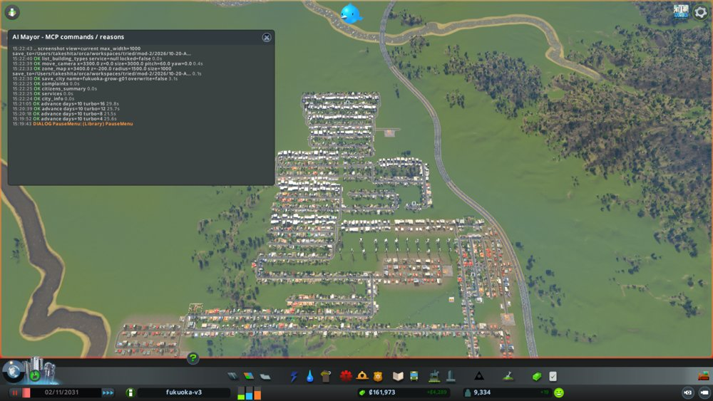
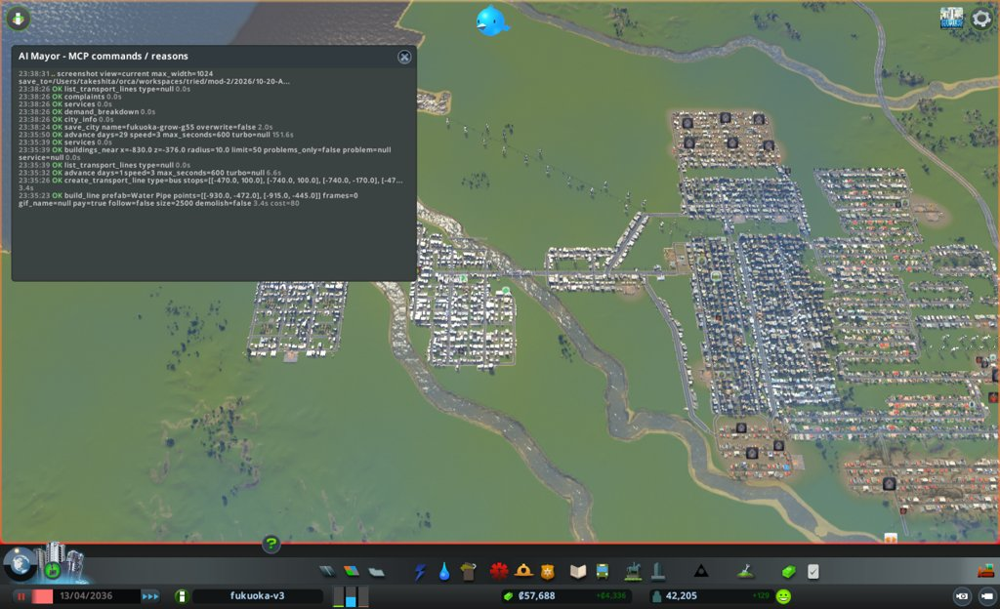
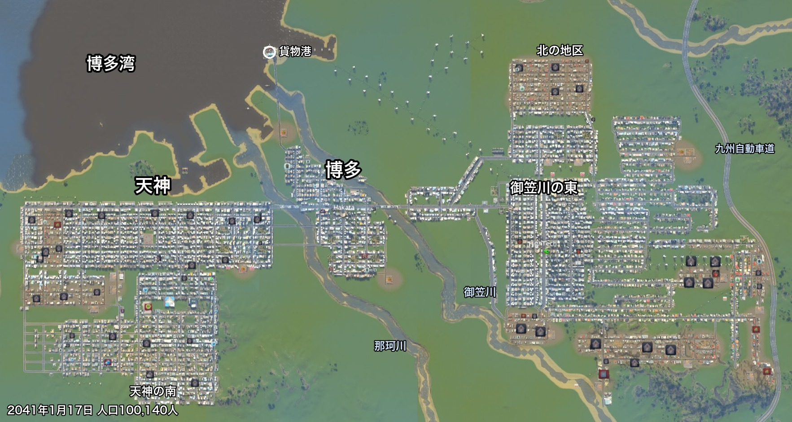
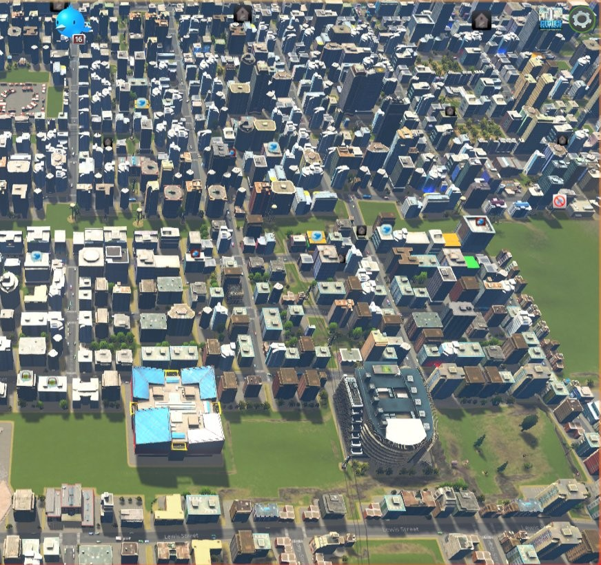
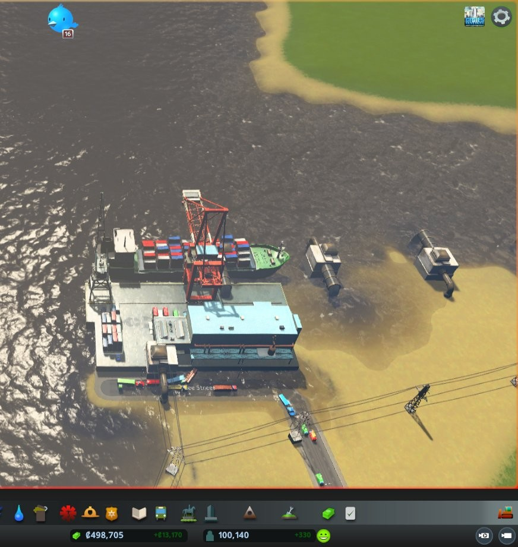
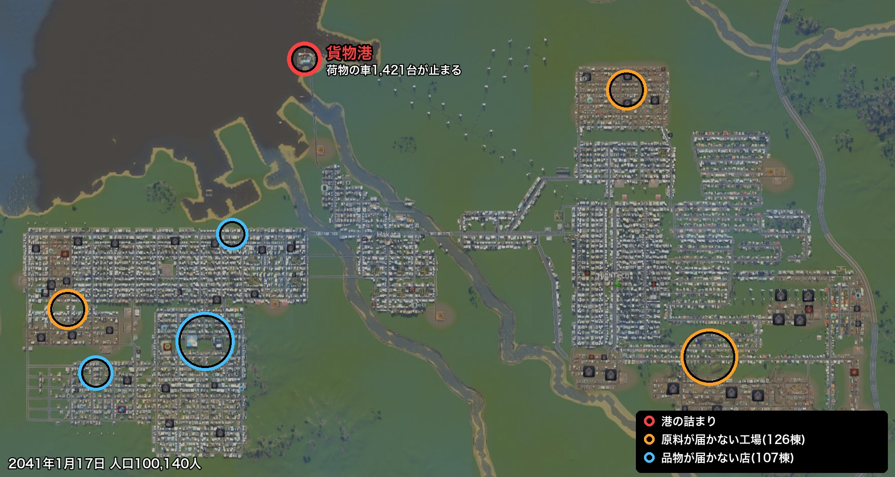

# AI市長で福岡を人口10万人まで育て、3人の市長を用意した

## 序盤では、市長の差が出ない

やってみ太郎です。連載「AIは最高の市長になれるか」の7回目です。

前回は、Claude(AI)に Cities: Skylines(シティーズ・スカイライン)の福岡を12か月任せました。
性格を与えない「基準の市長」です。任期の終わりに、人口は1,801人になっていました。

本当にやりたいのは、この先です。
性格の違う市長に同じ街を任せて、どんな街になるかを見比べたい。

ところが、前回の録画を見返していて、少し不安になりました。
何もない平地から始めると、やることはほぼ決まっています。
道路を引く。住宅の区画を塗る。電気と水を通す。誰が市長でも、最初の1年はこの繰り返しです。
これでは、性格の差が出る前に任期が終わってしまいます。

そこで、方針を変えました。
まず基準の市長に、街を大きく育ててもらう。
課題がたくさん積もった街を作ってから、性格の違う市長に引き継ぐことにしたんです。

## 5年で9,000人

最初は、AI市長がゲームを動かすためのMOD(ゲームに足す改造プログラム)を直しながら、5年を任せました。
前回見つかった穴をふさいだので、その確かめも兼ねています。

5年で、人口は0から9,268人になりました。実時間で4時間43分です。
保存が止まる穴も、命令が遅れて動く穴も、一度も出ませんでした。

ただ、9,000人はまだ小さな町です。
最初の目安は3万人。それを超えたところで、もっと先まで行きたくなりました。
目標を、人口10万人に上げました。

## 家が建たない

3万人を超えたあたりで、街の伸びが止まりました。
住宅の需要(家を建ててほしいという街の声の強さ)が、0のまま動かないんです。

AI市長は、博多に大きな区画を広げました。5,659マスです。
建ったのはオフィスと店ばかりで、家は1軒も建ちませんでした。

ゲームのプログラムを読んで、理由が分かりました。
仕事のない人が、働き口の数の4分の1を超えると、住宅の需要は0から上がらない作りだったんです。
「この街に来ても仕事がない」と、ゲームが判断しているわけです。

失業していたのは、大学を出た人たちでした。
大学卒の人が働けるオフィスが、足りなかったんです。

ここから、AI市長の手探りが続きました。
バスの路線を2本通すと、博多に初めて家が建ちました。0軒から101軒です。
消防署と警察署と診療所を3つそろえて置くと、止まっていたオフィスが一段大きく建て替わりました。
片方だけでは、建て替わりませんでした。3つそろったときだけです。
人口の伸びは、1か月に約1,100人まで倍増しました。

## 寄り道もたくさんあった

順調な月ばかりではありませんでした。

給水塔を、ごみの処理場の近くに置いた月がありました。
汚れた地下水をくみ上げてしまい、体調の悪い市民が644人から1,196人に倍増しました。
AI市長は給水塔を止めて、元に戻しています。

風がぱたりと弱まった月もありました。
風力発電の電気が半分近くに落ち、18,809人の家で電気が止まりました。
AI市長は、石油と石炭の発電所を建てて戻しました。

もう1つ、AI市長の側の変化もありました。
同じAI市長に続けて任せていると、1回の作業がどんどん重くなったんです。
6か月の運営に、実時間で100分。前の回の会話が積もっていくせいでした。
そこで、毎回新しいAI市長を呼び、前の市長が書いた市政ノート(判断の記録)を読ませて引き継ぐ形に変えました。
すると、30分ほどに戻りました。
人間の市長なら交代のたびに引き継ぎ書を読みますが、AI市長は毎回それをやっていることになります。

## 10万人の日

ゲームの中の2041年1月17日に、人口が10万人を超えました。100,140人です。
育て始めてから112か月。ゲームの中で9年あまり、実時間では約12時間かかりました。

西の天神から、川を2本越えて博多、さらに東へ。ゲームの中で東西7kmほどに広がりました。

お金には余裕があります。所持金は約50万で、毎週1万3千ほどの黒字です。
幸福度(市民の満足の目安)も82あります。
数字だけ見ると、よく育った街です。

## 10万人の街の困りごと

でも、中をのぞくと、困りごとが積もっていました。
今回、AI市長に読ませる道具で、改めて数え直しました。

いちばん大きいのは、港でした。
荷物を運ぶトラックが2,682台走っていて、そのうち1,577台が止まっています。
そのうち1,421台が、たった1つの貨物港に詰まっていました。

この写真を撮りに行って、あれ、と思いました。
1,421台も詰まっているなら、車の長い列が見えるはずです。でも、道には数台しか走っていません。
トラックは、港の中で出発を待っている扱いのようでした。数字では大渋滞なのに、画面では静かな港です。
港のすぐ横では、下水の排水口が湾を茶色く濁らせていました。

港が詰まると、何が起きるか。
困りごとのある場所を、地図に丸で囲んでみました。

港は街の北の端に1つだけ。工場は東にも西にもあって、どこも原料を待っています。
困りごとは、1本の鎖のようにつながっていました。

- 港が詰まって、工場に原料が届かない。原料が来ない工場は、放棄されて空き家になる
- 店にも品物が届かない。品物のない店が107軒ある
- 工場が減るぶん、働き口が増えない。6か月ずっと約43,000のまま
- 仕事のない人が約8,800人。ほとんどが大学を出た人
- 仕事がないので、住宅の需要は0。家が建たない

前に博多で見た「家が建たない」が、街全体の規模で戻ってきていたんです。

鎖の外にも、困りごとがあります。
オフィスの8割は、バスなどの公共交通や、葬祭(亡くなった人を送る施設)が足りず、建て替わりが止まっています。
学校の席も、子どもの数に足りていません。

どこから手を付けるか。
ここで市長の性格が出るはずです。

## 3人の市長を作る

最初に考えた市長の案は、穏やかなものでした。
港から直す市長、困っている市民から直す市長、建物の止まりから直す市長。
どれも、街全体を少しずつ良くする市長です。

でも、並べてみると、どの市長も結局は似た手を打ちそうでした。
もっと方針を尖らせたい。たとえば、お金を稼ぐことだけを考えて、住みやすさや環境はそっちのけにする市長。
そう考えて、3人を作り直しました。

**お金市長**は、お金と働き口だけを追います。

- 毎週の黒字を、1万3千から4万にする
- 働き口を、43,000から55,000にする
- お金を減らさない

**人口市長**は、人の数だけを追います。

- 人口を、10万から13万にする
- 住宅の需要を、3か月目から毎月1以上にする
- 人口を毎月増やす

**住みやす市長**は、市民の体と気分だけを追います。

- 幸福度を、82から90にする
- 健康の平均を、70から80にする
- 汚染、騒音、ごみの困りごとを0にする

公約の数字は、10万人の街を実際に測ってから決めました。
最初は住みやす市長に「体調の悪い市民を1%未満にする」と約束させるつもりでした。
測ってみると、もう0.5%しかいませんでした。初日に守れてしまう約束では、意味がありません。

## 「捨てるもの」を書く

公約だけでは、まだ尖りません。
AIは、言われていないことにも気を配りがちだからです。
前回の基準の市長も、公約にない学校や診療所を自分から建てていました。それ自体は良いことでした。
でも今回は、それをされると3人の差が消えてしまいます。

そこで、市長の決まりに「捨てるもの」という欄を足しました。

- お金市長は、幸福度、健康、汚染を捨てる。公園も病院も、お金に効くときだけ建てる
- 人口市長は、黒字の幅、渋滞、汚染を捨てる。お金を借りてもよい
- 住みやす市長は、人口、働き口を捨てる。汚れの元なら、工場も貨物港も取り壊してよい

もう1人、何も捨てない基準の市長にも、同じ10万人の街を任せます。
3人の街に差が出たとき、それが性格のせいなのか、街の成り行きなのかを見分けるためです。

## AIは、本当に捨てられるか

もう1つ、見てみたいことがあります。
AIは「捨てていい」と言われたものを、本当に捨てられるのか。

体調の悪い市民が増えても、お金市長は病院を建てずにいられるでしょうか。
「働き手が病気だと収支に響く」と理由を付けて、建ててしまう気もします。

それを確かめるため、施策(市長が打つ手)のたびに、捨てるものに手を出したかを書かせることにしました。
手を出したなら、その理由も書かせます。
AIの判断の癖を、記録から数えられるようにしておくわけです。

Claude 自身にも、結果の予想を書いてもらいました。

- 最初の一手は、4人とも港か働き口に向かう。差が出るのは2か月目から
- お金市長は、黒字4万には届かない
- 人口市長は、いちばん人を増やす。でも13万には届かず、11万5千くらい
- 住みやす市長は、困りごとを0にできない。家が建つたびに、新しい困りごとが出るから
- 3人とも、1回以上は捨てるものに手を出す。いちばん多いのはお金市長

## 今日の学び

- 比べる実験は、差が出る場所から始める。何もない平地では誰が市長でも同じ手を打つので、課題の積もった10万人の街まで育ててから比べることにした。
- 数字の困りごとと、画面の困りごとは違う。1,421台が詰まった港は、写真では静かな港にしか見えなかった。
- 約束の数字は、測ってから決める。「体調の悪い市民を1%未満に」は、測ると初日に守れていた。
- 性格を尖らせるには、やることだけでなく、やらないことを書く。前回の市長が自分から学校を建てたように、AIは言われていないことにも手を伸ばす。

## 次にやること

次回から、3人と基準の市長に、同じ10万人の福岡を12か月ずつ任せます。
港を直すのか、人を詰め込むのか、工場を壊すのか。
そして、捨てると決めたものを、本当に捨てられるのか。

市長の決まりと比べ方は、リポジトリに置いています。
https://github.com/h-takeshita-henteco-shoji-com/tried/tree/main/code/ai-mayor/mayor
