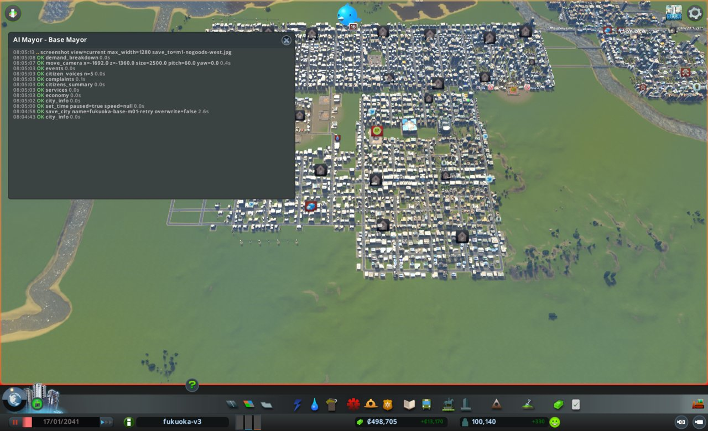

# 市政ノート

## 性格と公約と捨てるもの

- 性格: なし。判断の型(protocol.md)にだけ従う
- 公約:
  1. 人口を毎月増やす(city_info の population、毎月の月例で前の月例より増えていること)
  2. 電気・水・下水が来ない市民をなくす(citizens_summary の数、任期の終わりに0)
  3. 赤字を続けない(city_info の週の収支、毎月の月例で2回続けて赤字にしない)
- 捨てるもの: なし
- 任期: 12か月

## 申し送り(前の運営から)

なし

## 数字の表

| ゲーム内の日付 | 区切り | 人口 | 所持金 | 週の収支 | 幸福度 | 需要(住/商/工) | 失業 | 主な困りごと |
|---|---|---|---|---|---|---|---|---|
| 2041-01-17 | 月例 | 100,140 | 498,704 | +13,170(156,513 − 143,343) | 82 | 0 / 4 / 2 | 8,839 | 品物が届かない店 107、葬祭 14、ごみ 11 |
| 2041-01-27 | 見回り | 100,672 | 463,769 | +11,748 | 82 | 0 / 4 / 2 | − | 放棄の家のつぶやき1件 |
| 2041-02-06 | 見回り | 101,102 | 481,343 | +12,274 | 82 | 0 / 2 / 4 | − | なし |

## 施策の一覧

| ゲーム内の日付 | 区切り | 施策 | 分野 | 公約 | 捨てるもの | 建設費 | 週の維持費の増分 | 答え合わせ |
|---|---|---|---|---|---|---|---|---|
| 2041-01-17 | 月例 | 葬祭を事務所街に届ける(火葬場2か所) | 働き口 | 1 | なし | 50,000 | 1,440 | |
| 2041-01-17 | 月例 | 中心の西の空きマスを事務所の区画にする(水道管を含む) | 働き口 | 1 | なし | 1,600 | 小(管 約0.6km) | |

## 判断の記録

### 2041-01-17 月例(1か月目)

保存: fukuoka-base-m01-retry(2041-01-17)

#### 答え合わせ

なし(初回)

- 公約の進み具合
  1. 人口: 100,140 / 次の月例で上回ること / 住宅の需要が0のため、何もしなければ横ばい
  2. 電気・水・下水が来ない市民: 0 / 0 / 0。任期の終わりまで0を保つ
  3. 週の収支: +13,170 / 黒字 / 届いている

#### 気づいたこと

- 住宅の需要が0。demand_breakdown では jobTerm −39(失業 9,285 − 空いた働き口 786)と homeTerm −11(空き家 1,600)。人口を増やすには働き口が要る
- 失業 8,839 人のうち 8,315 人が大学卒。働き口は 43,075 で働き手 42,267。働く場所の需要の target は 89
- 事務所 1,443 棟のうち 1,182 棟がサービスでレベルが止まる。足りない項目は公共交通 583、葬祭 301。葬祭の届き具合は、中心(x −100〜800、z −200〜−1,100)と南西(x −2,800〜−1,000、z −1,300〜−1,750)で0
- 中心の西(x −370〜−70、z −320〜90)に、道路沿いの区画にしていないマスが554ある

#### 施策

1. 葬祭を事務所街に届ける(火葬場を2か所)
   - 公約: 1(事務所のレベルが上がると働き口が増え、jobTerm が上がる)
   - 捨てるもの: なし
   - 理由: 事務所 301 棟が葬祭で止まる。棟 794 はサービス 82/90 点で、葬祭が 2/20 点
   - 予想: 次の月例までに、中心と南西の事務所で limitedBy_services が減り、レベル3の棟が増える。葬祭の困りごと 14 棟が減る
   - 操作: place_building Crematory (255, −549) 北向き / 南西に1か所
   - 結果(1か所目): 置けた。id 27368、建設費 25,000、入口は Basic Road に接続。区画の建物3棟(8486、31428、35625)が取り壊された
   - 型から外れたこと: 1か所目は explain とノートの記入より先に置いた。取り壊しが出ることも確かめなかった。2か所目からは型の順に戻す
   - 結果(2か所目): place_building Crematory (−1660, −1675) 東向き。置けた。id 36657、建設費 25,000、入口は Basic Road に接続、取り壊し0
   - 維持費の見積もり: 720 × 2 = 週 1,440(黒字 13,170 の範囲)

2. 中心の西の空きマスを事務所の区画にする
   - 公約: 1(働き口を増やし、jobTerm を上げる)
   - 捨てるもの: なし
   - 理由: 大卒の失業 8,315 人。事務所は大卒の働き口になる。道路沿いの未指定の空きマスが 554 あり、道路を引かずに済む
   - 予想: 次の月例までに、この範囲に事務所が 20 棟ほど建ち、働き口が 150〜250 増える。区画の建物は1か月に約25〜30棟が上限のため、全部は埋まらない
   - 操作: zone_rect office x −370〜−70、z −320〜90
   - 結果: changedCells 585、skippedOccupied 61。zones_at(−220, −110, 半径220)で Office 554 マス(空き554)
   - 確かめで分かったこと: このマスには水と下水が来ていなかった(water_trace で cell が false、いちばん近い管が165m)。区画にされずに残っていた理由と見る
   - 追加の操作: build_line Water Pipe (−385, −85)→(−70, −85) と (−385, −265)→(−70, −265)。各800、計1,600。始点は既存の管につながった
   - 確かめ: advance(1) の後、water_trace(−220, −110) で cell の水・下水が true
   - 電気: 空き地には届いていない(map_layer electricity_service がほぼ0)。西の建物の列(x −372)には届く。建物が建てば隣から電気が伝わると見て、送電線は引かない。見回りで zone_map の赤い枠を確かめる

#### 考えたが打たなかった手

- 中心の事務所街に高校を置く: 事務所の高校の点が0/14で、10代16,097人に高校の席13,000。火葬場の効き目と混ざって答え合わせができなくなるため、来月に回す
- 大学を足す: 失業の大半はすでに大卒で、大学に戻らない。失業は減らないと見て見送る
- 公共交通(バスの路線)で事務所のレベルを上げる: 583棟が公共交通で止まるが、どの路線をどこに足すかを調べきれていない。来月に調べる
- 品物が届かない店 107 棟(南西 −1,693, −1,360): 公約に直接つながらない。悪化したら見る
- 満杯の埋立地4つ(4946、11708、12700、43004): ごみの容量は 89M/136M で余る。ごみの困りごと11棟。見送る
- 税を動かす: 住宅の需要0の原因は失業で、税ではない。黒字も保てているので動かさない

#### 次にやること

- 事務所のレベル(building_stats の OfficeGeneric の levels と limitedBy_services)と葬祭の地図を見て、火葬場の効き目を確かめる
- 新しい事務所の区画(−220, −110)に建った棟の数と、電気・水が来ているか(赤い枠)を確かめる
- 効き目が見えたら、高校か公共交通で事務所のレベルをさらに上げる

#### 画面写真

### 2041-01-27 見回り

確かめの advance(1) で1日進めたため、1回目は advance(9) にして、月例の間を30日に保った。

境目: 当たらず。人口 100,672、所持金 463,769、週の収支 +11,748、幸福度 82、来ない市民 0/0/0。つぶやきは放棄の家1件。
新しい事務所の区画には1棟が建ち、赤い枠はなし。働く場所の需要は2のまま。

### 2041-02-06 見回り

境目: 当たらず。人口 101,102、所持金 481,343、週の収支 +12,274、幸福度 82、来ない市民 0/0/0。つぶやきは学校の表彰1件。

### 2041-02-16 1か月目の終わり(次の月例の材料)

3回目の advance(10) の後に見た事実だけを書く。答え合わせは次の月例で行う。

- city_info: 人口 101,450、所持金 499,389、週の収支 +12,554(157,921 − 145,367)、幸福度 82、需要 0/4/4、来ない市民 0/0/0、ダイアログなし
- building_stats の事務所: 1,457 棟、レベル3 が 118 → 148、働き口 12,418 → 12,697。limitedBy_services の葬祭 301 → 204、公共交通 583 → 643
- zones_at(−220, −110): 事務所 554 マスのうち建った 48 マス(空き 506)

## 人が手を入れたこと

- 人が fukuoka-base-m01(2041-01-17、人口 100,140)を読み込み、一時停止した状態で渡した。この運営は m01 のやり直し(m01-retry)
- 2026-10-22 08:04(実時間): ゲームを起動し直し、画面の録画を始めた。親がパネルの見出しを `AI Mayor - Base Mayor` に戻した
- 定点の写真は撮っていない。出発点が1回目と同じため、`../assets/fixed/m01-*.jpg` を使う

### 実時間とトークン

| 月 | 実時間 | トークン | 道具の呼び出し |
|---|---|---|---|
| 1(2回目) | 11分38秒 | 122,327 | 84 |

## 公約の結果

(任期の終わりに書く)

## 次の市長への申し送り

(運営の終わりに書く)

