# 市政ノート

## 性格と公約と捨てるもの

市長の定義から写した。任期中は書き換えない。

- 性格: なし。判断の型(`protocol.md`)にだけ従う
- 公約:
  1. 人口を毎月増やす(`city_info` の population。毎月の月例で、前の月例より増えていること)
  2. 電気・水・下水が来ない市民をなくす(`citizens_summary` の電気・水・下水が来ない市民の数。任期の終わりに0)
  3. 赤字を続けない(`city_info` の週の収支。毎月の月例で、2回続けて赤字にしない)
- 捨てるもの: なし
- 任期: 12か月(段階6、`compare.md`)

## 申し送り(前の運営から)

なし

## 数字の表

月例と見回りのたびに1行足す。区切りは 月例・見回り・臨時。

| ゲーム内の日付 | 区切り | 人口 | 所持金 | 週の収支 | 幸福度 | 需要(住/商/工) | 失業 | 主な困りごと |
|---|---|---|---|---|---|---|---|---|
| 2041-01-17 | 月例 | 100,140 | 498,704 | +13,170 | 82 | 0 / 4 / 2 | 8,839 | NoGoods 107棟、埋立地の満杯4 |
| 2041-01-27 | 見回り | 100,587 | 458,659 | +10,465 | 82 | 0 / 6 / 4 | (9,557※) | 死体の回収のつぶやき1件 |
| 2041-02-06 | 見回り | 101,024 | 474,796 | +11,328 | 82 | 0 / 6 / 4 | | つぶやきなし |
| 2041-02-16 | 月例 | 101,445 | 491,583 | +11,790 | 82 | 0 / 5 / 4 | 9,439 | NoGoods 133棟、埋立地の満杯6 |
| 2041-02-26 | 見回り | 101,837 | 509,336 | +12,401 | 82 | 0 / 6 / 4 | | つぶやき1件(汚染) |
| 2041-03-08 | 見回り | 102,279 | 526,307 | +12,389 | 82 | 0 / 5 / 4 | | つぶやき1件(騒音) |
| 2041-03-18 | 月例 | 102,514 | 544,441 | +12,585 | 82 | 0 / 12 / 4 | 9,796 | NoGoods 140棟、埋立地の満杯6 |
| 2041-03-28 | 見回り | 102,929 | 559,863 | +12,223 | 82 | 0 / 8 / 2 | | つぶやき1件(警察の冗談) |
| 2041-04-07 | 見回り | 103,196 | 577,717 | +12,364 | 82 | 0 / 2 / 5 | | つぶやき1件(スマートホーム) |
| 2041-04-17 | 月例 | 103,530 | 595,957 | +12,697 | 82 | 0 / 3 / 2 | 10,329 | NoGoods 173棟、死体17棟、埋立地の満杯6 |
| 2041-04-27 | 見回り | 103,738 | 582,748 | +11,712 | 82 | 0 / 2 / 2 | | つぶやき1件(水道) |
| 2041-05-07 | 見回り | 104,124 | 600,473 | +12,401 | 82 | 0 / 5 / 2 | | つぶやき2件(学校、朝日) |
| 2041-05-17 | 月例 | 104,455 | 618,574 | +12,582 | 82 | 0 / 4 / 4 | 10,646 | NoGoods 206棟、ごみ41棟、埋立地の満杯6 |
| 2041-05-27 | 見回り | 104,702 | 533,287 | +8,968 | 82 | 0 / 2 / 2 | | つぶやき2件(賞) |
| 2041-06-06 | 見回り | 104,907 | 547,438 | +9,944 | 82 | 0 / 6 / 2 | | つぶやき1件(死体) |
| 2041-06-16 | 月例 | 105,206 | 562,862 | +10,932 | 82 | 0 / 2 / 2 | 10,926 | NoGoods 229棟、ごみ40棟、死体10棟、埋立地の満杯6 |
| 2041-06-26 | 見回り | | | +15,013 | | | | つぶやき2件(放棄、学校の賞) |
| 2041-07-06 | 見回り | | | +15,087 | | | | つぶやき1件(汚染) |
| 2041-07-16 | 月例 | 106,095 | 620,373 | +14,550 | 81 | 0 / 2 / 6 | 11,048 | NoGoods 256棟、ごみ35棟、死体10棟、埋立地の満杯6 |
| 2041-07-26 | 見回り | 106,322 | 634,960 | +14,178 | 82 | 0 / 2 / 2 | | つぶやき2件(騒音、学校の賞) |
| 2041-08-05 | 見回り | 106,545 | 654,087 | +13,781 | 82 | 0 / 2 / 4 | | つぶやき2件(スマートホーム、騒音) |
| 2041-08-15 | 月例 | 106,789 | 673,319 | +13,293 | 82 | 0 / 2 / 4 | 11,233 | NoGoods 307棟、原料なし113棟、ごみ14棟、埋立地の満杯6 |
| 2041-08-25 | 見回り | 106,946 | 688,936 | +13,197 | 82 | 0 / 4 / 4 | | つぶやき2件(学校の賞、消臭剤) |
| 2041-09-04 | 見回り | 106,998 | 707,872 | +13,106 | 81 | 0 / 2 / 4 | | つぶやき1件(植木の水やり) |
| 2041-09-14 | 月例 | 107,086 | 726,693 | +13,017 | 81 | 0 / 2 / 3 | 11,661 | NoGoods 382棟、原料なし124棟、ごみ32棟、埋立地の満杯6 |
| 2041-09-24 | 見回り | 107,098 | 737,768 | +13,326 | 81 | 0 / 2 / 6 | | つぶやき1件(ごみ収集車) |
| 2041-10-04 | 見回り | 107,110 | 756,736 | +13,292 | 81 | 0 / 2 / 5 | | つぶやき2件(水道管、学校の賞) |
| 2041-10-14 | 月例 | 107,114 | 774,494 | +12,935 | 81 | 0 / 2 / 2 | 12,114 | NoGoods 442棟、ごみ32棟、死体7棟、埋立地の満杯6 |
| 2041-10-24 | 見回り | 107,095 | 792,274 | +12,406 | 81 | 0 / 2 / 4 | | つぶやき2件(朝日、スマートホーム) |
| 2041-11-03 | 見回り | 106,747 | 809,611 | +12,044 | 81 | 0 / 2 / 2 | | つぶやき1件(魅力的な街の賞) |
| 2041-11-13 | 月例 | 106,680 | 826,686 | +12,008 | 81 | 0 / 2 / 4 | 13,243 | NoGoods 473棟、原料なし151棟、ごみ18棟、騒音18棟、埋立地の満杯6 |
| 2041-11-23 | 見回り | 106,454 | 800,683 | +9,902 | 83 | 0 / 2 / 2 | | つぶやき1件(死体の回収) |
| 2041-12-03 | 見回り | 106,648 | 816,136 | +10,775 | 83 | 0 / 2 / 4 | | つぶやき2件(放棄、学校の賞) |
| 2041-12-13 | 月例 | 106,755 | 832,012 | +11,029 | 83 | 0 / 2 / 2 | 14,012 | NoGoods 526棟、水2棟、埋立地の満杯8 |
| 2041-12-23 | 見回り | 106,852 | 846,670 | +11,529 | 83 | 0 / 2 / 4 | | つぶやきなし |
| 2042-01-02 | 見回り | 106,921 | 864,142 | +11,677 | 83 | 0 / 2 / 2 | | つぶやき2件(騒音と木、学校の賞) |
| 2042-01-12 | 任期の終わり | 106,966 | 880,072 | +11,654 | 83 | 0 / 2 / 2 | 14,847 | NoGoods 552棟、死体6棟、水1棟 |

## 施策の一覧

施策を打つたびに1行足す(臨時も含む)。答え合わせの列は、翌月の月例で埋める。
分野は、港・働き口・住宅・暮らし・環境・財政から1つ選ぶ。

| ゲーム内の日付 | 区切り | 施策 | 分野 | 公約 | 捨てるもの | 建設費 | 週の維持費の増分 | 答え合わせ |
|---|---|---|---|---|---|---|---|---|
| 2041-01-17 | 月例 | 焼却場を中心部に建てる | 環境 | 2・1 | なし | 30,000 | 1,440 | 当たり。ごみの困りごと11→5棟。ただし満杯の埋立地は4→6 |
| 2041-01-17 | 月例 | 火葬場を南のオフィス街に建てる | 暮らし | 1 | なし | 25,000 | 720 | 当たり。死体の困りごと14→6棟、オフィスの葬祭の制約301→187棟 |
| 2041-02-16 | 月例 | オフィス街にバス路線を2本通す(東部、中心の南) | 働き口 | 1 | なし | 0 | 約200(見込み) | 半分当たり。公共交通の制約631→568棟(予想は500以下)。働き口12,612→12,903。東部の line 35 は16.96km・乗客3で、東部の181棟はまだ公共交通で止まる |
| 2041-02-16 | 月例 | 放棄された建物108棟を取り壊す | 働き口 | 1 | なし | 0 | 0 | 外れ。建て直しは進んだ(商業31、工業23、オフィス15棟)が、10日余りで71棟が再び放棄。品物と原料が届かない根(港の詰まり)が残る |
| 2041-03-18 | 月例 | 港の出口に2本目の道路を引く(Harbor Road の行き止まりから南の4車線へ) | 港 | 1 | なし | 2,240 | 約8 | 外れ。止まったトラック1,374→1,348台、NoGoods 140→173棟。詰まりは港の敷地の中 |
| 2041-03-18 | 月例 | 東部のオフィスの環状の街区にバス路線を通す(line 189) | 働き口 | 1 | なし | 0 | 100未満(見込み) | 外れ。環状の街区の届き具合は0→73〜100に上がったが、東部の制約は181→190棟 |
| 2041-04-17 | 月例 | 北の街区(1880, 950)に火葬場を建てる | 暮らし | 1 | なし | 30,000(移設5,000を含む) | 720 | 半分当たり。死体17→7棟。オフィスの葬祭の制約206→202棟(予想は190以下) |
| 2041-04-17 | 月例 | 東部の z=−530 と z=−620 の街区にバス路線を通す(line 114) | 働き口 | 1 | なし | 0 | 100未満(見込み) | 外れ。東部の公共交通の制約190→186棟(予想は170以下)。乗客0 |
| 2041-05-17 | 月例 | 南西の住宅街の南に焼却場を建てる | 環境 | 1・2 | なし | 30,560 | 1,440 | 半分当たり。南西(半径700)のごみの困りごとは0棟。街全体は41→40棟で、中心が南東の工業地へ移った(予想は15棟以下) |
| 2041-05-17 | 月例 | 2つ目の荷物の港を北の水路の北岸に置く | 港 | 1 | なし | 67,020 | 約1,970 | 外れ。30日で出入り0台。止まったトラック1,332→1,286台、NoGoods 206→229棟 |
| 2041-06-16 | 月例 | 荷物の港2か所を止め、輸入を道路に切り替える | 港 | 1・3 | なし | 0 | 約−3,900(見込み) | 半分当たり。支出は3,598減り、流れは64%を保った。止まったトラックは1,119台(港の中983台)、NoGoods 229→256棟で外れ |
| 2041-06-16 | 月例 | 南東の工業地に埋立地を足す | 環境 | 1・2 | なし | 6,580 | 160 | 半分当たり。南東は16→0棟。街全体は40→35棟(予想は20棟以下)。中心が南西へ戻った |
| 2041-07-16 | 月例 | 止めた荷物の港 43449 を取り壊す | 港 | 1 | なし | 0 | 0 | 半分当たり。止まったトラック1,119→87台、流れ66%。NoGoods 256→307棟で外れ。品物の輸入トラックは178台で増えない |
| 2041-07-16 | 月例 | 南西の焼却場の南に埋立地を足す | 環境 | 1・2 | なし | 5,920 | 160 | 当たり。ごみの困りごと35→14棟。南西の中心は消えた |
| 2041-08-15 | 月例 | 中心と東の間の川に2本目の道を架ける(z=−80 を東へ延ばし、前後を4車線に) | 働き口 | 1 | なし | 3,420 | 約10 | 半分当たり。(1079, 92) の止まった車26台→消えた。流れ66%のまま(予想68%以上)。NoGoods 307→382棟で外れ。品物の輸入トラック178→179台 |
| 2041-09-14 | 月例 | 原料の届かない工業地2か所(西部・北)の放棄46棟を壊し、跡をオフィスの区画にする | 働き口 | 1 | なし | 0 | 0 | 半分当たり。オフィスの働き口13,356→13,454。原料なし124→122棟(予想105以下)、放棄の工業55→41棟(予想40以下)で外れ |
| 2041-09-14 | 月例 | 東部の満杯と98%の埋立地2か所(4946、10533)を同じ場所に置き直す | 環境 | 1・2 | なし | 8,000 | 0 | 半分当たり。東部のごみの印13→0棟。街全体は32→32棟(予想15以下)で、中心が西部の工業地へ移った |
| 2041-10-14 | 月例 | 南東の工業地の放棄8棟を壊し、空いた工業のマス288をオフィスの区画にする | 働き口 | 1 | なし | 0 | 0 | 外れ。原料なし122→151棟(南東45→47)、放棄の工業41→52棟。月に建ったオフィスは23棟(予想25以上) |
| 2041-10-14 | 月例 | 南東の z=−950 の通りの2車線の3区間を4車線にする(失敗、差し替え0) | 働き口 | 1 | なし | 0 | 0 | 打てず。止まった車は手を入れずに124→28台に減った |
| 2041-11-13 | 月例 | 南西のオフィス街の南に火葬場を建て、管を引く | 働き口 | 1 | なし | 30,460(移設5,000、管460を含む) | 720 | 半分当たり。南西のオフィスの葬祭の制約65→20棟。TooFewServices 5→2棟(予想0)。レベルはまだ上がらない |
| 2041-11-13 | 月例 | 西部の住宅地の放棄された店1棟の跡に診療所を建てる | 暮らし | 1 | なし | 10,000 | 400 | 当たり。(-1560, −450) の医療の届き具合0〜5→平均99。病気1,303→1,200人 |
| 2041-12-13 | 月例 | 水と下水の来ない建物2棟(オフィス4106、店29491)に管をつなぐ | 暮らし | 2・1 | なし | 1,040 | 10未満 | 半分当たり。2棟とも grid の水・下水が true になった。水の印は2→1棟(予想0)。29491 は管が来た後も30日 FatalProblem の印が残る |

## 判断の記録

### 2041-01-17 月例(1か月目)

保存: `fukuoka-base-m01`(2041-01-17、21.8MB)

#### 答え合わせ

なし(初回)

- 公約の進み具合
  1. 人口: 100,140。次の月例で増えているかを見る。住宅の需要が0なので、届くかは怪しい
  2. 電気・水・下水が来ない市民: 0 / 0 / 0。任期の終わりまで0を保つ
  3. 週の収支: +13,170(収入156,513、支出143,343)。黒字

#### 気づいたこと

- 住宅の需要が0。`demand_breakdown` では jobTerm −39(失業9,285、空いた働き口786)、homeTerm −11(空き家1,600)。失業の9割超(8,611)が大卒。働き口が増えないと人口は増えにくい
- 働く場所の需要は target 89 に対して actual 2。オフィスの空きマスは1,588ある。区画を足しても今は建たない。オフィスのレベル上げは、公共交通(583棟)と葬祭(301棟)の届き具合で止まっている
- ごみの埋立地17か所のうち4か所が満杯(4946、11708、12700、43004)、2か所が97〜99%。満杯の3か所は中心部にあり、ごみの困りごとの中心(134, 65)に近い
- 荷物の港(-400, 1555)に止まったトラックが1,421台。出口の Harbor Road の混み具合が100。品物が届かない店107棟、原料が届かない工場126棟。港の出口は建物の一部で、手を入れにくい

#### 施策

1. 中心部に焼却場(Combustion Plant)を建てる
   - 公約: 2(暮らしの土台。ごみが積もると放棄・病気につながる)と1(放棄で家が減るのを防ぐ)。直接の公約はないため、理由を添える
   - 捨てるもの: なし
   - 理由: 中心部の埋立地3か所が満杯で、中心のごみの困りごとが11棟ある。埋立地は残り47M分の空きしかなく、今後も満ちていく
   - 予想: 次の月例(2041-02-16ごろ)までに、ごみの困りごとが11棟から5棟以下になる。週の支出が約1,440増える
   - 操作: `place_building("Combustion Plant", x=-300, z=-56, facing=south)`。水・下水が届かなければ、x=-385 の水道管から道路沿いに管を引く
   - 結果: 成功。id 27368、建設費30,000。入口は Small 4 Lane Road(区間32275)に面した。取り壊した建物0
   - 確かめ: `water_trace` で水・下水とも届いている(最寄りの管85m)。電気は要らない。管は引かなかった
2. 中心の南のオフィス街に火葬場(Crematory)を建てる
   - 公約: 1(オフィスのレベル上げで働き口を増やし、失業を減らして住宅の需要を戻す)
   - 捨てるもの: なし
   - 理由: オフィス301棟が葬祭の届き具合でレベル上げが止まっている。死体の困りごと14棟の中心は(430, -265)で、近くに火葬場がない
   - 予想: 次の月例までに、死体の困りごとが14棟から7棟以下になる。オフィスのレベル上げの葬祭の制約(301棟)が減る。週の支出が約720増える
   - 操作: `place_building("Crematory", x=722, z=-330, facing=west)`
   - 結果: 成功。id 26233、建設費25,000。入口は Basic Road(区間35947)に面した。取り壊した建物0
   - 確かめ: `water_trace` で電気・水・下水とも届いている

#### 考えたが打たなかった手

- オフィスの区画を足す: 空いたオフィスのマスが1,588あり、需要(actual 2)が低いので建たない
- 満杯の埋立地を空にする(`empty_building`): 中身がほかの埋立地へ移るだけで、全体の空きは増えない。焼却場の効き目を見てから考える
- 荷物の港の出口を直す: 詰まっているのは建物の一部の Harbor Road。外の道路(混み具合30)は詰まっていない。手の打ち方が分からないので、来月もう一度調べる
- 公共交通を広げてオフィスのレベル上げを助ける(583棟): 路線の設計に手間がかかり、効き目の予想が立たない。来月以降に回す
- 税を動かす: 黒字で、住宅の需要は税ではなく失業で止まっている。動かす理由がない
- 3件目の施策: 打たなかった。失業が住宅の需要を止めており、働く場所の需要(actual 2、target 89)が上がるかを見回りで見てから決める

#### 次にやること

- 見回りで、働く場所の需要の actual が target 89 へ上がっているかを見る(`demand_breakdown`)
- 焼却場が動いているか(`buildings_near` の stats)を次の月例で見る
- 荷物の港の詰まりを、次の月例でもう一度調べる(`cargo`)

#### 画面写真

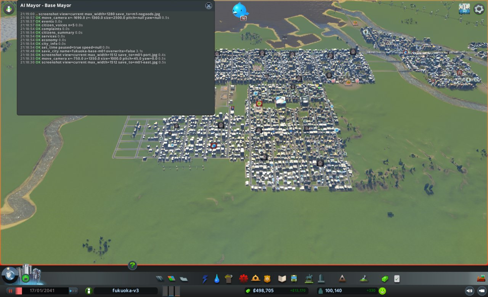
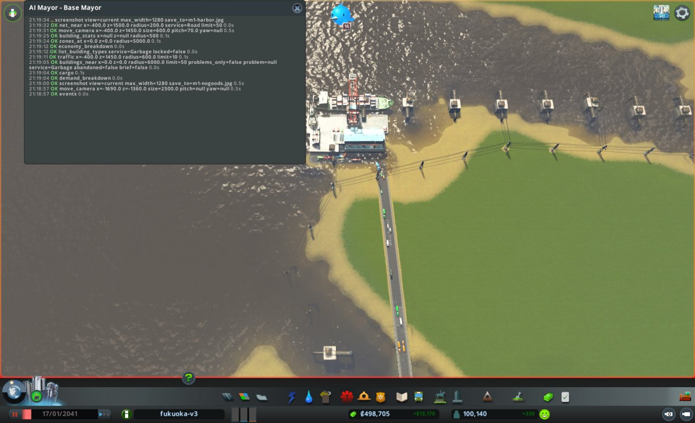

### 2041-01-27 見回り

境目: 当たらず。電気・水・下水が来ない市民は 0 / 0 / 0。つぶやきは焼却場をほめる声1件、死体の回収1件

- ※失業の欄は `demand_breakdown` の unemployed(数え方が `citizens_summary` と違う)
- 働く場所の需要は actual 4、target 90。10日でほとんど上がっていない。読み込み直後の遅れではなさそう

### 2041-02-06 見回り

境目: 当たらず。電気・水・下水が来ない市民は 0 / 0 / 0。つぶやきなし。人口は前回より437人増えた

### 2041-02-16 1か月目の区切り(次の月例の前)

`advance(10)` の後、2か月目の月例に渡すために事実だけを残す。数字の表の行は2か月目の月例で足す。

- `city_info`: 人口101,445、所持金491,583、週の収支 +11,790(収入158,303、支出146,513)、幸福度82、需要 0 / 5 / 4、来ない市民 0 / 0 / 0
- 焼却場 27368: ごみの蓄え95,310 / 400,000(23%)、処理 22,560 / 週、発電5MW、収集車 32 / 34 が稼働

### 2041-02-16 月例(2か月目)

保存: `fukuoka-base-m02`(2041-02-16、21.5MB)

#### 答え合わせ

- 焼却場(公約2・1): 予想「ごみの困りごと11棟→5棟以下」。結果は街全体で5棟(hotspot は西部 -2320, -1304 に1棟)。当たり。中心部の困りごとは消えた。一方、満杯の埋立地は4→6か所(39056、40118 が加わった)。焼却場が週22,560を処理しても、埋立地の満ちる流れは止まっていない。施策は続ける(建物なので戻さない)
- 火葬場(公約1): 予想「死体の困りごと14棟→7棟以下、オフィスの葬祭の制約301棟が減る」。結果は死体の困りごと6棟、オフィスの葬祭の制約187棟。当たり。週の支出は前回の月例から+3,170(143,343→146,513)で、2施設の見積もり2,160より大きい。差は街の育ちの分と見る
- 次にやることの実行
  - 働く場所の需要の actual: 見回りで見た。2→4→4。target 92 のまま上がらない。実行した
  - 焼却場の稼働: 1か月目の区切りで stats を見た。実行した
  - 荷物の港の詰まり: `cargo` で再調査した。止まったトラック1,584台(前回1,421)、港の出口付近に1,436台。悪化。手は打てていない
- 公約の進み具合
  1. 人口: 100,140 → 101,445(+1,305)。守れた。残り11回
  2. 電気・水・下水が来ない市民: 0 / 0 / 0。任期の終わりまで保つ
  3. 週の収支: +11,790。黒字。前月 +13,170 から1,380減った

#### 気づいたこと

- 住宅の需要は0のまま。jobTerm −42(失業9,884、空いた働き口839)、homeTerm −10。失業の94%(9,245)が大卒
- オフィスのレベル上げの止まり方(1,458棟): 公共交通631、葬祭187、地面の汚染184、娯楽152。公共交通がいちばん大きい
  - 東部(2500〜4500, −1500〜500)のオフィス225棟のうち191棟が公共交通で止まっている。z=−250 の通りと z=330〜60 の街区に路線がない
  - 中心の南(0〜700, −100〜−550)のオフィス232棟のうち105棟が公共交通。z=−350 より南は届き具合が0〜48
- 放棄された建物: 高密度商業42棟、工業61棟。市民のつぶやきにも放棄の家への不満が1件
- 工業のレベル上げは荷物の運送(cargoTransport)で485棟止まっている。港の詰まりと同じ根
- バスの維持費は、およそ255台で週3,318。1台あたり約13

#### 施策

1. オフィス街にバス路線を2本通す(東部と中心の南)
   - 公約: 1(オフィスのレベル上げで大卒の働き口を増やし、失業を減らして住宅の需要を戻す)
   - 捨てるもの: なし
   - 理由: オフィスのレベル上げを止める最大の項目が公共交通(631棟)。東部191棟、中心の南105棟が路線の外にある
   - 予想: 次の月例までに、オフィスの公共交通の制約が631棟から500棟以下になる。オフィスの働き口が12,612から増える。週の支出の増分は約200(バス15台前後)
   - 操作: `create_transport_line("bus")` を2本。東部は z=330 → x=3185 → z=−250 の通り。中心の南は z=−350、−440、−530 の通り
2. 放棄された建物を取り壊す
   - 公約: 1(区画を空けて建て直しを促し、働き口を戻す)
   - 捨てるもの: なし
   - 理由: 放棄が103棟(商業42、工業61)ある。放棄は地価を下げ、建て替わらない
   - 予想: 放棄が0棟近くになり、次の月例までに空いた区画に建て直しが始まる。費用0
   - 操作: `bulldoze(what="abandoned")` を街全体にかける
   - 結果: 成功。中心(800, 0)、半径4,500で108棟を取り壊した。工業・商業のほか、焼けた住宅(2134 など)も含む。払い戻しなし
1の結果: 成功。東部は line 35(番号22)、停留所8。2つ目の停留所は (3145, 64) の z=60 の通りに付いた。中心の南は line 57(番号23)、停留所8。どちらも道順は数日かけて計算される。費用0、台数は次の見回りで見る

#### 考えたが打たなかった手

- 荷物の港の詰まりを直す: 止まったトラックが1,584台に増えた。港の出口は建物の一部で、外の道路は詰まっていない。直し方の見当が立たないので見送る
- 荷物の鉄道の駅を工業地に建てる(工業の cargoTransport 485棟): 外への線路がなく、引くと費用と維持費が大きい。来月、線路の要否を調べてから決める
- 満杯の埋立地6か所を空にする: 全体の空きは増えない。ごみの困りごとは5棟と少ない
- 税と予算: 黒字で、人口を止めているのは失業。動かす理由がない
- 3件目の施策: 打たなかった。バス路線の効き目を、オフィスの公共交通の制約の数で切り分けて見たいため

#### 次にやること

- 見回りで、新しいバス路線2本(line 35、57)の pathFailed と台数を見る
- 次の月例で、オフィスの公共交通の制約(631棟)と働き口(12,612)を `building_stats` で比べる
- 次の月例で、取り壊した跡に建て直しが進んだかを `new_buildings`(since=41327)で見る
- 荷物の鉄道の駅を置けるか(外への線路のつなぎ口)を調べる

### 2041-02-26 見回り

境目: 当たらず。電気・水・下水が来ない市民は 0 / 0 / 0。つぶやきは1件(庭から光る樽、汚染の話)

- 新しいバス路線: line 35(東部)は道順が見つかったが、長さ16.96km、22 / 29台。停留所の間の遠回りが2.8〜12.8倍で、直線なら約4kmのはず。停留所が通りの逆側に付き、回り込んでいると見る。line 57(中心の南)は3.5km、6 / 6台。どちらも pathFailed 0、乗客はまだ0
- 次の月例で line 35 の停留所を置き直すか、台数の割合を下げるかを決める(維持費は29台で週約380の見込み)

### 2041-03-08 見回り

境目: 当たらず。電気・水・下水が来ない市民は 0 / 0 / 0。つぶやきは1件(木で交通の騒音を減らす話)。人口は前回より442人増えた

### 2041-03-18 2か月目の区切り(次の月例の前)

`advance(10)` の後、3か月目の月例に渡すために事実だけを残す。数字の表の行は3か月目の月例で足す。

- `city_info`: 人口102,514、所持金544,441、週の収支 +12,585(収入159,459、支出146,874)、幸福度82、需要 0 / 12 / 4、来ない市民 0 / 0 / 0
- `building_stats`(街全体): オフィス1,472棟、働き口12,903(月例は12,612)。公共交通の制約568棟(月例は631)、葬祭205、地面の汚染190、娯楽153
- 放棄: 高密度商業41棟、工業30棟。月例で108棟を壊したが、10日余りで71棟がまた放棄になった
- `new_buildings`(since=41327、次は index 41683): 高密度商業31、工業23、オフィス15
- バス: line 35 は29 / 29台、16.96km、乗客3。line 57 は6 / 6台、乗客0

### 2041-03-18 月例(3か月目)

保存: `fukuoka-base-m03`(2041-03-18、21.7MB)

#### 答え合わせ

- バス路線2本(公約1): 予想「オフィスの公共交通の制約631棟→500棟以下、働き口が増える」。結果は568棟、働き口12,903(+291)。半分当たり
  - 外れた理由の見立て: 東部の line 35 は停留所の間が2.8〜12.8倍の遠回りで、停留所が袋小路の多い街区の外側に付いた。東部の環状の街区(3420〜3800, 100〜260)は届き具合0のまま
  - 次の扱い: 続ける。届いていない環状の街区は、別の短い路線で補う
- 放棄の取り壊し(公約1): 予想「放棄が0近くになり、建て直しが始まる」。結果は建て直し69棟が進んだが、10日余りで71棟(商業41、工業30)がまた放棄になった。外れ
  - 外れた理由の見立て: 放棄の根は品物・原料が届かないこと(NoGoods 140棟、原料なし87棟)。建て直すたびに働く場所の需要が5ずつ削られ、actual が4に張り付いている
  - 次の扱い: 取り壊しは繰り返さない。根の港の詰まりに手を入れる
- 次にやることの実行
  - line 35、57 の pathFailed と台数: 見回りで見た。実行した
  - オフィスの公共交通の制約と働き口: 2か月目の区切りと今回の `building_stats` で比べた。実行した
  - 建て直し(`new_buildings` since=41327): 区切りで見た。実行した
  - 荷物の鉄道の駅を置けるか: 調べなかった。今月は港の出口の道路を先に見た。未実行
- 公約の進み具合
  1. 人口: 101,445 → 102,514(+1,069)。守れた。残り10回
  2. 電気・水・下水が来ない市民: 0 / 0 / 0。任期の終わりまで保つ
  3. 週の収支: +12,585。黒字

#### 気づいたこと

- 住宅の需要は0のまま。jobTerm −44(失業10,366、空いた働き口814)。失業の95%(9,893)が大卒
- 働く場所の需要は target 94、actual 4。建て直しが需要を食っている見立て
- 港(-400, 1555)の前で止まったトラックは1,374台。港から出る道は Harbor Road(区間15928、片側1車線、混み具合100)だけ。その先の Small 4 Lane Road(片側2車線)は混み具合33〜51で詰まっていない。詰まりは港の前の1車線の区間
  - Harbor Road は西の端(-448, 1515)が行き止まりで、全車が東の点9295へ出る。信号はない
  - Small 4 Lane Road は建設費が Basic Road と同じ(1kmあたり5,000)で、幅の広い道路ではない見込み
- 西の海辺は水深が浅い(-1500, 800 で水深0.5m)。2つ目の荷物の港を西に置くのは難しい
- 東部のオフィスの環状の街区(3420〜3800, 100〜260)は公共交通の届き具合が0

#### 施策

1. 港の出口の Harbor Road を片側2車線の Small 4 Lane Road に差し替える
   - 公約: 1(品物・原料を届けて放棄を止め、働く場所の需要を建て直しに食わせない)
   - 捨てるもの: なし
   - 理由: 港の前に止まったトラック1,374台。詰まりは片側1車線の Harbor Road 87mだけ
   - 予想: 次の月例までに、港の前に止まったトラックが1,374台から900台以下に減る。NoGoods が140棟から110棟以下になる。費用は1,000未満
   - 危うさ: 差し替えで道路が太り、港の建物にぶつかると港が消える。保存 `fukuoka-base-m03` がある。結果の overlaps と港の建物を直後に確かめる
2. 東部の環状の街区にバス路線を1本通す
   - 公約: 1(オフィスのレベル上げで大卒の働き口を増やす)
   - 捨てるもの: なし
   - 理由: 東部のオフィス227棟のうち181棟が公共交通で止まる。環状の街区は届き具合0
   - 予想: 次の月例までに、東部(3500, −500、半径1000)のオフィスの公共交通の制約が181棟から150棟以下になる。週の支出の増分は100未満(バス数台)
   - 操作: `create_transport_line("bus")`、停留所 (3500, 260)、(3650, 260)、(3800, 180)、(3650, 100)、(3500, 100)

1の結果: `upgrade_road` は失敗(区間15928は "part of a building" で飛ばされた。費用0)。同じ目的のまま操作を変えた。Harbor Road の西の行き止まり(-448, 1515)から南へ下り、(-455, 1441)で東へ折れて Small 4 Lane Road の点1812(-346, 1441)につなぐ道路を引いた。Small 4 Lane Road、3区間(うち橋2)、両端とも既存の点につながった(西端は港 43449 の Harbor Road)。建設費2,240、重なった建物0。`net_reach` で港は来られる・出られる
2の結果: 成功。line 189(番号24)、停留所5つ(区間7573、12473、23392、10441、12701)。台数は道順の計算後に決まる。費用0

#### 考えたが打たなかった手

- 2つ目の荷物の港を西に置く: 西の海辺は水深0.5m前後で、船が通れる見込みが立たない。建設費60,000、維持費週1,920
- 荷物の鉄道の駅(Cargo Center、60,000、週1,440): 外への線路のつなぎ口を調べていない。港の出口の手当ての効き目を見てから考える
- 放棄の取り壊しを繰り返す: 先月の結果、根が残る限り10日で戻る。建て直しで需要を食うので打たない
- line 35 を引き直す: 東部の届き具合は少し上がった(制約631→568の一部)。新しい路線の効き目と切り分けるため、今月は触らない
- オフィスの葬祭の制約(205棟): 西部53棟、中心の北17棟、東部5棟までは見つけたが、残りの場所が分からなかった。来月、場所を絞ってから決める
- 税と予算: 黒字で、人口を止めているのは大卒の失業。動かす理由がない
- 3件目の施策: 打たなかった。港の出口とバスの効き目を切り分けたいため

#### 次にやること

- 見回りで、港の前に止まったトラックの数を `cargo` で見る(1,374台から減ったか)
- 見回りで、line 189 の pathFailed、台数、遠回りを見る
- 次の月例で、東部のオフィスの公共交通の制約(181棟)と NoGoods(140棟)を比べる
- 次の月例で、放棄の数(商業41、工業30)と働く場所の需要の actual(4)を見る
- 次の月例で、オフィスの葬祭の制約の残りの場所を `building_stats` で探す

#### 画面写真

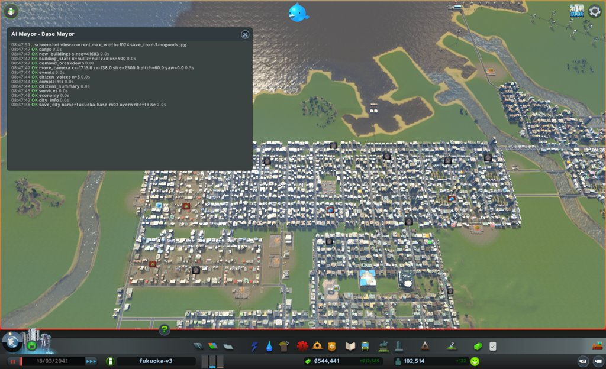
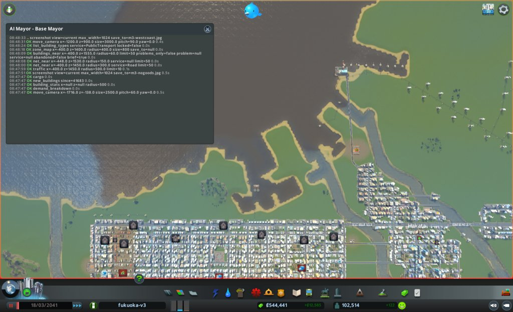
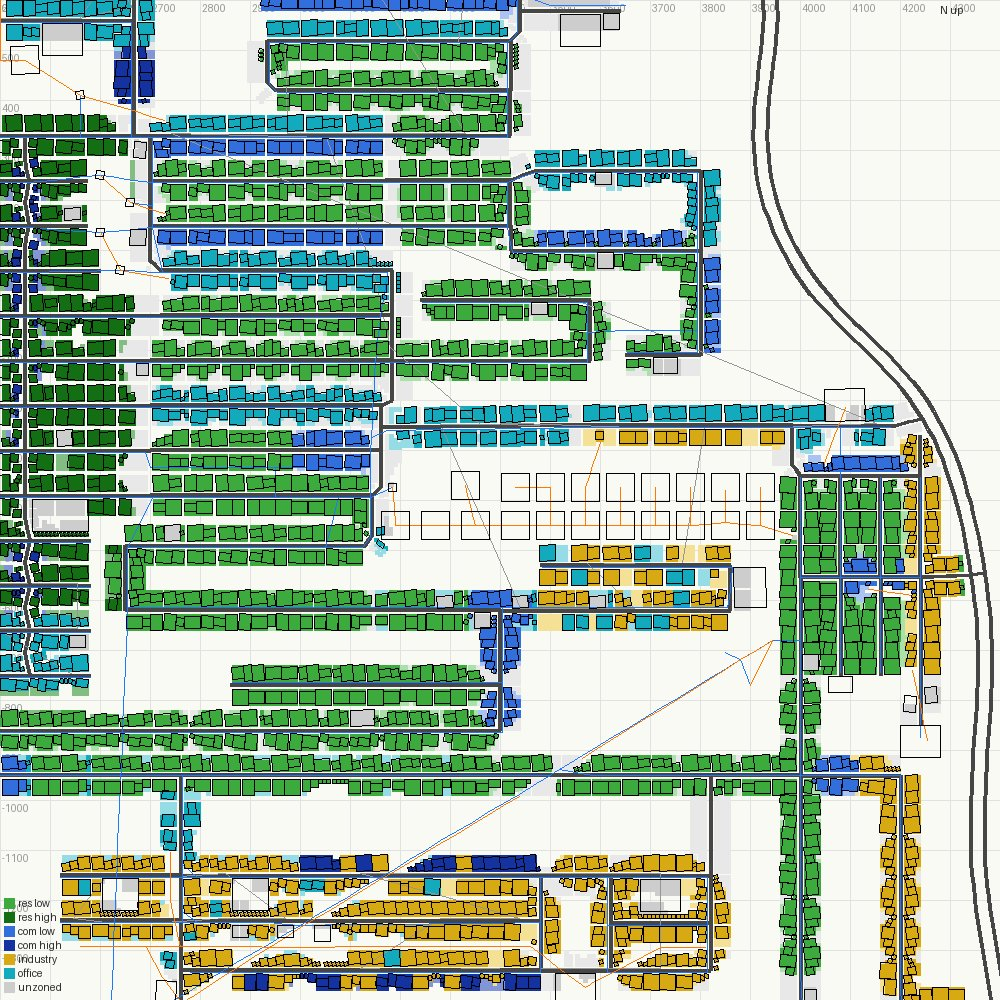

### 2041-03-28 見回り

境目: 当たらず。電気・水・下水が来ない市民は 0 / 0 / 0。つぶやきは1件(警察の冗談)。人口は前回より415人増えた

- `cargo`: 港の前に止まったトラックは1,366台(月例は1,374)。ほとんど変わらない。止まった場所の平均(-400, 1539)は港の敷地の中(z 1525〜1587)にある。詰まりは出口の道路ではなく、港の建物の中の可能性がある。NoGoods は153棟(月例140)
- line 189: 道順は見つかった(pathFailed 0)。長さ5.46km。停留所2→3が14.6倍、4→0が11.8倍の遠回り。停留所が道路の逆側に付いたと見る

### 2041-04-07 見回り

境目: 当たらず。電気・水・下水が来ない市民は 0 / 0 / 0。つぶやきは1件(スマートホームをほめる声)。人口は前回より267人増えた

### 2041-04-17 3か月目の区切り(次の月例の前)

`advance(10)` の後、4か月目の月例に渡すために事実だけを残す。数字の表の行は4か月目の月例で足す。

- `city_info`: 人口103,530、所持金595,957、週の収支 +12,697(収入159,694、支出146,997)、幸福度82、需要 0 / 3 / 2、来ない市民 0 / 0 / 0
- `cargo`: 港の前に止まったトラック1,348台(月例1,374)。港を出る車1,585台。NoGoods 173棟(月例140)、原料が届かない工場99棟(月例87)。2本目の出口道路は効いていない
- 東部(3500, −500、半径1000)の `building_stats`: オフィス229棟、公共交通の制約190棟(月例181)、働き口1,944(月例1,827)。工業の放棄13棟(月例8)
- バス: line 189 は10 / 10台、乗客0、5.46km。line 35 は29台、乗客21

### 2041-04-17 月例(4か月目)

保存: `fukuoka-base-m04`(2041-04-17、21.5MB)

#### 答え合わせ

- 港の出口に2本目の道路(公約1): 予想「港の前に止まったトラック1,374台→900台以下、NoGoods 140棟→110棟以下」。結果は1,348台、NoGoods 173棟。外れ
  - 外れた理由の見立て: 港のまわりの道路は流れている(`traffic` で港の周り blocked 0、Small 4 Lane Road の混み具合35〜62)。止まった車の平均(-400, 1539)は港の敷地の中。詰まりは道路ではなく、港1か所から出せる台数の上限と見る。輸入13,170 / 週のうち、船の港1か所に頼っている
  - 次の扱い: 道路は残す(維持費約8)。出口の道路への手当ては打ち切る。2つ目の荷物の港の場所を探す
- 東部の環状の街区のバス(line 189、公約1): 予想「東部のオフィスの公共交通の制約181棟→150棟以下」。結果は190棟。外れ
  - 外れた理由の見立て: 環状の街区の届き具合は上がった(`map_layer` で (3500, 300) 73、(3700, 300) 100)。制約の残りは、別の街区(3470〜3880, −500〜−650)にある。届き具合は (3900, −500) で0、(3700, −700) で35
  - 次の扱い: line 189 は続ける。残りの街区に短い路線を足す
- 次にやることの実行
  - 港の前のトラックの数: 見回り(2041-03-28)と区切りで `cargo` を見た。実行した
  - line 189 の pathFailed、台数、遠回り: 見回りで見た。実行した
  - 東部の公共交通の制約と NoGoods: 区切りで比べた。実行した
  - 放棄の数と働く場所の需要: 今回見た。放棄は高密度商業60棟、工業40棟。需要 actual 2(target 96)。実行した
  - オフィスの葬祭の制約の場所: 今回 `building_stats` で北(2200, 900)に28棟を見つけた。実行した
- 公約の進み具合
  1. 人口: 102,514 → 103,530(+1,016)。守れた。残り9回
  2. 電気・水・下水が来ない市民: 0 / 0 / 0。任期の終わりまで保つ
  3. 週の収支: +12,697。黒字

#### 気づいたこと

- 住宅の需要は0のまま。jobTerm −46(失業10,865、空いた働き口886)。失業の97%(10,485)が大卒
- 先月からの新しい建物は高密度商業36、工業29、オフィス13棟(`new_buildings` 41683→42017)。建て直しが働く場所の需要を食う状態が続く
- オフィスのレベル上げの止まり方(1,148棟): 公共交通587、葬祭206、地面の汚染194、娯楽154
- 死体の困りごと17棟の中心は (2108, 405)。近くの火葬場4か所は霊柩車が 8〜9 / 9 台出ているのに、先週の処理は0〜9人。霊柩車が渋滞で動けていない見立て
  - `traffic` (2100, 300、半径800): 止まった車74台、渋滞の印133台。(2083, 249) と (2085, 157) に止まった車がまとまる
  - 北(1300〜2900, 800〜1200)は葬祭の届き具合が0〜16
- 西の荷物の港の候補: 港の西(-500〜-600, 1480〜1600)は水深14〜20m。陸がなく、港は置けない
- つぶやきは1件(ごみ収集車が来ない)

#### 施策

1. 北の街区(x=1840 の通りの西側)に火葬場を建てる
   - 公約: 1(オフィスのレベル上げで大卒の働き口を増やす。死体の印による放棄を防ぐ)
   - 捨てるもの: なし
   - 理由: 死体の困りごと17棟。北は葬祭の届き具合0〜16で、南の火葬場の霊柩車は渋滞を抜けて来る。(2200, 900) のオフィス28棟が葬祭で止まる
   - 予想: 次の月例までに、死体の困りごとが17棟から9棟以下になる。オフィスの葬祭の制約が206棟から190棟以下になる。週の支出が約720増える
   - 操作: `place_building("Crematory", x=1818, z=950, facing=east)`。建設費25,000
2. 東部の残りのオフィスの街区(z=−530 と z=−620 の通り)にバス路線を通す
   - 公約: 1(オフィスのレベル上げで大卒の働き口を増やす)
   - 捨てるもの: なし
   - 理由: 東部のオフィスの公共交通の制約190棟。(3900, −500) は届き具合0
   - 予想: 次の月例までに、東部(3500, −500、半径1000)のオフィスの公共交通の制約が190棟から170棟以下になる。週の支出の増分は100未満
   - 操作: `create_transport_line("bus")`、停留所 (3500, −620)、(3700, −620)、(3800, −530)、(3580, −530)

1の結果: 最初の置き場所 (1818, 950) は入口の前に道路がなかった(id 38623、建設費25,000、warning "no road at the entrance")。通りは x=1840 ではなく x=1900 だった。`relocate_building` で (1880, 950) に移した(費用5,000)。`water_trace` で電気・水・下水とも届き、`net_reach` で noRoad 0。取り壊した建物0。合計30,000
2の結果: 成功。最初に line 55 を作ったが、停留所が道路の逆側(z=−616 は西向きの車線側)に付いたので消し、向きを逆にした順で作り直した。line 114(番号25)、停留所4つ(区間18368、22298、25356、15546)。費用0

#### 考えたが打たなかった手

- 2つ目の荷物の港: 港の西は水深20mで陸がない。港の東の海辺には排水口が並ぶ。置ける海辺を見つけられなかった。来月、北の海辺(0〜600, 1500〜1800)の陸と水の境を写真で探す
- (2085, 150〜250) の渋滞を道路の差し替えでほどく: 沿道の建物が壊れる。止まった車は74台で、火葬場の効き目を先に見る
- line 35 を引き直す: 乗客21で動いている。今月は触らない
- 満杯の埋立地6か所を空にする: ごみの困りごとは1棟と少ない
- 税と予算: 黒字で、人口を止めているのは大卒の失業。工業とオフィスの税は1%で、もう下げられない
- 3件目の施策: 打たなかった。港の手当ての当てがなく、ほかの2件の効き目を切り分けたいため

#### 次にやること

- 見回りで、line 114 の pathFailed、台数、遠回りを見る
- 次の月例で、死体の困りごと(17棟)とオフィスの葬祭の制約(206棟)を比べる
- 次の月例で、東部のオフィスの公共交通の制約(190棟)を比べる
- 次の月例で、2つ目の荷物の港を置ける海辺を探す

#### 画面写真

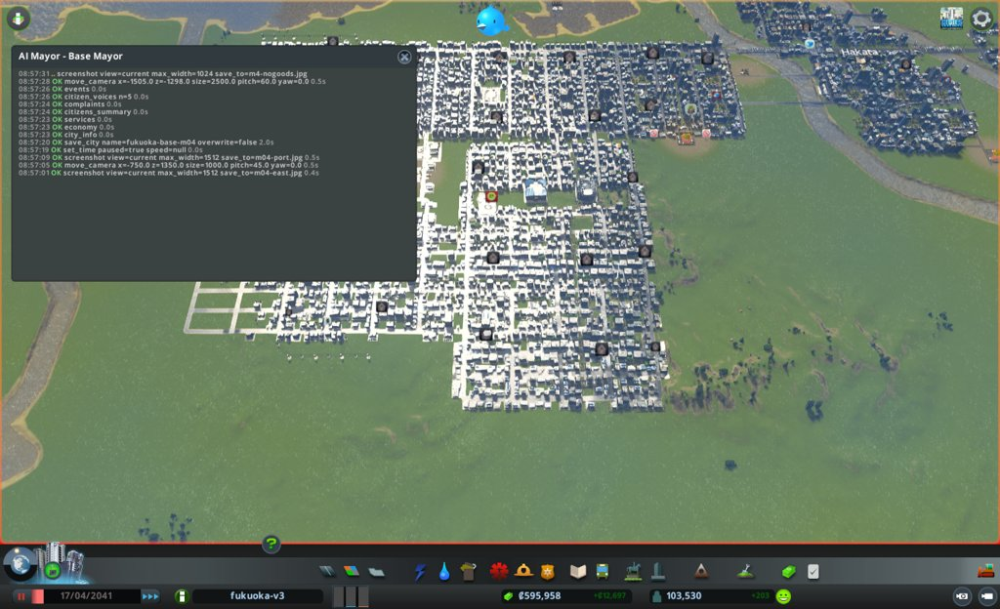
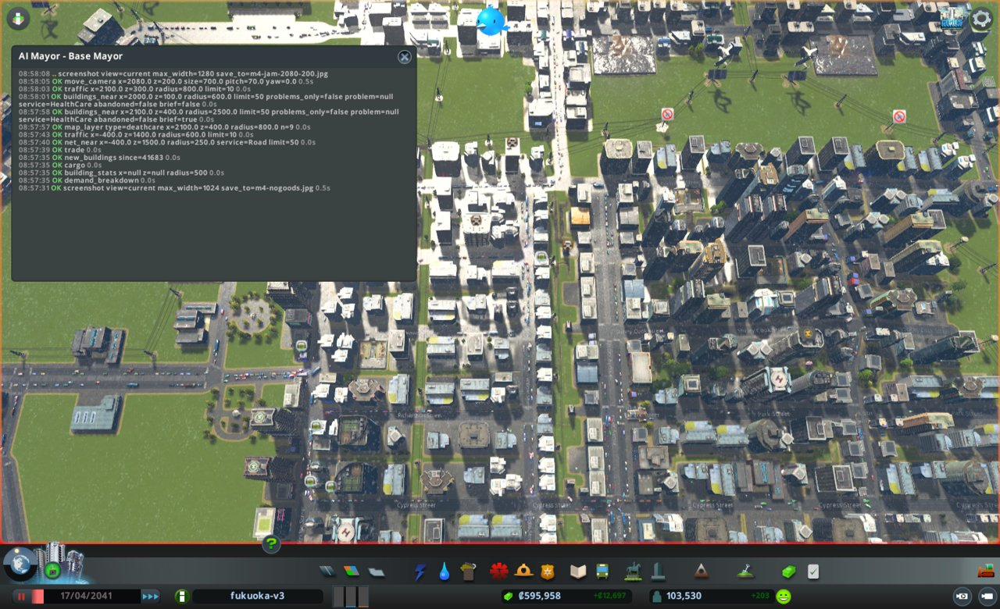
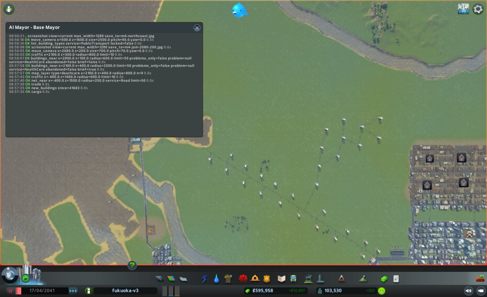

### 2041-04-27 見回り

境目: 当たらず。電気・水・下水が来ない市民は 0 / 0 / 0。つぶやきは1件(水道管を待つ声)。週の収支は +11,712 で黒字のまま(月例より985減。火葬場の720を含む)

- line 114: 長さ3.07km、pathFailed 0。停留所3→0が24.6倍の遠回り(z=−530 の西の端が行き止まりで、回り込む)。ほかの区間は1.0〜1.7倍

### 2041-05-07 見回り

境目: 当たらず。電気・水・下水が来ない市民は 0 / 0 / 0。つぶやきは2件(学校をほめる声、朝日)。人口は前回より386人増えた

### 2041-05-17 4か月目の区切り(次の月例の前)

`advance(10)` の後、5か月目の月例に渡すために事実だけを残す。数字の表の行は5か月目の月例で足す。

- `city_info`: 人口104,455、所持金618,574、週の収支 +12,582(収入160,648、支出148,066)、幸福度82、需要 0 / 4 / 4、来ない市民 0 / 0 / 0
- `complaints`: 困りごとのある建物280棟(月例226)。NoGoods 206棟(月例173)、ごみ41棟(月例1。中心は西部 -1271, -1378)、死体7棟(月例17)、騒音13棟
- 火葬場 38623: 霊柩車 3 / 9 台、蓄え0 / 105、先週の処理0
- `building_stats`(街全体): オフィス1,496棟、働き口13,208(月例13,107)。公共交通の制約590、地面の汚染206、葬祭202(月例206)、娯楽152。放棄は高密度商業76、工業47
- `building_stats`(東部 3500, −500、半径1000): オフィス230棟、公共交通の制約186(月例190)
- `cargo`: 港の前に止まったトラック1,332台。NoGoods 206棟、原料が届かない工場107棟
- バス: line 114 は6 / 6台、乗客0、3.07km、pathFailed 0
- `services`: 電気の容量1,576,848(月例1,746,912。風で変わる見込み)、使用937,264。満杯の埋立地6か所のまま

### 2041-05-17 月例(5か月目)

保存: `fukuoka-base-m05`(2041-05-17、21.6MB)

#### 答え合わせ

- 北の街区の火葬場(公約1): 予想「死体の困りごと17棟→9棟以下、オフィスの葬祭の制約206棟→190棟以下」。結果は死体7棟(当たり)、葬祭の制約202棟(外れ)
  - 外れた理由の見立て: 葬祭で止まるオフィスは北だけでなく西部・中心にも散っている。北の火葬場は霊柩車3 / 9台で、先週の処理0。北の街区の死体はもともと少ない
  - 次の扱い: 建物は残す。オフィスの葬祭の制約は、場所を絞れるまで新しい手を打たない
- 東部の z=−530 と z=−620 のバス(line 114、公約1): 予想「東部のオフィスの公共交通の制約190棟→170棟以下」。結果は186棟。外れ
  - 外れた理由の見立て: line 114 は乗客0、停留所3→0が24.6倍の遠回り。東部のオフィスは路線のある通りから外れた袋小路に多く、バス1本ごとに届く棟が少ない
  - 次の扱い: 路線は続ける(6台、維持費小)。東部のバスの追加はやめる。効き目が月に数棟で、手間に見合わない
- 次にやることの実行
  - line 114 の pathFailed、台数、遠回り: 見回り(2041-04-27)で見た。実行した
  - 死体の困りごととオフィスの葬祭の制約: 今回比べた。実行した
  - 東部のオフィスの公共交通の制約: 今回比べた。実行した
  - 2つ目の荷物の港を置ける海辺: 今回探した。北の排水口の並ぶ岸の先(x=−100、z 1620〜1760)は水深10〜15mの水路で、北の岸(z≈1780)は陸。実行した
- 公約の進み具合
  1. 人口: 103,530 → 104,455(+925)。守れた。残り8回
  2. 電気・水・下水が来ない市民: 0 / 0 / 0。任期の終わりまで保つ
  3. 週の収支: +12,582。黒字

#### 気づいたこと

- ごみの困りごとが1棟から41棟に増えた。中心は南西の住宅街(-1271, -1378)。近くの埋立地は西の3か所(x=−1885〜−2060)で、収集車は 17〜19 / 19 台が出払う。34558 は91%で、まもなく満ちる
- 住宅の需要は0のまま。jobTerm −47(失業 11,246、うち大卒 10,871)。働く場所の需要は target 97、actual 4
- `cargo`: 止まったトラック1,489台、うち港の前に1,332台。港を出る車1,572台。Harbor Road の混み具合100、まわりの道路は16〜44。品物が届かない店206棟(西部 -1205, -821 に125棟)
- 外とのつなぎ口: 鉄道は北(3150, 8644)と南(7012, −8644 など)にあるが、街から約7km離れる。線路の種類は `list_net_types` に出なかった
- 北の海辺: 港の東の岸(x −375〜170、z≈1600)には排水口9か所が約67m おきに並ぶ。その北は水深10〜15mの水路(z 1620〜1760)で、さらに北(z≈1780〜)は平らな陸(標高約44m)
- 工業のレベル上げは荷物の運送で433棟止まる。オフィスは公共交通590、地面の汚染206、葬祭202、娯楽152

#### 施策

1. 南西の住宅街の南(z=−1730 の通りの南)に焼却場を建てる
   - 公約: 1(ごみの印による放棄で家が減るのを防ぐ)と2(暮らしの土台)
   - 捨てるもの: なし
   - 理由: ごみの困りごと41棟。中心(-1271, -1378)の近くの埋立地は満杯か、収集車が出払っている
   - 予想: 次の月例までに、ごみの困りごとが41棟から15棟以下になる。週の支出が約1,440増える
   - 操作: z=−1730 の通りから南へ短い道路を引き、その脇に `place_building("Combustion Plant")`。建設費30,000と道路
2. 2つ目の荷物の港を、北の水路の北岸に置く
   - 公約: 1(品物・原料を届けて放棄を止め、働く場所の需要を建て直しに食わせない)
   - 捨てるもの: なし
   - 理由: 港の前に止まったトラック1,332台。港1か所の出口が上限で、4か月続く。北の水路は今の港と同じ海につながる
   - 予想: 次の月例までに、今の港の前に止まったトラックが1,332台から900台以下になる。品物が届かない店が206棟から160棟以下になる。週の支出が約2,000増える
   - 操作: `place_building("Cargo Harbor")` を北岸(x≈−70、z≈1770)に北向きで置き、入口から道路を引いて、水路を橋で渡り、点1812(-346, 1441)につなぐ。建設費60,000と道路

1の結果: 成功。(-1200, −1730) から南へ Basic Road を110m引いた(560。既存の通りを分けてつないだ)。焼却場 id 7765 を (-1178, −1815) に西向きで置いた(30,000)。入口は新しい道路(区間27399)に面した。取り壊した建物0。`water_trace` で水・下水とも届く。合計30,560
2の結果: 成功。荷物の港 id 20297 を (-70, 1770) に北向きで置いた(60,000)。船の乗り場は水路側(z 1662〜1722)、港の道路は z=1810。Small 4 Lane Road を (-22, 1810) → (10, 1810) → (10, 1441) → 点1812(-346, 1441) に引いた(11区間、うち橋3、6,040)。両端とも既存の点につながった。`net_reach` で港は来られる・出られる。電気・水・下水は来ていなかったので、水道管を排水口41902の管の点 (32, 1567) から港の敷地へ(560)、送電線を (-20, 1595) から港の敷地へ(420)引いた。届いたかは次の見回りで見る。合計67,020
- 2件の建設費の合計は97,580。判断の時点の所持金618,574の半分(309,287)に収まる。週の維持費の増分の見込みは約3,400で、黒字 +12,582 に収まる

#### 考えたが打たなかった手

- 荷物の鉄道: 外への線路のつなぎ口は街から約7km離れ、線路の種類も一覧に出なかった。港の効き目を見てから考える
- 東部のバス路線をさらに足す: 3か月で制約は191→186棟と、1本あたり数棟しか動かない。手間に見合わない
- 満杯に近い埋立地 34558(91%)を空にする: 中身がほかへ移るだけ。焼却場の効き目を先に見る
- 放棄の取り壊し(商業76、工業47): 2か月目の結果、根が残る限り戻る。港の効き目を見てから考える
- 税と予算: 黒字で、人口を止めているのは大卒の失業。工業とオフィスの税は1%で、もう下げられない
- 3件目の施策: 打たなかった。港と焼却場の効き目を切り分けたいため

#### 次にやること

- 見回りで、港 20297 に電気・水・下水が届いたか(`buildings_near` の grid)を見る。届いていなければ臨時で管・線を引き直す
- 見回りで、`cargo` の stations に港 20297 の出入りが出るか、港の前の止まったトラック(1,332台)が減ったかを見る
- 次の月例で、ごみの困りごと(41棟)、品物が届かない店(206棟)、放棄(商業76、工業47)、働く場所の需要の actual(4)を比べる

#### 画面写真

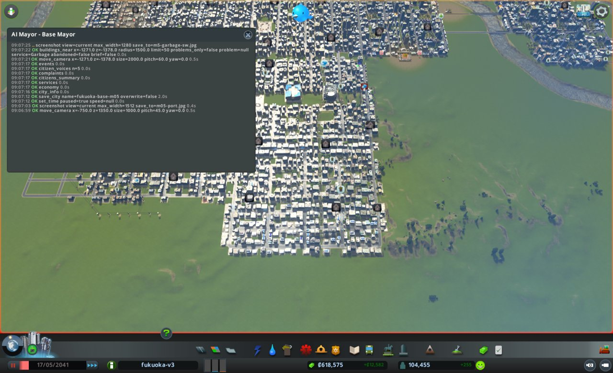
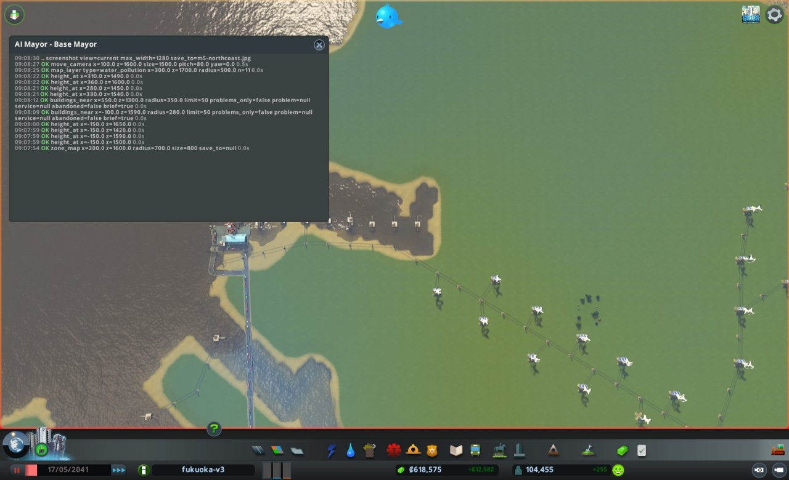
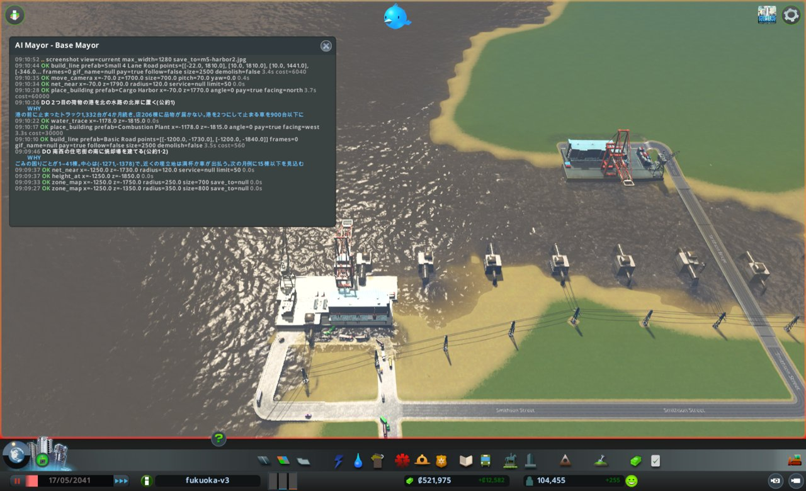

### 2041-05-27 見回り

境目: 当たらず。電気・水・下水が来ない市民は 0 / 0 / 0。つぶやきは2件(魅力的な街の賞、学校の賞)。週の収支は +8,968 で黒字のまま(月例より3,614減。支出は+4,136で、見込みの約3,400より大きい)

- 港 20297: 電気・水・下水とも届き、働き手71人。ただし `cargo` の出入りは0台。船はまだ来ていない
- 今の港の前に止まったトラック1,311台(月例1,332)。品物が届かない店202棟(月例206)

### 2041-06-06 見回り

境目: 当たらず。電気・水・下水が来ない市民は 0 / 0 / 0。つぶやきは1件(隣の部屋のにおい、死体)。週の収支は +9,944

- 港 20297 は20日たっても出入り0台。今の港の前に止まったトラック1,306台。品物が届かない店214棟
- `net_near`: 船の道(Ship Path)は北西から来て (-656, 1744) で終わる。今の港の乗り場の端 (-430, 1663)、(-370, 1663) にも、新しい港の端 (-40, 1662)、(-100, 1662) にも、船の道の区間はつながっていない。今の港に船が来る理由と、新しい港に来ない理由はまだ分からない。次の月例で調べる

### 2041-06-16 5か月目の区切り(次の月例の前)

`advance(10)` の後、6か月目の月例に渡すために事実だけを残す。数字の表の行は6か月目の月例で足す。

- `city_info`: 人口105,206、所持金562,862、週の収支 +10,932(収入163,134、支出152,202)、幸福度82、需要 0 / 2 / 2、来ない市民 0 / 0 / 0
- `complaints`: 困りごとのある建物313棟(月例280)。NoGoods 229棟(月例206)、ごみ40棟(月例41。中心は南西から南東の工業地 2295, −1196 に移った)、死体10棟(中心は東部 3545, −418)、騒音12棟、汚染8棟
- 焼却場 7765: 蓄え157,860 / 400,000(39%)、処理37,440 / 週、収集車34 / 34台が稼働
- `cargo`: 港 20297 は30日たっても出入り0台。今の港 43449 の前に止まったトラック1,286台(月例1,332)、出る車1,523台。原料が届かない工場97棟(月例107)

### 2041-06-16 月例(6か月目)

保存: `fukuoka-base-m06`(2041-06-16、21.3MB)

#### 答え合わせ

- 南西の焼却場 7765(公約1・2): 予想「ごみの困りごと41棟→15棟以下」。結果は街全体で40棟。南西(-1271, −1378、半径700)は0棟。半分当たり
  - 外れた理由の見立て: 南西は解けたが、南東の工業地(1900〜2720, −640〜−1270)に16棟が出た。近くの埋立地3か所(16097、20237、44233)は収集車が 19 / 19 台とも出払う。容量ではなく収集車の数が足りない
  - 次の扱い: 焼却場は続ける。南東は収集車を足す手を打つ
- 2つ目の荷物の港 20297(公約1): 予想「止まったトラック1,332台→900台以下、NoGoods 206棟→160棟以下」。結果は出入り0台、止まったトラック1,286台、NoGoods 229棟。外れ
  - 外れた理由の見立て: 船の道(Ship Path)は北西から来て (-656, 1744) で行き止まり。新しい港の乗り場の端にはつながらない。船の道は引けない(`list_net_types` に出ない)。また `trade` では、船のつなぎ口から来ている船は9隻だけ。今の港の前で止まった1,286台は、道路の詰まりではなく、港で船の荷を待つトラックと見る(港のまわりの道路は流れている。港の敷地の中に止まる)
  - 次の扱い: 新しい港は止める(下の施策1)
- 次にやることの実行
  - 港 20297 の電気・水・下水: 見回り(2041-05-27)で見た。届いた。実行した
  - `cargo` の港 20297 の出入りと止まったトラック: 見回り2回と今回見た。実行した
  - ごみ、NoGoods、放棄、働く場所の需要の比較: ごみ・NoGoods・需要は今回比べた(ごみ40棟、NoGoods 229棟、actual 2)。放棄の数は見なかった。一部未実行
- 公約の進み具合
  1. 人口: 104,455 → 105,206(+751)。守れた。残り7回。増え方は月に1,305→1,069→1,016→925→751と細る
  2. 電気・水・下水が来ない市民: 0 / 0 / 0。任期の終わりまで保つ
  3. 週の収支: +10,932。黒字。5か月目の月例 +12,582 から1,650減った

#### 気づいたこと

- 住宅の需要は0のまま。jobTerm −47(失業11,467、うち大卒11,117、空いた働き口1,193)。空き家1,699。人口は空き家が埋まる分だけ増えている
- 輸出はほぼ0(週1)、輸入は週14,073。輸入の車は道路のつなぎ口(地図の南東と北東、約8km先)から約465台、船は9隻
- 港 43449 からは1,523台が出ていく扱いで、うち1,286台が港の中で止まる。品物(Goods)のトラックは止まった582台が最多。船が少なく、港に割り当てられたトラックが荷を待ち続けている見立て
- 交通の流れは63%。止まった車316台。詰まりは (1906, 59)、(2148, −742) などに散る
- サービスは足りている。下水は容量1,600,000に対し1,168,000(73%)。医療・警察・葬祭は余裕がある

#### 施策

1. 荷物の港2か所(43449、20297)を止め、品物と原料の輸入を道路に切り替える
   - 公約: 1(品物・原料を届けて放棄を止め、働く場所の需要を建て直しに食わせない)と3(港20297の維持費約2,000を止める)
   - 捨てるもの: なし
   - 理由: 5か月、港の前に1,300台前後が止まり、NoGoods は107→229棟に増えた。船は9隻だけで、港に割り当てられたトラックが荷を待つ。港を止めれば、店と工場は道路のつなぎ口から輸入する
   - 予想: 次の月例までに、止まったトラックが1,400台から300台以下になる。NoGoods が229棟から180棟以下、原料が届かない工場が97棟から80棟以下になる。週の支出が約3,900減る(港2か所)。交通の流れは63%から55%までの悪化にとどまる
   - 危うさ: 8km先からのトラックで道路が詰まる。見回りで交通の流れが50%を下回ったら、次の月例で今の港を動かし直す。保存 `fukuoka-base-m06` がある
   - 操作: `set_building_active(43449, false)`、`set_building_active(20297, false)`
2. 南東の工業地の埋立地 16097 の南に、埋立地(Landfill Site)を1か所足す
   - 公約: 1(ごみの印による放棄を防ぐ)と2(暮らしの土台)
   - 捨てるもの: なし
   - 理由: 南東の工業地と住宅にごみの困りごと16棟。近くの埋立地3か所は収集車 19 / 19 台が出払う。埋立地は収集車19台で週の維持費160、焼却場(34台で1,440)より安い
   - 予想: 次の月例までに、ごみの困りごとが40棟から20棟以下になる。週の支出が約160増える。建設費は約5,000
   - 操作: 点27078 (2234, −1160) から南へ Basic Road を引き、その東側に `place_building("Landfill Site")` を西向きで置く

1の結果: 成功。港 43449 と 20297 を止めた(`active: false`)。費用0
2の結果: 成功。Basic Road を (2234, −1160) → (2234, −1380) に引いた(4区間、うち橋1、1,780。北端は点27078につながった)。埋立地 id 15191 を (2322, −1290) に置いたが入口の前に道路がなかった(4,000)。`relocate_building` で (2276, −1290) に移した(800)。`net_reach` で noRoad 0、来られる・出られる。取り壊した建物0。合計6,580
- 建設費の合計6,580は、所持金562,862の半分に収まる。週の維持費は港2か所を止めて約3,900減り、埋立地で160増える見込み

#### 考えたが打たなかった手

- 新しい港 20297 を古い港のそばへ移す(12,000): 古い港も船の道の端から約240m離れていて、なぜ船が着くのか分からない。移しても船が来る見込みが立たない
- 南東に焼却場(30,000、週1,440): 埋立地の方が収集車1台あたりの維持費が安い。焼却場は埋立地が満ちてから考える
- 東部の死体の困りごと(6棟、3545, −418): 数が少なく、火葬場の余力(容量15,000に対し4,643)はある
- 大卒の働き口を足す: 働く場所の需要は actual 2 で、オフィスの区画を足しても建たない。大学や病院の働き口は1棟100前後で、失業11,117に比べて小さい
- 放棄の取り壊し: 港を止めた効き目を見てから考える
- 税と予算: 黒字。工業とオフィスの税は1%で下げられない。住宅の税を下げても、住宅の需要を止めているのは失業
- 3件目の施策: 打たなかった。港を止める効き目は大きく、ほかと切り分けたいため

#### 次にやること

- 見回りで、`traffic` の流れ(63%)と `cargo` の止まったトラック(1,400台)を見る。流れが50%を下回ったら、次の月例で今の港 43449 を動かし直す
- 次の月例で、NoGoods(229棟)、原料が届かない工場(97棟)、放棄の数、働く場所の需要の actual(2)を比べる
- 次の月例で、南東のごみの困りごと(16棟)と埋立地 15191 の収集車の数を見る
- 次の月例で、週の支出が約3,700減ったかを見る(支出152,202)

#### 画面写真

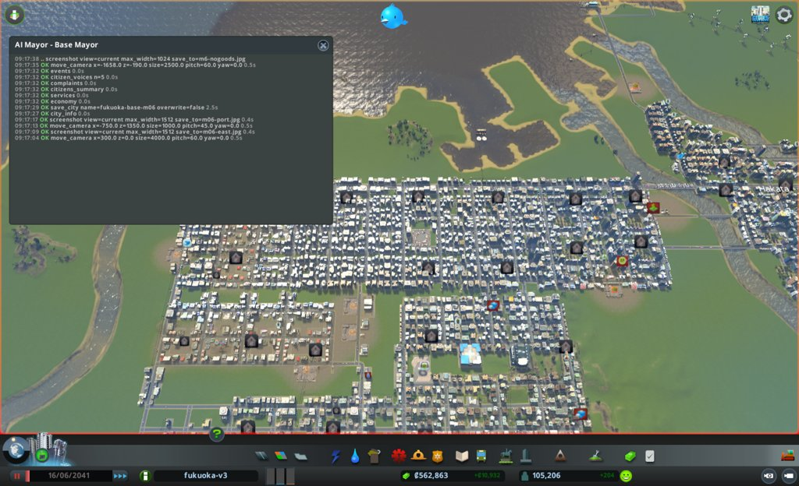
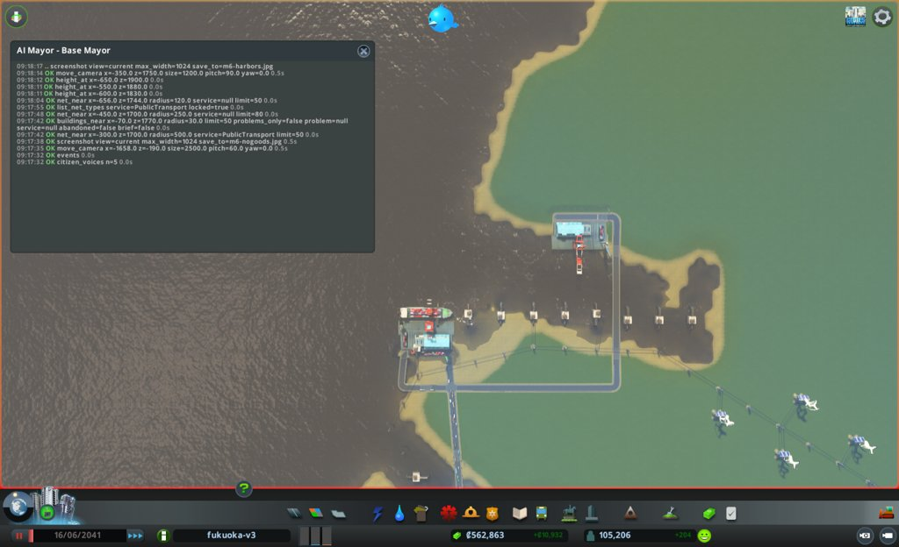
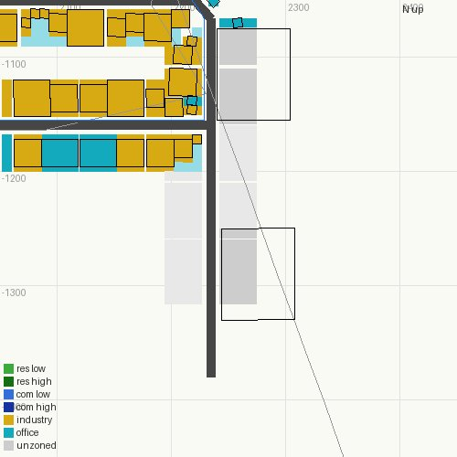

### 2041-06-26 見回り

境目: 当たらず。電気・水・下水が来ない市民は 0 / 0 / 0。つぶやきは2件(放棄の建物だらけ、学校の賞)。週の収支は +15,013(支出は月例より3,597減)

- `traffic`: 流れ64%(月例63%)、止まった車252台
- `cargo`: 止まったトラック1,324台、うち港 43449 の中に1,188台(月例1,286)。止めた港からも1,400台が出ていく扱いのまま。NoGoods 228棟、原料が届かない工場101棟。止める前に割り当てられたトラックが、港の中に残っている見立て

### 2041-07-06 見回り

境目: 当たらず。電気・水・下水が来ない市民は 0 / 0 / 0。つぶやきは1件(庭から光る樽、汚染)。人口は前回より307人増えた。週の収支 +15,087

- `cargo`: 港 43449 の中に止まったトラック1,083台(前回1,188)。10日で約100台ずつしか減らない。船は1隻。NoGoods 236棟、原料が届かない工場101棟
- `traffic`: 流れ63%、止まった車277台。道路の詰まりは悪くなっていない

### 2041-07-16 6か月目の区切り(次の月例の前)

`advance(10)` の後、7か月目の月例に渡すために事実だけを残す。数字の表の行は7か月目の月例で足す。

- `city_info`: 人口106,095、所持金620,373、週の収支 +14,550(収入163,154、支出148,604)、幸福度81、需要 0 / 2 / 6、来ない市民 0 / 0 / 0。つぶやきなし
- `complaints`: 困りごとのある建物332棟(月例313)。NoGoods 256棟(月例229)、ごみ35棟(月例40。中心は南西 -1182, −1158 に14棟。南東(2300, −1100、半径900)は16→0棟)、死体10棟(中心 2287, −331)、騒音12棟、汚染9棟
- `cargo`: 止まったトラック1,119台、うち港 43449 の中に983台(月例1,286)。港から出ていく扱い1,196台、船1隻。原料が届かない工場105棟(月例97)
- 埋立地 15191: 収集車 19 / 19台、蓄え40,000 / 8,000,000(1%)

### 2041-07-16 月例(7か月目)

保存: `fukuoka-base-m07`(2041-07-16、21.3MB)

#### 答え合わせ

- 荷物の港2か所を止める(公約1・3): 予想「止まったトラック1,400台→300台以下、NoGoods 229→180棟以下、原料が届かない工場97→80棟以下、支出約3,900減、流れ55%以上」。結果は止まったトラック1,119台(港 43449 の中に983台)、NoGoods 256棟、原料なし105棟、支出152,202→148,604(3,598減)、流れ64%。財政と交通は当たり、品物は外れ
  - 外れた理由の見立て: 止める前に港へ割り当てたトラックが、止めた後も港の中に残る。港 43449 は止めた今も vehicles.inUse 1,196台。10日で約100台しか減らない。道路からの輸入に切り替わる前に、港の車が店の注文をふさいでいる
  - 次の扱い: 港 43449 を取り壊し、残った車を一度に放す(下の施策1)
- 南東の埋立地 15191(公約1・2): 予想「ごみの困りごと40棟→20棟以下」。結果は35棟。南東(半径900)は16→0棟。半分当たり
  - 外れた理由の見立て: 南西に14棟が戻った。南西の焼却場 7765 は蓄え396,250 / 400,000(99%)で、受け入れの余地がない。近くの埋立地 34558 は98%、43004 は満杯
  - 次の扱い: 埋立地は続ける。南西に受け皿を足す(下の施策2)
- 次にやることの実行
  - 見回りで流れと止まったトラック: 2回とも見た。実行した
  - NoGoods、原料、放棄、働く場所の需要: 今回比べた。NoGoods 256、原料105、放棄は高密度商業104棟(5か月目76)、工業39棟(同47)、需要 actual 6。実行した
  - 南東のごみと埋立地 15191 の収集車: 6か月目の区切りで見た。実行した
  - 週の支出の減り: 3,598減った。実行した
- 公約の進み具合
  1. 人口: 105,206 → 106,095(+889)。守れた。残り6回
  2. 電気・水・下水が来ない市民: 0 / 0 / 0。任期の終わりまで保つ
  3. 週の収支: +14,550。黒字。前月 +10,932 から3,618増えた

#### 気づいたこと

- 住宅の需要は0のまま。jobTerm −46(失業11,655、うち大卒11,319、空いた働き口1,415)、homeTerm −11(空き家1,726)
- 働く場所の需要は target 96、actual 6。放棄の高密度商業が104棟に増えた。建て直しが需要を食う状態は続く
- NoGoods の多い場所は西部 (-1269, −777) 138棟、(-2257, −760) 45棟、(-827, 80) 36棟
- `cargo`: 品物の輸入668台、うち止まった496台。止まったトラックの87%(983 / 1,119)が港 43449 の中。道路のつなぎ口 (5779, −8640) に止まるのは14台だけ
- 交通の流れ64%。止まった車は東部 (4062, −523) 26台、(2477, −946) 23台など。港の周りではない
- 南西の焼却場 7765: 処理60,000 / 週、蓄え99%、収集車26 / 34台
- サービスは足りる。下水の使用は容量の73%、水は67%

#### 施策

1. 止めた荷物の港 43449 を取り壊す
   - 公約: 1(品物・原料を届けて放棄を止め、働く場所の需要を建て直しに食わせない)
   - 捨てるもの: なし
   - 理由: 止めても港の中に983台が残り、10日で約100台しか減らない。取り壊せば港の車は消え、店は道路のつなぎ口から輸入し直す。払い戻しはなく、建て直すなら60,000かかる
   - 予想: 次の月例までに、止まったトラックが1,119台から300台以下になる。NoGoods が256棟から200棟以下になる。交通の流れは55%以上を保つ。週の支出は変わらない(止めてあるため)
   - 危うさ: 道路の輸入が8km先から来るため、西部の店に届くまで時間がかかる。保存 `fukuoka-base-m07` がある
   - 操作: `bulldoze(x=-400, z=1555, radius=30, what="building")`。港の道路(Harbor Road)は建物の一部なので一緒に消える見込み
2. 南西の焼却場 7765 の南に埋立地を足す
   - 公約: 1(ごみの印による放棄を防ぐ)と2(暮らしの土台)
   - 捨てるもの: なし
   - 理由: 南西のごみの困りごと14棟。焼却場 7765 の蓄えは99%、近くの埋立地2か所は満杯か98%
   - 予想: 次の月例までに、ごみの困りごとが35棟から20棟以下になる。南西 (-1182, −1158、半径700)は5棟以下。週の支出が約160増える
   - 操作: 道路の端 (-1200, −1840) から南へ Basic Road を (-1200, −2070) まで引き、西側 (-1285, −1955) に東向きで `place_building("Landfill Site")`。建設費は約5,500

1の結果: 成功。港 43449 を取り壊した(払い戻しなし)。道路の区間は消えなかった(removedSegments 0)。`net_reach`(-400, 1500、半径300)で道路10区間はどれも出入りできる。直後の `cargo` で、トラックは2,258→1,062台、止まったトラックは1,119→115台。荷物の港は止めた 20297 だけが残る。NoGoods はまだ256棟
2の結果: 成功。Basic Road を (-1200, −1840) → (-1200, −2070) に引いた(4区間、1,120。北端は既存の点につながった)。埋立地 id 29553 を (-1285, −1955) に置いたが入口の前に道路がなかった(4,000)。`relocate_building` で (-1240, −1955) に移した(800)。`net_reach` で noRoad 0、来られる・出られる。合計5,920
- 建設費の合計5,920は、所持金620,373の半分に収まる。週の維持費の増分は約160で、黒字 +14,550 に収まる

#### 考えたが打たなかった手

- 止めた港 20297 も取り壊す: 止めてあり維持費は0。中に車もない。残しても困らない
- 南西の焼却場 7765 の蓄えを空にする(`empty_building`): 中身は近くの満ちかけた埋立地へ移るだけ
- 東部 (4062, −523) の渋滞をほどく: 止まった車は26台と少ない。港を壊した後の道路の様子を先に見る
- 死体の困りごと(10棟、2287, −331): 数が少なく、葬祭の容量は15,000に対し4,823と余る
- 放棄の取り壊し(商業104、工業39): 品物が届くようになるかを見てから考える
- 税と予算: 黒字。工業とオフィスの税は1%で下げられない。住宅の需要を止めているのは大卒の失業
- 3件目の施策: 打たなかった。港を壊した効き目が大きく、ほかと切り分けたいため

#### 次にやること

- 見回りで、`cargo` の止まったトラック(115台)と NoGoods(256棟)、`traffic` の流れ(64%)を見る。流れが50%を下回ったら、次の月例で道路を手当てする
- 見回りで、埋立地 29553 の収集車が出ているかを `buildings_near` で見る
- 次の月例で、NoGoods、原料が届かない工場(105棟)、放棄(商業104、工業39)、働く場所の需要の actual(6)を比べる
- 次の月例で、ごみの困りごと(35棟、南西14棟)を比べる

#### 画面写真

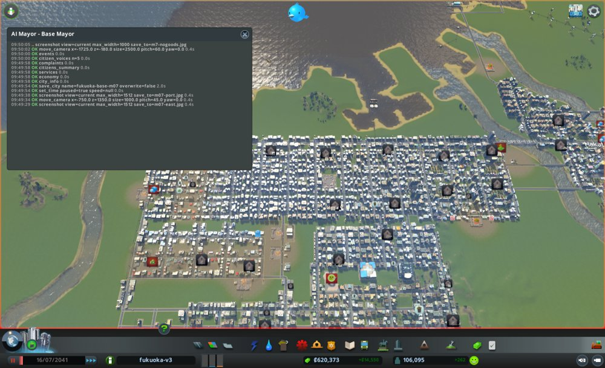

### 2041-07-26 見回り

境目: 当たらず。電気・水・下水が来ない市民は 0 / 0 / 0。つぶやきは2件(木で騒音を減らす話、学校の賞)。人口106,322、所持金634,960、週の収支 +14,178、幸福度82、需要 0 / 2 / 2

- `cargo`: 止まったトラック101台(月例の取り壊し直後115台)。品物の輸入トラックは180→178台と少ないまま。NoGoods 271棟(月例256)、原料が届かない工場109棟
- `traffic`: 流れ64%、止まった車328台(月例146)。(2153, −865) 44台、(1292, 98) 39台
- 埋立地 29553: 収集車 19 / 19台が出ている

### 2041-08-05 見回り

境目: 当たらず。電気・水・下水が来ない市民は 0 / 0 / 0。つぶやきは2件(スマートホーム、騒音)。人口は前回より223人増えた。週の収支 +13,781

- `cargo`: 止まったトラック126台。品物の輸入トラックは172台で増えない。NoGoods 288棟(前回271)、原料が届かない工場114棟。NoGoods の中心は西部 (-1267, −732) に144棟。道路からの輸入は西部まで届いていない見立て。次の月例で西部の品物の流れを調べる

### 2041-08-15 7か月目の区切り(次の月例の前)

`advance(10)` の後、8か月目の月例に渡すために事実だけを残す。数字の表の行は8か月目の月例で足す。

- `city_info`: 人口106,789、所持金673,319、週の収支 +13,293(収入162,154、支出148,861)、幸福度82、需要 0 / 2 / 4、来ない市民 0 / 0 / 0。つぶやきなし
- `complaints`: 困りごとのある建物368棟(月例332)。NoGoods 307棟(月例256。中心は西部 -1766, −159 に119棟)、ごみ14棟(月例35。中心は 2251, −220 に4棟。南西の中心は消えた)、汚染12棟、死体11棟(中心は東部 3421, −385)、騒音9棟
- `cargo`: 止まったトラック87台(月例の取り壊し前1,119台)。品物の輸入トラック178台、地元の品物357台。NoGoods の多い場所は (-1246, −681) 149棟、(-2274, −735) 60棟、(-986, 79) 42棟。原料が届かない工場113棟(月例105)
- `traffic`: 流れ66%(月例64%)、止まった車200台
- `building_stats`: 放棄は高密度商業123棟(月例104)、工業44棟(月例39)。オフィスの働き口13,372(月例13,307)
- `demand_breakdown`: 失業11,897(うち大卒11,525)、空いた働き口1,255、空き家1,764。働く場所の需要 target 98、actual 4

### 2041-08-15 月例(8か月目)

保存: `fukuoka-base-m08`(2041-08-15、20.3MB)

#### 答え合わせ

- 止めた荷物の港 43449 を取り壊す(公約1): 予想「止まったトラック1,119台→300台以下、NoGoods 256棟→200棟以下、流れ55%以上、支出は変わらない」。結果は止まったトラック87台(当たり)、NoGoods 307棟(外れ)、流れ66%(当たり)、支出148,604→148,861(当たり)
  - 外れた理由の見立て: 港の車は消えたが、品物の輸入トラックは178台のまま増えない。輸入は道路のつなぎ口(南東 5788, −8649 と北東 5294, 8649)から来る。西部へ行くには、z=100 の Medium Road を通る。その道は x=66〜1,260 で混み具合100。中心と東の間の川を渡る道は z=100 の橋1本だけ。品物が西部に届くまでが長い
  - 次の扱い: 港は戻さない。西への2本目の道を作る(下の施策1)
- 南西の埋立地 29553(公約1・2): 予想「ごみの困りごと35棟→20棟以下、南西は5棟以下」。結果は14棟。中心は (2251, −220) の4棟に移り、南西の中心は消えた。当たり
  - 次の扱い: 続ける
- 次にやることの実行
  - 見回りで `cargo` と `traffic`: 2回とも見た。実行した
  - 埋立地 29553 の収集車: 見回り(2041-07-26)で 19 / 19台を見た。実行した
  - NoGoods、原料、放棄、働く場所の需要: 区切りで比べた。NoGoods 307、原料113、放棄は商業123・工業44、需要 actual 4。実行した
  - ごみの困りごと: 区切りで比べた。実行した
- 公約の進み具合
  1. 人口: 106,095 → 106,789(+694)。守れた。残り5回。増え方は細る(+889→+694)
  2. 電気・水・下水が来ない市民: 0 / 0 / 0。任期の終わりまで保つ
  3. 週の収支: +13,293。黒字

#### 気づいたこと

- 住宅の需要は0のまま。jobTerm −48(失業11,897、うち大卒11,525、空いた働き口1,255)、homeTerm −11(空き家1,764)
- 輸入は週19,298、輸出は週1。輸入の車は南東のつなぎ口に350台、北東に341台
- `traffic`: 流れ66%、止まった車200台。混み具合100の区間は z=100 の Medium Road(x 66、503、796、906、1,260)と、西部の x=−1,845 の通り。止まった車の多い場所は (1702, 104) 35台、(4075, −252) 32台、(1079, 92) 26台
- 中心と西部の間は z=100(Medium Road)と z=−80(Small 4 Lane Road)の2本でつながる。中心と東の間は z=100 の橋1本だけ。z=−80 の道は x=700(点1450)で止まり、川(水深0.5m)の向こうの東の街区の角(920, 10、点24337)まで約240m
- 西部(-1500, −500)では止まった車は2台だけ。西部の中は流れている
- サービスは足りる。下水は容量の73%、水は67%、電気は62%
- 道路のつなぎ口からの輸入は荷物の駅(Cargo Center)でも受けられるが、線路(Train Track)はまだ解禁されていない

#### 施策

1. 中心と東の間の川に2本目の道を架ける(z=−80 の道を東へ延ばす)
   - 公約: 1(品物を西部に届けて商業の放棄を止め、働き口を戻す)
   - 捨てるもの: なし
   - 理由: 東のつなぎ口から西部への品物は、z=100 の橋1本に集まる。z=100 は混み具合100。z=−80 の道は中心と西部をつなぐが、東へは川の手前で止まる
   - 予想: 次の月例までに、(1079, 92) の止まった車が26台から15台以下になる。交通の流れは66%から68%以上になる。NoGoods は307棟から280棟以下になる。建設費は約2,000、週の維持費の増分は約10
   - 操作: Small 4 Lane Road を点1450(700, −80)→(860, −80)→点24337(920, 10)に引く。取水口 15773(785, −45)に重なるなら、南へずらす。続けて、z=−80(0〜700)と z=10(920〜1,400)の Basic Road を Small 4 Lane Road に差し替える(同じ幅のため、沿道の建物は壊れない見込み)

1の結果: 成功。Small 4 Lane Road を (700, −80)→(860, −80)→(920, 10) に引いた(4区間、うち橋3、3,420)。両端とも既存の点につながり、重なった建物0。差し替えは z=−80(0〜700)で8区間(費用0。区間23722 の (153〜227, −80) はぶつかる物があり Basic Road のまま)、z=10(920〜1,560)で9区間(費用0)。z=10 は x=1,560 で南東の工業地へ下る道と、北の z=100 への道につながる。`net_reach`(800, −40、半径200)で道路18区間はどれも出入りでき、建物34棟に問題なし。合計3,420
- 建設費3,420は、所持金673,319の半分に収まる。週の維持費の増分は約10で、黒字 +13,293 に収まる

#### 考えたが打たなかった手

- z=100 の Medium Road を Large Road に太くする: 幅が広がり、沿道の建物が壊れる。人口と働き口が減る
- 荷物の駅(Cargo Center、60,000、週1,440)を西部に置く: 線路(Train Track)が解禁されておらず、つなぎ口(北 3150, 8644)まで約9kmある
- 西部の工業地(-2361, −531、原料なし32棟)を農業などに特化する: 建物が建て替わり、働く場所の需要を食う。原料が届かない根は品物と同じ道の遠さと見る
- 放棄の取り壊し(商業123、工業44): 2か月目の結果、根が残る限り戻る。道の効き目を見てから考える
- 東部の死体(11棟)と汚染(12棟): 数が少ない。葬祭の容量は15,000に対し4,983と余る
- 税と予算: 黒字。工業とオフィスの税は1%で下げられない。住宅の需要を止めているのは大卒の失業
- 2件目・3件目の施策: 打たなかった。新しい道の効き目を、止まった車と NoGoods の数で切り分けたいため

#### 次にやること

- 見回りで、`traffic` の流れ(66%)と (1079, 92) の止まった車(26台)、新しい橋(700〜920, −80〜10)の混み具合を見る
- 次の月例で、NoGoods(307棟、西部 -1246, −681 に149棟)、品物の輸入トラック(178台)、放棄(商業123、工業44)を比べる
- 次の月例で、人口の増え方(+694)を見る。細り続けるなら、大卒の働き口を増やす手を考え直す

#### 画面写真

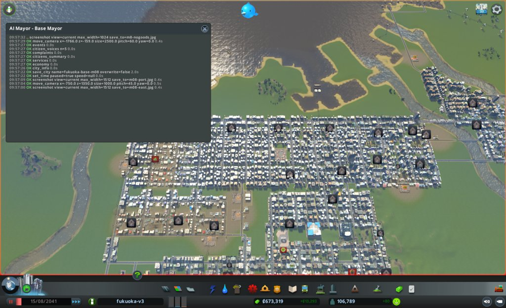
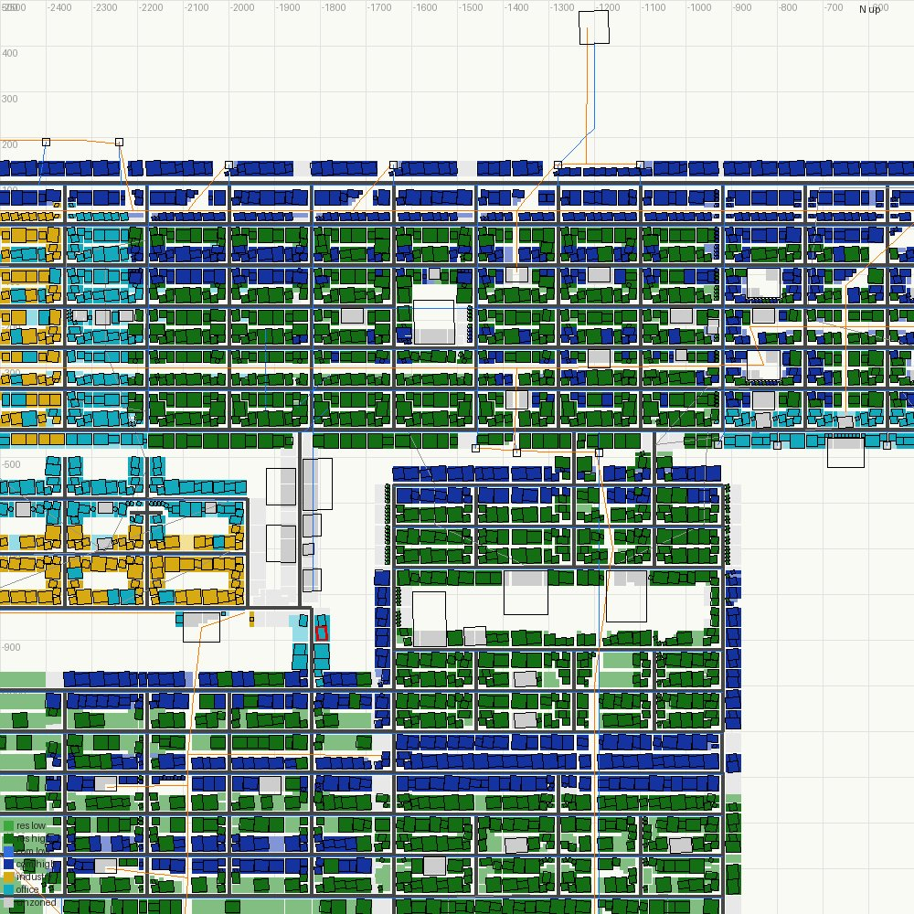
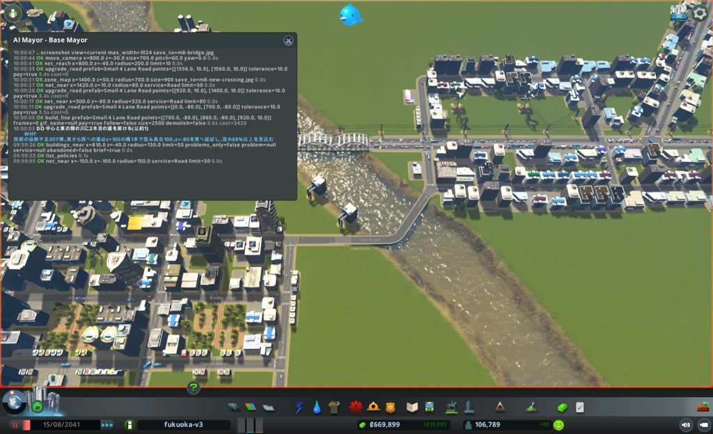

### 2041-08-25 見回り

境目: 当たらず。電気・水・下水が来ない市民は 0 / 0 / 0。つぶやきは2件(学校の賞、消臭剤)。週の収支 +13,197

- `traffic`: 流れ68%(月例66%)、止まった車128台(月例200)。(1079, 92) は止まった車の多い場所から消えた。混み具合100の区間に z=100 の x=503 が残る。止まった車の多い場所は東部 (4330, −506) 43台、南東 (2164, −862) 25台

### 2041-09-04 見回り

境目: 当たらず。電気・水・下水が来ない市民は 0 / 0 / 0。つぶやきは1件(植木の水やり)。人口は前回より52人増えただけ。週の収支 +13,106

- `cargo`: NoGoods 352棟(月例307。西部 -1209, −671 に164棟)。品物の輸入トラック169台(月例178)、地元の品物412台(月例357)。止まったトラック129台。原料が届かない工場126棟(月例113)。道を足しても、品物の輸入は増えていない

### 2041-09-14 8か月目の区切り(次の月例の前)

`advance(10)` の後、9か月目の月例に渡すために事実だけを残す。数字の表の行は9か月目の月例で足す。

- `city_info`: 人口107,086、所持金726,693、週の収支 +13,017(収入161,901、支出148,884)、幸福度81、需要 0 / 2 / 3、来ない市民 0 / 0 / 0。つぶやき1件(学校の賞)
- `traffic`: 流れ66%(月例66%、見回り68%)、止まった車189台。止まった車の多い場所は (2138, −841) 30台、(3701, −245) 30台、(1464, 69) 25台、(1336, 100) 18台。混み具合100に z=100 の (1800, 101)、西部の x=−1,833〜−1,845 の通りが残る
- `cargo`: NoGoods 382棟(月例307。西部 -1211, −726 に175棟、-2293, −665 に75棟、-998, 82 に59棟)。品物の輸入トラック179台(月例178)、地元の品物434台(月例357)。止まったトラック127台。原料が届かない工場124棟(月例113)
- `building_stats`: 放棄は高密度商業160棟(月例123)、工業55棟(月例44)。商業の働き口11,054、オフィスの働き口13,356(月例13,372)。オフィスの制約は公共交通607、地面の汚染230、葬祭182、娯楽152

### 2041-09-14 月例(9か月目)

保存: `fukuoka-base-m09`(2041-09-14、20.4MB)

#### 答え合わせ

- 中心と東の間の2本目の道(公約1): 予想「(1079, 92) の止まった車26台→15台以下、流れ66%→68%以上、NoGoods 307棟→280棟以下」。結果は (1079, 92) が止まった車の多い場所から消えた(当たり)。流れは見回りで68%、区切りで66%(外れ)。NoGoods 382棟(外れ)。半分当たり
  - 外れた理由の見立て: 道の詰まりは品物の根ではなかった。`trade` の輸入は品物4,066、石油4,114、鉱石4,085、林業4,056、農業4,938と、どれも週4,000前後でそろう。道路のつなぎ口から入る量に上限があると見る。品物の輸入トラックは179台で、道を足しても増えない
  - 次の扱い: 道は残す。品物を届けるための道の手当ては打ち切る。届く量に合わせて、品物と原料を使う建物の側を減らす(下の施策1)
- 次にやることの実行
  - 見回りで流れと (1079, 92) と新しい橋: 2041-08-25 に `traffic` で見た。実行した
  - NoGoods、品物の輸入トラック、放棄: 区切りで比べた(382棟、179台、商業160・工業55)。実行した
  - 人口の増え方: +694 → +297。細り続けた。大卒の働き口を増やす手を考え直した(下の施策1)。実行した
- 公約の進み具合
  1. 人口: 106,789 → 107,086(+297)。守れた。残り4回。最後の10日は+88で、来月は危うい
  2. 電気・水・下水が来ない市民: 0 / 0 / 0。任期の終わりまで保つ
  3. 週の収支: +13,017。黒字

#### 気づいたこと

- 住宅の需要は0。jobTerm −50(失業12,393、うち大卒12,012、空いた働き口1,368)、homeTerm −11(空き家1,830)。働く場所の需要は target 100、actual 3
- 放棄は218棟。商業の NoGoods が大半。工業の NoResources は西部(-2700〜−1950, −830〜0)、北(1880〜2620, 1050〜1520)、南東(1850〜3700, −900〜−1320)に固まる
- 北の工業地(2250, 1250、半径400)は肥沃さ・鉱石・石油・森林がどれも0。特化はできない。工業252棟のうち133棟が荷物の運送で止まり、間に混じるオフィス62棟は地面の汚染(35)と公共交通(27)でレベル1に止まる
- 区画の空きマス: オフィス912、工業144、高密度商業667。オフィスは場所ではなく需要の速さで止まる。働く場所の需要は工業とオフィスで共用で、放棄された工業の建て直しがその枠を使う
- 東部の埋立地: 4946・40118・39056 が満杯、10533(3900, −575)は98%で収集車5 / 19台。ごみの印32棟の中心は東部の工業地(3625, −333)に13棟
- 市民5人に困りごとはなかった。つぶやきなし
- 地下鉄と鉄道の線はまだ解禁されていない(`list_net_types` に出ない)

#### 施策

1. 原料の届かない工業地2か所(西部と北)で、放棄された建物を壊し、跡をオフィスの区画にする
   - 公約: 1(大卒に合う働き口を、放棄されない形で増やす)
   - 捨てるもの: なし
   - 理由: 原料の輸入は週約4,000で頭打ち。原料なし124棟のうち西部37棟・北35棟。建て直した工業はまた放棄され、働く場所の需要の枠を食う。失業の97%は大卒
   - 予想: 次の月例までに、原料が届かない工場が124棟から105棟以下になる。放棄された工業が55棟から40棟以下になる。オフィスの働き口が13,356から増える。費用0。南東の工業地は手を付けず、比べる相手にする
   - 操作: `bulldoze(what="abandoned")` を西部(-2300, −400、半径450)と北(2250, 1290、半径400)にかける。続けて `zone_rect` で、空いたマスをオフィスにする。西部は (-2630, −460)〜(-2390, 70) と (-2760, −790)〜(-1860, −480)、北は (1880, 1120)〜(2620, 1520)。建っている建物のマスは変わらない
2. 東部の満杯と満杯間近の埋立地2か所(4946、10533)を、同じ場所に置き直す
   - 公約: 1(ごみの印による放棄を防ぐ)と2(暮らしの土台)
   - 捨てるもの: なし
   - 理由: 東部の埋立地は3か所が満杯で、10533 は98%。ごみの印32棟のうち13棟が東部の工業地。5月と7月に埋立地を足した手は効いた
   - 予想: 次の月例までに、ごみの困りごとが32棟から15棟以下、東部(3625, −333)は13棟から3棟以下になる。建設費8,000。維持費は置き直しなので変わらない
   - 操作: `bulldoze` で 4946(3499, 618)と 10533(3900, −575)を壊し、`place_building("Landfill Site")` を同じ場所に置く。4946 は南向き(z=580 の道)、10533 は西向き(x=3860 の道)
   - 危うさ: 壊すと中の約16Mのごみは消える。街の埋立地の容量は152Mのうち使用114Mで、2か所分は置き直しで戻る

1の結果: 成功。西部(-2300, −400、半径450)で26棟(工業14、商業12)、北(2250, 1290、半径400)で工業20棟を取り壊した。費用0。`zone_rect` でオフィスにしたマスは、西部の北の四角109、西部の南の四角219、北234(建っているマスは飛ばした)。北の `zone_map` で、空いたマスが水色(オフィスの空き)になったのを確かめた
- 西部の円には、四角の外の放棄された商業(-2664, −374 など)も入った。その跡は商業の区画のまま
2の結果: 成功。10533 を壊し、(3900, −575)に Landfill Site を西向きで置いた(id 46690、4,000。入口は区間16162)。4946 を壊し、(3499, 618)に南向きで置いた(id 38094、4,000。入口は区間34031)。取り壊した区画の建物0。`net_reach`(3700, 0、半径700)で建物619棟に問題なし。合計8,000
- 建設費の合計8,000は、所持金726,693の半分に収まる。週の維持費は置き直しで変わらない

#### 考えたが打たなかった手

- 西部の放棄された商業(約100棟)を壊して跡をオフィスにする: 商業の区画を減らせば残りの店に品物が回る見込み。ただし区画の境が入り組み、四角で塗ると空いた住宅のマスまで変わる。工業の跡の効き目を見てから考える
- 南東の工業地(原料なし41棟)も同じくオフィスにする: 比べる相手として今月は残す
- 東部のバスや地下鉄でオフィスの公共交通の制約(607棟)を減らす: 地下鉄の線は解禁されていない。バスは1本で数棟しか動かなかった(5か月目)
- 学びの後押し(EducationBoost、週3,740)を外す: 大卒が増えても働き口の数は変わらない。黒字なので今は触らない
- 税と予算: 黒字。住宅の需要を止めているのは大卒の失業で、税の項はない
- 3件目の施策: 打たなかった。工業の跡とごみの効き目を切り分けたいため

#### 次にやること

- 見回りで、ごみの困りごと(32棟、東部13棟)と新しい埋立地 46690・38094 の収集車を見る
- 見回りで、`new_buildings`(since=44111)で、跡にオフィスが建ち始めたかを見る
- 次の月例で、原料が届かない工場(124棟。西部37、北35、南東41)、放棄された工業(55棟)、オフィスの働き口(13,356)を比べる
- 次の月例で、人口の増え方(+297)を見る。0を下回りそうなら、空き家(1,830)を埋める手を考える

#### 画面写真

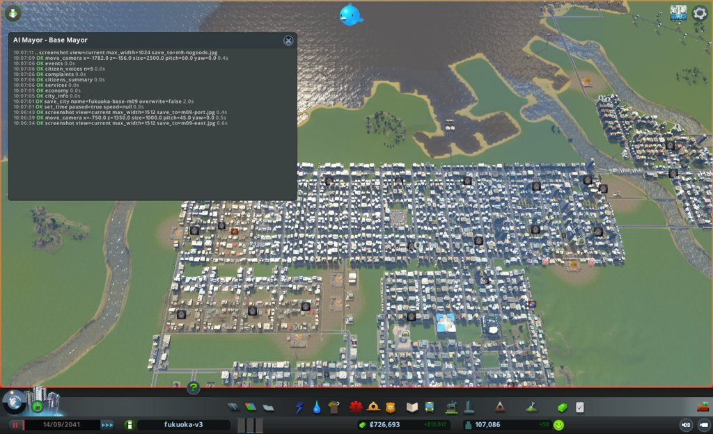
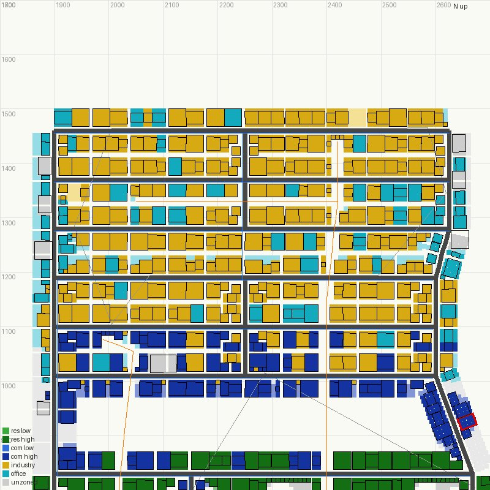
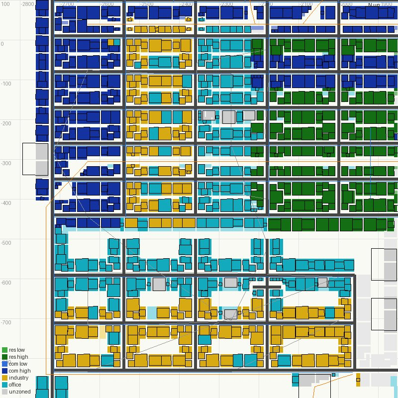
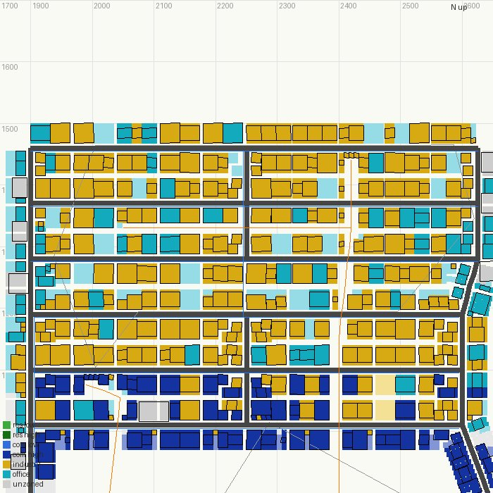

### 2041-09-24 見回り

境目: 当たらず。電気・水・下水が来ない市民は 0 / 0 / 0。つぶやきは1件(ごみ収集車が来ない)。人口は前回より12人増えただけ

- 新しい埋立地 46690・38094: どちらも収集車 19 / 19台が出て、蓄えは1%
- `new_buildings`(since=44111、次は 44231): 高密度商業19、工業6、オフィス4。働く場所の需要は actual 6

### 2041-10-04 見回り

境目: 当たらず。電気・水・下水が来ない市民は 0 / 0 / 0。つぶやきは2件(水道管を待つ声、学校の賞)。人口は前回より12人増えただけ

- `new_buildings`(since=44231、次は 44355): 高密度商業22、工業6、オフィス8

### 2041-10-14 9か月目の区切り(次の月例の前)

`advance(10)` の後、10か月目の月例に渡すために事実だけを残す。数字の表の行は10か月目の月例で足す。

- `city_info`: 人口107,114(月例107,086、+28)、所持金774,494、週の収支 +12,935(収入161,812、支出148,877)、幸福度81、需要 0 / 2 / 2、来ない市民 0 / 0 / 0。つぶやきなし
- `complaints`: 困りごとのある建物516棟(月例453)。NoGoods 442棟(月例382。中心は西部 -1783, −138 に166棟)、ごみ32棟(月例32。中心は東部から西部 -2090, −381 の14棟へ移った)、汚染10棟、騒音9棟、死体7棟、TooFewServices 4棟(南西のオフィス -1183, −1754)
- `cargo`: 原料が届かない工場122棟(月例124。南東 3049, −994 に45、西部 -2368, −578 に35、北 2204, 1268 に34)。品物の輸入トラック212台(月例179)、地元の品物381台(月例434)。止まったトラック133台(うち南東のつなぎ口 5784, −8640 に30台)
- `building_stats`: 放棄は高密度商業188棟(月例160)、工業41棟(月例55。月例で34棟を壊した)、オフィス2棟。オフィスの働き口13,454(月例13,356)、工業の働き口11,138、商業の働き口10,620(月例11,054)
- `demand_breakdown`: 失業12,791(うち大卒12,360)、働き口42,912(月例43,424)、空いた働き口1,117、空き家1,907。jobTermRaw −54。働く場所の需要 target 100、actual 2
- `new_buildings`(since=44355、次は 44487): 高密度商業17、工業7、オフィス3。月の合計(since=44111)は高密度商業58、工業19、オフィス15

### 2041-10-14 月例(10か月目)

保存: `fukuoka-base-m10`(2041-10-14、20.2MB)

#### 答え合わせ

- 西部・北の工業の跡をオフィスにする(公約1): 予想「原料なし124棟→105棟以下、放棄の工業55棟→40棟以下、オフィスの働き口が増える」。結果は原料なし122棟、放棄の工業41棟、オフィスの働き口13,454(+98)。半分当たり
  - 外れた理由の見立て: 跡に建ったオフィスは月15棟だけ。働く場所の需要は工業とオフィスで共用で、同じ月に工業が19棟建ち直した。工業の空きマスが残る限り、建て直しが需要を食い、また原料なしになる
  - 次の扱い: 続ける。比べる相手に残した南東の工業地にも広げ、工業の建て直しを止める(下の施策1)
- 東部の埋立地2か所の置き直し(公約1・2): 予想「ごみの困りごと32棟→15棟以下、東部13棟→3棟以下」。結果は東部(3625, −333、半径800)0棟で当たり。街全体は32棟で外れ。中心は西部の工業地(-2090, −381)の14棟
  - 外れた理由の見立て: 東部は解けたが、西部の工業地の収集が追いつかない。先月の取り壊しの跡の工事で、収集の道が変わった可能性もある
  - 次の扱い: 建物は残す。西部のごみは来月の数を見てから決める
- 次にやることの実行
  - 見回りでごみと新しい埋立地: 2041-09-24 に見た(収集車19 / 19台)。実行した
  - 見回りで跡のオフィス: 2回とも `new_buildings` で見た。実行した
  - 原料なし・放棄の工業・オフィスの働き口: 9か月目の区切りと今回で比べた。実行した
  - 人口の増え方: +297 → +28。0に近づいた。空き家(1,907)を埋める手は、住宅の需要が0で効かないと分かった(下の気づいたこと)。実行した
- 公約の進み具合
  1. 人口: 107,086 → 107,114(+28)。守れた。残り3回。次の月例で減る見込みが高い
  2. 電気・水・下水が来ない市民: 0 / 0 / 0。任期の終わりまで保つ
  3. 週の収支: +12,935。黒字

#### 気づいたこと

- 住宅の需要の target は 50 + jobTerm(−50。生の値−54)+ homeTerm(−12)= 0 で切れる。需要を1でも上げるには、失業と空いた働き口の差を約3,500縮める必要がある。1か月に建つオフィスは15〜30棟で、届かない
- 失業12,114人のうち大卒11,877人。長く失業している市民は10,948人
- 商業の働き口が10,620(先月11,054)に減った。放棄された商業188棟(先月160)。商業の建て直しは月58棟あるが、品物が届かずまた放棄される
- 品物と原料の輸入は、どれも週4,100〜5,000でそろう(`trade`)。道路のつなぎ口は南(5788, −8649 など)と北(5294, 8649 など)
- 南東の工業地(2100〜2440, −920〜−950)に止まった車が124台。z=−950 の4車線の通りの途中、x=2160〜2280 の3区間だけが片側1車線の Basic Road。混み具合100
- 南東の工業地は肥沃さ・鉱石・石油が0で、特化はできない
- 医療の届き具合は、西部の住宅地(-1338, 280〜−465)で0〜39、中心の南(85〜1508, −838)で4〜19と薄い。健康の平均は70
- 市民5人に困りごとはなかった。つぶやきなし

#### 施策

1. 南東の工業地で、放棄された建物を壊し、空いた工業のマスをオフィスにする
   - 公約: 1(大卒に合う働き口を増やし、工業の建て直しに働く場所の需要を食わせない)
   - 捨てるもの: なし
   - 理由: 南東の原料なし45棟。先月の西部・北と同じ根。工業の建て直しが月19棟あり、オフィスの建つ分を減らしている
   - 予想: 次の月例までに、原料が届かない工場が122棟から105棟以下、放棄された工業が41棟から30棟以下になる。月に建つオフィスが15棟から25棟以上になる。費用0
   - 操作: `bulldoze(what="abandoned")` を南東(2300, −1150、半径550)と(3100, −1250、半径600)にかける。続けて `zone_rect` で、空いたマスをオフィスにする。(1850, −880)〜(2250, −1170) と (2500, −1060)〜(3750, −1400)
2. 南東の工業地の z=−950 の通りの途中の2車線(x=2160〜2280)を、前後と同じ Small 4 Lane Road に差し替える
   - 公約: 1(工業地とオフィス街の行き来を通し、品物と原料を届ける)
   - 捨てるもの: なし
   - 理由: (2299, −921) に止まった車79台、近くに25台・20台。4車線の通りが3区間だけ2車線に細る
   - 予想: 次の月例までに、南東(2280, −930、半径300)の止まった車が124台から50台以下になる。費用1,000未満、維持費の増えはほぼ0
   - 危うさ: 沿道の建物が道路の幅の分だけ壊れることがある。結果の数を確かめる

1の結果: 成功。南東(2300, −1150、半径550)で5棟、(3150, −1250、半径600)で3棟、合わせて放棄された工業8棟を取り壊した(荷物置き場 cargoyard 1棟を含む)。費用0。`zone_rect` でオフィスにしたマスは、西の四角104、東の四角184(建っているマスは飛ばした)。`zone_map` で空いたマスが水色になったのを確かめた
- 放棄は予想より少なかった。南東の原料なし45棟の大半は、まだ放棄されずに建っている
2の結果: 失敗。`upgrade_road` は3区間とも選んだが、差し替えは0(区間3334と19196は ObjectCollision、36011は TooShort)。費用0
- 区間36011は長さ9m。x=2220(南へ)と x=2236(北へ)の2つのT字の交差点が16m離れて並ぶ。詰まりの根はこのずれた交差点の可能性がある
- 何がぶつかったかは道具が返さなかった。沿道の建物を推測で壊す手は打たなかった

#### 考えたが打たなかった手

- 西部の住宅地(-1338, 100 あたり)に病院を建て、亡くなる人を減らす: 医療の届き具合は0〜39と薄い。ただし病院の定員は1,315 / 2,700 で余り、人口への効き目の予想が立たない。置ける空き地も道路のない北側しかない。建設費65,000、週2,400
- 区間3334・19196の沿道の建物を壊して4車線にする: ぶつかった物が分からない。推測で建物を壊すと働き口が減る
- 西部の放棄された商業(188棟の多く)を壊してオフィスにする: オフィスの空きマスは912あり、足りないのはマスではなく需要の速さ。商業の区画を減らしても、オフィスの建つ速さは上がらない
- 産業の特化: 南東・北とも肥沃さ・鉱石・石油が0
- 学びの後押し(EducationBoost、週3,740)を外す: 黒字で、今外しても失業は減らない
- 税と予算: 住宅の需要の式に税の項はない。工業とオフィスの税は1%で下げられない
- 3件目の施策: 打たなかった。人口を今月増やす確かな手が見つからなかった

#### 次にやること

- 見回りで、`new_buildings`(since=44487)で、オフィスと工業の建つ数を見る
- 見回りで、`traffic`(2280, −930、半径300)の止まった車(124台)を見る。減らなければ、ずれた2つのT字の交差点の手を次の月例で考える
- 次の月例で、原料が届かない工場(122棟。南東45)、放棄された工業(41棟)、オフィスの働き口(13,454)を比べる
- 次の月例で、人口が減ったかを見る。減ったら公約1を守れなかった事実と理由をノートに書く

#### 画面写真

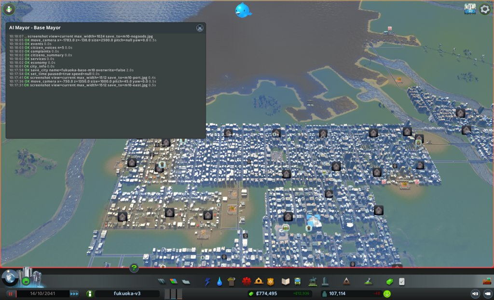
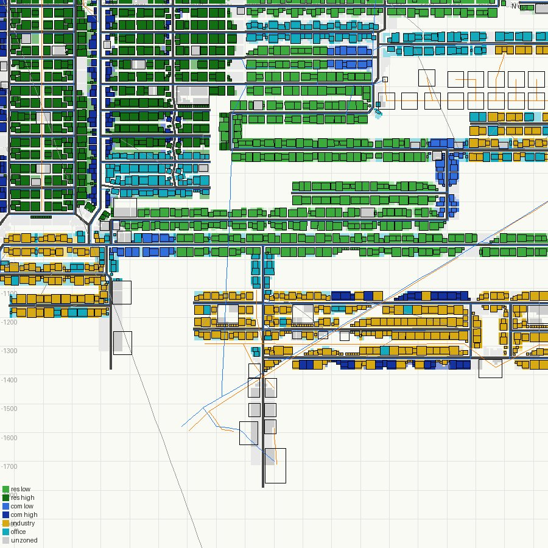
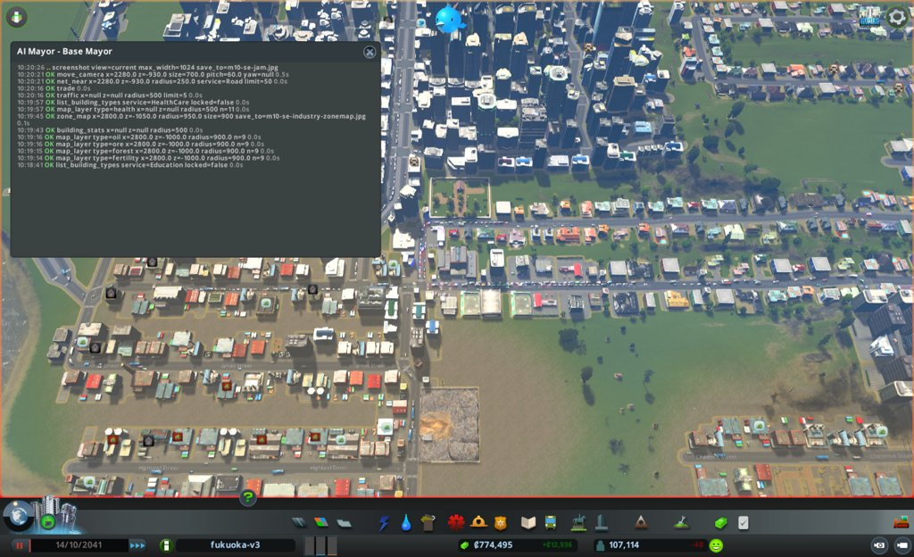
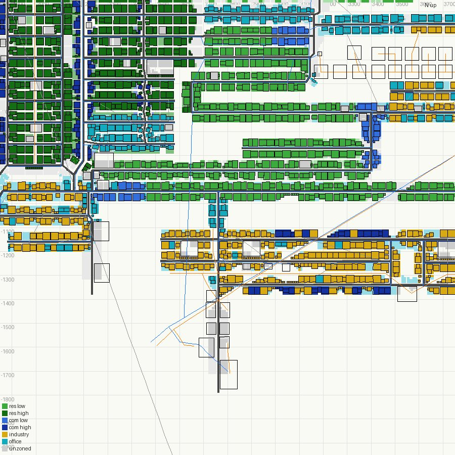

### 2041-10-24 見回り

境目: 当たらず。電気・水・下水が来ない市民は 0 / 0 / 0。つぶやきは2件(朝日、スマートホーム)。人口は前回より19人減った(5%に届かない)

- `new_buildings`(since=44487、次は 44608): 高密度商業19、工業4、オフィス10
- `traffic`(2280, −930、半径300): 止まった車66台。多い場所は (2128, −874) 48台、(2173, −775) 16台。混み具合100は z=−950 の東側(x=2370〜2490)の4車線

### 2041-11-03 見回り

境目: 当たらず。電気・水・下水が来ない市民は 0 / 0 / 0。つぶやきは1件(魅力的な街の賞)。人口は前回より348人減った(0.3%。5%に届かない)。週の収支 +12,044

- `new_buildings`(since=44608、次は 44737): 高密度商業21、工業7、オフィス6。工業の建て直しは止まっていない

### 2041-11-13 10か月目の区切り(次の月例の前)

`advance(10)` の後、11か月目の月例に渡すために事実だけを残す。数字の表の行は11か月目の月例で足す。

- `city_info`: 人口106,680(月例107,114、−434)、所持金826,686、週の収支 +12,008(収入160,884、支出148,876)、幸福度81、需要 0 / 2 / 4、来ない市民 0 / 0 / 0。つぶやき1件(学生の発明)
- 公約1: 月例の人口が前の月例より減った。10か月目で初めて守れなかった。住宅の需要は0のままで、引っ越してくる人は7人だけ
- `citizens_summary`: 失業13,243(月例12,114。うち大卒12,926)、長く失業10,948→11,644、就業41,790→40,625、病気1,303
- `demand_breakdown`: 失業13,729、働き口41,814(月例42,912)、空いた働き口1,139、空き家2,015。jobTermRaw −60(月例−54)
- `building_stats`: 放棄は高密度商業261棟(月例188)、工業52棟(月例41)。商業の働き口9,707(月例10,620)、工業10,828(月例11,138)、オフィス13,601(月例13,454)
- `new_buildings`(since=44737、次は 44861): 高密度商業22、工業6、オフィス7。月の合計(since=44487)は高密度商業62、工業17、オフィス23
- `cargo`: NoGoods 473棟(月例442。西部 -1246, −800 に225棟)、原料が届かない工場151棟(月例122。北 2233, 1275 に57、南東 3003, −1011 に47、西部 -2340, −577 に39)。品物の輸入トラック234台、地元の品物393台。止まったトラック175台(うち南のつなぎ口 5783, −8639 に72台)
- `traffic`(2280, −930、半径300): 止まった車28台(月例124)。多い場所は (2182, −835) 14台、(2195, −767) 11台。混み具合100は x=2110〜2130 の Basic Road

### 2041-11-13 月例(11か月目)

保存: `fukuoka-base-m11`(2041-11-13、19.9MB)

#### 答え合わせ

- 南東の工業の跡をオフィスにする(公約1): 予想「原料なし122棟→105棟以下、放棄の工業41棟→30棟以下、月に建つオフィス15棟→25棟以上」。結果は原料なし151棟(南東45→47)、放棄の工業52棟、オフィス23棟。外れ
  - 外れた理由の見立て: 壊せた放棄は8棟だけで、原料なしの工場の大半は建ったまま残った。工業の建て直しは月17棟で止まらず、原料の輸入は南と北の遠いつなぎ口から来るため、新しい工場もまた原料なしになる
  - 次の扱い: やめる。北の工業地でもオフィスは L1 のまま地面の汚染で止まっており(70棟中41棟)、工業の中にオフィスを混ぜても働き口は伸びにくい
- z=−950 の通りの4車線化(公約1): 打てなかった。止まった車は手を入れずに124→28台に減った。施策の効き目ではない
- 次にやることの実行
  - 見回りで `new_buildings`: 2回とも見た。実行した
  - 見回りで `traffic`(2280, −930): 2041-10-24 に見た(66台)。実行した
  - 原料なし・放棄の工業・オフィスの働き口: 10か月目の区切りと今回で比べた。実行した
  - 人口が減ったときの記録: 10か月目の区切りに書いた。実行した
- 公約の進み具合
  1. 人口: 107,114 → 106,680(−434)。守れなかった(初めて)。残り1回
  2. 電気・水・下水が来ない市民: 0 / 0 / 0。任期の終わりまで保つ
  3. 週の収支: +12,008。黒字

#### 気づいたこと

- 住宅の需要は jobTermRaw −60(失業13,729、空いた働き口1,139)で0に切れる。−50 を割り込まなくするだけで約7,000の差を縮める必要があり、1か月では届かない。公約1は来月も守れない見込みが高い
- 学校はどれも満席(小7,175 / 7,200、高12,968 / 13,000、大8,631 / 9,000)。失業の97%(12,926)は大卒で、大学を足しても失業は吸えない
- 商業の働き口が1か月で913減った(10,620→9,707)。放棄の商業は188→261棟。品物の届かない店は西部(-1246, −800)に225棟。品物と原料の輸入はすべて道路で、つなぎ口は南東(5788, −8649)と北(5294, 8649)。輸出は1
- 医療の届き具合の地図で、西部の住宅地の x=−1575 の列(z=220〜−711)がほぼ0(0〜5)。病院の定員は1,298 / 2,700 で余っている。健康の平均70、病気1,303人
- 南西のオフィス(-1136, −1754 あたり、140棟)は132棟がサービスで止まり、いちばん欠けるのは葬祭(65棟)。TooFewServices の印5棟もここ。近くの火葬場は北の (-1825, −702) と (-1010, −276) だけ
- 交通の流れは67%。止まった車は中心と東を結ぶ z=100 の Medium Road(1111, 93)に48台
- 市民5人に困りごとはなかった。つぶやきなし

#### 施策

1. 南西のオフィス街の南に火葬場を建てる
   - 公約: 1(オフィスのレベル上げで働き口を増やし、失業を減らす)
   - 捨てるもの: なし
   - 理由: 南西のオフィス140棟のうち65棟が葬祭の届き具合で止まる。1月に中心の南へ建てたときは、葬祭の制約が301→187棟に減った
   - 予想: 次の月例までに、南西(-1100, −1700、半径700)のオフィスの葬祭の制約が65棟から25棟以下になる。TooFewServices の印が5棟から0棟になる。建設費25,000、週の支出が約720増える
   - 操作: `place_building("Crematory", x=-1125, z=-1880, facing=west)`。南へ延びる x=−1150 の道路に面させる
2. 西部の住宅地の、医療の届かない列に診療所を建てる
   - 公約: 1(病気を治し、亡くなる人を減らして人口の減りを抑える)
   - 捨てるもの: なし
   - 理由: x=−1575 の列の医療の届き具合が0〜5。病院の定員は余っており、足りないのは近さ。品物が届かず放棄された店(11751、4x4)の跡を使う
   - 予想: 次の月例までに、(-1540, −450) あたりの医療の届き具合が0から50以上になる。街の病気の人が1,303人から1,200人以下になる。建設費10,000、週の支出が約400増える。人口への効き目は小さく、減りを止めるまでは届かない見込み
   - 操作: `bulldoze(what="abandoned")` を (-1540, −536)、半径20 にかけ、跡に `place_building("Medical Clinic", x=-1540, z=-536, facing=south)`。z=−560 の Basic Road に面させる

1の結果: 成功。ただし2手かかった
- 初めの (-1125, −1880) は入口の前に道路がなかった(road null)。道路は x=−1200 にあり、地図の読みが50mずれていた。`relocate_building` で (-1180, −1885) へ移した(5,000)。id 22642、建設費の合計30,000
- `water_trace` で水・下水が届いていなかった(最寄りの管150m)。(-1190, −1735) の管から道路の下を通して (-1180, −1885) まで管を引いた(460)。届いたかは見回りで見る
2の結果: 成功。放棄された店 11751 を1棟取り壊し、診療所 id 25212 を置いた(10,000)。入口は Basic Road(区間33769)に面した。取り壊した区画の建物0

#### 考えたが打たなかった手

- 北の工業地の工業をさらにオフィスにする: 北のオフィス70棟は67棟が L1 のままで、41棟が地面の汚染で止まる。工業に混ぜても働き口は伸びにくい。南東の答え合わせで、続けない
- 西部に貨物の駅をつくり、鉄道で原料と品物を入れる: 鉄道のつなぎ口は北(3150, 8644)と南(7012, −8644)で、西部まで10km近い。残り2か月で効き目を見られない
- z=100 の Medium Road(止まった車48台)を Large Road にする: 沿道の建物が道路の幅の分だけ壊れ、働き口と家が減る
- 西部の住宅地に病院(65,000、週2,400)を建てる: 置ける大きさの空き地がない。病院の定員は余っており、まず小さな診療所で届き具合の効き目を見る
- 高齢者の健康のための施設(Eldercare 01、12x6)を建てる: 西部に置ける空き地がない
- 放棄された商業261棟をまとめて壊す: 2月に壊したときは、建て直した店がまた品物が届かず放棄された
- 税と予算: 住宅の需要は失業で止まり、税では動かない。黒字で動かす理由がない
- 3件目の施策: 打たなかった。人口を今月増やす確かな手が見つからなかった

#### 次にやること

- 見回りで、火葬場 22642 と診療所 25212 の電気・水・下水(`buildings_near` の grid)を見る。来なければ管を引き直す
- 次の月例で、南西のオフィスの葬祭の制約(65棟)、TooFewServices(5棟)、(-1540, −450) の医療の届き具合、病気の人(1,303)を比べる
- 次の月例で、人口が減ったかを見る。任期の終わりなので、公約1の結果を「公約の結果」に書く

#### 画面写真

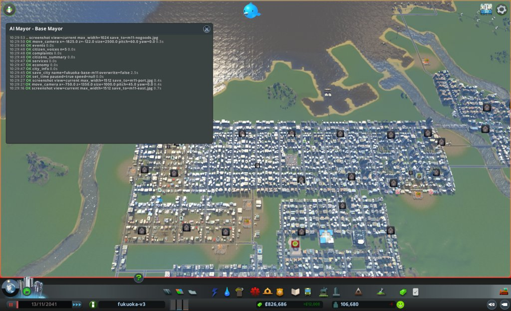

### 2041-11-23 見回り

境目: 当たらず。電気・水・下水が来ない市民は 0 / 0 / 0。つぶやきは1件(死体の回収)。人口は前回より226人減った(0.2%)。週の収支 +9,902(支出が1,570増えた)

- 火葬場 22642: 電気・水・下水とも来た。霊柩車 4 / 9 が稼働、働き手23
- 診療所 25212: 電気・水・下水とも来た。救急車 10 / 10 が稼働、患者2 / 100、働き手28

### 2041-12-03 見回り

境目: 当たらず。電気・水・下水が来ない市民は 0 / 0 / 0。つぶやきは2件(放棄された家、学校の賞)。人口は前回より194人増えた。週の収支 +10,775

### 2041-12-13 11か月目の区切り(次の月例の前)

`advance(10)` の後、12か月目の月例に渡すために事実だけを残す。数字の表の行は12か月目の月例で足す。

- `city_info`: 人口106,755(月例106,680、+75)、所持金832,012、週の収支 +11,029(収入161,473、支出150,444)、幸福度83、需要 0 / 2 / 2、来ない市民 0 / 0 / 0。つぶやき1件(庭の光る樽)
- `citizens_summary`: 失業14,012(月例13,243。うち大卒13,746)、長く失業12,647、就業39,791(月例40,625)、病気1,200(月例1,303)、健康の平均73(月例70)、体調の悪い市民755(月例790)、高齢者19,506、引っ越し中18
- `complaints`: 困りごとのある建物571棟(月例547)。NoGoods 526棟(月例473。中心は西部 -1816, −135 に190棟)、ごみ4棟(月例18)、騒音8棟、汚染9棟、死体4棟(月例8)、TooFewServices 2棟(月例5。南西のオフィス)
- `building_stats`(南西 -1100, −1700、半径700): オフィスの葬祭の制約20棟(月例65)、公共交通96棟(月例51)。L1 18棟、L2 120棟で、レベルはまだ上がっていない。働き口1,339。放棄の商業62 / 141棟(月例50)
- `map_layer` health(-1560, −450、半径300): 5×5の点で56〜129、平均99(月例の地図では x=−1575 の列が0〜5)

### 2041-12-13 月例(12か月目)

保存: `fukuoka-base-m12`(2041-12-13、20.3MB)

#### 答え合わせ

- 南西のオフィス街の南の火葬場(公約1): 予想「葬祭の制約65棟→25棟以下、TooFewServices 5棟→0棟」。結果は葬祭の制約20棟(当たり)、TooFewServices 2棟(外れ)。半分当たり
  - 外れた理由の見立て: 葬祭は届いたが、公共交通の制約が51→96棟に増え、次に欠ける項目に移った。レベルはまだ上がらず、印の残る2棟は別の欠けで止まる
  - 次の扱い: 建物は残す。任期の最後なので、公共交通の手は申し送りに回す
- 西部の住宅地の診療所(公約1): 予想「(-1540, −450) の届き具合0→50以上、病気1,303→1,200人以下」。結果は平均99、病気1,200人。当たり
  - 人口は +75 で、減りは止まった。診療所の効き目だけとは切り分けられない
  - 次の扱い: 残す
- 次にやることの実行
  - 見回りで火葬場と診療所の電気・水・下水: 2041-11-23 に見た(どちらも来た)。実行した
  - 葬祭の制約・TooFewServices・届き具合・病気: 11か月目の区切りと今回で比べた。実行した
  - 人口が減ったか: 106,680→106,755(+75)。増えた。実行した
- 公約の進み具合
  1. 人口: 106,680 → 106,755(+75)。守れた。任期の終わり(2042-01-12ごろ)の数字で結果を書く
  2. 電気・水・下水が来ない市民: 0 / 0 / 0。任期の終わりまで保つ
  3. 週の収支: +11,029。黒字

#### 気づいたこと

- 住宅の需要は0のまま。jobTermRaw −66(失業14,637、空いた働き口1,094)、homeTerm −13(空き家2,155)。失業の97%(14,176)が大卒。1か月で動かせる差ではない
- 水と下水が来ない建物が2棟ある(住民ではない)。オフィス 4106(-1796, −886)は最寄りの管98m、店 29491(2658, 925)は最寄りの管100m。どちらも管の網の切れ目に建つ。市民の数え(0 / 0 / 0)には入らないが、働き口が放棄で消える前に直せる
  - 4106: 管の端 10101(-1815, −790)から、x=−1819 の道路の下を南へ z=−1015 の管(区間31743)まで約225m
  - 29491: 管の端 21930(2595, 1005)から、斜めの道路(2623, 950)(2645, 890)に沿って管の端 5928(2663, 825)まで約200m
- 医療の届き具合が0の場所は、南の地図の端の人のいない所(zone_map で建物なし)。住宅地の穴ではない
- 満杯の埋立地は8か所(先月6)。ごみの印は4棟(先月18)と少ない。埋立地の空きは152Mのうち45M
- 市民5人のうち1人が失業2週(大卒)。ほかに困りごとはない。つぶやきなし

#### 施策

1. 水と下水の来ない建物2棟に、管の網の切れ目をつなぐ
   - 公約: 2(電気・水・下水を街の全部に届ける。市民の数えには入らない建物だが、同じ網の穴)と1(働き口と店を放棄から守る)
   - 捨てるもの: なし
   - 理由: 4106 と 29491 は、管の網の端から約100m離れ、水も下水も来ない(MajorProblem・FatalProblem)。放っておくと放棄される
   - 予想: 次の見回り(2041-12-23)までに、2棟の grid の水と下水が true になり、`complaints` の Water が2棟から0棟になる。建設費は2本で1,000未満、週の維持費の増分は10未満
   - 操作: `build_line("Water Pipe")` を (-1815, −790)→(-1819, −1015) と (2595, 1005)→(2623, 950)→(2645, 890)→(2663, 825) に引く

1の結果: 成功。西の管は3区間、始点は管の端 10101 につながり、終点は区間31743を分けてつないだ(540)。東の管は3区間、両端とも既存の管の端につながった(500)。合計1,040。届いたかは見回りで見る
- 建設費1,040は、所持金832,012の半分に収まる。週の維持費の増分は小さく、黒字 +11,029 に収まる

#### 考えたが打たなかった手

- 失業(大卒14,176)を吸うオフィスを増やす: 働く場所の需要は actual 2。区画を足しても建つ速さは変わらない(9〜11か月目の結果)
- 満杯の埋立地8か所を置き直す: ごみの印は4棟だけで、空きは45M残る。最後の月に建て直す理由が弱い
- 住宅の税を下げる: 住宅の需要の式に税の項はなく、黒字が減るだけ
- 南西のオフィスの公共交通(96棟)にバスを足す: 5か月目までに、1本で数棟しか動かなかった。1か月では答え合わせもできない
- 2件目・3件目の施策: 打たなかった。人口を今月増やす確かな手が見つからず、任期の終わりの数字を乱したくないため

#### 次にやること

- 見回りで、4106 と 29491 の grid(水・下水)と `complaints` の Water を見る。来なければ管を引き直す(臨時)
- 任期の終わり(2042-01-12ごろ)に、人口・来ない市民・週の収支を見て「公約の結果」を書く

#### 画面写真

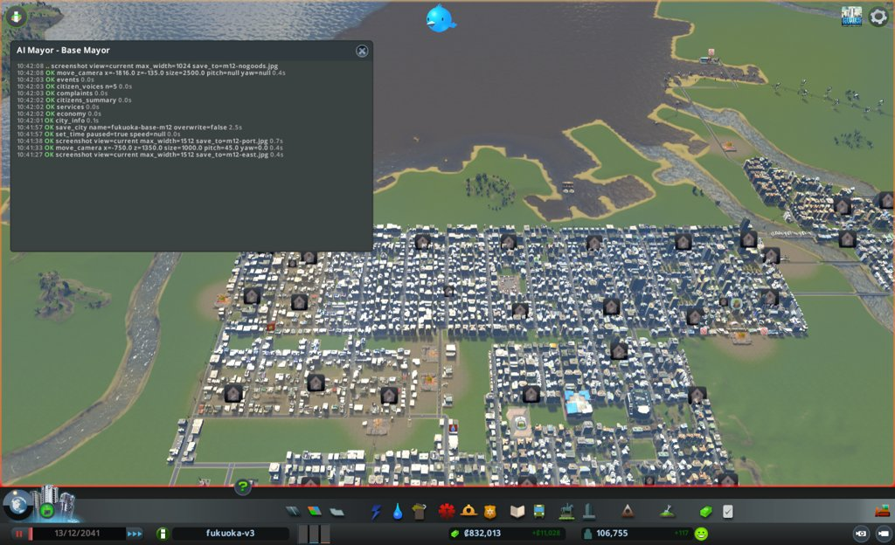
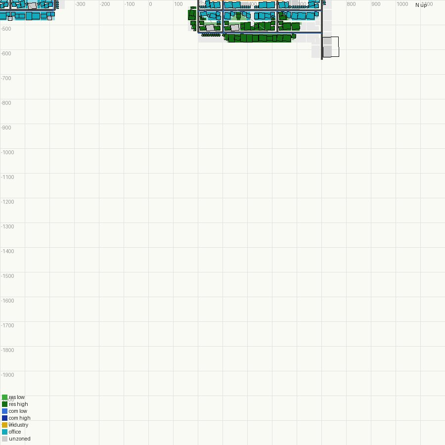

### 2041-12-23 見回り

境目: 当たらず。電気・水・下水が来ない市民は 0 / 0 / 0。つぶやきなし。人口は前回より97人増えた。週の収支 +11,529

- 管の確かめ: 水の印は2棟→1棟。4106 は印が消えた。29491 は grid の水・下水とも true(最寄りの管24m)になったが、印(Water、FatalProblem)はまだ残る

### 2042-01-02 見回り

境目: 当たらず。電気・水・下水が来ない市民は 0 / 0 / 0。つぶやきは2件(騒音と木、学校の賞)。人口は前回より69人増えた。週の収支 +11,677

### 2042-01-12 任期の終わり(12か月目の区切り)

`advance(10)` の後、任期の終わりの数字として事実だけを残す。

- `city_info`: 人口106,966(月例106,755、+211)、所持金880,072、週の収支 +11,654(収入162,096、支出150,442)、幸福度83、需要 0 / 2 / 2、来ない市民 0 / 0 / 0。つぶやき1件(警察の貸し倉庫の冗談)。ダイアログなし
- `citizens_summary`: 失業14,847(うち大卒14,576)、長く失業13,497、就業39,051、病気1,080(月例1,200)、健康の平均73、体調の悪い市民710、引っ越し中4。電気・水・下水が来ない市民 0 / 0 / 0
- `complaints`: 困りごとのある建物580棟(月例571)。NoGoods 552棟(中心は西部 -1790, −132 に197棟)、LandValueLow 11、死体6、汚染5、ごみ3、水1(29491)、騒音1。TooFewServices は消えた
- 施策1の答え合わせ: 4106 の水の印は消えた。29491 は grid が true のまま、印が残る。管の網の穴はふさいだ

## 人が手を入れたこと

- 2026-10-21 21:18(実時間): 画面の録画を始めた
- 1か月目の前: 親がパネルの見出しを `AI Mayor - Base Mayor` にし、定点の写真3枚を `assets/fixed/m01-*.jpg` に撮った
- 1か月目の後: 親が `fukuoka-base-m01-end`(2041-02-16)に保存した。1か月目の2回目のために `fukuoka-base-m01` を読み込み直すと、1回目の終わりの街が消えるため。2か月目はこの保存から続ける
- 2026-10-22 08:37(実時間): 人が `fukuoka-base-m01-end` を読み込み、録画を始めた。親が見出しを戻し、定点の写真3枚を `assets/fixed/m02-*.jpg` に撮った
- 2か月目の後: 1か月目のパネルのログを `command-log-m01.txt` に写した。ゲームを起動し直したため、`command-log.txt` は2か月目からの分で上書きされていた
- 6か月目の後: 人の求めで一度止めた。録画が大きく、6か月ごとに圧縮するため。親が `fukuoka-base-m06-end`(2041-07-16)に保存し、パネルのログを `command-log-m02-m06.txt` に写した。7か月目はこの保存から続ける
- 2026-10-22 09:49(実時間): 録画を始め直した。ゲームは閉じずに続けた(パネルのログが 09:26 から続いている)。親が見出しを戻し、定点の写真3枚を `assets/fixed/m07-*.jpg` に撮った
- 12か月目の途中: 人が誤って録画を止め、すぐに始め直した。1本目は 10:44 に終わり、2本目(約7分28秒)は 10:52 に終わったので、抜けは数秒とみている。2本は圧縮した後に `base-20261022-0949.mp4` につないだ
- 12か月目の後: 親が `fukuoka-base-m12-end`(2042-01-12)に保存した。`fukuoka-base-end` は 2026-10-19 の運営が使っていたため。パネルのログを `command-log-m07-m12.txt` に写した
- 12か月目だけ、呼ぶ文に「これが最後の月です。公約の結果と申し送りを書いてください」と足した。市長は、何か月目が任期の最後かを知らないため

### 月ごとの実時間とトークン

| 月 | 実時間 | トークン | 道具の呼び出し |
|---|---|---|---|
| 1 | 7分51秒 | 105,819 | 61 |
| 2 | 8分53秒 | 116,872 | 65 |
| 3 | 9分13秒 | 123,014 | 77 |
| 4 | 9分27秒 | 131,138 | 90 |
| 5 | 9分43秒 | 145,947 | 97 |
| 6 | 9分22秒 | 123,218 | 70 |
| 7 | 6分54秒 | 113,165 | 63 |
| 8 | 8分59秒 | 151,132 | 68 |
| 9 | 10分17秒 | 168,786 | 86 |
| 10 | 10分59秒 | 141,599 | 78 |
| 11 | 11分13秒 | 143,475 | 74 |
| 12 | 7分48秒 | 115,289 | 57 |

## 公約の結果

任期は 2041-01-17〜2042-01-12。数字はすべて道具が返した値。

1. 人口を毎月増やす: 12回の比べのうち11回守れた。1回(11か月目の月例)守れなかった
   - 人口は 100,140 → 106,966(+6,826)
   - 月例ごとの増え: +1,305、+1,069、+1,016、+925、+751、+889、+694、+297、+28、−434、+75。任期の終わりは +211
   - 守れなかった理由: 住宅の需要が任期の初めから終わりまで0だった。失業(9,285→14,637。97%が大卒)が空いた働き口を大きく上回り、jobTerm が −50 で切れていた。働く場所の需要は target 100 でも actual 2〜6 で、オフィスが月15〜30棟しか建たなかった。増えは細り、10か月目に減った
2. 電気・水・下水が来ない市民をなくす: 守れた
   - 任期の初め・毎月の月例・任期の終わりとも 0 / 0 / 0
   - 市民の数えに入らない建物では、最後の月に水の来ない2棟(オフィス・店)が見つかり、管をつないだ
3. 赤字を続けない: 守れた
   - 12回の月例と任期の終わりで、週の収支はすべて黒字。最も低いのは11か月目の +12,008(見回りでは5月の +8,968)
   - 任期の終わりは +11,654。所持金は 498,704 → 880,072

## 次の市長への申し送り

- 住宅の需要を止めているのは大卒の失業(14,576人)。jobTermRaw は −66 で、−50 の切れ目まで約1,600人分の差がある。働き口を増やす手が最優先
  - 区画を足しても建たない。働く場所の需要の actual が2〜6で、建つ速さが上限になる。工業の建て直しが同じ枠を食う
- 品物の届かない店は552棟で、任期中ずっと増えた(107→552)。中心は西部(-1790, −132)。輸入は道路のつなぎ口(南東 5788, −8649、北 5294, 8649)から週約4,000〜5,000で頭打ち。道を足しても、荷物の港を足しても増えなかった。荷物の港2か所は止めて1か所を取り壊した
  - 鉄道か地下鉄が解禁されれば、西部に貨物の駅を置く手を試す価値がある(今は Train Track が解禁されていない)
- 原料の届かない工場は西部・北・南東の工業地に固まる。どこも肥沃さ・鉱石・石油が0で、特化はできない。工業の跡をオフィスにする手は、工業の建て直しが止まらず効かなかった
- オフィスのレベル上げは、公共交通・地面の汚染・葬祭・娯楽で止まる。火葬場は2回とも葬祭の制約を大きく減らした(301→187、65→20)。バス路線は1本で数棟しか動かなかった
- ごみは埋立地を足す・置き直す手がよく効いた。満杯の埋立地は8か所、空きは152Mのうち約45M。次に満ちたら、同じ場所に置き直す
- 管の網の端から約100m離れた建物は水が来ない。`buildings_near(problem="Water")` で探し、道路の下に管を足す。店 29491(2658, 925)は管が来ても印が残っている。次の月に消えたかを確かめる
- 予算はごみ150、医療・消防・警察140。学びの後押し(EducationBoost、週3,740)がかかったまま。大卒が増えても働き口は増えないので、外すかを考える
