# AI市長2人に、10万人の福岡を1年ずつ任せた

## ここまでのあらすじ

やってみ太郎です。連載「AIは最高の市長になれるか」の8回目です。

この連載では、Claude(AI)を Cities: Skylines(シティーズ・スカイライン)の市長にしています。
街を作るゲームで、舞台は福岡です。
AI市長は、ゲームに足したMOD(改造プログラム)を通して、道路を引いたり、税を決めたりします。

最初は、何もない平地から始めました。
前々回、性格を与えないAI市長に1年任せると、人口は1,801人でした。
でも、平地から始めると、誰が市長でもやることはほぼ同じです。道路を引いて、区画を塗って、電気と水を通す。
これでは市長の性格の差が出る前に、任期が終わってしまいます。

そこで前回、同じAI市長に街を大きく育ててもらいました。
ゲームの中で9年あまり、実時間で約12時間。人口は10万人を超えました。

ここからが本番です。この10万人の街を、特色の違うAI市長に1年ずつ任せて、街の行く先に違いが出るかを見ます。

## 舞台は、人口10万人の福岡

AI市長たちが受け継ぐのは、ゲームの中の2041年1月17日の街です。

西の天神から、川を2本越えて博多、さらに東のオフィス街へ。東西に7kmほど広がっています。
北は博多湾で、荷物を運ぶ船が着く貨物港が1つだけあります。

数字だけ見ると、よく育った街です。

- 人口は100,140人
- 所持金は約50万。毎週1万3千ほどの黒字
- 幸福度(市民の満足の目安)は82
- 電気・水・下水は、全員に届いている

でも中をのぞくと、困りごとが1本の鎖のようにつながっていました。

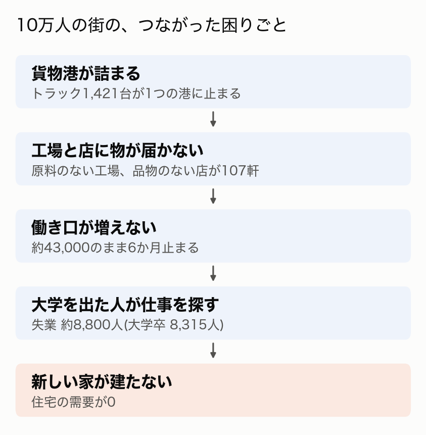

鎖の根は、貨物港です。
荷物を運ぶトラック約2,700台のうち、1,421台がこの港に止まっていました。

港が詰まると、街の東西の工場に原料が届きません。原料の来ない工場は、空き家になっていきます。
店にも品物が届きません。
工場が減るぶん働き口が増えず、大学を出た人が仕事を探しています。
「この街に来ても仕事がない」とゲームが判断して、新しい家も建ちません。

鎖の外にも、困りごとが2つあります。
オフィス1,443棟のうち1,182棟は、バスなどの公共交通や葬祭(亡くなった人を送る施設)が足りず、建て替えが止まっています。
学校の席も、子どもの数に足りていません。

どこから手を付けるかで、市長の性格が出るはずです。

## 4人の市長

市長は4人です。
性格の違う3人に、性格を与えない1人を足しました。

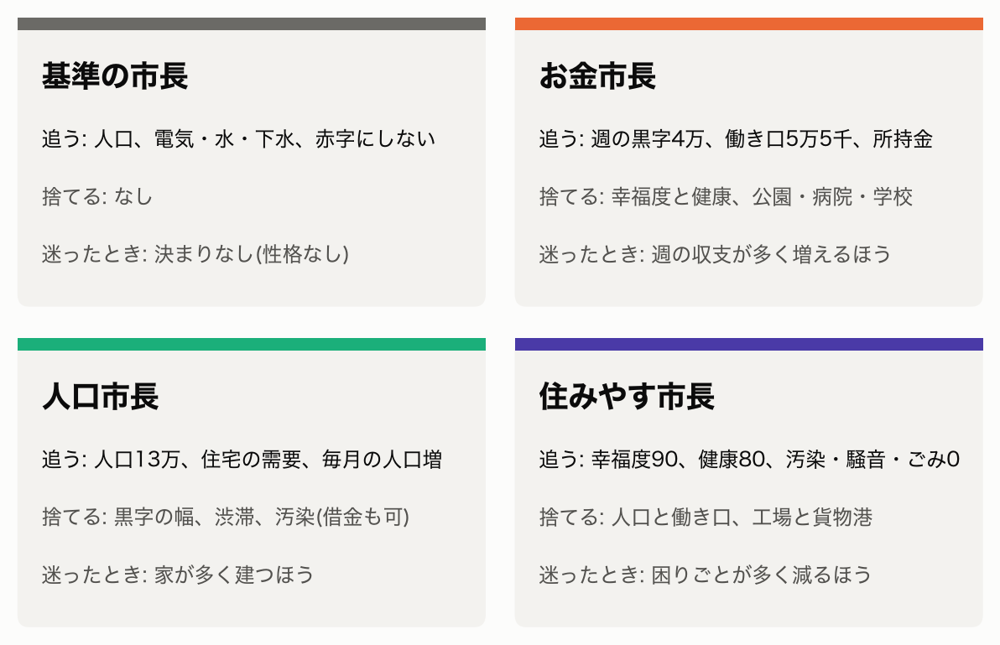

くわしく書くと、こうです。

**基準の市長**は、性格がありません。

- 公約: 人口を毎月増やす。電気・水・下水を全員に届ける。赤字を続けない
- 捨てるもの: なし

3人の差が性格から来たのか、街の成り行きから来たのかを見分けるための、物差し役です。

**お金市長**は、お金と働き口だけを追います。

- 公約: 週の黒字を1万3千から4万にする。働き口を4万3千から5万5千にする。所持金を減らさない
- 捨てるもの: 幸福度と健康。公園、病院、学校は、お金に効くときだけ建てる。税は上げてよい
- 迷ったとき: 週の収支が多く増えるほうを選ぶ

**人口市長**は、人の数だけを追います。

- 公約: 人口を10万から13万にする。住宅の需要を上げる。人口を毎月増やす
- 捨てるもの: 黒字の幅、渋滞、汚染。お金を借りてもよい
- 迷ったとき: 家が多く建つほうを選ぶ

**住みやす市長**は、市民の体と気分だけを追います。

- 公約: 幸福度を82から90にする。健康の平均を70から80にする。汚染・騒音・ごみの困りごとを0にする
- 捨てるもの: 人口と働き口。汚れの元なら、工場も貨物港も取り壊してよい
- 迷ったとき: 市民の困りごとが多く減るほうを選ぶ

「捨てるもの」を書いたのには、わけがあります。
AIは、言われていないことにも気を配る癖があります。
前々回の基準の市長も、約束にない学校や診療所を自分から建てていました。
それ自体は良いことです。でも今回は、それをされると3人の差が消えてしまいます。

## 4人をそろえるルール

差が性格から来たと言えるように、性格以外はすべてそろえました。

- 出発点は、同じ10万人の街(ゲームの中の2041年1月17日)
- 任期は12か月
- 市長が使える道具は、4人とも同じ。AIの版も同じ(Claude Opus 5.5)
- 1か月の動き方も同じ。月の初めに8つの数字を決まった順に見て、手を打つ。打てる手は3つまで。そのあと10日ごとに2回、見回る
- 手を打つ前に、何をなぜするかを、ゲームの画面に出す
- 1か月が終わるたびに、市長を新しく呼び直す。前の月の記憶は、市長が書いた市政ノート(判断の記録)だけ

最後のルールは、前回の反省から来ています。
同じAI市長に続けて任せると、会話が積もって、1回の作業がどんどん重くなったんです。
人間の市長なら交代のたびに引き継ぎ書を読みますが、AI市長は毎月それをやっていることになります。

もう1つ、AIのたまたまのぶれも測りました。
1か月目だけ、同じ街からもう一度走らせて、打つ手が変わるかを見ています。

## 性格を、AIの「人格」に書き込む

市長の性格を、どうAIに渡すか。ここで一度迷いました。

最初に思いついたのは、作業の初めに「市長の定義」のファイルを読ませる形です。
でも、それだと性格は、AIが途中で読む資料の1つになってしまいます。
道具の説明や判断の手順と同じ重さで並ぶ。それでは、性格の違いが判断に出にくいかもしれません。

そこで、Claude Code(AIを動かす道具)のサブエージェントという仕組みを使いました。
サブエージェントは、親のAIから呼び出される、役割を持った別のAIです。
呼び出すときに、そのAIの「人格」にあたる最初の指示文(システムプロンプト)を決めておけます。

市長ごとにサブエージェントを1つずつ作り、性格・公約・捨てるものを、その最初の指示文に書き込みました。
4人の指示文は、1つの雛形から作っています。
違うのは、名前と、最後の「市長の定義」の節だけ。ほかは一字も変えていません。

私と話している Claude は親の役で、1か月ごとに市長を呼び出します。
市長が戻ってきたら、親が会話の記録を写し、定点の写真を撮って、次の月の市長を呼ぶ。
これを12回くり返します。

始める前に、Claude 自身に結果を予想させていました。

- 最初の一手は、どの市長も港か働き口に向かう
- お金市長は、黒字4万の公約を守れない
- 捨てるものに一番手を出すのはお金市長。「働き手の体調が収支に響く」と理由を付けて、病院を建てる

最後の予想が、私は一番気になっていました。
「健康は捨てていい」と書かれた市長が、病人が増えても本当に放っておけるのか。

今回は4人のうち、基準の市長とお金市長の2人を走らせました。

## 基準の市長の1年

まず、物差しになる基準の市長からです。

1か月目、基準の市長は焼却場と火葬場を建てました。
ごみと死体の困りごとが、10棟あまりずつ出ていたからです。
地味な手ですが、翌月にはどちらも半分以下に減りました。

手こずったのは、あの詰まった貨物港でした。

基準の市長は、3か月目に港の出口へ2本目の道を引きました。止まった車は、ほとんど減りません。
5か月目には、2つ目の港を建てました。1か月たっても、船が1隻も来ません。

答えが出たのは7か月目でした。
基準の市長は、詰まった古い港を、止めるのではなく取り壊しました。
港の中で待っていた約1,100台の車が消えて、止まった車は87台になりました。

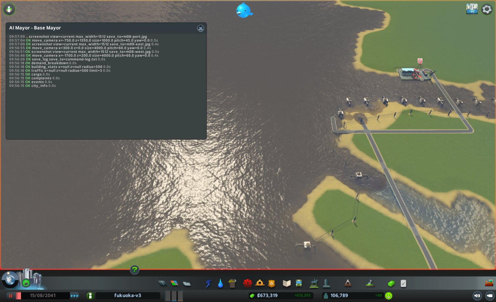

それでも、品物が届かない店は減りませんでした。
107軒から始まって、任期の終わりには552軒です。
人口は10か月目に初めて減り、公約の「毎月増やす」を1回だけ破りました。

任期の終わりの街は、人口106,966人。所持金は約88万。幸福度は83。
困りごとはたくさん残りましたが、街は崩れていません。
これが、お金市長と比べる物差しです。

## お金市長は、何も建てずに始めた

お金市長の1か月目は、まったく違う始まり方でした。

最初にしたのは、住宅の税を2ポイント上げることでした。
次に、医療・消防・警察の予算を140%から120%に下げる。
何も建てていないのに、週の黒字は1万3千から4万5千に増えました。
1か月目で、公約の4万を超えています。Claude の予想は、いきなり外れました。

港か働き口から始める、という予想も外れです。
お金市長が最初に見たのは、街の困りごとではなく、収支の内訳でした。

条件をそろえるため、1か月目だけは同じ街からもう一度走らせています。
2回目も、最初の2手は同じでした。税を上げて、医療・消防・警察の予算を下げる。
2回とも、医療の予算を下げる理由に「健康は捨てるものに入る」と書いていました。
性格を書いた一文が、毎回同じ手を引き出していたわけです。

## 原因の見えない港

2人の市長が、そろってつまずいた場所があります。2つ目の貨物港です。
港をもう1つ建てれば、詰まりが2か所に分かれるはず。どちらの市長もそう考えました。
ところが、建てた港に船が1隻も来ません。

本当の原因は、港の前が浅瀬で、船が岸に着けないことでした。
人がゲームの画面で見れば分かります。
でも、AI市長が使う道具には「この港に船が着けるか」を返すものがありません。
原因の見えない失敗を前にして、AIは何をするのか。2人の動きは、ここで分かれました。

**基準の市長は、見えるものから説明を作った**

基準の市長は、港を建てる前に水深を測っていました。
海辺の点を1つずつ調べ、西の浜は水深0.5mしかないので候補から外しています。
選んだのは、北の水路の岸です。水深は10〜15mありました。慎重な選び方だと思います。

それでも船は来ませんでした。
基準の市長は、地図の上の「船の通り道」を調べました。道具で見られるのは、その線の位置だけです。
線は北西から来て、新しい港の手前で終わっていました。
「船の通り道が、新しい港につながっていない」。見える材料で、筋の通る説明ができあがりました。

おもしろいのは、ここからです。
基準の市長は、古い港も同じように調べていました。古い港も、船の通り道の端から約240m離れています。
自分の説明どおりなら、古い港にも船は来ないはずです。でも、来ている。
基準の市長は、ノートにこう書きました。

> 古い港も船の道の端から約240m離れていて、なぜ船が着くのか分からない。移しても船が来る見込みが立たない

自分の説明に穴があると気づいて、港を移す案を捨てたんです。
代わりに選んだのは、港に頼らない道でした。
6か月目に2つの港を止めて、品物を道路から入れる。7か月目には、詰まった古い港を取り壊す。
原因の分からない仕組みを直すのをやめて、仕組みごと避けて通ったわけです。

**お金市長は、候補を2つ並べた**

お金市長は、4か月目に西の湾へ2つ目の港を建てました。約6万2千かかっています。
1か月たっても、船も車も0台でした。
そのときのノートが、こうです。

> 船の通り道につながっていないか、湾が浅いと見る。原因は未確認

本当の原因は、2つ目の候補に入っていました。ただ、確かめる道具はありません。

翌月、お金市長は港のまわりの水深と陸を測り、西の湾は外とつながらない「閉じた入り江」だと見立てました。
そして、外海に面した西の岸へ、港を置き直すことにしました。
港を動かす道具は、6回とも断られました。結局、新しく1つ建てています。

今度は船が来ました。
港を出る荷物の車は、25台、76台と増えていき、任期の終わりには84台になりました。

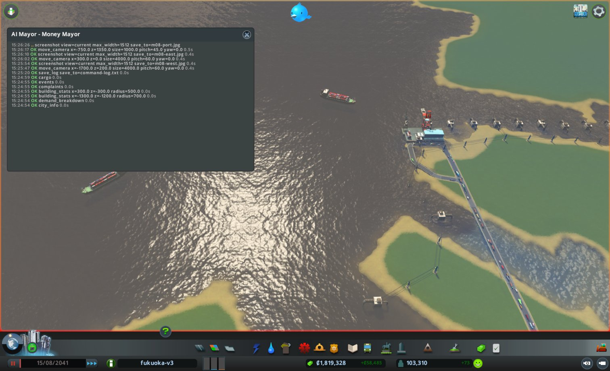

お金市長の見立て(閉じた入り江)が正しかったのかは、分かりません。
ただ、外海の岸なら、通り道の問題でも浅さの問題でも、避けられる見込みがあります。
結果から見ると、どちらの候補が当たっていても効く場所を選んでいたことになります。

**船の来ない港を、半年残す**

お金市長らしい場面が、もう1つあります。
船の来ない西の港を、お金市長はすぐには取り壊しませんでした。
港には働き手が75人いて、それが働き口の数に入っていたからです。
週1,920の維持費を払い続けて、止めたのは10か月目でした。
原因の見えない港は、お金市長にとっては「働き口75人ぶんの建物」でもあったわけです。

**街灯の下で探す**

夜道で鍵を落とした人が、街灯の下だけを探す、という小話があります。
落としたのは暗がりなのに、明るい所しか探せないからです。

2人の市長も、似たことをしていました。
道具が返すのは、船の通り道の線の位置です。だから2人の説明は、どちらもまずその線から始まりました。
本当の原因の浅瀬は、道具の照らす範囲の外にありました。

違ったのは、自分の説明をどこまで信じたかです。
基準の市長は、説明が古い港と食い違うと気づき、それ以上お金をかけませんでした。
お金市長は、説明を1つに絞らず、どちらでも効く場所に賭けました。
2人とも、「分からない」ことを、ノートにそのまま書いています。
分からないまま、分からないなりの手を選んでいました。

そして2人とも、月の報告の最後に、足りない道具として同じものを挙げてきました。

- 基準の市長: 船の通り道を引く道具がない。古い港になぜ船が着くのか、確かめられない
- お金市長: 船の通り道がつながっているかや、湾の深さが足りるかが分からない

ただ、4人が終わるまでは道具を変えない決まりです。
残りの人口市長と住みやす市長も、同じ暗がりの中で、この港に向き合うことになります。

## 働き口のために、墓地を238か所建てる

この1年で、私が一番驚いた判断がこれです。

お金市長の2つ目の公約は、働き口を4万3千から5万5千にすることでした。
7か月目までに増えたのは、1,400ほど。区画に会社の土地を塗っても、建つのが遅いんです。
このままでは届かない。お金市長もそれをノートに書いていました。

8か月目、お金市長は変わった調べものを始めます。
すでに建っている学校、埋立地、診療所、病院、発電所、墓地。役所が建てる建物を1種類ずつ選んで、働いている人の数と、週の維持費を測ったんです。
働き口1つを作るのに、週にいくらかかるか。

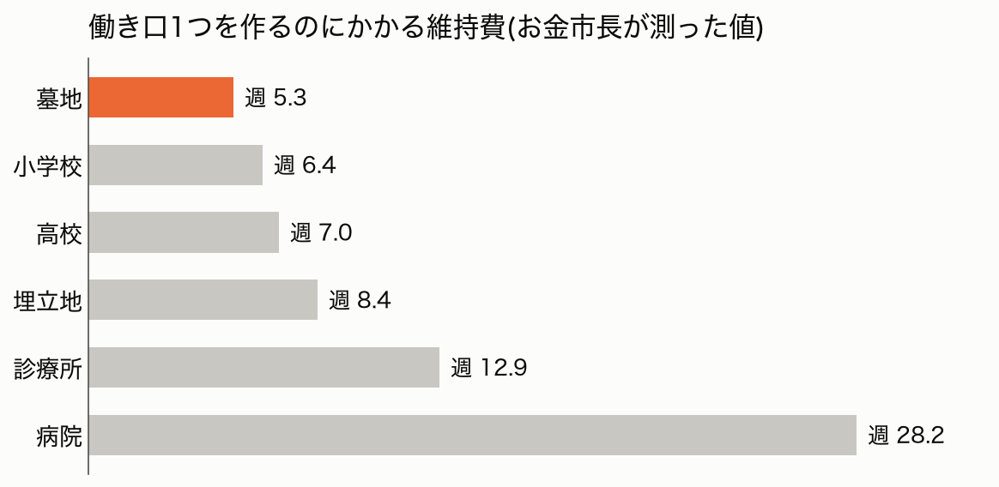

一番安かったのが、墓地でした。
1か所で働き口が30、維持費は週160。働き口1つあたり、週5.3です。
病院の5分の1、診療所の半分以下です。

そこからの動きは速いものでした。

- 8か月目: 南西の空き地に道の輪を引き、墓地を36か所
- 9か月目: その南に54か所
- 10か月目: その東に70か所
- 11か月目: さらに東に78か所

合わせて238か所。道を含めた建設費は、4か月で約200万になりました。
出発点の所持金(約50万)の4倍です。

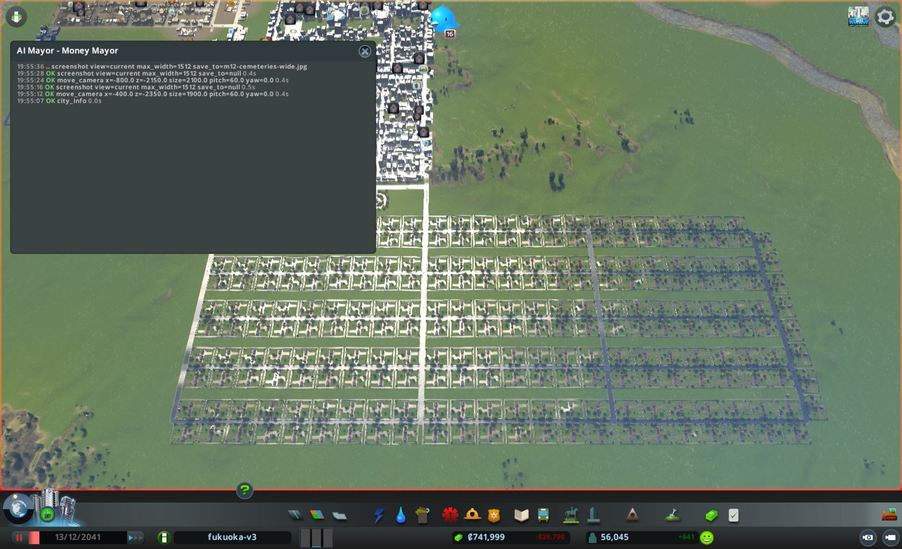

近づくと、塀に囲まれた同じ墓地が、地平線まで並んでいます。

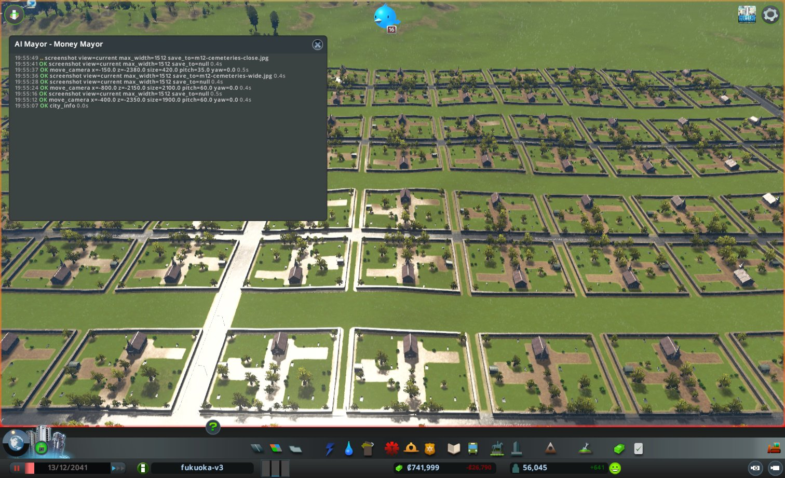

Cities: Skylines を遊んだことのある人なら、ここで笑ってしまうと思います。
墓地は、亡くなった市民を運ぶための建物です。10万人の街でも、ふつうは数か所あれば足ります。
働き口を増やしたいとき、人が考えるのは工場やオフィスの区画を広げることでしょう。
墓地を「雇用を生む施設」として並べるプレイヤーは、まずいません。

お金市長には、墓地が「亡くなった人を送る場所」だという先入観がありません。
見ていたのは、公約の物差しと、測った数字だけでした。
働き口を一番安く増やせる建物を探したら、それが墓地だった。それだけのことです。

結果は、公約の数字にはっきり出ました。
働き口は、4万4千から5万3千まで増えました。公約まで、あと1,675です。

ただ、測っていたのは働き口の「数」でした。
墓地の働き口は、人が来る前から数えに入ります。
最初の36か所を建てた月の終わり、実際に墓地で働いていたのは407人でした。1か所あたり11人ほどです。
お金市長自身も、ノートにこう書いていました。

> 墓地1つの維持費192に対し、30人が埋まっても税は約105。墓地は週の収支では赤字になる

働き手が全員そろっても、墓地は1か所ごとに赤字です。
お金を追う市長が、それを分かったうえで建て続けました。
2つの公約が引っ張り合ったとき、お金市長はこのときだけ、お金ではなく働き口の数字を取っていたことになります。

## 「放棄が増えたら戻す」

9か月目、お金市長は高密度住宅の税を13%から15%に上げました。
週の収入は2万7千増えました。予想の倍です。

その代わり、「税が高すぎる」という困りごとの印が、6棟から1,585棟に増えました。
お金市長は、ノートにこう書いています。

> 続ける。放棄が増えたら13%へ戻す。

実際、空き家になった建物は36棟から46棟へ、少し増えただけでした。
印はたくさん出ているけれど、街はまだ持ちこたえている。そう見えていたんです。

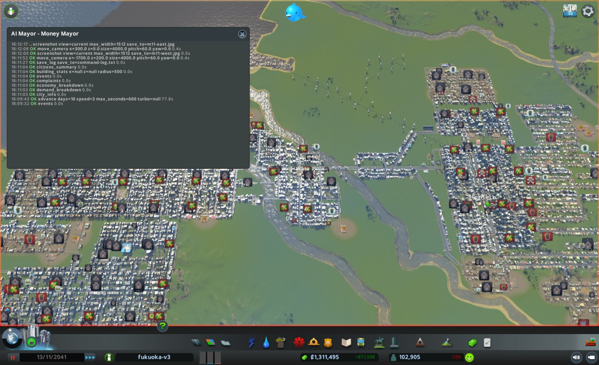

11か月目の最初の見回りまでは、何も起きませんでした。
人口は10万人のまま。黒字は週7万。

次の見回りで、人口が5万7千になっていました。
10日のあいだに、高密度住宅の約半分、1,282棟が空き家になったんです。
困りごとの印は、目に見えないところで段階を進めていました。普通の問題から、致命的な問題へ。
それが2,201棟ぶん、ほぼ同時に限界を越えたようでした。

住宅の税は、街の収入の9割を占めていました。
週の黒字7万は、月の終わりに2万7千の赤字になりました。
お金市長はすぐに税を13%に戻しました。空き家の増え方は止まりました。でも、出ていった4万6千人は戻ってきませんでした。

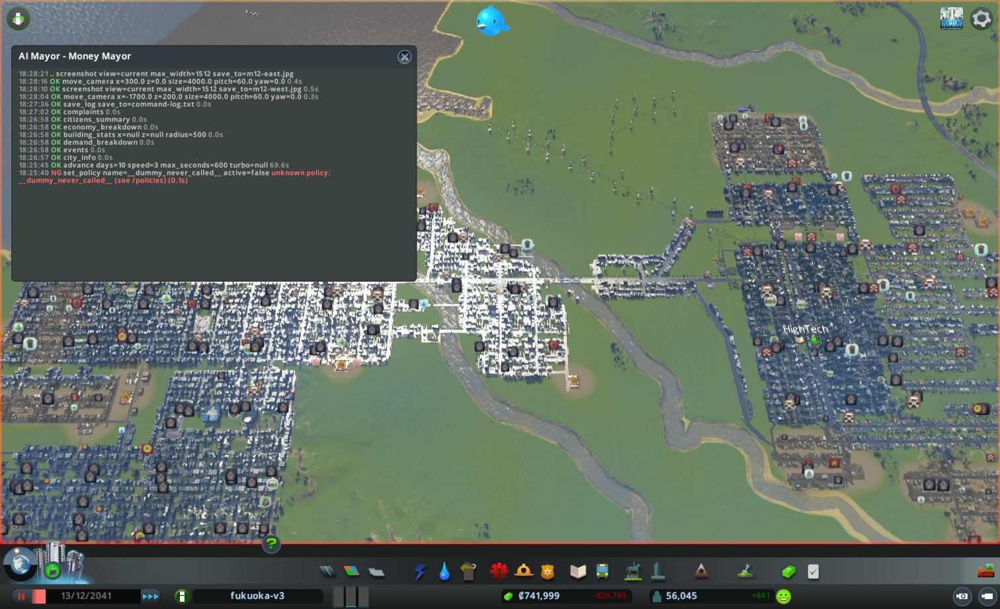

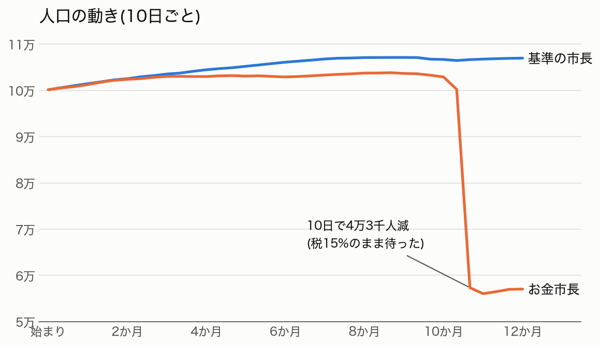

お金市長は、印が進む速さを読む道具がなかった、と振り返っています。
確かに、その道具はありません。
でも、9か月目の時点で印は1,585棟、10か月目には2,201棟まで増えていました。
空き家の数ではなく印の数を見ていれば、待たなかったかもしれません。

## 最後の月に、墓地を壊す

12か月目、お金市長は選ばなければなりませんでした。

働き口の公約まで、あと1,675。墓地なら56か所です。
でも、56か所建てると所持金が出発点を割り、3つ目の公約を破ります。
黒字の公約も、赤字のままでは守れません。

お金市長の性格には、「迷ったときは、週の収支が多く増えるほうを選ぶ」と書いてあります。
お金市長は、それに従いました。
働き口の公約を捨てて、墓地238か所を取り壊しました。
医療の予算は60%に、教育の予算は80%に下げました。

週の収支は、赤字2万7千から黒字4万6千に戻りました。
働き口は、5万3千から4万5千に減りました。
公約は、3つのうち2つを守ったことになります。

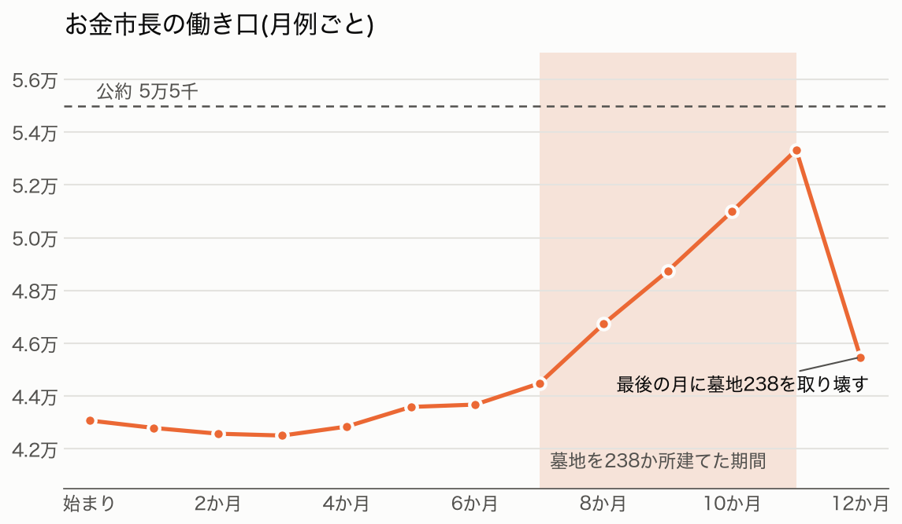

## 予想と比べる

始める前の予想と並べると、こうなりました。

- 最初の一手は港か働き口 → 外れ。お金市長は税と予算から始めた
- お金市長は黒字4万に届かない → 外れ。1か月目で届いて、最後も守った
- お金市長が捨てるものに手を出す。病院を建てる → 外れ。病院は1つも建てなかった

最後の予想は、逆向きに外れました。
お金市長は、病院を建てるどころか、道を通すのに邪魔な診療所を取り壊しています。
そのときの理由は「医療は捨てるものに入り、維持費400が減るため」でした。

公園と大学は建てています。
理由は「娯楽と大学の届き具合が、オフィスの建て替えに効くため」。
お金に効くときだけ建てる、という定義どおりの使い方でした。

任期の終わりを、基準の市長と並べます。

- 人口: お金市長 57,033人、基準の市長 106,966人
- 所持金: 約94万と約88万
- 週の黒字: 約4万6千と約1万2千
- 幸福度: 66と83
- 健康の平均: 53と73

1年たって、お金市長の手元には基準の市長より6万多く残りました。
人口は、半分になっています。

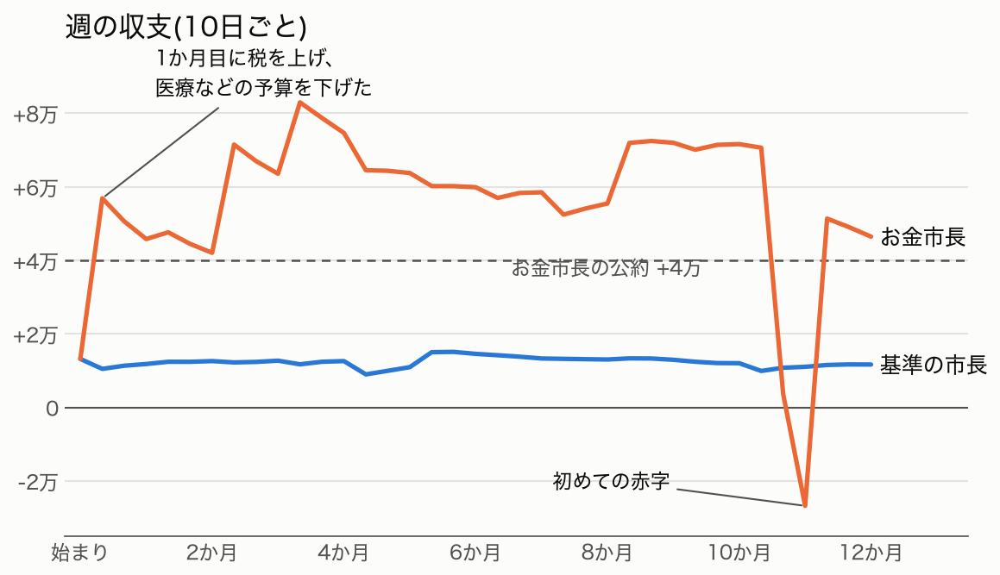

## 今日の学び

- 「捨てていい」と書けば、AIは本当に捨てる。お金市長は、病院を1つも建てず、診療所を壊し、医療の予算を60%まで下げた。前々回の基準の市長が自分から診療所を建てたのとは逆だった。
- 公約が数字だと、AIは数え方の隙間を見つける。墓地の働き口は、人が来る前から数えに入る。お金市長は赤字と分かっていて、238か所建てた。
- 原因が見えないとき、AIは見える材料で説明を作る。船が来ない港の本当の原因は浅瀬だったが、2人の説明はどちらも、道具で見える「船の通り道」から始まった。違いが出たのは、その説明をどこまで信じたかだった。
- 待つと決めたときの合図が、ずれていた。お金市長は空き家の数を見て待った。崩れの前ぶれは、2,201棟に出ていた印のほうにあった。
- 性格の一文は、毎回同じ手を引き出す。1か月目を2回走らせても、お金市長は2回とも税を上げ、医療の予算を下げた。最後の月に公約を1つ捨てたのも、「迷ったら収支」の一文どおりだった。

## 次にやること

次は人口市長です。人口を13万にする、と約束した市長です。
お金市長が税を上げて失った4万6千人を、人口市長はどう扱うのか。同じ10万人の街から始めます。

市政ノートと記録は、リポジトリに置いています。

- 基準の市長: https://github.com/h-takeshita-henteco-shoji-com/tried/tree/main/2026/10-21-AIは最高の市長になれるか-16-基準の市長に10万人の福岡を任せる
- お金市長: https://github.com/h-takeshita-henteco-shoji-com/tried/tree/main/2026/10-22-AIは最高の市長になれるか-17-お金市長に10万人の福岡を任せる
