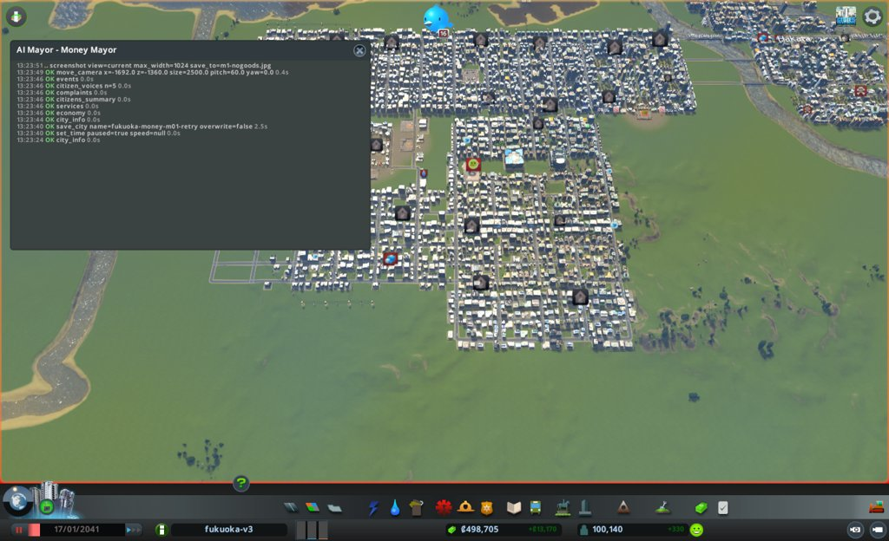
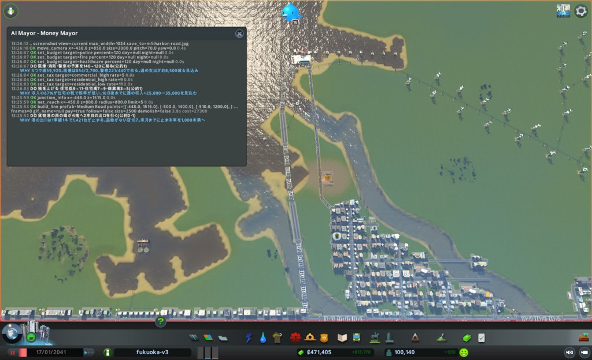

# 市政ノート

## 性格と公約と捨てるもの

市長の定義から写す。任期中は書き換えない。

- 性格: 週の収支と働き口だけを追う。暮らしと環境の数字は、お金に響かない限り見ない
  - 急ぎ方: すぐ動く。効きそうな手は、その月に打つ
  - 先に見るもの: 数字。とくに収支の内訳(`economy_breakdown`)と、荷物の流れ(`cargo`)
  - 迷ったとき: 週の収支が多く増えるほうを選ぶ
- 公約:
  1. 週の収支を +40,000 以上にする(`city_info` の weeklyIncome − weeklyExpenses。出発点 +13,170。期限は任期の終わり)
  2. 働き口を 55,000 以上にする(`demand_breakdown` の jobs。出発点 43,075。期限は任期の終わり)
  3. 所持金を出発点より減らさない(`city_info` の money。出発点 498,704。期限は毎月の月例)
- 捨てるもの: 幸福度と健康。公園、病院、学校(収支か働き口に効くときだけ建てる)。汚染と騒音への手当て。困りごとの印(お金に響く印だけ手当てする)。税は上げてよい
- 任期: 12か月

## 申し送り(前の運営から)

なし

## 数字の表

| ゲーム内の日付 | 区切り | 人口 | 所持金 | 週の収支 | 幸福度 | 需要(住/商/工) | 失業 | 主な困りごと |
|---|---|---|---|---|---|---|---|---|
| 2041-01-17 | 月例 | 100,140 | 498,704 | +13,170 | 82 | 0 / 4 / 2 | 8,839 | 品物がない107、死体14、ごみ11 |
| 2041-01-27 | 見回り | 100,615 | 561,407 | +64,203(199,329 − 135,126) | 81 | −3 / 2 / 6 | − | つぶやき: 放棄された建物1件 |
| 2041-02-06 | 見回り | 100,918 | 645,030 | +57,174(192,318 − 135,144) | 81 | −3 / 8 / 4 | − | つぶやき: 学校の賞1件 |
| 2041-02-16 | 月の終わり(読むだけ) | 101,391 | 720,443 | +51,790(186,934 − 135,144) | 81 | −3 / 6 / 2 | 10,069(需要の数え) | 品物がない店135、原料がない工場122 |

## 施策の一覧

| ゲーム内の日付 | 区切り | 施策 | 分野 | 公約 | 捨てるもの | 建設費 | 週の維持費の増分 | 答え合わせ |
|---|---|---|---|---|---|---|---|---|
| 2041-01-17 | 月例 | 港の西に2本目の出口(Medium Road) | 港 | 2・1 | なし | 27,300 | 約150(橋の分で増えうる) | |
| 2041-01-17 | 月例 | 税を上げる(住低9→11、住高7→9、商高3→5) | 財政 | 1 | 幸福度 | 0 | 0 | |
| 2041-01-17 | 月例 | 医療・消防・警察の予算 140→120 | 財政 | 1 | 健康 | 0 | 約 −8,500 | |

## 判断の記録

### 2041-01-17 月例(1か月目)

保存: `fukuoka-money-m01-retry`(gameDate 2041-01-17)

#### 答え合わせ

なし(初回)

- 公約の進み具合
  1. 週の収支: +13,170 / 目標 +40,000 まで 26,830 / 税と支出の手で届く見込み
  2. 働き口: 43,075 / 目標 55,000 まで 11,925 / 需要が止まっており、港の詰まりを解かないと届かない
  3. 所持金: 498,704 / 出発点と同じ

#### 気づいたこと

- 収入の87%が住宅の税(136,315 / 156,513)。住宅の税は低9%・高7%と低い。高密度の家は25,702戸で、税を2上げれば大きく効く
- 働く場所の需要は target 89 なのに actual 2。オフィスの空きマスは1,588ある。原料不足で放棄された工場(55棟)が建て替わるたびに需要を食っていると見る。根は貨物港の詰まり(止まった荷物の車1,577台のうち1,421台が港 -400,1539)
- 港の出口は1車線の Harbor Road(-448〜-352, 1515)1本で、混み具合100。そこから南へ Small 4 Lane 1本しかない。港の西の端(-448,1515)は何にもつながっていない
- 支出: 医療27,440、消防17,696、警察14,784 は予算140%。医療は捨てるもの

#### 施策

1. 貨物港の西の端から南へ、Medium Road の2本目の出口を引く
   - 公約: 2(働き口)、1(商業・工業の税)
   - 捨てるもの: なし
   - 理由: 港の出口が1車線1本で、1,421台が港で止まる。品物がない店107、原料がない工場126。西の端(-448,1515)から南へ、天神の側の Medium Road の交差点(-380,100)へつなぐ。品物がない場所は西(-1233,-809)と南西に多い
   - 予想: 次の月例までに、港で止まる荷物の車が1,421から1,000未満に減る。品物がない店が107から減る。働き口は2か月目以降に増え始める
   - 操作: `build_line`(Medium Road、(-448,1515)→(-500,1400)→(-510,1200)→(-470,800)→(-410,400)→(-380,100))。建設費約1.2万、維持費は約1.45km×100=週150ほど
   - 結果: 成功。21区間、うち橋15区間(湾の上を渡った)。建設費27,300。両端とも既存の点につながった(北は Harbor Road の点 14482、南は Medium Road の点 24426)
   - 確かめ: `junction_info`(-448,1515) で Harbor Road と Medium Road Bridge がつながる。`net_reach` で半径800mの道路96区間に入れない・出られない区間0。画面写真で橋を確かめた
2. 税を上げる(住宅・低 9→11、住宅・高 7→9、商業・高 3→5)
   - 公約: 1
   - 捨てるもの: 幸福度(税で下がる。捨てるものなので受け入れる)
   - 理由: 住宅の税が収入の87%。高密度の住宅の税を2上げると、住宅の税収が2割ほど増える。商業・高は3%で、2上げると商業の税収が5割ほど増える
   - 予想: 次の見回り(10日後)までに週の収入が +25,000〜35,000。人口は1%以内の減り。住宅の需要は0のまま
   - 操作: `set_tax` を3回
   - 結果: 3つとも成功(residential_low 11、residential_high 9、commercial_high 5)。費用なし
3. 予算を削る(医療・消防・警察を 140→120)
   - 公約: 1
   - 捨てるもの: 健康(医療の予算を下げる。捨てるものなので受け入れる)
   - 理由: 3つで週59,920。医療は使用854/定員2,700、警察は221/440で余っている。犯罪率5
   - 予想: 週の支出が約8,500減る。体調の悪い市民は増えるが、働き口と収支には響かない程度
   - 操作: `set_budget` を3回
   - 結果: 3つとも成功(healthcare / fire / police とも昼夜120)

#### 考えたが打たなかった手

- 工業・オフィスの税を上げる(1%): 働き口の需要を落とすので見送る。働き口(公約2)を先に取る
- EducationBoost をやめる(週3,740): 政策の変更は月1つ。今月は予算と税で足りる。オフィスのレベル上げ(学歴)に効くので様子を見る
- オフィスの区画を足す: 空きマスが1,588あり、需要が2なので足しても建たない
- 公共交通をオフィス街に引く(オフィスのレベルが公共交通で583棟止まる): 3件の枠を使い切った。来月以降
- 満ちたごみ処理場4つ: ごみの印11棟で、お金に響かない

#### 次にやること

- 港の詰まりが減ったかを `cargo` で確かめる。減らなければ、港の東側の出口(Small 4 Lane)の太さか、交差点を見る
- オフィス街の公共交通(レベル上げで働き口を増やす)を調べる
- 税を上げた後の人口と需要を見る

#### 画面写真

### 2041-01-27 見回り

境目: 当たらず。電気・水・下水が来ない市民は 0 / 0 / 0。ダイアログなし。つぶやきは放棄の1件だけ

### 2041-02-06 見回り

境目: 当たらず。週の収支は前回の +64,203 から +57,174 に下がったが黒字。来ない市民 0 / 0 / 0。ダイアログなし

### 2041-02-16 月の終わり(読むだけ。次の月例の材料)

施策は打たず、`city_info`、`demand_breakdown`、`cargo` を読んだだけ。事実だけを書く。

- 週の収支 +51,790。収入は 199,329(01-27)→ 192,318 → 186,934 と下がり続けている。支出は 135,144 で横ばい
- 働き口(jobs)42,827。出発点の 43,075 より 248 減った。働く場所の需要は target 93、actual 2 のまま
- 港で止まる荷物の車は 1,446(出発点 1,421)。港の vehiclesLeaving は 1,634 で、出発点とまったく同じ数
- 品物がない店 135(出発点 107)、原料がない工場 122(出発点 126)
- 見立て: 2本目の出口は効いていない。1,634台という数が10日ごとに変わらないので、道の混みではなく、港の中で動けないまま固まった車だと見る。次の月例で、港を `set_building_active` で一度止めて車を消す手か、港を移す手(`relocate_building`)を調べる

## 人が手を入れたこと

- 2026-10-22 13:20(実時間): 人が誤って `fukuoka-money-m01-end` を開き、録画を始めた。市長は呼んでいない
- 2026-10-22 13:23(実時間): 人が `fukuoka-money-m01` を読み込み、録画を始めた。親が見出しを `AI Mayor - Money Mayor` に戻した
- 定点の写真は撮っていない。出発点が1回目と同じため、`../assets/fixed/m01-*.jpg` を使う

### 実時間とトークン

| 月 | 実時間 | トークン | 道具の呼び出し |
|---|---|---|---|
| 1(2回目) | 9分35秒 | 106,800 | 68 |

## 公約の結果

## 次の市長への申し送り
