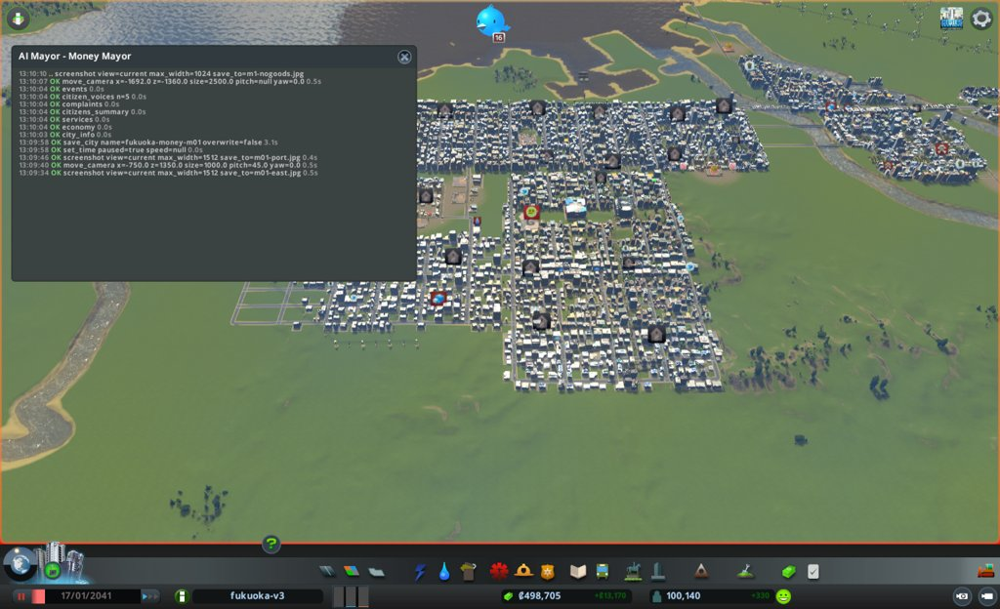
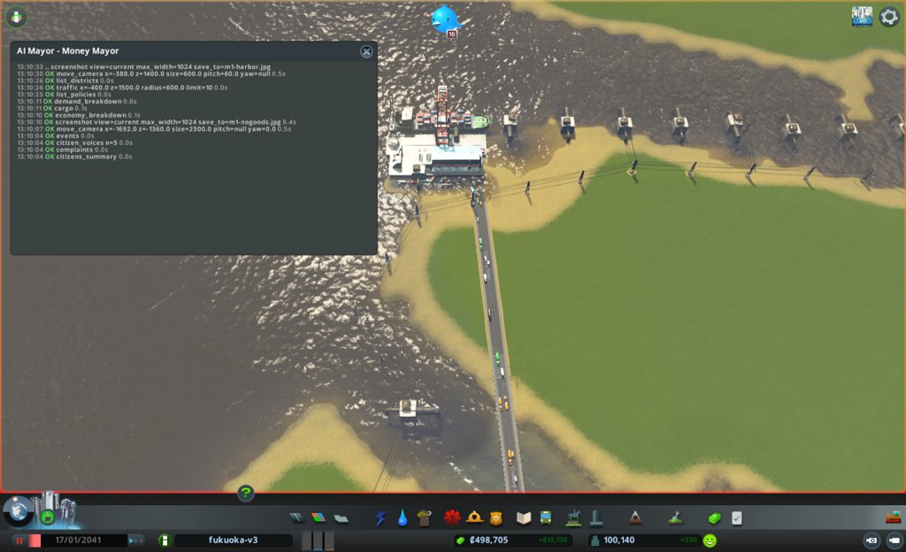
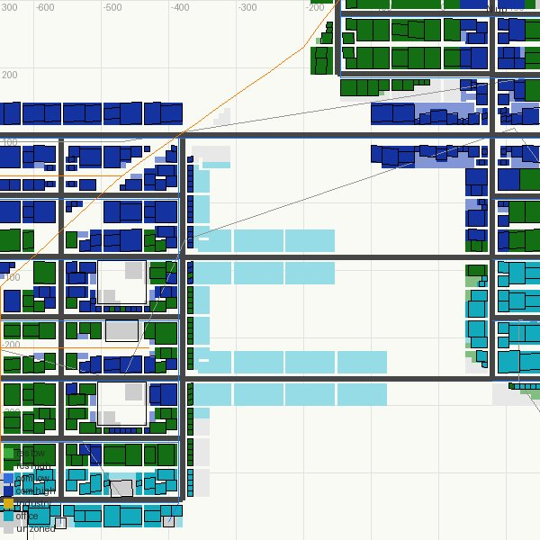
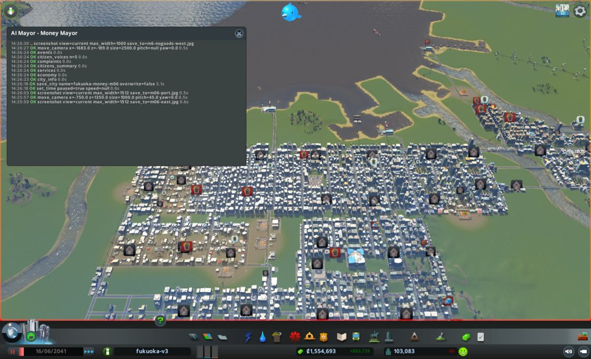

# 市政ノート

## 性格と公約と捨てるもの

市長の定義から写す。任期中は書き換えない。

- 性格: 週の収支と働き口だけを追う。暮らしと環境の数字は、お金に響かない限り見ない
  - 急ぎ方: すぐ動く。効きそうな手は、その月に打つ
  - 先に見るもの: 数字。とくに収支の内訳(`economy_breakdown`)と、荷物の流れ(`cargo`)
  - 迷ったとき: 週の収支が多く増えるほうを選ぶ
- 公約:
  1. 週の収支を +40,000 以上にする(`city_info` の weeklyIncome − weeklyExpenses。出発点は +13,170。期限は任期の終わり)
  2. 働き口を 55,000 以上にする(`demand_breakdown` の jobs。出発点は 43,075。期限は任期の終わり)
  3. 所持金を出発点より減らさない(`city_info` の money。出発点は 498,704。期限は毎月の月例)
- 捨てるもの: 幸福度と健康。公園、病院、学校(収支か働き口に効くときだけ建てる)。汚染と騒音への手当て。困りごとの印(お金に響く印だけ手当てする)。税は上げてよい
- 任期: 12か月

## 申し送り(前の運営から)

なし

## 数字の表

月例と見回りのたびに1行足す。区切りは 月例・見回り・臨時。

| ゲーム内の日付 | 区切り | 人口 | 所持金 | 週の収支 | 幸福度 | 需要(住/商/工) | 失業 | 主な困りごと |
|---|---|---|---|---|---|---|---|---|
| 2041-01-17 | 月例 | 100,140 | 498,704 | +13,170 | 82 | 0 / 4 / 2 | 8,839 | 品物がない107、ごみ11、死体14 |
| 2041-01-27 | 見回り | 100,526 | 578,476 | +56,859 | 82 | −3 / 6 / 2 | − | つぶやき: 放棄された建物1件 |
| 2041-02-06 | 見回り | 100,808 | 652,630 | +50,584 | 82 | −3 / 8 / 2 | − | なし |
| 2041-02-16 | 月例 | 101,243 | 719,436 | +45,786 | 82 | −3 / 6 / 2 | 9,503 | 品物がない133、ごみ24、死体13、騒音12 |
| 2041-02-26 | 見回り | 101,744 | 785,810 | +47,619 | 82 | −3 / 12 / 2 | − | つぶやき: 騒音1件 |
| 2041-03-08 | 見回り | 102,180 | 850,444 | +44,460 | 81 | −3 / 4 / 4 | − | なし |
| 2041-03-18 | 月末の確かめ | 102,372 | 908,569 | +42,037 | 81 | −3 / 6 / 2 | − | 品物がない店150、原料がない工場92 |
| 2041-03-18 | 月例 | 102,372 | 908,569 | +42,037 | 81 | −3 / 6 / 2 | 10,127 | 品物がない150、ごみ53、死体10、騒音10 |
| 2041-03-28 | 見回り | 102,530 | 1,000,983 | +71,475 | 81 | −9 / 4 / 2 | − | つぶやき: ごみ1件 |
| 2041-04-07 | 見回り | 102,811 | 1,098,326 | +66,986 | 81 | −9 / 10 / 2 | − | なし |
| 2041-04-17 | 月末の確かめ | 103,007 | 1,190,525 | +63,549 | 81 | −9 / 4 / 8 | − | 品物がない店166、原料がない工場100 |
| 2041-04-17 | 月例 | 103,007 | 1,190,525 | +63,549 | 81 | −9 / 4 / 8 | 10,551 | ごみ150、品物がない166、税が高い30、汚染12 |
| 2041-04-27 | 見回り | 103,029 | 1,185,596 | +82,955 | 80 | −14 / 2 / 4 | − | つぶやき: ごみ1件 |
| 2041-05-07 | 見回り | 102,992 | 1,299,572 | +78,725 | 79 | −14 / 4 / 4 | − | つぶやき: 水1件 |
| 2041-05-17 | 月末の確かめ | 102,986 | 1,407,912 | +74,644 | 79 | −14 / 2 / 2 | − | ごみ370、品物がない店184、原料がない工場103、税が高い38。電気が来ない市民43 |
| 2041-05-17 | 月例 | 102,986 | 1,407,912 | +74,644 | 79 | −14 / 2 / 2 | 10,388 | ごみ370、品物がない184、税が高い38、騒音17。電気が来ない市民43 |
| 2041-05-27 | 見回り | 103,137 | 1,370,421 | +64,504 | 79 | −14 / 2 / 4 | − | つぶやき: 観光客1件。電気が来ない市民0 |
| 2041-06-06 | 見回り | 103,191 | 1,462,905 | +64,344 | 78 | −14 / 2 / 4 | − | つぶやき: 死体1件 |
| 2041-06-16 | 月末の確かめ | 103,083 | 1,554,693 | +63,739 | 78 | −14 / 2 / 2 | − | ごみ439、品物がない店195、原料がない工場106、税が高い38、死体27。低密度住宅の放棄35 |
| 2041-06-16 | 月例 | 103,083 | 1,554,693 | +63,739 | 78 | −14 / 2 / 2 | 10,154 | ごみ439、品物がない195、税が高い38、死体27 |
| 2041-06-26 | 見回り | 103,146 | 1,508,050 | +60,192 | 78 | −14 / 2 / 2 | − | つぶやき: 放棄された建物1件 |
| 2041-07-06 | 見回り | 103,006 | 1,594,702 | +60,171 | 78 | −14 / 2 / 4 | − | つぶやき: 土の汚染1件 |
| 2041-07-16 | 月末の確かめ | 102,902 | 1,680,747 | +59,879 | 78 | −15 / 4 / 2 | − | ごみ558、品物がない店222、原料がない工場95、税が高い38、死体18 |
| 2041-07-16 | 月例 | 102,902 | 1,680,747 | +59,879 | 78 | −15 / 4 / 2 | 9,999 | ごみ558、品物がない222、税が高い38、死体18 |
| 2041-07-26 | 見回り | 103,001 | 1,651,674 | +56,966 | 78 | −13 / 2 / 2 | − | つぶやき: 公園1件、土の汚染1件 |
| 2041-08-05 | 見回り | 103,145 | 1,738,904 | +58,313 | 78 | −13 / 4 / 4 | − | つぶやき: 学校1件、騒音1件 |
| 2041-08-15 | 月末の確かめ | 103,310 | 1,819,327 | +58,485 | 78 | −12 / 2 / 2 | − | ごみ561、品物がない店239、原料がない工場76、死体37、税が高い19 |
| 2041-08-15 | 月例 | 103,310 | 1,819,327 | +58,485 | 78 | −12 / 2 / 2 | 9,635 | ごみ561、品物がない239、死体37、騒音25 |
| 2041-08-25 | 見回り | 103,459 | 1,589,737 | +52,427 | 78 | −13 / 4 / 4 | − | つぶやき: 休暇1件、学校1件 |
| 2041-09-04 | 見回り | 103,579 | 1,667,065 | +54,083 | 78 | −9 / 4 / 4 | − | つぶやき: ごみ1件 |
| 2041-09-14 | 月末の確かめ | 103,738 | 1,746,639 | +55,451 | 78 | −11 / 2 / 6 | 8,884 | ごみ535、品物がない274、死体40、騒音17 |
| 2041-09-14 | 月例 | 103,738 | 1,746,639 | +55,451 | 78 | −11 / 2 / 6 | 8,884 | ごみ535、品物がない274、死体40、汚染21、騒音17 |
| 2041-09-24 | 見回り | 103,748 | 1,392,208 | +71,936 | 78 | −15 / 2 / 2 | − | つぶやき: 水1件 |
| 2041-10-04 | 見回り | 103,820 | 1,496,299 | +72,447 | 76 | −12 / 2 / 4 | − | つぶやき: 賞1件 |
| 2041-10-14 | 月末の確かめ | 103,662 | 1,599,917 | +71,962 | 74 | −16 / 4 / 2 | 7,953 | 税が高い1,585、ごみ581、品物がない300、死体64 |
| 2041-10-14 | 月例 | 103,662 | 1,599,917 | +71,962 | 74 | −16 / 4 / 2 | 7,953 | 税が高い1,585、ごみ581、品物がない300、死体64 |
| 2041-10-24 | 見回り | 103,586 | 1,106,024 | +70,077 | 72 | −15 / 2 / 4 | − | つぶやき: 死体1件 |
| 2041-11-03 | 見回り | 103,281 | 1,208,461 | +71,404 | 69 | −11 / 4 / 4 | − | つぶやき: 放棄された家1件 |
| 2041-11-13 | 月末の確かめ | 102,905 | 1,311,495 | +71,598 | 66 | −10 / 2 / 2 | 6,939 | 税が高い2,201、ごみ518、品物がない319、死体76 |
| 2041-11-13 | 月例 | 102,905 | 1,311,495 | +71,598 | 66 | −10 / 2 / 2 | 6,939 | 税が高い2,201、ごみ518、品物がない319、死体76 |
| 2041-11-23 | 見回り | 100,197 | 759,711 | +70,631 | 64 | −14 / 4 / 4 | − | つぶやき: 土の汚染1件 |
| 2041-12-03 | 見回り→臨時 | 57,342 | 784,128 | +3,608 | 66 | −17 / 2 / 2 | 1,366 | 高密度住宅の放棄1,282、税が高い2,271、ごみ535、品物がない334、死体130 |
| 2041-12-13 | 月末の確かめ | 56,045 | 741,998 | −26,789 | 72 | −10 / 2 / 1 | 802 | 税が高い1,260、ごみ676、品物がない341、死体221 |
| 2041-12-13 | 月例 | 56,045 | 741,998 | −26,789 | 72 | −10 / 2 / 1 | 802 | 税が高い1,260、ごみ676、品物がない341、死体221 |
| 2041-12-23 | 見回り | 56,485 | 805,366 | +51,337 | 68 | −12 / 0 / 3 | − | つぶやき: 休暇1件 |
| 2042-01-02 | 見回り | 56,987 | 876,406 | +49,022 | 67 | −12 / 0 / 6 | − | つぶやき: スマートホーム1件、ごみ1件 |
| 2042-01-12 | 任期の終わり | 57,033 | 940,710 | +46,439 | 66 | −12 / 0 / 4 | 900 | 税が高い1,206、ごみ725、地価が低い562、死体405、品物がない345 |

## 施策の一覧

施策を打つたびに1行足す(臨時も含む)。答え合わせの列は、翌月の月例で埋める。
分野は、港・働き口・住宅・暮らし・環境・財政から1つ選ぶ。

| ゲーム内の日付 | 区切り | 施策 | 分野 | 公約 | 捨てるもの | 建設費 | 週の維持費の増分 | 答え合わせ |
|---|---|---|---|---|---|---|---|---|
| 2041-01-17 | 月例 | 住宅の税を+2(低11%、高9%) | 財政 | 1 | 幸福度 | 0 | 0 | 半分当たり(収入+24,057。幸福度は下がらず) |
| 2041-01-17 | 月例 | 医療・消防・警察の予算140→120% | 財政 | 1 | 健康 | 0 | 約 −8,500(減る) | 当たり(支出 −8,559) |
| 2041-01-17 | 月例 | 空いた街区をオフィスに(565マス) | 働き口 | 2 | なし | 0 | 0 | 外れ(建ったのは16マス。働き口 −282) |
| 2041-02-16 | 月例 | 港の2つ目の出口(Small 4 Lane Road 3区間) | 港 | 2・1 | なし | 2,520 | 小(約0.2km分) | 外れ(港の前の止まった車 1,418→1,385) |
| 2041-02-16 | 月例 | 放棄された建物107棟を取り壊す | 働き口 | 2 | なし | 0 | 0 | 外れ(68棟建ったが働き口 −218) |
| 2041-02-16 | 月例 | 電気の予算100→80% | 財政 | 1 | なし | 0 | 約 −5,000(減る) | 当たり(電気の支出 −4,736。停電0) |
| 2041-03-18 | 月例 | 港から街への道を4車線に(10区間差し替え+2区間) | 港 | 2・1 | なし | 1,220 | 小(約0.1km分) | 外れ(混み具合89〜100のまま。港の前の止まった車1,337) |
| 2041-03-18 | 月例 | 住宅の税を+2(低13%、高11%) | 財政 | 1 | 幸福度 | 0 | 0 | 当たり(収入 +21,703。幸福度81のまま) |
| 2041-03-18 | 月例 | 東のオフィス街に墓地 | 働き口 | 2 | なし | 8,000 | 160 | 半分当たり(葬祭で止まる棟318→205。働き口 +184) |
| 2041-04-17 | 月例 | 西の湾に2つ目の Cargo Harbor と出口の道 | 港 | 2・1 | なし | 61,780 | 約1,950 | 外れ(船も車も0台。閉じた入り江) |
| 2041-04-17 | 月例 | 北東の工業の北に Cargo Center(線路なし)と道 | 働き口 | 2 | なし | 62,560 | 約1,470 | ほぼ当たり(工業の働き口 +290。荷物の便で止まる 459→376) |
| 2041-04-17 | 月例 | 高密度住宅の税を+2(13%) | 財政 | 1 | 幸福度 | 0 | 0 | ほぼ当たり(月末の収入 +14,490。幸福度 81→79) |
| 2041-05-17 | 月例 | 西の外海の岸に Cargo Harbor と出口の道(移す道具は断られた) | 港 | 2・1 | なし | 64,620 | 約2,000 | 外れ(出る車25台。北の港の前1,136台。品物がない店195) |
| 2041-05-17 | 月例 | 電気の予算80→100% | 財政 | 1・2 | なし | 0 | 約 +5,300 | 当たり(容量1,557,152。来ない市民0。支出 +4,762) |
| 2041-05-17 | 月例 | 南東の工業の南に Cargo Center と道 | 働き口 | 2 | なし | 61,920 | 約1,500 | 半分当たり(止まる工業348。工業の働き口 +466) |
| 2041-06-16 | 月例 | 東の工業の真ん中に Cargo Center と道 | 働き口 | 2 | なし | 61,440 | 約1,500 | 外れ(止まる棟203→181。東の工業の働き口 +264) |
| 2041-06-16 | 月例 | 南西のオフィス街の南に墓地と道 | 働き口 | 2 | なし | 10,600 | 約230 | 半分当たり(葬祭で止まる73→8。働き口 −92) |
| 2041-06-16 | 月例 | 東の工業の南東に2つ目の Cargo Center と道 | 働き口 | 2 | なし | 61,120 | 約1,480 | 外れ(施策1と合わせて止まる棟181) |
| 2041-07-16 | 月例 | 北東に埋立地3つと道(診療所1つを取り壊し) | 暮らし | 1・2 | ごみの印、医療 | 13,280 | 約560(診療所 −400 を引く前) | 半分当たり(ごみの印561で減らず。働き手54人) |
| 2041-07-16 | 月例 | 南西のオフィス街の南に Expensive Park 3つと道 | 働き口 | 2 | 公園 | 15,180 | 約200 | 外れ(L3 0のまま。働き口 +50) |
| 2041-07-16 | 月例 | 中央のオフィス街の西に大学と水道管(水の上の道を引いて取り除いた分を含む) | 働き口 | 2 | 学校 | 78,700 | 約1,950 | 当たり(L3 60→99。働き口 +161) |
| 2041-08-15 | 月例 | 南西のオフィス街の南に道2本の輪と墓地36、水道管 | 働き口 | 2・1 | なし | 304,940 | 約7,700(予算120%)+道 | ほぼ当たり(働き口 +2,252。住宅の収入 +4,170 は予想を少し下回る) |
| 2041-08-15 | 月例 | 南西のオフィス街の南の通りにバス路線22 | 働き口 | 2 | なし | 0 | 約500(見込み) | 当たり(止まる棟 115→18。南西の L3 0→69) |
| 2041-09-14 | 月例 | 南西の墓地の南に道3本の輪と墓地54、水道管 | 働き口 | 2 | なし | 457,260 | 約10,400(予算120%)+道 | ほぼ当たり(働き口48,740。予想48,800を60下回る。支出 +10,368) |
| 2041-09-14 | 月例 | 東と中央のオフィス街にバス路線23・24 | 働き口 | 2 | なし | 0 | 約500(見込み) | 外れ(止まる棟 東119・中央71。オフィスの働き口 +216) |
| 2041-09-14 | 月例 | 高密度住宅の税を+2(15%) | 財政 | 1 | 幸福度 | 0 | 0 | 半分当たり(住宅の収入 +27,190。幸福度 −4、税が高い印1,585) |
| 2041-10-14 | 月例 | 南西の墓地の東に道と墓地70、水道管 | 働き口 | 2 | なし | 589,760 | 約11,200(予算100%)+道 | 外れ(働き口50,993。予想51,000を7下回る) |
| 2041-10-14 | 月例 | 医療の予算120→100% | 財政 | 1 | 健康 | 0 | 約 −6,900(減る) | ほぼ当たり(墓地70と差し引き医療 +4,336。病人 2,474→3,027) |
| 2041-10-14 | 月例 | 船の来ない港3590を止める | 財政 | 1 | なし | 0 | −1,920(減る) | 当たり(船 5,760→3,840) |
| 2041-11-13 | 月例 | 東の墓地のさらに東に道と墓地78、水道管 | 働き口 | 2 | なし | 653,520 | 約12,500(予算100%)+道 | 当たり(働き口53,325) |
| 2041-11-13 | 月例 | 医療の予算100→80% | 財政 | 1 | 健康 | 0 | 約 −11,000(減る) | 当たり(約 −11,600) |
| 2041-12-03 | 臨時 | 高密度住宅の税を−2(15→13%) | 財政 | 1・2 | なし | 0 | 0 | 半分当たり(放棄は止まった。印1,260、収入 −31,414) |
| 2041-12-13 | 月例 | 7つのサービスの予算を下げ、EducationBoost を外す | 財政 | 1 | 健康、学校 | 0 | 約 −33,000(減る) | |
| 2041-12-13 | 月例 | 商業・工業・オフィスの税を+2 | 財政 | 1 | なし | 0 | 0 | |
| 2041-12-13 | 月例 | 南西の墓地238を取り壊し、記念碑7つを止める | 財政 | 1(2を下げる) | なし | 0 | 約 −25,400(減る) | |

## 判断の記録

### 2041-01-17 月例(1か月目)

保存: fukuoka-money-m01

#### 答え合わせ

なし(初回)

- 公約の進み具合
  1. 週の収支: +13,170 / 残り12か月 / あと +26,830 要る
  2. 働き口: 43,075 / 残り12か月 / あと 11,925 要る
  3. 所持金: 498,704 / 出発点と同じ

#### 気づいたこと

- 収入の87%は住宅の税(136,315)。住宅の税率は低9%・高7%で、上げる余地がある。支出は医療27,440、電気25,846、教育18,700、消防17,696、警察14,784が大きい
- 医療・消防・警察の予算が140%。医療は容量2,700に使用854、警察は440に221で、余っている
- 失業8,839人のうち8,315人が大卒。働き口の需要の目標は89(今は2)。大卒向けの働き口(オフィス)が足りない
- 荷物: 港(Cargo Harbor、-400,1555)の前で荷物の車1,421台が止まっている。出口は Harbor Road 1車線の1本だけ。品物がない店107、原料がない工場126

#### 施策

1. 住宅の税を上げる(低9→11%、高7→9%)
   - 公約: 1
   - 捨てるもの: 幸福度に手を出す(税を上げると下がりうる)。定義で「税は上げてよい」とあるため
   - 理由: 住宅の税が収入の87%。1ポイントあたり住宅の収入の約1/8が増える見込み
   - 予想: 次の見回りまでに週の収入が +25,000〜+35,000。幸福度は82から3〜5下がる
   - 操作: `set_tax` residential_low 11、residential_high 9
2. 医療・消防・警察の予算を140→120%に下げる
   - 公約: 1
   - 捨てるもの: 健康(医療の予算)に手を出す。容量が使用の3倍あり、下げても足りる見込み
   - 理由: 3つの支出の合計60,000。20ポイント下げると約1/7減る
   - 予想: 次の見回りまでに週の支出が約 −8,500
   - 操作: `set_budget` healthcare / fire / police を120
3. 空いた街区(-380〜-60, -320〜+60)をオフィスにする
   - 公約: 2
   - 捨てるもの: なし
   - 理由: 失業の大半が大卒で、働き口の需要の目標が89。この街区には区画にできる空きマスが約540ある
   - 予想: 1か月後までにオフィスが建ち始め、働き口が +1,000〜2,000
   - 操作: `zone_rect` office
   - 結果: 成功。changedCells 565、skippedOccupied 49。費用0
   - 確かめ: `zone_map` で街区がオフィスの色になった(m1-office-zone.jpg)。南西の端の数マスは灰のまま

施策1の結果: `set_tax` residential_low 11、residential_high 9 とも ok。費用0。
施策2の結果: `set_budget` healthcare / fire / police とも 120(昼夜)で ok。費用0。
時間が止まっているため、`city_info` の収支はまだ変わっていない(収入156,513、支出143,343)。

#### 考えたが打たなかった手

- 港の出口の詰まりを直す(出口を足す、港を止めて高速道路から入れる): 効き目と副作用(高速道路の詰まり)をまだ読めない。月の上限3件に入らないため来月に回す
- 商業高密度(3%)・工業(1%)・オフィス(1%)の税を上げる: 収入が小さい(商業14,909、工業1,716、オフィス2,075)。オフィスと工業は働き口の需要を下げ、公約2とぶつかる
- 政策 EducationBoost(週3,740)と HighTechHousing(地区、政策費の大半)を外す: 外すと住民の学歴や地価が下がり、住宅の税収が減るおそれがある。中身を確かめてから決める(政策の変更は月1つ)
- ごみの予算150%を下げる: 支出4,080と小さい。満杯の埋立地が4つあり、下げるとごみの印が増える
- 港の近くの空きマス約300をオフィスにする: 港の出口の道路に通勤の車が乗り、荷物の詰まりが悪くなる

#### 次にやること

- 港(Cargo Harbor id 43449)の出口の詰まりを調べて、手を打つ(品物がない店107、原料がない工場126)
- 政策の費用6,944の中身を確かめる(HighTechHousing が地区にかかっている)
- 区画にできる空きマスを探し、オフィスか工業を足す(公約2にあと約12,000)

#### 画面写真

### 2041-01-27 見回り

境目: 当たらず。収入191,629、支出134,770で週の収支 +56,859。電気・水・下水が来ない市民は0のまま。ダイアログなし

### 2041-02-06 見回り

境目: 当たらず。収入185,369、支出134,785で週の収支 +50,584(前回より −6,275 だが黒字)。電気・水・下水が来ない市民は0。ダイアログなし

### 2041-02-16 1か月目の終わり(次の月例の前の確かめ)

施策は打っていない。次の月例の材料として、道具が返した事実だけを書く。

- `city_info`: 人口101,243、所持金719,436、収入180,570、支出134,784(週の収支 +45,786)、幸福度82、需要 −3 / 6 / 2。ダイアログなし
- `demand_breakdown`: jobs 42,793(出発点43,075より −282)。働き口の需要は target 93 に対し actual 2 のまま動かない。失業(需要の数え)9,920、うち大卒9,366
- `zones_at`(-220,-130、半径200): オフィス521マスのうち空き505。建ったのは16マス分だけ
- 気づいたこと: 週の収入は 191,629 → 185,369 → 180,570 と下がり続けている。税を上げた直後の跳ねが戻っている途中かもしれない。オフィスが建たないのは、働き口の需要の actual が2で止まっているためと見られる。原因は未確認

### 2041-02-16 月例(2か月目)

保存: fukuoka-money-m02

#### 答え合わせ

1. 住宅の税+2: 予想は収入 +25,000〜+35,000、幸福度 −3〜−5
   - 結果: 収入は 156,513 → 191,629(+35,116)まで跳ね、月末は 180,570(+24,057)。幸福度は82のまま
   - 見立て: 収入は予想の幅に入った。幸福度は下がらなかった。収入が月の中で下がり続けた理由は未確認
   - 次の扱い: 続ける。今月は税を動かさず、収入の下がり方を見る
2. 医療・消防・警察の予算を120%に: 予想は支出 −8,500
   - 結果: 支出 143,343 → 134,784(−8,559)。当たり
   - 次の扱い: 続ける。医療は容量2,700に使用882でまだ余る
3. 空いた街区をオフィスに: 予想は働き口 +1,000〜2,000
   - 結果: 建ったのは16マス分。働き口は 43,075 → 42,793(−282)。外れ
   - 見立て: 働き口の需要が target 93 に対し actual 2 のまま動かない。放棄された工業62棟・商業40棟が建て替わる分で、需要を食っているのかもしれない
   - 次の扱い: 区画は残す。需要を食う元(放棄された建物、原料の届かない工場)を減らす
- 「次にやること」の実行
  - 港の出口の詰まりを調べる: 実行した(下の気づいたこと)
  - 政策の費用6,948の中身: 実行していない。今月も後回し
  - 空きマスを探してオフィスか工業を足す: 実行していない。需要が動かないうちは足しても建たないため
- 公約の進み具合
  1. 週の収支: +45,786 / 残り11か月 / 目標の +40,000 を今は超えている
  2. 働き口: 42,793 / 残り11か月 / あと 12,207 要る(出発点より −282)
  3. 所持金: 719,436 / 出発点 498,704 より +220,732。守れている

#### 気づいたこと

- 収入180,570のうち住宅161,739(90%)。商業13,957、オフィス1,955、工業1,582
- 支出の大きい順: 電気25,846、医療23,520、教育18,700、消防15,168、水13,060、警察12,672、政策6,948
- 電気は容量1,534,992に使用920,736(60%)。水は65%、下水は71%
- 荷物: 荷物の車2,732台のうち1,542台が止まっている。1,418台は港(-400,1539)の前。港を出る車1,631台に対し、着く車7台。中身はほぼ輸入(品物872、燃料385、食べ物428、石炭296、木材293)
- 港の前の Harbor Road(区間15928)は片側1車線で、混み具合100。その先の Small 4 Lane Road は30〜50で空いている。詰まりの元は Harbor Road の1本
- 品物がない店133、原料がない工場124。放棄された建物は工業62、商業40、オフィス1
- オフィスがレベルを上げられない理由は、公共交通(578棟)と葬祭(320棟)。工業は荷物の便(494棟)
- 市民の声5人はみな健康で幸福度は最高。困りごとなし。つぶやきに「放棄された建物だらけ」が1件

#### 施策

1. 港の前の Harbor Road を Small 4 Lane Road にする
   - 公約: 2(原料が工場に届き、放棄が減る)、1(品物が店に届き、商業の税が保たれる)
   - 捨てるもの: なし
   - 理由: 港の前の1車線に荷物の車1,418台が止まっている。その先の4車線は空いている
   - 予想: 次の見回りまでに止まっている荷物の車が1,542台から半分以下。1か月で品物がない店が133から80以下
   - 操作: `upgrade_road` 区間15928(-448,1515)〜(-352,1515)
2. 放棄された建物を街じゅうで取り壊す
   - 公約: 2(建て替わって働き口が戻る)
   - 捨てるもの: なし
   - 理由: 放棄された工業62棟、商業40棟は働き口を出さない。壊すと区画が空き、建て直される。取り壊しの費用はかからない
   - 予想: 1か月で働き口が +500〜1,000。働き口の需要は一度下がる
   - 操作: `bulldoze` what=abandoned
3. 電気の予算を 100→80% にする
   - 公約: 1
   - 捨てるもの: なし
   - 理由: 電気の支出25,846が最大。容量の60%しか使っていない。80%でも容量は使用を上回る見込み
   - 予想: 次の見回りまでに週の支出が約 −5,000。停電は出ない(citizensWithoutService の電気が0のまま)
   - 操作: `set_budget` electricity 80

施策1の結果: `upgrade_road` は断られた(区間15928は "part of a building"。港の建物の一部)。
代わりに、Harbor Road の西の端(-448,1515)から南の4車線の点(-340,1368)へ、Small 4 Lane Road を3区間引いた。
港の出口を2つにして、東西の両方から出られるようにするため。目的は同じなので1件と数える。
結果: ok。両端とも既存の点につながった(西は港 43449 の Harbor Road、東は Small 4 Lane Road)。橋2区間。費用2,520。
`net_reach`(-400,1450、半径200): 区間7、入れない・出られない区間0。
施策2の結果: `bulldoze` what=abandoned(0,0、半径6000)。107棟を取り壊した(工業・商業が大半、住宅も含む)。費用0。
施策3の結果: `set_budget` electricity 80(昼夜)で ok。費用0。

#### 考えたが打たなかった手

- 住宅の税をさらに+2: 週の収支はもう +45,786 で公約を超えている。収入が月の中で下がり続けており、原因を見てから動かす
- 商業高密度の税 3→5%: 商業の収入は13,957と小さい。品物が届かない店が多いうちに上げると、放棄が増えるおそれ
- 港を止めて、輸入を高速道路から入れる: 高速道路の詰まりを読めない。出口を足す手を先に試す
- オフィスの公共交通(レベル上げの壁578棟): バスの路線を引くと維持費がかかる。効く場所を調べてから
- 政策 EducationBoost と HighTechHousing を外す: 中身をまだ確かめていない。来月に回す

#### 次にやること

- 港の前で止まっている荷物の車の数を `cargo` で比べる(1,542台から半分以下になったか)
- 取り壊した跡に建物が建つか、`new_buildings`(index 41297 から)で数える
- 働き口の需要の actual が動くかを `demand_breakdown` で見る
- 政策の費用6,948の中身を確かめる

### 2041-02-26 見回り

境目: 当たらず。収入177,676、支出130,057で週の収支 +47,619(前回より +1,833)。支出は −4,727。電気・水・下水が来ない市民は0。ダイアログなし

### 2041-03-08 見回り

境目: 当たらず。収入174,527、支出130,067で週の収支 +44,460(前回より −3,159 だが黒字)。収入は今月も下がり続けている(180,570 → 177,676 → 174,527)。電気・水・下水が来ない市民は0。ダイアログなし

### 2041-03-18 2か月目の終わり(次の月例の前の確かめ)

施策は打っていない。次の月例の材料として、道具が返した事実だけを書く。

- `city_info`: 人口102,372、所持金908,569、収入172,107、支出130,070(週の収支 +42,037)、幸福度81、需要 −3 / 6 / 2。ダイアログなし
- `demand_breakdown`: jobs 42,575(月初42,793より −218)。働き口の需要は target 96 に対し actual 2 のまま。失業(需要の数え)10,624、うち大卒10,134
- `cargo`: 止まっている荷物の車1,506台(月初1,542)。港の前(-400,1539)に1,385台(月初1,418)。品物がない店150(月初133)、原料がない工場92(月初124)
- `new_buildings`(index 41297 → 41511): 商業高密度29、工業16、オフィス23棟が建った
- 気づいたこと
  - 港の2つ目の出口では、港の前の詰まりはほとんど減らなかった。詰まりの元は、港の建物の中の Harbor Road(建物の一部で、太くできない)と見られる
  - 週の収入は2か月続けて下がっている(191,629 → 172,107)。支出は電気の予算で約 −4,700 下がったが、収支は月初より −3,749
  - 取り壊した107棟の跡には68棟が建ったが、働き口は増えていない

### 2041-03-18 月例(3か月目)

保存: fukuoka-money-m03

#### 答え合わせ

1. 港の2つ目の出口: 予想は止まった荷物の車が1,542台から半分以下、品物がない店が80以下
   - 結果: 止まった車1,506台、港の前1,385台。品物がない店は133 → 150。外れ
   - 見立て: 港の出口の4車線は空いている(混み具合35〜48)。詰まりの元は、その先で4車線が住宅街の Basic Road(-225,640)(-178,640)に流れ込む所(混み具合100)。2つ目の出口も同じ4車線に戻るので効かなかった
   - 次の扱い: 足した道路は残す。今月は流れ込む先の Basic Road を太くする
2. 放棄された建物の取り壊し: 予想は働き口 +500〜1,000
   - 結果: 68棟が建ったが、働き口は 42,793 → 42,575(−218)。外れ
   - 見立て: 建つたびに働き口の需要が5ずつ下がり、actual が2に張り付いている。棟数は増えてもレベル1が多く、原料の届かない工場の放棄と相殺している
   - 次の扱い: やめる(今月は放棄の建物を見ない)。働き口は1棟あたりを増やす(レベル上げ)方へ向ける
3. 電気の予算80%: 予想は支出 −5,000、停電なし
   - 結果: 電気の支出 25,846 → 21,110(−4,736)。電気が来ない市民0。当たり
   - 見立て: ただし容量は 1,534,992 → 996,032 に下がり、使用 917,520 で92%。余裕は小さい
   - 次の扱い: 続ける。見回りで電気の来ない市民を見る。出たら予算を戻す
- 「次にやること」の実行
  - 港の前の止まった車を比べる: 実行した(1,542 → 1,506)
  - 取り壊した跡を数える: 実行した(68棟)
  - 働き口の需要の actual: 実行した(2のまま。target 96)
  - 政策の費用6,948の中身: 実行していない。3か月続けて後回し
- 公約の進み具合
  1. 週の収支: +42,037 / 残り10か月 / 目標 +40,000 をかろうじて超える。収入は月に約1万ずつ下がっている
  2. 働き口: 42,575 / 残り10か月 / あと 12,425 要る(出発点より −500)
  3. 所持金: 908,569 / 出発点より +409,865。守れている

#### 気づいたこと

- 収入172,107のうち住宅153,895(89%)。住宅の収入は月初161,739から −7,844。失業が 9,503 → 10,127 に増えており、失業した住民は税を払わないため、収入が下がっていると見る
- 失業10,127人のうち大卒9,791人。公約1と2は同じ根(大卒の働き口)につながっている
- オフィス1,479棟のうちレベル2が1,113棟。レベルを上げられない理由は公共交通586棟、葬祭318棟。工業は荷物の便478棟
- 葬祭の届き具合は、東のオフィス街(x 200〜650、z −500〜−50)の東側でほぼ0
- 港を出る車1,609台、着く車7台。輸入12,598、輸出1。中身は品物、食べ物、燃料、石炭、木材
- 電気は容量の92%を使っている(予算80%で容量が下がった)
- 市民の声5人はみな幸福度最高。つぶやきに困りごとなし

#### 施策

1. 港から街へ流れ込む Basic Road を Small 4 Lane Road にし、南の Medium Road へ抜ける道を足す
   - 公約: 2(原料が工場に届き、放棄が減る)、1(品物が店に届く)
   - 捨てるもの: なし
   - 理由: 港の4車線は空いているのに、その先の Basic Road 2区間が混み具合100。Small 4 Lane Road は Basic Road と同じ値段・同じ幅
   - 予想: 次の見回りまでに (-225,640) の混み具合が100から70以下。1か月で港の前の止まった車が1,385から1,000以下、品物がない店150から120以下
   - 操作: `upgrade_road` (-250,640)→(-150,640)→(-150,190)。`build_line` (-150,190)→(-170,100)
2. 住宅の税をさらに+2(低11→13%、高9→11%)
   - 公約: 1
   - 捨てるもの: 幸福度に手を出す。定義で「税は上げてよい」とあり、前回+2では幸福度が下がらなかった
   - 理由: 収入の89%が住宅で、月に約1万ずつ下がっている。このままでは目標 +40,000 を割る
   - 予想: 次の見回りまでに週の収入 +18,000〜+24,000。幸福度は81から2〜4下がる。人口は減らない
   - 操作: `set_tax` residential_low 13、residential_high 11
3. 東のオフィス街の東に墓地(Cemetery)を置く
   - 公約: 2(オフィスがレベル3に上がると1棟の働き口が増える)
   - 捨てるもの: なし(葬祭はオフィスのレベル上げに効くため建てる)
   - 理由: 葬祭でレベルを上げられないオフィスが318棟。墓地は建設費8,000、週の維持費160と安い
   - 予想: 1か月で葬祭で止まるオフィスが318から250以下。オフィスの働き口が12,638から +300以上
   - 操作: `place_building` Cemetery (692,-250) 入口を西へ

施策1の結果: `upgrade_road` は12区間のうち10区間を差し替えた。費用0。
(-150,280)〜(-150,370)の2区間(15272、36064)は、火葬場(Crematory 31667)にぶつかるため飛ばされた。Basic Road のまま残る。
`build_line` (-150,190)→(-164,172)→(-170,100): ok。2区間(うち橋1)。両端とも既存の点につながった。費用1,220。
最初の線は住宅1棟(13140)に重なり断られたため、西へずらして引き直した。
`net_reach`(-150,400、半径300): 入れない・出られない区間0、来られない建物0。
施策2の結果: `set_tax` residential_low 13、residential_high 11 とも ok。費用0。
施策3の結果: `place_building` Cemetery を (694,-250) に置いた(id 39681)。入口は西の Basic Road(区間28653)から2m。費用8,000。
敷地に重なった区画の建物3棟(20171、41943、44069)が取り壊された。電気・水のつながりは次の見回りで確かめる。

#### 考えたが打たなかった手

- 2つ目の Cargo Harbor(建設費60,000、維持費1,920): 輸入を2か所に分けられる。ただし海岸で船が着く場所を確かめていない。今月の道の手当ての効き目を見てから
- 港を止めて輸入を高速道路から入れる: 1,600台が一度に道路へ移り、読めない。見送る
- オフィスの公共交通(586棟): バスの路線は維持費がかかり、効く場所の調べがまだ。来月に回す
- 商業高密度の税 3→5%: 品物がない店が150あり、上げると放棄が増えるおそれ
- 火葬場の前の Basic Road 2区間を太くする: 火葬場を移す費用がかかる。今月の流れを見てから
- 電気の予算を戻す: 停電は0。92%使っているが、来るまで待つ

#### 次にやること

- (-225,640) と (-150,325) の混み具合を `traffic` で見る
- 港の前の止まった車と品物がない店を `cargo` で比べる(1,385台、150店)
- 墓地 39681 に電気・水が来ているかを `buildings_near` で見る
- オフィスの葬祭で止まる棟数を `building_stats` で比べる(318棟)
- 政策の費用6,948の中身を確かめる

### 2041-03-28 見回り

境目: 当たらず。収入201,741、支出130,266で週の収支 +71,475(前回より +29,438)。電気・水・下水が来ない市民は0。ダイアログなし。
墓地 39681 は電気・水・下水とも来ており、霊柩車2台が動いている。

### 2041-04-07 見回り

境目: 当たらず。収入197,248、支出130,262で週の収支 +66,986(前回より −4,489 だが黒字)。電気・水・下水が来ない市民は0。ダイアログなし

### 2041-04-17 3か月目の終わり(次の月例の前の確かめ)

施策は打っていない。次の月例の材料として、道具が返した事実だけを書く。

- `city_info`: 人口103,007、所持金1,190,525、収入193,810、支出130,261(週の収支 +63,549)、幸福度81、需要 −9 / 4 / 8。ダイアログなし
- `demand_breakdown`: jobs 42,506(月初42,575より −69)。働き口の需要は target 97 に対し actual 8。失業(需要の数え)11,007、うち大卒10,633
- `cargo`: 止まっている荷物の車1,488台(月初1,506)。港の前1,337台(月初1,385)。品物がない店166(月初150)、原料がない工場100(月初92)
- `traffic`(-200,450、半径300): 4車線にした道も混み具合89〜100。いちばん混むのは火葬場の前の Basic Road(-150,306)100と、足した道(-157,181)100
- `building_stats`: オフィスの働き口 12,638 → 12,822(+184)。レベル3は119 → 136棟。葬祭で止まるオフィスは318 → 205棟。公共交通で止まるのは586 → 651棟
- 気づいたこと
  - 住宅の税+2の収入の跳ねは +29,634(201,741)で、月末には193,810まで戻った。収入は今月も月の中で下がっている
  - 港から街への道は、太くしても車で埋まった。港の前の止まった車はほとんど減らない。港1か所に輸入が集まるかぎり、道を太くしても追いつかないと見る
  - 墓地はオフィスのレベル上げに効いた。働き口全体は、商業と工業の減り(品物・原料が届かない放棄)で相殺された

### 2041-04-17 月例(4か月目)

保存: fukuoka-money-m04

#### 答え合わせ

1. 港から街への道を4車線に: 予想は (-225,640) の混み具合70以下、港の前の止まった車1,000以下、品物がない店120以下
   - 結果: 混み具合89〜100、港の前1,337台、品物がない店166。外れ
   - 見立て: 港1か所に輸入(週1,588台が出る)が集まり、道を太くしても車で埋まる。東の工業まで約3kmを走るため、どの道も混む
   - 次の扱い: 道は残す。道の手当てはやめ、輸入の入り口を別の場所に足す
2. 住宅の税+2: 予想は収入 +18,000〜+24,000、幸福度 −2〜−4
   - 結果: 収入 172,107 → 193,810(+21,703)。幸福度81のまま。当たり
   - 見立て: 税を上げた直後に跳ね、月の中で約8,000戻る型は前と同じ。税が高いという印は低密度の30棟に出た
   - 次の扱い: 続ける。低密度は13%で印が出たため上げない
3. 東のオフィス街に墓地: 予想は葬祭で止まるオフィス250以下、オフィスの働き口 +300以上
   - 結果: 318 → 205棟。オフィスの働き口 +184。半分当たり
   - 次の扱い: 続ける(維持費160)
- 「次にやること」の実行
  - 混み具合を見る: 実行した(月末の確かめ)
  - 港の前の止まった車と品物がない店: 実行した
  - 墓地の電気・水: 実行した(3/28の見回り。来ている)
  - 葬祭で止まるオフィス: 実行した(205棟)
  - 政策の費用6,940の中身: 実行した。地区 HighTech(人口68,660)の HighTechHousing と、EducationBoost(学校の維持費の+25%)
- 公約の進み具合
  1. 週の収支: +63,549 / 残り9か月 / 目標 +40,000 を超えている
  2. 働き口: 42,506 / 残り9か月 / あと 12,494 要る(出発点より −569)
  3. 所持金: 1,190,525 / 出発点より +691,821。守れている

#### 気づいたこと

- 収入193,810のうち住宅175,982(91%)。支出は医療23,712、電気21,110、教育18,700、消防15,168、水13,060、警察12,672
- 失業10,551人のうち大卒10,274人。住宅の需要は jobTerm −47 で下がり、働き口の需要は target 97 に対し actual 8
- 今月建った区画の建物は商業高密度36、工業26、オフィス17棟。棟数は建つが、働き口はほぼ増えない
- 荷物: 止まった車1,488台のうち1,337台が港(-400,1539)の中。品物がない店は南西(-1210,-787)に98、原料がない工場は北東(2250,1277)に39、南東(2924,-952)に30
- 工業1,021棟のうち459棟が「荷物の便(cargoTransport)」でレベルを上げられない。北東の工場14364では、この項が100点満点で0点。次のレベルまで19点足りない
- オフィスの1棟(21834)は、公共交通を満点にしても90点に届かない(今49点)。公共交通だけではオフィスは上がらない
- 消防と医療と警察は、工業とオフィスのレベル上げの点に入っている(消防25点など)。予算を下げると働き口に響く
- ごみの印が53 → 150棟に増えた(港の北の住宅街 (38,280))。お金には直接響かないため、今月は見ない
- 市民の声5人のうち1人が7週の失業(大卒)。ほかは幸福度最高

#### 施策

1. 西の湾(-1000,300)に2つ目の Cargo Harbor を置き、南の Medium Road(z=100)へ道を引く
   - 公約: 2(西の工場に原料、店に品物が届き、放棄が減る)、1(商業の税)
   - 捨てるもの: なし
   - 理由: 輸入がすべて北の港1か所に集まり、港の中で1,337台が止まる。品物がない店の多い南西に近い入り口を足す
   - 予想: 1か月で港の前の止まった車が1,337から1,000以下。品物がない店が166から130以下
   - 費用: 建設費60,000+道路。週の維持費1,920+道路
2. 北東の工業(2250,1277)の北に Cargo Center を置き、道を引く
   - 公約: 2(工業がレベル3に上がり、1棟の働き口が増える)
   - 捨てるもの: なし
   - 理由: 工業459棟が荷物の便でレベルを上げられない。この項は100点満点で、ほかの項より大きい。線路にはつながず、届き具合だけを得る
   - 予想: 1か月で北東の工業のうち荷物の便で止まる棟が減り、工業の働き口が10,253から +300以上。線路がなくて届き具合が出なければ外れ
   - 費用: 建設費60,000+道路。週の維持費1,440+道路
3. 高密度住宅の税を+2(11→13%)
   - 公約: 1
   - 捨てるもの: 幸福度に手を出す。定義で「税は上げてよい」
   - 理由: 収入の91%が住宅、その大半が高密度(26,330世帯)。低密度は13%で税の印が出たため上げない
   - 予想: 次の見回りまでに週の収入 +15,000〜+20,000。幸福度は81から1〜3下がる。税が高い印は高密度にも出始める

施策1の結果: `place_building` Cargo Harbor を (-1000,300) に置いた(id 3590)。入口は南向きで、港の中の Harbor Road(-1048〜-952, z=260)。費用60,000。
港の東の端(-952,260)から南の Medium Road(-904,100)へ、Small 4 Lane Road を3区間引いた。費用880。両端ともつながった。
この道は、品物の届かない店(16417、NoGoods・FatalProblem)1棟に重なったため、取り壊して引いた。もうすぐ放棄される店と見て、取り壊しを選んだ。
西の端からの2つ目の出口は、働いている店2棟に重なるため引かなかった。
水道管(-992,95)→(-992,280)を引いた(費用480)。送電線を店45147から港の中へ引いた(費用420)。
2日進めた後の `buildings_near`: 電気・水・下水とも来ている。働き手65人。`net_reach`: 入れない・出られない区間0。
施策2の結果: Basic Road を (1900,1460) から北へ、(1880,1545) を経て (2250,1545) まで7区間引いた。費用2,280。
Cargo Center を (2160,1586) に置いた(id 44993)。入口は南向きで、新しい道から1m。費用60,000。線路にはつないでいない。
水道管(2176,1455)→(2176,1570)を引いた(費用280)。電気は近くの建物から届いた。2日後に電気・水・下水とも来ている。
2日後の工場14364: 荷物の便(cargoTransport)が0点 → 18点。点の合計は41 → 59(次のレベルまで60)。線路なしでも届き具合は出た。
施策3の結果: `set_tax` residential_high 13 で ok。費用0。
建設費の合計: 124,340(所持金の約10%)。週の維持費の増分は約3,400(港1,920、貨物駅1,440、道と管)。

#### 考えたが打たなかった手

- 政策 HighTechHousing(地区 HighTech、週約6,940)を外す: 住宅の地価と学歴が下がると、収入の91%を占める住宅の税が減るおそれ。見送る
- 政策 EducationBoost を外す: 街全体のものを外しても、地区(人口の69%)の分は残り、節約が小さい。政策の変更は月1つまで。見送る
- 医療・消防・警察の予算を120→100%に: 工業とオフィスのレベル上げの点(消防25点、医療10点、警察10点)が減り、公約2とぶつかる。見送る
- オフィスに公共交通(バス): オフィス21834は公共交通を満点にしても90点に届かない。効き目が小さいと見て見送る
- 低密度住宅の税を上げる: 13%で税が高い印が30棟に出た。見送る
- 港の西の端からの2つ目の出口: 働いている店2棟を壊すことになる。今月の港の効き目を見てから

#### 次にやること

- 北の港(43449)の前の止まった車と、品物がない店を `cargo` で比べる(1,337台、166店)。西の港 3590 を出る車の数も見る
- 北東の工業のレベルと働き口を `building_stats`(2250,1300、半径400)で比べる。工業全体の働き口 10,253
- 南東の工業(2924,-952)にも貨物駅が効くかを考える(荷物の便で止まる工業は街全体で459棟)
- 高密度住宅の税を上げた後の収入と、税が高い印の数を見る

### 2041-04-27 見回り

境目: 当たらず。収入216,616、支出133,661で週の収支 +82,955(前回より +19,406)。電気・水・下水が来ない市民は0。ダイアログなし。
所持金は建設費124,340を払って 1,185,596。つぶやきに「貨物が線路で運べるようになった」(貨物駅の建設の知らせ)、ごみ1件

### 2041-05-07 見回り

境目: 当たらず。収入212,385、支出133,660で週の収支 +78,725(前回より −4,230 だが黒字)。人口は −37(0.04%)。幸福度80 → 79。電気・水・下水が来ない市民は0。ダイアログなし。つぶやきに水1件

### 2041-05-17 4か月目の終わり(次の月例の前の確かめ)

施策は打っていない。次の月例の材料として、道具が返した事実だけを書く。

- `city_info`: 人口102,986、所持金1,407,912、収入208,300、支出133,656(週の収支 +74,644)、幸福度79、需要 −14 / 2 / 2。ダイアログなし
  - 電気が来ない市民が 0 → 43 に増えた(水・下水は0)
- `services`: 電気の容量928,704に使用921,904(99%)。月初は996,032に919,520。予算80%のまま、容量が下がった
- `demand_breakdown`: jobs 42,845(月初42,506より +339)。働き口の需要は target 95 に対し actual 2。失業(需要の数え)11,010、うち大卒10,719
- `cargo`: 止まっている荷物の車1,368台(月初1,488)。北の港の前1,236台(月初1,337)。北の港を出る車1,498台
  - 西の港 3590 を出入りする車は0台。働き手75人で電気・水は来ているが、使われていない
  - 品物がない店184(月初166)、原料がない工場103(月初100)。品物がない店は南西(-1217,-764)に119
- `building_stats`(街全体): 工業のレベル3が153 → 210棟。工業の働き口 10,253 → 10,543(+290)。荷物の便で止まる工業 459 → 376棟
  - 北東(2250,1300、半径400)の工業243棟のうちレベル3が65棟。荷物の便で止まるのは46棟。工場14364はレベル3に建て替わった
  - オフィスの働き口 12,822 → 12,922、商業高密度 11,836 → 11,628(放棄 63 → 77棟)
- `complaints`: ごみ150 → 370棟(南西(-1561,-1312)に103)。税が高い印30 → 38棟(低密度の別荘が中心)
- 気づいたこと
  - 貨物駅は線路なしでも荷物の便の点を出し、工業のレベル上げに効いた
  - 西の港は、建ったが船も車も来ない。船の通り道につながっていないか、湾が浅いと見る。原因は未確認
  - 電気は予算80%で余裕がなくなった。次の月例で予算を戻すか、発電を足す必要がある
  - ごみの印が月に倍以上に増えている。放棄につながればお金に響く

#### 次の月例への引き継ぎ(5か月目)

- 電気: 予算80% → 100% に戻すかを決める(電気が来ない市民43、容量の99%)
- 西の港 3590: 船が来ない原因を調べる。来ないなら止める(週の維持費1,920)か移す
- 貨物駅を南東の工業(3032,-921)の近くにも置くかを決める(荷物の便で止まる工業はまだ376棟)
- 高密度住宅の税13%: 収入は 193,810 → 216,616 と跳ね、月末は 208,300。答え合わせをする
- ごみの印370棟: 放棄が増えるかを見る

### 2041-05-17 月例(5か月目)

保存: fukuoka-money-m05

#### 答え合わせ

1. 西の湾に2つ目の Cargo Harbor: 予想は北の港の前の止まった車1,000以下、品物がない店130以下
   - 結果: 北の港の前1,236台、品物がない店184。西の港 3590 を出入りする車は0台。外れ
   - 見立て: 西の港の湾は閉じた入り江。港の後ろ(z=400)は水深7.5m、北(-1000,700)は陸。船の通り道(Ship Path)は北の港の沖(-656,1744)で終わり、西の湾に届かない
   - 次の扱い: 戻す(港を外海の岸へ移す)
2. 北東に Cargo Center(線路なし): 予想は荷物の便で止まる棟が減り、工業の働き口 +300以上
   - 結果: 工業のレベル3 153 → 210棟。工業の働き口 10,253 → 10,543(+290)。荷物の便で止まる工業 459 → 376棟。ほぼ当たり
   - 次の扱い: 続ける。南東の工業にも置く
3. 高密度住宅の税を13%に: 予想は収入 +15,000〜+20,000、幸福度 −1〜−3
   - 結果: 収入 193,810 → 216,616(見回り)→ 208,300(月末。+14,490)。幸福度 81 → 79。税が高い印 30 → 38棟。ほぼ当たり(月末の収入は予想の下限をわずかに下回る)
   - 次の扱い: 続ける。今月は動かさない
- 「次にやること」の実行
  - 北の港の前の止まった車と品物がない店: 実行した(1,236台、184店)
  - 北東の工業のレベルと働き口: 実行した
  - 南東の工業の貨物駅: 今月の施策3で打つ
  - 高密度の税の後の収入と印: 実行した
- 公約の進み具合
  1. 週の収支: +74,644 / 残り8か月 / 目標 +40,000 を超えている
  2. 働き口: 42,845 / 残り8か月 / あと 12,155 要る(出発点より −230)
  3. 所持金: 1,407,912 / 出発点より +909,208。守れている

#### 気づいたこと

- 収入208,300のうち住宅191,129(92%)、商業12,834、オフィス1,673、工業1,298。支出は医療23,712、電気21,120、教育18,700、消防15,168、水13,063、警察12,672、政策6,935
- 電気: 容量928,704に使用921,904(99%)。電気が来ない市民43。南東の発電所のうち石炭3つと石油2つが「燃料がない」(NoFuel)で0MW。燃料(石炭・石油)の輸入の車が北の港で止まっている(石炭194台、石油254台)。容量が下がったのは予算より燃料切れが主と見る
- 働き口(jobs)の数え: 空いた働き口1,317、埋まった分41,528 ≒ 働いている市民41,487。発電所や港など、サービスの建物の働き手も jobs に入っていると見る
- 働き口の需要は target 95 に対し actual 2。失業(需要の数え)11,010、うち大卒10,719
- オフィス1,501棟(L1 251、L2 1,110、L3 138)。サービスで止まる1,214棟のうち、公共交通653、葬祭204、地面の汚染199、娯楽148
- 工業1,034棟のうち荷物の便で止まる376棟。原料がない工場は北東(2234,1282)36、南東(3032,-921)34、西(-2364,-635)24
- ごみの印370棟(南西(-1561,-1312)に103)。品物がない店184(南西(-1217,-764)に119)
- 市民の声5人のうち1人が大卒で7週の失業。つぶやきなし

#### 施策

1. 西の港 3590 を外海の岸(北の港の西、x≈−620、z≈1150)へ移し、南西へ専用の道を引く
   - 公約: 2(原料と品物が届き、放棄が減って働き口の需要が積もる)、1(商業の税)
   - 捨てるもの: なし
   - 理由: 西の港は閉じた入り江で船が来ない。北の港の荷物は桟橋の1本道に集まる。外海に面し、別の道で南西へ出る入口を作る
   - 予想: 1か月で移した港を出る車が100台以上。北の港の前の止まった車が1,236から1,000以下。品物がない店184から150以下。船が来なければ外れ
   - 費用: 移す費用12,000+道路。週の維持費は変わらない(1,920)+道路
2. 電気の予算を 80→100% に戻す
   - 公約: 1(停電で建物が放棄されると税が減る)、2
   - 捨てるもの: なし
   - 理由: 容量の99%を使い、電気が来ない市民43。燃料切れの発電所5つは港の詰まりが解けるまで戻らない
   - 予想: 次の見回りまでに容量が約1,100,000以上、電気が来ない市民0。週の支出 +約5,300
3. 南東の工業(3032,−921)の近くに Cargo Center を置く
   - 公約: 2(工業がレベル3に上がり、1棟の働き口が増える)
   - 捨てるもの: なし
   - 理由: 北東の貨物駅は線路なしで荷物の便の点を出し、工業の働き口 +290 に効いた。荷物の便で止まる工業はまだ376棟
   - 予想: 1か月で街全体の荷物の便で止まる工業が376から300以下、工業の働き口 +200以上
   - 費用: 建設費60,000+道路。週の維持費1,440+道路

施策1の結果: `relocate_building` 3590 は6回とも断られた(HeightTooHigh。元の場所の近くでも同じ)。移す道具では岸の建物を置けないと見て、手を変えた。
`place_building` で新しい Cargo Harbor を西の外海の岸 (-1900,580) に置いた(id 13608)。入口は南向き。費用60,000。
港の東の端 (-1852,540) から南の Medium Road (-1840,100) へ Small 4 Lane Road を7区間引いた。費用2,280。両端ともつながった。
最初の線は店1棟(39797)に重なり断られたため、西へずらした。水道管(費用1,260)と、店39797から港への送電線(費用1,080)を引いた。
2日後の `buildings_near`: 電気・水・下水とも来ている。働き手52人。`net_reach`: 入れない・出られない区間0。
古い西の港 3590 は残した(働き手75人。週の維持費1,920)。船が来ないことは変わらない。
施策2の結果: `set_budget` electricity 100(昼夜)で ok。費用0。
施策3の結果: `place_building` Cargo Center を (2980,-1525) に置いた(id 9337)。入口は北向き。費用60,000。
入口の前に Basic Road を (2760,-1490) から (3060,-1486) まで4区間引いた。費用1,520。西の端は既存の点につながった。水道管(費用400)を引いた。
2日後: 電気・水・下水とも来ている。働き手32人。`net_reach`: 入れない・出られない区間0。
建設費の合計: 126,540(所持金の約9%)。週の維持費の増分は約3,400(港1,920、貨物駅1,440、道と管)+電気の予算 約5,300。

#### 考えたが打たなかった手

- 古い西の港 3590 を取り壊す(週1,920の節約): 働き手75人も jobs に入る。公約1は目標を超えており、公約2を優先して残す。来月、新しい港が動けば決め直す
- 燃料の切れた石炭・石油の発電所5つを止める(週 約4,400の節約): 働き手約330人が jobs に入る。港の詰まりが解ければ燃料が届き、また発電する。見送る
- 2つ目の原子力発電所(建設費200,000、週8,000): 予算を戻す方が安く、すぐ効く。見送る
- オフィスの公共交通(653棟): 前月、満点にしても L2→L3 の90点に届かない棟を見た。見送る
- 住宅の税をさらに上げる: 公約1は超えており、税が高い印が38棟。見送る

#### 次にやること

- 新しい港 13608 を出入りする車と、北の港の前の止まった車を `cargo` で比べる(1,236台、品物がない店184)
- 電気の容量と、電気が来ない市民を見る(容量928,704、43人)
- 南東の工業の荷物の便で止まる棟を `building_stats` で比べる(街全体376棟、工業の働き口10,543)
- 古い西の港 3590 を残すか決める

### 2041-05-27 見回り

境目: 当たらず。収入206,313、支出141,809で週の収支 +64,504(前回より −10,140 だが黒字。支出 +8,153 は電気の予算と新しい2棟)。電気が来ない市民 43 → 0。水・下水も0。ダイアログなし。つぶやきは観光客の1件。
`cargo`: 新しい港 13608 に着く車2台、出る車0台。北の港の前の止まった車1,220台。品物がない店186

### 2041-06-06 見回り

境目: 当たらず。収入206,126、支出141,782で週の収支 +64,344(前回より −160)。幸福度79 → 78。電気・水・下水が来ない市民は0。ダイアログなし。つぶやきに死体の引き取り1件

### 2041-06-16 5か月目の終わり(次の月例の前の確かめ)

施策は打っていない。次の月例の材料として、道具が返した事実だけを書く。

- `city_info`: 人口103,083、所持金1,554,693、収入205,492、支出141,753(週の収支 +63,739)、幸福度78、需要 −14 / 2 / 2。電気・水・下水が来ない市民0。ダイアログなし
- `services`: 電気の容量1,557,152に使用943,760(61%)。月初は928,704に921,904
- `demand_breakdown`: jobs 43,590(月初42,845より +745)。働き口の需要は target 91 に対し actual 2。失業(需要の数え)10,809、うち大卒10,443
- `cargo`: 止まっている荷物の車1,314台(月初1,368)。北の港の前1,136台(月初1,236)。北の港を出る車1,394台
  - 新しい港 13608: 出る車25台、着く車4台。船が来て輸入を運び出し始めた
  - 古い西の港 3590 は0台のまま。南東の貨物駅 9337 と北東の貨物駅 44993 は0台(線路がないため。届き具合だけを出す)
  - 品物がない店195(月初184。南西(-1199,-725)に125)、原料がない工場106(月初103。南東(2945,-945)に33)
- `building_stats`: 工業の働き口 10,543 → 11,009(+466)。レベル3 210 → 255棟。荷物の便で止まる工業 376 → 348棟。オフィスの働き口 12,922 → 13,008
  - 低密度住宅の放棄が 1 → 35棟。レベル4は 38 → 5棟。税が高い印の別荘(L4 Villa)が放棄されたと見る(原因は未確認)
- `complaints`: ごみ370 → 439棟(東(2303,-32)に101)、死体4 → 27棟、税が高い38棟
- 気づいたこと
  - 電気は予算100%で容量が約1.7倍に戻った。月初の推測(燃料切れが主)は外れで、予算の効きが大きかった
  - 新しい港は動き始めたが、まだ北の港の2%ほどしか運んでいない
  - 南東の貨物駅は、工業の働き口の増え(+466)に効いたと見られる。北東の分との切り分けはしていない

#### 次の月例への引き継ぎ(6か月目)

- 答え合わせ: 新しい港(出る車100台以上、北の港の前1,000以下、品物がない店150以下)、電気の予算(容量1,100,000以上、来ない市民0、支出 +5,300)、南東の貨物駅(荷物の便で止まる工業300以下、工業の働き口 +200以上)
- 低密度住宅の放棄35棟: 税(13%)の印が原因かを確かめる。住宅の税は収入の92%
- 古い西の港 3590 を残すか決める(週1,920、働き手75人)
- 電気は容量の61%。予算を90%に下げても足りるかを考える
- 新しい港の出口を2つにするか(西の端 (-1948,540) から南へ)

### 2041-06-16 月例(6か月目)

保存: fukuoka-money-m06

#### 答え合わせ

1. 西の外海の岸に Cargo Harbor(13608): 予想は出る車100台以上、北の港の前1,000以下、品物がない店150以下
   - 結果: 出る車25台、着く車4台。北の港の前1,136台。品物がない店195。外れ(ただし船は来た)
   - 見立て: 船は来るようになったが、輸入の大半は北の港を選ぶ。港の選び方を変える手は道具にない。動き始めたので、まだ伸びるかもしれない
   - 次の扱い: 続ける(残す)。来月も出る車の数を見る
2. 電気の予算を100%に: 予想は容量1,100,000以上、来ない市民0、支出 +5,300
   - 結果: 容量 928,704 → 1,557,152、来ない市民 43 → 0、電気の支出 21,120 → 25,882(+4,762)。当たり
   - 次の扱い: 続ける。容量の61%だが、予算を下げた2月に容量が急に落ちたので、今月は動かさない
3. 南東の工業に Cargo Center(9337): 予想は荷物の便で止まる工業300以下、工業の働き口 +200以上
   - 結果: 荷物の便で止まる工業 376 → 348。工業の働き口 10,543 → 11,009(+466)。半分当たり(棟数は300まで減らず、働き口は予想を超えた)
   - 見立て: 南東の分は止まる棟が14まで減った。残りの348棟のうち203棟は、さらに東の工業(x 3400〜4100)にある。貨物駅の届く範囲の外
   - 次の扱い: 続ける。東の工業にも置く
- 「次にやること」の実行
  - 新しい港の車と北の港の前: 実行した(25台、1,136台)
  - 電気の容量と来ない市民: 実行した
  - 南東の工業の荷物の便: 実行した(南東は14棟まで減った)
  - 古い西の港 3590 を残すか: 決めた。残す(働き手75人が jobs に入る。公約1は目標を2万超えている)
- 公約の進み具合
  1. 週の収支: +63,739 / 残り7か月 / 目標 +40,000 を超えている
  2. 働き口: 43,590 / 残り7か月 / あと 11,410 要る(出発点より +515)。月 +745 の今の速さでは届かない
  3. 所持金: 1,554,693 / 出発点より +1,055,989。守れている

#### 気づいたこと

- 収入205,492のうち住宅188,358(92%)、商業12,644、オフィス1,639、工業1,360。支出は電気25,882、医療23,712、教育18,700、消防15,168、水13,069、警察12,672、公共交通11,958、政策6,873
- 失業10,154人のうち大卒9,963人。長い失業9,358人。働き口の需要は target 91 に対し actual 2のまま
- 区画の建物の働き口は 36,804(商業高密度11,627、オフィス13,008、工業11,009、商業低密度1,160)。残りの約6,800はサービスの建物の働き手
- 工業1,040棟: L1 351、L2 382、L3 255。荷物の便で止まるのは348棟。地域で分けると、東(3850,-800、半径700)286棟のうち203棟、北東56棟、西21棟、南東14棟
- オフィス1,513棟: L3は140棟だけ。サービスで止まる1,219棟のうち公共交通652、葬祭206、地面の汚染204、娯楽147。南西(-1300,-1100)のオフィス133棟は L3 が0で、葬祭で止まるのが73棟
- 葬祭の届き具合は、南西のオフィス街(x −1700〜−900、z −1500〜−1770)の東寄りで0〜15
- 荷物: 止まった車1,314台のうち1,136台が北の港の中。港の前の道路の車は49台で、止まった車0。車は港の建物の中で道路に出るのを待っていると見る
- 市民の声5人はみな幸福度が高い。1人が大卒で2週の失業。つぶやきなし

#### 施策

1. 東の工業の真ん中(3515,−807)に Cargo Center を置き、(3400,−770)から東へ道を引く
   - 公約: 2(工業がレベル3に上がり、1棟の働き口が増える)
   - 捨てるもの: なし
   - 理由: 東の工業286棟のうち203棟が荷物の便で止まり、L3は3棟だけ。前の2つの貨物駅は工業の働き口 +290、+466 に効いた
   - 予想: 1か月で東の工業(3850,−800、半径700)の荷物の便で止まる棟が203から150以下。工業の働き口が街全体で +300以上
   - 費用: 建設費60,000+道路。週の維持費1,440+道路
2. 南西のオフィス街の南(−1250,−1830)に墓地を置き、道を引く
   - 公約: 2(オフィスが L3 に上がる)
   - 捨てるもの: なし(葬祭はオフィスのレベル上げに効くため建てる)
   - 理由: 南西のオフィス133棟は L3 が0で、73棟が葬祭で止まる。東の墓地では葬祭で止まるオフィスが318→205棟、働き口 +184 だった
   - 予想: 1か月で南西のオフィスの葬祭で止まる棟が73から40以下。オフィスの働き口が街全体で +100以上
   - 費用: 建設費8,000+道路。週の維持費160+道路
3. 東の工業の南東(3964,−1490)に2つ目の Cargo Center を置き、(4000,−1420)から南へ道を延ばす
   - 公約: 2
   - 捨てるもの: なし
   - 理由: 東の工業は南北1.3kmに伸びる。施策1の駅だけでは、南の端(x 4050〜4130、z −1000〜−1450)と南の街区(3500〜3820、−1100〜−1360)に届かないおそれ
   - 予想: 施策1と合わせて、東の工業の荷物の便で止まる棟が203から100以下。工業の働き口が合わせて +500以上
   - 費用: 建設費60,000+道路。週の維持費1,440+道路
- 3つ合わせて、建設費は約13万(所持金の約9%)、週の維持費の増分は約3,100。週の収支は +60,000前後に下がる見込みで、公約1の目標を超えたまま

施策1の結果: (3400,−770)から東への道は、店37802に重なり断られた。13m北へずらし、(3400,−757)〜(3600,−757)に Basic Road を4区間引いた。西の端は既存の区間を分けてつないだ。費用960。
Cargo Center を (3522,−795) に置いた(id 38426)。入口は北向きで、新しい道から0m。費用60,000。取り壊した建物0。
水道管 (3405,−765)→(3600,−765) を引いた(費用480)。2日後: 電気・水・下水とも来ている。働き手37人。
施策2の結果: (−920,−1730) から東へ少し出て南へ下り、z=−1792 を西へ (−1320,−1792) まで Basic Road を9区間引いた。費用2,440。
最初の線はオフィス6826に重なり断られたため、東へずらした。墓地を (−1240,−1828) に置いた(id 1381)。入口は北向き。費用8,000。
水道管 (−1240,−1735)→(−1240,−1800) を引いた(費用160)。2日後: 電気・水・下水とも来ている。霊柩車2台が動いている。
施策3の結果: (4000,−1420) から南へ (4000,−1570) まで Basic Road を2区間引いた。費用760。北の端は既存の点につながった。
Cargo Center を (3964,−1495) に置いた(id 47386)。入口は東向きで、新しい道から0m。費用60,000。水道管(費用360)を引いた。
2日後: 電気・水・下水とも来ている。働き手32人。
`net_reach`(3700,−1100、半径600)と(−1100,−1790、半径250): 入れない・出られない区間0、来られない建物0。
建設費の合計: 133,160(所持金の約9%)。週の維持費の増分は約3,100(貨物駅2つ2,880、墓地160、道と管)。

#### 考えたが打たなかった手

- 貨物駅を外の鉄道のつなぎ口へ線路でつなぎ、輸入の入口を増やす: 線路は1kmで7,500と安い。ただ `net_near` でつなぎ口(Train Connection Track)の場所を見つけられなかった。来月、探し方を変える
- 北の港 43449 を止めて、輸入を道路と西の港へ移す: 港の中の1,136台の行き先と、道路の詰まりを読めない。見送る
- 電気の予算を100→90%に下げる(週 約2,600の節約): 公約1は目標を2万超えている。2月に予算で容量が急に落ちた。見送る
- オフィスの公共交通(652棟): 前に1棟で、満点でも L3 の90点に届かないと見た。見送る
- 放棄された建物(商業83、工業52、低密度住宅35)を取り壊す: 2月に試し、働き口は増えなかった。見送る
- 住宅の税をさらに上げる: 公約1は超えている。税が高い印38棟。見送る

#### 次にやること

- 東の工業(3850,−800、半径700)の荷物の便で止まる棟と、L3の棟数を `building_stats` で比べる(203棟、L3 3棟)。工業の働き口 11,009
- 南西のオフィス(−1300,−1100、半径700)の葬祭で止まる棟を比べる(73棟)。オフィスの働き口 13,008
- 新しい港 13608 を出る車を `cargo` で見る(25台)
- 鉄道のつなぎ口を探す(地図の端で `net_near` を半径を小さくして調べる)

#### 画面写真

### 2041-06-26 見回り

境目: 当たらず。収入205,037、支出144,845で週の収支 +60,192(前回より −3,547 だが黒字。支出 +3,092 は新しい3棟と道)。電気・水・下水が来ない市民は0。ダイアログなし。つぶやきに放棄された建物1件

### 2041-07-06 見回り

境目: 当たらず。収入204,987、支出144,816で週の収支 +60,171(前回より −21)。人口 −140(0.1%)。電気・水・下水が来ない市民は0。ダイアログなし。つぶやきに土の汚染1件

### 2041-07-16 6か月目の終わり(次の月例の前の確かめ)

施策は打っていない。次の月例の材料として、道具が返した事実だけを書く。

- `city_info`: 人口102,902、所持金1,680,747、収入204,670、支出144,791(週の収支 +59,879)、幸福度78、需要 −15 / 4 / 2。電気・水・下水が来ない市民0。ダイアログなし
- `demand_breakdown`: jobs 43,678(月初43,590より +88)。働き口の需要は target 90 に対し actual 2。失業(需要の数え)10,652、うち大卒10,335
- `building_stats`(東 3850,−800、半径700): 工業287棟。L1 141→83、L2 133→186、L3 3→10。荷物の便で止まる 203→181。工業の働き口 2,706→2,970(+264)
- `building_stats`(南西 −1300,−1100、半径700): オフィス 133→127棟。葬祭で止まる 73→8。L3 は0のまま。今は公共交通で止まるのが108棟。オフィスの働き口 1,279→1,187(−92)
- `building_stats`(街全体): 工業の働き口 11,009→11,176(+167)。L1 351→278、L2 382→431、L3 255→273。荷物の便で止まる工業 348→341。オフィス 13,008→12,936(−72)。葬祭で止まるオフィス 206→138、公共交通で止まるオフィス 652→709。商業高密度 11,627→11,506(−121。放棄 83→96)
- `cargo`: 止まった荷物の車1,144台(月初1,314)。北の港の前997台(月初1,136)、出る車1,236台。新しい港 13608 を出る車 25→76台。品物がない店 195→222(南西(−1232,−696)に129)、原料がない工場 106→95
- `services`: 電気の容量1,570,912に使用961,312(61%)。墓地の容量 18,000→21,000
- `complaints`: ごみ 439→558棟(東(2205,−140)に128)。死体 27→18
- 気づいたこと
  - 東の貨物駅2つで、東の工業の L1 が L2 に上がった(+53棟)。ただ L3 は +7棟だけで、働き口は +264。荷物の便で止まる棟は181残る
  - 南西の墓地で葬祭は解けたが、オフィスは公共交通で止まり直した。L3 には上がらず、働き口は減った
  - 働き口は区画の建物の中で入れ替わり、街全体では +88 にとどまった。商業は品物が届かず放棄が増え、増えた分を食っている
  - 新しい港を出る車は3倍に増え、北の港の前の止まった車は減り始めた

#### 次の月例への引き継ぎ(7か月目)

- 答え合わせ: 東の貨物駅2つ(止まる棟203→100以下、工業の働き口 +500以上)、南西の墓地(葬祭で止まる73→40以下、オフィスの働き口 +100以上)
- 公約2はあと11,322。月 +100〜+750 の今の速さでは届かない。区画の建物のレベル上げ以外の手(大きな働き口を持つ建物、鉄道で輸入を分ける、商業の放棄を止める)を考える
- 品物がない店222(南西に129)。商業の放棄が働き口を減らしている
- 鉄道のつなぎ口(Train Connection Track、18区間)を探す。見つかれば貨物駅を線路でつなぐ

### 2041-07-16 月例(7か月目)

保存: fukuoka-money-m07

#### 答え合わせ

1. 東の工業の真ん中に Cargo Center(38426): 予想は東の工業の荷物の便で止まる棟203→150以下、工業の働き口 +300以上
   - 結果: 止まる棟 203→181。東の工業の働き口 +264、街全体の工業 +167。外れ
   - 見立て: L1→L2 は53棟進んだが、L3 は +7棟だけ。工業の L3 には働き手の学歴も要る(街全体で学歴で止まる工業556棟)。荷物の便だけでは足りない
   - 次の扱い: 続ける(残す)。工業への貨物駅の追加はやめる
2. 南西のオフィス街の南に墓地(1381): 予想は葬祭で止まる棟73→40以下、オフィスの働き口 +100以上
   - 結果: 葬祭で止まる 73→8。オフィスの働き口 −92。半分当たり
   - 見立て: 葬祭は解けたが、次の壁の公共交通(108棟)と娯楽(この地区は0)で止まった。L3 は0のまま
   - 次の扱い: 続ける(残す)。今月は娯楽(公園)を足す
3. 東の工業の南東に2つ目の Cargo Center(47386): 施策1と合わせて止まる棟100以下、工業の働き口 +500以上
   - 結果: 止まる棟181、合わせた働き口 +264。外れ
   - 次の扱い: 施策1と同じ
- 「次にやること」の実行
  - 東の工業の荷物の便と L3: 実行した(月末の確かめ)
  - 南西のオフィスの葬祭: 実行した
  - 新しい港 13608 を出る車: 実行した(25→76台)
  - 鉄道のつなぎ口を探す: 実行した。北の端 (3010,8330) と南東の端 (7200,−8500)。どちらも東の工業から約8km
- 公約の進み具合
  1. 週の収支: +59,879 / 残り6か月 / 目標 +40,000 を超えている
  2. 働き口: 43,678 / 残り6か月 / あと 11,322 要る。この3か月は月 +88〜+745。今の手の速さでは届かない見込み
  3. 所持金: 1,680,747 / 出発点より +1,182,043。守れている

#### 気づいたこと

- 収入204,670のうち住宅187,429(92%)、商業12,717、オフィス1,596、工業1,480。支出は電気25,882、医療23,904、教育18,700、消防15,168、公共交通14,838、水13,073、警察12,672、政策6,801
- 失業9,999人のうち大卒9,735人。長い失業9,241人。働き口の需要は target 90 に対し actual 2
- オフィス1,510棟(L3 140)。サービスで止まる1,216棟。1棟のレベル上げの点を見ると、項目は公共交通(33点)、娯楽(16点)、高校・大学の届き具合(各14点)、葬祭(20点)など
  - 中央のオフィス街(300,−300、255棟)は大学の届き具合が0。オフィス229は87点で、あと3点。大学は0点、葬祭は3点
  - 南西のオフィス街(138棟、L3 0)は娯楽が0。オフィス6103は72点、8962は63点。娯楽は0点(満点16)
- ごみ: 埋立地17のうち6つが満杯、残りもごみ収集車が19台すべて出ている。ごみの印は 53→150→370→439→558棟と増え続けている。南西では、ごみで放棄された住宅が7棟あった。住宅の税は収入の92%
- 荷物: 北の港の中で997台が止まる(月初1,136)。新しい港を出る車76台。品物がない店222、原料がない工場95
- 市民の声5人はみな幸福度が高い。失業なし。つぶやきは学校の1件
- 画面(m7-nogoods-west.jpg): 品物がない店の多い西の街。放棄の印が散らばる

#### 施策

1. 北東の埋立地の跡の道を東へ延ばし、埋立地を3つ置く
   - 公約: 1(ごみで住宅が放棄されると、収入の92%の住宅の税が減る)、2(1つ約20人の働き口)
   - 捨てるもの: ごみの印に手を出す。お金に響く(住宅の放棄)と見たため
   - 理由: 埋立地6つが満杯で、残りも収集車が出きっている。ごみの印は5か月で10倍
   - 予想: 1か月でごみの印が558から450以下。働き口 +約60
   - 費用: 建設費12,000+道路。週の維持費480+道路
2. 南西のオフィス街の南に道を延ばし、Expensive Park を3つ置く
   - 公約: 2(オフィスが L3 に上がる)
   - 捨てるもの: 公園に手を出す。娯楽の点がオフィスのレベル上げに入るため
   - 理由: 南西のオフィス138棟は L3 が0で、娯楽が0点(満点16)
   - 予想: 1か月で南西のオフィス(−1300,−1200、半径700)の L3 が0から15以上。オフィスの働き口 1,269 から +100以上
   - 費用: 建設費13,500+道路。週の維持費120+道路
3. 中央のオフィス街の南西(240,−640)に大学を置き、道を引く
   - 公約: 2
   - 捨てるもの: 学校に手を出す。大学の届き具合がオフィスのレベル上げに入るため
   - 理由: 中央のオフィス255棟は大学の届き具合が0。ready 23棟、あと数点の棟がある(229は87/90)
   - 予想: 1か月で中央のオフィス(300,−300、半径500)の L3 が60から80以上。オフィスの働き口 1,888 から +150以上
   - 費用: 建設費75,000+道路。週の維持費1,920+道路
- 3つ合わせて建設費は約10万5千(所持金の約6%)、週の維持費の増分は約2,600。週の収支は +57,000前後の見込み

施策1の結果: (3640,580)から東へ (3900,580) まで Basic Road を4区間引いた。費用1,280。
始めの点の横の Medical Clinic(2466)に重なり、2度断られた。医療は捨てるものに入り、維持費400が減るため、demolish=true で取り壊して引いた。
埋立地を (3720,622)(id 39982)、(3820,622)(id 17492)、(3780,538)(id 19922)に置いた。費用12,000。取り壊した建物0。
2日後: 3つとも収集車が4台ずつ出ている。`net_reach`: 入れない・出られない区間0。
施策2の結果: 南の道の西の端 (−1320,−1792) から (−1660,−1795) まで Basic Road を6区間引いた。費用1,680。
Expensive Park を (−1400,−1852)(id 46419)、(−1580,−1852)(id 31524)、(−1100,−1852)(id 767)に置いた。費用13,500。取り壊した建物0。
2日後: 3つとも電気が来ている。`net_reach`: 来られない建物0。オフィス6103の娯楽が 0→9点、点の合計が 72→80(L3 まで90)。
施策3の結果: まず (200,−530) から南へ道を引いたが、3区間が橋になった。南は水だった(height_at で地面35.8m、水面39.7m)。
大学を置けないため、引いた4区間を `remove_line` で取り除いた(費用2,500は戻らない)。
University を西寄りの (−125,−301) に置いた(id 46551)。入口は北の Small 4 Lane Road から1m。費用75,000。区画の建物1棟(48480)が取り壊された。
大学に水が来なかった。近くに水道管がなかった(このあたりのオフィスの「水」の印10棟も同じ原因と見る)。
水道管を (−385,−265)→(80,−265) に引き、東西の網をつないだ。費用1,200。1日後: 電気・水・下水とも来ている。働き手41人。
オフィス229: 大学の点が 0→5、点の合計が 87→92。L3 の条件を満たした。
建設費の合計: 106,660(所持金の約6%)。週の維持費の増分は約2,500(大学1,920、埋立地480、公園120、道と管。診療所 −400)。

#### 考えたが打たなかった手

- 貨物駅を鉄道のつなぎ口へ線路でつなぐ: つなぎ口は北の端 (3010,8330) と南東の端 (7200,−8500) で、東の工業から約8km。地形と費用を読めない。見送る
- 北の港 43449 を止める: 港の中の997台は減り始めている(1,136→997)。止めると輸入が道路に移り、読めない。見送る
- 東の工業に貨物駅をさらに足す: 2つで L3 が +7棟だけだった。学歴の壁が大きい。やめる
- 南西のオフィス街に公共交通(バス路線): 公共交通は満点33で最大の項目。今月は娯楽を先に足し、効き目を分けて見るため来月に回す
- 中央のオフィス街に墓地: 葬祭は3点(満点20)だが、東の墓地の近くでも率は37。墓地を足しても点が伸びにくいと見て見送る
- 住宅の税を上げる: 公約1は約2万上回る。税が高い印38棟。見送る

#### 次にやること

- 南西のオフィス(−1300,−1200、半径700)の L3 と働き口を `building_stats` で比べる(L3 0、働き口1,269)
- 中央のオフィス(300,−300、半径500)の L3 と働き口を比べる(L3 60、働き口1,888)
- ごみの印の数を `complaints` で比べる(558)
- 南西のオフィス街に、バス路線を足すか決める

### 2041-07-26 見回り

境目: 当たらず。収入205,004、支出148,038で週の収支 +56,966(前回より −2,913 だが黒字。支出 +3,247 は新しい建物)。電気・水・下水が来ない市民は0。ダイアログなし。つぶやきは新しい公園への礼1件と、土の汚染1件

### 2041-08-05 見回り

境目: 当たらず。収入206,354、支出148,041で週の収支 +58,313(前回より +1,347)。人口103,145。電気・水・下水が来ない市民は0。ダイアログなし。つぶやきは学校1件、騒音1件

### 2041-08-15 7か月目の終わり(次の月例の前の確かめ)

施策は打っていない。次の月例の材料として、道具が返した事実だけを書く。

- `city_info`: 人口103,310、所持金1,819,327、収入206,550、支出148,065(週の収支 +58,485)、幸福度78、需要 −12 / 2 / 2。電気・水・下水が来ない市民0。ダイアログなし
- `demand_breakdown`: jobs 44,480(月初43,678より +802。この5か月で最大)。働き口の需要は target 87 に対し actual 2。失業(需要の数え)10,256、うち大卒9,975
- `building_stats`(中央 300,−300、半径500): オフィス256棟。L3 60→99棟。オフィスの働き口 1,888→2,049(+161)。サービスで止まる 151→110、学歴で止まる 81→119
- `building_stats`(南西 −1300,−1200、半径700): オフィス139棟。L3 は0のまま。L1 26→17、L2 111→122。オフィスの働き口 1,269→1,319(+50)。公共交通で止まる 116→115
- `complaints`: ごみ 558→561棟(いちばん多い区画は東 (3363,167) に137)。品物がない 222→239。死体 18→37。税が高い 38→19。水 10→4(中央のオフィスの印は消えた)
- `cargo`: 止まった荷物の車1,013台(月初1,144)。北の港の中840台(月初997)、出る車1,077台。新しい港を出る車 76→86台。原料がない工場 95→76
- 気づいたこと
  - 中央のオフィス街は大学で L3 が +39棟。働き口の増えは予想(+150)どおり
  - 南西の公園で娯楽の点は上がった(オフィス6103 は 72→80点)が、90点に届いた棟はなかった。残りの壁は公共交通(115棟)
  - ごみの印は増えるのが止まったが、減らなかった。印の多い区画は、新しい埋立地のある東へ移った
  - 北の港の中の止まった車は3か月続けて減っている(1,236→1,136→997→840)

#### 次の月例への引き継ぎ(8か月目)

- 答え合わせ: 埋立地3つ(ごみの印450以下、働き口 +60)、南西の公園(L3 15棟以上、働き口 +100)、中央の大学(L3 80棟以上、働き口 +150)
- オフィスのレベル上げの点は、娯楽・大学・高校の届き具合でも稼げる。オフィスごとに `building_levelup` で、0点の項目を探してから手を選ぶ
- 南西のオフィスは、公共交通が次の壁(115棟)。バス路線を足すか決める
- 公約2はあと10,520。月 +800 の今の速さでも届かない見込み

### 2041-08-15 月例(8か月目)

保存: fukuoka-money-m08

#### 答え合わせ

1. 北東に埋立地3つ: 予想はごみの印558→450以下、働き口 +約60
   - 結果: ごみの印561。3つの働き手は19・19・16人(計54)。半分当たり
   - 見立て: 3つとも収集車が16〜19台出ており、運ぶ力は足りた。印の多い区画が東へ移っただけで、減るまでに時間がかかる
   - 次の扱い: 続ける(残す)。ごみにはこれ以上手を出さない
2. 南西に Expensive Park 3つ: 予想は南西のオフィスの L3 0→15以上、働き口 +100以上
   - 結果: L3 0のまま。働き口 +50。外れ
   - 見立て: オフィス6103は娯楽 0→9点で79点(要90)。残る低い項は葬祭4/20点(届き具合46)、公共交通16/33点、大学1/14点。公園1つの項だけでは届かない
   - 次の扱い: 続ける(残す)。今月は葬祭と公共交通を足す
3. 中央に大学: 予想は中央のオフィスの L3 60→80以上、働き口 +150以上
   - 結果: L3 60→99、働き口 +161。当たり
   - 次の扱い: 続ける
- 「次にやること」の実行
  - 南西のオフィスの L3 と働き口: 実行した(月末の確かめ)
  - 中央のオフィスの L3 と働き口: 実行した
  - ごみの印の数: 実行した(561)
  - 南西のバス路線: 今月の施策2で打つ
- 公約の進み具合
  1. 週の収支: +58,485 / 残り5か月 / 目標 +40,000 を約18,000上回る
  2. 働き口: 44,480 / 残り5か月 / あと 10,520 要る。月 +800 では届かない
  3. 所持金: 1,819,327 / 出発点より +1,320,623。守れている

#### 気づいたこと

- 収入206,550のうち住宅189,044(92%)。支出は電気25,882、医療23,904、教育21,100、消防15,168、公共交通14,838、水13,078、警察12,672、政策6,806
- 働き口44,480のうち、区画の建物は37,430(商業高12,734+低1,144、工業11,482、オフィス13,214)。残りの約7,050はサービスの建物の働き手
- サービスの建物の働き手を測った。墓地30人(建設費8,000、維持費160)、小学校約25人(10,000、160)、埋立地19人(4,000、160)、診療所約31人(10,000、400)、石炭発電所約70人、高校約80人(24,000、560)、病院85人(65,000、2,400)。働き口1つあたりの維持費は墓地が最も安い(約5)
- 区画の建物は、オフィスがレベル1つ上がっても働き口は約4しか増えない(中央で39棟が L3 に上がって +161)。レベル上げだけでは10,520に届かない
- 失業9,635人のうち大卒9,442人。働き口の需要は target 87 に対し actual 2。区画の建物は月に約25〜30棟しか建たない
- 3か月目の記録では、失業が624人増えた月に住宅の収入が7,844減った。失業1人あたり週約12の税と見る。働き口が埋まれば、住宅の税も増える見込み(確かめていない)
- 南西のオフィス街の南(z −1900〜−2200)は、建物も道もない平らな陸。地面の高さ49〜52m、水はない
- 南西のオフィス街の届き具合: 公共交通は z −1550〜−1650 で80〜138、南の端(z −1750)で約30。葬祭は約40〜56
- ごみの印561(東 (3363,167) に137)、品物がない239(西 (−1747,−152) に99)、死体37(東 (2273,−107) に23)
- 市民の声5人はみな幸福度最高。1人は工業で働くが失業7週の記録が残る。つぶやきなし
- 画面(m8-garbage-east.jpg): ごみの印の多い東の住宅街

#### 施策

1. 南西のオフィス街の南に道を引き、墓地を約40並べる
   - 公約: 2(墓地1つで働き口30。南西のオフィスの葬祭の点も上がる)、1(働き手が税を払う見込み)
   - 捨てるもの: なし(葬祭は働き口とオフィスのレベル上げに効くため建てる)
   - 理由: 働き口1つあたりの維持費が最も安い。南は空いた平地。失業の大卒9,442人が埋める
   - 予想: 月末に墓地の働き手 +900〜1,200、働き口 44,480→45,800以上。住宅の収入 +5,000以上。南西のオフィスの L3 0→10以上
   - 費用: 建設費 約32万+道と管 約1万(所持金の約18%)。週の維持費 約7,700(予算120%)+道
2. 南西のオフィス街の南の2本の通り(z −1730、−1795)にバス路線を引く
   - 公約: 2(オフィスのレベル上げの公共交通の点)
   - 捨てるもの: なし
   - 理由: 公共交通で止まるオフィスが街全体で691棟、南西で115棟。南の端は届き具合が約30
   - 予想: 月末に南の端の公共交通の届き具合 30→80以上。南西の公共交通で止まるオフィス 115→90以下。建設費0、週の維持費 +約500

施策1の結果: Basic Road を2本の輪で引いた。(−898,−1792)→(−898,−2000)→(−1700,−2000)→(−1660,−1795) と、(−898,−2000)→(−898,−2180)→(−1700,−2180)→(−1700,−2000)。各24区間、両端とも既存の点につながった。費用5,920と5,760。
Cemetery を z −1962・−2038・−2142・−2218 の4列、x −1650〜−946 に88mおきに9つずつ、計36置いた。費用288,000。取り壊した建物0。
id: 17140、28800、12771、26090、28362、10357、36843、9736、4403(1列目)、27901、41098、23735、41149、8864、45040、36430、18971、6338(2列目)、969、42629、6509、46897、25946、39642、4343、41343、33588(3列目)、17111、852、42896、2387、23351、45631、28369、17610、5906(4列目)。
水道管を墓地1381の管 (−1240,−1800) から南へ (−1254,−2180) まで引き、2本の道の上にも引いた。同じ位置の点がつながらなかったため、斜めの短い管を2本足してつないだ。管の費用は計5,260。
1日後: `zone_map` で赤い枠なし(電気・水・下水とも来ている)。墓地8864と25946は霊柩車2台ずつ出ている。働き手はまだ0。`net_reach`(半径450): 入れない・出られない区間0、来られない建物0。
建設費の合計: 304,940。所持金 1,819,327 → 1,524,340。週の支出 148,065 → 149,081(+1,016。墓地の維持費はまだ月の途中の分しか入っていないと見る)。
施策2の結果: `create_transport_line` bus で路線22(line 211)を作った。停留所8つ(z −1726 に4つ、z −1789〜−1800 に4つ)。費用0。
1日後: 長さ7.98km、目指す台数14、走る台数2、pathFailed 0。

#### 考えたが打たなかった手

- 墓地をさらに36足す(東の死体の印の多い (2273,−107) の近くなど): 墓地の働き口が税を増やすかを、まだ確かめていない。維持費だけ増えると週の収支が約43,000まで下がり、公約1に近づく。今月の結果を見てから
- 商業高密度の税 3→5%: 週 +約8,000 の見込み。ただ品物がない店239で放棄が増え、商業の働き口(12,734)が減るおそれ。公約2とぶつかる
- 政策 EducationBoost を外す(週 約4,000減る): 学歴がオフィスと工業のレベル上げの条件に入る(学歴で止まる工業545、オフィス216)。見送る
- 小学校を南西のオフィス街に置く(小学校の点 3/14): 墓地の働き口の効き目を先に見る

#### 次にやること

- 墓地36の働き手を数える(`buildings_near` service=HealthCare、(−1300,−2090)、半径450)。予想は月末に約1,000人
- 住宅の収入 189,044 が働き手の分だけ増えるかを `economy_breakdown` で見る。失業 9,635 の減り方も見る
- 南西のオフィス(−1300,−1200、半径700)の L3 と公共交通で止まる棟数を `building_stats` で比べる(L3 0、115棟)
- 路線22の pathFailed と台数を `list_transport_lines` で見る

### 2041-08-25 見回り

境目: 当たらず。収入207,666、支出155,239で週の収支 +52,427(前回より −6,058 だが黒字。支出 +6,174 は墓地36の維持費と見る)。人口103,459。電気・水・下水が来ない市民は0。ダイアログなし。つぶやきは休暇1件、学校1件

### 2041-09-04 見回り

境目: 当たらず。収入209,364、支出155,281で週の収支 +54,083(前回より +1,656)。人口103,579。電気・水・下水が来ない市民は0。ダイアログなし。つぶやきはごみ1件

### 2041-09-14 8か月目の終わり(次の月例の前の確かめ)

施策は打っていない。次の月例の材料として、道具が返した事実だけを書く。

- `city_info`: 人口103,738、所持金1,746,639、収入210,744、支出155,293(週の収支 +55,451)、幸福度78、需要 −11 / 2 / 6。電気・水・下水が来ない市民0。ダイアログなし
- `demand_breakdown`: jobs 46,732(月初44,480より +2,252。この8か月で最大)。emptyJobs 1,890→2,949。働き口の需要は target 78 に対し actual 6。失業(需要の数え)9,639、うち大卒9,377
- `citizens_summary`: 働く市民 42,536→43,715(+1,179)。失業 9,635→8,884
- `economy_breakdown`: 住宅の収入 189,044→193,214(+4,170)。医療の支出 23,904→30,816(+6,912。墓地36×192)。公共交通(バス)3,318→3,464
- 墓地36の働き手: 計407人(1つ3〜23人)。まだ埋まりきっていない。働き口の数えには、空きを含めて1つ30が入っていると見る(emptyJobs が約1,060増えた)
- `building_stats`(南西 −1300,−1200、半径700): オフィス141棟。L3 0→69棟。オフィスの働き口 1,319→1,746(+427)。公共交通で止まる 115→18。今の壁は警察20棟、公共交通18棟
- `building_stats`(街全体): オフィス 13,214→13,701(+487。L3 181→252)。工業 11,482→12,173(+691)。商業高密度 11,590→11,529(−61。放棄 94→107)。公共交通で止まるオフィス 691→593
- `map_layer` public_transport(南西): z −1750 の列が 30前後 →185〜206
- `transport_line` 211(路線22): pathFailed 0。ただし停留所3→4、4→5、5→6 が 1.8〜3.1km の遠回り(detour 10〜29)。停留所の向きが道の流れと合っていない
- `complaints`: ごみ 561→535。品物がない 239→274。死体 37→40
- 気づいたこと
  - 墓地の働き口は、埋まる前から働き口の数えに入った。公約2の数え方では、墓地1つで30増える
  - 住宅の収入の増えは、働く市民1人あたり週約3.5。墓地1つの維持費192に対し、30人が埋まっても税は約105。墓地は週の収支では赤字になる
  - バス路線22が、南西のオフィスの L3 を一気に進めた(公共交通の壁 115→18)。墓地の葬祭の届き具合も効いたと見るが、分けて測っていない

#### 次の月例への引き継ぎ(9か月目)

- 答え合わせ: 墓地36(働き口 45,800以上、住宅の収入 +5,000以上、南西のオフィス L3 10以上)、バス路線22(南の端の届き具合80以上、止まる棟90以下)
- 公約2はあと8,268。墓地は1つ30の働き口で、週の維持費192。週の収支の余り(約15,000)では、約80まで足せる。墓地とバス路線の組み合わせを、ほかのオフィス街(公共交通で止まる593棟)にも広げるかを決める
- 路線22の停留所の並びを直すか決める(遠回りで台数が増え、維持費がかかる)
- 商業の放棄 94→107、品物がない店274。商業の働き口が減り始めている

### 2041-09-14 月例(9か月目)

保存: fukuoka-money-m09

#### 答え合わせ

1. 南西のオフィス街の南に墓地36: 予想は働き口45,800以上、住宅の収入 +5,000以上、南西のオフィスの L3 10以上
   - 結果: 働き口 44,480 → 46,732(+2,252)。住宅の収入 +4,170。南西の L3 0 → 69棟。ほぼ当たり(住宅の収入だけ予想を少し下回った)
   - 見立て: 墓地の働き口は埋まる前から数えに入る(1つ30)。働き手は407人で、税の増えは働き手の分だけ。墓地1つの維持費192に対し、税は埋まっても約105
   - 次の扱い: 続ける。公約2は墓地が最も確かに数を足せる。週の収支の余りの中で足す
2. 南西のバス路線22: 予想は南の端の届き具合80以上、公共交通で止まる南西のオフィス90以下
   - 結果: 届き具合 30前後 → 185〜206。止まる棟 115 → 18。当たり
   - 見立て: バスは建設費0で、週の支出の増えも小さい(バス全体 3,318 → 3,464)。オフィスのレベル上げに最も安く効く
   - 次の扱い: 続ける。公共交通で止まるオフィスの多いほかの街(東144、中央111、北東52)へ広げる
- 「次にやること」の実行
  - 墓地36の働き手: 実行した(月末の確かめ。407人)
  - 住宅の収入: 実行した(+4,170)
  - 南西のオフィスの L3 と止まる棟数: 実行した
  - 路線22の pathFailed と台数: 実行した(pathFailed 0、14台。遠回りの区間あり。今月は直さない)
- 公約の進み具合
  1. 週の収支: +55,451 / 残り4か月 / 目標 +40,000 を約15,000上回る
  2. 働き口: 46,732 / 残り4か月 / あと 8,268 要る。月 +2,000 余りでは届かない。月 +2,100 が要る
  3. 所持金: 1,746,639 / 出発点より +1,247,935。守れている

#### 気づいたこと

- 収入210,744のうち住宅193,214(92%)。支出は医療30,816(墓地で +6,912)、電気25,882、教育21,100、消防15,168、公共交通14,984、水13,099、警察12,672、政策6,862
- 公共交通の内訳: 船5,760(北の港・西の港・閉じた入り江の港3590)、鉄道5,760(貨物駅4つ)、バス3,464(22路線)
- 閉じた入り江の港 3590 は、今月も出入りの車0台。週1,920を払い続けている。働き手75人は働き口の数えに入っている
- 融資が2つ残る(BankB 残り31,312、BankC 残り91,201)。返済は週696
- 働き口の需要は target 78 に対し actual 6。失業(需要の数え)9,639、うち大卒9,377。空いた働き口 2,949(墓地の空きが大半と見る)
- オフィス1,524棟(L1 250、L2 1,021、L3 252)。サービスで止まる1,107棟のうち、公共交通593、地面の汚染216、娯楽147、葬祭114
  - 公共交通で止まるオフィス: 東(3300,−500、半径800)144、中央(300,−300、半径600)111、北東(2200,1100、半径550)52、東中(1700,0)30、南西18
  - 公共交通の届き具合は、中央のオフィス街の南(z −450より南)と、東のオフィスの帯(z −250 の4車線沿い)で0
- 荷物: 止まった荷物の車873台(月初1,013)、北の港の中712台。品物がない店274(南西 (−1266,−722) に142)、原料がない工場65(月初76)
- 市民の声5人はみな幸福度が高く、困りごとなし。つぶやきなし
- 南西の墓地の南(z −2300〜−2700、x −1700〜−900)は、建物も道もない平らな陸(地面52〜58m、水なし)
- 画面(m9-nogoods-west.jpg): 品物がない店の多い西の街

#### 施策

1. 南西の墓地の南に道3本を足し、墓地を54並べる
   - 公約: 2(墓地1つで働き口30。54で +1,620)
   - 捨てるもの: なし(葬祭の建物は働き口のために建てる)
   - 理由: 先月の36で働き口が +2,252。働き口1つあたりの維持費が最も安い(約6.4)。南は空いた平地
   - 予想: 月末に働き口 46,732 → 48,800以上(墓地 +1,620、レベル上げ +500)。週の支出 +約10,500
   - 費用: 建設費 約43万+道と管 約2万(所持金の約26%)。週の維持費 約10,400(予算120%)+道
2. 東と中央のオフィス街にバス路線を2本足す
   - 公約: 2(オフィスのレベル上げの公共交通の点)
   - 捨てるもの: なし
   - 理由: 公共交通で止まるオフィスが東144、中央111。南西では路線1本で 115 → 18 に減り、働き口 +427
   - 予想: 月末に東の止まる棟 144 → 70以下、中央 111 → 50以下。オフィスの働き口 13,701 → 14,300以上。建設費0、週の支出 +約500
3. 高密度住宅の税を+2(13 → 15%)
   - 公約: 1(施策1の維持費を埋める)
   - 捨てるもの: 幸福度に手を出す。定義で「税は上げてよい」
   - 理由: 税が高い印は6棟まで減った。前回の+2で月末の収入 +14,490
   - 予想: 月末に週の収入 +12,000〜+15,000。幸福度は78から1〜3下がる。週の収支は施策1と合わせて +55,000前後を保つ

施策1の結果: Basic Road を3本の輪で引いた。(−898,−2180)→(−898,−2360)→(−1700,−2360)→(−1700,−2180)、同じ形で −2360→−2540、−2540→−2720。各17区間、両端とも既存の点につながった。費用5,880×3=17,640。
Cemetery を z −2322・−2398・−2502・−2578・−2682・−2758 の6列、x −1650〜−946 に88mおきに9つずつ、計54置いた。費用432,000。取り壊した建物0。入口はすべて道から0m。
水道管を (−1254,−2180) から南へ (−1254,−2720) まで引き、z −2360・−2540・−2720 の道の上にも引いた(費用1,400+1,980×3)。
1日後: −2360 と −2540 の管が縦の管とつながらず、別の網になっていた(`water_trace`。intakes も outlets も空)。墓地32つに水・下水が来なかった(赤い枠)。
縦の管の点と横の管の点を短い管でつないだ((−1254,−2334)→(−1263,−2360)、(−1254,−2566)→(−1263,−2540)。費用80×2)。
さらに1日後: 網は1つになり、赤い枠は0(m9-cemeteries.jpg)。`net_reach`(半径500): 入れない・出られない区間0、来られない建物0。
働き口(`demand_breakdown` の jobs): 46,732 → 48,378(+1,646。置いた翌日)。emptyJobs 2,949 → 4,575。
建設費の合計: 457,260(所持金の約26%)。所持金 1,746,639 → 1,298,132(9/15)。
施策2の結果: `create_transport_line` bus で2本作った。費用0。
- 路線23(line 83、東): 停留所7つ(z −250 の4車線に4つ、z −110〜−120 の道に3つ)。1日後: 長さ12.51km、目指す台数21、pathFailed 0
- 路線24(line 81、中央): 停留所7つ(z −174 に3つ、x 524 に1つ、z −436 に2つ、x 204 に1つ)。1日後: 長さ2.04km、目指す台数4、pathFailed 0
- 路線23は停留所の直線の距離に比べて長い(12.51km)。遠回りの区間があると見る。次の見回りで `transport_line` を見る
施策3の結果: `set_tax` residential_high 15 で ok。費用0。1日後の週の収入 210,744 → 213,434。

#### 考えたが打たなかった手

- 閉じた入り江の港 3590 を止める(週 −1,920): 働き手75人分が働き口の数えから消える。墓地なら10で300の働き口になる額だが、今月は施策が3件に達した。来月に回す
- 融資2つを返す(残り計122,513、週 −696): 所持金は足りる。ただ今月の施策の上限3件に入らない。来月に回す
- 墓地をさらに増やす(例: 100): 週の支出が +約19,000 になり、週の収支が +40,000 に近づく。税を上げた効き目を見てから
- 商業高密度の税 3→5%: 品物がない店274。放棄が増えると商業の働き口(11,529)が減り、公約2とぶつかる
- 北東のオフィス(公共交通52棟)のバス: 東と中央の効き目を見てから

#### 次にやること

- 働き口を `demand_breakdown` で比べる(48,378。月末に48,800以上か)
- 東(3300,−500、半径800)と中央(300,−300、半径600)の公共交通で止まるオフィスを `building_stats` で比べる(144、111)
- 路線23の遠回りを `transport_line` 83 で見る
- 高密度の税を上げた後の収入と、税が高い印の数を見る(6棟)
- 港 3590 を止めるか、融資を返すかを決める

### 2041-09-24 見回り

境目: 当たらず。収入237,946、支出166,010で週の収支 +71,936(前回 +55,451 より +16,485)。人口103,748。幸福度78。電気・水・下水が来ない市民は0。ダイアログなし。つぶやきは水1件、住宅1件。
支出 +10,693 は墓地54の維持費と見る。収入 +27,202 は高密度の税+2の直後の跳ね。
路線23(`transport_line` 83): pathFailed 0。ただし停留所0→1、2→3、3→4、4→5、6→0 で 1.1〜3.4km の遠回り(detour 5〜18)。路線22と同じく、停留所の向きが道の流れと合っていない。見回りなので直さない

### 2041-10-04 見回り

境目: 当たらず。収入238,541、支出166,094で週の収支 +72,447(前回より +511)。人口103,820。幸福度 78 → 76(−2)。電気・水・下水が来ない市民は0。ダイアログなし。つぶやきは「最も魅力的な街」の賞1件

### 2041-10-14 9か月目の終わり(次の月例の前の確かめ)

施策は打っていない。次の月例の材料として、道具が返した事実だけを書く。

- `city_info`: 人口103,662、所持金1,599,917、収入238,051、支出166,089(週の収支 +71,962)、幸福度74、需要 −16 / 4 / 2。電気・水・下水が来ない市民0。ダイアログなし
- `demand_breakdown`: jobs 48,740(月初46,732より +2,008)。emptyJobs 4,217。働き口の需要は target 68 に対し actual 2。失業(需要の数え)8,829、うち大卒8,576
- `citizens_summary`: 働く市民 43,715 → 44,515(+800)。失業 8,884 → 7,953
- `economy_breakdown`: 住宅の収入 193,214 → 220,404(+27,190)。医療の支出 30,816 → 41,184(+10,368。墓地54×192)。バス 3,464 → 3,723
- `building_stats`(東 3300,−500、半径800): オフィス175棟。L3 2 のまま。公共交通で止まる 144 → 119。働き口 1,445 → 1,448
- `building_stats`(中央 300,−300、半径600): オフィス268棟。L3 101 → 147。公共交通で止まる 111 → 71。働き口 2,182 → 2,340(+158)
- `complaints`: 税が高い 6 → 1,585棟(いちばん多い区画は東 (2253,−44) に551。高密度住宅)。ごみ 535 → 581。品物がない 274 → 300。死体 40 → 64
- つぶやき: 学生の発明1件
- 気づいたこと
  - 高密度の税を15%にして、税が高い印が一気に1,585棟に増えた。幸福度は 78 → 76 → 74 と下がり続けている。放棄が始まれば住宅の税(収入の93%)が減る
  - 週の収支は +71,962 で、目標を約32,000上回る。墓地をさらに足す余裕がある
  - 東の路線23は遠回りが大きく、止まる棟は25しか減らなかった。中央の路線24は短く、止まる棟が40減った

#### 次の月例への引き継ぎ(10か月目)

- 答え合わせ: 墓地54(働き口48,800以上)、バス路線23・24(東70以下、中央50以下、オフィスの働き口14,300以上)、高密度の税15%(収入 +12,000〜+15,000、幸福度 −1〜−3)
- 税が高い印1,585棟と幸福度74: 放棄が増えるか見る。増えるなら高密度の税を13%へ戻すかを決める
- 公約2はあと6,260。墓地1つで30。週の収支の余り約32,000で、税を戻す分を引いても、墓地100前後は足せる
- 路線23の停留所の並びを直すか決める
- 港 3590 を止めるか、融資を返すかを決める

### 2041-10-14 月例(10か月目)

保存: fukuoka-money-m10

#### 答え合わせ

1. 南西の墓地の南に墓地54: 予想は月末に働き口48,800以上、週の支出 +約10,500
   - 結果: 働き口 46,732 → 48,740(+2,008)。医療の支出 +10,368。ほぼ当たり(働き口は予想を60下回った)
   - 見立て: 墓地の分(+1,620)は置いた翌日に数えに入った。レベル上げの分は約+400で、予想の+500より小さい。商業高密度の放棄(107 → 144棟、働き口 −328)が足を引いた
   - 次の扱い: 続ける。公約2を確かに足せるのは墓地だけ
2. 東と中央のバス路線23・24: 予想は東の止まる棟70以下、中央50以下、オフィスの働き口14,300以上
   - 結果: 東 144 → 119、中央 111 → 71。オフィスの働き口 13,701 → 13,917(+216)。外れ
   - 見立て: 東の路線23は遠回り(detour 5〜18)で、停留所の近くにしか届かない。中央は短く効いたが、1か月では予想の半分
   - 次の扱い: 続ける(費用が小さい)。直すのは停留所の並びだけで、今月は手を出さない
3. 高密度住宅の税15%: 予想は月末の収入 +12,000〜+15,000、幸福度 −1〜−3
   - 結果: 住宅の収入 193,214 → 220,404(+27,190)。幸福度 78 → 74(−4)。税が高い印 6 → 1,585棟。収入は予想の倍で当たり、幸福度は予想より1多く下がった
   - 見立て: 15%で多くの高密度住宅が印を出す境を越えた。人口は 103,738 → 103,662 でほぼ動かず、高密度住宅の放棄は36棟
   - 次の扱い: 続ける。放棄が増えたら13%へ戻す
- 「次にやること」の実行
  - 働き口を比べる: 実行した(48,740)
  - 東と中央の止まる棟: 実行した(119、71)
  - 路線23の遠回り: 実行した(9/24の見回り)
  - 税を上げた後の収入と印: 実行した
  - 港 3590 を止めるか、融資を返すか: 今月決める(下の施策3)
- 公約の進み具合
  1. 週の収支: +71,962 / 残り3か月 / 目標 +40,000 を約32,000上回る
  2. 働き口: 48,740 / 残り3か月 / あと 6,260 要る。月 +2,100 が要る
  3. 所持金: 1,599,917 / 出発点より +1,101,213。守れている

#### 気づいたこと

- 収入238,051のうち住宅220,404(93%)。支出は医療41,184(墓地90×192が約17,280)、電気25,882、教育21,100、消防15,168、公共交通15,243、水13,129、警察12,672、政策6,861
- 医療の予算は120%。病院の容量2,700に使用2,478。葬祭は容量291,000に使用5,607で、ほとんど使っていない
- 働き口の需要は target 68 に対し actual 2。失業(需要の数え)8,829、うち大卒8,576
- オフィス1,532棟(L3 300)。サービスで止まる1,073棟のうち公共交通515、地面の汚染234、娯楽147、葬祭139
- 商業高密度の放棄144棟(先月107)。品物がない店300。商業の働き口 11,529 → 11,201
- 工業の働き口 12,173 → 12,697(+524)。荷物の便で止まる工業409
- 市民の声5人はみな幸福度最高。うち2人の家に税が高い印。1人は5週の失業(大卒)。つぶやきなし
- 画面(m10-taxhigh-east.jpg): 税が高い印の多い東の高密度住宅街
- 南西の墓地の東(x −898〜−274、z −1920〜−2800)は、建物も道もない平らな陸(地面55〜60m)。墓地の南(z −2800より南)は西ほど高くなる(−1700,−3260 で約100m)

#### 施策

1. 南西の墓地の東に道を延ばし、墓地を約70並べる
   - 公約: 2(墓地1つで働き口30。70で +2,100)
   - 捨てるもの: なし(葬祭の建物は働き口のために建てる)
   - 理由: 公約2はあと6,260。墓地は先月も置いた翌日に数えに入った。東は空いた平地
   - 予想: 月末に働き口 48,740 → 51,000以上(墓地 +2,100、レベル上げ +200)。週の支出 +約11,200(予算100%で1つ160)
   - 費用: 建設費 約56万+道と管 約2万(所持金の約36%)
2. 医療の予算を 120 → 100% に下げる
   - 公約: 1(墓地の維持費を埋める)
   - 捨てるもの: 健康に手を出す。病院の容量が使用を下回り、病人が増えうる。定義で健康は捨てている
   - 理由: 医療の支出41,184が最大。墓地144つの維持費も1つ192 → 160に下がる
   - 予想: 次の見回りまでに医療の支出 −約6,900(施策1の分を除く)。働き口は変わらない。オフィスのレベル上げは少し遅れる
3. 閉じた入り江の港 3590 を止める
   - 公約: 1(週 −1,920)
   - 捨てるもの: なし
   - 理由: 5か月続けて船も車も0台。働き手75人は働き口の数えに入るが、同じ額で墓地12(働き口360)を持てる
   - 予想: 次の見回りまでに船の支出 5,760 → 約3,840。働き口は −75

施策1の結果: Basic Road を (−898,−2000)→(−274,−2000)→(−274,−2720)→(−898,−2720) と引き(28区間、費用10,240)、z −2180・−2360・−2540 にも (−898)→(−274) を引いた(各8区間、費用3,200×3)。すべて両端が既存の点につながった。道の費用 19,840。
Cemetery を z −1962・−2038・−2142・−2218・−2322・−2398・−2502・−2578・−2682・−2758 の10列、x −850〜−322 に88mおきに7つずつ、計70置いた。費用560,000。取り壊した建物0。入口はすべて道から0m。
水道管は、先に縦の管 (−274,−2000)→(−274,−2720) を各 z に点を置いて引き(費用1,920)、続けて5本の横の管 (−898,z)→(−274,z) を引いた(各1,600)。横の管は10本の端すべてが既存の点につながった(先月の、交わっても網が分かれた失敗を避けた)。管の費用 9,920。
1日後: `zone_map` で赤い枠0(m10-cemeteries.jpg)。`net_reach`(−600,−2360、半径500): 入れない・出られない区間0、来られない建物0。
働き口(`demand_breakdown` の jobs): 48,740 → 50,847(+2,107。港3590の −75 を含む)。emptyJobs 4,217 → 6,274。
建設費の合計: 589,760(所持金の約37%)。所持金 1,599,917 → 1,018,620(10/15)。
施策2の結果: `set_budget` healthcare 100(昼夜)で ok。費用0。支出は週の締めで変わるため、次の見回りで見る。
施策3の結果: `set_building_active` 3590 false で ok。費用0。

#### 考えたが打たなかった手

- 高密度住宅の税を13%へ戻す: 税が高い印は1,585棟だが、人口はほぼ動かず、高密度の放棄は36棟。戻すと住宅の収入が約 −27,000。放棄が増えるまで待つ
- 墓地の南にさらに輪を足す(z −2900、−3080): 今月の建設費が所持金の半分(約80万)に近づく。南は西ほど高い斜面。来月に回す
- 融資2つを返す(残り計約12万、週 −696): 今月は施策が3件に達した。所持金も墓地に回したい
- 商業高密度の税 3→5%: 品物がない店300、放棄144棟で、働き口を減らすおそれ
- 路線23の停留所の並びを直す: 効き目が小さく、今月は施策の上限
- 政策 HighTechHousing(週約6,861)を外す: 住宅の地価と学歴が下がり、収入の93%の住宅の税が減るおそれ

#### 次にやること

- 働き口を `demand_breakdown` で比べる(50,847。月末に51,000以上か)
- 医療の支出を `economy_breakdown` で比べる(41,184 → 予算と墓地70を合わせて約 +4,300 の見込み。墓地144 × 160 + 病院など)
- 病人と死体の印を見る(病人2,474、死体の印64)。放棄が出ればお金に響く
- 税が高い印(1,585)と高密度の放棄(36棟)を見る
- 来月の墓地の置き場所(南の斜面、または別の空き地)を探す。公約2はあと約4,150

### 2041-10-24 見回り

境目: 当たらず。収入238,790、支出168,713で週の収支 +70,077(前回 +71,962 より −1,885 だが黒字)。人口103,586。幸福度 74 → 72。電気・水・下水が来ない市民は0。ダイアログなし。つぶやきは死体1件。
支出は +2,624。墓地70の維持費(約11,200)と、医療の予算と港を止めた分(約 −8,800)の差と見る

### 2041-11-03 見回り

境目: 当たらず。収入240,122、支出168,718で週の収支 +71,404(前回より +1,327)。人口 103,586 → 103,281(−0.3%)。幸福度 72 → 69(−3)。電気・水・下水が来ない市民は0。ダイアログなし。つぶやきは「放棄された家」1件。
幸福度は月例から5下がった。住宅の放棄が始まっていないかを月末に見る

### 2041-11-13 10か月目の終わり(次の月例の前の確かめ)

施策は打っていない。次の月例の材料として、道具が返した事実だけを書く。

- `city_info`: 人口102,905、所持金1,311,495、収入240,311、支出168,713(週の収支 +71,598)、幸福度66、需要 −10 / 2 / 2。電気・水・下水が来ない市民0。ダイアログなし
- `demand_breakdown`: jobs 50,993(月初48,740より +2,253。墓地を置いた翌日の50,847から +146)。emptyJobs 5,686。働き口の需要は target 57 に対し actual 2。失業(需要の数え)7,704、うち大卒7,530
- `citizens_summary`: 働く市民 44,515 → 45,213(+698)。失業 7,953 → 6,939。病人 2,474 → 3,027。健康の平均 65 → 62
- `economy_breakdown`: 住宅の収入 220,404 → 222,381(+1,977)。医療の支出 41,184 → 45,520(+4,336。予算100%と墓地70の差し引き)。船 5,760 → 3,840(−1,920)。道 6,201 → 6,360
- `building_stats`(街全体): オフィスの働き口 13,917 → 13,973(+56)。工業 12,697 → 12,945(+248)。商業高密度 11,201 → 11,028(−173。放棄 144 → 158)。高密度住宅の放棄 36 → 46、家族の数 27,058 → 26,874
- `complaints`: 税が高い 1,585 → 2,201棟(東 (2249,−41) に762)。品物がない 300 → 319。ごみ 581 → 518。死体 64 → 76
- つぶやき: スマートホームの政策を褒める1件
- 気づいたこと
  - 墓地70は置いた翌日に働き口へ入った。その後のひと月の自然な増えは +146 だけ(商業の放棄で −173)
  - 医療の予算を下げた分と墓地70の維持費が打ち消し合い、週の収支は月初とほぼ同じ(+71,962 → +71,598)
  - 幸福度は 74 → 66 と月に8下がった。税が高い印は 2,201棟に増え、高密度住宅の放棄も 36 → 46。人口は −757。住宅の収入はまだ増えている
  - 公約2はあと4,007。墓地で埋めるなら約134(建設費約107万、週 +約21,400)。週の収支は約 +50,000 に下がる見込みで、目標 +40,000 の内に収まる

#### 次の月例への引き継ぎ(11か月目)

- 答え合わせ: 墓地70(働き口51,000以上)、医療の予算100%(医療の支出 −約6,900。差し引き +4,336 で確かめた)、港3590を止める(船の支出 −1,920)
- 公約2はあと4,007。残り2か月。墓地なら約134。建設費が所持金の半分(約65万)を超えるため、2か月に分ける(今月約80、来月約55)
- 墓地の置き場所: 南の斜面(z −2900、−3080)か、東の墓地の東(x −274 より東)。東は (−300,−2400) 付近が地面55〜60mで平ら
- 幸福度66と税が高い印2,201、高密度住宅の放棄46: 放棄が増え続けるなら、高密度の税15 → 13% を考える(住宅の収入 約 −27,000)
- 融資2つを返すかを決める(残り約12万、週 −696)

### 2041-11-13 月例(11か月目)

保存: fukuoka-money-m11

#### 答え合わせ

1. 南西の墓地の東に墓地70: 予想は月末に働き口51,000以上
   - 結果: 働き口 48,740 → 50,993(+2,253)。予想を7下回った。外れ(ほぼ届いた)
   - 見立て: 墓地の分(+2,100)は置いた翌日に入った。その後の自然な増えは +146 だけで、予想の +200 に足りなかった。商業高密度の放棄(144 → 158棟、働き口 −173)が引いた
   - 次の扱い: 続ける。残り2か月で、公約2を足せるのは墓地だけ
2. 医療の予算 120 → 100%: 予想は医療の支出 −約6,900(墓地70の分を除く)
   - 結果: 医療の支出 41,184 → 45,520(+4,336)。墓地70の維持費 約11,200 を引くと約 −6,900。ほぼ当たり。病人 2,474 → 3,027、健康の平均 65 → 62
   - 次の扱い: 続ける。働き口の数えは変わらなかった(墓地の働き口は予算に左右されないと見る)
3. 港3590を止める: 予想は船の支出 5,760 → 約3,840、働き口 −75
   - 結果: 船の支出 3,840。当たり
   - 次の扱い: 続ける
- 「次にやること」の実行
  - 働き口を比べる: 実行した(50,993)
  - 医療の支出: 実行した(45,520)
  - 病人と死体の印: 実行した(病人3,027、死体の印76)
  - 税が高い印と高密度の放棄: 実行した(2,201棟、46棟)
  - 墓地の置き場所を探す: 実行した。東の墓地のさらに東(x −274 〜 +350、z −1960 〜 −2760)は、建物も道もない平らな陸(地面53〜58m、水なし)
- 公約の進み具合
  1. 週の収支: +71,598 / 残り2か月 / 目標 +40,000 を約31,600上回る
  2. 働き口: 50,993 / 残り2か月 / あと 4,007 要る
  3. 所持金: 1,311,495 / 出発点より +812,791。守れている

#### 気づいたこと

- 収入240,311のうち住宅222,381(93%)。支出は医療45,520、電気25,882、教育21,100、消防15,168、公共交通13,324、水13,169、警察12,672、政策6,868、道6,360
- 医療の支出45,520のうち、墓地214つの維持費が約34,000(1つ160)。病院の容量2,700に使用3,015で、もう足りていない
- 墓地の容量501,000に使用5,964。墓地は葬祭の役にはほとんど立たず、働き口の数えのためだけにある
- 市民の声5人の家すべてに「税が高い」の印(MajorProblem)。1人は大卒で7週の失業。5人とも幸福度は最高
- 税が高い印2,201棟。いちばん多い区画は東 (2249,−41) に762。高密度住宅の放棄46棟(2,468棟の約2%)
- 働き口の需要は target 57 に対し actual 2。失業(需要の数え)7,704、うち大卒7,530。空いた働き口5,686(墓地の空きが大半)
- 埋立地の働き口は `buildings_near` で jobs.total 0 と出て、数えに入るかは分からない(働き手は17〜20人)
- 画面(m11-taxhigh-east.jpg): 税が高い印の多い東の高密度住宅街

#### 施策

1. 東の墓地のさらに東に道を延ばし、墓地を70並べる
   - 公約: 2(墓地1つで働き口30。70で +2,100)
   - 捨てるもの: なし(葬祭の建物は働き口のために建てる)
   - 理由: 公約2はあと4,007。先月と先々月、墓地は置いた翌日に数えに入った。x −274 の東は空いた平地
   - 予想: 置いた翌日に働き口 50,993 → 53,000以上。月末に53,150以上。週の支出 +約11,200(1つ160)
   - 費用: 建設費 560,000+道と管 約3万(所持金の約45%。上限は半分の655,747)
2. 医療の予算を 100 → 80% に下げる
   - 公約: 1(施策1の維持費を埋める)
   - 捨てるもの: 健康に手を出す。病院はもう容量を超えており、病人は増える。定義で健康は捨てている
   - 理由: 医療の支出45,520の大半は墓地(214つで約34,000、施策1の後は284つで約45,000)。墓地の容量は使用の80倍あり、下げても困らない
   - 予想: 次の見回りまでに医療の支出が約 −11,000(施策1の分を足した後の額から2割)。働き口の数えは変わらない。週の収支は施策1と合わせて約 +71,000 を保つ

施策1の結果: Basic Road を (−274,−2000)→(350,−2000)→(350,−2720)→(−274,−2720) と引いた(25区間、費用10,000)。z −2180・−2360・−2540 にも (−274)→(350) を引いた(各8区間、費用3,200×3)。すべて両端が既存の点か区間につながった。道の費用 19,600。
水道管は、先に縦の管 (350,−2000)→(350,−2720) を各 z に点を置いて引き(費用1,920)、続けて5本の横の管 (−274,z)→(350,z) を引いた(各1,600)。10本の端すべてが既存の点につながった。管の費用 9,920。
Cemetery を z −1962・−2038・−2142・−2218・−2322・−2398・−2502・−2578・−2682・−2758 の10列、x −226〜302 に88mおきに7つずつ、計70置いた。費用560,000。取り壊した建物0。入口はすべて道から0m。
1日後: `zone_map` で赤い枠0(m11-cemeteries.jpg)。`net_reach`(40,−2360、半径450): 入れない・出られない区間0、来られない建物0。働き口 50,993 → 53,039。
建設費の上限(655,747)まで約66,000残ったため、東の道 x 350 の東側に、西向きの墓地を8つ足した(z −2045〜−2675 に90mおき、x 390)。費用64,000。取り壊した建物0。
さらに1日後: 8つとも電気・水・下水が来ている。働き口 53,039 → 53,284。
建設費の合計: 653,520(上限の内)。所持金 1,311,495 → 680,281(11/15)。墓地は計78。
施策2の結果: `set_budget` healthcare 80(昼夜)で ok。費用0。2日後の週の支出は 168,713 → 168,832。墓地78の維持費と予算の下げは、週の締めで入るため、次の見回りで見る。

#### 考えたが打たなかった手

- 高密度住宅の税を15 → 13%へ戻す: 税が高い印は2,201棟(MajorProblem)だが、高密度の放棄は2%(46棟)で、住宅の収入はまだ増えている。戻すと週 約 −27,000。放棄が増えたら戻す
- 埋立地を墓地の代わりに並べる(建設費4,000で働き手約20人): `buildings_near` で埋立地の jobs.total が0と出て、働き口の数えに入るか確かめられない。墓地は3か月続けて1つ30で入った
- 融資を借りて来月の建設費の上限を広げる: 来月の所持金の見込み(約97万)の半分で、残りの約1,700(墓地約58)を置けそう。足りなければ来月考える
- 融資2つを返す(週 −696): 所持金を墓地に回す。来月の働き口を先に満たす
- 商業高密度の税 3→5%: 品物がない店319、放棄158棟。働き口を減らすおそれ

#### 次にやること

- 働き口を `demand_breakdown` で比べる(53,284。月末に53,400以上か)。公約2はあと1,716
- 医療の支出を `economy_breakdown` で比べる(45,520 → 墓地78の分 約+10,000、予算80%で約 −11,000)
- 来月の墓地の置き場所を探す(東の墓地のさらに東、x 430 より東。または南の斜面)
- 税が高い印(2,201)と高密度の放棄(46棟)、住宅の収入(222,381)を見る

### 2041-11-23 見回り

境目: 当たらず。収入240,382、支出169,751で週の収支 +70,631(前回 +71,598 より −967 だが黒字)。人口 102,905 → 100,197(−2.6%。境目の5%には届かない)。幸福度 66 → 64。電気・水・下水が来ない市民は0。ダイアログなし。つぶやきは土の汚染1件。
人口の減りは月例から8日で2,708人と、これまでで最も速い。医療の予算を下げた後の死亡か、税による放棄かは見ていない。月末に原因を確かめる

### 2041-12-03 見回り → 臨時

境目: 当たった。人口 100,197 → 57,342(−43%)。週の収支 +70,631 → +3,608(収入170,785、支出167,177。まだ黒字)。幸福度64 → 66。電気・水・下水が来ない市民は0。ダイアログなし。つぶやきは騒音1件。

#### 原因を探した道具の結果

- `building_stats`: 高密度住宅2,468棟のうち放棄が 46 → 1,282棟。家族の数 26,874 → 12,870。低密度住宅の放棄は 5 → 10棟。商業高密度の放棄 158 → 171棟
- `buildings_near`(東 (2252,−43)、放棄だけ): 133棟。見た10棟のうち住宅8棟はすべて「TaxesTooHigh, FatalProblem」。商業2棟は「NoGoods, FatalProblem」
- `complaints`: 税が高い 2,201 → 2,271棟(東 (2252,−43) に789)。死体 76 → 130。品物がない 334
- `citizens_summary`: 住民55,309。年齢層・学歴とも、どこもほぼ半分に減った。働く市民 45,213 → 26,125。失業 6,939 → 1,366。病人2,319
- `economy_breakdown`: 住宅の収入 222,381 → 153,751。医療の支出45,520 → 46,400
- `demand_breakdown`: 働き口53,495、空いた働き口14,667。家16,454。住宅の需要の目標84(jobTerm +42)
- `services`: 働き手38,800。働き手が足りない印(NoWorkers)は 9 → 17棟
- 見立て: 高密度の税15%で出ていた「税が高い」の印(MajorProblem)が、FatalProblem に進み、高密度住宅の半分が一度に放棄された。医療の予算の下げではなく、税が原因。残る高密度住宅約1,186棟にも印が出ており、放っておくと残りも放棄され、住宅の収入(収入の90%)がさらに減る

#### 施策(臨時)

1. 高密度住宅の税を 15 → 13% に下げる
   - 公約: 1(残る高密度住宅の放棄を止め、住宅の税を守る)、2(働き手が減ると商業と工業が働き手不足で放棄される)
   - 捨てるもの: なし(税は上げてよいとあるが、下げるのは収入を守るため)
   - 理由: 放棄された住宅は印が TaxesTooHigh。13%だった9月は、税が高い印が6棟だけだった
   - 予想: 次の月例までに税が高い印が2,271から500以下。高密度住宅の放棄が1,282から大きく増えない(1,400以下)。週の収入は税の分だけ約 −17,000(高密度の収入の2/15)下がり、週の収支は赤字になりうる

施策の結果: `set_tax` residential_high 13 で ok。費用0。
誤って `set_policy`(存在しない名前、active=false)を1回呼んだ。"unknown policy" で断られ、何も変わっていない。パネルのログに残る。

#### 考えたが打たなかった手(臨時)

- 放棄された建物を取り壊す: 費用0で、建て直しの場所が空く。ただ臨時の施策は1件まで。区画の建物は月に約25〜30棟しか建たないため、10日待っても失うものは小さい。次の月例に回す
- 教育と電気の予算を下げる(学生 28,665 → 17,491、電気の使用は容量の46%): 支出を減らせるが、臨時の上限。次の月例に回す
- 墓地を減らす(週 約37,000): 公約2の働き口が減る。見送る

### 2041-12-13 11か月目の終わり(次の月例の前の確かめ)

施策は打っていない。次の月例の材料として、道具が返した事実だけを書く。
週の収支が赤字になり、見回りなら臨時の境目に当たる。ただ月の終わりで、次の月例(3件まで)で手を打つ方が手が多いため、臨時にはしなかった。

- `city_info`: 人口56,045、所持金741,998、収入139,338、支出166,127(週の収支 −26,789)、幸福度72、需要 −10 / 2 / 1。電気・水・下水が来ない市民0。ダイアログなし
- `demand_breakdown`: jobs 53,325(月初50,993より +2,332。墓地78を置いた翌々日の53,284から +41)。emptyJobs 14,759。住宅の需要の目標92(jobTerm +49)。働き口の需要の目標1
- `building_stats`: 高密度住宅の放棄 1,282 → 1,291棟(臨時の後の10日で +9)。家族の数12,752。商業高密度の放棄 171 → 182、働き口 10,792。工業 13,067、オフィス 14,051
- `economy_breakdown`: 住宅の収入 153,751 → 122,337。医療の支出46,400(墓地292、予算80%)。政策 4,260 → 3,206
- `citizens_summary`: 住民56,048。働く市民27,002。失業802。病人2,501
- `complaints`: 税が高い 2,271 → 1,260棟(放棄された建物の印を含む)。ごみ676、品物がない341、死体221、働き手が足りない22
- つぶやき: 学生の発明1件
- 気づいたこと
  - 税を13%に戻した後、高密度住宅の放棄はほぼ止まった(10日で +9)
  - 住宅の収入は、月例の222,381から122,337へ約10万減った。支出166,127は変わらず、週の収支は赤字
  - 医療の予算80%は効いていた。墓地292の維持費を予算100%で数えると約58,000で、46,400との差は約 −11,600
  - 放棄された高密度住宅1,291棟は家族0のまま。取り壊さないと建て直されない

#### 次の月例への引き継ぎ(12か月目、最後の月)

- 答え合わせ: 墓地78(働き口53,000以上、月末53,150以上)、医療の予算80%(医療の支出 −約11,000)、臨時の高密度の税13%(税が高い印500以下、放棄1,400以下、収入 −約17,000)
- 公約1: 週の収支 −26,789。目標 +40,000 まで約67,000足りない。住宅の収入を戻すか、支出を減らすしかない
  - 支出の候補: 教育21,100(学生 28,665 → 18,023)、電気25,882(容量の約46%しか使っていない)、消防15,168と警察12,672(予算120%)、ごみ(予算150%)、水13,208。融資の返済696
  - 収入の候補: 放棄された住宅1,291棟と商業182棟を取り壊して建て直させる(住宅の需要の目標92)。月に建つ棟数には上限がある
  - 墓地292の維持費(約37,000)は公約2とぶつかる
- 公約2: 働き口53,325。あと1,675(墓地約56、建設費約45万+道)。所持金741,998の半分は約37万で、墓地約44まで。働き手が減り、商業と工業の放棄で働き口が減るおそれ
- 公約3: 所持金741,998。出発点498,704を守るには、赤字と建設費の合計を約24万以内に収める

### 2041-12-13 月例(12か月目、最後の月)

保存: fukuoka-money-m12

#### 答え合わせ

1. 東の墓地のさらに東に墓地78: 予想は翌日に働き口53,000以上、月末に53,150以上
   - 結果: 翌日53,039、翌々日53,284、月末53,325。当たり
   - 見立て: 墓地の働き口は置いた翌日に入る。その後の自然な増えは +41 だけ
   - 次の扱い: やめる。今月は墓地を足す所持金がない(下の公約3)
2. 医療の予算 100 → 80%: 予想は医療の支出 約 −11,000
   - 結果: 墓地292を予算100%で数えた額(約58,000)に対し、医療の支出46,400。約 −11,600。当たり
   - 次の扱い: 続ける。今月さらに下げる
3. 臨時の高密度の税 15 → 13%: 予想は税が高い印500以下、放棄1,400以下、週の収入 約 −17,000
   - 結果: 税が高い印1,260(外れ)。高密度の放棄1,291(当たり。10日で +9)。住宅の収入 153,751 → 122,337(−31,414。外れ)
   - 見立て: 放棄は止まった。印の1,260には、放棄された建物の印が多く含まれると見る。収入は税の下げ分(約 −20,000)に、放棄が進んだ分が足された
   - 次の扱い: 続ける。住宅の税は今月は動かさない
- 「次にやること」の実行
  - 働き口を比べる: 実行した(53,325)
  - 医療の支出を比べる: 実行した(46,400)
  - 来月の墓地の置き場所を探す: 実行しなかった。週の収支が赤字になり、墓地を足す余裕が消えたため
  - 税が高い印、高密度の放棄、住宅の収入: 実行した
- 公約の進み具合
  1. 週の収支: −26,789 / 残り1か月 / 目標 +40,000 まで約67,000足りない
  2. 働き口: 53,325 / 残り1か月 / あと 1,675 要る
  3. 所持金: 741,998 / 出発点より +243,294。今の月例では守れている

#### 気づいたこと

- 収入139,338のうち住宅122,337(88%)、商業12,300、オフィス1,668、工業1,561、バス1,470。税率は住宅13%・13%、商業低9%・高3%、工業1%、オフィス1%
- 支出166,127のうち医療46,400(墓地292、予算80%)、電気25,882、教育21,100(政策 EducationBoost の +25% を含む)、消防15,168、公共交通13,324、水13,208、警察12,672、道6,517、ごみ4,800、記念碑2,600、政策3,206、融資696
- 電気は容量1,634,480に使用756,896(46%)。水は1,740,000に810,896、下水は1,600,000に809,616。予算を2割下げても足りる
- 学生18,023に対し、学校の定員は小7,200・高13,000・大13,500
- 人口56,045。働く市民27,002、働き手38,539に対し働き口53,325(空き14,759)。働き口の空きの大半は墓地と見る
- 墓地は葬祭の容量735,000に使用6,360。南西の墓地の区画(x −1700〜390、z −1920〜−2800)には、墓地238だけがあり、ほかの建物はない(`zone_map`)
- 記念碑7つ(SeaWorld、Countdown Clock、ScienceCenter、Winter Market、Friendly Neighborhood、Fountain of LifeDeath、Plaza of Transference)で週2,600
- 困りごと: 税が高い1,260(東 (2257,−48) に449)、ごみ676、品物がない341、死体221、働き手が足りない22
- 市民の声5人はみな幸福度が高い。家の印なし。1人は老人で病気。つぶやきなし
- 画面(m12-abandoned-east.jpg): 放棄された高密度住宅の多い東の街。白く抜けた建物が放棄
- 試した操作(施策の前): 墓地37693を `set_building_active` で止め、1日進めた(12/14)。働き口 53,325 → 53,309(−16)。止めても1つ30が数えから消えなかった。止めた墓地が働き口の数えに残る見込みのため、止めるのでは公約2を正しく測れない。減らすなら取り壊す

#### 考えたこと

- 公約1と公約2は今月、両立しない。公約2のあと1,675は墓地約56(建設費約45万+道)。払うと所持金は約18万まで下がり、公約3を破る。墓地の維持費も週 +約7,000 で、公約1はさらに遠のく
- 公約1は、支出を削り、税を上げ、墓地を減らせば届く見込み。墓地を残したままでは、予算と税で約 +42,000 しか戻らず、週の収支は約 +15,000 にとどまる
- 迷ったときは、週の収支が多く増えるほうを選ぶ(定義)。公約2を捨て、公約1と公約3を取りにいく

#### 施策

1. サービスの予算を下げ、政策 EducationBoost を外す
   - 公約: 1
   - 捨てるもの: 健康(医療)と学校(教育)に手を出す。定義で捨てている
   - 中身: 電気 100→80、水 100→80、医療 80→60、教育 100→80、消防 120→100、警察 120→100、道 100→80。EducationBoost を外す(週4,220)
   - 理由: 電気と水は容量の半分しか使っていない。学生は人口とともに約4割減った
   - 予想: 次の週の締めから支出 約 −33,000(電気 −5,200、水 −2,600、医療 −11,600、教育 −7,600、消防 −2,500、警察 −2,100、道 −1,300)。停電と断水は出ない
2. 商業・工業・オフィスの税を+2(商業低 9→11、商業高 3→5、工業 1→3、オフィス 1→3)
   - 公約: 1
   - 捨てるもの: なし(税は上げてよい)
   - 理由: 工業とオフィスは1%で、収入はそれぞれ約1,600。3倍になる
   - 予想: 数日で週の収入 約 +12,000(オフィス +3,300、工業 +3,100、商業 +6,000)。商業と工業に税が高い印はほとんど出ない
3. 南西の墓地238を取り壊し、記念碑7つを止める
   - 公約: 1(公約2を下げる)
   - 捨てるもの: なし。公約2を下げることを、公約1のために選ぶ
   - 理由: 墓地は葬祭の役にほとんど立たず、働き口の数えのためだけにある。医療60%で1つ週96。働き手のいない空きの働き口が多く、税にほとんど効いていない
   - 取り壊す理由(型の3章): 止めても働き口の数えに残るため、止めるのではなく取り壊す。取り壊しの払い戻しはない
   - 予想: 週の支出 約 −22,800(墓地)−2,600(記念碑)。働き口 53,325 → 約46,200(−7,140)。死体の印221は増えうる
- 3つ合わせて、月末の週の収支は約 +44,000(−26,789 + 33,000 + 12,000 + 25,400)。建設費0。所持金は月末に約70万の見込み

施策1の結果: `set_budget` で electricity 80、water 80、healthcare 60、education 80、fire 100、police 100、roads 80 にした(昼夜)。すべて ok。`set_policy` EducationBoost active=false で ok。費用0。
施策2の結果: `set_tax` で commercial_low 11、commercial_high 5、industrial 3、office 3 にした。すべて ok。費用0。
施策3の結果: `bulldoze`(what=building)を円で33回。墓地238を取り壊した(試しに止めた37693を含む)。墓地以外の建物は壊していない。残したのは墓地1381と、南の区画の外の墓地。道と水道管は残した。
記念碑7つ(2374、9113、29187、30532、37107、41780、45587)を `set_building_active` false で止めた。費用0。
1日後(12/15)の道具の結果:
- `city_info`: 人口56,090、所持金744,481、収入143,469(+4,131)、支出159,977(−6,150)、週の収支 −16,508。幸福度70。電気・水・下水が来ない市民0
- `demand_breakdown`: jobs 53,309 → 46,136(−7,173)。emptyJobs 9,462
- `services`: 電気の容量 1,634,480 → 1,056,752(使用702,320)。水 1,113,600(使用791,776)。下水 1,024,000(使用790,496)。予算の下げで容量は2割より多く下がった。まだ使用を上回る
- 予算の下げは週の締めで入るため、支出の多くは次の見回りで見る

#### 考えたが打たなかった手

- 墓地を足して公約2を取りにいく: 墓地約56で建設費約45万+道。所持金が約18万まで下がり公約3を破る。週の支出も増え、公約1から遠のく。捨てた
- 墓地を止める(取り壊さない): 止めても働き口の数えに残った(試しの1つで −16 だけ)。公約2の数字を実際より大きく見せることになるため、取り壊した
- 放棄された住宅1,291棟と商業182棟を取り壊す: 費用0で建て直しの場所が空く。ただ施策は3件に達した。住宅の建つ速さは月に約25〜30棟で、最後の月には収入に効きにくい。次の市長に回す
- 住宅の税を上げる: 15%で高密度住宅の半分が放棄された。上げない
- 電気・水の予算をさらに下げる: 1回に −20 までで、容量の下がり方も2割より大きかった。下水は容量の77%を使う
- 貨物駅4つ(週5,760)と港2つ(週3,840)を止める: 品物がない店341がさらに増え、商業の税が減るおそれ
- ごみの予算 150 → 130%: 効き目は週 −640 と小さく、ごみの印676。見送る

#### 次にやること

- 週の収支を `city_info` で見る(12/15 で −16,508。週の締めの後に +40,000 を超えるか)
- 電気・水・下水の容量と、来ない市民の数を見る(予算の下げで容量が2割より多く下がった)
- 商業・工業・オフィスの税が高い印と、放棄の数を見る
- 働き口(46,136)と所持金(744,481)を見る

### 2041-12-23 見回り

境目: 当たらず。収入161,049、支出109,712で週の収支 +51,337(月例の −26,789 より +78,126)。人口56,485(+0.8%)。所持金805,366。幸福度 72 → 68(−4)。電気・水・下水が来ない市民は0。ダイアログなし。つぶやきは休暇1件

### 2042-01-02 見回り

境目: 当たらず。収入158,780、支出109,758で週の収支 +49,022(前回より −2,315 だが黒字)。人口56,987(+0.9%)。所持金876,406。幸福度 68 → 67。電気・水・下水が来ない市民は0。ダイアログなし。つぶやきはスマートホーム1件、ごみ1件

### 2042-01-12 12か月目の終わり(任期の終わり)

施策は打っていない。道具が返した事実だけを書く。

- `city_info`: 人口57,033、所持金940,710、収入156,238、支出109,799(週の収支 +46,439)、幸福度66、需要 −12 / 0 / 4。電気・水・下水が来ない市民0。ダイアログなし
- `demand_breakdown`: jobs 45,474(取り壊した翌日の46,136から −662)。emptyJobs 8,160。失業(需要の数え)1,459
- `economy_breakdown`: 住宅の収入 122,337 → 129,218。商業 12,300 → 16,970。工業 1,561 → 4,099。オフィス 1,668 → 4,474。支出は医療 46,400 → 11,952、電気 25,882 → 21,146、水 13,208 → 10,824、教育 21,100 → 13,504、消防 15,168 → 12,640、警察 12,672 → 10,560、記念碑 2,600 → 0。道は 6,517 のまま
- `services`: 電気の容量1,037,408に使用668,176。水1,113,600に768,656。下水1,024,000に767,376。病院の容量2,700に使用3,359。埋立地の満杯 9 → 10
- `building_stats`: 商業高密度の放棄 182 → 221棟、働き口 10,792 → 10,226。工業の働き口 13,067 → 12,857(放棄49)。オフィス 14,051 → 14,076。高密度住宅の放棄 1,291 → 1,267
- `complaints`: 税が高い1,206、ごみ725、死体 221 → 405、地価が低い 19 → 562、品物がない345、働き手が足りない28
- `citizens_summary`: 住民57,020。働く市民28,312。失業900。病人 2,501 → 3,380。健康の平均 57 → 53

#### 答え合わせ(12か月目の施策)

1. 7つのサービスの予算を下げ、EducationBoost を外す: 予想は支出 約 −33,000、停電と断水なし
   - 結果: 医療を除く5つで −19,356(電気 −4,736、水 −2,384、教育 −7,596、消防 −2,528、警察 −2,112)。道は変わらなかった(6,517)。医療は施策3の墓地と合わせて −34,448。停電・断水0。ほぼ当たり
   - 見立て: 予想の −33,000 から医療の −11,600 を除くと約 −21,400。道の −1,300 が出なかった分だけ届かなかった。道の予算は、道の維持費の表示に入らないと見る
2. 商業・工業・オフィスの税を+2: 予想は週の収入 約 +12,000
   - 結果: 商業 +4,670、工業 +2,538、オフィス +2,806。計 +10,014。ほぼ当たり。商業・工業に税が高い印は出ていない
   - 見立て: 商業高密度の放棄は 182 → 221棟と増えた。主な印は品物がない。税が引き金かは分けて測っていない
3. 南西の墓地238を取り壊し、記念碑7つを止める: 予想は支出 約 −25,400、働き口 約46,200
   - 結果: 記念碑 −2,600。医療は予算と合わせて 46,400 → 11,952。働き口は翌日46,136、月末45,474。当たり
   - 見立て: 死体の印 221 → 405、地価が低い印 19 → 562 と増えた。墓地と記念碑が地価を支えていたと見る。働き口は商業の放棄でさらに −662
- 3つ合わせて、週の収支は −26,789 → +46,439(+73,228)。予想の +44,000 を上回った。住宅の収入も +6,881 戻った

## 公約の結果

1. 週の収支を +40,000 以上にする: 守れた。最後の数字は +46,439(出発点 +13,170)
   - 9月から11月は +55,000〜+72,000 だった。12月の初めに −26,789 まで落ち、最後の月に予算・税・墓地の取り壊しで戻した
2. 働き口を 55,000 以上にする: 守れなかった。最後の数字は 45,474(出発点 43,075)
   - 11月に墓地で53,325まで上げた。12月に高密度住宅の半分が放棄され、週の収支が赤字になった。最後の月は、公約2を満たす墓地約56を建てると所持金が出発点を割り、週の収支も遠のくため、公約1と公約3を選んで墓地238を取り壊した
   - 働き口の伸びの多くは墓地(1つ30)だった。区画の建物の働き口は、8か月目の月例で37,430、任期の終わりに38,296(商業高10,226、商業低1,137、工業12,857、オフィス14,076)
3. 所持金を出発点より減らさない: 守れた。12回の月例すべてで出発点を上回った。最後の数字は 940,710(出発点 498,704)

## 次の市長への申し送り

- 高密度住宅の税は13%が上限と見る。15%にして約2か月後に「税が高い」の印が FatalProblem に進み、高密度住宅2,468棟のうち約1,250棟が10日ほどで放棄された。人口は 103,000 → 56,000。住宅の税は収入の8〜9割を占める
- 放棄された高密度住宅1,267棟と商業221棟が、取り壊されないまま残る。`bulldoze` what=abandoned で取り壊せば、住宅の需要(目標73)で建て直される。建つのは月に約25〜30棟
- 予算は電気・水・道80%、医療60%、教育80%、消防・警察100%、ごみ150%。電気と水の容量は予算を2割下げると約35%下がる。下水は容量の75%を使っており、これ以上下げると届かなくなるおそれ
- 病院は容量2,700に使用3,359で足りていない。死体の印405、ごみの印725(埋立地10が満杯)。お金に響くかは見ていない
- 記念碑7つは止めてある(`set_building_active`)。地価が低い印が 19 → 562 に増えたので、戻すかを決める
- 墓地は止めても働き口の数えに残った(止めた1つで −16)。働き口を測るときは、止めた建物に気をつける
- 税は住宅13%・13%、商業低11%・高5%、工業3%、オフィス3%。政策 EducationBoost は外した
- 融資が2つ残る(週696)。所持金940,710で返せる
- 貨物駅4つ(週5,760)と港2つ(週3,840)は動いている。工業のレベル上げは荷物の便(492棟)と学歴(489棟)で止まる

## 人が手を入れたこと

- 2026-10-22 13:09(実時間): 画面の録画を始めた
- 1か月目の前: 親がパネルの見出しを `AI Mayor - Money Mayor` にし、定点の写真3枚を `assets/fixed/m01-*.jpg` に撮った
- 1か月目の後: 親が `fukuoka-money-m01-end`(2041-02-16)に保存し、パネルのログを `command-log-m01.txt` に写した。1か月目の2回目のために `fukuoka-money-m01` を読み込み直すと、1回目の終わりの街が消えるため。2か月目はこの保存から続ける
- 2026-10-22 13:41(実時間): 人が `fukuoka-money-m01-end` を読み込み、録画を始めた。親が見出しを戻し、定点の写真3枚を `assets/fixed/m02-*.jpg` に撮った
- 3か月目の後: 市長の親への報告が英語で返ってきた。市政ノートは日本語のまま。呼ぶ文も定義も変えていない
- 6か月目の後: 録画を圧縮するため一度止めた。親が `fukuoka-money-m06-end`(2041-07-16)に保存し、パネルのログを `command-log-m02-m06.txt` に写した。7か月目はこの保存から続ける
- 2026-10-22 15:09(実時間): 録画を始め直した。ゲームは閉じずに続けた(パネルのログが 14:40 から続いている)。親が見出しを戻し、定点の写真3枚を `assets/fixed/m07-*.jpg` に撮った
- 9か月目の途中: 2026-10-22 15:53(実時間、ゲーム内 2041-09-24)に、利用の上限で市長が止まった。17:52 に同じ市長を続きから再開した(会話は引き継がれている)。月例の施策は止まる前に実行済みで、やり直していない。道具や型の不具合ではないため、`compare.md` の例外の手順(月の初めの保存からやり直す)は使わなかった
- 録画の抜け: 9か月目の中断の間、人が録画を止めていた。17:59 に録画を始め直した。9か月目の後半(17:52〜17:55)と、10か月目の初め(17:57〜17:59)は録画にない。パネルのログと会話の記録には残っている
- 12か月目の後: 親が `fukuoka-money-m12-end`(2042-01-12)に保存し、パネルのログを `command-log-m07-m12.txt` に写した
- 12か月目だけ、呼ぶ文に「これが最後の月です。公約の結果と申し送りを書いてください」と足した(基準の市長と同じ)

### 月ごとの実時間とトークン

| 月 | 実時間 | トークン | 道具の呼び出し |
|---|---|---|---|
| 1 | 7分02秒 | 86,390 | 58 |
| 2 | 8分14秒 | 93,600 | 57 |
| 3 | 8分05秒 | 117,436 | 69 |
| 4 | 12分07秒 | 165,802 | 108 |
| 5 | 12分01秒 | 165,770 | 128 |
| 6 | 14分22秒 | 181,566 | 107 |
| 7 | 15分04秒 | 211,877 | 120 |
| 8 | 15分34秒 | 229,773 | 129 |
| 9 | 14分07秒(中断を除く) | 228,079 | 154 |
| 10 | 14分21秒 | 177,190 | 154 |
| 11 | 15分10秒 | 236,704 | 170 |
| 12 | 11分53秒 | 193,603 | 126 |

(「公約の結果」と「次の市長への申し送り」は、12か月目の終わりの記録の後、「人が手を入れたこと」の前に書いた)
