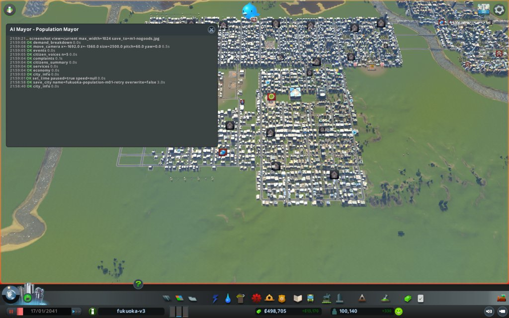

# 市政ノート

## 性格と公約と捨てるもの

人口だけを追う市長。お金と街の住み心地は、人が増える邪魔にならない限り見ない。

- 性格:
  - 急ぎ方: すぐ動く。手は大きく打つ
  - 先に見るもの: 数字。とくに住宅の需要の内訳(`demand_breakdown`)
  - 迷ったとき: 家が多く建つほうを選ぶ
- 公約:
  1. 人口を 130,000 以上にする(`city_info` の population。出発点 100,140。期限は任期の終わり)
  2. 住宅の需要を 1 以上にする(`city_info` の demand.residential。出発点 0。3か月目から毎月の月例)
  3. 人口を毎月増やす(`city_info` の population。毎月の月例で、前の月例より増えていること)
- 捨てるもの: 週の収支(黒字の幅は使い切ってよい。融資も可。赤字にしない決まりは型に従う)、渋滞、汚染と騒音、建物のレベル、幸福度
- 任期: 12か月

## 申し送り(前の運営から)

なし

## 数字の表

月例と見回りのたびに1行足す。区切りは 月例・見回り・臨時。

| ゲーム内の日付 | 区切り | 人口 | 所持金 | 週の収支 | 幸福度 | 需要(住/商/工) | 失業 | 主な困りごと |
|---|---|---|---|---|---|---|---|---|
| 2041-01-17 | 月例 | 100,140 | 498,704 | +13,170 | 82 | 0 / 4 / 2 | 8,839 | 品物が届かない店 107棟 |
| 2041-01-27 | 見回り | 100,549 | 351,226 | +9,837 | 82 | 2 / 4 / 2 | (9,419 需要の数え) | 遺体の引き取りのつぶやき1件 |
| 2041-02-06 | 見回り | 101,003 | 366,785 | +10,994 | 82 | 2 / 6 / 4 | - | なし |

## 施策の一覧

施策を打つたびに1行足す(臨時も含む)。答え合わせの列は、翌月の月例で埋める。
分野は、港・働き口・住宅・暮らし・環境・財政から1つ選ぶ。

| ゲーム内の日付 | 区切り | 施策 | 分野 | 公約 | 捨てるもの | 建設費 | 週の維持費の増分 | 答え合わせ |
|---|---|---|---|---|---|---|---|---|
| 2041-01-17 | 月例 | 南西に学校の街区(高校4・小学校4、道路と水道管) | 働き口 | 2・1 | 週の収支 | 143,420 | 約2,900 | まだ分からない |
| 2041-01-17 | 月例 | オフィス街に墓地2・公園2 | 働き口 | 2 | なし | 18,000 | 約340 | まだ分からない |
| 2041-01-17 | 月例 | 中央のオフィス街にバス路線22 | 働き口 | 2 | 週の収支 | 0 | 未見積もり(バスの台数しだい) | まだ分からない |

## 判断の記録

### 2041-01-17 月例(1か月目)

保存: `fukuoka-population-m01-retry`(成功、2041-01-17)

#### 答え合わせ

なし(初回)

- 公約の進み具合
  1. 人口 130,000: 今 100,140 / 残り 12か月で +29,860 / 今の需要0では届かない
  2. 住宅の需要 1 以上: 今 0 / 3か月目の月例から / 需要の目標値(target)が0のまま
  3. 毎月増やす: 基準は 100,140

#### 気づいたこと

- 住宅の需要の内訳(`demand_breakdown`): base 50 + jobTerm −39 + homeTerm −11 = 目標0。
  - jobTerm は (空いた働き口 786 − 失業 9,285) × 200 ÷ 働き口 43,075 ≒ −39 と読める。働き口が約215増えるごとに需要が1上がる
  - homeTerm は 空き家 1,600 × 200 ÷ 家 28,764 ≒ −11
  - 失業の9割(8,611人)は大学を出た人。働き口が足りないことが、人が来ない一番の原因
- 区画の建物は月に約25〜30棟しか建たない(道具の説明)。オフィス1棟は平均8.6人分なので、区画を塗るだけでは月300人分ほどしか働き口が増えない
  - 一方、サービスの建物の働き手も働き口に入る(働き口 43,075 ≒ 働き手 42,267 + 空き 786)。高校1校で約90人、小学校で26人。高校は週560で90人分と安い
  - 高校は全部満員(13,000席に10代 16,097人)、小学校も満員(7,200席に子ども 8,930人)
- オフィス1,443棟のうち1,182棟がサービスの点でレベルが止まっている。不足は公共交通583、葬祭301、娯楽119。南西のオフィス街(x −1640〜−920, z −1450〜−1770)は葬祭67棟・公共交通43棟、中央(x 0〜700, z 0〜−500)は葬祭88棟・公共交通81棟で止まっている。レベルが上がると1棟の働き口が増える

#### 施策

1. 南西に学校の街区を作る(高校4校と小学校4校)
   - 公約: 2(働き口を増やして jobTerm を上げる)、1・3(需要が戻れば引っ越しが来る)
   - 捨てるもの: 週の収支に手を出す(維持費 約2,900/週を足す)。黒字 13,170 の範囲
   - 理由: 学校は満員で、働き手を約460人分足せる。席の不足(高校約3,100、小学校約1,700)も埋まる
   - 予想: 次の月例(2041-02-16ごろ)までに働き口が+400以上、jobTerm が+2ほど。需要の目標が2前後になる
   - 操作: `build_line`(Basic Road、z=−1900 の東西の道と、南北のつなぎ3本。水道管も)、`place_building`(High School ×4、Elementary School ×4)
   - 結果:
     - 道路: 最初の線(南北のつなぎ2本を含む)はオフィス2棟(46374、6826)に重なり、断られた。壊さずに引き直した。(-920,-1730)→(-880,-1730)→(-880,-1900)→(-1680,-1900) で成功。費用 5,040。東の端だけが既存の道につながる(西の端は行き止まり)
     - 水道管: (-1240,-1735)→(-1240,-1895)→(-1680,-1895) と (-1240,-1895)→(-880,-1895)。成功。費用 1,480 + 900
     - 高校4校(id 32535、43658、48031、41583。x −1640〜−1460、z −1872、南向き)。各 24,000
     - 小学校4校(id 46516、6956、27046、9355。x −1210〜−1030、z −1876、南向き)。各 10,000
     - 合計 143,420。壊した建物は0
   - 確かめ: 1日進めて `buildings_near`。8校とも電気・水・下水が来ている。働き手が入り始めた(5〜19人)。生徒も入り始めた(高校 170、193 人など)
2. 南西と中央のオフィス街に墓地と公園を置く
   - 公約: 2(オフィスのレベルを上げて働き口を増やす)
   - 捨てるもの: なし(建物のレベルは捨てるものだが、ここでは働き口のために上げる。目的は働き口)
   - 理由: 南西のオフィス 6103 はサービス点 67/90。葬祭が0/20、娯楽が0/16。墓地と公園で届く
   - 予想: 次の月例までに、南西と中央でオフィスのレベル3が合わせて20棟以上増える。働き口が+150以上
   - 操作: `place_building`(Cemetery、Regular Park)
   - 結果:
     - 南西: 墓地(id 28442、-1380,-1860、8,000)、公園(id 19882、-1290,-1860、1,000)、公園(id 37396、-950,-1860、1,000)
     - 中央: 墓地(id 262、741,-300、西向き、8,000)
     - 合計 18,000。壊した建物は0
   - 確かめ: 中央の墓地は1日後に電気・水・下水あり、働き手25人、霊柩車2台が動いている。墓地1つで25人分の働き口になると分かった
3. 中央のオフィス街に環状のバス路線を引く(臨時に足した3件目ではなく、月例の3件目)
   - 公約: 2(オフィスのレベルを上げて働き口を増やす)
   - 捨てるもの: 週の収支に少し手を出す(バスの維持費)
   - 理由: 中央のオフィスは公共交通で81棟が止まっている。バスの車庫はある(1652,66)
   - 予想: 10日以内に pathFailed 0 で走り出す。次の月例までに中央のオフィスのレベル3が増える(施策2と合わせて見る)
   - 操作: `create_transport_line`(bus、停留所8か所。x 80〜700、z −80〜−530)
   - 結果: 成功。路線 line 63(画面の番号22)、停留所8。建設費なし。台数はまだ0
   - 確かめ: 次の見回りで `list_transport_lines` の pathFailed を見る

#### 考えたが打たなかった手

- オフィスや工業の区画を新しく塗る: 区画の建物は月25〜30棟が上限で、オフィスの空きマスが1,588ある。塗っても速くならない
- 住宅の区画を新しく塗る: 空きマスが3,267ある。需要0では建たない
- 住宅の税を下げる: `demand_breakdown` の式に税の項がない。効くか分からないので見送る
- 大学を建てる: 失業の大学卒は入れない。働き手83〜90人で維持費1,920と割高
- 工業の貨物(497棟が貨物の不足で止まっている): 貨物の駅に線路が要り、手が大きすぎる。来月以降に調べる
- 融資: 所持金 498,704 で足りている

#### 次にやること

- 見回りで、新しい学校と墓地の働き手が埋まったか、jobTerm が上がったかを `demand_breakdown` で見る
- 南西の新しい道の南側に区画を塗るか、来月決める(需要が戻ってから)
- ほかの葬祭が届かないオフィス(約150棟)の場所を調べ、墓地を足す
- 高校・小学校の席がまだ足りなければ足す(働き口にもなる)

#### 画面写真

### 2041-01-27 見回り

境目: 当たらず(所持金 351,226、週 +9,837 の黒字、人口 +409、幸福度 82 のまま、電気・水・下水の来ない市民 0、つぶやきは公園の感謝・遺体の引き取り各1件)

- 月例の後に1日、見回りまで9日進めた(月の日数を30日にそろえるため)
- `demand_breakdown`: 働き口 43,075→43,744(+669)、空き 786→1,222。失業 9,285→9,419。jobTerm −39→−37、目標 0→2、actual 2
- バス路線22: 7台が走っている。pathFailed 0

### 2041-02-06 見回り

境目: 当たらず(所持金 366,785、週 +10,994、人口 +454、幸福度 82、電気・水・下水の来ない市民 0、つぶやきは学生の発明1件)

### 2041-02-16 1か月目の終わり(次の月例の前に見た数字)

施策は打っていない。次の月例の答え合わせの材料として、道具の返した数字だけを残す。

- `city_info`: 人口 101,540(月例から +1,400)、所持金 383,748、週 +11,847(収入 159,379 / 支出 147,532)、幸福度 82、需要 住0 / 商4 / 工2、電気・水・下水の来ない市民 0
- `demand_breakdown`: 働き口 43,676(月例 43,075、+601)、空き 999、失業 9,550(+265)、うち大学卒 9,057。家 29,163、空き家 1,666。jobTerm −39、homeTerm −11、目標 0
- `building_stats`(街全体)
  - オフィス: レベル3 が 118→163 棟(+45)。働き口 12,418→12,763(+345)。葬祭で止まる棟 301→136
  - オフィスで止まる理由の残り: 公共交通 627、地面の汚染 180、娯楽 153、葬祭 136
  - 工業: 働き口 10,921→10,686(−235)。商業(高): 12,198→12,134(−64)
- 気づいたこと: 人口は需要0〜2でも月に約1,400増えた。増えた分の大人は大学卒の失業になり、失業が働き口より速く増える。働き口を月600足しても jobTerm は動かなかった

## 人が手を入れたこと

- 1か月目は、人が fukuoka-population-m01 を読み込んでやり直した(m01-retry)
- 2026-10-22 21:58(実時間): 録画を始め直した。親が見出しを `AI Mayor - Population Mayor` に戻した
- 定点の写真は撮っていない。出発点が1回目と同じため、`../assets/fixed/m01-*.jpg` を使う

### 実時間とトークン

| 月 | 実時間 | トークン | 道具の呼び出し |
|---|---|---|---|
| 1(2回目) | 14分54秒 | 173,772 | 92 |

## 公約の結果

<任期の終わりに書く>

## 次の市長への申し送り

<運営の終わりに書く>
