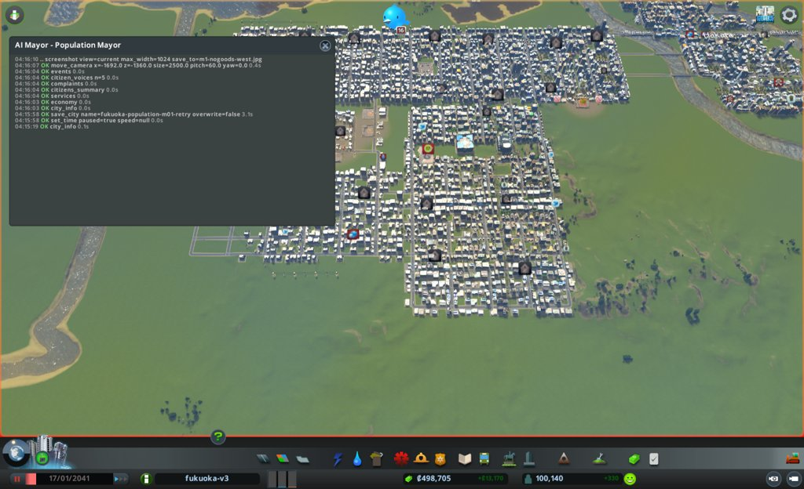
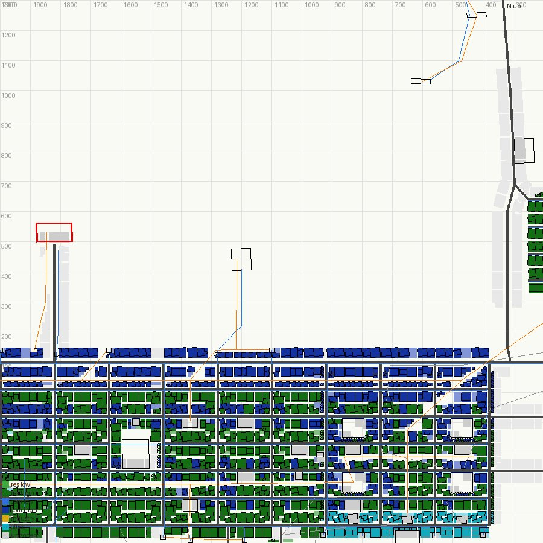

# 市政ノート

## 性格と公約と捨てるもの

人口だけを追う市長。お金と街の住み心地は、人が増える邪魔にならない限り見ない。

- 性格:
  - 急ぎ方: すぐ動く。手は大きく打つ
  - 先に見るもの: 数字。とくに住宅の需要の内訳(`demand_breakdown`)
  - 迷ったとき: 家が多く建つほうを選ぶ
- 公約:
  1. 人口を 130,000 以上にする(`city_info` の population。出発点 100,140。期限は任期の終わり)
  2. 住宅の需要を 1 以上にする(`city_info` の demand.residential。出発点 0。3か月目から毎月の月例)
  3. 人口を毎月増やす(`city_info` の population。毎月の月例で、前の月例より増えていること)
- 捨てるもの: 週の収支(黒字の幅は使い切ってよく、融資も借りてよい。赤字にしない決まりは型に従う)、渋滞、汚染と騒音、建物のレベル、幸福度
- 任期: 12か月

## 申し送り(前の運営から)

なし

## 数字の表

月例と見回りのたびに1行足す。区切りは 月例・見回り・臨時。

| ゲーム内の日付 | 区切り | 人口 | 所持金 | 週の収支 | 幸福度 | 需要(住/商/工) | 失業 | 主な困りごと |
|---|---|---|---|---|---|---|---|---|
| 2041-01-17 | 月例 | 100,140 | 498,704 | +13,170 | 82 | 0 / 4 / 2 | 8,839 | 品物がない107、死体14、ごみ11、汚染9 |
| 2041-01-27 | 見回り | 100,590 | 439,461 | +11,744 | 82 | 0 / 5 / 5 | — | 電気・水・下水の来ない市民 0/0/0。つぶやき1件(土の汚染) |
| 2041-02-06 | 見回り | 101,043 | 457,125 | +12,305 | 82 | 0 / 8 / 4 | — | 電気・水・下水の来ない市民 0/0/0。つぶやき1件 |

## 施策の一覧

施策を打つたびに1行足す(臨時も含む)。答え合わせの列は、翌月の月例で埋める。
分野は、港・働き口・住宅・暮らし・環境・財政から1つ選ぶ。

| ゲーム内の日付 | 区切り | 施策 | 分野 | 公約 | 捨てるもの | 建設費 | 週の維持費の増分 | 答え合わせ |
|---|---|---|---|---|---|---|---|---|
| 2041-01-17 | 月例 | 2つ目の荷物港を西の海岸に置く(道・管・送電線つき) | 港 | 1・2 | 週の収支(維持費を足す) | 66,340 | 約2,020(港1,920+道47+線・管) | |
| 2041-01-17 | 月例 | 放棄・倒壊の建物94棟を取り壊す | 働き口 | 1・2 | なし | 0 | 0 | |
| 2041-01-17 | 月例 | 港1の道から本通りへ Large Road の近道 | 港 | 1・2 | なし | 9,540 | 約72 | |

## 判断の記録

### 2041-01-17 月例(1か月目)

保存: `fukuoka-population-m01-retry`(2041-01-17)

#### 答え合わせ

なし(初回)

- 公約の進み具合
  1. 人口 130,000: 今 100,140 / 残り 12か月で +29,860 / 今のままでは届かない。需要が0で家が建たない
  2. 住宅の需要 1 以上: 今 0 / 3か月目の月例から / 働き口が増えないと上がらない
  3. 毎月増やす: 初回なので比べる前の月例なし

#### 気づいたこと

- 住宅の需要の内訳は base 50、jobTerm −39、homeTerm −11 で、ちょうど0。jobTerm は (空いた働き口 786 − 失業 9,285) × 200 ÷ 働き口 43,075 で計算が合う。失業を約350減らすか、空いた働き口を約400増やせば需要が1を超える
- 働く場所の需要は target 89 なのに actual 2。空いたオフィスの区画はあるのに建たない。原料不足で放棄される工場の建て直しが、需要を食っているとみる
- 荷物港 (−400,1555) が1つしかなく、荷物の車1,577台が止まり、うち1,421台が港に集まる。原料が来ない工場126棟、品物がない店107棟。放棄・倒壊の建物は94棟(多くは工場と店)

#### 施策

1. 2つ目の荷物港を西の海岸に置く
   - 公約: 1・2(働き口を戻し、jobTerm を上げて住宅の需要を出す)
   - 捨てるもの: 週の収支(維持費 約1,970/週を足す。黒字 13,170 の範囲)
   - 理由: 荷物港が1つで、1本の道に約1,600台が出入りする。西の工業 (−2400,−500) と品物のない店 (−1233,−809) に近い所に港を足し、車を分ける
   - 予想: 次の月例(2041-02-16ごろ)までに、港で止まる車が1,421台から1,000台未満に減る。原料不足の工場が126から100未満に減る
   - 操作: `build_line`(Large Road、(−1820,100) から北へ海岸まで)、`place_building`(Cargo Harbor、南向き)
   - 結果: Large Road (−1820,100)→(−1820,490) 成功 3,840。x=−1820 では店1棟(39797)に重なり、demolish=true で取り壊した(x=−1892 は2棟に重なったため)。Cargo Harbor (−1820,530) 成功 60,000、id 46695、入口の道あり。水道管 (−1815,95)→(−1808,470) 1,000。送電線 店40923→港 1,020
   - 確かめ: 初めは港の Harbor Road (z=490) と道の端がつながっていなかった(`net_reach` で notEnterable 1)。最後の区間を `remove_line` で消し、(−1820,427)→(−1820,476) を引き直して Harbor Road を分けてつないだ(480)。`net_reach` で notEnterable 0、notReachable 0。港の電気・水は次の見回りで見る
2. 放棄・倒壊の建物を取り壊す
   - 公約: 1・2(空いた敷地に働く場所と家が建ち直せるようにする)
   - 捨てるもの: なし
   - 理由: 放棄・倒壊が94棟あり、働き口も家も持たないまま敷地をふさいでいる
   - 予想: 次の月例までに、放棄の建物が94棟から30棟未満に減り、働き口の総数が 43,075 から増える
   - 操作: `bulldoze(what="abandoned")` を街の東西で
   - 結果: `bulldoze(x=800, z=0, radius=5000, what="abandoned")` で94棟を取り壊した。払い戻しなし。工場、店、焼けた住宅2棟を含む
   - 確かめ: 空いた敷地に建つかは、次の月例で `new_buildings`(since=41042)と働き口の数で見る
3. 1つ目の港の道から、本通り (z=100) へ太い近道を引く
   - 公約: 1・2(施策1と同じ。港1の出口の詰まりをほどく)
   - 捨てるもの: なし(渋滞を直すためではなく、荷物を工場と店へ届けるため)
   - 理由: 港1の道 (Small 4 Lane Road) は z=640 で細い Basic Road の住宅街に入り、そこの区間の混み具合が100
   - 予想: 次の月例までに、施策1と合わせて港の止まる車が減る(施策1の予想と同じ数字で見る)
   - 操作: `build_line`(Large Road、(−295,690) → (−320,600) → (−320,150) → (−310,100))
   - 結果: 成功 9,540。10区間、うち橋3区間。始点は港1の Small 4 Lane Road の点、終点は本通りの Medium Road の点につながった(snapped 2)
   - 確かめ: 両端が既存の点につながった。混み具合は次の月例で `traffic` を見る

#### 考えたが打たなかった手

- 新しい道の両側に住宅の区画を塗る: 需要が0のうちは建たない。需要が出てから塗る
- 空いた土地にオフィスの区画を足す: 空いたオフィスの区画がすでにあり、働く場所の需要の actual が2で建たない。区画より需要が先
- 大学や病院などで働き口を直接足す: 1棟の働き口が少なく、維持費のわりに jobTerm が動かない
- 住宅の税を下げる: 需要の内訳(base、jobTerm、homeTerm)に税の項がなく、需要は動かないとみた
- 融資: 所持金が約42万残り、今月は要らない

#### 次にやること

- 港2の電気・水が来たか、船と車が港2を使い始めたかを見回りで確かめる(`buildings_near`、`cargo`)
- 需要が1を超えたら、新しい道の沿いと空いた土地に住宅の区画を大きく塗る
- 働く場所の需要の actual が上がらない理由を `new_buildings` で確かめる

#### 画面写真

### 2041-01-27 見回り

境目: 当たらず。港2(46695)は電気・水・下水が来て、働き手62人。住宅の需要は target 0(jobTerm −40、homeTerm −10)のまま。失業(需要の数え)9,536

### 2041-02-06 見回り

境目: 当たらず。`cargo` で港2の出入りは0台、港1は出る車1,624台のまま。止まる車1,571(港1に1,403)。原料が来ない工場は126→86、品物がない店は107→113。港2に船が来ていない理由は月例で調べる

### 2041-02-16 1か月目の終わり(次の月例の前に見た数字)

- `city_info`: 人口 101,413、所持金 475,124、週の収支 +12,616、幸福度 82、需要 0 / 4 / 2
- `cargo`: 港2(46695)の出入りは0台のまま。港1は出る車1,648台、止まる車1,556(港1に1,430)。原料が来ない工場95、品物がない店123
- 次の月例で見ること: 港2に船が来ない理由(船の通り道、海の深さ、置いた向き)。来ないなら港2を移すか、別の手に切り替える

## 人が手を入れたこと

- 1か月目の2回目(m01-retry)。人が `fukuoka-population-m01` を読み込んで渡した
- これは2度目の m01-retry。1度目は録画が真っ黒だったため捨てた(`../discarded-m01retry-m06/m01-retry/`)
- 2026-10-23 04:15(実時間): 録画を始めた。親が見出しを `AI Mayor - Population Mayor` にした
- 定点の写真は撮っていない。出発点が1回目と同じため、`../assets/fixed/m01-*.jpg` を使う

### 実時間とトークン

| 月 | 実時間 | トークン | 道具の呼び出し |
|---|---|---|---|
| 1(2回目) | 11分38秒 | 157,411 | 93 |

## 公約の結果

## 次の市長への申し送り
