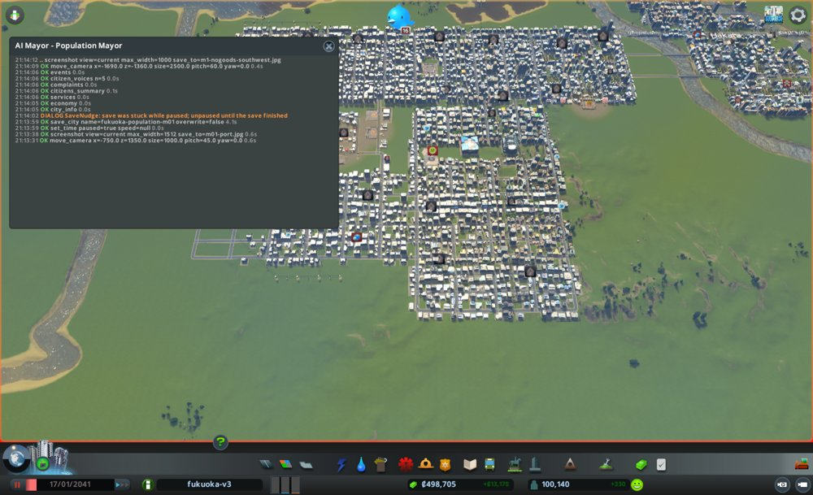
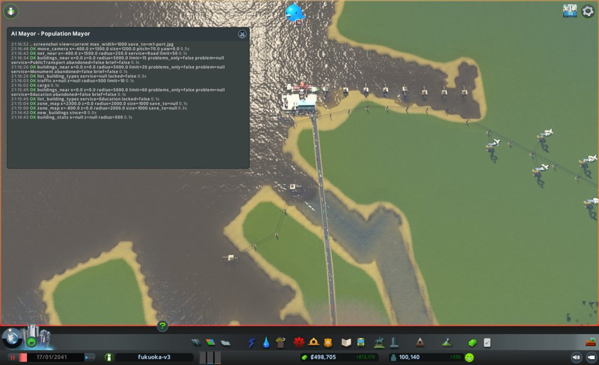
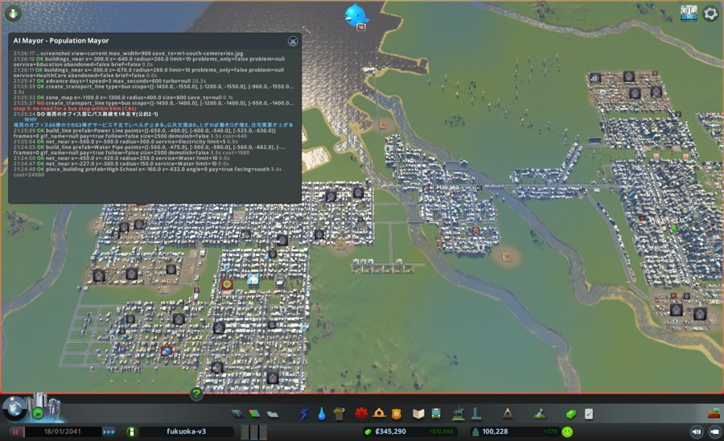
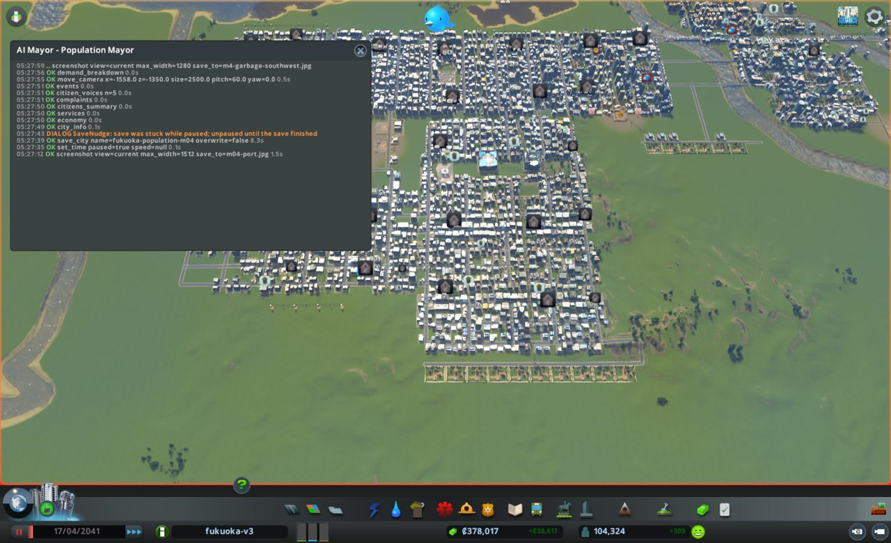
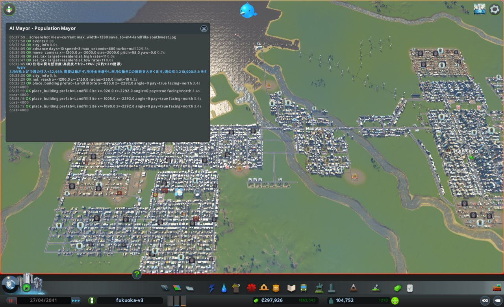

# 市政ノート

## 性格と公約と捨てるもの

人口だけを追う市長。お金と街の住み心地は、人が増える邪魔にならない限り見ない。

- 性格:
  - 急ぎ方: すぐ動く。手は大きく打つ
  - 先に見るもの: 数字。とくに住宅の需要の内訳(`demand_breakdown`)
  - 迷ったとき: 家が多く建つほうを選ぶ
- 公約:
  1. 人口を 130,000 以上にする(`city_info` の population。出発点 100,140。期限は任期の終わり)
  2. 住宅の需要を 1 以上にする(`city_info` の demand.residential。出発点 0。3か月目から毎月の月例)
  3. 人口を毎月増やす(`city_info` の population。毎月の月例で、前の月例より増えていること)
- 捨てるもの: 週の収支(黒字の幅は使い切ってよく、融資を借りてよい。赤字にしない決まりは型に従う)、渋滞、汚染と騒音、建物のレベル、幸福度
- 任期: 12か月

## 申し送り(前の運営から)

なし

## 数字の表

| ゲーム内の日付 | 区切り | 人口 | 所持金 | 週の収支 | 幸福度 | 需要(住/商/工) | 失業 | 主な困りごと |
|---|---|---|---|---|---|---|---|---|
| 2041-01-17 | 月例 | 100,140 | 498,704 | +13,170 | 82 | 0 / 4 / 2 | 8,839 | 品物がない107、死体14、ごみ11、汚染9 |
| 2041-01-27 | 見回り | 100,639 | 357,351 | +9,918 | 82 | 2 / 2 / 4 | (9,541 需要の数え) | つぶやきは放棄の家1件だけ |
| 2041-02-06 | 見回り | 101,030 | 373,690 | +11,532 | 82 | 3 / 4 / 2 | — | 困りごとのつぶやきなし |
| 2041-02-15 | 月例 | 101,573 | 391,622 | +12,491 | 82 | 1 / 8 / 4 | 8,966 | 品物がない129、ごみ19、騒音12 |
| 2041-02-25 | 見回り | 102,063 | 316,983 | +11,409 | 82 | 2 / 2 / 4 | (9,610 需要の数え) | 騒音のつぶやき1件 |
| 2041-03-07 | 見回り | 102,550 | 334,599 | +12,309 | 82 | 1 / 7 / 2 | (9,557 需要の数え) | 困りごとのつぶやきなし |
| 2041-03-17 | 2か月目の終わり | 102,959 | 352,627 | +12,674 | 82 | 0 / 4 / 2 | (9,692 需要の数え) | — |
| 2041-03-17 | 月例 | 102,959 | 352,627 | +12,674 | 82 | 0 / 4 / 2 | 9,146 | 品物がない147、ごみ32、死体15 |
| 2041-03-28 | 見回り | 103,393 | 263,978 | +42,673 | 82 | 3 / 2 / 4 | (9,694 需要の数え) | ごみのつぶやき1件 |
| 2041-04-07 | 見回り | 103,883 | 322,154 | +40,032 | 82 | 3 / 6 / 2 | (9,668 需要の数え) | つぶやきなし |
| 2041-04-17 | 3か月目の終わり | 104,324 | 378,016 | +38,618 | 81 | 2 / 5 / 4 | (9,722 需要の数え) | 断水のつぶやき1件 |
| 2041-04-17 | 月例 | 104,324 | 378,016 | +38,618 | 81 | 2 / 5 / 4 | 9,190 | 品物がない164、ごみ136、騒音13、汚染12 |
| 2041-04-27 | 見回り | 104,752 | 297,926 | +63,542 | 81 | 0 / 2 / 6 | (9,798 需要の数え) | 困りごとのつぶやきなし |
| 2041-05-07 | 見回り | 105,251 | 384,507 | +59,753 | 81 | 0 / 4 / 2 | (9,884 需要の数え) | 困りごとのつぶやきなし |
| 2041-05-17 | 4か月目の終わり | 105,596 | 462,728 | +56,398 | 81 | 0 / 2 / 2 | (9,807 需要の数え) | ごみ202(北東の工場へ移った)、品物がない170 |
| 2041-05-17 | 月例 | 105,596 | 462,728 | +56,398 | 81 | 0 / 2 / 2 | 9,206 | ごみ202、品物がない170、騒音21、死体13 |
| 2041-05-27 | 見回り | 105,937 | 350,450 | +77,072 | 81 | −6 / 2 / 2 | (9,794 需要の数え) | 死体のつぶやき1件 |
| 2041-06-06 | 見回り | 106,178 | 457,175 | +73,752 | 81 | −6 / 2 / 2 | (9,754 需要の数え) | 放棄の家のつぶやき1件 |
| 2041-06-16 | 5か月目の終わり | 106,651 | 559,663 | +70,925 | 81 | −6 / 2 / 2 | (9,750 需要の数え) | 品物がない186、税が高すぎる82、ごみ40 |
| 2041-06-16 | 月例 | 106,651 | 559,663 | +70,925 | 81 | −6 / 2 / 2 | 9,037 | 品物がない186、税が高すぎる82、ごみ40、騒音14 |
| 2041-06-26 | 見回り | 107,028 | 338,829 | +23,020 | 82 | 3 / 6 / 2 | (9,601 需要の数え) | 汚染のつぶやき1件 |
| 2041-07-06 | 見回り | 107,553 | 379,039 | +29,008 | 82 | 1 / 2 / 4 | (9,401 需要の数え) | 騒音の話1件 |
| 2041-07-16 | 6か月目の終わり | 108,092 | 425,605 | +32,983 | 82 | −1 / 2 / 6 | (9,222 需要の数え) | 品物がない212、死体12、ごみ10。税が高すぎる0 |
| 2041-07-16 | 月例 | 108,092 | 425,605 | +32,983 | 82 | −1 / 2 / 6 | 8,330 | 品物がない212、騒音13、死体12、ごみ10 |
| 2041-07-26 | 見回り | 108,511 | 271,500 | +6,795 | 81 | 5 / 2 / 4 | (8,928 需要の数え) | 困りごとのつぶやきなし |
| 2041-08-05 | 見回り | 109,007 | 288,431 | +13,010 | 81 | 4 / 2 / 4 | (8,693 需要の数え) | 困りごとのつぶやきなし |
| 2041-08-15 | 7か月目の終わり | 109,643 | 311,713 | +16,792 | 81 | 7 / 2 / 4 | (8,578 需要の数え) | 品物がない243、死体22、ごみ14、騒音13 |
| 2041-08-15 | 月例 | 109,643 | 311,713 | +16,792 | 81 | 7 / 2 / 4 | 7,778 | 品物がない243、死体22、ごみ14、騒音13、汚染9 |
| 2041-08-25 | 見回り | 109,928 | 175,849 | +12,860 | 81 | 4 / 2 / 6 | (8,394 需要の数え) | ごみのつぶやき1件 |
| 2041-09-04 | 見回り | 110,287 | 197,781 | +15,583 | 81 | 4 / 3 / 4 | (8,123 需要の数え) | 断水のつぶやき1件 |
| 2041-09-14 | 8か月目の終わり | 110,709 | 223,188 | +17,994 | 81 | 2 / 2 / 4 | (8,021 需要の数え) | 品物がない236、騒音25、死体16。西の放棄34 |
| 2041-09-14 | 月例 | 110,709 | 223,188 | +17,994 | 81 | 2 / 2 / 4 | 7,200 | 品物がない236、騒音25、死体16、汚染6 |
| 2041-09-24 | 見回り | 111,180 | 233,076 | +7,878 | 82 | 14 / 4 / 11 | (7,938 需要の数え) | 困りごとのつぶやきなし |
| 2041-10-04 | 見回り | 111,851 | 255,626 | +16,737 | 82 | 10 / 2 / 4 | (8,104 需要の数え) | 困りごとのつぶやきなし |
| 2041-10-14 | 9か月目の終わり | 112,294 | 283,215 | +20,482 | 82 | 10 / 2 / 8 | (8,095 需要の数え) | 品物がない284、死体9、騒音8、汚染7 |
| 2041-10-14 | 月例 | 112,294 | 283,215 | +20,482 | 82 | 10 / 2 / 8 | 7,242 | 品物がない284、死体9、騒音8、汚染7 |
| 2041-10-24 | 見回り | 112,624 | 183,330 | +13,751 | 82 | 10 / 2 / 5 | (8,062 需要の数え) | 死体のつぶやき1件 |
| 2041-11-03 | 見回り | 113,212 | 207,254 | +17,179 | 82 | 12 / 4 / 8 | (8,236 需要の数え) | 放棄のつぶやき1件 |
| 2041-11-13 | 10か月目の終わり | 113,602 | 233,348 | +18,363 | 82 | 6 / 2 / 8 | (8,211 需要の数え) | 品物がない332、汚染11、騒音11、死体7 |
| 2041-11-13 | 月例 | 113,602 | 233,348 | +18,363 | 82 | 6 / 2 / 8 | 7,460 | 品物がない332、汚染11、騒音11、死体7 |
| 2041-11-23 | 見回り | 113,950 | 145,781 | +10,621 | 82 | 13 / 4 / 9 | (8,232 需要の数え) | 地面の汚染のつぶやき1件 |
| 2041-12-03 | 見回り | 114,338 | 164,236 | +13,145 | 82 | 13 / 4 / 8 | (8,214 需要の数え) | 騒音のつぶやき1件 |
| 2041-12-13 | 11か月目の終わり | 114,657 | 185,614 | +14,998 | 82 | 11 / 2 / 7 | (8,181 需要の数え) | 品物がない361、ごみ15、騒音8、死体8 |
| 2041-12-13 | 月例 | 114,657 | 185,614 | +14,998 | 82 | 11 / 2 / 7 | 7,302 | 品物がない361、ごみ15、騒音8、死体8 |
| 2041-12-23 | 見回り | 115,133 | 113,794 | +12,677 | 82 | 2 / 17 / 12 | (8,183 需要の数え) | 困りごとのつぶやきなし |
| 2042-01-02 | 見回り | 115,316 | 133,481 | +13,914 | 82 | 4 / 47 / 17 | (8,099 需要の数え) | ごみのつぶやき1件 |
| 2042-01-12 | 12か月目の終わり(任期の終わり) | 115,709 | 153,353 | +13,792 | 82 | 2 / 46 / 22 | (8,274 需要の数え) | 品物がない253、ごみ35、死体16。水・下水が来ない31人 |

## 施策の一覧

| ゲーム内の日付 | 区切り | 施策 | 分野 | 公約 | 捨てるもの | 建設費 | 週の維持費の増分 | 答え合わせ |
|---|---|---|---|---|---|---|---|---|
| 2041-01-17 | 月例 | 港の出口の道を4車線に | 港 | 1・2 | なし | 0 | 0 | |
| 2041-01-17 | 月例 | 中心の南に墓地6・高校4 | 働き口 | 2・1 | なし | 155,280(川の橋3,340を含む) | 約3,240 | |
| 2041-01-17 | 月例 | 南西のオフィス街にバス路線 | 働き口 | 2・1 | なし | 0 | バスの台数しだい | |
| 2041-02-15 | 月例 | 東と斜めのオフィス通りにバス2本 | 働き口 | 2・1 | なし | 0 | バスの台数しだい | |
| 2041-02-15 | 月例 | 南西の南に道と墓地10 | 働き口 | 2・1 | なし | 88,800 | 約1,650 | |
| 2041-03-17 | 月例 | 東の風車の列を高校6・遊び場に | 働き口 | 2・1 | なし | 149,990 | 約3,400 | |
| 2041-03-17 | 月例 | 高密度住宅の税 7→9% | 税 | 2・1 | 幸福度 | 0 | 0(収入 +) | |
| 2041-04-17 | 月例 | 南西の南に道と埋立地40 | 働き口 | 2・1 | 汚染と騒音、渋滞 | 171,280 | 約6,400 | |
| 2041-04-17 | 月例 | 住宅の税 低・高とも 9→11% | 税 | 1・2 | 幸福度 | 0 | 0(収入 +) | |
| 2041-05-17 | 月例 | 北東の工場の北に道と埋立地36 | 働き口 | 2・1 | 汚染と騒音、渋滞 | 154,200 | 約5,760 | |
| 2041-05-17 | 月例 | 住宅の税 低・高とも 11→13% | 税 | 1・2 | 幸福度 | 0 | 0(収入 +) | |
| 2041-05-17 | 月例 | 南西の埋立地の東に道と埋立地16 | 働き口 | 2・1 | 汚染と騒音 | 68,000 | 約2,560 | |
| 2041-06-16 | 月例 | 住宅の税 低・高とも 13→11% | 税 | 2・1・3 | 週の収支 | 0 | 0(収入 −) | |
| 2041-06-16 | 月例 | 南西の埋立地の列の東に道3本と埋立地60 | 働き口 | 2・1 | 汚染と騒音、渋滞 | 255,120 | 約9,600 | 当たり(働き口 +1,835、目標 8→13) |
| 2041-07-16 | 月例 | 住宅の税 低・高とも 11→9% | 税 | 2・1・3 | 週の収支 | 0 | 0(収入 約−36,600) | |
| 2041-07-16 | 月例 | 予算 ごみ150→130、医療・消防・警察140→120 | 予算 | 1 | 幸福度、週の収支 | 0 | 約−14,500 | |
| 2041-07-16 | 月例 | 南西の埋立地の列の南に道4本と埋立地38 | 働き口 | 2・1 | 汚染と騒音、渋滞 | 163,200 | 約7,900 | 一部当たり(働き口 +907、目標 13→15) |
| 2041-08-15 | 月例 | 南西の埋立地の列の東に道5本と埋立地36 | 働き口 | 2・1 | 汚染と騒音、渋滞 | 154,000 | 約7,500 | |
| 2041-08-15 | 月例 | 西の放棄された建物56棟を取り壊す | 地価 | 1・2 | なし | 0 | 0 | 一部当たり(放棄 55→34、地価は動かず) |
| 2041-09-14 | 月例 | 地区 HighTech(HighTechHousing)を東と西の残りに広げる | 地価 | 1・3 | 週の収支 | 0 | 政策の費用(見回りで見る) | 当たり(家 月 +868、政策の費用 +5,109) |
| 2041-09-14 | 月例 | 予算 医療・消防・警察120→140、公園100→120 | 地価 | 1・3 | 週の収支 | 0 | 約 +9,200 | 当たり(地価の平均 28→30、地価で止まる 1,372→1,295) |
| 2041-10-14 | 月例 | 公共交通の届かない住宅街にバス4本 | 地価 | 1・2 | 週の収支 | 0 | 約 +500 | 一部当たり(地価で止まる 1,295→1,197、届き具合の平均 15→16) |
| 2041-10-14 | 月例 | 地区 HighTech を街のほぼ全体に広げる(Hakata を含む) | 地価 | 1・3 | 週の収支 | 0 | +2,915 | 一部当たり(費用は予想どおり、住宅(低)の地価で止まる 801→871) |
| 2041-10-14 | 月例 | 南西の埋立地の列の南に道2本と埋立地28 | 働き口 | 2・1 | 汚染と騒音、渋滞 | 119,440 | 約5,800 | 一部当たり(働き口 +581、目標 12→11) |
| 2041-11-13 | 月例 | 南西の住宅街と東の南にバス2本 | 地価 | 1・3 | 週の収支 | 0 | バスの台数しだい | |
| 2041-11-13 | 月例 | 予算 教育100→120、公園120→140 | 地価 | 1・3 | 週の収支 | 0 | 約 +5,200 | |
| 2041-11-13 | 月例 | 南の埋立地の列の南に道2本と埋立地24 | 働き口 | 2・1 | 汚染と騒音、渋滞 | 102,320 | 約3,900 | |
| 2041-12-13 | 月例 | 中心の西を住宅(高)にし水道管を引く | 住宅 | 1・3 | なし | 2,220 | 約0 | 外れ(建ったのは1棟) |
| 2041-12-13 | 月例 | 放棄195棟を壊し、西を住宅(高)に塗り替える | 住宅 | 1・3 | なし | 0 | 0 | 当たり(住宅(高)月 8 → 58棟、家 +611) |
| 2041-12-13 | 月例 | 南の埋立地の列の南に道2本と埋立地20 | 働き口 | 2・1 | 汚染と騒音、渋滞 | 86,640 | 約3,300 | 一部当たり(今の値 2、働き口 −70) |

## 判断の記録

### 2041-01-17 月例(1か月目)

保存: `fukuoka-population-m01`(2041-01-17)

#### 答え合わせ

なし(初回)

- 公約の進み具合
  1. 人口 130,000: 今 100,140 / 残り12か月 / あと約30,000。月2,500ずつ要る
  2. 住宅の需要 1 以上: 今 0 / 3か月目の月例から
  3. 毎月増やす: 基準は 100,140

#### 見た数字(深く調べた道具)

- `demand_breakdown`: 住宅の需要の目標 0 = base 50 + jobTerm −39 + homeTerm −11
  - jobTerm は 200 ×(空いた働き口 786 − 失業 9,285)÷ 働き口 43,075 で −39 に合う。働き口が約215増えると +1
  - homeTerm は 200 ×(家のない人 0 − 空き家 1,600)÷ 家 28,764 で −11 に合う
  - 働く場所の需要: 目標 89、今 2
- `building_stats`: 区画の働き口 36,697。全体 43,075 との差 6,378 はサービスの建物の働き口。サービスの建物の働き口も数に入る
  - オフィス 1,443棟のうち 1,182棟がサービス不足でレベルが止まる(公共交通 583、葬祭 301)
  - 放棄: 商業35、工業55
- `zones_at`(街全体): 空いた区画マス 住宅(高)1,939、オフィス 1,466、商業(高)769。土地は余っている
- `cargo`: 荷物の車 2,682台のうち 1,577台が止まり、1,421台が貨物港(−400,1539)に固まる。出入りの道は Harbor Road(片側1車線)と、その先の住宅街の Basic Road
- サービスの建物の働き手(`buildings_near`): 墓地30(8,000、週160)、高校約90(24,000、週560)、診療所33、大学約90
- `map_layer` deathcare: 中心の南(x −1100〜800、z −700〜−1300)が0
- 中心の南(x −900〜600、z −540〜−1400)に、広い空き地(陸)がある

#### 気づいたこと

- 住宅の需要は、あと2点上がれば1以上になる。足りないのは働き口で、約430あれば届く
- オフィスの空きマスが1,466あるのに建たない。区画を増やしても働き口は増えない。働き口を増やすには、サービスの建物、レベル上げ、港の流れを直す、の3つ
- 貨物港の出口が細く、工場と店に物が届かない。放棄が続けば働き口が減り、需要がさらに下がる

#### 施策

1. 貨物港の出口の道を広げる
   - 公約: 1・2(工場と店の働き口を守り、需要の jobTerm を下げない)
   - 捨てるもの: なし(渋滞を直す形だが、狙いは働き口)
   - 理由: 港で1,421台が止まる。出口が Harbor Road(片側1車線)と Basic Road の住宅街の道
   - 予想: 2月中旬までに、港で止まる車が1,421台から1,000台未満に減る。品物がない店が107棟から減る
   - 操作: `upgrade_road` で Harbor Road と、港の道から中央の Medium Road(z=100)までの Basic Road を Small 4 Lane Road にする
   - 結果: Harbor Road は「建物の一部」で差し替えられず(0区間)。港の道の先(z=640 → x=−150 → z=190 → x=80)の Basic Road 20区間を Small 4 Lane Road にした。費用0
     - x=−150 の z=280〜370 の2区間と、z=370 の x=−73〜80 の2区間は ObjectCollision で飛ばした。火葬場(−134,330)などが道に接している。片側1車線が約90m残る
   - 確かめ: `net_near` で、x=−150(z 370〜640)、z=190、x=80(z 100〜370)が Small 4 Lane Road になった
2. 中心の南の空き地に、墓地と高校を建てる(働き口を直接増やす)
   - 公約: 2(働き口が増えて jobTerm が上がる)、1
   - 捨てるもの: なし
   - 理由: 働き口が約215で需要+1。墓地は1棟30人・8,000、高校は約90人・24,000。葬祭の届かないオフィスのレベルも上がる。高校の席は10代16,097に対し13,000
   - 予想: 2月中旬までに働き口が約500増え、住宅の需要の目標が +2 以上になる
   - 操作: `build_line` で道を引き、`place_building` で墓地6、高校4
   - 結果:
     - 先に (200,−530) から南へ道を引いたら、川の上の橋になった(bridgeSegments 3、3,340)。空き地と思った所の東半分は川だった。働き口のない橋なので `remove_line` で4区間を取り壊した(払い戻しなし)
     - 道: (−227,−260) から南へ (−227,−660)、z=−660 を x −560〜40。2,000 + 3,000 + つなぎ直し320。途中の点がつながらず、1区間を消して引き直した
     - 墓地6(x −510、−425、−340、−255、−170、−85、z −700、北向き)各8,000 = 48,000
     - 高校4(x −520、−460、−400、−160、z −632、南向き)各24,000 = 96,000
     - 水道管 (−560,−475) から z=−662 へ 1,980。送電線 (−650,−400) から高校9352へ 640
     - 合計 155,280(川の橋 3,340 を含む)。所持金は 498,704 → 345,290(1日後)
   - 確かめ: `advance(1)` の後の `buildings_near` で、10棟とも電気・水・下水が来ている。高校2校に生徒が入り始めた(193、170)
3. 南西のオフィス街にバス路線を1本足す
   - 公約: 2・1(オフィスのレベルが上がると働き口が増える)
   - 捨てるもの: なし
   - 理由: 南西のオフィス66棟のうち63棟がサービス不足で止まる(葬祭33、公共交通30)。`map_layer` の公共交通はこのあたりが0
   - 予想: 2月中旬に、この辺りのオフィスのレベル3が0棟から増え始める。大きな数ではない
   - 操作: `create_transport_line` bus、停留所6(z −1546 と −1644、x −1428〜−961)
   - 結果: 路線 line 104(番号22)、停留所6。建設費0。台数はまだ0(道順の計算中)
   - 確かめ: 次の見回りで `list_transport_lines` の pathFailed を見る

#### 考えたが打たなかった手

- 新しいオフィス街の区画: オフィスの空きマスが既に1,466ある。区画を足しても、働く場所の需要(今2)が低く建たない
- 住宅の区画を足す: 住宅(高)の空きマスが1,939ある。需要が上がるまで要らない
- 放棄された建物(商業35、工業55)の取り壊し: 建て直しは需要しだいで、働き口がすぐ増えない。品物の届かない所では、また放棄される
- 2つ目の貨物港: 工場の近くに海岸が見つからず、置く場所を決められなかった
- 税を下げる: `demand_breakdown` の住宅の需要の式に税の項がない。オフィスと工業は既に1%
- 融資: 所持金が345,290 あり、今は要らない

#### 次にやること

- 港の出口の残りの1車線(x=−150 の z=280〜370 と、火葬場の前)を、別の道で迂回できないか調べる
- 墓地と高校の働き口が埋まったかと、`demand_breakdown` の jobTerm の変化を見る
- 南西(z −1100〜−1300)など、葬祭が0の所に墓地を足すか決める

#### 画面写真

### 2041-01-27 見回り

境目: 当たらず。週の収支は +13,170 → +9,918 に減ったが黒字。電気・水・下水が来ない市民は0のまま

- 調べた数字(`demand_breakdown`): 働き口 43,075 → 43,889(+814)、空き 786 → 1,302。jobTerm −39 → −37、住宅の需要の目標 0 → 2
- バス路線22は6台で走り、pathFailed 0

### 2041-02-06 見回り

境目: 当たらず。人口 +391、住宅の需要 3、週の収支 +11,532

### 2041-02-16 1か月目の終わり(次の月例の前に見た数字)

月例の答え合わせは2か月目の月例で行う。そのための事実だけを残す。

- `city_info`: 人口 101,573、所持金 391,622、週 160,112 − 147,621 = +12,491、需要 1 / 8 / 4、幸福度 82、電気・水・下水が来ない市民 0
- `demand_breakdown`: 働き口 43,879(空き 1,068)、失業 9,559(大学卒 9,058)、空き家 1,695。jobTerm −38、homeTerm −11、目標 1
  - 働き口は1月27日の 43,889 から増えていない。大学卒の失業は 8,611 → 9,058 に増えた
- `cargo`: 貨物港で止まる車 1,406(月初 1,421)。品物がない店 107 → 129。原料がない工場 126 → 112

### 2041-02-15 月例(2か月目)

保存: `fukuoka-population-m02`(2041-02-15)

#### 答え合わせ

1. 港の出口の道を4車線に
   - 予想: 港で止まる車が1,421台から1,000台未満に。品物がない店が107棟から減る
   - 結果: 外れ。止まる車 1,406台、品物がない店 129棟(増えた)
   - 見立て: 片側1車線が約90m残り、Harbor Road は差し替えられなかった。出口の一番細い所が変わっていない
   - 次の扱い: やめる。人口の公約への効き目が見えない。港の流れには今月は手を出さない
2. 中心の南に墓地6・高校4
   - 予想: 働き口が約500増え、住宅の需要の目標が +2 以上
   - 結果: 一部当たり。1月27日に働き口 +814、目標 0 → 2。ただし2月16日には働き口 43,879 で、目標は 1 に戻った
   - 見立て: サービスの建物の働き口は増えたが、ほかで同じくらい減った(放棄が98棟ある)。大学卒の失業が 8,611 → 9,058 に増え、打ち消した
   - 次の扱い: 続ける。働き口を直接増やす手は効く。今月は葬祭の届かない南西で同じ手を打つ
3. 南西のオフィス街にバス路線
   - 予想: レベル3が0棟から増え始める。大きな数ではない
   - 結果: 路線22は6台で走るが、乗客0。レベルの変化は今月は測っていない
   - 次の扱い: 続ける。今月は公共交通で止まるオフィスの多い東に広げる

- 次にやることの実行
  - 港の残りの1車線の迂回: 実行しなかった。効き目が見えず、やめると決めた
  - 墓地と高校の働き口と jobTerm: 確かめた(上の2)
  - 南西に墓地を足すか: 足すと決めた(施策2)
- 公約の進み具合
  1. 人口 130,000: 今 101,573 / 残り11か月 / あと 28,427。月 2,584 ずつ要る。1か月目は +1,433 で足りない
  2. 住宅の需要 1 以上: 今 1 / 3か月目の月例から
  3. 毎月増やす: 100,140 → 101,573(+1,433)。達成

#### 見た数字

- `city_info`: 人口 101,573、所持金 391,622、週 +12,491、需要 1 / 8 / 4、幸福度 82
- `economy`: 税 住(低)9・住(高)7・商(低)9・商(高)3・工1・オフィス1。予算 ごみ150、医療・消防・警察140、ほか100
- `services`: 電気 937,488 / 1,536,960、水 1,142,016 / 1,860,000、下水 1,140,736 / 1,600,000。埋立地6が満杯。働き手 42,788 / 働き口 43,879
- `citizens_summary`: 失業 8,966(大学卒 8,637)、長く失業 7,989。小学校の席 7,200 に子ども 9,018
- `complaints`: 品物がない129(南西 −1656,−1348 に51)、ごみ19、騒音12
- `citizen_voices`: 5人とも困りごとなし。幸福度は最高
- `events`: 放棄の家1件だけ
- 深く調べた
  - `demand_breakdown`: 目標 1 = 50 − 38 − 11。働き口 43,879(空き1,068)、失業 9,559(大学卒 9,058)、空き家 1,695
  - `building_stats`: オフィス 1,449棟のうち 1,076棟がサービス不足でレベルが止まる(公共交通502、葬祭272)。東(2400,−100 半径900)だけで公共交通201、葬祭51
  - 放棄 98棟。工業は東の原料なし(NoResources)、商業は南西の品物なし
  - 空きマス: 住宅(高)2,963、オフィス1,472、商業(高)722、工業108
  - `map_layer` public_transport: 東(x 2500〜3200、z −450〜330)と斜めのオフィス通り(x 1560〜1720、z 0〜−850)が0
  - `map_layer` deathcare: 南西のオフィス(x −1650〜−900、z −1500〜−1780)が0に近い

#### 気づいたこと

- 需要の式で効くのは、働き口の数そのもの。空いたままの働き口も式に入る
- 放棄を片付けても働き口は増えない。オフィスと商業の空きマスはもう多く、建つ速さは需要で決まる
- オフィスのレベル上げは公共交通で止まる棟が多い。バスは建設費0で、広く効く

#### 施策

1. 東と斜めのオフィス通りにバス路線を2本足す
   - 公約: 2・1(オフィスのレベルが上がり、働き口が増える)
   - 捨てるもの: なし
   - 理由: 公共交通で止まるオフィスが502棟、そのうち東に201棟。東の公共交通は0
   - 予想: 3月中旬に、東のオフィスのレベル3が57棟から80棟以上になる。働き口が東で +200 以上
   - 操作: `create_transport_line` bus を2本
   - 結果: 東の環状 line 151(番号23、停留所8、x 2696〜3201、z −214〜326)。斜めの通り line 30(番号24、停留所7、x 1589〜1884、z −87〜−733)。建設費0。台数はまだ0(道順の計算中)
   - 確かめ: 次の見回りで pathFailed を見る
2. 南西のオフィス街の南に、道を引き墓地10を建てる
   - 公約: 2・1(墓地1つで働き口30、葬祭で止まるオフィスのレベルも上がる)
   - 捨てるもの: なし
   - 理由: 南西は葬祭が0に近い。墓地は1つ8,000・週160で、働き口あたりの費用が安い
   - 予想: 3月中旬に働き口が +300、住宅の需要の目標が今より +1 以上。建設費約90,000、週の維持費 +1,700
   - 操作と結果:
     - 道 (−920,−1730) → (−760,−1730) → (−760,−1820) → (−1640,−1820)。Basic Road 15区間、5,680。始点は既存の道につながった
     - 墓地10(x −1600〜−835 を85おき、z −1862、北向き)。各8,000 = 80,000。10棟とも入口の2m先に道
     - 水道管 (−920,−1735) から新しい道に沿って (−1640,−1815) まで、2,800。既存の管につながった
     - 送電線 (−1200,−1740) から墓地3491 の敷地へ、320
     - 合計 88,800
   - 確かめ: 1日後は電気・水・下水がどれも来ていなかった。送電線を足してもう1日進めた後、`zone_map` で赤い枠(来ていない建物)は0

#### 考えたが打たなかった手

- 放棄98棟の取り壊し: オフィスと商業の空きマスがもう多い。建つ速さは需要で決まり、取り壊しても働き口は増えない
- 政策 IndustrySpace や BigBusiness: 働き口が増えるかを道具で確かめられない。今月は見送る
- 小学校を足す: 席 7,200 に子ども 9,018 で足りない。だが働き口が少なく、需要への効き目は小さい
- 3件目の施策: 墓地と同じ手をほかの場所で打つ案は、効き目を見てから決める。所持金は手元に残す

#### 次にやること

- 新しいバス2本の pathFailed と台数を見る
- 墓地10の働き手が埋まったかと、`demand_breakdown` の働き口・jobTerm を見る
- 東(2400,−100 半径900)のオフィスのレベル3の棟数を見る(今57)
- `new_buildings` を index 41692 から呼び、今月建った棟数を見る。働く場所の需要が目標88なのに4のままの理由を探す

### 2041-02-25 見回り

境目: 当たらず。人口 +490、週の収支 +12,491 → +11,409(黒字)、電気・水・下水が来ない市民 0、困りごとのつぶやき0

- 調べた数字(`demand_breakdown`): 働き口 43,879 → 44,281(+402)、空き 1,275、失業 9,610。jobTerm −37、目標 2
- バス: 路線24(line 30)は5台・2.44km。路線23(line 151)は20台・12.76km で、停留所の間の遠回りが5〜19倍。停留所の向きで大回りしている。次の月例で直す

### 2041-03-07 見回り

境目: 当たらず。人口 +487、週の収支 +12,309、電気・水・下水が来ない市民 0

- 調べた数字(`demand_breakdown`): 働き口 44,358(+77)、空き 1,141、失業 9,557(大学卒 9,216)。jobTerm −37、目標 2、今 1

### 2041-03-17 2か月目の終わり(次の月例の前に見た数字)

月例の答え合わせは3か月目の月例で行う。そのための事実だけを残す。

- `city_info`: 人口 102,959、所持金 352,627、週 162,887 − 150,213 = +12,674、需要 0 / 4 / 2、幸福度 82、電気・水・下水が来ない市民 0
- `demand_breakdown`: 働き口 44,274(空き 1,005)、失業 9,692(大学卒 9,285)、空き家 1,752、家 29,665。jobTerm −39、homeTerm −11、目標 0
  - 働き口は月初 43,879 から +395。墓地の働き手は1棟26〜27人
  - 大学卒の失業は 9,058 → 9,285 に増えた
- `building_stats`(東 2400,−100 半径900): オフィスのレベル3は57棟のまま。公共交通で止まる棟 201 → 200
- `new_buildings`(index 41692 → 42174): 商業(高)31、住宅(高)31、工業28、オフィス13
  - 工業の空きマスは月初108しかないのに28棟建った。放棄された工場の建て直しが、働く場所の需要を使っている見込み

### 2041-03-17 月例(3か月目)

保存: `fukuoka-population-m03`(2041-03-17)

#### 答え合わせ

1. 東と斜めのオフィス通りにバス2本
   - 予想: 東のオフィスのレベル3が57棟から80棟以上。働き口が東で +200 以上
   - 結果: 外れ。東のレベル3は57棟のまま。公共交通で止まる棟 201 → 200
   - 見立て: 路線23は遠回りが5〜19倍で、停留所の近くしか届かない。オフィス948(3724,−226)を見ると、足りない点は12点。公共交通(11/33)より、高校(0/14)と娯楽(0/16)の点が0なのが大きい
   - 次の扱い: やめる。バスは足さない。東では高校の届き具合を上げる手に切り替える
2. 南西の南に道と墓地10
   - 予想: 働き口 +300、住宅の需要の目標が +1 以上。建設費約90,000、週の維持費 +1,700
   - 結果: 一部当たり。働き口は月で +395(墓地の働き手は1棟26〜27人)。需要の目標は 1 → 0 で、上がらなかった
   - 見立て: 働き口は増えたが、大学卒の失業も 9,058 → 9,285 に増えた。人口が増える分だけ失業も増え、jobTerm は −38 → −39
   - 次の扱い: 続ける。働き口を直接足す手は効くが、足す量が月 +400 では人口の伸びに負ける。量を増やす

- 次にやることの実行
  - バス2本の pathFailed と台数: 見回りで見た(路線23は20台、遠回り)
  - 墓地の働き手と jobTerm: 確かめた(上の2)
  - 東のレベル3の棟数: 確かめた(57のまま)
  - `new_buildings`: 確かめた(オフィス13、工業28)
- 公約の進み具合
  1. 人口 130,000: 今 102,959 / 残り10か月 / あと 27,041。月 2,704 ずつ要る。2か月目は +1,386 で足りない
  2. 住宅の需要 1 以上: 今 0。今月から毎月の月例で測る。今回は未達
  3. 毎月増やす: 101,573 → 102,959(+1,386)。達成

#### 見た数字

- `city_info`: 人口 102,959、所持金 352,627、週 +12,674、需要 0 / 4 / 2、幸福度 82、電気・水・下水が来ない市民 0
- `economy`: 税 住(低)9・住(高)7・商(低)9・商(高)3・工1・オフィス1。予算 ごみ150、医療・消防・警察140、ほか100
- `services`: 電気 945,088 / 1,637,760、水 1,153,952 / 1,860,000、下水 1,152,672 / 1,600,000。埋立地6が満杯。働き手 43,244 / 働き口 44,274。高校の席 17,000、10代 17,149
- `citizens_summary`: 失業 9,146(大学卒 8,889)、長く失業 8,236。子ども 9,041 に小学校の席 7,200
- `complaints`: 品物がない147(南西 −1576,−1309 に51)、ごみ32(東 3682,−285)、死体15、汚染9、騒音9
- `citizen_voices`: 5人とも困りごとなし。幸福度は最高
- `events`: 困りごとのつぶやきなし
- `screenshot`: 前の視点(港)のまま撮った。南西の写真は撮り直していない(`assets/m3-nogoods-southwest.jpg` は港の海)
- 深く調べた
  - `demand_breakdown`: 目標 0 = 50 − 39 − 11。働き口 44,274(空き 1,005)、失業 9,692(大学卒 9,285)、家 29,665、空き家 1,752
  - `building_stats`(街全体): オフィス 1,462棟のうち 1,063棟がサービスで止まる(公共交通539、地面の汚染183、葬祭172、娯楽144)。工業は貨物475、学歴492で止まる
  - `building_stats`(東 3500,−200 半径900): オフィス228棟(働き口1,900)、レベル3は0棟。214棟がサービスで止まる。低密度住宅809棟
  - `building_levelup` 948(東のオフィス): サービス 33 / 45。高校 0/14、娯楽 0/16、公共交通 11/33、葬祭 5/20
  - `map_layer` education_high: 東(x 3300〜4350)は0。entertainment も0
  - 小学校1校の働き手26人(10,000、週160)。高校は約90人(24,000、週560)。働き口1人あたりの週の維持費は、どれも約6
  - `list_loans`: 枠の額が20,000〜200,000で小さい。2つは借りている

#### 気づいたこと

- 住宅の需要を1上げるには、働き口が約220要る。月 +400 では、人口が増える分の失業に追いつかない
- 週の維持費1あたり働き口が約1/6人増える。黒字 12,674 を全部使っても、働き口は約2,000
- 東のオフィスは、高校と娯楽が0点。高校を置けば、働き口とオフィスのレベルの両方に効く

#### 施策

1. 東のオフィス街の裏に道を引き、高校6校と遊び場を建てる
   - 公約: 2・1(働き口を直接足す。東のオフィスのレベルも上げる)
   - 捨てるもの: なし
   - 理由: 高校1校で働き口約90。東のオフィス228棟は高校0点・娯楽0点。風車の列(z −375)の所は道がなく、空いている
   - 取り壊しの理由: 風車7基(z −375 の列、容量の合計 約128,000)を壊す。電気は 945,088 / 1,637,760 で余りが約69万あり、足りなくならない
   - 予想: 4月中旬に働き口が +450 以上、住宅の需要の目標が今より +2。東のオフィスのレベル3が0棟から10棟以上。建設費約150,000、週の維持費 +3,400
   - 操作と結果:
     - 風車7基を `bulldoze`(45636、41238、17399、5989、40156、25840、30414)。払い戻しなし
     - 道 (3162,−335) → (3800,−335)。Basic Road 9区間、3,120。西の端は既存の道を分けてつないだ。初めに (3843,−250) までつなごうとしたら工場8601に重なり、手前で止めた
     - 高校6(x 3240〜3690 を90おき、z −360、北向き)。各24,000 = 144,000。どれも入口の前に道
     - 遊び場(Regular Playground)(3762,−360)、1,250
     - 水道管 (3185,−375) → (3185,−330) → (3790,−330)、1,620。既存の管につながった
     - 合計 149,990
   - 確かめ: `advance(1)` の後の `buildings_near` で、6校とも電気・水・下水が来ている。働き手が入り始めた(0〜37人)
2. 高密度住宅の税を 7% → 9% にする
   - 公約: 2・1(働き口の施設の維持費の財源)
   - 捨てるもの: 幸福度(税が上がると下がる。捨ててよい)
   - 理由: `demand_breakdown` の住宅の需要の式に税の項がない。住宅の税収は週141,616。週の維持費1あたり働き口は約1/6人で、黒字の幅が働き口を足す上限になっている
   - 予想: 次の見回りで週の収入が +15,000 以上。住宅の需要の今の値(actual)は目標(target)から離れない
   - 結果: `set_tax` 成功

#### 考えたが打たなかった手

- 3件目の施策(墓地や小学校を足す): 建設費の上限(所持金の半分 176,313)の残りが約26,000。墓地3つ(働き口約80)では小さく、来月にまとめて打つ
- バスを足す・直す: 東の2本で効き目が見えなかった。やめる
- 公園で地価を上げ、住宅のレベルを上げる: 高密度住宅のレベル4→5は地価61が要り、今56。1棟の家の増え方が小さい
- 融資: 枠が20,000で小さい
- 政策 IndustrySpace / BigBusiness: 週6,000ほどかかり、働き口が増えるかを道具で確かめられない

#### 次にやること

- 見回りで、週の収入の変化と、住宅の需要の actual と target のずれを見る
- 高校6校の働き手と、`demand_breakdown` の働き口・jobTerm を見る
- 東(3500,−200 半径900)のオフィスのレベル3の棟数を見る(今0)
- 税で増えた黒字で、働き口の施設(高校・墓地・小学校)を大きく足す場所を探す。中心の南や南西の空き地

### 2041-03-28 見回り

境目: 当たらず。人口 +434、週の収支 +12,674 → +42,673(収入 162,887 → 195,856)、電気・水・下水が来ない市民 0。ごみのつぶやき1件

- 調べた数字(`demand_breakdown`): 働き口 44,274 → 45,124(+850)、空き 1,631、失業 9,694。jobTerm −35、homeTerm −12、目標 3、今 3(税を上げても、今の値は目標と同じ)

### 2041-04-07 見回り

境目: 当たらず。人口 +490、週の収支 +40,032、電気・水・下水が来ない市民 0、つぶやき0

- 調べた数字(`demand_breakdown`): 働き口 45,309(+185)、空き 1,583、失業 9,668。jobTerm −35、目標 3、今 3

### 2041-04-17 3か月目の終わり(次の月例の前に見た数字)

月例の答え合わせは4か月目の月例で行う。そのための事実だけを残す。

- `city_info`: 人口 104,324、所持金 378,016、週 191,812 − 153,194 = +38,618、需要 2 / 5 / 4、幸福度 81、電気・水・下水が来ない市民 0
- `demand_breakdown`: 働き口 45,234(空き 1,409)、失業 9,722(大学卒 9,317)、家 30,194、空き家 1,818。jobTerm −36、homeTerm −12、目標 2、今 2
  - 働き口は月初 44,274 から +960
- 高校6校の働き手: 52〜64人、合わせて355人。生徒は1校256〜392人
- `building_stats`(東 3500,−200 半径900): オフィス229棟、レベル 31 / 198 / 0(月初 62 / 166 / 0)。働き口 1,900 → 2,116。レベル3は0棟のまま
- `building_levelup` 948: レベル1 → 2 に上がった。高校 0 → 13点、娯楽 0 → 5点。レベル3には90点が要り、今50点
- `events`: 断水のつぶやき1件(水は電気・水・下水が来ない市民 0)

### 2041-04-17 月例(4か月目)

保存: `fukuoka-population-m04`(2041-04-17)

#### 答え合わせ

1. 東の風車の列を高校6・遊び場に
   - 予想: 働き口 +450 以上、住宅の需要の目標 +2。東のオフィスのレベル3が0棟から10棟以上
   - 結果: 一部当たり。働き口は月で +960(高校6校の働き手 355人)、目標 0 → 2。東のレベル3は0棟のまま(レベル2は 166 → 198)
   - 見立て: レベル3には90点が要る。高校と娯楽で 33 → 50点に上がったが、まだ遠い。レベル上げは今の手では届かない
   - 次の扱い: 働き口を直接足す手は続ける。レベル3は追わない(建物のレベルは捨てるもの)
2. 高密度住宅の税 7 → 9%
   - 予想: 週の収入 +15,000 以上。住宅の需要の今の値は目標から離れない
   - 結果: 当たり。収入 162,887 → 195,856(+32,969)。需要は今の値と目標がそろったまま(3 / 3、月末 2 / 2)
   - 次の扱い: 続ける。建設費の上限(所持金の半分)を広げる財源になる

- 次にやることの実行
  - 週の収入と、需要の今の値と目標のずれ: 見回りで見た(上の2)
  - 高校6校の働き手と jobTerm: 確かめた。jobTerm −39 → −36
  - 東のレベル3: 確かめた(0のまま)
  - 働き口の施設を大きく足す場所: 南西の墓地の列のさらに南が、平らな空き地(高さ約55m、水なし)
- 公約の進み具合
  1. 人口 130,000: 今 104,324 / 残り9か月 / あと 25,676。月 2,853 ずつ要る。3か月目は +1,365 で足りない
  2. 住宅の需要 1 以上: 今 2。達成
  3. 毎月増やす: 102,959 → 104,324(+1,365)。達成

#### 見た数字

- `city_info`: 人口 104,324、所持金 378,016、週 191,812 − 153,194 = +38,618、需要 2 / 5 / 4、幸福度 81、電気・水・下水が来ない市民 0
- `economy`: 税 住(低)9・住(高)9・商(低)9・商(高)3・工1・オフィス1。予算 ごみ150、医療・消防・警察140、ほか100
- `services`: 電気 962,992 / 1,467,616、水 1,171,808 / 1,740,000、下水 1,170,528 / 1,600,000。埋立地6が満杯(4946、11708、12700、39056、40118、43004)。働き手 43,805 / 働き口 45,234。高校の席 23,000、10代 17,440
- `citizens_summary`: 失業 9,190(大学卒 8,896)、長く失業 8,344。子ども 9,126 に小学校の席 7,200
- `complaints`: 品物がない164(−1693,−135 に60)、ごみ136(南西 −1558,−1350 に40)、騒音13、汚染12
- `citizen_voices`: 5人のうち1人が失業1週(大学卒、東の低密度住宅)。ほかは困りごとなし
- `events`: つぶやきなし
- `screenshot`: 南西のごみの多い所(`assets/m4-garbage-southwest.jpg`)。ごみの印が街区に散らばる。南は広い空き地
- 深く調べた
  - `demand_breakdown`: 目標 2 = 50 − 36 − 12。働き口 45,234(空き 1,409)、失業 9,722(大学卒 9,317)、家 30,194、空き家 1,818
  - `list_building_types`: 埋立地 4,000・週160、墓地 8,000・週160、小学校 10,000・週160、高校 24,000・週560
  - `buildings_near`(ごみ): 埋立地17。働き手は1つ19〜20人。満杯の6つは収集車 0/19 で動かない
  - `list_loans`: 借りられるのは枠0の 20,000 だけ

#### 気づいたこと

- 働き口1人あたりの建設費は、埋立地が 200 で一番安い(墓地 267、高校 267、小学校 385)
- 満杯の埋立地が6つあり、南西にごみの印が多い。埋立地を足すと、働き口とごみの手当てが同時にできる
- 週の黒字 38,618 に対し、建設費の上限(所持金の半分 189,008)が働き口を足す量の上限になっている

#### 施策

1. 南西の墓地の列の南に道を2本引き、埋立地を最大40建てる
   - 公約: 2・1(働き口を直接足す)
   - 捨てるもの: 汚染と騒音、渋滞(埋立地は汚染を出し、収集車が増える。捨ててよい)
   - 理由: 埋立地は働き口1人あたりの建設費が一番安い。南西にごみの印40棟、満杯の埋立地6
   - 予想: 5月中旬に働き口 +700 以上、住宅の需要の目標が今より +3(5以上)。ごみの印が136棟から減る。建設費約170,000、週の維持費 +6,400
   - 操作と結果:
     - 道 (−760,−1820) → (−760,−2250)、z=−2050 と z=−2250 を x −760〜−1680。Basic Road 32区間、11,280。3本とも始点は既存の道・新しい道につながった
     - 埋立地40(x −1600〜−835 を85おき。z −2008 と −2208 は南向き、z −2092 と −2292 は北向き)。各4,000 = 160,000。40棟とも入口の2m先に道
     - 合計 171,280。所持金 378,016 → 206,736
   - 確かめ: `net_reach`(−1200,−2150 半径550)で、建物130・道70区間とも来られない・出られないものは0。埋立地は電気・水・下水が要らない
2. 住宅の税を 低密度 9 → 11%、高密度 9 → 11% にする
   - 公約: 1・2(来月の働き口の施設の建設費の財源)
   - 捨てるもの: 幸福度、週の収支の黒字の使い道(税が上がると幸福度が下がる。捨ててよい)
   - 理由: 3月に高密度を 7 → 9% にしたら週の収入が +32,969 で、需要は動かなかった。建設費の上限は所持金の半分で、所持金を増やすと来月に足せる働き口が増える
   - 予想: 次の見回りで週の収入が +20,000 以上(210,000 以上)。住宅の需要の目標は動かない(±1)。人口は減らない
   - 結果: `set_tax` 2つとも成功

#### 考えたが打たなかった手

- 3件目の施策(小学校・墓地を足す): 建設費の上限 189,008 のうち 171,280 を使った。残りは約17,000
- 融資(枠0の 20,000): 上限が1万増えるだけ。来月、税で増えた所持金と合わせて決める
- 満杯の埋立地6を空にする(`empty_building`): 中身が新しい埋立地に移るだけで、働き口は増えない
- オフィスのレベル上げ(バス、娯楽): 東で90点に届かなかった。建物のレベルは捨てるもの
- ごみの予算 150% を下げる: 黒字は足りている。収集が落ちて放棄が出ると人口が減る

#### 次にやること

- 見回りで、週の収入(210,000 以上か)と、埋立地40の働き手を見る
- 次の月例で `demand_breakdown` の働き口・jobTerm と、ごみの印の数を見る
- 次の月例で、埋立地をさらに足す場所(z −2350 より南、x −760 より東)を `height_at` で探す

#### 画面写真

### 2041-04-27 見回り

境目: 当たらず。人口 +428、週の収支 +38,618 → +63,542(収入 191,812 → 226,432)、電気・水・下水が来ない市民 0、困りごとのつぶやき0

- 調べた数字(`demand_breakdown`): 働き口 45,234 → 46,080(+846)、空き 1,946、失業 9,798。jobTerm −36 → −34、目標 2 → 4。今の値は 0(家が建つたびに下がる)

### 2041-05-07 見回り

境目: 当たらず。人口 +499、週の収支 +63,542 → +59,753(黒字)、電気・水・下水が来ない市民 0、困りごとのつぶやき0

- 調べた数字(`demand_breakdown`): 働き口 46,225(+145)、空き 1,840、失業 9,884。jobTerm −34、目標 4、今 0

### 2041-05-17 4か月目の終わり(次の月例の前に見た数字)

月例の答え合わせは5か月目の月例で行う。そのための事実だけを残す。

- `city_info`: 人口 105,596、所持金 462,728、週 219,297 − 162,899 = +56,398、需要 0 / 2 / 2、幸福度 81、電気・水・下水が来ない市民 0
- `demand_breakdown`: 働き口 46,108(空き 1,703)、失業 9,807(大学卒 9,401)、家 30,611、空き家 1,811。jobTerm −35、homeTerm −11、目標 4、今 0
  - 働き口は月初 45,234 から +874。5月7日の 46,225 から少し減った
  - 需要の今の値は、4月27日から3回続けて0。目標は4
- `economy_breakdown`: 住宅の税収 198,526。ごみの支出 13,680
- 埋立地40: 40棟とも困りごとの印なし。1433 の働き手17人、収集車 19/19 が出ている
- `complaints`: ごみ 136 → 202棟。いちばん多い所は南西から北東の工場(2241,1351 に40)へ移った。品物がない 164 → 170
- `events`: 困りごとのつぶやきなし

### 2041-05-17 月例(5か月目)

保存: `fukuoka-population-m05`(2041-05-17)

#### 答え合わせ

1. 南西の南に道と埋立地40
   - 予想: 働き口 +700 以上、住宅の需要の目標が +3(5以上)。ごみの印が136棟から減る。建設費約170,000、週の維持費 +6,400
   - 結果: 一部当たり。働き口は月で +874、目標 2 → 4(+2)。ごみの印は 136 → 202 で増えた。建設費 171,280
   - 見立て: 働き口は予想どおり増えた。目標が +3 に届かなかったのは、失業も 9,722 → 9,807 に増えたため。ごみは南西では減り、北東の工場(2241,1351)に40棟の山が移った。埋立地が北東から遠い
   - 次の扱い: 続ける。同じ手を、ごみの山のある北東の工場の北で打つ
2. 住宅の税 低・高とも 9 → 11%
   - 予想: 週の収入 +20,000 以上(210,000 以上)。需要の目標は動かない(±1)。人口は減らない
   - 結果: 当たり。収入 191,812 → 219,297(+27,485)。目標は 2 → 4 で、上がった分は埋立地の働き口で説明がつく。人口は +1,272
   - 次の扱い: 続ける。もう2ポイント上げる

- 次にやることの実行
  - 週の収入と埋立地40の働き手: 見回りと月末に見た(収入 226,432、1433 の働き手17人)
  - `demand_breakdown` の働き口・jobTerm とごみの印: 確かめた(上の1)
  - 埋立地を足す場所を `height_at` で探す: 南西ではなく、北東の工場の北(x 1880〜2700、z 1550〜1950、高さ約47〜49m、水なし)を見つけた。z 2100 は水
- 公約の進み具合
  1. 人口 130,000: 今 105,596 / 残り8か月 / あと 24,404。月 3,051 ずつ要る。4か月目は +1,272 で足りない
  2. 住宅の需要 1 以上: 今 0。未達。目標は4だが、家が建つたびに今の値が0まで下がる
  3. 毎月増やす: 104,324 → 105,596(+1,272)。達成

#### 見た数字

- `city_info`: 人口 105,596、所持金 462,728、週 219,297 − 162,899 = +56,398、需要 0 / 2 / 2、幸福度 81、電気・水・下水が来ない市民 0
- `economy`: 税 住(低)11・住(高)11・商(低)9・商(高)3・工1・オフィス1。予算 ごみ150、医療・消防・警察140、ほか100
- `services`: 電気 974,432 / 1,548,416、水 1,184,784 / 1,860,000、下水 1,183,504 / 1,600,000。埋立地6が満杯(前月と同じ6つ)。働き手 44,376 / 働き口 46,108
- `citizens_summary`: 失業 9,206(大学卒 8,947)、長く失業 8,429。子ども 9,257 に小学校の席 7,200
- `complaints`: ごみ202(北東の工場 2241,1351 に40)、品物がない170(−1679,−166 に62)、騒音21、死体13
- `citizen_voices`: 5人のうち2人が失業(大学卒1人は1週)。困りごとの印はなし
- `events`: つぶやきなし
- `screenshot`: 北東の工場(`assets/m5-garbage-northeast.jpg`)。工場の街区の北は広い草地で、さらに北に川
- 深く調べた
  - `demand_breakdown`: 目標 4 = 50 − 35 − 11。働き口 46,108(空き 1,703)、失業 9,807(大学卒 9,401)、家 30,611、空き家 1,811。今の値 0
  - `list_loans`: 借りられるのは枠0の 20,000 だけ
  - `net_near`: 工場の街区のいちばん北の道は z=1460(x 1900〜2625)。北の端の点は (2625,1460)

#### 気づいたこと

- 住宅の需要の今の値は、家が建つたびに5下がる。目標4では、月例の時点で0に落ちていることが多い。公約2には目標を10以上に上げる必要がある
- 人口の伸びは月 +1,300 前後で変わらない。公約1に要る月 3,051 の半分に届かない。働き口をもっと速く足す
- 建設費の上限は所持金の半分(231,364)。埋立地なら約55棟、働き口約1,100、需要 +5 に当たる

#### 施策(実行の前に書いた)

1. 北東の工場の北に道を3本引き、埋立地36を建てる
   - 公約: 2・1(働き口を直接足す)
   - 捨てるもの: 汚染と騒音、渋滞(埋立地は汚染を出し、収集車が増える)
   - 理由: 埋立地は働き口1人あたりの建設費が一番安い(200)。ごみの印の山(40棟)がこの工場にある
   - 予想: 6月中旬に働き口 +700 以上、住宅の需要の目標 +3 以上(7以上)。北東のごみの印が40棟から20棟未満に減る。建設費約155,000、週の維持費 +5,760
2. 住宅の税を 低・高とも 11 → 13% にする
   - 公約: 1・2(来月の働き口の施設の建設費の財源)
   - 捨てるもの: 幸福度
   - 理由: 9 → 11% で収入 +27,485、需要と人口の伸びに変化は見えなかった
   - 予想: 次の見回りで週の収入が 240,000 以上。人口は減らない。幸福度は81から2以上は下がらない
3. 南西の埋立地の列の東に、埋立地を足す(上限の残り約70,000 で)
   - 公約: 2・1
   - 捨てるもの: 汚染と騒音
   - 理由: 1と同じ。建設費の上限の残りを働き口に使い切る
   - 予想: 働き口 +300 前後。1と合わせて目標 +4 以上

#### 施策の結果(実行の後に書いた)

1. 北東の埋立地36
   - 道: (2625,1460) → (2700,1460) → (2700,1850) を7区間 2,280。z=1650 と z=1850 を x 2700〜1880 に各11区間 3,960。始点はどれも既存の点につながった
   - 埋立地36(x 1920〜2600 を85おき。z 1608 と 1808 は北向き、z 1692 と 1892 は南向き)。各4,000 = 144,000。36棟とも入口の2m先に道
   - 合計 154,200
   - 確かめ: `net_reach`(2290,1750 半径450)で、建物133・道46区間とも来られない・出られないものは0
2. 住宅の税 低・高とも 11 → 13%: `set_tax` 2つとも成功
3. 南西の埋立地16
   - 道: z=−1950(始点は既存の点 (−760,−1940) につながった)と z=−2150 を x −760〜−380 に各5区間 2,000
   - 埋立地16(x −700、−615、−530、−445。z −1908 と −2108 は南向き、z −1992 と −2192 は北向き)。各4,000 = 64,000
   - 合計 68,000
   - 確かめ: `net_reach`(−580,−2050 半径250)で、建物16・道18区間とも問題0
- 建設費の合計 222,200(上限 231,364)。所持金 462,728 → 240,528。週の維持費の増分は埋立地52 × 160 = 8,320 と道の分。黒字 56,398 の範囲

#### 考えたが打たなかった手

- 融資(枠0の 20,000): 建設費の上限が1万増えるだけ。今月は上限の残りが約9,000で、足しても埋立地2つ。見送る
- 小学校を足す(子ども 9,257 に席 7,200): 働き口1人あたり385で、埋立地(200)の倍
- 満杯の埋立地6を空にする: 働き口は増えない
- 品物がない店170(南西 −1679,−166): 港の出口を広げた1か月目の手が外れた。人口への効き目が見えない
- 商業・オフィスの区画を足す: 空きマスが多く、建つ速さは需要で決まる

#### 次にやること

- 見回りで、週の収入(240,000 以上か)と幸福度、埋立地52の働き手を見る
- 次の月例で `demand_breakdown` の働き口・jobTerm、北東のごみの印(2241,1351 に40棟)を見る
- 次の月例の建設費の上限で、埋立地をさらに足す場所を探す。北東は z 1950 より北が水。南西は x −380 より東が空いている
- (見回りの後に足した)次の月例で、住宅の税を戻すかを最初に決める。13% にしてから需要の今の値が −6 のまま動かず、公約2が守れない

### 2041-05-27 見回り

境目: 当たらず。人口 +341、週の収支 +56,398 → +77,072(収入 219,297 → 252,560)、電気・水・下水が来ない市民 0。つぶやきは死体の1件だけ

- 調べた数字(`demand_breakdown`): 働き口 46,108 → 47,201(+1,093)、空き 2,512、失業 9,794。jobTerm −35 → −30、目標 4 → 8。今の値は −6
  - 今の値が目標より14低い。税 9% の3月は今と目標がそろい(3 / 3)、11% の4月は0 / 4、13% の今は −6 / 8。`demand_breakdown` の式に税の項はないが、税を上げるほど今の値が目標から離れている。人口の伸びも10日で +341 に落ちた(前は +430〜500)
  - 見回りでは施策を打たない。次の月例で、住宅の税を戻すかを決める

### 2041-06-06 見回り

境目: 当たらず。人口 +241、週の収支 +73,752、電気・水・下水が来ない市民 0。つぶやきは放棄の家の1件だけ

- 調べた数字(`demand_breakdown`): 働き口 47,239(+38)、空き 2,516、失業 9,754。jobTerm −30、目標 8、今の値 −6 のまま
  - 今の値が10日たっても目標へ近づかない。家が建って下がったのではなく、税で下がった見込みが強い。人口の伸びは10日で +241 にさらに落ちた

### 2041-06-16 5か月目の終わり(次の月例の前に見た数字)

月例の答え合わせは6か月目の月例で行う。そのための事実だけを残す。

- `city_info`: 人口 106,651、所持金 559,663、週 246,412 − 175,487 = +70,925、需要 −6 / 2 / 2、幸福度 81、電気・水・下水が来ない市民 0
- `demand_breakdown`: 働き口 47,463(空き 2,296)、失業 9,750(大学卒 9,348)、家 30,929、空き家 1,815。jobTerm −31、homeTerm −11、目標 8、今の値 −6(5月27日から3回続けて −6)
  - 働き口は月初 46,108 から +1,355
- 人口は月で +1,055。4か月目の +1,272 より少ない
- `complaints`: ごみ 202 → 40(北東の工場の山は消え、いちばん多い所は 2159,−196 に15)。税が高すぎる(TaxesTooHigh)82棟が新しく出た(東の低密度の屋敷 2640,−646 に43)。品物がない 186
- 北東の埋立地: 26573 は働き手11人・収集車 2/19、37318 は働き手1人・収集車 2/19。働き手はまだ埋まりきっていない
- `events`: 困りごとのつぶやきなし
- `screenshot`: 北東の埋立地36(`assets/m5-landfills-northeast.jpg`)。工場の北に4列並び、東の道で工場の街区につながる

### 2041-06-16 月例(6か月目)

保存: `fukuoka-population-m06`(2041-06-16)

#### 答え合わせ

1. 北東の工場の北に道と埋立地36
   - 予想: 働き口 +700 以上、住宅の需要の目標 +3 以上(7以上)。北東のごみの印が40棟から20棟未満。建設費約155,000、週の維持費 +5,760
   - 結果: 当たり。働き口は月で +1,355(3と合わせて)、目標 4 → 8。北東の工場のごみの山は消えた(ごみの印は街全体で 202 → 40)。建設費 154,200
   - 次の扱い: 続ける。ただし目標が上がっても今の値が −6 のままで、人口は増えにくい
2. 住宅の税 低・高とも 11 → 13%
   - 予想: 週の収入 240,000 以上。人口は減らない。幸福度は2以上は下がらない
   - 結果: 収入は当たり(246,412)、幸福度は当たり(81のまま)。だが需要の今の値が −6 に張りつき、人口の伸びは月 +1,272 → +1,055 に落ちた。税が高すぎる(TaxesTooHigh)の印が82棟出た
   - 見立て: `demand_breakdown` の式に税の項はないが、今の値が目標(8)から14離れたまま動かない。ゲームは税が高いと住宅の需要を引く見込み。9% の3月は今の値と目標がそろっていた
   - 次の扱い: 戻す。今月 13 → 11%、来月 11 → 9% にする
3. 南西の埋立地の列の東に埋立地16
   - 予想: 働き口 +300 前後。1と合わせて目標 +4 以上
   - 結果: 当たり。目標 4 → 8(+4)
   - 次の扱い: 続ける。同じ場所をさらに東へ広げる

- 次にやることの実行
  - 週の収入・幸福度・埋立地の働き手: 見回りで見た。北東の埋立地の働き手は1〜11人で、まだ埋まらない
  - `demand_breakdown` と北東のごみの印: 確かめた(上の1)
  - 埋立地を足す場所: 南西の x −380 より東(x −380〜460、z −1900〜−2420)が平らな空き地(高さ50〜59m、水なし、建物も線もなし)
  - 住宅の税を戻すか: 戻すと決めた(施策1)
- 公約の進み具合
  1. 人口 130,000: 今 106,651 / 残り7か月 / あと 23,349。月 3,336 ずつ要る。5か月目は +1,055 で足りない
  2. 住宅の需要 1 以上: 今 −6。未達
  3. 毎月増やす: 105,596 → 106,651(+1,055)。達成

#### 見た数字

- `city_info`: 人口 106,651、所持金 559,663、週 246,412 − 175,487 = +70,925、需要 −6 / 2 / 2、幸福度 81、電気・水・下水が来ない市民 0
- `economy`: 税 住(低)13・住(高)13・商(低)9・商(高)3・工1・オフィス1。予算 ごみ150、医療・消防・警察140、ほか100
- `services`: 電気 991,520 / 1,581,840、水 1,201,056 / 1,860,000、下水 1,199,776 / 1,600,000。埋立地6が満杯(同じ6つ)。働き手 45,144 / 働き口 47,463
- `citizens_summary`: 失業 9,037(大学卒 8,809)、長く失業 8,291。子ども 9,227 に小学校の席 7,200。引っ越しの途中 20人
- `complaints`: 品物がない186(南西 −1597,−1252 に63)、税が高すぎる82(東の屋敷 2640,−646 に43)、ごみ40、騒音14
- `citizen_voices`: 5人とも失業なし。1人は家にごみの印。幸福度はどれも高い
- `events`: つぶやきなし
- `screenshot`: 東の屋敷の街(`assets/m6-taxes-east.jpg`)。低密度の家が広がり、印は散らばる
- 深く調べた
  - `demand_breakdown`: 目標 8 = 50 − 31 − 11。今の値 −6。働き口 47,463(空き 2,296)、失業 9,750(大学卒 9,348)、家 30,929、空き家 1,815
  - `height_at`・`buildings_near`・`net_near`: 南西の埋立地の東(x −380〜460、z −1850〜−2420)に建物も線もない。道の東の端は (−380,−1950) と (−380,−2150)

#### 気づいたこと

- 住宅の需要の目標は働き口で 0 → 8 まで上げられた。今の値を押さえているのは税と見る
- 税を下げると収入が減るが、黒字 70,925 に余裕がある
- 埋立地の働き口は効いている。同じ手をもう一度、大きく打つ

#### 施策(実行の前に書いた)

1. 住宅の税を 低・高とも 13 → 11% に戻す
   - 公約: 2・1・3(需要の今の値を目標へ戻し、家を建たせる)
   - 捨てるもの: 週の収支(収入が約27,000減る。黒字の範囲)
   - 理由: 13% にしてから今の値が −6 のまま、目標 8 から離れ、人口の伸びが落ちた。税が高すぎるの印82棟
   - 予想: 次の見回りで需要の今の値が0以上、7月中旬の月例で1以上。人口の伸びが10日で +400 以上に戻る。週の収入は約220,000
2. 南西の埋立地の列を東へ広げ、道3本と埋立地を最大60建てる
   - 公約: 2・1(働き口を直接足す)
   - 捨てるもの: 汚染と騒音、渋滞
   - 理由: 埋立地は働き口1人あたりの建設費が一番安い。前月の52で目標 4 → 8
   - 予想: 7月中旬に働き口 +1,000 以上、需要の目標 +4 以上(12以上)。建設費約250,000(上限 279,831)、週の維持費 +9,600

#### 施策の結果(実行の後に書いた)

1. 住宅の税 低・高とも 13 → 11%: `set_tax` 2つとも成功
2. 南西の埋立地60
   - 道: z=−1950 と z=−2150 を x −380〜460 に各11区間 4,400。西の端は既存の点につながった。x=460 を z −1950〜−2350 と、z=−2350 を x 460〜−380 に17区間 6,320。北の端は z=−1950 の東の端につながった。z=−2150 の東の端とはつながっていない(点が別)
   - 埋立地60(x −360〜405 を85おき。z −1908・−2108・−2308 は南向き、z −1992・−2192・−2392 は北向き)。各4,000 = 240,000。60棟とも入口の2m先に道
   - 合計 255,120。所持金 559,663 → 304,543
   - 確かめ: `net_reach`(40,−2150 半径480)で、建物60・道40区間とも来られない・出られないものは0。埋立地は電気・水・下水が要らない

#### 考えたが打たなかった手

- 3件目の施策: 建設費の上限 279,831 の残りが約24,700。埋立地6つ分で小さく、来月にまとめる
- 住宅の税をもう2ポイント下げる(9%): 1回の上限は ±2。来月に決める
- 小学校を足す(子ども 9,227 に席 7,200): 働き口1人あたりの建設費が埋立地の約2倍
- 品物がない店186(南西): 港の手が1か月目に外れた。人口への効き目が見えない
- 融資: 枠が20,000で小さい
- 満杯の埋立地6を空にする: 働き口は増えない

#### 次にやること

- 見回りで、需要の今の値(0以上に戻るか)と、10日の人口の伸び(+400 以上か)を見る
- 次の月例で `demand_breakdown` の働き口・jobTerm と、埋立地60の働き手を見る
- 次の月例で、住宅の税を 11 → 9% にするかを決める。今の値が目標に追いつかなければ下げる
- 埋立地を足す場所: 南西は x 460 より東と z −2420 より南が空いているかを `height_at` で見る

### 2041-06-26 見回り

境目: 当たらず。人口 +377、週の収支 +70,925 → +23,020(収入 246,412 → 213,031、支出 175,487 → 190,011。黒字)、幸福度 81 → 82、電気・水・下水が来ない市民 0。つぶやきは汚染の1件だけ

- 調べた数字(`demand_breakdown`): 働き口 47,463 → 48,842(+1,379)、空き 3,476、失業 9,601。jobTerm −31 → −25、目標 8 → 13。今の値 −6 → 3(税を戻して、0以上に戻った)

### 2041-07-06 見回り

境目: 当たらず。人口 +525、週の収支 +29,008(黒字、前回より良い)、幸福度 82、電気・水・下水が来ない市民 0。つぶやきは騒音の話1件だけ

- 調べた数字(`demand_breakdown`): 働き口 49,002(+160)、空き 3,269、失業 9,401。jobTerm −25、目標 13、今の値 1

### 2041-07-16 6か月目の終わり(次の月例の前に見た数字)

月例の答え合わせは7か月目の月例で行う。そのための事実だけを残す。

- `city_info`: 人口 108,092、所持金 425,605、週 223,001 − 190,018 = +32,983、需要 −1 / 2 / 6、幸福度 82、電気・水・下水が来ない市民 0
- `demand_breakdown`: 働き口 49,298(空き 3,054)、失業 9,222(大学卒 8,802)、家 31,387、空き家 1,892。jobTerm −25、homeTerm −12、目標 13、今の値 −1
  - 働き口は月初 47,463 から +1,835。目標は 8 → 13
  - 今の値は 3(6月26日)→ 1(7月6日)→ −1。目標 13 に近づかず、下がっている
- 人口は月で +1,441(5か月目の +1,055 より多い)。10日ごとに +377、+525、+539
- 新しい埋立地(−20〜150、z −2108〜−2192 の6棟): 働き手 4〜16人、収集車 1〜2 / 19。働き口の数(jobs.total)は0と出る
- `complaints`: 税が高すぎる 82 → 0。品物がない 186 → 212(いちばん多い所は −1657,−157 に73)。ごみ 40 → 10、死体 6 → 12
- `events`: 困りごとのつぶやきなし

### 2041-07-16 月例(7か月目)

保存: `fukuoka-population-m07`(2041-07-16)

#### 答え合わせ

1. 住宅の税 低・高とも 13 → 11%
   - 予想: 次の見回りで需要の今の値が0以上、7月中旬の月例で1以上。人口の伸びが10日で +400 以上。週の収入は約220,000
   - 結果: 一部当たり。6月26日に今の値 −6 → 3、7月6日 1。だが月例では −1 で、1以上は外れ。10日の伸びは +377、+525、+539(2回は +400 以上)。週の収入 223,001 で当たり
   - 見立て: 11% でも今の値は目標 13 から14離れたまま。9% の3月は今と目標がそろった。税の差が残っている見込み
   - 次の扱い: 続ける。今月 11 → 9% にする(申し送りどおり)
2. 南西の埋立地の列を東へ、埋立地60
   - 予想: 働き口 +1,000 以上、需要の目標 +4 以上(12以上)。建設費約250,000、週の維持費 +9,600
   - 結果: 当たり。働き口は月で +1,835(47,463 → 49,298)、目標 8 → 13。建設費 255,120。週の支出は 175,487 → 190,018(+14,531。予想より多い)
   - 次の扱い: 続ける。同じ列のさらに南へ広げる

- 次にやることの実行
  - 需要の今の値と10日の伸び: 見回りで見た(上の1)
  - `demand_breakdown` と埋立地60の働き手: 確かめた。働き手は1棟4〜16人で、まだ埋まりきらない(空き 3,054)
  - 住宅の税を 9% にするか: する(施策1)
  - 埋立地を足す場所: 南の x −380〜460、z −2450〜−2800 が空き地(高さ53〜59m、水なし、建物0)
- 公約の進み具合
  1. 人口 130,000: 今 108,092 / 残り6か月 / あと 21,908。月 3,651 ずつ要る。6か月目は +1,441 で足りない
  2. 住宅の需要 1 以上: 今 −1。未達
  3. 毎月増やす: 106,651 → 108,092(+1,441)。達成

#### 見た数字

- `city_info`: 人口 108,092、所持金 425,605、週 223,001 − 190,018 = +32,983、需要 −1 / 2 / 6、幸福度 82、電気・水・下水が来ない市民 0
- `economy`: 税 住(低)11・住(高)11・商(低)9・商(高)3・工1・オフィス1。予算 ごみ150、医療・消防・警察140、ほか100
- `services`: 電気 1,009,344 / 1,465,600、水 1,217,952 / 1,860,000、下水 1,216,672 / 1,600,000。埋立地6が満杯(同じ6つ)。医療 1,295 / 2,700。働き手 46,216 / 働き口 49,298
- `citizens_summary`: 失業 8,330(大学卒 8,067)、長く失業 7,657。子ども 9,338 に小学校の席 7,200。引っ越しの途中 33人
- `complaints`: 品物がない212(西 −1657,−157 に73)、騒音13、死体12、ごみ10、汚染8
- `citizen_voices`: 5人のうち1人が失業1週(学歴なし、工業で働く)。困りごとの印はなし
- `events`: つぶやきなし
- `screenshot`: 品物がない店の多い西の街(`assets/m7-nogoods-west.jpg`)。高密度の街区に印が散らばる
- 深く調べた
  - `demand_breakdown`: 目標 13 = 50 − 25 − 12。今の値 −1。働き口 49,298(空き 3,054)、失業 9,222(大学卒 8,802)、家 31,387、空き家 1,892
  - `new_buildings`(index 42174 → 44414、3〜7月): 商業(高)162、工業124、住宅(高)84、オフィス42、住宅(低)1。住宅は4か月で85棟しか建っていない
  - `economy_breakdown`: 住宅の税収 201,489。ごみ 40,560、医療 31,024、消防 17,696、警察 14,784、政策 6,996

#### 気づいたこと

- 住宅は4か月で85棟しか建たない。人口の伸びは空き家が埋まる分が主で、家が足りない。今の値を0より上に保たないと家は建たない
- 税を 9% にすると収入が約36,600減り、黒字 32,983 を超える。赤字にしないため、予算を絞って埋め合わせる
- 医療は 1,295 / 2,700 で余り、ごみは埋立地が170を超えて容量が余る。予算 140〜150% は人口に効いていない

#### 施策(実行の前に書いた)

1. 住宅の税を 低・高とも 11 → 9% にする
   - 公約: 2・1・3(需要の今の値を目標へ近づけ、家を建たせる)
   - 捨てるもの: 週の収支(収入が約36,600減る)
   - 理由: 9% の3月だけ今の値と目標がそろった。11% では今の値 −1、目標 13
   - 予想: 次の見回りで需要の今の値が5以上。8月中旬の月例で1以上。10日の人口の伸びが +550 以上。週の収入は約186,000
2. サービスの予算を絞る(ごみ 150 → 130、医療・消防・警察 140 → 120)
   - 公約: 1(施策1と3の赤字を防ぎ、税を下げたままにする)
   - 捨てるもの: 幸福度、週の収支(サービスの届き具合が少し下がる)
   - 理由: 医療は容量の半分しか使わない。埋立地は170を超える。4つで週約14,500減る
   - 予想: 週の支出が約14,000減る。施策1と合わせて週の収支は +5,000 以上の黒字。人口は減らない
3. 南西の埋立地の列の南に道を引き、埋立地40を建てる
   - 公約: 2・1(働き口を直接足す)
   - 捨てるもの: 汚染と騒音、渋滞
   - 理由: 前月の60で目標 8 → 13。埋立地は働き口1人あたりの建設費が一番安い
   - 予想: 8月中旬に働き口 +700 以上、需要の目標 +3 以上(16以上)。建設費約170,000(上限 212,802)、週の維持費 +8,300(ごみの予算130%で)

#### 施策の結果(実行の後に書いた)

1. 住宅の税 低・高とも 11 → 9%: `set_tax` 2つとも成功
2. 予算: ごみ 130、医療 120、消防 120、警察 120。`set_budget` 4つとも成功
3. 南西の埋立地38
   - 道: x=460 を z −2350〜−2750 に8区間 1,920(北の端は既存の点につながった)。z=−2550 と z=−2750 を x 460〜−380 に各11区間 4,160。x=−380 を z −2550〜−2750 に4区間 960。x=−380 を z −2350 までつなぐ案は、埋立地33284 に重なるため引かなかった
   - 埋立地38(x −360〜405 を85おき。z −2508・−2708 は南向き、z −2592・−2792 は北向き)。x=−380 の道に重なる (−360,−2592) と (−360,−2708) は置かなかった。各4,000 = 152,000。38棟とも入口の2m先に道
   - 合計 163,200。所持金 425,605 → 262,405
   - 確かめ: `net_reach`(40,−2650 半径450)で、建物54・道40区間とも来られない・出られないものは0

#### 考えたが打たなかった手

- 小学校を足す(子ども 9,338 に席 7,200): 働き口1人あたりの建設費が埋立地の約2倍。税を下げて黒字が細る今は維持費も重い
- 住宅の区画を足す: 住宅(高)の空きマスは2月に2,963あった。今の値が0以下では、区画を足しても建たない
- 品物がない店212(西): 1か月目の港の手が外れた。人口への効き目が見えない
- 融資: 枠が20,000で小さい
- 政策をやめて費用 6,996 を浮かす: どの政策が人口に効いているかを調べていない。今月は予算で埋め合わせた

#### 次にやること

- 見回りで、週の収支が黒字か(赤字なら臨時)、需要の今の値(5以上か)、10日の人口の伸び(+550 以上か)を見る
- 次の月例で `demand_breakdown` と、`new_buildings`(index 44414 から)の住宅の棟数を見る
- 埋立地を足す場所: 南西は z −2830 より南、x 460 より東が空いているかを `height_at` で見る

### 2041-07-26 見回り

境目: 当たらず。人口 +419、週の収支 +32,983 → +6,795(収入 190,318、支出 183,523。黒字)、幸福度 82 → 81、電気・水・下水が来ない市民 0。困りごとのつぶやき0

- 調べた数字(`demand_breakdown`): 働き口 49,298 → 50,160(+862)、空き 3,496、失業 8,928。jobTerm −25 → −21、目標 13 → 17。今の値 −1 → 5

### 2041-08-05 見回り

境目: 当たらず。人口 +496、週の収支 +6,795 → +13,010(良くなった)、幸福度 81、電気・水・下水が来ない市民 0。困りごとのつぶやき0

- 調べた数字(`demand_breakdown`): 働き口 50,255(+95)、空き 3,172、失業 8,693。jobTerm −21、目標 17、今の値 4。家 31,728(+190)

### 2041-08-15 7か月目の終わり(次の月例の前に見た数字)

月例の答え合わせは8か月目の月例で行う。そのための事実だけを残す。

- `city_info`: 人口 109,643、所持金 311,713、週 200,332 − 183,540 = +16,792、需要 7 / 2 / 4、幸福度 81、電気・水・下水が来ない市民 0
- `demand_breakdown`: 働き口 50,205(空き 2,785)、失業 8,578(大学卒 8,108)、家 31,875、空き家 1,941。jobTerm −23、homeTerm −12、目標 15、今の値 7
  - 働き口は月初 49,298 から +907。8月5日の 50,255 から少し減った
  - 今の値は −1 → 5 → 4 → 7。3回とも0より上
  - 家は月初 31,387 から +488
- 人口は月で +1,551(6か月目の +1,441 より多い)。10日ごとに +419、+496、+636
- 週の支出は 190,018 → 183,540(−6,478。予算を絞った分から埋立地38の維持費を引いた差)。週の収入は 223,001 → 200,332(−22,669)
- `new_buildings`(index 44414 → 44941): 商業(高)42、住宅(高)36、工業25、オフィス8、商業(低)2。住宅は前の4か月の月平均約21棟から36棟に増えた
- 埋立地45132(65,−2592): 働き手12人、収集車 2/19。働き口の数(jobs.total)は0と出る
- `complaints`: 品物がない 212 → 243(西 −1698,−146 に85)、死体 12 → 22(東 2132,−195 に13)、ごみ14、騒音13、汚染9
- `events`: 困りごとのつぶやきなし
- `screenshot`: 西の街(`assets/m7-end-west.jpg`)。前回と同じ視点で撮るつもりが、斜めの広い引きになった

### 2041-08-15 月例(8か月目)

保存: `fukuoka-population-m08`(2041-08-15)

#### 答え合わせ

1. 住宅の税 低・高とも 11 → 9%
   - 予想: 次の見回りで需要の今の値が5以上。月例で1以上。10日の人口の伸びが +550 以上。週の収入は約186,000
   - 結果: 一部当たり。今の値は 5、4、7 で、月例で1以上は当たり。10日の伸びは +419、+496、+636 で、+550 以上は1回だけ。週の収入 200,332(予想より約14,000多い)
   - 見立て: 今の値が0より上に保たれ、住宅は月36棟建った(前の4か月の月平均約21棟)。伸びが +550 に届かないのは、建つ棟数に上限(月25〜36棟)があるため
   - 次の扱い: 続ける。9% のまま。7% にすると収入が約20,000減り、赤字になる
2. 予算 ごみ150→130、医療・消防・警察140→120
   - 予想: 週の支出が約14,000減る。1と合わせて週の収支 +5,000 以上。人口は減らない
   - 結果: 当たり。支出は 190,018 → 183,540(埋立地38の分を足した後で −6,478)。週の収支 +16,792。人口 +1,551
   - 次の扱い: 続ける
3. 南西の埋立地の列の南に埋立地38
   - 予想: 働き口 +700 以上、需要の目標 +3 以上(16以上)。建設費約170,000、週の維持費 +8,300
   - 結果: 一部当たり。働き口は月で +907、目標 13 → 15(+2)。建設費 163,200
   - 見立て: 失業は 9,222 → 8,578 に減ったが、空いた働き口も 3,054 → 2,785 に減った。働き口の増え方が前月の半分
   - 次の扱い: 続ける。需要の目標を保つ手として、同じ列の東へ広げる

- 次にやることの実行
  - 見回りの週の収支・需要・10日の伸び: 見た(上の1・2)
  - `demand_breakdown` と `new_buildings`: 月末に見た(住宅(高)36棟)
  - 埋立地を足す場所: z −2830 より南は見ていない。代わりに x 460 より東(x 480〜900、z −1900〜−2800)が水のない平地と分かった。x 1000 付近に浅い水(0.9m)がある
- 公約の進み具合
  1. 人口 130,000: 今 109,643 / 残り5か月 / あと 20,357。月 4,071 ずつ要る。7か月目は +1,551 で足りない
  2. 住宅の需要 1 以上: 今 7。達成
  3. 毎月増やす: 108,092 → 109,643(+1,551)。達成

#### 見た数字

- `city_info`: 人口 109,643、所持金 311,713、週 200,332 − 183,540 = +16,792、需要 7 / 2 / 4、幸福度 81、電気・水・下水が来ない市民 0
- `economy`: 税 住(低)9・住(高)9・商(低)9・商(高)3・工1・オフィス1。予算 ごみ130、医療・消防・警察120、ほか100
- `services`: 電気 1,018,384 / 1,559,808、水 1,230,656 / 1,860,000、下水 1,229,376 / 1,600,000。埋立地6が満杯(同じ6つ)。医療 1,391 / 2,700。働き手 47,394 / 働き口 50,205
- `citizens_summary`: 失業 7,778(大学卒 7,479)、長く失業 6,926。子ども 9,577 に小学校の席 7,200。引っ越しの途中 11人
- `complaints`: 品物がない243(西 −1698,−146 に85)、死体22(東 2132,−195 に13)、ごみ14、騒音13、汚染9、火事4
- `citizen_voices`: 5人とも仕事か学校があり、困りごとなし
- `events`: つぶやきなし
- `screenshot`: 西の品物がない店の多い街(`assets/m8-nogoods-west.jpg`)。高密度の街区に放棄の印が散らばる
- 深く調べた
  - `demand_breakdown`: 目標 15 = 50 − 23 − 12。今の値 7。働き口 50,205(空き 2,785)、失業 8,578(大学卒 8,108)、家 31,875、空き家 1,941
  - `building_stats`(街全体): 住宅(高)2,653棟、レベル 298 / 325 / 417 / 1,147 / 466、家 28,774。上がれないのは地価 1,317棟、学歴 1,200棟。条件を満たした棟 82
  - `building_levelup` 186(西 −1744,−416、レベル3): 地価 37 で、レベル4に要る 41 に届かない(13/15)。地価の閾値は 6 / 21 / 41 / 61
  - 商業(高)の放棄 94棟。西(−1400,−400 半径900)だけで 56棟、ほとんど品物がない(NoGoods)
  - `economy_breakdown`: 住宅の税収 177,745。オフィス 2,189、工業 1,962。ごみの支出 43,056
  - `list_loans`: 借りられるのは枠0の 20,000 だけ

#### 気づいたこと

- 住宅は月25〜36棟の上限で建つ。今の値が0より上なら、目標をさらに上げても建つ速さはあまり変わらない
- 上限のない伸び方は、建った家のレベル上げ(建て替えで家族が増える)。地価で止まる棟が1,317ある
- 放棄された建物は周りの地価を下げる。西に放棄された店が56棟ある
- 公約1は月 4,071 が要り、今の伸び(月 +1,551)の2.6倍。今のやり方では届かない見込みが強い

#### 施策(実行の前に書いた)

1. 南西の埋立地の列の東(x 460〜840)に、道5本を延ばして埋立地36を建てる
   - 公約: 2・1(働き口を足し、人口が増えても需要の目標を下げない)
   - 捨てるもの: 汚染と騒音、渋滞
   - 理由: 埋立地38で目標 +2、60で +5。人口が増えると失業も増え、目標が下がる
   - 予想: 9月中旬に働き口 +700 以上、需要の目標 15 以上を保つ。今の値は1以上。建設費約153,000(上限 155,856)、週の維持費 +7,500
2. 西の放棄された店を取り壊す
   - 公約: 1(地価を上げ、住宅のレベル上げで家を増やす)、2(建て直した店の働き口)
   - 捨てるもの: なし
   - 取り壊しの理由: 放棄された建物は働き口0で、周りの地価を下げる。品物がない店が放棄され、そのまま残っている
   - 理由: 西の住宅(高)は地価37前後で、レベル4に要る41に近い
   - 予想: 9月中旬に、西(−1400,−400 半径900)の放棄 56棟 → 10棟未満。住宅(高)のレベル4以上の棟が今より増える。費用0
   - 比べる元(`building_stats` 西 −1400,−400 半径900): 住宅(高)1,041棟、レベル 45 / 142 / 213 / 523 / 118、家 10,926、地価の平均 45、地価で止まる 568棟。商業(高)618棟、放棄 55

#### 施策の結果(実行の後に書いた)

1. 南西の埋立地36
   - 道: z = −1950、−2150、−2350、−2550、−2750 を x 460 → 840 に各5区間、各2,000 = 10,000。5本とも西の端は既存の点につながった。東の端は行き止まり
   - 埋立地36(x 520・605・690・775。z −1992・−2192・−2392・−2592・−2792 は北向き、z −2108・−2308・−2508・−2708 は南向き)。z −1908 の列は置かなかった。各4,000 = 144,000。36棟とも入口の2m先に道、取り壊した建物0
   - 合計 154,000(上限 155,856)
   - 確かめ: `net_reach`(650,−2370 半径450)で、建物52・道49区間とも来られない・出られないものは0
2. 西の放棄された建物の取り壊し: `bulldoze`(−1400,−400 半径900、abandoned)で56棟(店55、工場1)を壊した。費用0
- 所持金 311,713 → 157,713

#### 考えたが打たなかった手

- 住宅の税を 9 → 7% にする: 収入が約20,000減り、週の収支 +16,792 と埋立地の維持費を合わせると赤字になる
- 跡地に公園を置く: 跡地は 1x1〜4x4 の区画のマスで、公園(5x5 以上)は隣の家を壊す。家が減る手は選ばない
- 跡地を住宅(高)の区画に塗り替える: 住宅は建つ棟数に上限があり、住宅(高)の空きマスはもう多い。店が建ち直すほうが働き口が増える
- 予算を140%に戻して地価を上げる: 週約9,000かかり、埋立地の維持費と合わせると黒字が細る。効き目を道具で確かめられない
- 小学校を足す(子ども 9,577 に席 7,200。学歴で止まる住宅 1,200棟): 働き口あたりの建設費が埋立地の約2倍。今月は埋立地で上限を使い切った
- 融資(枠0の 20,000): 上限が1万増えるだけ

#### 次にやること

- 見回りで、週の収支が黒字か(埋立地36で約 −7,500)、需要の今の値を見る
- 次の月例で、西の放棄の数、住宅(高)のレベルの内訳と家の数、地価の平均を、上の比べる元と比べる
- 次の月例で `demand_breakdown` と `new_buildings`(index は月末に取る)
- 公約1に届かない見込みが強い。レベル上げで家を増やす手(地価、学歴)を、次の月例で大きく打つかを決める

### 2041-08-25 見回り

境目: 当たらず。人口 +285、週の収支 +16,792 → +12,860(黒字)、幸福度 81、電気・水・下水が来ない市民 0。つぶやきはごみの1件だけ

- 調べた数字(`demand_breakdown`): 働き口 50,205 → 50,952(+747)、空き 3,199、失業 8,394。jobTerm −23 → −20、目標 15 → 18。今の値 4。家 32,019(+144)
- 10日の人口の伸びが +285 で、前の月の +419〜636 より少ない

### 2041-09-04 見回り

境目: 当たらず。人口 +359、週の収支 +15,583(前回より良い)、幸福度 81、電気・水・下水が来ない市民 0。つぶやきは断水の1件と学校の1件

- 調べた数字(`demand_breakdown`): 働き口 51,050(+98)、空き 2,899、失業 8,123。jobTerm −20、目標 18、今の値 4。家 32,135(+116)

### 2041-09-14 8か月目の終わり(次の月例の前に見た数字)

月例の答え合わせは9か月目の月例で行う。そのための事実だけを残す。

- `city_info`: 人口 110,709、所持金 223,188、週 209,123 − 191,129 = +17,994、需要 2 / 2 / 4、幸福度 81、電気・水・下水が来ない市民 0
- `demand_breakdown`: 働き口 51,006(空き 2,560)、失業 8,021(大学卒 7,617)、家 32,298、空き家 1,996。jobTerm −21、homeTerm −12、目標 17、今の値 2
  - 働き口は月初 50,205 から +801。目標は 15 → 17
  - 今の値は 7 → 4 → 4 → 2。0より上を保った
  - 家は月初 31,875 から +423
- 人口は月で +1,066(7か月目の +1,551 より少ない)。10日ごとに +285、+359、+422
- 週の支出は 183,540 → 191,129(+7,589。埋立地36の分)。週の収入は 200,332 → 209,123
- `new_buildings`(index 44941 → 45414): 商業(高)41、住宅(高)36、工業27、オフィス6
- `building_stats`(西 −1400,−400 半径900): 住宅(高)1,047棟(+6)、レベル 44 / 134 / 203 / 545 / 121(レベル4以上 641 → 666)、家 10,926 → 11,046、地価の平均 45 のまま、地価で止まる 568 → 601。商業(高)582棟、放棄 55 → 34(壊した後に、また34棟が放棄された)
- `complaints`: 品物がない 243 → 236(西 −1711,−172 に91)、騒音 13 → 25、死体 22 → 16、汚染6、ごみ4
- `events`: 困りごとのつぶやきなし

### 2041-09-14 月例(9か月目)

保存: `fukuoka-population-m09`(2041-09-14)

#### 答え合わせ

1. 南西の埋立地の列の東に埋立地36
   - 予想: 働き口 +700 以上、需要の目標 15 以上を保つ。今の値は1以上。建設費約153,000、週の維持費 +7,500
   - 結果: 当たり。働き口は月で +801、目標 15 → 17、今の値 2。建設費 154,000。週の支出 +7,589
   - 見立て: 目標は17まで上がった。だが住宅は月36棟のまま(前月と同じ)。建つ速さは目標ではなく、1棟ごとに需要が5下がる上限で決まっている
   - 次の扱い: 今月は止める。目標は人口が増えても月1〜2しか下がらず、15前後を保てる
2. 西の放棄された建物56棟を取り壊す
   - 予想: 西の放棄 56 → 10棟未満。住宅(高)のレベル4以上が増える
   - 結果: 一部当たり。放棄は 55 → 34(壊した後に34棟がまた放棄)で外れ。レベル4以上は 641 → 666(+25)。地価の平均は45のまま。地価で止まる棟は 568 → 601 に増えた
   - 見立て: 品物の届かない店が、建ち直してもまた放棄された。レベル4以上が増えたのは、壊した効き目か自然な伸びかを分けられない
   - 次の扱い: やめる。地価は取り壊しでは動かなかった

- 次にやることの実行
  - 見回りの週の収支と需要の今の値: 見た(どちらも黒字、今の値は4、4、2)
  - 西の放棄、レベルの内訳、家の数、地価: 月末に比べた(上の2)
  - `demand_breakdown` と `new_buildings`: 月末に見た(住宅(高)36棟)
  - レベル上げで家を増やす手を大きく打つか: 打つと決めた(施策1・2)
- 公約の進み具合
  1. 人口 130,000: 今 110,709 / 残り4か月 / あと 19,291。月 4,823 ずつ要る。8か月目は +1,066。今の伸びでは届かない(下の「気づいたこと」)
  2. 住宅の需要 1 以上: 今 2。達成
  3. 毎月増やす: 109,643 → 110,709(+1,066)。達成

#### 見た数字

- `city_info`: 人口 110,709、所持金 223,188、週 209,123 − 191,129 = +17,994、需要 2 / 2 / 4、幸福度 81、電気・水・下水が来ない市民 0
- `economy`: 税 住(低)9・住(高)9・商(低)9・商(高)3・工1・オフィス1。予算 ごみ130、医療・消防・警察120、ほか100
- `services`: 電気 1,028,784 / 1,524,960、水 1,241,632 / 1,740,000、下水 1,240,352 / 1,600,000。埋立地6が満杯(同じ6つ)。医療 1,485 / 2,700。働き手 48,416 / 働き口 51,006。小学校の席 7,200
- `citizens_summary`: 失業 7,200(大学卒 6,934)、長く失業 6,411。子ども 9,667、学歴なし 21,175(高齢者 18,598)。引っ越しの途中 18人
- `complaints`: 品物がない236(西 −1711,−172 に91)、騒音25(−1493,−687 に13)、死体16、汚染6、ごみ4、火事4
- `citizen_voices`: 5人とも困りごとなし。失業0
- `events`: つぶやきなし
- `screenshot`: 西の品物がない店の多い街(`assets/m9-nogoods-west.jpg`)。街区は建物で埋まり、空き地は少ない
- 深く調べた
  - `demand_breakdown`: 目標 17 = 50 − 21 − 12。今の値 2。働き口 51,006(空き 2,560)、失業 8,021、家 32,298、空き家 1,996
  - `building_stats`(街全体): 住宅(高)2,689棟、レベル 303 / 320 / 418 / 1,176 / 472、家 29,219。地価で止まる 1,372棟、学歴で止まる 1,198棟。住宅(低)1,035棟、地価で止まる 958棟
  - `building_stats`(西 −1400,−400 半径900): 住宅(高)1,047棟、レベル 44 / 134 / 203 / 545 / 121、家 11,046、地価の平均 45、地価で止まる 601棟、学歴で止まる 389棟
  - `building_levelup` 186(西、レベル3): 地価 37、レベル4に要る 41(13/15)。学歴は15/15
  - `land_value`: 街の平均 28。西(−1400,−400 半径900)の平均 28、最大 69
  - `list_districts`: 地区 HighTech(中心 481,−323、8,244マス、人口 71,085)に HighTechHousing と EducationBoost。Hakata(人口 2,929)に EducationBoost。人口の約3分の1(約36,700人)は地区の外
  - `list_policies`: HighTechHousing は住宅1棟あたり週4。今の政策の費用 週7,026
  - `economy_breakdown`: 医療 26,592、消防 15,168、警察 12,672、教育 25,700、公園 456
  - `list_building_types`: 公園は Expensive Park 4,500・週40、Regular Park 1,000・週8
  - `zone_map`(西): 街区は建物で埋まる。公園を置ける道沿いの空き地は、ほぼない
  - `list_loans`: 借りられるのは枠0の 20,000 だけ

#### 気づいたこと

- 住宅は月36棟で頭打ち。働き口を足して目標を上げても、建つ速さは変わらない
- 上限のない伸び方は、建った家のレベル上げ。高密度住宅は地価で止まる棟が1,372ある
- 地価を上げる手で、場所を取らないのは、地区の政策 HighTechHousing と、サービスの予算(届く範囲が広がる)
- 公約1は月 4,823 が要り、今の伸びの約4.5倍。任期中に届かない見込みが強い。それでも、伸びを最大にする手を選ぶ

#### 施策(実行の前に書いた)

1. 地区 HighTech を西の住宅街に広げる(HighTechHousing と EducationBoost を西にもかける)
   - 公約: 1(地価を上げ、レベル上げで家を増やす)、3
   - 捨てるもの: 週の収支(政策の費用が増える)
   - 理由: 西の住宅(高)1,047棟のうち601棟が地価で止まる。地区の外で、HighTechHousing がかかっていない
   - 予想: 10月中旬に、西の地価の平均(建物の場所)45 → 48 以上。地価で止まる棟 601 → 550 未満。家 11,046 → 11,300 以上。政策の費用 +5,000/週前後
2. 予算を上げる(医療・消防・警察 120 → 140、公園 100 → 120)
   - 公約: 1(サービスの届く範囲を広げ、街全体の地価を上げる)、3
   - 捨てるもの: 週の収支
   - 理由: 7月に140 → 120に下げた。その後、人口の伸びは月 +1,551 → +1,066 に落ちた。公園の予算は週456で、上げても安い
   - 予想: 週の支出 +9,200 前後。10月中旬に街の地価の平均 28 → 29 以上。住宅(高)の地価で止まる棟 1,372 → 1,300 未満
- 2つ合わせて週の支出は約 +14,000。黒字 17,994 の範囲に収まる見込み

#### 施策の結果(実行の後に書いた)

1. 地区 HighTech を広げる
   - 西を3回塗った。(−1450,−200 半径450)で +448マス、(−2000,−100 半径400)で +735、(−1250,−850 半径450)で +273。西の住宅街の多くは、もう地区に入っていた。予想の前提(西は地区の外)は誤り
   - 東(2000,−300 半径300)は +13 で、もう入っていた。東の低密度住宅の街(x 2600〜4300)は外だった
   - そこで東を塗った。(3300,−300)、(2900,650)、(3450,650)、(2900,50)、(3500,50)、(2900,−650)、(3500,−650)、(4100,−600)、北東(2150,800)、南東(2150,−1000)、中心の北(−50,550)
   - 地区のマスは 8,244 → 18,763。費用0。政策の費用の変化は、次の見回りで `list_policies` を見る
   - 比べる元は、西ではなく東にする必要がある。東の数字は次の見回りの前に取れていない(取り忘れ)。答え合わせは街全体の `building_stats` で行う
2. 予算: 医療・消防・警察 120 → 140、公園 100 → 120。`set_budget` 4つとも成功

#### 考えたが打たなかった手

- 埋立地を足す: 需要の目標は17あり、建つ速さは目標で変わらない。今月は維持費を地価に回す
- 小学校を足す(子ども 9,667 に席 7,200): 子どもが学歴を得るのは卒業のときで、残り4か月では住宅のレベルに効きにくい
- 公園を置く: 西の街区は建物で埋まり、道沿いの空き地がない。家を壊して置く手は選ばない
- 住宅の税を下げる: 7%で収入が約20,000減る。予算を上げた分と合わせると赤字になる
- 融資(20,000): 建設費の上限が1万増えるだけ。今月は大きな建設をしない
- 教育の予算を上げる: 週約5,100。予算2つで黒字の幅を使い切るため見送る

#### 次にやること

- 見回りで、週の収支(+4,000 前後の見込み)と、`list_policies` の政策の費用を見る
- 次の月例で、街全体の `building_stats`(住宅(高)の地価で止まる 1,372、レベル 303 / 320 / 418 / 1,176 / 472、家 29,219)と `land_value`(平均 28)を比べる
- 赤字になったら、公園以外の予算を130に戻す

### 2041-09-24 見回り

境目: 当たらず。人口 +471、週の収支 +17,994 → +7,878(収入 213,279、支出 205,401。黒字)、幸福度 82、電気・水・下水が来ない市民 0。困りごとのつぶやき0。HighTechHousing をほめるつぶやき1件

- 政策の費用(`list_policies`): 週 7,026 → 12,135(+5,109)。支出は合わせて +14,272
- 調べた数字(`demand_breakdown`): 家 32,298 → 32,603(+305。前の月の10日ごとの +144、+116 より多い)。働き口 50,955、失業 7,938。目標 15、今の値 14

### 2041-10-04 見回り

境目: 当たらず。人口 +671、週の収支 +7,878 → +16,737(収入 222,144、支出 205,407)、幸福度 82、電気・水・下水が来ない市民 0。困りごとのつぶやき0

- 調べた数字(`demand_breakdown`): 家 32,603 → 32,956(+353)、空き家 2,319。働き口 51,015、失業 8,104。目標 13、今の値 10

### 2041-10-14 9か月目の終わり(次の月例の前に見た数字)

月例の答え合わせは10か月目の月例で行う。そのための事実だけを残す。

- `city_info`: 人口 112,294、所持金 283,215、週 225,895 − 205,413 = +20,482、需要 10 / 2 / 8、幸福度 82、電気・水・下水が来ない市民 0
- 人口は月で +1,585(8か月目の +1,066 より多い)。10日ごとに +471、+671、+443
- `demand_breakdown`: 働き口 51,030(空き 1,934)、失業 8,095、家 33,166、空き家 2,369。jobTerm −24、homeTerm −14、目標 12、今の値 10
  - 家は月初 32,298 から +868(8か月目は +423)
  - 目標は 17 → 12 に下がった。働き口が月で +24 しか増えず、空き家が増えた
- `building_stats`(街全体)を月初と比べた
  - 住宅(高): 2,689 → 2,715棟。レベル 303 / 320 / 418 / 1,176 / 472 → 297 / 306 / 319 / 1,305 / 488。家 29,219 → 29,779(+560)。地価の平均 44 → 47。地価で止まる 1,372 → 1,295。学歴で止まる 1,198 → 1,235
  - 住宅(低): 1,035棟のまま。レベル 3 / 51 / 871 / 109 / 0 → 3 / 38 / 318 / 673 / 3。家 3,138 → 3,442(+304)。地価の平均 32 → 43。地価で止まる 958 → 801
- `land_value`: 街の平均 28 → 30
- `new_buildings`(index 45414 → 46582): 商業(高)41、工業27、住宅(高)26、オフィス5、住宅(低)1。住宅(高)は前月の36棟より少ない
- 週の支出は 191,129 → 205,413(+14,284)。週の収入は 209,123 → 225,895(+16,772)
- `complaints`: 品物がない 236 → 284(西 −1711,−175 に114)、騒音 25 → 8、死体 16 → 9、汚染7(東の低密度住宅 4123,−624 に6)。商業(高)の放棄 83 → 117
- `events`: 困りごとのつぶやきなし

### 2041-10-14 月例(10か月目)

保存: `fukuoka-population-m10`(2041-10-14)

#### 答え合わせ

1. 地区 HighTech(HighTechHousing)を広げる
   - 予想: 西の地価の平均 45 → 48 以上、地価で止まる棟 601 → 550 未満、家 11,046 → 11,300 以上。政策の費用 +5,000/週前後
   - 結果: 西は前提が誤りで、答え合わせは街全体で行った。住宅(高)の地価の平均 44 → 47、地価で止まる 1,372 → 1,295。住宅(低)の地価の平均 32 → 43、レベル4以上 109 → 676。家は月 +868(前月 +423 の約2倍)。政策の費用 +5,109
   - 見立て: 当たり。東の低密度の街が地区の外で、そこが大きく伸びた
   - 次の扱い: 続ける。地区の外に残る人口(約16,000、Hakata を除く)にも広げる
2. 予算 医療・消防・警察 120 → 140、公園 100 → 120
   - 予想: 週の支出 +9,200 前後。街の地価の平均 28 → 29 以上。住宅(高)の地価で止まる 1,372 → 1,300 未満
   - 結果: 当たり。支出は合わせて +14,284(政策 +5,109 を引くと約 +9,175)。地価の平均 30。地価で止まる 1,295
   - 次の扱い: 続ける。140% のまま
- 人口は月 +1,585(8か月目 +1,066)

- 次にやることの実行
  - 見回りの週の収支と政策の費用: 見た(+7,878、+16,737。政策 7,026 → 12,135)
  - 街全体の `building_stats` と `land_value`: 月末に比べた(上の1・2)
  - 赤字なら予算を戻す: 赤字にならず、戻していない
- 公約の進み具合
  1. 人口 130,000: 今 112,294 / 残り3か月 / あと 17,706。月 5,902 ずつ要る。9か月目は +1,585。届かない見込みが強い
  2. 住宅の需要 1 以上: 今 10。達成
  3. 毎月増やす: 110,709 → 112,294(+1,585)。達成

#### 見た数字

- `city_info`: 人口 112,294、所持金 283,215、週 225,895 − 205,413 = +20,482、需要 10 / 2 / 8、幸福度 82、電気・水・下水が来ない市民 0
- `economy`: 税 住(低)9・住(高)9・商(低)9・商(高)3・工1・オフィス1。予算 ごみ130、医療・消防・警察140、公園120、ほか100
- `services`: 電気 1,047,584 / 1,533,072、水 1,252,176 / 1,740,000、下水 1,250,768 / 1,600,000。埋立地6が満杯(同じ6つ)。医療 1,490 / 2,700。働き手 49,075 / 働き口 51,030
- `citizens_summary`: 失業 7,242(大学卒 7,028)、長く失業 6,229。子ども 9,749、小学校の席 7,200。引っ越しの途中 11人
- `complaints`: 品物がない284(西 −1711,−175 に114)、死体9、騒音8、汚染7、火事4、水3
- `citizen_voices`: 5人とも困りごとなし。失業0
- `events`: つぶやきなし
- `screenshot`: 西の街(`assets/m10-nogoods-west.jpg`)。高密度の街区が埋まり、品物がない店の印が散らばる
- 深く調べた
  - `demand_breakdown`: 目標 12 = 50 − 24 − 14。今の値 10。働き口 51,030(空き 1,934)、失業 8,095(大学卒 7,708)、家 33,166、空き家 2,369
  - `building_stats`(街全体): 住宅(高)2,715棟、地価で止まる 1,295、学歴で止まる 1,235。住宅(低)1,035棟、地価で止まる 801。オフィス 1,520棟のうちサービスで止まる 1,112(公共交通が足りない 562)
  - `list_districts`: HighTech 18,763マス・人口 93,414。Hakata 671マス・人口 2,898(EducationBoost だけ)。地区の外に約16,000人
  - `list_policies`: HighTechHousing を街全体にかけると週 14,836(住宅 3,709棟 × 4)。今の政策の費用 12,146
  - `zones_at`(街全体): 住宅(高)の空きマス 985(1月は 1,939)。未指定の空きマス 9,717
  - `map_layer` public_transport(15×15): 平均15。西の住宅街(x −1745、z −116〜−785)、中心の西(x −728・−220、z −116〜−450)、東の低密度の街(x 2829、z −450)が0
  - `economy_breakdown`: 住宅の税収 201,177。バス 3,651、地下鉄・鉄道なし
  - `height_at`: 南西の埋立地の列の南(x −200〜800、z −2950〜−3200)は高さ51〜59mの陸
  - `list_loans`: 借りられるのは枠0の 20,000 だけ

#### 気づいたこと

- 空き家が 1,996 → 2,369 に増えた。家がレベル上げで増える速さに、引っ越してくる人が追いつかない
- 引っ越してくる速さは住宅の需要の今の値で決まる見込み。需要の目標は働き口で上がる
- 地価を上げる手のうち、公共交通は場所を取らず、バスの路線は建設費0。オフィスのレベル上げ(働き口)にも効く

#### 施策(実行の前に書いた)

1. バスの路線を、公共交通の届かない住宅街に3〜4本引く(西、中心の西、東の低密度の街)
   - 公約: 1(地価を上げ、住宅のレベル上げで家を増やす)、2(オフィスのレベル上げで働き口)
   - 捨てるもの: 週の収支(バスの台数の分)
   - 理由: 西の住宅街の中心(x −1745)など、公共交通の届き具合が0。オフィスは公共交通の不足で562棟が止まる
   - 予想: 11月中旬に、街の公共交通の届き具合の平均 15 → 20 以上。住宅(高)の地価で止まる 1,295 → 1,230 未満。週の支出 +2,000〜4,000
2. 地区 HighTech を、まだ外の住宅街にも広げる(Hakata も含めて塗る)
   - 公約: 1・3(地価を上げ、レベル上げで家を増やす)
   - 捨てるもの: 週の収支(政策の費用)
   - 理由: 前月、地区を広げた東の低密度の街で、レベル4以上が 109 → 676 に増えた。地区の外に約19,000人(Hakata を含む)
   - 予想: 政策の費用 +2,000〜3,000/週。11月中旬に住宅(低)の地価で止まる 801 → 700 未満
3. 南西の埋立地の列の南に、道2本と埋立地28を建てる
   - 公約: 2・1(働き口を足し、需要の目標を上げて引っ越しを速める)
   - 捨てるもの: 汚染と騒音、渋滞
   - 理由: 需要の目標が 17 → 12 に下がった(働き口は月 +24)。空き家 2,369 を埋めるには需要の今の値を上げたい
   - 予想: 11月中旬に働き口 +500 以上、需要の目標 12 以上を保つ。建設費約120,000(上限 141,607)、週の維持費 +5,800
- 3つ合わせて週の支出は約 +12,000。黒字 20,482 の範囲

#### 施策の結果(実行の後に書いた)

1. バスの路線4本(`create_transport_line`、建設費0)
   - 25番(line 150): 西の住宅街。z=−76 を x −1910〜−1190 に5停留所、z=−346 を戻る5停留所
   - 26番(line 45): 西の南の街区。z=−646 を x −1550〜−1031 に4停留所、z≈−1006 を戻る4停留所
   - 27番(line 199): 中心の西。x −650・−470、z 6〜−354 に6停留所
   - 28番(line 144): 東の低密度の街。x 2689〜3879、z 236〜−659 に9停留所
   - 道順は数日かけて計算される。見回りで `pathFailed` を見る
2. 地区 HighTech を広げた: 半径720の円を25回塗った(x −2500〜4300、z −1500〜1500 を約1,000おき)。マス 18,763 → 75,498。Hakata は HighTech に塗り込まれ、地区の一覧から消えた。費用0
3. 南西の埋立地28
   - 道: x=460 を z −2750〜−2950 に延ばし(960)、z=−2950 を x −380〜840 に引いた(6,240)。x=460 の南の端が z=−2950 の道と別の点になっていたので、1区間(460,−2900〜−2950)を消して引き直し、両端をつないだ(240)
   - 埋立地28(x −360〜405 を85おきと 520〜775。z −2908 は南向き、z −2992 は北向き)。各4,000 = 112,000。28棟とも入口の2m先に道、取り壊した建物0
   - 合計 119,440(上限 141,607)。所持金 283,215 → 163,775
   - 確かめ: `net_reach`(200,−2950 半径650)で、建物88・道68区間とも来られない・出られないものは0

#### 考えたが打たなかった手

- 住宅の税を 9 → 7% にする: 住宅の税収 201,177 の約2/9(約44,000)が減り、黒字 20,482 を超えて赤字になる
- 教育の予算 100 → 120(地価と学歴): 週約5,100。3件の上限に当たり、来月に回す
- 医療・消防・警察を 150 に上げる: 週約4,500。届く範囲の伸びが 120 → 140 より小さい見込み
- 未指定の空きマス 9,717 を住宅(高)にする: 住宅は1棟建つたびに需要が5下がり、月の棟数に上限がある。今は空き家 2,369 を埋めるほうが早い
- 小学校を足す(子ども 9,749 に席 7,200): 残り3か月で家の学歴に効きにくい
- 融資(枠0の 20,000): 建設費の上限が1万増えるだけ

#### 次にやること

- 見回りで、新しいバス4本の `pathFailed`、週の収支、政策の費用(`list_policies`)を見る
- 次の月例で、`map_layer` public_transport の平均(15)、`building_stats` の地価で止まる棟(住宅(高)1,295、住宅(低)801)、`demand_breakdown` の働き口(51,030)と目標(12)、空き家(2,369)を比べる
- `new_buildings` は index 46582 から

### 2041-10-24 見回り

境目: 当たらず。人口 +330、週の収支 +20,482 → +13,751(収入 228,187、支出 214,436。黒字)、幸福度 82、電気・水・下水が来ない市民 0。つぶやきは死体の1件だけ

- 調べた数字(`demand_breakdown`): 働き口 51,030 → 51,602(+572)、空き 2,384、失業 8,062。jobTerm −24 → −22、目標 12 → 14。今の値 10。家 33,428(+262)、空き家 2,474
- バスの新しい4本: どれも `pathFailed` 0。28番(東)は長さ 16.14km と遠回りで、台数の目標27。乗客はまだ0
- `list_districts`: HighTech の人口 112,624(街の全員)

### 2041-11-03 見回り

境目: 当たらず。人口 +588、週の収支 +13,751 → +17,179(収入 231,858、支出 214,679)、幸福度 82、電気・水・下水が来ない市民 0。つぶやきは放棄の建物の1件だけ

- 調べた数字(`demand_breakdown`): 働き口 51,621(+19)、空き 2,178、失業 8,236。jobTerm −23、目標 12、今の値 12。家 33,678(+250)、空き家 2,537

### 2041-11-13 10か月目の終わり(次の月例の前に見た数字)

月例の答え合わせは11か月目の月例で行う。そのための事実だけを残す。

- `city_info`: 人口 113,602、所持金 233,348、週 233,070 − 214,707 = +18,363、需要 6 / 2 / 8、幸福度 82、電気・水・下水が来ない市民 0
- 人口は月で +1,308(9か月目の +1,585 より少ない)。10日ごとに +330、+588、+390
- `demand_breakdown`: 働き口 51,611(空き 2,012)、失業 8,211(大学卒 7,779)、家 33,849、空き家 2,541。jobTerm −24、homeTerm −15、目標 11、今の値 6
  - 働き口は月初 51,030 から +581(10月24日に +572、その後は増えていない)
  - 家は月初 33,166 から +683(9か月目は +868)。空き家は 2,369 → 2,541
  - 今の値は 10 → 10 → 12 → 6
- `building_stats`(街全体)を月初と比べた
  - 住宅(高): 2,715 → 2,740棟。レベル 297 / 306 / 319 / 1,305 / 488 → 279 / 301 / 228 / 1,389 / 543。家 29,779 → 30,415(+636)。地価の平均 47 → 50。地価で止まる 1,295 → 1,197。学歴で止まる 1,235 → 1,327
  - 住宅(低): レベル 3 / 38 / 318 / 673 / 3 → 2 / 20 / 247 / 760 / 5。家 3,442 → 3,489(+47)。地価の平均 43 → 44。地価で止まる 801 → 871
  - オフィス: 公共交通で止まる 562 → 554。働き口 13,885 → 13,977
- `map_layer` public_transport(15×15): 平均 15 → 16。西の住宅街(x −1745、z −116〜−450)は 0 → 46・19、中心の西(x −728)は 116・39、東(x 3845、z −116〜−450)は 88・35
- `land_value`: 街の平均 30 のまま
- `list_policies`: 政策の費用 12,146 → 15,061(+2,915)
- `new_buildings`(index 46582 → 47490): 商業(高)51、工業25、住宅(高)25、オフィス4
- `complaints`: 品物がない 284 → 332(西 −1764,−143 に139)、汚染 7 → 11、騒音 8 → 11、死体7。商業(高)の放棄 117 → 151
- `events`: HighTechHousing をほめるつぶやき1件

### 2041-11-13 月例(11か月目)

保存: `fukuoka-population-m11`(2041-11-13)

#### 答え合わせ

1. 公共交通の届かない住宅街にバス4本
   - 予想: 公共交通の届き具合の平均 15 → 20 以上。住宅(高)の地価で止まる 1,295 → 1,230 未満。週の支出 +2,000〜4,000
   - 結果: 一部当たり。平均は 15 → 16 で外れ。地価で止まる 1,295 → 1,197 で当たり。バスの支出は 3,651 → 4,148(+497)で、予想より小さい
   - 見立て: 平均は地図全体(海と空き地を含む)で割るので、住宅街だけ上がっても動きにくい。路線を引いた西の住宅街は 0 → 46 に上がった
   - 次の扱い: 続ける。まだ0の住宅街(南西 z −1100〜−1370、東の南 z −850〜−940)に足す
2. 地区 HighTech を街のほぼ全体に広げる
   - 予想: 政策の費用 +2,000〜3,000/週。住宅(低)の地価で止まる 801 → 700 未満
   - 結果: 一部当たり。政策の費用 +2,915 で当たり。住宅(低)の地価で止まる 801 → 871 で外れ。住宅(低)の家は月 +47
   - 見立て: 住宅(低)はレベル4が 673 → 760 に増えた。レベル5に要る地価が高く、上がった棟がまた地価で止まる側に数えられた
   - 次の扱い: 続ける(費用は払い続ける)。地区は街の全員(人口 112,624)を含み、これ以上広げる所はない
3. 南西の埋立地の列の南に埋立地28
   - 予想: 働き口 +500 以上、需要の目標 12 以上を保つ。建設費約120,000、週の維持費 +5,800
   - 結果: 一部当たり。働き口は月で +581。目標は 12 → 11 で外れ。建設費 119,440
   - 見立て: 家が月 +683 増え、空き家が 2,369 → 2,541 に増えて homeTerm が −14 → −15 に下がった。働き口の分を打ち消した
   - 次の扱い: 続ける。公約2の今の値(6)の余裕を保つため、もう一度打つ
- 人口は月 +1,308(9か月目 +1,585)

- 次にやることの実行
  - 新しいバス4本の pathFailed、週の収支、政策の費用: 見回りで見た(pathFailed 0、黒字、政策 15,061)
  - `map_layer`、`building_stats`、`demand_breakdown` を比べる: 月末に比べた(上の1〜3)
  - `new_buildings` を index 46582 から: 見た(住宅(高)25)
- 公約の進み具合
  1. 人口 130,000: 今 113,602 / 残り2か月 / あと 16,398。月 8,199 ずつ要る。10か月目は +1,308。期限までに届かない。公約1は守れない見込み。月の伸びが 1,000〜1,600 で、残り2か月の手では届かないため
  2. 住宅の需要 1 以上: 今 6。達成
  3. 毎月増やす: 112,294 → 113,602(+1,308)。達成

#### 見た数字

- `city_info`: 人口 113,602、所持金 233,348、週 233,070 − 214,707 = +18,363、需要 6 / 2 / 8、幸福度 82、電気・水・下水が来ない市民 0
- `economy`: 税 住(低)9・住(高)9・商(低)9・商(高)3・工1・オフィス1。予算 ごみ130、医療・消防・警察140、公園120、ほか100
- `services`: 電気 1,049,360 / 1,443,840、水 1,254,032 / 1,740,000、下水 1,252,624 / 1,600,000。埋立地6が満杯(同じ6つ)。医療 1,532 / 2,700。働き手 49,576 / 働き口 51,611
- `citizens_summary`: 失業 7,460(大学卒 7,205)、長く失業 6,312。子ども 9,771、10代 19,172、若者 21,597。引っ越しの途中 22人
- `complaints`: 品物がない332(西 −1764,−143 に139)、汚染11、騒音11、死体7、火事4、水3
- `citizen_voices`: 5人とも困りごとなし。失業0
- `events`: つぶやきなし
- `screenshot`: 西の街(`assets/m11-nogoods-west.jpg`)。高密度の街区が埋まり、品物がない店の印が散らばる
- 深く調べた
  - `demand_breakdown`: 目標 11 = 50 − 24 − 15。今の値 6。働き口 51,611(空き 2,012)、失業 8,211(大学卒 7,779)、家 33,849、空き家 2,541
  - `building_stats`(街全体): 住宅(高)2,740棟、レベル5 543、地価で止まる 1,197、学歴で止まる 1,327。住宅(低)地価で止まる 871。商業(高)放棄 151
    - 西(−1700,−400 半径800): 住宅(高)832棟、地価で止まる 491、地価の平均 49
    - 東(2200,−200 半径800): 住宅(高)683棟、地価で止まる 345、住宅(低)193棟のうち 182 が地価で止まる
  - `economy_breakdown`: 住宅の税収 208,868、教育 25,700、公園 547、バス 4,148
  - `cargo`: 貨物港で止まる車 1,401(1月 1,421)。品物がない店 332
  - `map_layer` public_transport(15×15): 南西の住宅街(x −2253〜−1237、z −1249)と東の南(x 2827〜3335、z −900)が0。地価はそれぞれ 31〜51、55・47
  - `height_at`: 南の z −3110〜−3230 は x −300〜650 が陸(53〜60m)。x 800 は水
  - `list_policies`: HighTechHousing の費用 14,992、EducationBoost はかかっている

#### 気づいたこと

- 人口の伸びは、家の増え方の約1.9倍で動く(9か月目 家 +868・人口 +1,585、10か月目 +683・+1,308)
- 需要の今の値が高かった9か月目に、空き家はかえって増えた。引っ越しの速さより、家の増え方が人口を決めている見込み
- 家は、住宅(高)のレベル4→5(地価と学歴)で増える。区画の建物は月約25棟が上限で、ほぼ上限に当たっている

#### 施策(実行の前に書いた)

1. バスの路線を2本足す(南西の住宅街、東の南の低密度の街)
   - 公約: 1・3(地価を上げ、住宅のレベル上げで家を増やす)
   - 捨てるもの: 週の収支(バスの台数の分)
   - 理由: 前月のバス4本で、住宅(高)の地価で止まる棟が 1,295 → 1,197 に減った。この2か所は公共交通が0
   - 予想: 12月中旬に住宅(高)の地価で止まる 1,197 → 1,150 未満。バスの支出 +200〜600
2. 予算 教育 100 → 120、公園 120 → 140
   - 公約: 1・3(届き具合を広げて地価を上げ、学歴も上げる)
   - 捨てるもの: 週の収支
   - 理由: 住宅(高)は学歴で止まる 1,327、地価で止まる 1,197。教育の届き具合は地価にも効く
   - 予想: 週の支出 +5,200 前後。12月中旬に街の地価の平均 30 → 31 以上。住宅(高)の学歴で止まる 1,327 → 1,300 未満
3. 南の埋立地の列のさらに南に、道と埋立地24
   - 公約: 2・1(働き口を足し、需要の目標を保つ)
   - 捨てるもの: 汚染と騒音、渋滞
   - 理由: 前月の28で働き口 +581。家が増えると homeTerm が下がるので、目標を保つには働き口を足し続ける
   - 予想: 12月中旬に働き口 +450 以上、需要の目標 11 以上を保つ。建設費約102,000(上限 116,674)、週の維持費 +3,900
- 3つ合わせて週の支出は約 +9,500。黒字 18,363 の範囲

#### 施策の結果(実行の後に書いた)

1. バスの路線2本(`create_transport_line`、建設費0)
   - 29番(line 171): 南西の住宅街。z≈−1104 を x −2148〜−1681、(−1360,−1186)、z≈−1370 を戻る。8停留所
   - 30番(line 120): 東の南。z=−856 を x 2540〜3310、z=−946 を戻る。8停留所
   - 道順は数日かけて計算される。見回りで `pathFailed` を見る
2. 予算 教育 100 → 120、公園 120 → 140: `set_budget` 2つとも成功
3. 南の埋立地24
   - 道: x=460 を z −2950〜−3150 に延ばし、z=−3150 を x −400〜640 に引いた。Basic Road 17区間、5,360 + 960。北の端は既存の点(460,−2950)につながった
   - 埋立地24(x −360〜405 を85おきと 520・605。z −3108 は南向き、z −3192 は北向き)。各4,000 = 96,000。24棟とも入口の2m先に道、取り壊した建物0
   - 合計 102,320(上限 116,674)。所持金 233,348 → 131,028
   - 確かめ: `net_reach`(120,−3100 半径550)で、建物71・道49区間とも来られない・出られないものは0

#### 考えたが打たなかった手

- 住宅の税を 9 → 7% にする: 住宅の税収 208,868 の約2/9(約46,000)が減り、黒字 18,363 を超えて赤字になる。HighTechHousing(14,992)と医療・消防・警察の予算を削っても埋まらない
- HighTechHousing を外して財源にする: 9か月目に家の増え方を約2倍にした手。人口の伸びは家の増え方で決まる見込みで、外すと伸びが落ちる
- 貨物港の詰まり(止まる車 1,401)と品物がない店 332: 1か月目の手が外れた。出口の Harbor Road は建物の一部で差し替えられない。残り2か月で効く手が見つからない
- 西の住宅街に公園を置く: 空いた所が少なく、置くと区画の建物を壊す。地価の効き目を量れない
- 中心の西(x −221)と北(z 500)へのバス: `zone_map` で見ると空き地と海で、住宅がない
- 融資(枠0の 20,000): 建設費の上限が1万増えるだけ

#### 次にやること

- 見回りで、新しいバス2本の `pathFailed`、週の収支(教育の予算の分)を見る
- 次の月例で、`building_stats` の住宅(高)の地価で止まる(1,197)と学歴で止まる(1,327)、`land_value` の平均(30)、`demand_breakdown` の働き口(51,611)と目標(11)、家(33,849)を比べる
- `new_buildings` は index 47490 から
- 12か月目は最後の月。人口が前の月例より増えること(公約3)と、需要の今の値が1以上(公約2)を守る手を優先する

### 2041-11-23 見回り

境目: 当たらず。人口 +348、週の収支 +18,363 → +10,621(収入 235,855、支出 225,234。黒字)、幸福度 82、電気・水・下水が来ない市民 0。つぶやきは地面の汚染の1件だけ

- 調べた数字(`demand_breakdown`): 働き口 51,611 → 52,165(+554)、空き 2,498、失業 8,232。jobTerm −24 → −21、目標 11 → 14、今の値 13。家 34,073(+224)、空き家 2,676
- バスの新しい2本: どちらも `pathFailed` 0。30番(line 120)は長さ 20.86km と遠回りで、台数の目標35。29番は 4.08km・7台
- 支出は +10,527 で、予想 +9,500 より少し多い

### 2041-12-03 見回り

境目: 当たらず。人口 +388、週の収支 +10,621 → +13,145(収入 238,601、支出 225,456。黒字)、幸福度 82、電気・水・下水が来ない市民 0。つぶやきは騒音の1件だけ

- 調べた数字(`demand_breakdown`): 働き口 52,190(+25)、空き 2,223、失業 8,214。jobTerm −22、homeTerm −16、目標 12、今の値 13。家 34,252(+179)、空き家 2,742

### 2041-12-13 11か月目の終わり(次の月例の前に見た数字)

月例の答え合わせは12か月目の月例で行う。そのための事実だけを残す。

- `city_info`: 人口 114,657、所持金 185,614、週 240,478 − 225,480 = +14,998、需要 11 / 2 / 7、幸福度 82、電気・水・下水が来ない市民 0
- 人口は月で +1,055(10か月目の +1,308 より少ない)。10日ごとに +348、+388、+319
- `demand_breakdown`: 働き口 52,203(空き 2,068)、失業 8,181(大学卒 7,799)、家 34,388、空き家 2,774。jobTerm −23、homeTerm −16、目標 11、今の値 11
  - 働き口は月初 51,611 から +592(11月23日に +554、その後はほぼ増えていない)
  - 家は月初 33,849 から +539(10か月目は +683)。空き家は 2,541 → 2,774
  - 今の値は 6 → 13 → 13 → 11
- `building_stats`(街全体)を月初と比べた
  - 住宅(高): 2,740 → 2,748棟。レベル 279 / 301 / 228 / 1,389 / 543 → 257 / 290 / 191 / 1,382 / 628。家 30,415 → 30,908(+493)。地価の平均 50 → 52。地価で止まる 1,197 → 1,143。学歴で止まる 1,327 → 1,397
  - 住宅(低): レベル5 5 → 23。家 3,489 → 3,510(+21)。地価で止まる 871 → 838
  - 商業(高): 放棄 151 → 191。働き口 11,010 → 10,768
  - オフィス: 公共交通で止まる 554 → 523。働き口 13,977 → 14,243
- `land_value`: 街の平均 30 → 31
- `economy_breakdown`: 教育 25,700 → 30,840(+5,140)、公園 547 → 638、バス 4,148 → 4,587(+439)、ごみ 56,368 → 61,360(+4,992)
- `new_buildings`(index 47490 → 48249): 商業(高)51、工業24、住宅(高)8、オフィス5、住宅(低)1。住宅(高)は前月の25棟から大きく減った
- `zones_at`(街全体): 住宅(高)の空きマス 985 → 763、住宅(低)の空きマス 392、未指定の空きマス 9,909
- `complaints`: 品物がない 332 → 361(西 −1787,−171 に143)、ごみ15(南東の工場 2070,−1151 に9)、騒音8、死体8、汚染6、火事6
- `events`: 困りごとのつぶやきなし

#### 次の月例への申し送り(12か月目、最後の月)

- 住宅(高)の新しい建物が月 8棟に落ちた。空きマス 763 は残るが、建たない形の切れ端かもしれない。未指定の空きマス 9,909 のうち、道路沿いの所を住宅(高)にすると家が建つ見込み。`zone_map` で場所を確かめる
- 家の増え方が人口を決める見込み(11か月目は家 +539・人口 +1,055、比 約2.0)
- 黒字 +14,998。建設費の上限は所持金の半分で約92,800

### 2041-12-13 月例(12か月目、最後の月)

保存: `fukuoka-population-m12`(2041-12-13)

#### 答え合わせ

1. 南西の住宅街と東の南にバス2本
   - 予想: 住宅(高)の地価で止まる 1,197 → 1,150 未満。バスの支出 +200〜600
   - 結果: 当たり。地価で止まる 1,143。バスの支出 4,148 → 4,587(+439)
   - 次の扱い: 続ける(路線は残す)
2. 予算 教育 100 → 120、公園 120 → 140
   - 予想: 週の支出 +5,200 前後。街の地価の平均 30 → 31 以上。住宅(高)の学歴で止まる 1,327 → 1,300 未満
   - 結果: 一部当たり。支出 +5,231(教育 +5,140、公園 +91)。地価の平均 31 で当たり。学歴で止まる 1,327 → 1,397 で外れ
   - 見立て: 地価で止まっていた棟が上がり(1,197 → 1,143)、次のレベルで学歴に止められた。学歴は卒業まで時間がかかり、1か月では動かない
   - 次の扱い: 続ける。最後の月なので戻さない
3. 南の埋立地の列のさらに南に埋立地24
   - 予想: 働き口 +450 以上、需要の目標 11 以上を保つ。建設費約102,000、週の維持費 +3,900
   - 結果: 当たり。働き口 +592、目標 11。建設費 102,320
   - 次の扱い: 続ける。最後の月も公約2の今の値を保つために、もう一度打つ
- 人口は月 +1,055(10か月目 +1,308)

- 次にやることの実行
  - 新しいバス2本の pathFailed と週の収支: 見回りで見た(pathFailed 0、黒字)
  - `building_stats`、`land_value`、`demand_breakdown` を比べる: 月末に比べた(上の1〜3)
  - `new_buildings` を index 47490 から: 見た(住宅(高)8)
  - 公約2・3を守る手を優先する: 今月の施策3で行う
- 公約の進み具合
  1. 人口 130,000: 今 114,657 / 残り1か月 / あと 15,343。届かない。月の伸びは +1,000〜1,600
  2. 住宅の需要 1 以上: 今 11。達成
  3. 毎月増やす: 113,602 → 114,657(+1,055)。達成

#### 見た数字

- `city_info`: 人口 114,657、所持金 185,614、週 240,478 − 225,480 = +14,998、需要 11 / 2 / 7、幸福度 82、電気・水・下水が来ない市民 0
- `economy`: 税 住(低)9・住(高)9・商(低)9・商(高)3・工1・オフィス1。予算 ごみ130、医療・消防・警察140、教育120、公園140、ほか100
- `services`: 電気 1,052,320 / 1,429,056、水 1,256,496 / 1,740,000、下水 1,254,960 / 1,600,000。埋立地6が満杯(同じ6つ)。医療 1,543 / 2,700。働き手 50,113 / 働き口 52,203
- `citizens_summary`: 失業 7,302(大学卒 7,098)、長く失業 6,372。子ども 10,017。引っ越しの途中 21人
- `complaints`: 品物がない361(西 −1787,−171 に143)、ごみ15、騒音8、死体8、汚染6、火事6
- `citizen_voices`: 5人とも失業0。1人は家に騒音の印
- `events`: つぶやきなし
- `screenshot`: 西の街(`assets/m12-nogoods-west.jpg`)。高密度の街区が埋まり、品物がない店の印が散らばる
- 深く調べた
  - `demand_breakdown`: 目標 11 = 50 − 23 − 16。今の値 11。働き口 52,203(空き 2,068)、失業 8,181、家 34,388、空き家 2,774
  - `building_stats`(街全体): 住宅(高)2,748棟、家 30,908、地価で止まる 1,143、学歴で止まる 1,397。商業(高)1,588棟のうち放棄 191。工業の放棄 35
  - `land_value`: 街の平均 31
  - `zone_map`: 西(x −2800〜−600)と東(x 1500〜4300)の住宅街は、道沿いがほぼ埋まっている。中心の西(x −380〜80、z −260 の道と、x −227 の道 z −260〜−660)の道沿いが未指定の灰色で空いている
  - `net_near`(水道管): 中心の西の空き地には管がない。管の端は (−385,−265) と (80,−265)、(−227,−662)
  - `buildings_near`(放棄、街全体): 231棟。ほとんどが品物のない店(NoGoods)と原料のない工場(NoResources)。西(x −2800〜700)に集まる

#### 気づいたこと

- 住宅(高)の新しい建物が月8棟に落ちた。住宅(高)の空きマス 763 は残るが、建つ場所として使われていない見込み
- 放棄された店の跡を住宅(高)にすれば、すでに道・水・電気のある所に家の建つ場所ができる。店は品物が届かず、建ち直してもまた放棄される(9か月目の答え合わせ)

#### 施策(実行の前に書いた)

1. 中心の西の空き地に、住宅(高)の区画を指定し、水道管を引く
   - 公約: 1・3(家の建つ場所を増やす)
   - 捨てるもの: なし
   - 理由: 道沿いが未指定のまま空いている。西と東の住宅街は埋まっている
   - 予想: 1月中旬に、この場所(−150,−420 半径300)に住宅(高)が10棟以上建つ。管の費用 2,000 未満
2. 放棄された店と工場を取り壊し、跡の空いたマスを住宅(高)の区画にする(西 x −2800〜700)
   - 公約: 1・3(家の建つ場所を増やす)、2(取り壊しは需要に効かない)
   - 捨てるもの: なし(店の働き口は放棄で0になっている)
   - 取り壊しの理由: 放棄された建物は働き口も家も0で、品物が届かない店は建ち直してもまた放棄される
   - 予想: 1月中旬に、街の住宅(高)の新しい建物が月8棟 → 20棟以上。住宅(高)の家 30,908 → 31,300 以上。費用0
3. 南の埋立地の列のさらに南に、道と埋立地を足す
   - 公約: 2(働き口を足して需要の目標を保つ)、1
   - 捨てるもの: 汚染と騒音、渋滞
   - 理由: 施策1・2で家が増えると、空き家が増えて homeTerm が下がり、建つたびに需要も5下がる。最後の月例で今の値1以上を守る
   - 予想: 1月中旬に働き口 +400 以上、需要の目標 10 以上、今の値 1 以上。建設費約80,000(上限 92,807)、週の維持費 +3,000
- 3つ合わせて週の支出は約 +3,000。黒字 14,998 の範囲

#### 施策の結果(実行の後に書いた)

1. 中心の西を住宅(高)に
   - `zone_polygon`(x −370〜90、z −200〜−320 と、x −270〜−190、z −320〜−700 ほか)で 706マス、`zone_rect`(x −500〜−240、z −600〜−645)で 52マスを住宅(高)にした
   - 水道管: (−385,−265) → (80,−265) を 1,200、(−227,−265) → (−227,−662) を 1,020。両端とも既存の管につながった
   - 電気: `map_layer` electricity_service で、x −250〜−50、z −250〜−550 が0。送電線は道に沿って引けないため、建った家が隣から電気を受けるのを待つ。見回りで赤い枠を見る
2. 放棄された建物の取り壊しと区画の塗り替え
   - `bulldoze`(−1100,−600 半径1800、abandoned)で195棟を壊した。費用0
   - `zone_rect`(x −2850〜720、z −1650〜300)を住宅(高)にした。4,520マスが変わった(建物のあるマス 32,315 は変わらない)
   - `zones_at`(−1100,−600 半径1800): 住宅(高)の空きマス 5,572。商業(高)の空きマス 11、オフィスの空きマス 16(空いていたオフィスのマスも住宅(高)になった)
3. 南の埋立地20
   - 道: x=460 を z −3150〜−3350 に延ばし(960)、z=−3350 を x −400〜640 に引いた(5,360)。x=460 の南の端がまた別の点になったので、1区間(460,−3283〜−3350)を消して引き直した(320)
   - 埋立地20(z −3308 は南向きで x −360〜405 と 520・605 の12棟、z −3392 は北向きで x −360〜235 の8棟)。各4,000 = 80,000。20棟とも入口の2m先に道、取り壊した建物0
   - 確かめ: `net_reach`(120,−3330 半径550)で、建物64・道47区間とも来られない・出られないものは0
- 合計 88,860(上限 92,807)。所持金 185,614 → 96,754

#### 考えたが打たなかった手

- 住宅の税を 9 → 7% にする: 住宅の税収の約2/9(約46,000)が減り、黒字 14,998 を超えて赤字になる
- 送電線を新しい住宅地に引く: 道の上に沿って引けず、区画のマスに引くと建つ場所を減らす。隣の建物から電気が伝わるのを待つ
- 融資(枠0の 20,000): 建設費の上限が1万増えるだけ。最後の月で返す期間もない
- 工場の放棄(東 x 2000〜4300 の約30棟)も壊す: 工業の区画で、塗り替えても住宅の近くに工業が残る。今月は西に絞った

#### 次にやること

- 見回りで、中心の西に電気が来ない建物(赤い枠)がないか、`zone_map` で見る。週の収支と需要の今の値
- 月末に、住宅(高)の新しい建物(`new_buildings` は index 48249 から)、家の数(30,908)、働き口(52,203)、需要の目標(11)を比べる

### 2041-12-23 見回り

境目: 当たらず。人口 +476、週の収支 +14,998 → +12,677(収入 242,398、支出 229,721。黒字)、幸福度 82、電気・水・下水が来ない市民 0。困りごとのつぶやき0

- 調べた数字
  - `new_buildings`(index 48249 → 48465): 住宅(高)18、工業8、商業(高)7。住宅(高)は10日で18棟(前月は月8棟)
  - `demand_breakdown`: 目標 12 = 50 − 22 − 16。今の値 11 → 2(建つたびに5下がる)。働き口 52,490(+287)、家 34,572(+184)、空き家 2,842
  - `zone_map`(中心の西): まだ建物は建っていない。赤い枠なし
- 需要の今の値が2まで下がった。月末の公約2に注意する。見回りでは施策を打たない

### 2042-01-02 見回り

境目: 当たらず。人口 +183、週の収支 +12,677 → +13,914(収入 243,706、支出 229,792)、幸福度 82、電気・水・下水が来ない市民 0。つぶやきはごみの1件だけ

- 調べた数字
  - `new_buildings`(index 48465 → 48604): 住宅(高)18、工業8、商業(高)2
  - `demand_breakdown`: 目標 11、今の値 4。働き口 52,313(−177)、家 34,731(+159)、空き家 2,913
  - 需要: 商業 17 → 47(店を壊した分)
- 人口の伸びが10日で +183 に落ちた。家は増えているが、空き家も増えている

### 2042-01-12 12か月目の終わり(任期の終わり)

- `city_info`: 人口 115,709、所持金 153,353、週 243,660 − 229,868 = +13,792、需要 2 / 46 / 22、幸福度 82。水・下水が来ない市民 31(電気 0)
- 人口は月で +1,052(11か月目の +1,055 とほぼ同じ)。10日ごとに +476、+183、+393
- `demand_breakdown`: 働き口 52,133(空き 1,737)、失業 8,274、家 34,957、空き家 2,950。jobTerm −25、homeTerm −16、目標 9、今の値 2
  - 働き口は月初 52,203 から −70。埋立地20の分は、壊した店・工場の分と見分けられない
  - 家は月初 34,388 から +569(11か月目は +539)
  - 今の値は 11 → 2 → 4 → 2
- `new_buildings`(index 48249 → 48744): 住宅(高)58、工業25、商業(高)13。住宅(高)は前月の8棟から58棟に増えた
- `building_stats`(街全体)を月初と比べた
  - 住宅(高): 2,748 → 2,806棟。レベル 287 / 279 / 191 / 1,403 / 646。家 30,908 → 31,519(+611)。地価の平均 52 → 51。地価で止まる 1,143 → 1,177。学歴で止まる 1,397 → 1,425
  - 商業(高): 1,588 → 1,406棟、放棄 191 → 80。働き口 10,768 → 10,233
  - 工業: 放棄 35 → 20
- `land_value`: 街の平均 31 のまま
- `zone_map`(中心の西): 住宅(高)が1棟建っただけ。赤い枠なし
- `citizens_without_service`(水): 31人のうち29人は西の1棟(275、−1844,−886)。前から水の印がある場所(放棄されたオフィス13645の跡)に建った家
- `complaints`: 品物がない 361 → 253(西 −1924,−123 に86)、ごみ 15 → 35(南東の工場 3495,−1273 に26)、死体16、汚染11、騒音11
- `events`: 困りごとのつぶやきなし
- `screenshot`: 西の街(`assets/m12-end-west.jpg`)

#### 12か月目の施策の答え合わせ(任期の終わりなので、ここで行う)

1. 中心の西を住宅(高)にし水道管を引く
   - 予想: この場所に住宅(高)が10棟以上建つ
   - 結果: 外れ。1棟だけ
   - 見立て: 同じ月に西の跡地に空きマスが約4,500増え、建つ場所が街じゅうに散った。中心の西は電気も地価も低く、選ばれにくかった見込み
2. 放棄195棟を壊し、西を住宅(高)に塗り替える
   - 予想: 住宅(高)の新しい建物が月8棟 → 20棟以上。家 30,908 → 31,300 以上
   - 結果: 当たり。住宅(高)58棟、家 31,519。品物がない店 361 → 253
   - 見立て: 前月に住宅(高)が建たなかったのは、建つ場所が足りなかったため。人口の伸びは +1,052 で前月と同じ。家が建ってから人が入るまでに1か月以上かかる見込み
3. 南の埋立地20
   - 予想: 働き口 +400 以上、需要の目標 10 以上、今の値 1 以上
   - 結果: 一部当たり。今の値 2 で当たり。働き口は −70、目標 9 で外れ
   - 見立て: 店を壊して商業(高)の働き口が −535 減り、埋立地の分を打ち消した

## 人が手を入れたこと

- 2026-10-22 21:12(実時間): 画面の録画を始めた
- 1か月目の前: 親がパネルの見出しを `AI Mayor - Population Mayor` にし、定点の写真3枚を `assets/fixed/m01-*.jpg` に撮った
- 1か月目の後: 親が `fukuoka-population-m01-end`(2041-02-16)に保存し、パネルのログを `command-log-m01.txt` に写した。2か月目はこの保存から続ける
- 1か月目の2回目から6か月目までを、一度走らせてから捨てた。2本の録画がゲームの映らない画面を録っていて真っ黒だったため。人が「1か月目の2回目からやり直す」と決めた(2026-10-23)。捨てた運営の記録は `discarded-m01retry-m06/` に残す。このノートは1か月目の終わりの形に戻した
- 2026-10-23 04:15(実時間): 1か月目の2回目をやり直した(`m01-retry/`)。録画にゲームが映ることを確かめた
- 2026-10-23 04:36(実時間): 人が `fukuoka-population-m01-end` を読み込み、録画を始めた。読み込んだ街の日付は 2041-02-15 と出たが、人口と所持金は1回目の終わりと同じ。親が見出しを戻し、定点の写真3枚を `assets/fixed/m02-*.jpg` に撮った
- 5か月目の後: 市長が5か月目の節を足すとき、この節の見出し「人が手を入れたこと」が消えていた。親が見出しを戻した。中身の行は残っていた
- 6か月目の後: 録画を圧縮するため一度止めた。親が `fukuoka-population-m06-end`(2041-07-16)に保存し、パネルのログを `command-log-m02-m06.txt` に写した。7か月目はこの保存から続ける
- 2026-10-23 09:14(実時間): 人が `fukuoka-population-m06-end` を読み込み、録画を始めた。親が見出しを戻し、定点の写真3枚を `assets/fixed/m07-*.jpg` に撮った
- 8か月目の後: 「人が手を入れたこと」の見出しが、また消えていた(5か月目に続き2回目)。親が見出しを戻した。中身の行は残っていた
- 12か月目の後: 親が `fukuoka-population-m12-end`(2042-01-12)に保存し、パネルのログを `command-log-m07-m12.txt` に写した
- 12か月目だけ、呼ぶ文に「これが最後の月です。公約の結果と申し送りを書いてください」と足した(ほかの2人と同じ)

### 月ごとの実時間とトークン

| 月 | 実時間 | トークン | 道具の呼び出し |
|---|---|---|---|
| 1 | 19分51秒 | 211,921 | 129 |
| 2 | 27分32秒 | 175,302 | 89 |
| 3 | 20分32秒 | 151,363 | 91 |
| 4 | 20分38秒 | 130,808 | 106 |
| 5 | 19分07秒 | 139,989 | 132 |
| 6 | 14分42秒 | 133,749 | 128 |
| 7 | 13分13秒 | 132,900 | 105 |
| 8 | 23分21秒 | 169,712 | 111 |
| 9 | 13分43秒 | 145,513 | 78 |
| 10 | 15分13秒 | 167,464 | 142 |
| 11 | 15分43秒 | 196,971 | 112 |
| 12 | 15分20秒 | 179,182 | 108 |

## 公約の結果

任期の終わり(2042-01-12)の数字で付ける。

1. 人口を 130,000 以上にする: 守れなかった
   - 100,140 → 115,709(+15,569、+15.5%)。目標まで 14,291 足りない
   - 月の伸びは +1,000〜1,600 で、要る月 2,500 に一度も届かなかった
   - 理由の見立て: 区画の建物は月25〜36棟が上限で、人口は家の増え方の約2倍でしか伸びない。家を増やす手(地価、地区の政策、建つ場所)は効いたが、伸びを倍にするほどではなかった
2. 住宅の需要を 1 以上にする(3か月目から毎月の月例): 守れなかった(月例10回のうち6回)
   - 月例の値: 3か月目 0、4か月目 2、5か月目 0、6か月目 −6、7か月目 −1、8か月目 7、9か月目 2、10か月目 10、11か月目 6、12か月目 11。任期の終わり(2042-01-12)は 2
   - 3・5・6・7か月目に外れた。働き口の不足で目標が下がり、住宅の税を 9 → 13% に上げた時期と重なった。8か月目からは5回続けて守り、任期の終わりも1以上
3. 人口を毎月増やす: 守った(12回すべて)
   - 月例ごとの人口: 100,140 → 101,573 → 102,959 → 104,324 → 105,596 → 106,651 → 108,092 → 109,643 → 110,709 → 112,294 → 113,602 → 114,657 → 115,709

## 次の市長への申し送り

- 人口の伸びは、家の増え方の約2倍で決まる。家は区画の建物が月25〜36棟で上限に当たる。上限に当たらないよう、住宅(高)の建つ場所を切らさない
  - 11か月目に住宅(高)が月8棟に落ちたのは、空きマスが足りなかったため。放棄された店の跡を住宅(高)にしたら、月58棟に戻った
- 住宅の需要の目標は 50 + jobTerm + homeTerm。失業(ほぼ大学卒)が8,000あり、jobTerm は −22〜−25 から動きにくい。埋立地は1棟で働き口約25を足す最も安い手だった(4,000、週約160)
- 品物がない店(253)と放棄が続く。原因は貨物港(−400,1539)の出口の詰まりで、1か月目から直せていない。店は建ち直してもまた放棄される
- 地区 HighTech(HighTechHousing)は街の全員にかかっている(週約15,000)。外すと家のレベル上げが止まる
- 中心の西(x −370〜90、z −200〜−700)は住宅(高)に塗ったが、ほとんど建っていない。電気が来ていない所がある
- 西の1棟(275、−1844,−886)に水・下水が来ていない(29人)。前から水の印がある場所
- 住宅の税は 9%。7% にすると住宅の税収の約2/9が減り、赤字になる
- 南の埋立地の列(x −400〜840、z −1900〜−3400)は、もう南に余地が少ない
