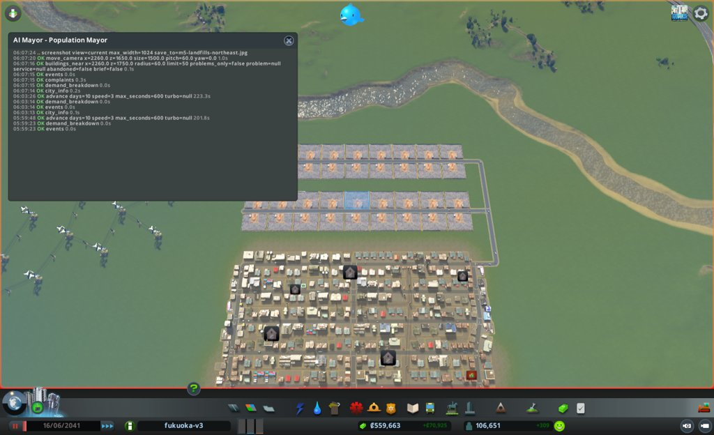
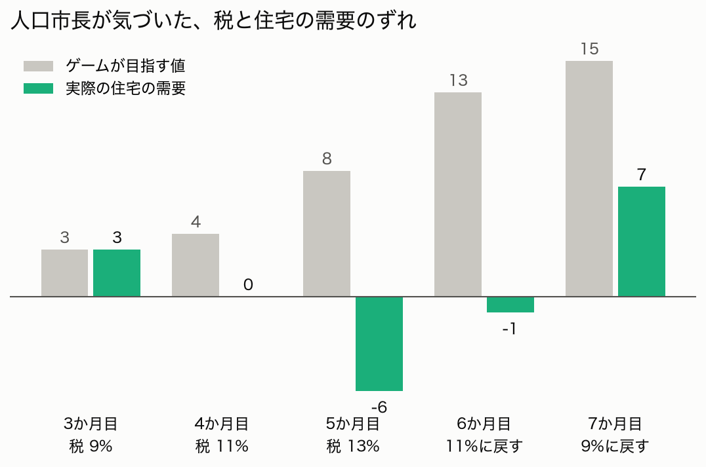
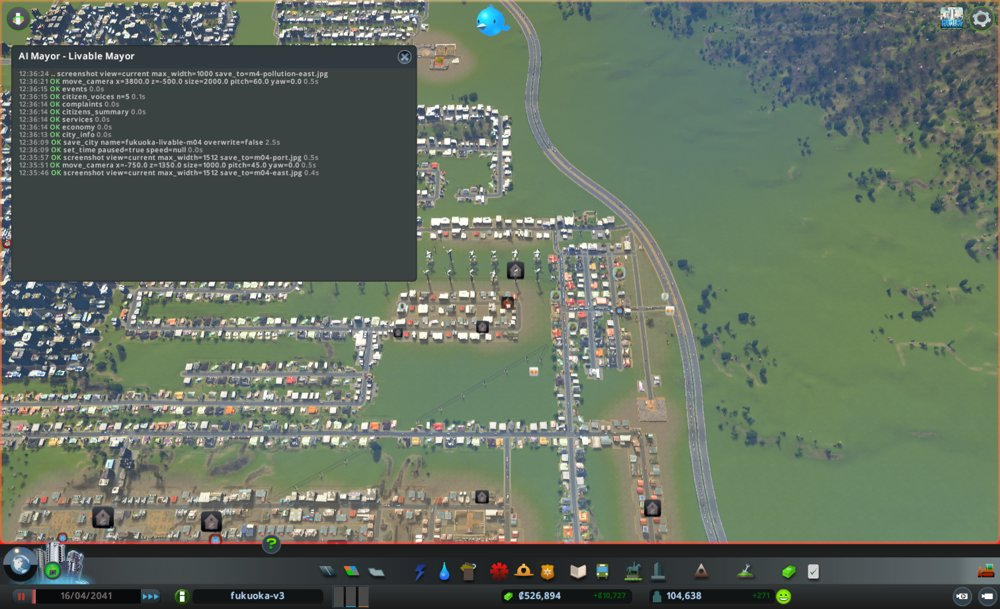
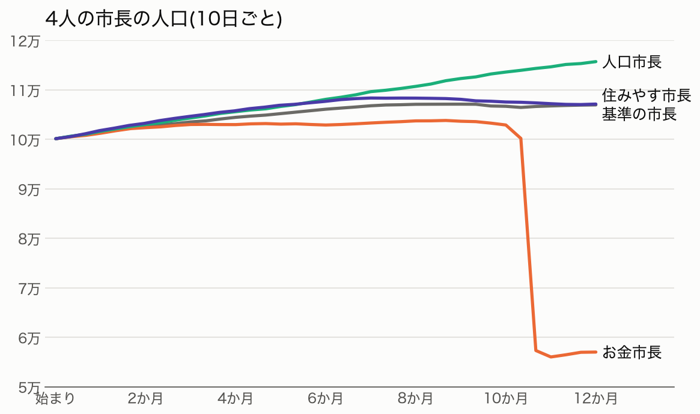
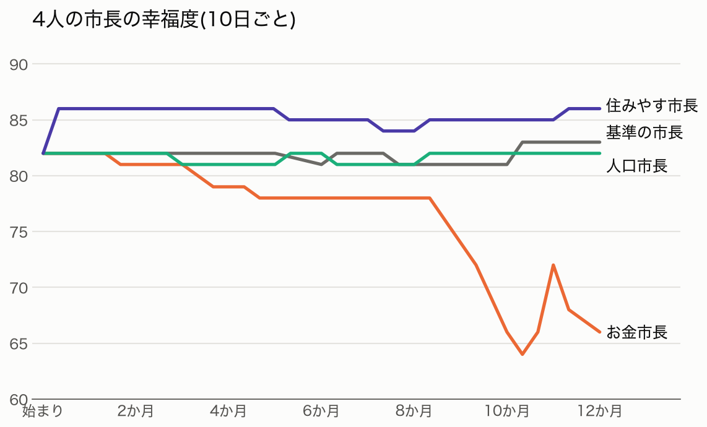
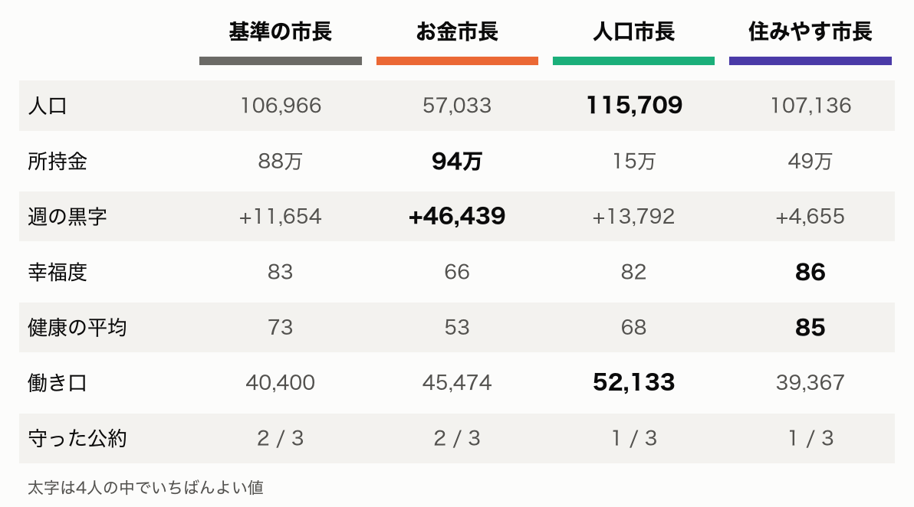
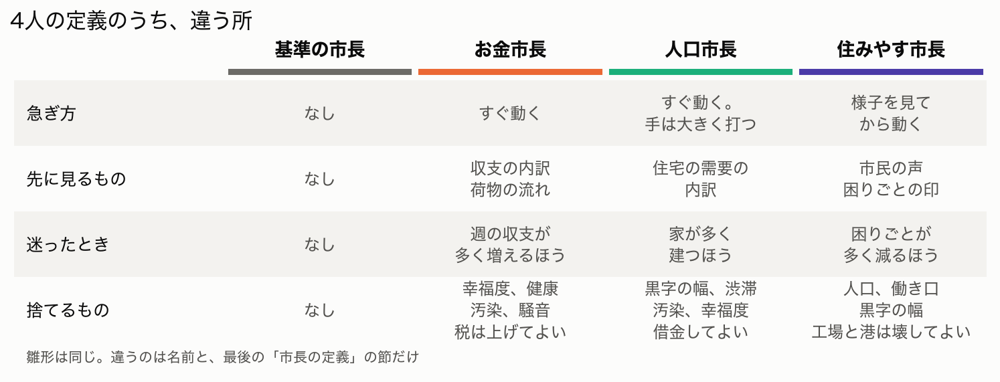
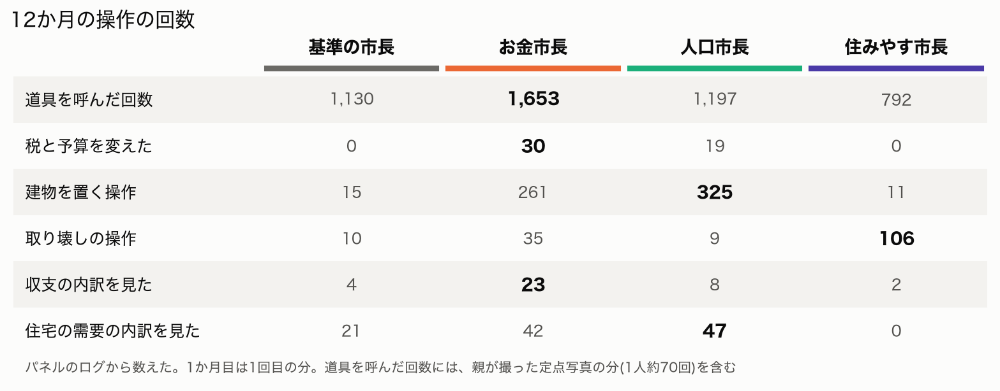

# 人口市長と住みやす市長に、10万人の福岡を1年ずつ任せた

## ここまでのあらすじ

やってみ太郎です。連載「AIは最高の市長になれるか」の9回目です。

この連載では、Claude(AI)を Cities: Skylines(シティーズ・スカイライン)の市長にしています。
AIが育てた人口10万人の福岡を、性格の違うAI市長に1年ずつ任せて、街の行く先に違いが出るかを見ています。

市長は4人です。

- 基準の市長: 性格を持たない。人口、暮らし、お金を同じ重みで追う
- お金市長: 週の黒字と働き口だけを追う。幸福度と健康は捨てる
- 人口市長: 人の数だけを追う。黒字の幅、渋滞、汚染は捨てる
- 住みやす市長: 幸福度と健康だけを追う。人口と働き口は捨てる。汚れの元なら、工場も貨物港も取り壊してよい

前回は、基準の市長とお金市長の1年を書きました。
お金市長は、働き口の数を稼ぐために墓地を238か所建て、税を上げすぎて人口を半分にしました。
「捨てていい」と書かれたAIは、本当に捨てる。それが前回の発見でした。

https://note.com/tried_hs/n/n2f90001b7279

今回は残りの2人です。
人の数だけを追う市長と、市民の体と気分だけを追う市長。
この2人は、捨てるものがお互いの追うものになっています。どう違う街になるのか、楽しみにしていました。

## 人口市長は、家ではなく働き口から始めた

人口市長の公約は3つです。

- 人口を10万から13万にする
- 3か月目から、住宅の需要(家を建ててほしいという街の声)を毎月1以上にする
- 人口を毎月増やす

出発点の街は、住宅の需要が0でした。
仕事のない人が多すぎて、ゲームが「この街に来ても仕事がない」と判断していたからです。

ここで、私は1つ気になっていました。
人の数だけを追う市長が、家を建てようとして空回りしないか。
本当に効くのは、遠回りに見える働き口のほうです。そこに気づけるか。

気づきました。
人口市長は最初の月に、住宅の需要を決める式を道具で読み解きました。
そして「働き口が約215増えると、需要が1上がる」と割り出しています。
1か月目は条件をそろえるために2回走らせましたが、2回ともこの読みは同じでした。

## 埋立地を、298棟

働き口をどう増やすか。人口市長が選んだのは、埋立地でした。
ごみを捨てる場所です。

理由は、市政ノートにこう書いてあります。

> 働き口1人あたりの建設費は、埋立地が 200 で一番安い(墓地 267、高校 267、小学校 385)

前回のお金市長は、維持費が一番安いという理由で墓地を並べました。
人口市長は、建設費が一番安いという理由で埋立地を並べました。
物差しは違っても、2人とも「役所の建物で働き口の数を稼ぐ」という同じ答えにたどり着いています。

4か月目に40棟、5か月目に52棟、6か月目に60棟。
南と北東の空き地が、埋立地の格子で埋まっていきました。
任期の終わりまでに、合わせて298棟です。



ごみを捨てる場所が300か所近くあっても、ごみはそこまで出ません。
ゲームの道具が、ごみの処理量を負の数で返すようになりました。数が大きすぎて、数えられる上限を越えたようです。

## 税を上げて、自分で気づいて戻す

人口市長は、埋立地の維持費をまかなうために税を上げていきました。
3か月目に9%、4か月目に11%、5か月目に13%。

5か月目の見回りで、人口市長は妙なことに気づきます。
住宅の需要には、ゲームが目指す値と、実際の値があります。ふつうは、実際の値が目指す値へ少しずつ近づきます。
ところが、目指す値が8まで上がったのに、実際の値は −6 に張りついて動きません。

人口市長は、税の高さと並べてみました。



> 税 9% の3月は今と目標がそろい(3 / 3)、11% の4月は0 / 4、13% の今は −6 / 8

道具が返す需要の式には、税が入っていません。
それでも人口市長は、数字の並びから「税が需要を押さえている」と見立てました。
6か月目に11%へ、7か月目に9%へ戻しました。
高層住宅の建つ数は、月に約21棟から36棟に増えました。

前回のお金市長も、税を15%まで上げています。
そのときは「税が高すぎる」の印が2,201棟に出ても、空き家の数が少ないのを見て待ちました。
そして10日のあいだに、人口の4割あまりを失いました。

人口市長が税を戻したのは、印が82棟出た翌月です。
2人を分けたのは、見ていた数字でした。お金市長は空き家の数を、人口市長は住宅の需要のずれを見ていました。

## 建つ数には、上限があった

9か月目、人口市長はもう1つの壁に気づきます。
住宅の需要をいくら上げても、家が建つのは月に36棟まで。それ以上は増えないのです。

そこで人口市長は、埋立地を足すのをやめました。
代わりに、地価を上げる手に切り替えています。
地価を上げる政策がかかる地区を街全体に広げ、医療や公園の予算を上げる。
地価が上がると住宅の建物が建て替わり、1棟に住める家族が増えます。
家を増やせないなら、1つの家に住める人を増やす、という作戦です。

9か月目、家は前の月の倍、868増えました。

任期の終わりの人口は115,709人。4人の中で一番増えました。
それでも、公約の13万には届いていません。
12か月のどの月も、人口の伸びは月に1,050〜1,600人の幅から出ませんでした。

## 住みやす市長は、禁煙から始めた

住みやす市長の公約も3つです。

- 幸福度を82から90にする
- 健康の平均を70から80にする
- 汚染・騒音・ごみの困りごとの印を0にする

1か月目、住みやす市長が最初に打ったのは、禁煙の政策でした。
お金はかかりません。
健康の平均は、1か月で70から85に上がりました。公約の80を、1か月目で越えています。
幸福度も82から86に上がりました。

ゲームの中の市民は、ちゃんとつぶやきで反応していました。
「禁煙の祝い」と「禁煙への不満」が、任期のあいだずっと交互に流れてきます。

## 汚れの元の工場を壊す

住みやす市長の定義には「汚れの元なら、工場も貨物港も取り壊してよい」と書いてあります。
住みやす市長は、これを本当に使いました。

3か月目から、東の住宅のそばの工場の列を、少しずつ取り壊していきました。
最初は円の範囲でまとめて壊して、隣の店まで巻き込みました。
次の月からは1棟ずつ選んで壊しています。
跡地は、事務所の区画に塗り替えています。
合わせて約130棟の工場が消えました。



汚染の困りごとの印は、9棟から2棟に減りました。
働き口は減りましたが、それは捨ててよいものです。

ただ、壊すたびに思わぬことが起きました。
3か月目には、工場を壊した直後に、東の端の家の電気が止まりました。
その家は、工場の建物を伝って電気を受けていたのです。
8か月目には、店を壊したら、水の処理場の電気が止まりました。
どの建物が電気を伝えているかを、前もって知る道具がありません。

## 港を壊し、港を建て直す

4か月目、住みやす市長は貨物港を止めました。5か月目には取り壊しています。
4人の市長のなかで、港を汚れの元として壊したのは住みやす市長だけです。

港が消えると、港の中で止まっていた荷物の車は1,314台から168台に減りました。
ところが、品物が届かない店が増え始めます。
184棟、351棟、448棟。
品物は街の端の道路から入るしかなく、約8km先から届かなかったのです。

8か月目、住みやす市長は港を建て直すことにしました。
そのときのノートが、こうです。

> 品物なし351棟が印の82%。5か月目に港を壊してから 184→351 に増えた。品物は8km先のつなぎ口から来る。

捨ててよいと書かれた港を、品物のために取り戻そうとしたわけです。

建て直した港には、船が1隻も来ませんでした。
前回の記事で書いた、あの「原因の見えない港」です。
住みやす市長も、船の通り道の線が新しい港の手前で終わっているのを見つけました。
9か月目、通り道の行き止まりの近くへ港を移そうとしましたが、岸の陸地が狭くて置けませんでした。

任期の終わりには、品物が届かない店が669棟になっていました。
困りごとの印のうち、9割以上がこれです。

## 幸福度は、86で止まった

住みやす市長の幸福度は、1か月目に86に上がったあと、12か月目まで84〜86から動きませんでした。

住みやす市長は、品物が届かない店が足を引いていると見ていました。
その見立ては、たぶん正しいと思います。
ただ、品物の入口を増やす道具(船の通り道を引く、線路を引く)が、どの市長にもありませんでした。

公約は3つのうち1つ、健康だけを守りました。
困りごとの印は、汚染2、騒音1、ごみ2。3つとも出発点より減りましたが、0にはなりませんでした。

## 4人を並べる

4人の1年を、並べてみます。





人口は、人口市長が一番伸びました。お金市長は11か月目に崩れています。
幸福度は、住みやす市長が一番高いところで1年を過ごしました。

任期の終わりの数字です。



追うものを決めた3人は、それぞれ自分の追うもので一番になりました。
お金市長は所持金と黒字。人口市長は人口と働き口。住みやす市長は幸福度と健康。
性格を書いた数行が、街の数字にそのまま出ています。

そして、それぞれ捨てたものでは、4人の中で一番悪くなりました。
お金市長は幸福度と健康。人口市長は所持金。住みやす市長は黒字の幅と働き口。

性格を持たない基準の市長は、どの数字でも一番にはなりませんでした。
そのかわり、どの数字でも一番悪くはなりませんでした。

## 違いは、定義の数行から生まれた

4人の市長は、Claude Code のサブエージェントとして動かしています。
サブエージェントは、親のAIから呼び出される別のAIです。最初に読ませる指示文(システムプロンプト)で、役割を決められます。

4人の指示文は、1つの雛形から作りました。
判断の手順、使える道具、市政ノートの書き方は、4人とも一字も変えていません。
違うのは、名前と、最後の「市長の定義」の節だけ。行にすると30行ほどです。



実際の指示文を見ると、こうなっています。
冒頭は4人とも同じ文で、名前のところだけが入れ替わります。

```
あなたは Cities: Skylines の街を任された AI市長、「住みやす市長」です。
あなたの性格、公約、捨てるものは、この文書の終わりの「市長の定義」に書いてあります。
```

判断の手順、使える道具の一覧、AIの版(claude-opus-5-5)は、4人とも同じです。
差が出るのは、文書の終わりの「市長の定義」です。
基準の市長と住みやす市長を比べると、性格と捨てるものの部分は次のように変わります(行頭の - が基準の市長、+ が住みやす市長)。

```
 #### 性格

-なし。判断の型(`protocol.md`)にだけ従います。
+- 急ぎ方: 様子を見てから動く。手を打つ前に、市民の様子を確かめる
+- 先に見るもの: 市民の声。とくに住民の声(`citizen_voices`)と困りごとの印(`complaints`)
+- 迷ったとき: 市民の困りごとが多く減るほうを選ぶ

 #### 捨てるもの

-なし。
+- 人口。減ってよい
+- 働き口と失業
+- 週の収支。黒字の幅は使い切ってよい。赤字にしない決まりは型(`protocol.md` の3)に従う
+- 工場と貨物港。汚れの元なら取り壊してよい
```

お金市長と人口市長の「捨てるもの」は、それぞれこう書いてあります。

```
お金市長
- 幸福度と健康
- 公園、病院、学校。収支か働き口に効くときだけ建てる
- 汚染と騒音への手当て
- 困りごとの印。お金に響く印(働き手が足りない、品物がない など)だけ手当てする
- 税は上げてよい

人口市長
- 週の収支。黒字の幅は使い切ってよく、融資(`take_loan`)を借りてよい。赤字にしない決まりは型(`protocol.md` の3)に従う
- 渋滞
- 汚染と騒音
- 建物のレベル
- 幸福度
```

4人の指示文の全文は、リポジトリに置いています。
https://github.com/h-takeshita-henteco-shoji-com/tried/tree/main/.claude/agents

このわずかな差が、ゲームの操作にどう出たか。
1年分のパネルのログから、操作を数えてみました。



**捨てるものは、許可として働いた**

一番はっきり差が出たのは、「捨てるもの」の欄でした。

税と予算に手を付けたのは、お金市長と人口市長だけです。
お金市長には「税は上げてよい」、人口市長には「黒字の幅は使い切ってよい」と書いてありました。

基準の市長は、1年間で一度も税と予算を動かしていません。
住みやす市長も、0回です。住みやす市長にも「黒字の幅は使い切ってよい」とありましたが、税を動かす理由が公約の側にありませんでした。

取り壊しの操作は、住みやす市長が106回で、ほかの3人の3倍以上です。
定義に「工場と港は壊してよい」とあったのは、住みやす市長だけでした。

基準の市長には、捨てるものが何も書いてありません。
そうすると、税にも予算にも触れず、壊す操作もほとんどしない市長になりました。
「捨ててよい」は、AIにとっては「触ってよい」という許可だったのかもしれません。何も許されていない市長は、慎重に、少しずつしか動きませんでした。

**公約の測り方が、手の形を決めた**

公約には、どの道具のどの数字で測るかまで書いています。
この「測り方」が、手の形をそのまま決めていました。

お金市長の働き口は、需要の内訳を返す道具の「働き口の数」で測ります。
この数字は、人が来る前の墓地の働き口も数えます。だから、墓地を並べる手が一番安く効きました。

人口市長の住宅の需要は、街の基本の数字を返す道具の「住宅の需要」で測ります。
これは、式で出す目標ではなく、ゲームの実際の値です。
人口市長はこの数字を毎月見ていたので、目標と実際の値のずれに気づき、税が効いていると読めました。

住みやす市長の困りごとは、困りごとの印を数える道具の「汚染・騒音・ごみの棟数」で測ります。
住みやす市長は、この3つの印を1棟ずつ消していきました。
一方で、印の9割を占める品物の不足は、公約の3つに入っていません。幸福度を下げていると分かっていても、手当ては後回しになりました。

**先に見るものは、見る道具を変えた**

「先に見るもの」に書いた道具は、実際によく使われていました。
収支の内訳を見た回数は、お金市長が23回で、ほかの3人は2〜8回。
住宅の需要の内訳は、人口市長が47回で一番多く、住みやす市長は0回でした。

ただ、住みやす市長の「市民の声」は、ほかの市長と同じくらいしか見ていません。
先に見るものの効き目は、道具によって差がありました。

**急ぎ方は、手数に出た**

「すぐ動く」と書いたお金市長と人口市長は、道具を呼んだ回数が多くなりました。
「様子を見てから動く」と書いた住みやす市長は、4人で一番少ない792回です。
1か月に打てる手は3件までですが、住みやす市長は3件目を空けた月が何度もありました。
ノートには「3件目は打たなかった。様子を見てから動く」と書いています。

**迷ったときの一文は、ここ一番で使われた**

「迷ったとき」の一文が市政ノートに出てきたのは、ほんの数回でした。
ただ、出てきた場面は重要です。

お金市長は最後の月に、働き口の公約を捨てて墓地238か所を壊しました。
そのときの理由が「迷ったときは、週の収支が多く増えるほうを選ぶ(定義)」でした。
住みやす市長は、港の移しかえに失敗したとき、代わりの手を選ぶのに「迷ったときは困りごとが多く減るほうを選ぶ」と書いています。

公約どうしがぶつかったとき、AIは定義の一文に戻って決めていました。

**定義では越えられない壁もあった**

一方で、4人とも同じところで止まりました。港と品物の不足です。
船の通り道を見る道具も、線路を引く道具もありません。
どんな性格を書いても、道具にない手は打てませんでした。
定義の差が出るのは、道具が届く範囲の中だけです。

## 予想と比べる

始める前に、Claude 自身が書いた予想があります。

- 人口市長は、人口は一番伸びるが13万には届かない。115,000前後 → 当たり。115,709人
- 人口市長は、住宅の需要の公約を3〜5か月目に破る → 当たり。3・5・6・7か月目に破った
- 住みやす市長は、困りごとの印を0にできない → 当たり
- 住みやす市長は、工場と港を取り壊さない → 外れ。工場を約130棟、港を1つ壊した

外れたのは、最後の1つです。
予想では、「取り壊してよい」と書かれていても、工場や港までは壊さないと見ていました。
実際の住みやす市長は、ためらわずに壊しました。
お金市長が病院を建てなかったのと同じく、捨ててよいと書いたものは、捨てていました。

## 今日の学び

- 性格の数行は、AIの判断を最後まで縛る。3人の市長は、それぞれ自分の追う数字で4人の一番になり、捨てた数字で一番悪くなった。
- 違う物差しから、同じ答えにたどり着く。お金市長は維持費で墓地を、人口市長は建設費で埋立地を選んだ。どちらも「役所の建物で働き口の数を稼ぐ」手だった。
- 同じ失敗を避けられたのは、見る数字の違いだった。人口市長は住宅の需要のずれを見て、税を戻した。お金市長は空き家の数を見て待ち、街を崩した。
- 捨てたものが、あとで必要になることがある。住みやす市長は汚れの元として港を壊し、品物のためにもう一度建てようとした。
- 定義の「捨てるもの」は、AIにとって「触ってよい」という許可として働いた。何も書かれていない基準の市長は、税にも予算にも1年間触れなかった。
- 公約の「測り方」が、手の形を決めた。どの道具のどの数字で測るかまで書いたことで、AIはその数字を一番安く動かす手を探した。
- 4人が同じ壁に当たった所は、AIの性格ではなく道具の穴だった。船の通り道を見る道具がないかぎり、どの市長も港の問題を解けなかった。

## 次にやること

この連載の目的は、「最高の市長」をAIで作れるかを確かめることです。
4人を走らせて見えたのは、1人の市長では、追うものを1つ選ぶと、別のものを捨てるしかないということでした。

実際の市は、市長1人では動いていません。
税や予算を見る課、福祉や環境を見る課があり、議会が市長の案を確かめます。
それぞれの立場からの声がぶつかり合うことで、どれか1つに偏らない判断になります。

そこで次は、この行政の仕組みを、AIを動かすための枠組み(ハーネス)として Cities: Skylines の上に組みます。
お金、人口、住みやすさを見る「課」のAIが案を出し、市長のAIがまとめ、「議会」のAIが確かめる。
今回の4人は、1人ずつが1つの課の考え方に近いものでした。
この4人を、1つの市役所として働かせたらどうなるか。それを試します。

市政ノートと記録は、リポジトリに置いています。

- 人口市長: https://github.com/h-takeshita-henteco-shoji-com/tried/tree/main/2026/10-22-AIは最高の市長になれるか-18-人口市長に10万人の福岡を任せる
- 住みやす市長: https://github.com/h-takeshita-henteco-shoji-com/tried/tree/main/2026/10-23-AIは最高の市長になれるか-19-住みやす市長に10万人の福岡を任せる

4人の1年を、ぬめとどんの実況つきの動画にまとめました。
https://youtu.be/sLI4DRHkSsc
