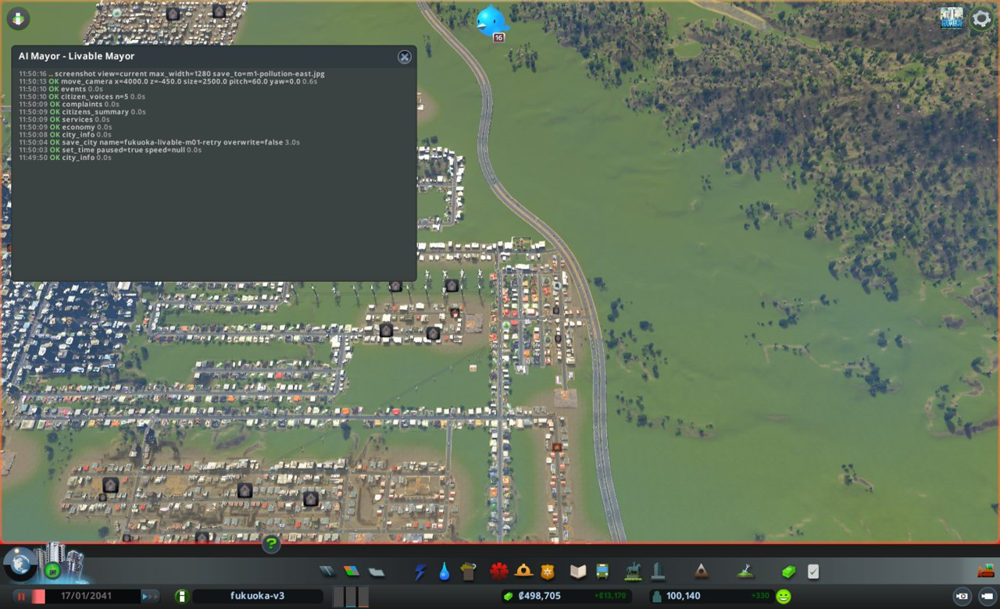
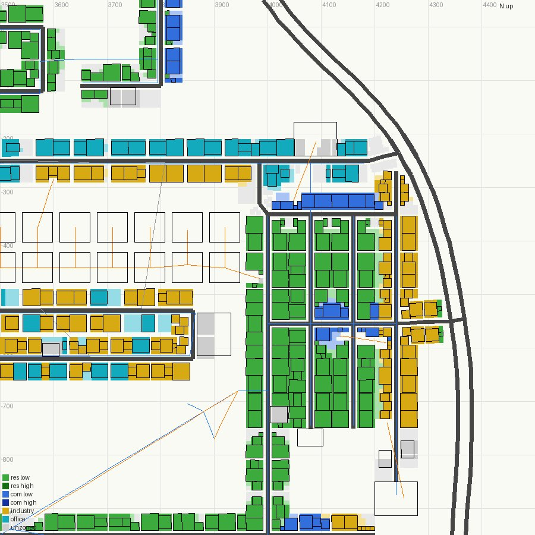

# 市政ノート

## 性格と公約と捨てるもの

市民の体と気分だけを追う市長。人口、働き口、お金は、市民の暮らしに響かない限り見ない。

- 性格:
  - 急ぎ方: 様子を見てから動く。手を打つ前に、市民の様子を確かめる
  - 先に見るもの: 市民の声。とくに住民の声(`citizen_voices`)と困りごとの印(`complaints`)
  - 迷ったとき: 市民の困りごとが多く減るほうを選ぶ
- 公約:
  1. 幸福度を 90 以上にする(`city_info` の happiness。出発点 82。期限は任期の終わり)
  2. 健康の平均を 80 以上にする(`citizens_summary` の average.health。出発点 70。期限は任期の終わり)
  3. 汚染、騒音、ごみの印を 0 にする(`complaints` の Pollution、Noise、Garbage の buildings。出発点 9、6、11。期限は任期の終わり)
- 捨てるもの: 人口(減ってよい)、働き口と失業、週の収支(黒字の幅は使い切ってよい。赤字にしない決まりは型に従う)、工場と貨物港(汚れの元なら取り壊してよい)
- 任期: 12か月

## 申し送り(前の運営から)

なし

## 数字の表

月例と見回りのたびに1行足す。区切りは 月例・見回り・臨時。

| ゲーム内の日付 | 区切り | 人口 | 所持金 | 週の収支 | 幸福度 | 需要(住/商/工) | 失業 | 主な困りごと |
|---|---|---|---|---|---|---|---|---|
| 2041-01-17 | 月例 | 100,140 | 498,704 | +13,170 | 82 | 0/4/2 | 8,839 | 品物不足107、死体14、ごみ11、汚染9、騒音6(健康70) |
| 2041-01-27 | 見回り | 100,728 | 449,172 | +9,845 | 84 | 0/8/2 | - | つぶやき: ごみ発電を喜ぶ声、死体の臭い1件。電気・水・下水が来ない人0 |
| 2041-02-06 | 見回り | 101,262 | 464,757 | +10,950 | 84 | 0/9/2 | - | つぶやき: 学校の表彰1件。電気・水・下水が来ない人0 |

## 施策の一覧

施策を打つたびに1行足す(臨時も含む)。答え合わせの列は、翌月の月例で埋める。
分野は、港・働き口・住宅・暮らし・環境・財政から1つ選ぶ。

| ゲーム内の日付 | 区切り | 施策 | 分野 | 公約 | 捨てるもの | 建設費 | 週の維持費の増分 | 答え合わせ |
|---|---|---|---|---|---|---|---|---|
| 2041-01-17 | 月例 | 喫煙を禁じる(SmokingBan) | 暮らし | 2 | なし | 0 | 0 | |
| 2041-01-17 | 月例 | 満杯の埋立地2か所を焼却場に置き換え | 環境 | 3 | なし | 60,320 | +2,880(埋立地2つ分 -320) | |
| 2041-01-17 | 月例 | 東の工業の帯を壊し、未指定にして植樹 | 環境 | 3、2 | 工場と働き口(工業51棟) | 3,270 | 0 | |

## 判断の記録

### 2041-01-17 月例(1か月目)

保存: fukuoka-livable-m01-retry

#### 答え合わせ

なし(初回)

- 公約の進み具合
  1. 幸福度: 82 / 残り12か月 / あと8。まだ分からない
  2. 健康: 70 / 残り12か月 / あと10。まだ分からない
  3. 印: 汚染9、騒音6、ごみ11 / 残り12か月 / まだ分からない

#### 気づいたこと

- ごみ: 埋立地17か所がすべて埋立地。4か所が満杯(4946、11708、12700、43004)。ほかもほとんど収集車19/19を使い切っている。ごみの印11は都心(北 -214,484 付近と南 560,-506 付近)で、近くの満杯の埋立地 12700(-262,800)と 11708(738,-590)の受け持ちに重なる
- 汚染: 印9のうち6が東の住宅(x 3976〜4188、z -366〜-701)。裏手の x 4210〜4310 に工業の帯があり、地面の汚染が 250 前後。埋立地 10533(3900,-575)も同じ所にある。残りの1件(3388,644)は満杯の埋立地 4946 のそば
- 健康: 平均70。医療のベッドは 854/2700 で余っているが、医療の届き具合は東西の端と南で 0〜10 の所がある。5人の声はみな幸福度 Superb、困りごとなし

#### 施策

1. 喫煙を禁じる(SmokingBan)
   - 公約: 2(健康)
   - 捨てるもの: なし
   - 理由: 週の費用 0。街全体の市民の健康をじかに上げる政策。医療のベッドは余っているので、病院より先に打てる
   - 予想: 次の月例(2041-02-16 ごろ)に、健康の平均が 70 から 71〜73 に上がる。幸福度は下がっても1まで
   - 操作: `set_policy("SmokingBan")`
   - 結果: 成功。active=true、週の費用 0
   - 確かめ: 政策なので置き場所の確かめはなし
2. 都心の満杯の埋立地2か所を、焼却場(Combustion Plant)に置き換える
   - 公約: 3(ごみ)。満杯の埋立地の汚染も減らす
   - 捨てるもの: なし(週の収支の黒字を使う)
   - 理由: ごみの印11の多くが、満杯で受け入れを止めた 11708 と 12700 の受け持ち。満杯の埋立地は汚れの元のまま役に立たない
   - 予想: 次の月例までに、ごみの印が 11 から 5 以下に減る。建設費 約60,000、週の維持費 +2,880 から埋立地2つ分 -320
   - 操作: `bulldoze` で 11708 と 12700 を壊し、`place_building("Combustion Plant")` をその跡に置く。水が来なければ水道管を引く
   - 結果: 埋立地 11708(738,-590)と 12700(-262,800)を取り壊した(どちらも 100% 満杯で、収集車 0/19)。焼却場を2つ置いた。31821 を (722,-560)、33321 を (-282,770)。どちらも西向きで入口が道路に接し、建設費 30,000 ずつ。33321 のために水道管を (-250,635) から引いた(320)
   - 確かめ: 1日進めた後、2つとも電気・水・下水あり、問題なし。収集車は 2/34 が出ている
3. 東の住宅の裏の工業の帯を取り壊し、区画を外して木を植える
   - 公約: 3(汚染)、2(健康)
   - 捨てるもの: 工場(汚れの元。定義で取り壊してよいとされている)と、その働き口
   - 理由: 汚染の印6棟が工業の帯(x 4210〜4310、z -280〜-730)のすぐ西にある
   - 予想: 地面の汚染は少しずつ抜けるので、次の月例で汚染の印が 9 から 6 以下、2か月後に 3 以下
   - 操作: `bulldoze(what="building")` を x 4250 の線に沿って半径55で6回、`zone_rect` で none、`plant_trees`
   - 結果: 取り壊しは 54 棟。内訳は工業 51、商業(L1 1x1 Shop)1、住宅(L1 1x1 Detached)2。住宅2棟は、残った工場 (4308,-552) を壊す円に入ってしまった。`zone_rect`(x 4203〜4340、z -810〜-250)で 443 マスを未指定に戻した(建物のある 36 マスは残る)。木を 327 本植えた(3,270)
   - 確かめ: `zone_map` で、帯に工業の建物が残っていないことを見た
   - 1日後: 所持金 498,704 → 437,113、週の収支 +12,600

#### 考えたが打たなかった手

- 満杯の埋立地 43004(-650,-490)と 4946(3499,618)も置き換える: 施策の数の上限。2つの焼却場の効き目を見てから決める
- 埋立地 10533(3900,-575)を壊す: 東の汚染の印の家(3976 の列)のそばにある。75% 埋まって働いている。工業の帯を壊した効き目を先に見る
- 病院・診療所を増やす: ベッドは 854/2700 で余っている。届き具合が 0 の所に住宅があるかを、まだ調べていない
- Recycling 政策: 政策の変更は月例で1つまで。今月は SmokingBan にした
- 騒音(-1556,-809 の高密度住宅4棟): 原因をまだ調べていない

#### 次にやること

- 来月: 騒音の印の原因を調べる(道路か、工業か、埋立地 34558・20041 か)
- 来月: Recycling 政策(ごみ -15%)をかけるか決める
- 来月: 満杯の埋立地 43004 と 4946 を焼却場に置き換えるか決める
- 来月: 医療の届き具合が 0〜10 の所に住宅があるかを調べる

#### 画面写真

### 2041-01-27 見回り

境目: 当たらず。週の収支は +12,600 から +9,845 に下がったが黒字のまま。焼却場2つの維持費が入った分と見る

### 2041-02-06 見回り

境目: 当たらず

### 2041-02-16 1か月目の終わり(次の月例の前の確かめ)

答え合わせは次の月例で行う。ここには道具が返した数字だけを残す。

- `city_info`: 人口 101,812、所持金 481,814、週の収支 +12,027、幸福度 84、需要 0/3/6、電気・水・下水が来ない人 0
- `citizens_summary`: 健康の平均 80、幸福度の平均 85、失業 9,854
- `complaints`: 汚染 5(東の 3976〜4184 の家)、騒音 4(-1680,-1108 付近)、ごみ 2(-976,-1706 ほか)、品物不足 133、死体 7

## 人が手を入れたこと

- 街は人が fukuoka-livable-m01(2041-01-17)を読み込んだ状態で渡された。1か月目のやり直し
- 2026-10-23 11:49(実時間): 録画を始めた。親が見出しを `AI Mayor - Livable Mayor` にした
- 定点の写真は撮っていない。出発点が1回目と同じため、`../assets/fixed/m01-*.jpg` を使う

### 実時間とトークン

| 月 | 実時間 | トークン | 道具の呼び出し |
|---|---|---|---|
| 1(2回目) | 11分25秒 | 107,995 | 69 |

## 次の市長への申し送り

- 1か月目の後、公約の数字は 幸福度 84、健康 80、汚染5・騒音4・ごみ2(出発点 82、70、9・6・11)
- 残る汚染の印は、東の 3976 の列(埋立地 10533 のそば)と 4184 の列。工業の帯を壊した跡の地面の汚染が抜けるのを待つか、埋立地 10533 を壊すかを決める
- 騒音の印の場所が -1556,-809 から -1680,-1108 付近へ移った。原因はまだ調べていない
- 満杯の埋立地 43004(-650,-490)と 4946(3499,618)は残っている
