# 市政ノート

## 性格と公約と捨てるもの

市民の体と気分だけを追う市長。人口、働き口、お金は、市民の暮らしに響かない限り見ない。

- 性格:
  - 急ぎ方: 様子を見てから動く。手を打つ前に、市民の様子を確かめる
  - 先に見るもの: 市民の声。とくに住民の声(`citizen_voices`)と困りごとの印(`complaints`)
  - 迷ったとき: 市民の困りごとが多く減るほうを選ぶ
- 公約:
  1. 幸福度を 90 以上にする(`city_info` の happiness。出発点 82。任期の終わりまで)
  2. 健康の平均を 80 以上にする(`citizens_summary` の average.health。出発点 70。任期の終わりまで)
  3. 汚染、騒音、ごみの印を 0 にする(`complaints` の Pollution、Noise、Garbage の buildings。出発点 9、6、11。任期の終わりまで)
- 捨てるもの: 人口(減ってよい)、働き口と失業、週の収支(黒字の幅は使い切ってよい。赤字にしない決まりは型に従う)、工場と貨物港(汚れの元なら取り壊してよい)
- 任期: 12か月

## 申し送り(前の運営から)

なし

## 数字の表

月例と見回りのたびに1行足す。区切りは 月例・見回り・臨時。

| ゲーム内の日付 | 区切り | 人口 | 所持金 | 週の収支 | 幸福度 | 需要(住/商/工) | 失業 | 主な困りごと |
|---|---|---|---|---|---|---|---|---|
| 2041-01-17 | 月例 | 100,140 | 498,704 | +13,170 | 82 | 0 / 4 / 2 | 8,839 | 品物なし107、死体14、ごみ11、汚染9、騒音6、火事5(健康70) |
| 2041-01-27 | 見回り | 100,568 | 438,058 | +10,197 | 86 | 0 / 6 / 2 | - | つぶやき: 死体1 |
| 2041-02-06 | 見回り | 101,155 | 455,791 | +12,605 | 86 | 0 / 6 / 2 | - | つぶやき0 |
| 2041-02-15 | 月例 | 101,762 | 475,390 | +13,760 | 86 | 0 / 5 / 4 | 9,282 | 品物なし134、ごみ24、死体11、汚染10、火事5、騒音4(健康85) |
| 2041-02-25 | 見回り | 102,269 | 483,934 | +6,826 | 86 | 0 / 2 / 2 | - | つぶやき: リサイクルの祝い1、汚染(光る泥)1 |
| 2041-03-07 | 見回り | 102,827 | 495,604 | +8,394 | 86 | 0 / 6 / 4 | - | つぶやき: 禁煙の祝い1 |
| 2041-03-17 | 月例 | 103,226 | 509,414 | +9,676 | 86 | 0 / 6 / 2 | 9,838 | 品物なし158、死体17、汚染10、ごみ9、騒音7、火事4(健康85) |
| 2041-03-27 | 見回り→臨時 | 103,785 | 497,681 | +9,225 | 86 | 0 / 4 / 2 | - | 電気の来ない市民 0→1(東端の家 40328) |
| 2041-04-06 | 見回り | 104,234 | 511,628 | +10,108 | 86 | 0 / 5 / 2 | - | 電気の来ない市民1(別の家)。家 22559 が電気なし |
| 2041-04-16 | 見回り | 104,638 | 526,893 | +10,727 | 86 | 0 / 4 / 2 | - | つぶやき1(雑談)。境目に当たらず。電気の来ない市民1のまま |
| 2041-04-16 | 月例 | 104,638 | 526,893 | +10,727 | 86 | 0 / 4 / 2 | 10,605 | 品物なし181、汚染12、死体10、火事5、ごみ1、騒音1、電気1(健康85) |
| 2041-04-26 | 見回り | 105,019 | 545,077 | +12,726 | 86 | 0 / 2 / 2 | - | つぶやき1(断水)。境目に当たらず。電気の来ない市民1(別の家、次に外れる) |
| 2041-05-06 | 見回り | 105,453 | 564,159 | +13,352 | 86 | 0 / 2 / 2 | - | つぶやき1(雑談)。境目に当たらず。電気の来ない市民1のまま(家 1051) |
| 2041-05-16 | 見回り | 105,757 | 582,468 | +13,351 | 86 | 0 / 4 / 4 | - | つぶやき1(ほめる声)。境目に当たらず。汚染4、騒音4、ごみ2、品物なし184 |
| 2041-05-16 | 月例 | 105,757 | 582,468 | +13,351 | 86 | 0 / 4 / 4 | 11,392 | 品物なし184、死体7、汚染4、騒音4、ごみ2、火事2、水2(健康85) |
| 2041-05-26 | 見回り | 106,206 | 535,856 | +9,684 | 86 | 0 / 2 / 2 | - | つぶやき2(焼却施設の祝い)。境目に当たらず。止まった荷物の車 1,314→130 |
| 2041-06-05 | 見回り | 106,503 | 550,885 | +10,558 | 86 | 0 / 3 / 2 | - | つぶやき1(禁煙への不満)。境目に当たらず |
| 2041-06-15 | 見回り | 106,883 | 566,702 | +11,081 | 86 | 0 / 2 / 2 | - | 境目に当たらず。品物なし205、汚染12、死体9、ごみ6、騒音2(健康85) |
| 2041-06-15 | 月例 | 106,883 | 566,702 | +11,081 | 86 | 0 / 2 / 2 | 11,801 | 品物なし205、汚染12、死体9、ごみ6、火事3、騒音2、水2、犯罪1(健康85) |
| 2041-06-25 | 見回り | 107,078 | 583,827 | +11,724 | 85 | 0 / 2 / 2 | - | つぶやき2(放棄された家、禁煙への不満)。境目に当たらず。放棄・焼け跡135棟 |
| 2041-07-05 | 見回り | 107,376 | 600,680 | +11,603 | 85 | 0 / 4 / 4 | - | つぶやき1(汚染)。境目に当たらず |
| 2041-07-15 | 見回り | 107,661 | 617,421 | +11,746 | 85 | 0 / 2 / 2 | - | 境目に当たらず。品物なし250、死体23、ごみ22、汚染7、火事4、騒音2(健康85) |
| 2041-07-15 | 月例 | 107,661 | 617,421 | +11,746 | 85 | 0 / 2 / 2 | 11,965 | 品物なし250、死体23、ごみ22、汚染7、火事4、騒音2、水2(健康85) |
| 2041-07-26 | 見回り | 108,036 | 575,741 | +9,382 | 85 | 0 / 2 / 4 | - | つぶやき2(騒音と木、禁煙の祝い)。境目に当たらず |
| 2041-08-05 | 見回り | 108,237 | 589,384 | +9,964 | 85 | 0 / 2 / 2 | - | つぶやき1(雑談)。境目に当たらず。電気の来ない市民 1→0 |
| 2041-08-15 | 見回り | 108,356 | 603,658 | +9,992 | 85 | 0 / 2 / 2 | - | 境目に当たらず。品物なし351、ごみ42、死体20、汚染5、火事3、騒音2、水2(健康85) |
| 2041-08-15 | 月例 | 108,356 | 603,658 | +9,992 | 85 | 0 / 2 / 2 | 12,341 | 品物なし351、ごみ42、死体20、汚染5、火事3、騒音2、水2(健康85) |
| 2041-08-25 | 見回り | 108,325 | 521,447 | +6,548 | 84 | 0 / 6 / 6 | - | つぶやき2(学校の祝い、雑談)。境目に当たらず。貨物港の車0 |
| 2041-09-04 | 見回り | 108,344 | 531,840 | +7,379 | 84 | 0 / 2 / 6 | - | つぶやき2(ごみ、スマートホーム)。境目に当たらず。貨物港の車0 |
| 2041-09-14 | 見回り | 108,334 | 542,563 | +7,491 | 84 | 0 / 4 / 2 | - | 境目に当たらず。品物なし448、ごみ43、死体22、汚染3、火事3、騒音2、水2、電気1(健康85) |
| 2041-09-14 | 月例 | 108,334 | 542,563 | +7,491 | 84 | 0 / 4 / 2 | 12,828 | 品物なし448、ごみ43、死体22、汚染3、火事3、騒音2、水2、電気1(健康85) |
| 2041-09-24 | 見回り | 108,295 | 487,957 | +3,973 | 85 | 0 / 2 / 2 | - | つぶやき2(断水、発明の祝い)。境目に当たらず。ごみ 43→30 |
| 2041-10-04 | 見回り | 108,241 | 494,508 | +4,636 | 85 | 0 / 2 / 2 | - | つぶやき2(電気の網、リサイクルの祝い)。境目に当たらず |
| 2041-10-14 | 見回り | 108,094 | 501,430 | +5,059 | 85 | 0 / 2 / 4 | - | 境目に当たらず。品物なし531、死体25、ごみ24、汚染4、火事4、騒音3、水2、電気1(健康85) |
| 2041-10-14 | 月例 | 108,094 | 501,430 | +5,059 | 85 | 0 / 2 / 4 | 13,831 | 品物なし531、死体25、ごみ24、汚染4、火事4、騒音3、水2、電気1(健康85) |
| 2041-10-24 | 見回り | 107,786 | 469,366 | +3,945 | 85 | 0 / 2 / 2 | - | つぶやき2(禁煙の祝い、ほめる声)。境目に当たらず。東のごみの印 10→1 |
| 2041-11-03 | 見回り | 107,705 | 475,096 | +3,970 | 85 | 0 / 2 / 2 | - | つぶやき2(旅行の礼、禁煙の祝い)。境目に当たらず |
| 2041-11-13 | 見回り | 107,550 | 481,357 | +4,379 | 85 | 0 / 2 / 2 | - | 境目に当たらず。品物なし587、死体33、ごみ15、火事4、水2、汚染1、騒音1(健康85) |
| 2041-11-13 | 月例 | 107,550 | 481,357 | +4,379 | 85 | 0 / 2 / 2 | 14,691 | 品物なし587、死体33、ごみ15、火事4、教育のある働き手なし4、水2、汚染1、騒音1(健康85) |
| 2041-11-23 | 見回り | 107,498 | 489,221 | +5,453 | 85 | 0 / 2 / 2 | - | つぶやき2(死体のにおい、スマートホーム)。境目に当たらず。死体 33→41、騒音 1→3(場所が東 (1886, -30) へ) |
| 2041-12-03 | 見回り | 107,369 | 497,553 | +5,859 | 85 | 0 / 2 / 4 | - | つぶやき1(行政のオンライン化)。境目に当たらず |
| 2041-12-13 | 見回り | 107,209 | 505,494 | +5,444 | 85 | 0 / 2 / 2 | - | 境目に当たらず。品物なし621、死体50、ごみ10、火事4、教育のある働き手なし4、水2、汚染1、騒音0(健康85) |
| 2041-12-13 | 月例 | 107,209 | 505,494 | +5,444 | 85 | 0 / 2 / 2 | 15,191 | 品物なし621、死体50、ごみ10、火事4、教育のある働き手なし4、水2、汚染1、騒音0(健康85) |
| 2041-12-23 | 見回り | 107,072 | 478,866 | +3,596 | 86 | 0 / 2 / 2 | - | つぶやき0。境目に当たらず。南 (-988, -1256) の半径300のごみの印 4→2 |
| 2042-01-02 | 見回り | 107,037 | 484,594 | +4,176 | 86 | 0 / 2 / 4 | - | つぶやき2(汚染(光る泥)、スマートホーム)。境目に当たらず |
| 2042-01-12 | 任期の終わり | 107,136 | 491,241 | +4,655 | 86 | 0 / 2 / 2 | 15,699 | 品物なし669、死体35、火事6、教育のある働き手なし4、水2、汚染2、ごみ2、騒音1(健康85) |

## 施策の一覧

施策を打つたびに1行足す(臨時も含む)。答え合わせの列は、翌月の月例で埋める。
分野は、港・働き口・住宅・暮らし・環境・財政から1つ選ぶ。

| ゲーム内の日付 | 区切り | 施策 | 分野 | 公約 | 捨てるもの | 建設費 | 週の維持費の増分 | 答え合わせ |
|---|---|---|---|---|---|---|---|---|
| 2041-01-17 | 月例 | 満杯の埋立地4か所を空にする | 環境 | 3 | なし | 0 | 0 | 外れ。ごみの印 11→24。2月にやめた |
| 2041-01-17 | 月例 | 西と南西に病院と診療所 | 暮らし | 2 | 人口(8棟取り壊し) | 75,000 | 約3,900 | 当たり。健康 70→85(禁煙と分けられない) |
| 2041-01-17 | 月例 | 禁煙の政策 | 暮らし | 2 | なし | 0 | 0 | 当たり。健康 70→85、幸福度 82→86 |
| 2041-02-15 | 月例 | 埋立地4か所を空にするのをやめる | 環境 | 3 | なし | 0 | 0 | 当たり。ごみの印 24→9 |
| 2041-02-15 | 月例 | リサイクルの政策 | 環境 | 3 | 週の収支(住宅税収-5%) | 0 | 0(税収減) | 当たり。黒字のまま、ごみの印 9 |
| 2041-02-15 | 月例 | 東の埋立地 10533 を取り壊す | 環境 | 3・2 | なし | 0 | -160 | 外れ。汚染の印 10→10。元は東隣の工業の列。戻さない |
| 2041-03-17 | 月例 | 東の工業の列51棟を取り壊し、事務所の区画にする | 環境 | 3・2 | 工場、働き口 | 0 | 0(工業の税収減) | 外れ。汚染の印 10→12。列の跡は 255→185。西の工場の行が残る。続ける |
| 2041-03-17 | 月例 | 中心部の南に火葬場 | 暮らし | 1 | なし | 25,000 | 約1,000 | 外れ(惜しい)。死体の印 17→10(予想8以下)。続ける |
| 2041-03-17 | 月例 | 貨物港の出口の道路を広げる(失敗) | 港 | 1 | なし | 0 | 0 | 外れ。差し替えられず。品物なし 158→181 |
| 2041-03-27 | 臨時 | 東端の家に送電線を引く | 暮らし | 1 | なし | 360 | 約10 | 当たり。家 40328 は一覧から外れた。家 22559 が残る |
| 2041-04-16 | 月例 | 東の工場の行の工業55棟を取り壊し、事務所の区画にする | 環境 | 3・2 | 工場、働き口 | 0 | 0(工業の税収減) | 当たり。汚染の印 12→4 |
| 2041-04-16 | 月例 | 東端の家 22559 に送電線を引く | 暮らし | 1 | なし | 120 | 約3 | 当たり。家 22559 は一覧から外れた |
| 2041-04-16 | 月例 | 貨物港 43449 を止める | 港 | 1 | 貨物港 | 0 | 減る(港の維持費) | 外れ。品物なし 181→184。たまった車がはけない。取り壊しに替えた |
| 2041-05-16 | 月例 | 貨物港 43449 を取り壊す | 港 | 1 | 貨物港 | 0 | 0(止めてあった) | 外れ。止まった車 1,314→168、品物なし 184→205。戻さない |
| 2041-05-16 | 月例 | 中心部の北に焼却施設2つと水道管 | 環境 | 3 | 週の収支 | 60,640 | 約4,300 | 半分当たり。焼却施設のそばに汚染の印0。ごみの印 2→6(東)。続ける |
| 2041-05-16 | 月例 | 満杯の埋立地 40118 を取り壊す | 環境 | 3・2 | なし | 0 | -160 | 外れ。汚染の印 4→12(別の場所に増えた)。戻さない |
| 2041-06-15 | 月例 | 満杯の埋立地3か所(43004、12700、39056)を取り壊す | 環境 | 3・2 | なし | 0 | -480 | 半分当たり。汚染の印 12→7、南の4棟は消えた。ごみの印 6→22(北東の収集の手不足)。戻さない |
| 2041-06-15 | 月例 | 東の北の行の工場2棟を取り壊し、事務所の区画にする | 環境 | 3・2 | 工場、働き口 | 0 | 0(工業の税収減) | 当たり。東の家の汚染の印 5→3。続ける |
| 2041-07-15 | 月例 | 北東の工業の端に焼却施設と道路・水道管 | 環境 | 3 | 週の収支 | 30,440 | 約2,160 | 半分当たり。北東の印 15→0、街のごみの印 22→42(南西へ移った)。続ける |
| 2041-07-15 | 月例 | 99%の埋立地 4946 を取り壊す | 環境 | 3・2 | なし | 0 | -160 | 半分当たり。汚染の印 7→5、家 20761 に印が残る。戻さない |
| 2041-07-15 | 月例 | 東の高層住宅の北に火葬場と道路 | 暮らし | 1 | 週の収支 | 25,640 | 約1,000 | 外れ。死体の印 23→20、幸福度85。霊柩車9/9台で処理0。続ける |
| 2041-08-15 | 月例 | 南西の住宅の南に焼却施設と道路・水道管 | 環境 | 3 | 週の収支、働き口(事務所1棟) | 31,280 | 約2,160 | 半分当たり。南西の印 22→1、街のごみの印 42→43(西へ移った)。続ける |
| 2041-08-15 | 月例 | 東の工場の北の行の工業15棟を取り壊し、事務所の区画にする | 環境 | 3・2 | 工場、働き口 | 0 | 0(工業の税収減) | 当たり。2棟の印が消え、汚染の印 5→3 |
| 2041-08-15 | 月例 | 西の住宅地の北の海辺に貨物港と出口の道路2本 | 港 | 1 | 週の収支、人口(店6棟) | 60,320 | 約1,920 | 外れ。船の航路につながらず車0、品物なし 351→448。移しかえも置けず |
| 2041-09-14 | 月例 | 貨物港 7336 を航路の行き止まりの近くへ移す(失敗) | 港 | 1 | なし | 0 | 0 | 外れ(実行できず)。品物なし 448→531 |
| 2041-09-14 | 月例 | 満杯の埋立地 34558 を取り壊し、跡に焼却施設 | 環境 | 3 | 週の収支 | 30,000 | 約2,160 | 当たり。西の半径500の印 10→0、街のごみの印 43→24 |
| 2041-09-14 | 月例 | 東の工場の南の行に焼却施設 | 環境 | 3 | 週の収支、工場 | 30,000 | 約2,160 | 半分当たり。東の半径200の印 9→2。北の家2棟に汚染の印。続ける |
| 2041-10-14 | 月例 | 水の処理場 46343 に送電線 | 暮らし | 1 | なし | 360 | 約9 | |
| 2041-10-14 | 月例 | 東の道路を北へ延ばし、焼却施設と水道管 | 環境 | 3 | 週の収支 | 37,240 | 約2,170 | |
| 2041-10-14 | 月例 | 水の処理場 46343 に送電線 | 暮らし | 1 | なし | 360 | 約9 | 当たり。電気の印0、下水の容量 1,600,000 |
| 2041-10-14 | 月例 | 東の道路を北へ延ばし、焼却施設と水道管 | 環境 | 3 | 週の収支 | 37,240 | 約2,170 | 当たり。東の半径500の印 10→3、街のごみの印 24→15 |
| 2041-10-14 | 月例 | 南の工場の行 z≈-970 の工業10棟を取り壊し、事務所の区画にする | 環境 | 3・2 | 工場、働き口 | 0 | 0(工業の税収減) | 当たり。2棟の印が消え、街の汚染の印 4→1 |
| 2041-11-13 | 月例 | 東の高層住宅の Basic Road 31区間を Small 4 Lane Road に差し替える | 暮らし | 1 | なし | 0 | 0 | 外れ。止まった車 281→273、死体の印 33→50。出口の Basic Road で詰まる。南へ続ける |
| 2041-11-13 | 月例 | 騒音の元の風車4基を止める | 環境 | 3・2 | なし | 0 | 減る(風車の維持費) | 当たり。騒音の印 1→0、電気の来ない市民0のまま |
| 2041-12-13 | 月例 | 南の住宅地の東の草地に焼却施設と道路・水道管 | 環境 | 3 | 週の収支 | 31,380 | 約2,160 | 当たり(任期の終わりに見た)。南の半径300の印 4→0、街のごみの印 10→2、汚染の印はそばに出ず |
| 2041-12-13 | 月例 | 東の高層住宅の出口 x=2110 の Basic Road 7区間を Small 4 Lane Road に差し替える | 暮らし | 1 | なし | 0 | 0 | 当たり(任期の終わりに見た)。止まった車 273→133、死体の印 50→35 |

## 判断の記録

### 2041-01-17 月例(1か月目)

保存: fukuoka-livable-m01

#### 答え合わせ

なし(初回)

- 公約の進み具合
  1. 幸福度: 82 / 残り12か月 / あと8。届くかは未知
  2. 健康の平均: 70 / 残り12か月 / あと10。医療の届かない地域があり、伸ばす余地はある
  3. 汚染・騒音・ごみの印: 9・6・11 / 残り12か月 / ごみは満杯の埋立地が原因で、手が打てる

#### 気づいたこと

- ごみ: 埋立地17か所のうち4か所が満杯(4946、11708、12700、43004)。うち3か所は街の中心部にある。ごみの印11棟の中心も (134, 65) で、中心部の収集が止まっている。焼却施設は1つもない
- 健康: 病院は2つだけ(中心部)。医療の届き具合が0の地域が西の住宅地 (-1550, 0) 付近と南西 (-2400, -1300) 付近にある。住民の声5人はみな幸福度最高で困りごとなし
- 品物なし(NoGoods)の印が107棟と最多。西の商業 (-1690, -1360) に集まる。公約の外だが、印は幸福度を下げる。今月は様子を見る

#### 施策

1. 満杯の埋立地4か所を空にする
   - 公約: 3(ごみの印)
   - 捨てるもの: なし
   - 理由: 満杯の4か所は収集車0台で、中心部のごみが集まらない。ほかの埋立地に空きが約4,600万ある
   - 予想: 次の月例(2041-02-16ごろ)までに、ごみの印が11から5以下に減る
   - 操作: `empty_building` を 4946、11708、12700、43004 に
   - 結果: 4か所とも emptying=true。費用0
   - 確かめ: 空になったら active=false で戻す。見回りで中身の割合を見る
2. 医療の届かない地域に病院と診療所を置く
   - 公約: 2(健康)
   - 捨てるもの: 人口(敷地の住宅を壊す。健康のために受け入れる)
   - 理由: 西の高密度住宅 (-1550, -30) と南西の住宅 (-2440, -1300) は医療の届き具合が0
   - 予想: 2か月以内に健康の平均が70から72以上に上がる
   - 操作: `place_building` Hospital (-1550, -30) 北向き、Medical Clinic (-2440, -1303) 北向き。建設費75,000、週の維持費 約3,900(予算140%)
   - 結果: Hospital id 27368、65,000、入口は道路 12538 に接する。住宅など8棟を取り壊した。Medical Clinic id 26908、10,000、入口は道路 21416 に接する。取り壊し0
   - 確かめ: `buildings_near` で2棟とも電気・水・下水が来ている(grid すべて true)
3. 禁煙(SmokingBan)の政策をかける
   - 公約: 2(健康)
   - 捨てるもの: なし
   - 理由: 週の費用は0。健康を街全体で底上げする手として試す
   - 予想: 次の月例までに健康の平均が1以上上がる。幸福度は2以上は下がらない
   - 操作: `set_policy` SmokingBan
   - 結果: active=true、週の費用0

#### 考えたが打たなかった手

- リサイクル(Recycling)の政策: ごみを15%減らせるが、政策の変更は月1つまで。今月は健康の禁煙を先にした
- 焼却施設(Combustion Plant)を建てる: 汚染の元になりうる。まず満杯の埋立地を空にして効き目を見る
- 品物なしの商業107棟への手当て(工業を増やす、貨物の駅): 公約の外で、工業は汚れの元になる。幸福度が伸びなければ考える
- 東の汚染 (4011, -368) と西の騒音 (-1556, -809) への手当て: 原因(埋立地か工業か道路か)をまだ確かめていない。来月の月例で調べる

#### 次にやること

- 空にした埋立地4か所が空になったら、empty_building active=false で戻す
- 東の汚染の印9棟の原因を調べる(埋立地 10533・7741、工業との距離)
- 西の騒音の印6棟の原因を調べる(noise の地図)
- リサイクルの政策を検討する(ごみの印が残っていれば)

#### 画面写真

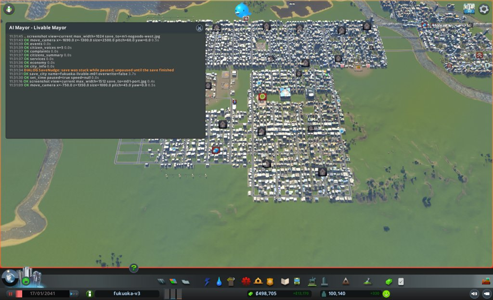

### 2041-01-27 見回り

境目: 当たらず。幸福度 82→86、所持金 438,058、週 +10,197、電気・水・下水の来ない市民0。つぶやきは病院の開院の祝い1件、死体のにおい1件。
空にしている埋立地 43004 は10日で100%→95%。このままだと空になるまで約200日かかり、その間は受け入れない。月例で扱いを決める。

### 2041-02-06 見回り

境目: 当たらず。人口 101,155、幸福度 86、所持金 455,791、週 +12,605、電気・水・下水の来ない市民0。つぶやき0件。

### 2041-02-16 1か月目の終わり(次の月例への引き継ぎ)

月例ではない。親への報告のために3つの道具だけ見た。次の月例は、この日付から型どおりに見直す。

- `city_info`: 人口 101,762、幸福度 86、所持金 475,390、週 +13,760、電気・水・下水の来ない市民0
- `citizens_summary`: 健康の平均 85(月初 70)、病気 748(月初 853)
- `complaints`: ごみ 24(月初 11)、汚染 10(月初 9)、騒音 4(月初 6)、品物なし 134(月初 107)
- ごみの印が増え、中心は東 (2426, 356) に移った。空にしている4か所の埋立地は受け入れを止めたまま、収集車が運び出しに回っている。埋立地を空にする手は、ごみの印を減らすどころか増やした恐れがある。次の月例で、空にするのを止めるか(active=false)を最初に決める

### 2041-02-15 月例(2か月目)

保存: fukuoka-livable-m02

#### 答え合わせ

1. 満杯の埋立地4か所を空にする: 外れ
   - 予想: ごみの印が11から5以下に減る。結果: 24に増えた
   - 外れた理由の見立て: 空にしている間は受け入れを止める。4か所の収集車(計73台)が運び出しに回り、近くの家を回らなくなった。中身は1か月で4〜5%しか減らない(95%→91%)
   - 次の扱い: やめる(active=false で戻す)。91〜95%で、まだ5〜9%の空きがある
2. 西と南西に病院と診療所: 当たり
   - 予想: 2か月以内に健康が72以上。結果: 85(病気 853→748)
   - 次の扱い: 続ける。禁煙と同時に打ったので、どちらの効き目かは分けられない
3. 禁煙の政策: 当たり
   - 予想: 健康が1以上上がり、幸福度が2以上は下がらない。結果: 健康 70→85、幸福度 82→86
   - 次の扱い: 続ける
- 「次にやること」の実行
  - 空になったら戻す: 空にならなかった。今月、空にするのをやめる(実行)
  - 東の汚染の原因: 調べた(下の「気づいたこと」)
  - 西の騒音の原因: 調べていない。騒音の印は6→4に減り、中心は東 (1900, 10) に移った
  - リサイクルの政策: 今月かける(実行)
- 公約の進み具合
  1. 幸福度: 86 / 残り11か月 / あと4
  2. 健康の平均: 85 / 残り11か月 / 80を超えた。保つ
  3. 汚染・騒音・ごみの印: 10・4・24 / 残り11か月 / ごみが出発点の2倍に増えた

#### 気づいたこと

- ごみ: 埋立地17か所。満杯は 39056(東 4127, -1490)、99%は 40118(3560, 540)。空にしている4か所のほかは、収集車が19台中19台とも出ている。容量は 1億3,600万のうち 9,169万(空き約4,400万)。足りないのは容量ではなく、収集の手
- 汚染10棟のうち6棟は東 (3976, -503〜-668) と (4184, -402〜-672) の戸建て。地面の汚染の地図で、255近い値が埋立地 10533(3900, -575)の敷地とその周り40m、西の工場の列 (3480〜3850, -500〜-650) に広がる。3976 の列の家は、埋立地のすぐ東にある
- 東の工場の列は工業44棟(うち放棄11、原料なしで止まりかけが多い)、働き口は424だけ。ただし事務所・消防署・警察署と入り混じり、円で壊すと巻き込む
- 品物なし134棟: 貨物港 (-400, 1555) に止まった荷物の車が1,441台たまっている。港の前の道路は混んでいない(止まった車0)。港の中で出口を待っている
- 死体11棟: 中心 (358, -62)。近くの火葬場は (-134, 330) と (1500, 124) で、中心部の南に空白がある
- 住民の声5人はみな幸福度最高、困りごとなし。つぶやきは病院の祝い、学校の祝い、死体のにおい、放棄された家の苦情の4件

#### 施策

1. 埋立地4か所を空にするのをやめる
   - 公約: 3(ごみの印)
   - 捨てるもの: なし
   - 理由: 1か月目の施策の外れ。収集車73台を集める仕事に戻す
   - 予想: 次の月例(2041-03-17ごろ)までに、ごみの印が24から12以下に減る
   - 操作: `empty_building` active=false を 4946、11708、12700、43004 に
2. リサイクル(Recycling)の政策をかける
   - 公約: 3(ごみの印)
   - 捨てるもの: 週の収支(住宅の税収が5%減る。週の黒字 +13,760 の中に収まる見込み)
   - 理由: ごみの量を15%減らし、収集と埋立地の両方の重荷を軽くする。週の直接の費用は0
   - 予想: 次の月例で週の収支は黒字のまま。ごみの印は施策1と合わせて12以下
   - 操作: `set_policy` Recycling
3. 東の埋立地 10533 を取り壊す
   - 公約: 3(汚染の印)、2(健康)
   - 捨てるもの: なし(ごみの容量800万と収集車19台を手放す。街の空きは約4,400万あり、施策1で73台が戻る)
   - 理由: 汚染の印のある戸建て6棟のうち4棟が、汚染255の埋立地の敷地から東へ80m以内にある。中身は78%で、2〜3か月で満杯になる
   - 予想: 地面の汚染は少しずつ引く。次の月例で汚染の印が10から7以下。ごみの印は増えない
   - 操作: `bulldoze` (3900, -575) 半径10、what=building

#### 実行の結果

1. 4か所とも emptying=false。費用0
2. Recycling active=true。週の直接の費用0
3. 取り壊したのは埋立地 10533 の1棟だけ。道路は残した。費用0(払い戻しなし)

#### 考えたが打たなかった手

- 東の工場の列(工業44棟)を取り壊して事務所の区画にする: 事務所・消防署・警察署と入り混じり、円の取り壊しでは巻き込む。埋立地の取り壊しの効き目を見てから考える
- 貨物港を取り壊す: 品物なし134棟の原因の見込みは強い。ただ港をなくすと、荷物の車がすべて高速道路から来て、道路の騒音が増えるおそれがある。公約の外なので、幸福度が伸びなければ考える
- 中心部の南 (358, -62) に火葬場を置く: 死体の印11棟。公約の外で、施策の枠を使い切った。来月、死体の印が残れば考える
- 焼却施設: 汚染の元になる。リサイクルと収集車の戻りの効き目を先に見る

#### 次にやること

- 見回りで、空にするのをやめた4か所の収集車の数と、ごみの印の数を見る
- 汚染の地図で、埋立地の跡 (3900, -575) の汚染が引くかを見る
- 東 (4184, -402〜-672) の汚染の元(工場の列か埋立地 7741 か)を調べる
- 騒音の印の東 (1900, 10) の原因を調べる
- 死体の印が残れば、中心部の南に火葬場を考える

#### 画面写真

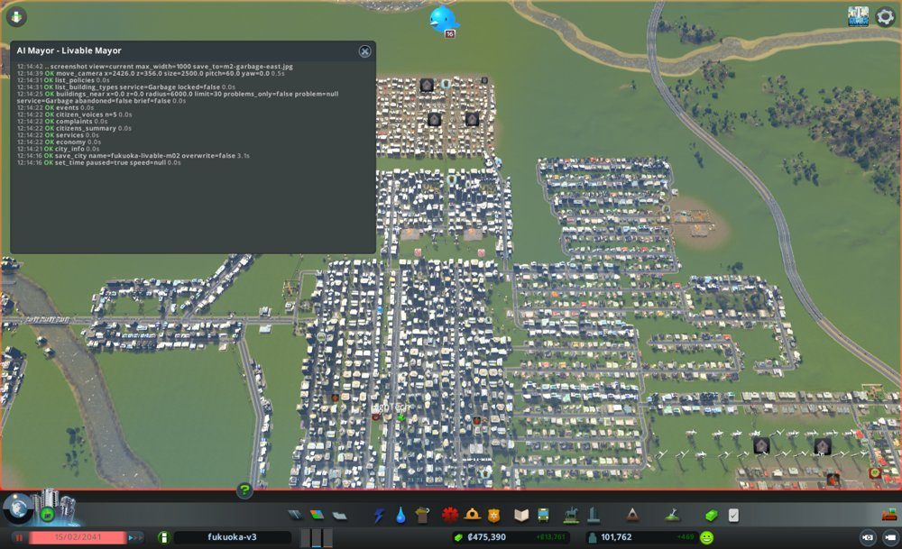
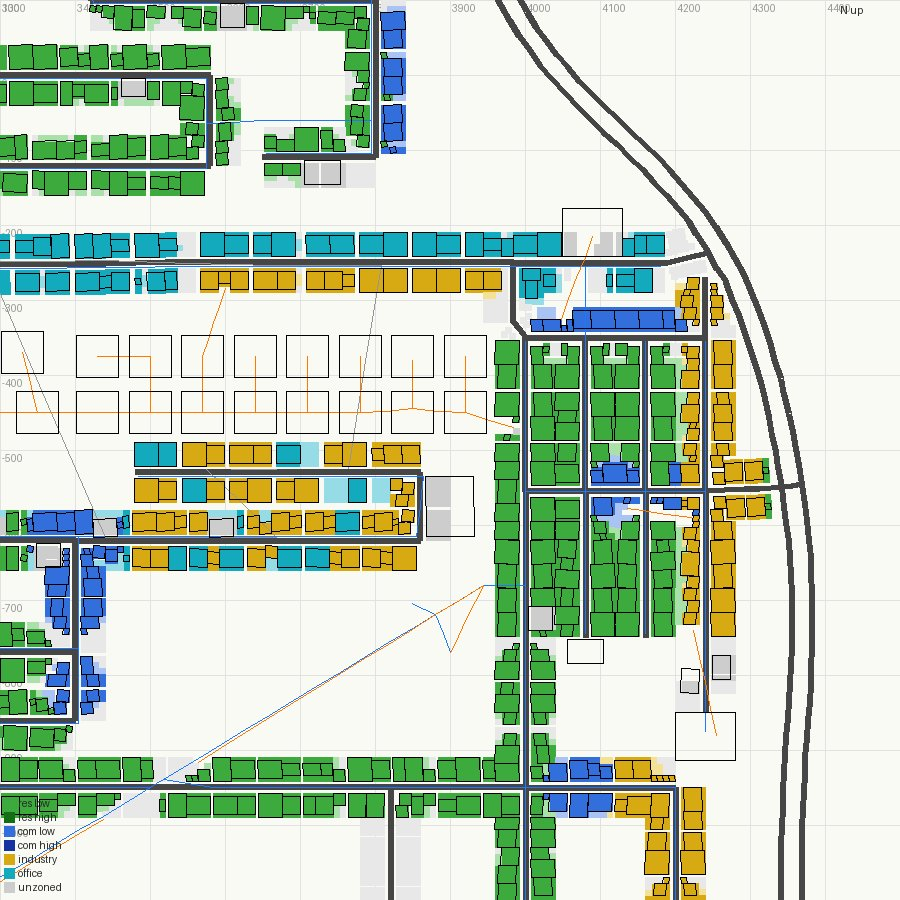

### 2041-02-25 見回り

境目: 当たらず。人口 102,269、幸福度 86、所持金 483,934、電気・水・下水の来ない市民0。つぶやき2件(リサイクルの祝い、汚染)。
週の収支は +13,760 → +6,826 に縮んだ。リサイクルの住宅税収-5%の分と見る。黒字なので境目ではない。

### 2041-03-07 見回り

境目: 当たらず。人口 102,827、幸福度 86、所持金 495,604、週 +8,394、電気・水・下水の来ない市民0。つぶやき1件(禁煙の祝い)。

### 2041-03-17 2か月目の終わり(次の月例への引き継ぎ)

月例ではない。親への報告のために3つの道具だけ見た。次の月例は、この日付から型どおりに見直す。

- `city_info`: 人口 103,226、幸福度 86、所持金 509,414、週 +9,676、電気・水・下水の来ない市民0
- `citizens_summary`: 健康の平均 85、病気 666(月初 748)
- `complaints`: ごみ 9(月初 24)、汚染 10(月初 10)、騒音 7(月初 4)、死体 17(月初 11)、品物なし 158(月初 134)
- ごみの印は減り、中心は東の工場の列 (3607, -525) に移った。取り壊した埋立地 10533 の収集車19台が抜けた所と見る
- 汚染の印は10のまま。東の戸建て (3976, -555) と (4184, -648〜-733) に残る。埋立地の跡の地面の汚染が引いたかは、次の月例で地図を見る
- 死体の印が中心部 (-49, -187) で17に増えた。次の月例で火葬場を最初に考える

### 2041-03-17 月例(3か月目)

保存: fukuoka-livable-m03

#### 答え合わせ

1. 埋立地4か所を空にするのをやめる: 当たり
   - 予想: ごみの印が24から12以下。結果: 9
   - 次の扱い: 続ける(元に戻したまま)
2. リサイクルの政策: 当たり
   - 予想: 週の収支は黒字のまま、ごみの印は12以下。結果: 週 +9,676、ごみの印 9
   - 次の扱い: 続ける
3. 東の埋立地 10533 を取り壊す: 外れ
   - 予想: 汚染の印が10から7以下。結果: 10のまま
   - 外れた理由の見立て: 汚染の印の家6棟のうち5棟は x=4184 の列で、すぐ東 (4210〜4310) に工業の列がある。地面の汚染の地図で、x=4250 の列は z=-300〜-900 がずっと255。元は埋立地ではなく、この工業の列だった。埋立地の跡 (3900, -575) の周りは 255→0 に引いた
   - 次の扱い: 続ける(戻さない)。元の工業の列に手を打つ
- 「次にやること」の実行
  - 見回りで収集車とごみの印を見る: 印の数だけ見た(月末9)
  - 埋立地の跡の汚染が引くか: 見た。引いた
  - 東 (4184, -402〜-672) の汚染の元: 調べた。東隣の工業の列
  - 騒音の東 (1900, 10) の原因: 調べた。道路 x=1880 の西側にある高密度商業(ホテル、店)の騒音。騒音の地図で 132
  - 死体の印が残れば火葬場: 今月打つ
- 公約の進み具合
  1. 幸福度: 86 / 残り10か月 / あと4。住民だけの平均は89
  2. 健康の平均: 85 / 残り10か月 / 80を超えたまま
  3. 汚染・騒音・ごみの印: 10・7・9 / 残り10か月 / 出発点 9・6・11 とほぼ同じ

#### 気づいたこと

- 品物なし158棟が印の75%を占める。貨物港 (-400, 1555) から出る車1,646台が、港の出口の Harbor Road(片側1車線、87m、混み具合100)1本に並ぶ。止まった荷物の車1,592台のうち1,439台が港にいる
- 死体の印17棟。葬祭の届き具合の地図で、中心部の南 (0〜700, -300〜-850) が0。火葬場は7か所あるが、中心部の南にない
- 騒音7棟のうち4棟は東 (1870〜2250, -190〜44)。高密度商業と高層住宅が入り混じる
- 住民の声5人のうち4人は幸福度最高。1人 (-2136, -1346) は学歴なし・失業・病気で幸福度 Poor
- つぶやき2件(騒音の苦情1、リサイクルの祝い1)

#### 施策

1. 東の工業の列 (4210〜4310, -490〜-720) を取り壊し、事務所の区画にする
   - 公約: 3(汚染の印)、2(健康)
   - 捨てるもの: 工場(汚れの元なので取り壊す)、働き口
   - 理由: 汚染の印の家6棟のうち5棟が、この列の西隣 x=4184 に並ぶ。地面の汚染が255
   - 予想: 次の月例で汚染の印が10から6以下。工場の跡に事務所が建ち、汚染は出さない
   - 操作: 工業の建物ごとに小さな円で `bulldoze`(what=building)、その後 `zone_polygon` で office
2. 中心部の南に火葬場を置く
   - 公約: 1(幸福度)
   - 捨てるもの: なし
   - 理由: 死体の印 11→17。葬祭の届き具合が0の空白がある
   - 予想: 次の月例で死体の印が17から8以下
   - 操作: `place_building` Crematory (180, -325) 東向き。建設費25,000、週の維持費 約1,000(予算140%)
3. 貨物港の出口の Harbor Road を Small 4 Lane Road に広げる
   - 公約: 1(幸福度。品物なしの印は働く場所の建物の幸福度を下げる)
   - 捨てるもの: なし
   - 理由: 港の車1,646台が片側1車線の出口に並ぶ。品物なし158棟
   - 予想: 次の月例で、港に止まった車が1,439から700以下、品物なしの印が158から120以下
   - 操作: `upgrade_road` 区間 15928 (-448, 1515)〜(-352, 1515)

#### 実行の結果

1. 工業の列の取り壊し: 列は南北に z=-270〜-720 まで続いていたので、範囲を北へ広げた。`bulldoze` を x=4240 の半径36の円で12回、東の4棟は半径6で1棟ずつ。工業51棟と低密度商業2棟(13999、7904)を取り壊した。家は壊していない。費用0。続けて `zone_polygon` (4206〜4316, -262〜-728) を office に。401マスを変えた。`zone_map` で列が事務所の色になったのを確かめた
   - 半径27の円 (4293, -552) は0棟を返した。理由は分からない。1棟ずつの小さな円では壊せた
2. 火葬場: id 15232、25,000。入口は道路 13223(Basic Road)に接する。取り壊し0
3. 港の出口の道路: 失敗。`upgrade_road` が "part of a building" で飛ばした。Harbor Road は港の建物の一部で、差し替えられない。費用0。交差点 (-352, 1515) は信号なしの曲がり角で、ほかに手はなかった

#### 考えたが打たなかった手

- 東の工業の残り (3480〜3850, -480〜-560) も取り壊す: ごみの印9棟のうち5棟がこの工場で、汚染の印 (3976, -555) の元でもある。ただ品物なしの印が158棟あり、さらに工場を減らすと品物が足りなくなるおそれ。今月の列の効き目を見てから決める
- 東 (1880, -30) の騒音: 高密度商業の騒音。建物のあるマスは区画を変えられず、取り壊すと商業を減らす。木を植える手を来月考える
- 港の出口が細いことへの別の手(2つ目の貨物港、港の取り壊し): 港の取り壊しは、荷物の車がすべて道路から来て騒音が増えるおそれ。2つ目の港は建設費が大きい。来月、品物なしの印の数を見て決める
- 施策3が失敗したので、空いた枠に別の手は入れなかった。準備なく打つと答え合わせがしにくい

#### 次にやること

- 見回りで、事務所の区画に建物が建ち始めたか、電気が来ない家が出ていないかを見る
- 次の月例で、汚染の印 (x=4184 の列) と地面の汚染の地図 (4250, -500) を見る
- 品物なしの印が減らなければ、港への別の手を考える
- 東 (1880, -30) の騒音に、木を植える手を考える

### 2041-03-27 見回り → 臨時

境目: 当たった。電気の来ない市民が 0→1。人口 103,785、幸福度 86、所持金 497,681、週 +9,225。つぶやき1件(食べ物の宣伝)。

- 原因: `citizens_without_service` で、家 40328 (4323.8, -574.9) の1棟。取り壊した工業の列のすぐ東にあり、電気は工場の建物を伝って来ていた。工場がなくなり、電気がとぎれた。市長の施策1の取りこぼし
- 施策: 家 40328 と、西の電気の来ている家の列 (4184) を送電線でつなぐ
  - 公約: 1(幸福度。電気のない家は印が出る)
  - 捨てるもの: なし
  - 予想: 次の見回りで、電気の来ない市民が0に戻る
  - 操作: `build_line` Power Line (4323.8, -574.9)〜(4184, -607)。約140m、建設費 約350、週の維持費 約10
  - 結果: 2区間を引いた。費用360。両端は家 40328 と家 30274(電気の来ている列)の敷地の中(insideBuilding)。つながったかは次の見回りで見る

### 2041-04-06 見回り

境目: 当たらず。人口 104,234、幸福度 86、所持金 511,628、週 +10,108。電気の来ない市民は1のまま(増えていない)。つぶやき1件(禁煙の祝い)。

- 家 40328 は電気の来ない一覧から外れた。臨時の送電線は効いた
- 代わりに一覧の1人は家 1051 (-1584, -1484)。cellNow=true で、次の更新で外れる
- ただし `buildings_near` で、東端のもう1棟の家 22559 (4321.5, -527) が電気なし(grid.electricity=false、印 Electricity)。これも工場の取り壊しの取りこぼし。住民の数えはまだ増えていないので境目ではない。月例で送電線を足す

### 2041-04-16 3か月目の終わり(次の月例への引き継ぎ)

月例ではない。親への報告のために3つの道具と、汚染の地図だけ見た。次の月例は、この日付から型どおりに見直す。

- `city_info`: 人口 104,638、幸福度 86、所持金 526,893、週 +10,727、電気の来ない市民1
- `citizens_summary`: 健康の平均 85、病気 611(月初 666)、住民の幸福度の平均 89
- `complaints`: 汚染 12(月初 10)、騒音 1(月初 7)、ごみ 1(月初 9)、死体 10(月初 17)、品物なし 181(月初 158)、電気 1(家 22559)
- 汚染の印は増えた。中心は (3992, -367)。x=4184 の列の家 (254、26328) に加え、西の工場の行 (3480〜3850, -480〜-650) の東隣 x=3976〜4024 の家に広がった
- 地面の汚染の地図で、取り壊した列 x=4250 は 255→185 に下がった。1か月で約70ずつ引くなら、あと3か月ほどで0に近づく見込み。西の工場の行 (3550〜3850) は 251〜255 のまま
- 騒音の印は 7→1。東 (1880, -30) の4棟は消えた。理由は確かめていない
- 東端の家 22559 (4321.5, -527) は電気なしのまま。次の月例で、送電線を家 40328 か家 30274 までつなぐ
- 品物なしは 158→181 に増えた。港の出口の道路は広げられなかった

### 2041-04-16 月例(4か月目)

保存: fukuoka-livable-m04

#### 答え合わせ

1. 東の工業の列を取り壊し、事務所の区画にする: 外れ
   - 予想: 汚染の印が10から6以下。結果: 12
   - 外れた理由の見立て: 列の跡の地面の汚染は 255→185 で、1か月では引ききらない。もう一つの元、西の工場の行 (3480〜3900, -270〜-650) が残る。印は x=3976〜4024 の家に広がった
   - 次の扱い: 続ける(戻さない)。西の工場の行にも手を打つ
2. 中心部の南に火葬場: 外れ(惜しい)
   - 予想: 死体の印が17から8以下。結果: 10。中心は (-370, -30) に移った
   - 次の扱い: 続ける
3. 貨物港の出口の道路を広げる: 外れ(実行できず)
   - 品物なし 158→181。港に止まった荷物の車は1,420台のまま
   - 次の扱い: 別の手(港を止める)に替える
4. 臨時の送電線: 当たり。家 40328 は電気の来ない一覧から外れた
- 「次にやること」の実行
  - 事務所の区画に建ち始めたか: 見ていない
  - 汚染の印と地図: 見た(上)
  - 品物なしが減らなければ港へ別の手: 今月打つ
  - 東 (1880, -30) の騒音に木: 打たない。騒音の印は 7→1 に減った
- 公約の進み具合
  1. 幸福度: 86 / 残り9か月 / あと4。住民だけの平均は89
  2. 健康の平均: 85 / 残り9か月 / 80を超えたまま
  3. 汚染・騒音・ごみの印: 12・1・1 / 残り9か月 / 騒音とごみはほぼ0。汚染だけが残る

#### 気づいたこと

- 住民の声5人はみな幸福度最高、困りごとなし。つぶやき0件
- 住民の幸福度は89なのに、街の幸福度は86。街の幸福度は働く場所の建物も入る。品物なしの印181棟(印のある建物の83%)が、店の幸福度を下げていると見る
- 品物なし: 貨物港 43449 は出る車1,656、止まった車1,420。港の外の道路は40台しか走らず、詰まりは港の中だけ。品物の輸入898台のうち624台が止まっている
- 汚染12棟のうち7棟は東 (3976〜4184, -400〜-640)。地面の汚染の地図で、西の工場の行 z≈-274 と z≈-500〜-650(x=3480〜3900)が 172〜254。工業は約55棟で、事務所・消防署・風車と入り混じる
- 東端の家 22559 は電気なし。送電線の端 (4324, -575) から北へ約48m

#### 施策

1. 西の工場の行 (3480〜3900, -270〜-650) の工業を1棟ずつ取り壊し、事務所の区画にする
   - 公約: 3(汚染の印)、2(健康)
   - 捨てるもの: 工場(汚れの元)、働き口
   - 理由: 汚染の印の家7棟が、地面の汚染172〜254の工場の行の東隣に並ぶ
   - 予想: 次の月例で汚染の印が12から7以下。2か月後に3以下
   - 操作: 工業の建物の位置ごとに `bulldoze`(what=building、半径6)。事務所・消防署・風車は残す。その後 `zone_polygon` で office
2. 東端の家 22559 に送電線を引く
   - 公約: 1(幸福度)
   - 捨てるもの: なし
   - 理由: 3か月目の取り壊しの取りこぼし。電気の印が1棟
   - 予想: 次の見回りで、電気の来ない市民が0になる
   - 操作: `build_line` Power Line (4324, -575)〜(4321.5, -527)。約48m、建設費 約120
3. 貨物港 43449 を止める(`set_building_active` false)
   - 公約: 1(幸福度。品物なしの印は店の幸福度を下げる)
   - 捨てるもの: 貨物港(止める。壊さないので戻せる)
   - 理由: 港の中に荷物の車1,420台が止まり、品物が店に届かない。港を止めれば、輸入は高速道路のつなぎ口から道路で来る
   - 予想: 次の月例で品物なしの印が181から100以下。幸福度が86から87以上。騒音の印は3以下にとどまる
   - 操作: `set_building_active` id 43449 active=false

#### 実行の結果

1. 工業55棟を1棟ずつ取り壊した(南の行43棟、北の行 z=-274 の12棟)。事務所・消防署 18411・風車・店は残した。費用0。`zone_polygon` (3440〜3925, -245〜-670) を office に。672マスを変え、建物のある271マスは飛ばした。`zones_at` で半径300の中は事務所1,102マス(空き713)、工業は建物のある4マスだけ残った
2. 送電線: 1区間、費用120。始点は既存の送電線の点につながり、終点は家 22559 の敷地の中(insideBuilding)
3. 貨物港 43449: active=false
- 電気のつながり(工場を伝っていた事務所や家が切れていないか)は、次の見回りで `buildings_near` の grid を見る

#### 考えたが打たなかった手

- 貨物港を取り壊す: 止めるだけで同じ効き目を確かめられ、戻せる。来月の結果で決める
- 南の工業 (4050〜4150, -850〜-950) の地面の汚染255: 汚染の印の家が近くにあるかを確かめていない。来月見る
- 死体の印10棟 (-370, -30): 火葬場の効き目がまだ途中。来月も残れば考える
- 幸福度を直接上げる公園や政策: 住民の声は5人とも最高。下げているのは店の印と見て、今月は港を先にした

#### 次にやること

- 見回りで、取り壊した工場の周りの事務所・家に電気が来ているかを見る
- 見回りで、家 22559 の電気と、港を止めた後の品物なしの印・道路の詰まり(`traffic`)を見る
- 次の月例で、汚染の地図 (3700, -450) と汚染の印、品物なしの印、騒音の印を見る
- 品物なしが減らなければ、港を戻す(active=true)

### 2041-04-26 見回り

境目: 当たらず。人口 105,019、幸福度 86、所持金 545,077、週 +12,726。電気の来ない市民1(家 1051、cellNow=true で次に外れる。家 22559 は一覧にない)。つぶやき1件(断水の苦情。水の来ない市民は0)。

- 取り壊した工場の周り (半径350) で、電気の印の建物は0。事務所や家の電気は切れていない
- 取りこぼし: 北の行の東端に工業2棟 (149: 3957, -274、8586: 3933, -274) が残る。来月の月例で扱う
- 港を止めても、港の中に止まった車は 1,420→1,336 とほとんど減らない。出る車 1,582。品物なしの印は 181→187。止める前に出た車が残っていると見る。次の見回りでも見る

### 2041-05-06 見回り

境目: 当たらず。人口 105,453、幸福度 86、所持金 564,159、週 +13,352。電気の来ない市民1(家 1051。grid は来ていて cellNow=true のまま、2回続けて外れない)。つぶやき1件(雑談)。

- 港の中に止まった車は 1,336→1,247。10日で約90台ずつしか減らない。港から出る車 1,499、着く船は1隻。品物なしの印は 186
- 港を止めても、たまった車がはけるまで1か月以上かかりそう。品物なしの印は、はけた後に動くと見る

### 2041-05-16 4か月目の終わり(次の月例への引き継ぎ)

月例ではない。親への報告のために4つの道具だけ見た。次の月例は、この日付から型どおりに見直す。

- `city_info`: 人口 105,757、幸福度 86、所持金 582,468、週 +13,351、電気の来ない市民1(家 1051)
- `citizens_summary`: 健康の平均 85、病気 551(月初 611)、住民の幸福度の平均 89
- `complaints`: 汚染 4(月初 12)、騒音 4(月初 1)、ごみ 2(月初 1)、死体 7(月初 10)、品物なし 184(月初 181)、火事 2
- 汚染の印は 12→4。東の工場の行のそばの家の印は消えた。残る4棟は (3354, 644)、(4188, -366) など。中心は (3771, 139)
- 騒音の印が東 (1900, -9) の高層住宅に戻った(4棟)。3か月目と同じ場所
- ごみの印2棟は西 (-1504, -626)、(-1132, -896) の住宅。東から西へ移った
- 品物なしは 184 のまま。港を止めた効き目はまだ出ていない
- つぶやき1件(街をほめる声)

### 2041-05-16 月例(5か月目)

保存: fukuoka-livable-m05

#### 答え合わせ

1. 西の工場の行の工業55棟を取り壊し、事務所の区画にする: 当たり
   - 予想: 汚染の印が12から7以下。結果: 4
   - 次の扱い: 続ける。北の行の取りこぼし2棟(149、8586。原料なしで止まっている)は残る
2. 東端の家 22559 に送電線: 当たり
   - 予想: 電気の来ない市民が0。結果: 家 22559 は一覧から外れた。数えの1人は別の家 1051(cellNow=true のまま外れない)
3. 貨物港 43449 を止める: 外れ
   - 予想: 品物なしの印が181から100以下、幸福度87以上、騒音3以下。結果: 品物なし184、幸福度86、騒音4
   - 外れた理由の見立て: 止めても、港の中にたまった荷物の車は消えない。1,420→1,166台で、10日に約90台しかはけない。たまった車が店の注文を抱えたままなので、新しい注文が道路から来ない
   - 次の扱い: やめて、もっと強い手(港を取り壊す)に替える
- 「次にやること」の実行
  - 工場の周りの電気: 見た(見回りで電気の印0)
  - 家 22559 の電気、港の後の品物なし: 見た
  - 汚染の地図と汚染・品物なし・騒音の印: 見た(下)
  - 品物なしが減らなければ港を戻す: 戻さない。止めても減らないのは、港を開けても同じ詰まりが続くため。取り壊しに替える
- 公約の進み具合
  1. 幸福度: 86 / 残り8か月 / あと4。住民だけの平均は89(健康85と暮らし向き93の間)
  2. 健康の平均: 85 / 残り8か月 / 80を超えたまま
  3. 汚染・騒音・ごみの印: 4・4・2 / 残り8か月 / 出発点 9・6・11 からどれも減った

#### 気づいたこと

- 住民の声5人はみな幸福度最高、困りごとなし。2人は長い失業(公約の外)。つぶやき0件
- 品物なし184棟(印のある建物210棟の88%)。西の商業 (-1190, -767) に118棟。港 43449 は止めた後も出る車1,423、止まった車1,166。港の出口は Harbor Road(片側1車線)が1本だけで、港の外の道路は混んでいない
- 道路のつなぎ口は南北の端 (z=±8649) だけ。港がなければ、品物は8km以上を道路で来る
- ごみ: 中心部の埋立地4か所が満杯の手前(43004 99%、11708 98%、12700 98%、4946 96%)。満杯の 39056、40118 は収集車0台。1か月目と同じく、中心部の収集が止まるおそれ
- 汚染4棟: 家 25499 (3354, 644) は、満杯の埋立地 40118 (3560, 540) と 4946 (3499, 618) のすぐ西。地面の汚染が251。家 1838 (-584, -374) は埋立地 43004 (-650, -490) の北東。家 28848 (4188, -366) は止まった工場2棟 (3945, -274) の南東
- 騒音4棟は散らばる。東 (1896, -46)、(1904, 28) は Small 4 Lane Road x=1880 沿いで、騒音117
- 医療の届き具合は、東の高層住宅の西の列 (1880〜2000) で36〜60と、ほかより低い。高齢者は20,098人(19%)。Eldercare 01 と Child Health Center 01 が置ける

#### 施策

1. 貨物港 43449 を取り壊す
   - 公約: 1(幸福度。品物なしの印は店の幸福度を下げる)
   - 捨てるもの: 貨物港(汚れの元ではないが、品物を止めている元なので取り壊す)
   - 理由: 止めても港の中の荷物の車1,166台がはけない。取り壊せば、注文を抱えた車が消え、店は道路から注文し直す
   - 予想: 次の月例で、港の止まった車が0、品物なしの印が184から100以下、幸福度が86から87以上。騒音の印は6以下
   - 操作: `bulldoze` (-400, 1555) what=building。小さな円で港だけを壊す
2. 中心部の北の空き地に焼却施設(Combustion Plant)を2つ置く
   - 公約: 3(ごみの印)
   - 捨てるもの: 週の収支(維持費 約4,300/週、予算150%)
   - 理由: 中心部の埋立地4か所が96〜99%。1か月目、満杯の埋立地でごみの印が増えた。焼却施設は満杯にならない。家から約300m離れた、港へ行く道路沿いの空き地 (-334, 900〜1000) に置く
   - 予想: 次の月例で、ごみの印は2から3以下にとどまる。汚染の印は焼却施設のそばに出ない
   - 操作: `place_building` Combustion Plant (-334, 1000) と (-334, 900)、東向き。建設費60,000(所持金の半分 291,000 の中)
3. 満杯の埋立地 40118 (3560, 540) を取り壊す
   - 公約: 3(汚染の印)、2(健康)
   - 捨てるもの: なし(満杯で収集車0台。容量はもう使えない)
   - 理由: 西隣の家 (3354〜3432, 508〜656) の地面の汚染が251。汚染の印の家 25499 がある
   - 予想: 次の月例で、汚染の印が4から3以下。2か月目の埋立地の跡と同じく、地面の汚染は1か月で大きく引く
   - 操作: `bulldoze` (3560, 540) 半径10、what=building

#### 実行の結果

1. 貨物港 43449 を取り壊した(1棟だけ。道路は残した)。費用0
2. Combustion Plant 2つ: id 35280 (-334, 1000)、id 12873 (-330, 900)。各30,000、計60,000。入口は Small 4 Lane Road に接する。取り壊し0
   - 2つとも水と下水が要る。`water_trace` で最寄りの管まで177m だった。管を (-480, 1100)〜(-365, 1000)〜(-362, 900) に引いた。費用640。始点は既存の管の点につながった。建物に水が来たかは見回りで見る
3. 埋立地 40118 を取り壊した(1棟だけ)。費用0
- 建設費の合計 60,640(所持金 582,468 の半分の中)

#### 考えたが打たなかった手

- Eldercare 01 を西 (-1162, -978) などに置く: 高齢者は19%で、健康と幸福度の両方に効くかもしれない。ただ1棟の届く範囲は狭く、街の平均では効き目が見えにくい。施策の枠を、印を確実に減らす手に使った。来月、幸福度が動かなければ考える
- 医療の予算 140→150: 東の高層住宅の西の列は届き具合36〜60。健康は公約の80を超えている。幸福度のための手として来月考える
- 止まった工場2棟 (149、8586) の取り壊し: 家 28848 の汚染の元の見込み。今月は埋立地を先にした。来月、印が残れば打つ
- 埋立地 4946 (96%)、43004 (99%) の取り壊し: まだ収集車が出ている。満杯になって焼却施設が動いてから考える
- 東 x=1880 の道路沿いの騒音: 道路の車の騒音。木を植える隙間がない

#### 次にやること

- 見回りで、焼却施設2つに水・下水が来たか(`buildings_near` の grid)を見る
- 見回りで、港の跡の止まった荷物の車(`cargo`)と品物なしの印を見る
- 次の月例で、汚染の地図 (3450, 600) と汚染・ごみの印、中心部の埋立地の割合を見る

### 2041-05-26 見回り

境目: 当たらず。人口 106,206、幸福度 86、所持金 535,856、週 +9,684。電気の来ない市民1(増えていない)。つぶやき2件(焼却施設の祝い、観光客)。

- 焼却施設2つは水・下水が来た(grid すべて true)。収集車は 13/34 台と 7/34 台が出ている
- 止まった荷物の車は 1,314→130。港の跡の詰まりは消えた。品物なしの印は 184→191 で、まだ動かない
- 品物の輸入の車は 746→196 に減った。道路のつなぎ口が遠く、品物が届くまで時間がかかると見る

### 2041-06-05 見回り

境目: 当たらず。人口 106,503、幸福度 86、所持金 550,885、週 +10,558。電気の来ない市民1(増えていない)。つぶやき1件(禁煙の政策への不満)。

### 2041-06-15 5か月目の終わり(次の月例への引き継ぎ)

月例ではない。親への報告のために5つの道具と、汚染の地図だけ見た。次の月例は、この日付から型どおりに見直す。

- `city_info`: 人口 106,883、幸福度 86、所持金 566,702、週 +11,081、電気の来ない市民1
- `citizens_summary`: 健康の平均 85、病気 542(月初 551)、住民の幸福度の平均 89、高齢者 20,687
- `complaints`: 品物なし 205(月初 184)、汚染 12(月初 4)、死体 9(月初 7)、ごみ 6(月初 2)、火事 3、騒音 2(月初 4)、水 2、犯罪 1
- `cargo`: 止まった荷物の車 168(月初 1,314)。品物の輸入の車は 190 台だけ。品物なしは増えた。港をなくしても、品物は届いていない
- 汚染の印は 4→12。中心は (3902, -204)、東の戸建て x=3976 と x=4184 の列。地面の汚染の地図で、取り壊した工場の行 (3500〜3900, z≈-270 と -540〜-630) は 134 前後。先月の 172〜254 から下がっているのに、印は増えた。理由は分かっていない
- 南東 (4050〜4300, -900) は 255。埋立地 7741 (4240, -882) の周り
- ごみの印 2→6。中心は東の高層住宅 (2200, -52)
- つぶやき2件(死体のにおい、リサイクルの祝い)

### 2041-06-15 月例(6か月目)

保存: fukuoka-livable-m06

#### 答え合わせ

1. 貨物港 43449 を取り壊す: 外れ
   - 予想: 港の止まった車が0、品物なしの印が184から100以下、幸福度87以上、騒音6以下。結果: 止まった荷物の車 1,314→168(当たり)、品物なし 205(増えた)、幸福度86、騒音2
   - 外れた理由の見立て: 港の詰まりは消えたが、品物は南東の道路のつなぎ口 (5788, -8649) から8km以上かけて来る。つなぎ口に止まった車が67台。品物なしの中心は西 (-1247, -801) の126棟で、つなぎ口から最も遠い
   - 次の扱い: 戻さない(同じ場所に港を建て直すと、出口1本の詰まりがまた起きる見込み)。品物には別の手を考える
2. 中心部の北に焼却施設2つと水道管: 当たり
   - 予想: ごみの印が3以下にとどまる。焼却施設のそばに汚染の印が出ない。結果: ごみの印6(外れ)、焼却施設のそばの汚染の印0(当たり)。焼却施設は収集車 26/34、14/34 台が出ている
   - ごみの印6の中心は東の高層住宅 (2200, -52)。近くの埋立地 41982・18626 は収集車19/19台とも出ている。焼却施設の届かない東の収集の手が足りない
   - 次の扱い: 続ける
3. 満杯の埋立地 40118 を取り壊す: 外れ
   - 予想: 汚染の印が4から3以下。結果: 12
   - 外れた理由の見立て: 増えた印は別の場所。中心部の南の高層住宅4棟 (-584〜-668, -374) は満杯の埋立地 43004 (-650, -490) の北。東の家5棟は工場の跡の地面の汚染(134前後に下がったがまだ残る)と、新しく建った工場 28042 (3933, -274)。工業の区画が北の行の東端に残っていて、建て替わった。(3388〜3428, 640) の2棟は、98%の埋立地 4946 (3499, 618) の西
   - 次の扱い: 続ける(40118 の跡は戻さない)。満杯の埋立地と、残った工業の区画に手を打つ
- 「次にやること」の実行
  - 焼却施設の水・下水: 見た(5月26日の見回りで来ていた)
  - 港の跡の荷物の車と品物なし: 見た
  - 汚染の地図 (3450, 600) と汚染・ごみの印、中心部の埋立地の割合: 汚染の地図は東 (3900, -400) を見た。(3450, 600) は見ていない。埋立地の割合は見た(下)
- 公約の進み具合
  1. 幸福度: 86 / 残り7か月 / あと4。4か月続けて86で動かない。住民だけの平均は89
  2. 健康の平均: 85 / 残り7か月 / 80を超えたまま
  3. 汚染・騒音・ごみの印: 12・2・6 / 残り7か月 / 汚染が出発点の9を超えた

#### 気づいたこと

- 住民の声5人はみな幸福度最高、困りごとなし。2人は7週の失業(公約の外)。つぶやき0件
- 満杯の埋立地は3か所(12700、39056、43004)。どれも収集車0台で、ごみを受け入れていない。地面の汚染は、12700 (-262, 800) の周りが255
- 98〜99%の埋立地が2か所(4946 は収集車5台、11708 は2台)。まだ受け入れている
- 東の地面の汚染は、工場の跡 (3500〜3900, z≈-300 と -500) が119〜163。先月の172〜254から下がり続けている。南東の埋立地 7741 (4240, -882) の周りは255(41%で動いている)
- 東の北の行の東端に工場が2棟。149 は原料なしで止まりかけ、28042 は新しく建った(先月の 8586 が建て替わったと見る)
- 品物なし205棟。品物の輸入の車は190台、つなぎ口 (5782, -8639) に67台が止まる
- 医療は容量3,300に使用540で、病院の席は余っている。予算を上げても健康は伸びにくい
- 住宅の税収が週139,848で、収入の87%。住宅の税を1下げると、週の黒字 +11,081 をほぼ使い切る

#### 施策

1. 満杯の埋立地3か所(43004、12700、39056)を取り壊す
   - 公約: 3(汚染の印)、2(健康)
   - 捨てるもの: なし(満杯で収集車0台。ごみの容量はもう使えない)
   - 理由: 中心部の南の高層住宅4棟の汚染の印は、43004 のすぐ北。2か月目と5か月目に、埋立地の跡の地面の汚染は1か月で大きく引いた
   - 予想: 次の月例で、汚染の印が12から8以下。(-584〜-668, -374) の4棟の印が消える。ごみの印は6から増えない
   - 操作: `bulldoze` 各埋立地の中心で半径10、what=building
2. 東の北の行に残る工場2棟(149、28042)を取り壊し、事務所の区画にする
   - 公約: 3(汚染の印)、2(健康)
   - 捨てるもの: 工場(汚れの元)、働き口
   - 理由: 4か月目の取りこぼし。工業の区画が残り、工場が建て替わった。南東の家 x=3976〜4184 の汚染の元の一つ
   - 予想: 次の月例で、東の家 (3976〜4184, -370〜-700) の汚染の印が5から3以下。2か月後に0
   - 操作: `bulldoze` (3957, -274) と (3933, -274) 半径6、what=building。続けて `zone_polygon` で office

#### 実行の結果

1. 埋立地 43004、12700、39056 を1棟ずつ取り壊した。道路は残した。費用0
2. 工場 149、28042 を取り壊した。費用0。`zone_rect` (3915〜3970, -250〜-302) を office に。42マスを変えた。`zones_at` で半径60の中の工業は 38→0、事務所は 45→87
- 埋立地が電気を伝えていた建物が切れていないかは、見回りで見る

#### 考えたが打たなかった手

- 3件目は打たなかった。様子を見てから動く。今月の2件は汚染の印の元に当てた
- 住宅の税を下げて幸福度を上げる: 住宅の税収は週139,848。1下げると週 約17,000減り、黒字 +11,081 を超えて赤字になる見込み。型の3に反する
- 医療の予算 140→150: 病院の席は3,300のうち540しか使っていない。届き具合は少し伸びるが、健康の平均は動きにくい
- 貨物港を建て直す: 前の港は出口の Harbor Road 1本に車1,600台が並んだ。同じ場所では同じ詰まりの見込み。海に面した別の場所を探していない
- 98%の埋立地 4946 (3499, 618) の取り壊し: 西の家2棟 (3388〜3428, 640) に汚染の印。まだ収集車5台が出ている。東の収集は手が足りない(41982、18626 は19/19台)。満杯になったら壊す
- 東の高層住宅 (2200, -52) のごみの印6に焼却施設を置く: 焼却施設はまわり150mの騒音が100近い。近くに家から離れた空き地を探していない

#### 次にやること

- 見回りで、取り壊した埋立地のそば (-650, -490)、(-262, 800) に電気の来ない建物がないかを見る
- 次の月例で、汚染の地図 (-620, -450) と (3900, -400)、汚染・ごみの印を見る
- 埋立地 4946、11708 が満杯になったら取り壊す
- 東の高層住宅のごみの印が増えれば、収集の手を足す場所を探す
- 幸福度を上げる別の手を探す(品物なし、税を下げる余地)

#### 画面写真

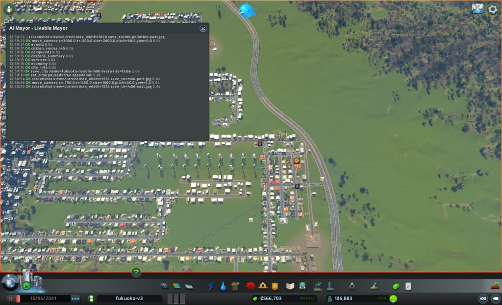

### 2041-06-25 見回り

境目: 当たらず。人口 107,078、幸福度 85(1下がった)、所持金 583,827、週 +11,724。電気の来ない市民1(増えていない)。つぶやき2件(放棄された家の苦情、禁煙への不満)。

- 取り壊した埋立地のそば(半径800)に電気の印の建物は0
- 放棄・焼け跡の建物が街に135棟ある。多くは品物なし・原料なしで止まった店と工場。月例で扱いを決める

### 2041-07-05 見回り

境目: 当たらず。人口 107,376、幸福度 85、所持金 600,680、週 +11,603。電気の来ない市民1(増えていない)。つぶやき1件(汚染。裏庭の光る泥)。

### 2041-07-15 6か月目の終わり(次の月例への引き継ぎ)

月例ではない。親への報告のために4つの道具だけ見た。次の月例は、この日付から型どおりに見直す。

- `city_info`: 人口 107,661、幸福度 85、所持金 617,421、週 +11,746、電気の来ない市民1
- `citizens_summary`: 健康の平均 85、病気 520(月初 542)、体調の悪い市民 329(月初 469)、住民の幸福度の平均 89
- `complaints`: 品物なし 250(月初 205)、死体 23(月初 9)、ごみ 22(月初 6)、汚染 7(月初 12)、火事 4、騒音 2(月初 2)、水 2
- 汚染は 12→7。中心部の南の高層住宅4棟 (-584〜-668, -374) の印は消えた。残るのは東の家 (4024〜4184, -607〜-672) と、98%の埋立地 4946 の西の家 (3388〜3412, 644)
- ごみが 6→22 に増えた。中心は北東の工業 (2372, 1282) の15棟(工場と貨物の置き場)。埋立地3か所を取り壊したことと関わるかは、次の月例で収集車の数を見て確かめる
- 死体が 9→23 に増えた。中心は東の高層住宅 (2377, 192)
- 品物なしは 205→250 に増え続けている
- つぶやき1件(リサイクルの祝い)

### 2041-07-15 月例(7か月目)

保存: fukuoka-livable-m07

#### 答え合わせ

1. 満杯の埋立地3か所(43004、12700、39056)を取り壊す: 半分当たり
   - 予想: 汚染の印が12から8以下。(-584〜-668, -374) の4棟の印が消える。ごみの印は6から増えない。結果: 汚染7(当たり)、4棟の印は消えた(当たり)、ごみ22(外れ)
   - 外れた理由の見立て: ごみの印22のうち15棟は北東の工業 (2372, 1282)。近くの埋立地 41982・18626 は収集車19/19台とも出ている。取り壊した3か所は収集車0台だったので、関わりは薄い。東の収集の手が足りない
   - 次の扱い: 続ける(戻さない)。東に収集の手を足す
2. 東の北の行の工場2棟を取り壊し、事務所の区画にする: 当たり
   - 予想: 東の家 (3976〜4184, -370〜-700) の汚染の印が5から3以下。結果: 3(25921、31247、32422)
   - 次の扱い: 続ける。地面の汚染は 85〜97 に下がり続けている
- 「次にやること」の実行
  - 取り壊した埋立地のそばの電気: 見た(見回りで電気の印0)
  - 汚染の地図 (-620, -450) と (3900, -400): (3800, -100) 半径800を見た。(-620, -450) は見ていない(その辺りの印が消えたため)
  - 埋立地 4946、11708 が満杯になったら取り壊す: 11708 は100%で満杯。4946 は99%(収集車1/19台)
  - 東の高層住宅のごみの印: 増えた(下)
  - 幸福度を上げる別の手: 死体の印を下げる手を今月打つ
- 公約の進み具合
  1. 幸福度: 85 / 残り6か月 / あと5。5か月続けて85〜86で動かない。住民だけの平均は89
  2. 健康の平均: 85 / 残り6か月 / 80を超えたまま
  3. 汚染・騒音・ごみの印: 7・2・22 / 残り6か月 / ごみが出発点の11の2倍

#### 気づいたこと

- 住民の声5人はみな幸福度最高、困りごとなし。2人は7週の失業(公約の外)。つぶやき0件
- ごみの印22のうち15棟は北東の工業 (2372, 1282) の工場と貨物の置き場。南の埋立地 41982 (2240, 522)、18626 (2525, 522) は収集車19/19台、16097 は18/19台。焼却施設2つは中心部の北 (-330, 900) で遠い
- 死体の印23のうち12棟は東の高層住宅 (2377, 192)。近くの火葬場 31990、21324 は霊柩車9/9台、23747 は8/9台、墓地 44681 は13/13台。霊柩車が足りない
- 汚染の地図で、(3400〜3600, 700) が250前後。99%の埋立地 4946 (3499, 618) の周り。汚染の印の家2棟 (3388、3412, 644) はそのすぐ西。4946 は収集車1/19台で、ほとんど働いていない
- 東の工場の跡は 85〜97 に下がった。南東の埋立地 7741 (4240, -882) の周りは255のまま
- 品物なし250棟(印のある建物312棟の80%)。中心は西 (-1732, -146)
- 医療は容量3,300に使用524

#### 施策

1. 北東の工業の北東の端に焼却施設を1つ置く(道路と水道管をのばす)
   - 公約: 3(ごみの印)
   - 捨てるもの: 週の収支(維持費 約2,160/週、予算150%)
   - 理由: ごみの印15棟が北東の工業にあり、近くの埋立地の収集車は出払っている。焼却施設は収集車34台
   - 予想: 次の月例で、ごみの印が22から8以下。北東の工業 (2372, 1282) の印は3以下
   - 操作: `build_line` Basic Road (2625, 1460)〜(2690, 1460)。`place_building` Combustion Plant (2665, 1484) 南向き。水道管 (2625, 1455)〜(2670, 1455)。建設費 約31,000
2. 99%の埋立地 4946 (3499, 618) を取り壊す
   - 公約: 3(汚染の印)、2(健康)
   - 捨てるもの: なし(空きは2万で、収集車は1台しか出ていない)
   - 理由: 西隣の家2棟に汚染の印。地面の汚染が250。2か月目・6か月目に、埋立地の跡の汚染は1か月で大きく引いた
   - 予想: 次の月例で、汚染の印が7から5以下。(3388、3412, 644) の2棟の印が消える
   - 操作: `bulldoze` (3499, 618) 半径10、what=building
3. 東の高層住宅の北の空き地に火葬場を置く(短い道路をのばす)
   - 公約: 1(幸福度。死体の印は家の幸福度を下げる)
   - 捨てるもの: 週の収支(維持費 約1,000/週、予算140%)
   - 理由: 死体の印12棟が (2377, 192) に集まる。近くの火葬場と墓地の霊柩車は出払っている
   - 予想: 次の月例で、死体の印が23から12以下。幸福度が85から86以上
   - 操作: `build_line` Basic Road (2400, 560)〜(2400, 430)。`place_building` Crematory (2400, 410) 北向き。建設費 約26,000
- 建設費の合計 約57,000(所持金 617,421 の半分の中)。週の維持費の増え分 約3,000(黒字 +11,746 の中)

#### 実行の結果

1. 道路 (2625, 1460)〜(2690, 1460) 1区間、320。始点は既存の点につながった。Combustion Plant id 2653 を (2665, 1486) 南向きに置いた。30,000。入口は道路 1854 に接する。取り壊し0。水道管 (2625, 1455)〜(2672, 1455) 1区間、120。始点は既存の管につながった
   - 1日進めて確かめ: grid は電気・水・下水すべて true。収集車 2/34 台が出た
2. 埋立地 4946 を取り壊した(1棟だけ)。費用0。1日後、周り300mで電気の印の建物は0
3. 道路 (2400, 560)〜(2400, 430) 2区間、640。始点は既存の道路を分けてつないだ(split)。Crematory id 24331 を (2400, 410) 北向きに置いた。25,000。入口は道路 35866 に接する。取り壊し0
   - 1日進めて確かめ: grid は電気・水・下水すべて true。霊柩車 2/9 台が出た
- 建設費の合計 56,080

#### 考えたが打たなかった手

- 満杯の埋立地 11708 (738, -590) の取り壊し: 収集車0台で受け入れていない。汚染の印は近くにない。施策の枠を使い切った。来月、近くに汚染の印が出れば壊す
- 南東の埋立地 7741 (4240, -882) の取り壊し: 周りは地面の汚染255。東の家3棟 (4024〜4184, -607〜-672) の印の元の一つかもしれない。ただ東は収集の手が足りず、7741 は動いている。北東の焼却施設の効き目を見てから決める
- 品物なし250棟への手当て(貨物港を別の場所に建て直す): 印の80%を占め、幸福度が動かない元と見る。前の港は出口1本に車が並んだ。海に面した場所と出口の道路を調べてからにする
- 住宅の税を下げる: 先月と同じく、1下げると赤字の見込み

#### 次にやること

- 見回りで、焼却施設 2653 と火葬場 24331 の車の数を見る
- 次の月例で、ごみ・死体・汚染の印と、汚染の地図 (3500, 650) を見る
- 品物なしの手として、海に面した貨物港の候補地を調べる

#### 画面写真

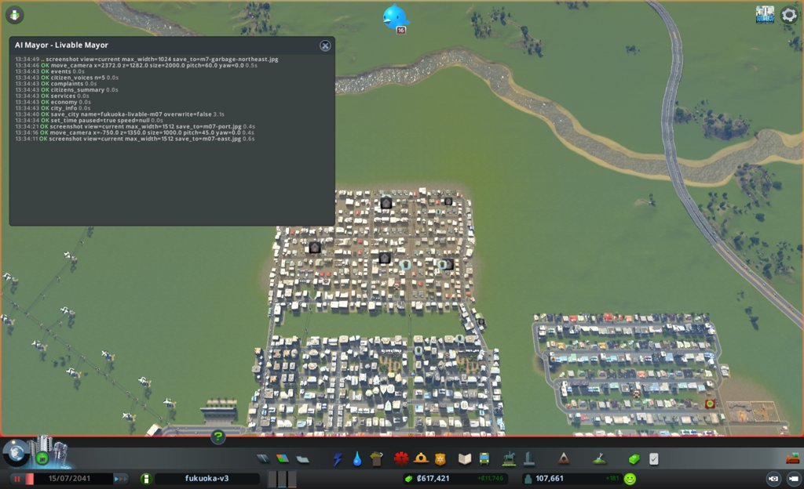
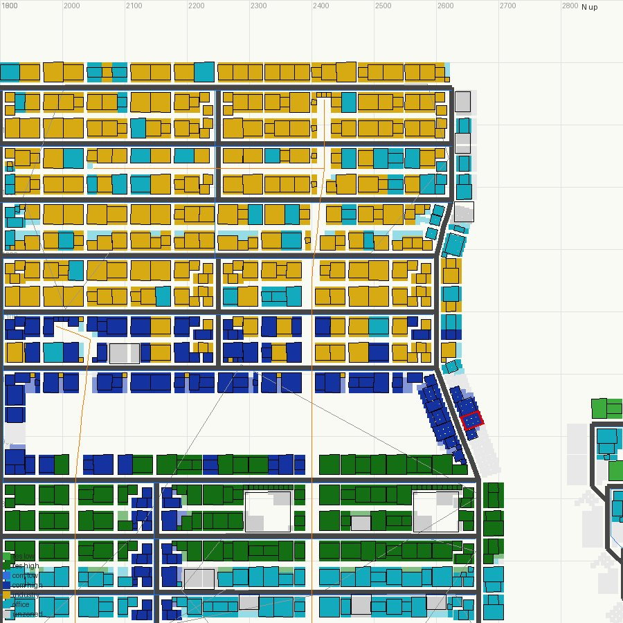

### 2041-07-26 見回り

境目: 当たらず。人口 108,036、幸福度 85、所持金 575,741、週 +9,382。電気の来ない市民1(増えていない)。つぶやき2件(木と騒音の話、禁煙の祝い)。

- 焼却施設 2653 は収集車 17/34 台、たまり13%。火葬場 24331 は霊柩車 7/9 台

### 2041-08-05 見回り

境目: 当たらず。人口 108,237、幸福度 85、所持金 589,384、週 +9,964。電気・水・下水の来ない市民0(1から減った)。つぶやき1件(雑談)。

### 2041-08-15 7か月目の終わり(次の月例への引き継ぎ)

月例ではない。親への報告のために4つの道具と、南西の埋立地だけ見た。次の月例は、この日付から型どおりに見直す。

- `city_info`: 人口 108,356、幸福度 85、所持金 603,658、週 +9,992、電気・水・下水の来ない市民0
- `citizens_summary`: 健康の平均 85、病気 444(月初 520)、体調の悪い市民 259(月初 329)、住民の幸福度の平均 89
- `complaints`: 品物なし 351(月初 250)、ごみ 42(月初 22)、死体 20(月初 23)、汚染 5(月初 7)、火事 3、騒音 2(月初 2)、水 2
- ごみの印の中心は、北東の工業から南西の高層住宅 (-1755, -1359) の22棟に移った。南西の埋立地 20041、23877、42584 は収集車19/19台、34558 は99%で1/19台。北東と同じく、収集の手が足りない
- 汚染5の中心は中心部の南 (-662, -378) の高層住宅2棟。6か月目に印が消えた場所に戻った。(3388、3412, 644) の2棟は例に出ていない
- 死体の中心は (2455, 138) の9棟。火葬場 24331 の近く
- 品物なしは 250→351 に増え続けている
- つぶやき1件(スマートホームの祝い)

### 2041-08-15 月例(8か月目)

保存: fukuoka-livable-m08

#### 答え合わせ

1. 北東の工業の端に焼却施設と道路・水道管: 半分当たり
   - 予想: ごみの印が22から8以下、北東の工業 (2372, 1282) の印は3以下。結果: 街全体は42(外れ)、北東の工業の半径400の印は0(当たり)
   - 外れた理由の見立て: 北東は片づいたが、印の中心が南西の高層住宅 (-1755, -1359) の22棟に移った。南西の埋立地3か所は収集車19/19台とも出ていて、34558 は99%で1/19台。北東と同じく、収集の手が足りない
   - 次の扱い: 続ける。南西にも同じ手(焼却施設)を打つ
2. 99%の埋立地 4946 を取り壊す: 半分当たり
   - 予想: 汚染の印が7から5以下、(3388、3412, 644) の2棟の印が消える。結果: 5(当たり)、家 20761 (3428, 648) に印が残る(外れ)
   - 外れた理由の見立て: 跡の地面の汚染が1か月では引ききらない(2か月目・6か月目と同じ)
   - 次の扱い: 続ける(戻さない)
3. 東の高層住宅の北に火葬場と道路: 外れ
   - 予想: 死体の印が23から12以下、幸福度86以上。結果: 死体20、幸福度85。中心は (2455, 138) の9棟で、新しい火葬場のすぐ南
   - 外れた理由の見立て: 火葬場 24331 は霊柩車9/9台が出ているのに、先週の処理が0。車が着いていないか、遠くを回っている。理由はまだ確かめていない
   - 次の扱い: 続ける。来月、処理の数を見る
- 「次にやること」の実行
  - 焼却施設 2653 と火葬場 24331 の車の数: 見た(7月26日の見回り)
  - ごみ・死体・汚染の印と汚染の地図 (3500, 650): 印は見た。地図 (3500, 650) は見ていない。代わりに (-650, -450) と (2050, -900) を見た
  - 海に面した貨物港の候補地: 調べた(下)
- 公約の進み具合
  1. 幸福度: 85 / 残り5か月 / あと5。6か月続けて85〜86。住民だけの平均は89
  2. 健康の平均: 85 / 残り5か月 / 80を超えたまま
  3. 汚染・騒音・ごみの印: 5・2・42 / 残り5か月 / ごみが出発点の11の4倍

#### 気づいたこと

- 住民の声5人はみな幸福度最高、困りごとなし。1人は1週の失業(公約の外)。つぶやき0件
- ごみ42: 中心は南西 (-1755, -1359) の22棟。南西の埋立地 20041 (69%)、23877 (82%)、42584 (83%) は収集車19/19台、34558 は99%で1/19台。焼却施設はこの辺りに1つもない
- 南西の住宅の南 (z<-1600、x -2600〜-1690) は空き地。南端の道路 x=-1640 は z=-1730 で止まる。給水塔4つ (z=-1570) がある
- 汚染5: 中心部の南 (-608、-716, -378) の2棟は、6か月目に壊した埋立地 43004 の跡(地面の汚染 134、先月の255から下がり中)。東 (1985、2025, -852) の2棟は、南の工場の北の行 (1870〜2210, z≈-926) のすぐ北。工場の行の地面の汚染は 246〜255。家 20761 (3428, 648) は埋立地 4946 の跡
- 品物なし351棟(印のある建物426棟の82%)。中心は西 (-1233, -749) の190棟。品物は南東の道路のつなぎ口 (5783, -8639) から来て、78台が止まる。品物の輸入の車215台
- 西の住宅地の北 (z≈150〜800、x -1400〜-1000) は海(水面39m、深さ4〜18m)。北端の Medium Road z=100 のすぐ北が水
- 死体20: 中心 (2455, 138)。火葬場 24331 は霊柩車9/9台、先週の処理0

#### 施策

1. 南西の住宅の南の空き地に焼却施設を置く(道路と水道管をのばす)
   - 公約: 3(ごみの印)
   - 捨てるもの: 週の収支(維持費 約2,160/週、予算150%)
   - 理由: ごみの印22棟が南西に集まり、近くの埋立地の収集車は出払う。7か月目、北東に置いた焼却施設で北東の印は15→0になった
   - 予想: 次の月例で、ごみの印が42から20以下。南西 (-1755, -1359) の半径500の印は5以下
   - 操作: `build_line` Basic Road (-1640, -1730)〜(-1820, -1730)。`place_building` Combustion Plant (-1760, -1705) 南向き。水道管を近くの管から。建設費 約31,000
2. 東の工場の北の行 (1870〜2210, z≈-926) の工業15棟を取り壊し、事務所の区画にする
   - 公約: 3(汚染の印)、2(健康)
   - 捨てるもの: 工場(汚れの元)、働き口
   - 理由: 汚染の印の家2棟 (1985、2025, -852) が、地面の汚染246〜255の工場の行のすぐ北にある。3〜6か月目に東の工場の行で同じ手が効いた
   - 予想: 次の月例で、この2棟の印が消える。街の汚染の印は5から3以下
   - 操作: 工業の建物ごとに `bulldoze`(what=building、半径6)。事務所は残す。その後 `zone_rect` で office
3. 西の住宅地の北の海辺に貨物港を置く
   - 公約: 1(幸福度。品物なしの印は店の幸福度を下げる)
   - 捨てるもの: 週の収支(維持費 約1,920/週)
   - 理由: 品物なし351棟が印の82%。5か月目に港を壊してから 184→351 に増えた。品物は8km先のつなぎ口から来る。品物なしの中心 (-1233, -749) から約900mの海辺に置けば、品物が近くから届く
   - 予想: 次の月例で、品物なしの印が351から250以下。2か月後に幸福度86以上。港の出口に車が並べば、前の港と同じ詰まりになるおそれ。騒音の印は4以下にとどまる
   - 操作: `place_building` Cargo Harbor (-1229, 160) 前後、南向き(入口を Medium Road z=100 に向ける)。置けなければ打たない。建設費 60,000
- 建設費の合計 約91,000(所持金 603,658 の半分の中)。週の維持費の増え分 約4,100(黒字 +9,992 の中)

#### 実行の結果

1. 道路 (-1640, -1730)〜(-1820, -1730) は、事務所 11772 (-1664, -1710) に重なると断られた。南へずらす道も事務所 46374 に重なった。働き口は捨てるものなので、demolish=true で元の道を引いた。3区間、960。事務所1棟を取り壊した。始点は既存の点につながった
   - Combustion Plant id 4249 を (-1770, -1756) 北向きに置いた。30,000。入口は道路 28510 に接する。取り壊し0。家から約250m
   - 水道管 (-1640, -1735)〜(-1770, -1735) 2区間、320。始点は既存の管につながった
   - 1日進めて確かめ: grid は電気・水・下水すべて true。収集車 2/34 台が出た
2. 工業15棟を1棟ずつ取り壊した(9174、37940、37579、9578、25361、37952、42683、29154、4093、8989、28439、44129、22658、41779、40676)。事務所 18461、2993、30613、5784 は残した。費用0。`zone_rect` (1860〜2215, -948〜-895) を office に。133マスを変え、建物のある46マスは飛ばした。`zones_at` で (2040, -925) 半径25は事務所22マス(空き22)
   - 1日後、半径300で電気の印の建物は0
3. Cargo Harbor id 7336 を (-1229, 150) 南向きに置けた。60,000。区画の建物6棟(店。3260、5422、16457、27557、39407、44565)を取り壊した
   - 港の Harbor Road (z=110) は Medium Road (z=100) につながっていなかった(`net_reach` で入れない・出られない)。両端から Basic Road を1区間ずつ引いた。(-1277, 110)〜(-1306, 100) 160、(-1181, 110)〜(-1151, 100) 160(取り壊し中の店 3260 に重なったので demolish=true)。出口を2本にした
   - `net_reach` で入れない・出られない区間は0になった。1日後、grid は電気・水・下水すべて true。車はまだ0台
- 建設費の合計 91,600

#### 考えたが打たなかった手

- 火葬場 24331 の霊柩車が9/9台出て処理0の原因調べ: 公約1に響くが、施策の枠を使い切った。来月 `buildings_near` で処理の数を見て、変わらなければ調べる
- 埋立地の跡の汚染の印3棟 ((-608、-716, -378)、(3428, 648)): 地面の汚染は下がり続けている(255→134)。手を打たずに待つ
- 99%の埋立地 34558 (-1885, -690) の取り壊し: 収集車1/19台でほぼ働いていない。近くに汚染の印の家はない。南西の焼却施設の効き目を先に見る
- 満杯の埋立地 11708 (738, -590) の取り壊し: 近くに汚染の印がない
- 住宅の税を下げる: 先月と同じく、1下げると赤字の見込み。港と焼却施設で維持費が約4,100増える

#### 次にやること

- 見回りで、貨物港 7336 の車の数と出口の詰まり(`cargo`、`traffic`)、品物なしの印を見る。出口に1,000台以上並べば、臨時で止めるかを考える
- 見回りで、焼却施設 4249 の収集車の数を見る
- 次の月例で、ごみ・汚染・品物なし・死体の印と、火葬場 24331 の処理の数を見る
- 港のそばの騒音の印が増えていないかを見る

#### 画面写真

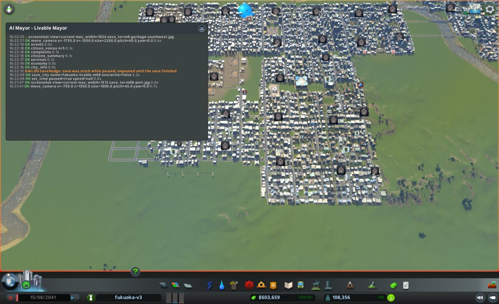
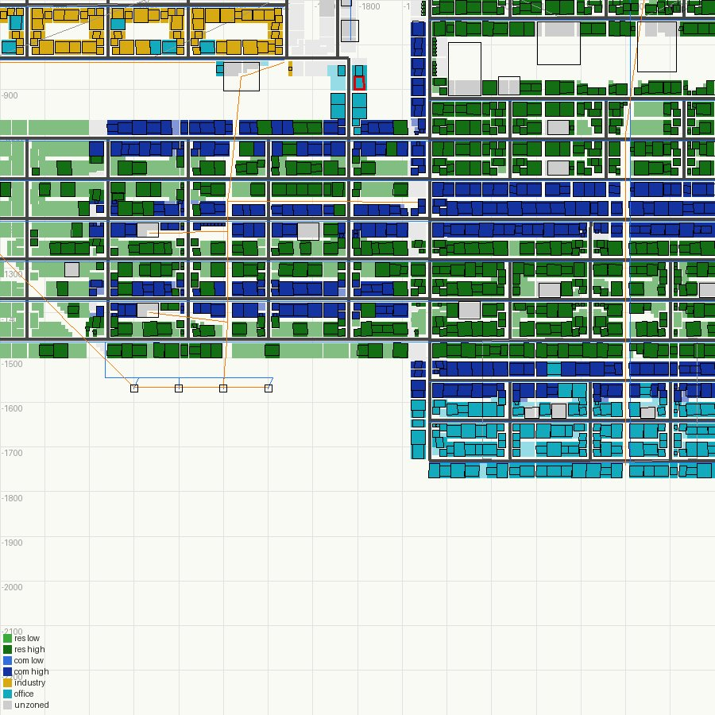

### 2041-08-25 見回り

境目: 当たらず。人口 108,325、幸福度 84(1下がった)、所持金 521,447、週 +6,548、電気・水・下水の来ない市民0。つぶやき2件(学校の祝い、雑談)。

- 貨物港 7336 は出入りの車0、船0。品物なしの印は 351→365。船のつなぎ口は (-4000, 8653)。船が来るまで時間がかかるのか、航路がないのかは、まだ分からない
- 道路のつなぎ口 (5784, -8640) に止まった荷物の車は85台

### 2041-09-04 見回り

境目: 当たらず。人口 108,344、幸福度 84、所持金 531,840、週 +7,379、電気・水・下水の来ない市民0。つぶやき2件(ごみがたまる話、スマートホームの祝い)。

- 貨物港 7336 は置いて20日たっても車0(働き手77人)。船が着いていない。航路が港に届いていない見込み。次の月例で、止めるか取り壊すかを決める

### 2041-09-14 8か月目の終わり(次の月例への引き継ぎ)

月例ではない。親への報告のために、見回りの2つと4つの道具だけ見た。次の月例は、この日付から型どおりに見直す。

- `city_info`: 人口 108,334、幸福度 84、所持金 542,563、週 +7,491、電気・水・下水の来ない市民0。つぶやき0件
- `citizens_summary`: 健康の平均 85、病気 381(月初 444)、体調の悪い市民 193(月初 259)、住民の幸福度の平均 89
- `complaints`: 品物なし 448(月初 351)、ごみ 43(月初 42)、死体 22(月初 20)、汚染 3(月初 5)、火事 3、騒音 2(月初 2)、水 2、電気 1
- 汚染は 5→3。東 (1985、2025, -852) の2棟の印は消えた。残るのは家 1838 (-584, -374) など埋立地の跡のそば
- ごみの印は 42→43。中心は南西 (-1755, -1359) から西 (-1912, -434) の10棟に移った。焼却施設 4249 は収集車31/34台、たまり99%(処理は週60,000)。焼却施設が受け止めきれず、ためた分で手いっぱい
- 埋立地 34558 (-1885, -690) が満杯になった(満杯は 11708 と2か所)
- 品物なしは 351→448 に増えた。貨物港 7336 は30日たっても出入りの車0、船0。道路のつなぎ口 (5783, -8640) に止まった荷物の車は122台
- 電気の印1: 水の処理場 46343 (-1200, 440) に電気が来ていない。下水の容量が 1,600,000→1,440,000 に下がった(使用 1,152,064 なので、まだ足りている)。貨物港を置いたときに取り壊した店が、電気を伝えていたと見る。市長の施策3の取りこぼし。次の月例で、港か近くの建物から送電線を引く

### 2041-09-14 月例(9か月目)

保存: fukuoka-livable-m09

#### 答え合わせ

1. 南西の住宅の南に焼却施設と道路・水道管: 半分当たり
   - 予想: ごみの印が42から20以下、南西 (-1755, -1359) の半径500の印は5以下。結果: 街全体は43(外れ)、南西の半径500は1(当たり)
   - 外れた理由の見立て: 7か月目の北東と同じく、印は片づいた所から隣へ移った。中心は西 (-1912, -434) の10棟。焼却施設 4249 はたまり99%(396,250/400,000)、収集車31/34台。運び込む量が処理(週60,000)を上回り、手いっぱい。西の埋立地 34558 が満杯になり、収集車0/19台になった
   - 次の扱い: 続ける。西にも同じ手を打つ
2. 東の工場の北の行の工業15棟を取り壊し、事務所の区画にする: 当たり
   - 予想: (1985、2025, -852) の2棟の印が消え、街の汚染の印は3以下。結果: 2棟の印は消え、街は3
   - 次の扱い: 続ける(戻さない)
3. 西の住宅地の北の海辺に貨物港: 外れ
   - 予想: 品物なしの印が351から250以下。結果: 448。港の車は30日で0、船0
   - 外れた理由の見立て: 港の船の乗り場の線(Ship Dockway)の先 (-1259, 258)、(-1199, 258) が、どの船の航路(Ship Path)にもつながっていない。半径600mに航路がない。航路は北の (-656, 1744) で行き止まりになっている。前の港 43449 の乗り場へ続いていた所と見る。航路を引く道具はない
   - 次の扱い: 戻さず、航路の行き止まりの近くへ移す(今月の施策1)
- 「次にやること」の実行
  - 港の車の数と出口の詰まり: 見た(車0。出口は詰まりようがない)
  - 焼却施設 4249 の収集車: 見た(31/34台、たまり99%)
  - ごみ・汚染・品物なし・死体の印と、火葬場 24331 の処理の数: 見た。火葬場 24331 は霊柩車9/9台、処理0のまま。隣の 31990 も処理0
  - 港のそばの騒音: 見た。騒音の印2で、港のそばにはない
- 公約の進み具合
  1. 幸福度: 84 / 残り4か月 / あと6。2か月続けて1ずつ下がった。住民だけの平均は89
  2. 健康の平均: 85 / 残り4か月 / 80を超えたまま
  3. 汚染・騒音・ごみの印: 3・2・43 / 残り4か月 / 汚染と騒音は出発点より下。ごみは出発点の4倍

#### 気づいたこと

- 住民の声5人はみな幸福度 Suberb か Excellent、困りごとなし。高層住宅の高学歴・豊かな人ばかり。つぶやき0件
- 印のある建物526棟のうち、品物なしが448棟(85%)。中心は西 (-1240, -738) の216棟。品物の輸入は南東の道路のつなぎ口 (5783, -8640) だけで、止まった荷物の車122台。原料の来ない工場も129棟
- 鉄道の線路は引ける線の一覧にない。品物の入口を増やす手は、港の移しかえだけ
- 東の高層住宅 (1900〜2700, 0〜650) で、車135台が止まっている。Basic Road の6区間が混み具合100。火葬場 24331 と 31990 の霊柩車が出たまま戻らず、処理0。死体の印22棟のうち13棟がこの辺り
- ごみ: 西の埋立地 34558 (-1885, -690) は満杯で収集車0/19台。西の埋立地 20041 72%、23877 83%、42584 87%。焼却施設 4249 の汚染は、敷地から75m で 60〜170、100m より外で0。34558 の敷地から家までは約215m
- 水の処理場 46343 の送電線は、(-1216, 291) で行き止まり。つながった送電線の点 (-1218, 142) まで約150m

#### 施策

1. 貨物港 7336 を、船の航路の行き止まりの近くの岸 (-390, 1420) へ移す
   - 公約: 1(幸福度。品物なしの印は店の幸福度を下げる)
   - 捨てるもの: 週の収支(移す費用 約12,000)
   - 理由: 港は航路につながらず30日で車0。航路は (-656, 1744) で行き止まり。前の港 43449 はこの近くで船が着いていた
   - 予想: 次の月例までに港に船が着き、品物なしの印が448から350以下。港の中に車が1,000台以上並べば外れ
   - 操作: `relocate_building` 7336 (-390, 1420) 東向き(入口を Small 4 Lane Road x≈-343 に向ける)。置けなければ打たない
2. 満杯の埋立地 34558 を取り壊し、跡に焼却施設を置く
   - 公約: 3(ごみの印)
   - 捨てるもの: 週の収支(維持費 約2,160/週、予算150%)
   - 理由: ごみの印の中心は西 (-1912, -434)。34558 は満杯で収集車0台。焼却施設は7・8か月目に置いた所の印を消した
   - 予想: 次の月例で、西 (-1912, -434) の半径500の印が10から3以下。街のごみの印は43から30以下。汚染の印は3から増えない
   - 操作: `bulldoze` (-1885, -690) 半径10 what=building。`place_building` Combustion Plant (-1880, -690) 東向き。水道管を x≈-1815 の管から。建設費 約30,500
- 施策1の結果(施策2の前に打った): 失敗。`relocate_building` が断った(ObjectCollision、HeightTooHigh、CannotConnect)。岸の陸は道路 x≈-343 と海の間で幅約60m しかなく、排水口4つへの送電線 (-420〜-480, 1300〜1535) と港の敷地(120m × 64m)がぶつかる。前の港の跡 (-400, 1555) には排水口 44119、15610 が建っている。費用0。この岸に港を置くには排水口を動かす必要があり、排水口を動かすと川や海が溢れるおそれがある(#82)。今月はここで止める
- 施策1が失敗したので、予定の施策3(水の処理場の送電線、電気の印1棟)を、ごみの印が多く減る手に替えた。印は東 (1936〜1973, -456〜-684) に9棟固まり、近くの埋立地 16097 (2272, -1115) は98%で収集車8/19台。迷ったときは困りごとが多く減るほうを選ぶ

3. 東の工場の南の行 (1900, -976) に焼却施設を置く
   - 公約: 3(ごみの印)
   - 捨てるもの: 週の収支(維持費 約2,160/週)、工場(敷地の工業3棟ほど。汚れの元)
   - 理由: 東の高層住宅の9棟の印。焼却施設は近くの家から約150m離れ、目の前の道路 z=-950 に水道管が通る
   - 予想: 次の月例で、東 (1950, -580) の半径200の印が9から2以下。焼却施設のそばの家に汚染の印は出ない
   - 操作: `place_building` Combustion Plant (1900, -976) 北向き。建設費30,000
- 建設費の合計 約61,000(所持金 542,563 の半分の中)。週の維持費の増え分 約4,320(黒字 +7,491 の中)

#### 実行の結果

1. 貨物港 7336 の移しかえ: 失敗(上に書いたとおり)。費用0。港は元の場所 (-1229, 150) のまま
2. 埋立地 34558 を取り壊した(1棟だけ)。Combustion Plant id 35968 を (-1869, -690) 東向きに置いた。30,000。入口は道路 26277(Basic Road)に接する。取り壊し0。`water_trace` で水・下水はもう来ていた(管は引いていない)。1日後、grid すべて true、収集車2/34台
3. Combustion Plant id 32768 を (1900, -976) 北向きに置いた。30,000。入口は道路 34944(Basic Road)に接する。工場 4059、7507 を取り壊すと返したが、1日後も 7507 は建ったまま(働き手18人)。1日後、grid すべて true、収集車2/34台
- 建設費の合計 60,000

#### 考えたが打たなかった手

- 水の処理場 46343 に送電線 (-1216, 291)〜(-1218, 142): 施策1の失敗で枠を使った。下水の容量は 1,440,000 で使用 1,152,064 の上にある。来月の初めに打つ
- 貨物港 7336 を止める・取り壊す: 週の維持費 約1,920 がむだになっている。ただ取り壊すと戻せない。航路へつなぐ別の手がないかを来月もう一度考え、なければ取り壊す
- 東の高層住宅 (1900〜2700, 0〜650) の渋滞: 車135台が止まり、霊柩車が戻れず死体の印13棟。Basic Road の格子で、1つの手では解けそうにない。来月、詰まりの元の交差点を `traffic` と `junction_info` で調べる
- 南の中心部 (-950, -1150) のごみの印10棟: 東と西の焼却施設の効き目を見てから考える
- 南の埋立地 16097 (98%): 満杯になってから扱う

#### 次にやること

- 見回りで、焼却施設 35968、32768 の収集車の数と、工場 7507 が消えたかを見る
- 次の月例の初めに、水の処理場 46343 に送電線を引く
- 次の月例で、西 (-1912, -434) と東 (1950, -580) のごみの印、焼却施設のそばの汚染の印を見る
- 東の高層住宅の渋滞の元を調べる

#### 画面写真

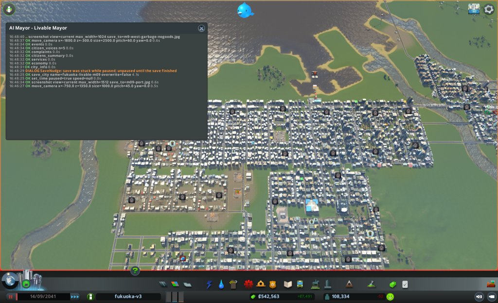

### 2041-09-24 見回り

境目: 当たらず。人口 108,295、幸福度 85(1上がった)、所持金 487,957、週 +3,973、電気・水・下水の来ない市民0。つぶやき2件(断水の苦情、発明の祝い)。

- ごみの印 43→30。中心は遠い東 (3565, 248) の10棟に移った。工場 7507 は消えた
- 汚染の印 3→4。東 (1985、2017, -852) の2棟に印が戻った。新しい焼却施設 32768 から約160m。元が焼却施設か、残る南の工場の行かは、月例で汚染の地図を見る
- 品物なし 448→473

### 2041-10-04 見回り

境目: 当たらず。人口 108,241、幸福度 85、所持金 494,508、週 +4,636、電気・水・下水の来ない市民0。つぶやき2件(電気の網への苦情、リサイクルの祝い)。電気の苦情は、水の処理場 46343 の電気の印と同じ件と見る(市民の数えは0)

### 2041-10-14 9か月目の終わり(次の月例への引き継ぎ)

月例ではない。親への報告のために、見回りの2つと、答え合わせに使う道具だけ見た。次の月例は、この日付から型どおりに見直す。

- `city_info`: 人口 108,094、幸福度 85、所持金 501,430、週 +5,059、電気・水・下水の来ない市民0。つぶやき0件
- `citizens_summary`: 健康の平均 85、病気 306(月初 381)、体調の悪い市民 143(月初 193)、住民の幸福度の平均 89
- `complaints`: 品物なし 531(月初 448)、死体 25(月初 22)、ごみ 24(月初 43)、汚染 4(月初 3)、火事 4、騒音 3(月初 2)、水 2、電気 1
- ごみ: 西 (-1912, -434) の半径500の印は 10→0。東 (1950, -580) の半径200は 9→2。中心は遠い東 (3441, 191) の10棟(戸建てと診療所)に移った
- 汚染: 東 (1993、2009, -852) の家に印。汚染の地図で、z=-880 の行が135〜255、その南 (1810〜2110, -920〜-1080) の工場の行は全部255。元は残る南の工場の行と見る。焼却施設 32768 もこの中にある
- 品物なしは 448→531 と増え続ける。貨物港 7336 は車0のまま
- 水の処理場 46343 は電気なしのまま(施策を打っていない)

### 2041-10-14 月例(10か月目)

保存: fukuoka-livable-m10

#### 答え合わせ

1. 貨物港 7336 を航路の行き止まりの近くへ移す: 外れ(実行できず)
   - 予想: 船が着き、品物なしの印が448から350以下。結果: 移せず、港は車0のまま。品物なし531
   - 外れた理由の見立て: 岸の陸が狭く、排水口と送電線にぶつかる。航路を引く道具もない
   - 次の扱い: 港はどこにもつながらないまま、週の維持費 約1,920 を使っている。取り壊すかを今月考える
2. 満杯の埋立地 34558 を取り壊し、跡に焼却施設 35968: 当たり
   - 予想: 西 (-1912, -434) の半径500の印が10から3以下、街のごみの印が43から30以下、汚染の印は3から増えない
   - 結果: 西の半径500は0、街のごみの印は24。汚染の印は4に増えたが、増えたのは東 (2000, -852) で、西ではない
   - 次の扱い: 続ける
3. 東の工場の南の行に焼却施設 32768: 半分当たり
   - 予想: 東 (1950, -580) の半径200の印が9から2以下、焼却施設のそばの家に汚染の印は出ない
   - 結果: 印は2(当たり)。焼却施設から約100〜160m北の家 7760、16147 に汚染の印が出た
   - 外れた理由の見立て: 汚染の地図で、z=-890 より南は x=1830〜2150 のどこも255。焼却施設だけでなく、残る工場の行 z≈-970 が元と見る
   - 次の扱い: 続ける。工場の行を取り壊す(今月の施策3)
- 「次にやること」の実行
  - 焼却施設 35968、32768 の収集車と工場 7507: 見回りで見た(7507 は消えた)
  - 水の処理場 46343 に送電線: 9か月目の月中には打っていない。今月の施策1で打つ
  - 西と東のごみの印、焼却施設のそばの汚染: 見た(上)
  - 東の高層住宅の渋滞の元: 調べていない。今月も施策の枠が足りない
- 公約の進み具合
  1. 幸福度: 85 / 残り3か月 / あと5。住民だけの平均は89
  2. 健康の平均: 85 / 残り3か月 / 80を超えたまま
  3. 汚染・騒音・ごみの印: 4・3・24 / 残り3か月 / ごみは出発点 11 の2倍。汚染と騒音は出発点より下

#### 気づいたこと

- 住民の声5人はみな幸福度 Suberb、困りごとなし。1人は7週の失業(公約の外)。つぶやき0件
- 印のある建物597棟のうち、品物なしが531棟(89%)。中心は西 (-1807, -137)。品物の輸入は南北の道路のつなぎ口だけで、南東のつなぎ口に荷物の車120台が止まっている。船の航路も線路も引けず、市長の道具では入口を増やせない
- ごみの印24棟のうち10棟は遠い東 (3441, 191) の戸建て。近くの埋立地4か所(7741、18626、41982、44233)は収集車18〜19/19台で、みな出払っている。5・7か月目に取り壊した埋立地 40118、4946 があった辺りで、収集の手が抜けた所と見る
- 東の行き止まりの道路 z=580 (3440〜3640) の東は空き地。水道管の端 (3650, 590) がある。家からは約160m以上離れる
- 汚染4棟のうち2棟は東 (2000, -852) の高層住宅。南の工場の行 z≈-966〜-974 (x=1858〜2152) は工業約10棟。焼却施設 32768 も同じ行にある
- 死体の印25棟のうち14棟は東の高層住宅 (2390, 241)。先月の渋滞と同じ所
- 電気・水・下水の来ない市民0。水の処理場 46343 だけ電気の印1

#### 施策

1. 水の処理場 46343 に送電線を引く
   - 公約: 1(幸福度。電気の印のある建物を0にする)、下水の容量を戻す
   - 捨てるもの: なし
   - 理由: 8か月目の取りこぼし。送電線の行き止まり (-1216, 291) から、つながった点 (-1218, 142) まで約150m
   - 予想: 次の見回りで電気の印が0、下水の容量が 1,440,000 から 1,600,000 に戻る
   - 操作: `build_line` Power Line。建設費 約380、週の維持費 約9
2. 東の行き止まりの道路の先に焼却施設を置く
   - 公約: 3(ごみの印)
   - 捨てるもの: 週の収支(維持費 約2,160/週、予算150%。黒字 +5,059 の中)
   - 理由: 東 (3441, 191) のごみの印10棟。近くの埋立地4か所の収集車は出払っている。焼却施設は7〜9か月目に置いた所の印を消した
   - 予想: 次の月例で、東 (3441, 191) の半径500の印が10から3以下、街のごみの印が24から15以下。焼却施設のそばの家に汚染の印は出ない
   - 操作: 道路 z=580 を (3640)〜(3750) へ延ばす。`place_building` Combustion Plant (3695, 627) 南向き。建設費 約30,600
3. 南の工場の行 z≈-970 の工業を取り壊し、事務所の区画にする
   - 公約: 3(汚染の印)、2(健康)
   - 捨てるもの: 工場(汚れの元)、働き口
   - 理由: 汚染の印の家 7760、16147 の南。地面の汚染は z=-890 より南で255。焼却施設 32768 と事務所は残す
   - 予想: 次の月例で、東 (2000, -852) の汚染の印2棟が消え、街の汚染の印は4から2以下
   - 操作: 工業の建物ごとに `bulldoze`(what=building、半径6)。その後 `zone_polygon` で office
- 建設費の合計 約31,000(所持金 501,430 の半分の中)。週の維持費の増え分 約2,170

#### 実行の結果

1. 送電線: 2区間、費用360。両端とも既存の送電線の点につながった。1日後、水の処理場 46343 の grid.electricity=true、印なし
2. 焼却施設: 道路 z=580 の東への延長は、診療所 2466 (3622, 558) の敷地にぶつかり、3通り試して断られた(建てていない)。場所を替えた
   - 道路を (3800, 260)〜(3800, 430) に北へ延ばした。費用840
   - Combustion Plant id 45815 を (3848, 375) 西向きに置いた。30,000。入口が道路から32m離れていたので、(3825, 375) へ移した。6,000
   - 水道管を (3795, 255)〜(3795, 375)〜(3825, 375) に引いた。費用400
   - 1日後、grid すべて true、収集車3/34台。最寄りの家 (約3780, 237) から約120m。東 (3441, 191) からは約420m
3. 工場の行: 工業10棟(9276、28436、22481、41542、23708、28088、5767、38459、36203、28909)を1棟ずつ取り壊した。事務所 26535 と焼却施設 32768 は残した。費用0。`zone_polygon` (1845〜2175, -950〜-1000) を office に。95マスを変え、建物のある46マスは飛ばした。`zones_at` で半径60の中は事務所93マス(空き72)。1日後、半径250に電気の印の建物0
- 建設費の合計 37,600(予定より約6,600多い。移しかえの分)

#### 考えたが打たなかった手

- 品物なし531棟への手当て: 輸入の入口は南北の道路のつなぎ口だけ。船の航路も線路も引けず、市長の道具では打つ手がない。幸福度の公約には響くが、今月は印を確実に減らせる手を先にした
- 貨物港 7336 を取り壊す: つながらないまま維持費 約1,920/週。取り壊すと週の黒字が戻る。ただ公約に直接は効かず、施策の枠を使い切った。来月、黒字が細れば打つ
- 東の高層住宅 (2390, 241) の死体の印14棟と渋滞: 先月から調べていない。原因の交差点を決めずに道路を変えると、詰まりを広げるおそれ
- 2列目の工場の行 z≈-1030: 汚染の印の家から約180m。今月の1列目の効き目を見てから

#### 次にやること

- 見回りで、焼却施設 45815 の収集車の数と、東 (3441, 191) のごみの印を見る
- 見回りで、取り壊した工場の行の周りに電気の印が出ていないかを見る
- 次の月例で、東 (2000, -852) の汚染の印と地面の汚染の地図を見る
- 週の黒字が2,000を下回ったら、貨物港 7336 の取り壊しを最初に考える

#### 画面写真

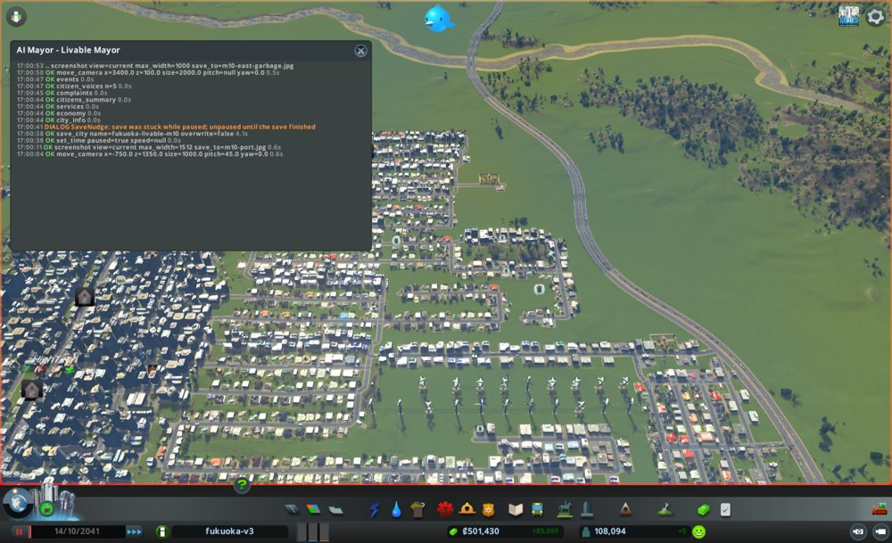
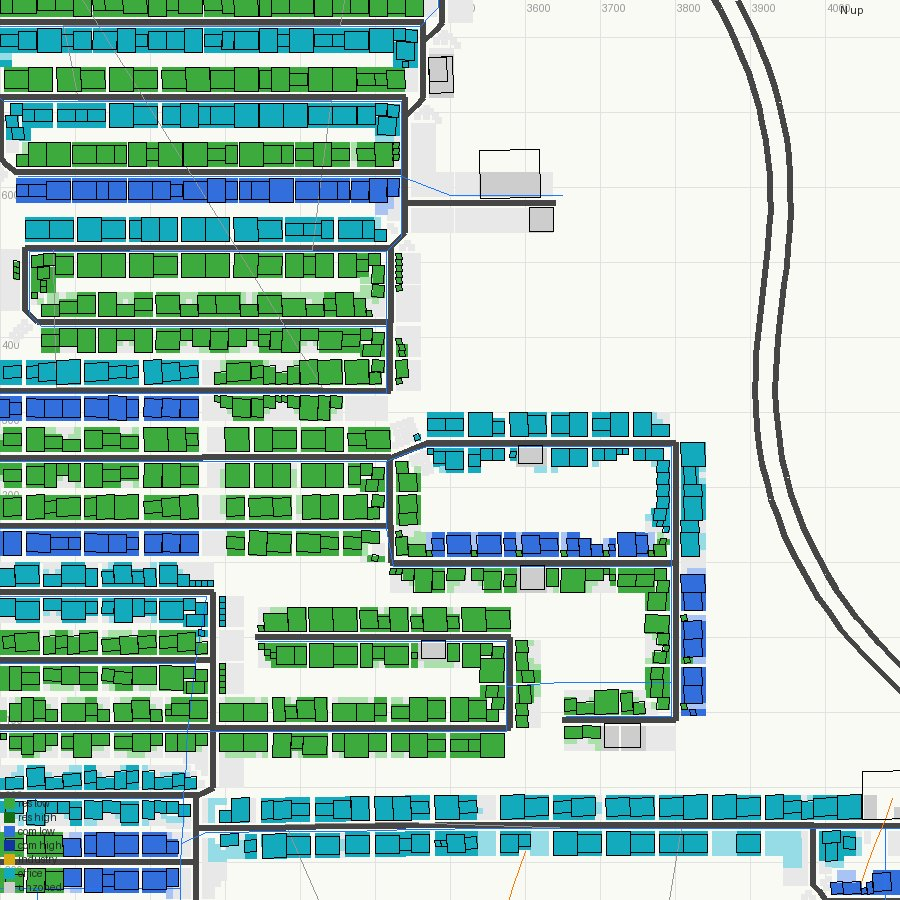

### 2041-10-24 見回り

境目: 当たらず。人口 107,786、幸福度 85、所持金 469,366、週 +3,945、電気・水・下水の来ない市民0。つぶやき2件(禁煙の祝い、街をほめる声)。

- 焼却施設 45815 は収集車18/34台、たまり13%。東 (3441, 191) の半径500のごみの印は 10→1(家 26525)

### 2041-11-03 見回り

境目: 当たらず。人口 107,705、幸福度 85、所持金 475,096、週 +3,970、電気・水・下水の来ない市民0。つぶやき2件(旅行の礼、禁煙の祝い)。

### 2041-11-13 10か月目の終わり(次の月例への引き継ぎ)

月例ではない。親への報告のために、見回りの2つと、答え合わせに使う道具だけ見た。次の月例は、この日付から型どおりに見直す。

- `city_info`: 人口 107,550、幸福度 85、所持金 481,357、週 +4,379、電気・水・下水の来ない市民0。つぶやき0件
- `citizens_summary`: 健康の平均 85、病気 251(月初 306)、体調の悪い市民 114(月初 143)、住民の幸福度の平均 89
- `complaints`: 品物なし 587(月初 531)、死体 33(月初 25)、ごみ 15(月初 24)、火事 4、汚染 1(月初 4)、騒音 1(月初 3)、水 2。電気の印は0(月初 1)
- ごみ: 中心は (3475, -43) の6棟。焼却施設 45815 の南約400m。小学校 2030 (3730, -130) と事務所 (3495〜3523, -506) を含む
- 汚染: 東 (2000, -852) の2棟の印は消え、隣の家 39063 (2017, -852) の1棟が残る
- 死体: 25→33。中心は東の高層住宅 (2514, 265) の20棟。施策を打っていない所で増えた
- 品物なし: 531→587 と増え続ける

### 2041-11-13 月例(11か月目)

保存: fukuoka-livable-m11

#### 答え合わせ

1. 水の処理場 46343 に送電線: 当たり
   - 予想: 電気の印が0、下水の容量が 1,600,000 に戻る。結果: 電気の印0、下水の容量 1,600,000
   - 次の扱い: 続ける
2. 東の行き止まりの道路の先に焼却施設 45815: 当たり
   - 予想: 東 (3441, 191) の半径500の印が10から3以下、街のごみの印が24から15以下、そばの家に汚染の印なし
   - 結果: 半径500の印は3((3480, 24)、(3709, -86)、小学校 (3730, -130))、街は15、汚染の印は東 (3800, 300) の辺りに0
   - 次の扱い: 続ける。焼却施設は働き手22人、処理は週31,200(ほかの焼却施設の約半分)、収集車23/34台
3. 南の工場の行 z≈-970 の工業10棟を取り壊す: 当たり
   - 予想: 東 (2000, -852) の印2棟が消え、街の汚染の印が4から2以下。結果: 7760、16147 の印は消え、街は1(隣の家 39063)
   - 次の扱い: 続ける(戻さない)
- 「次にやること」の実行
  - 焼却施設 45815 の収集車と東のごみの印: 見回りで見た(10→1)
  - 取り壊した工場の行の周りの電気の印: 月末に見た(0)
  - 東 (2000, -852) の汚染の印と地図: 今月見た(下)
  - 週の黒字が2,000を下回ったら港の取り壊し: 下回らなかった(+3,945〜+4,379)。打たない
- 公約の進み具合
  1. 幸福度: 85 / 残り2か月 / あと5。住民だけの平均は89
  2. 健康の平均: 85 / 残り2か月 / 80を超えたまま
  3. 汚染・騒音・ごみの印: 1・1・15 / 残り2か月 / 汚染と騒音は0まであと1ずつ。ごみは出発点 11 より多い

#### 気づいたこと

- 住民の声5人はみな幸福度 Suberb、困りごとなし。2人は失業(1週と7週。公約の外)。つぶやき0件
- 印のある建物647棟のうち、品物なしが587棟(91%)。荷物の車1,280台のうち品物は輸入251・街の中334。輸入は地図の南東と北東の端の道路のつなぎ口だけで、南東のつなぎ口に121台が止まる。原料の来ない工場も151棟。今月も市長の道具で入口は増やせない
- 死体の印33棟のうち20棟は東の高層住宅 (2514, 265)。半径600の中で車614台のうち281台が止まり、流れ61%。止まった所は (2096, 302) 53台、(2492, 307) 37台、(2658, 499) 31台、(2145, 498) 30台。どれも Basic Road(片側1車線)の区間で、間をつなぐ Small 4 Lane Road(片側2車線)は空いている。火葬場 24331 は霊柩車9/9台、31990 は8/9台で出払う
- ごみの印15棟のうち3棟 (2498〜2557, 126〜264) も同じ渋滞の中
- 汚染: 印は家 39063 (2017, -852) の1棟。地面の汚染は z=-850 の行で x=2030 より東は90〜110 に下がった。南の工場の2列目 z≈-1030〜-1070 は255のまま
- 騒音: 印は家 28969 (3976, -439) の1棟。騒音の地図で、西隣 (3826, -389) が281。そこは風車4基(4630、17521、20972、30414)。電気は容量 1,673,648 に使用 922,112 で、余りが大きい

#### 施策

1. 東の高層住宅の詰まった Basic Road を Small 4 Lane Road に差し替える
   - 公約: 1(幸福度。死体とごみの印は家の幸福度を下げる)
   - 捨てるもの: なし
   - 理由: 死体の印20棟とごみの印3棟が、車281台の止まった格子の中にある。止まった所はみな片側1車線の区間。Small 4 Lane は Basic と同じ幅・同じ値段で、区画を壊さない見込み
   - 予想: 次の月例で、半径600の止まった車が281から150以下、東 (2514, 265) の死体の印が20から10以下、街の死体の印が33から25以下
   - 操作: `upgrade_road` で x=2110 (z 150〜330)、z=330 (x 1825〜2200)、x=2152 (z 330〜740)、x=2450 (z −75〜330)、x=2668 (z 330〜740) の Basic Road を差し替える。費用は差額0の見込み。維持費は同じ
2. 騒音の元の風車4基を止める
   - 公約: 3(騒音の印)、2(健康。騒音は病気のもと)
   - 捨てるもの: なし(電気は余っている)
   - 理由: 騒音の印1棟の西隣が騒音281で、そこにあるのは風車4基だけ。取り壊しではなく止めれば、戻せる
   - 予想: 次の月例で騒音の印が1から0。電気の来ない市民は0のまま
   - 操作: `set_building_active` 4630、17521、20972、30414 を false

#### 実行の結果

1. 道路の差し替え: 5本の線で、選んだ33区間のうち31区間を Small 4 Lane Road にした。費用0。x=2450 の2区間(5866、16564、z 15〜105)は ObjectCollision で飛ばした。`zonesKept` true。x=2110 の沿道の11棟は残っていた
   - 1日後、半径600の止まった車は 281→116、混み具合の平均 32→21。流れ 61→62%。止まった所は (2490, 307) 36台、(2300, 324) 28台、(2665, 468) 23台。いちばん混む区間は x=2630〜2668, z=740〜804 の残りの Basic Road
2. 風車4基を止めた。4基とも active=false(印は TurnedOff)。1日後、騒音の地図の最大は 281→104(家 28969 の西 (3901, -439))。家 28969 の騒音の印はまだ残る
- 建設費の合計 0。週の維持費の増え分 0(風車の維持費の分は減る)

#### 考えたが打たなかった手

- 南の工場の2列目 z≈-1030〜-1070 の工業約25棟を取り壊す: 汚染の印は家 39063 の1棟だけで、その場所の地面の汚染は先月の取り壊しの後 255→約100 に下がっている。品物を作る工場をさらに減らすと、品物なしの印が増えるおそれ。来月まで待つ
- 品物なし587棟への手当て: 輸入の入口は地図の端の道路だけ。船の航路も線路も引けない。先月と同じく打つ手がない
- ごみの印15棟: 焼却施設4つの後、24→15と減り続けている。3棟は今月の道路の差し替えの中。残りは街に散らばり、1か所の手では減らない
- 貨物港 7336 の取り壊し: 週の黒字は +4,379 で、細っていない。公約に効かない
- 施策の枠は1つ残した。準備のない手を足すと、答え合わせがしにくい

#### 次にやること

- 見回りで、電気の来ない市民が増えていないか(風車を止めた分)を見る
- 見回りで、東の高層住宅の止まった車と死体の印を見る
- 次の月例で、騒音の印(家 28969)と汚染の印(家 39063)が0になったかを見る。汚染が残れば、2列目の工場を考える
- 任期の最後の月なので、公約の結果と申し送りを書く

### 2041-11-23 見回り

境目: 当たらず。人口 107,498、幸福度 85、所持金 489,221、週 +5,453、電気・水・下水の来ない市民0。つぶやき2件(死体のにおい、スマートホームの祝い)。

- 死体の印は 33→41、東の高層住宅 (2487, 256) は 20→24。道路の差し替えの後も増えた
- 騒音の印は 1→3。風車の東の家 28969 の印は消えた。新しい印は東 (1886, -30) の高層住宅2棟(3か月目と同じ、高密度商業のそば)
- ごみの印は 15→14。中心は南西 (-1346, -1308)

### 2041-12-03 見回り

境目: 当たらず。人口 107,369、幸福度 85、所持金 497,553、週 +5,859、電気・水・下水の来ない市民0(風車を止めた後も0)。つぶやき1件(行政のオンライン化)。

### 2041-12-13 11か月目の終わり(次の月例への引き継ぎ)

月例ではない。親への報告のために、見回りの2つと、答え合わせに使う道具だけ見た。次の月例は、この日付から型どおりに見直す。

- `city_info`: 人口 107,209、幸福度 85、所持金 505,494、週 +5,444、電気・水・下水の来ない市民0。つぶやき2件(禁煙への不満、放棄された家の苦情)
- `citizens_summary`: 健康の平均 85、病気 216(月初 251)、体調の悪い市民 112(月初 114)、住民の幸福度の平均 89
- `complaints`: 品物なし 621(月初 587)、死体 50(月初 33)、ごみ 10(月初 15)、火事 4、教育のある働き手なし 4、水 2、汚染 1(月初 1)、騒音 0(月初 1)
- 騒音: 0。風車の東の家 28969 の印は消えた。11-23 に出た東 (1886, -30) の2棟も消えた
- 汚染: 1。家 39063 (2017, -852) の印は消え、別の家 40587 (3412, 644) に出た。2月に取り壊した埋立地の跡のそば (3428, 648) で、8か月目にも印があった所
- 死体: 33→50。東の高層住宅 (2472, 256) は 20→31。半径600の止まった車は、差し替えの1日後 116 から、月末に 273 へ戻った。いちばん混む区間は差し替えた x=2110 (z 213) と、その南の差し替えていない Basic Road x=2110 (z 34)、Medium Road x=2200 (z −139)。止まった所は (2479, 297) 54台、(2095, 288) 41台、(2660, 501) 32台。車線を足しても、格子の出口(南の x=2110、x=2200)で詰まる見込み
- ごみ: 15→10。中心は南西 (-988, -1256) の4棟

### 2041-12-13 月例(12か月目)

保存: fukuoka-livable-m12

#### 答え合わせ

1. 東の高層住宅の Basic Road 31区間を Small 4 Lane Road に差し替える: 外れ
   - 予想: 止まった車が281から150以下、東 (2514, 265) の死体の印が20から10以下、街の死体の印が33から25以下
   - 結果: 止まった車は1日後に116、月末に273。東の死体の印は31、街は50
   - 外れた理由の見立て: 格子の中の車線を足しても、格子の出口が細いまま。混み具合100の区間に、差し替えていない x=2110 (z −165〜105) の Basic Road と、Medium Road x=2200 (z −139) が入る。火葬場6か所の霊柩車はみな出払い(9/9)、処理は週0〜34
   - 次の扱い: 続ける。出口の x=2110 の Basic Road を差し替える(今月の施策2)
2. 騒音の元の風車4基を止める: 当たり
   - 予想: 騒音の印が1から0、電気の来ない市民は0のまま。結果: 騒音0、電気の来ない市民0(電気は容量 1,647,648 に使用 927,600)
   - 次の扱い: 続ける(止めたまま)
- 「次にやること」の実行
  - 風車を止めた後の電気の来ない市民: 見回りで見た(0)
  - 東の高層住宅の止まった車と死体の印: 見回りと月末に見た(上)
  - 騒音の印と汚染の印: 見た。騒音0。汚染は家 39063 の印が消え、家 40587 (3412, 644) に1棟
  - 公約の結果と申し送り: 今月の終わりに書く
- 公約の進み具合
  1. 幸福度: 85 / 残り1か月 / あと5。住民だけの平均は89。7か月目から84〜85で動かない
  2. 健康の平均: 85 / 残り1か月 / 80を超えたまま
  3. 汚染・騒音・ごみの印: 1・0・10 / 残り1か月 / 騒音は0。汚染はあと1。ごみは出発点 11 を下回った

#### 気づいたこと

- 住民の声5人はみな幸福度 Suberb、健康も Excellent か VeryHealthy、家の困りごとなし。2人は7週の失業(公約の外)。つぶやき0件
- 印のある建物690棟のうち、品物なしが621棟(90%)。中心は西 (-1836, -129) の224棟。今月も輸入の入口を増やす道具がない。幸福度が85で止まっている主な元と見るが、手が届かない
- 死体の印50棟のうち31棟が東の高層住宅 (2472, 256)。半径600で車709台のうち273台が止まり、流れ62%。火葬場 24331、31990、23747、21324、17188 はどれも霊柩車9/9台で、ためた死体は0。霊柩車が渋滞の中にいる
- ごみの印10棟のうち4棟は南 (-988, -1256)。半径700の中にごみの施設がない。いちばん近い焼却施設 4249 (-1770, -1756) と 35968 (-1869, -690) は約800m 離れ、収集車32〜33/34台で出払う。住宅地の東 x≈-880 より東は、建物のない平らな草地(高さ58m、水なし)
- 汚染の印1棟(家 40587)の地面の汚染は45。2月に取り壊した埋立地の跡で、元はもうない。下がるのを待つしかない

#### 施策

1. 南の住宅地の東の草地に焼却施設を置く
   - 公約: 3(ごみの印)
   - 捨てるもの: 週の収支(維持費 約2,160/週、予算150%。黒字 +5,444 の中)
   - 理由: 南 (-988, -1256) のごみの印4棟。半径700にごみの施設がない。焼却施設は7〜10か月目に置いた所の印を消した
   - 予想: 次の月例の時点(2042-01-12ごろ)で、南 (-988, -1256) の半径300の印が4から1以下、街のごみの印が10から7以下。焼却施設のそばの家に汚染の印は出ない
   - 操作: 道路 x=-920 の (−920, −1125) から東へ (−740, −1125) まで Basic Road。`place_building` Combustion Plant を道路の南 (−760, −1160) 北向き。水道管を既存の管 (−920, −1195) から。建設費 約31,500
2. 東の高層住宅の出口 x=2110 (z −165〜105) の Basic Road を Small 4 Lane Road に差し替える
   - 公約: 1(幸福度。死体の印は家の幸福度を下げる)
   - 捨てるもの: なし
   - 理由: 混み具合100の区間 20592 と、止まった車23台の (2109, 159) がこの道の上。先月差し替えた北の区間の続き
   - 予想: 次の月例で、東 (2400, 300) の半径600の止まった車が273から200以下、街の死体の印が50から40以下
   - 操作: `upgrade_road` (2110, 150)〜(2110, −170)。費用は差額0の見込み

- 建設費の合計 約31,500(所持金 505,494 の半分の中)。週の維持費の増え分 約2,160

#### 実行の結果

1. 焼却施設: Basic Road (-920, -1125)〜(-740, -1125) を引いた。960。始点は道路 x=-920 の区間を分けてつながった。Combustion Plant id 23831 を (-770, -1160) 北向きに置いた。30,000。入口は道路 9877 に接する(11m)。取り壊し0。水道管 (-920, -1195)〜(-770, -1195)〜(-770, -1170) を引いた。420。始点は既存の管の点につながり、終点は焼却施設の敷地の中
   - 1日後、grid は電気・水・下水すべて true、収集車2/34台。`net_reach` で入れない・出られない区間と建物は0
2. 道路の差し替え: x=2110 (z 150〜−170) の7区間を Small 4 Lane Road にした。費用0、飛ばした区間0、`zonesKept` true
   - 1日後、半径600の止まった車 273→238、流れ 62→59%。混み具合100の区間は、z=330 と x=2450 の交わり、x=2110 (z 303)、x=2152 (z 587)。止まった所は (2092, 290) 43台、(2502, 315) 34台
- 建設費の合計 31,380。週の維持費の増え分 約2,160

#### 考えたが打たなかった手

- 品物なし621棟への手当て: 輸入の入口は地図の端の道路だけで、船の航路も線路も引けない。11か月目と同じく打つ手がない
- 品物なしの店を取り壊す: 印は消えるが、住民の買い物の先を減らす。市民の暮らしを良くする手ではなく、数字だけを動かす手なので打たない
- 汚染の印の家 40587 (3412, 644): 地面の汚染45は埋立地の跡の名残で、元はもうない。家を壊せば印は消えるが、住民を追い出す手なので打たない
- 住宅の税を下げる(幸福度): 住宅の税収は週 148,914。1ポイント下げても週 約17,000減り、黒字 +5,444 を超えて赤字になる
- 東の高層住宅の z=330 と x=2450 の交わり (2450, 285〜330) の短い区間の詰まり: 21m と22m の区間が続く交差点の組み直しは、1か月で効き目を確かめられない。差し替えの効き目を先に見る
- 施策の枠を1つ残した。最後の月で、答え合わせのできない手を足さない

#### 次にやること

- 見回りで、焼却施設 23831 の収集車の数と、南 (-988, -1256) のごみの印を見る
- 見回りで、東の高層住宅の止まった車と死体の印を見る
- 月の終わりに、公約の結果と申し送りを書く

#### 画面写真

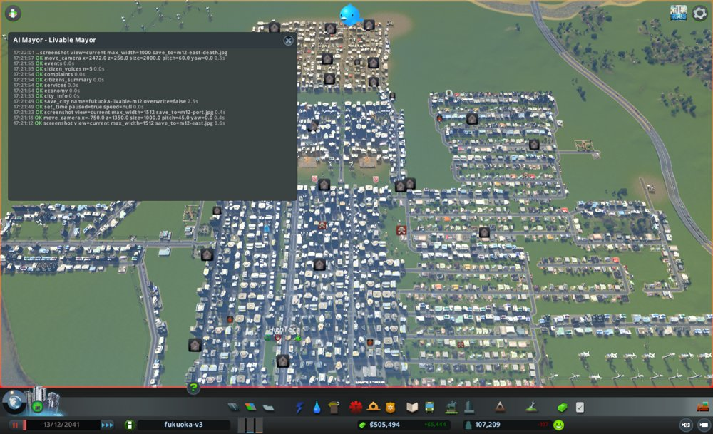
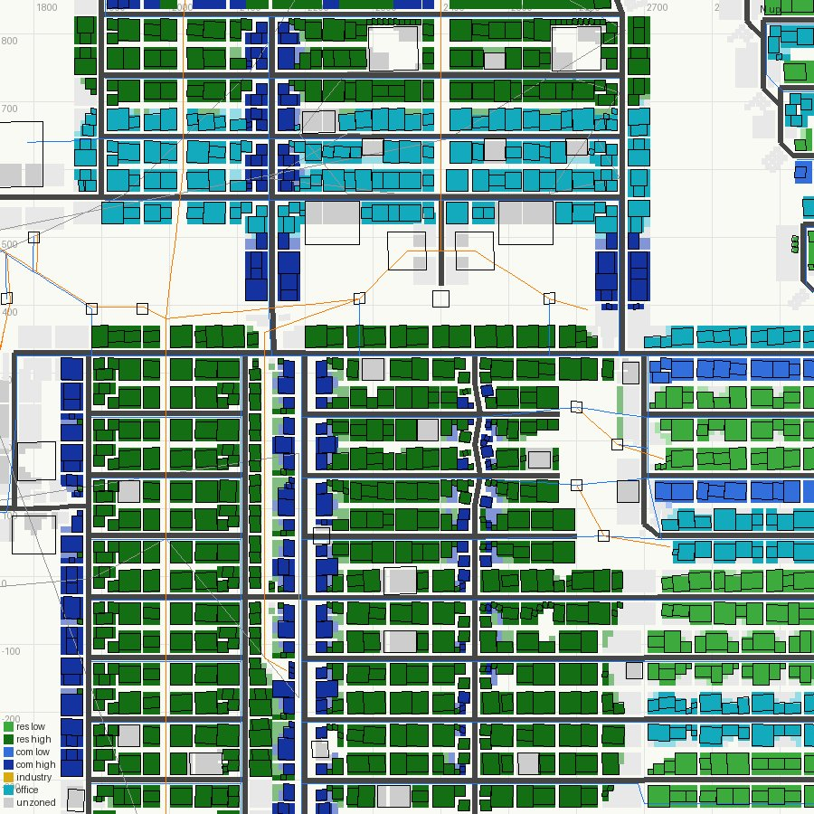
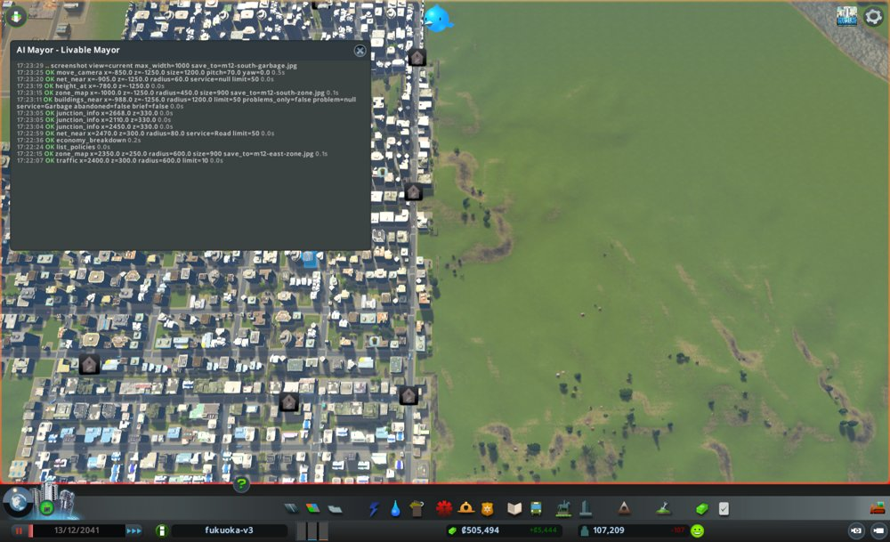
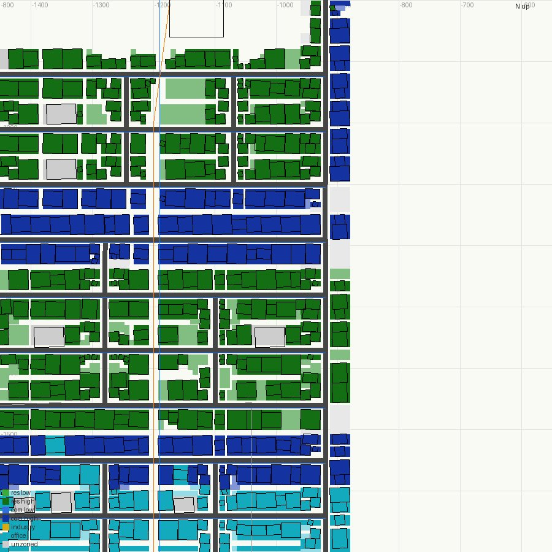

### 2041-12-23 見回り

境目: 当たらず。人口 107,072、幸福度 86(1上がった)、所持金 478,866、週 +3,596、電気・水・下水の来ない市民0。つぶやき0件。

- 焼却施設 23831 は働き手19人、収集車2/34台、たまり4%(18,350)。南 (-988, -1256) の半径300のごみの印は 4→2((-1004, -1436)、(-976, -1436))

### 2042-01-02 見回り

境目: 当たらず。人口 107,037、幸福度 86、所持金 484,594、週 +4,176、電気・水・下水の来ない市民0。つぶやき2件(裏庭の光る泥、スマートホームの祝い)。光る泥は汚染の話で1件だけなので、境目の3件に届かない

### 2042-01-12 任期の終わり(12か月目の終わり)

月例ではない。任期の最後なので、見回りの2つと、公約を測る道具だけ見た。施策は打っていない。

- `city_info`: 人口 107,136、幸福度 86、所持金 491,241、週 +4,655、電気・水・下水の来ない市民0。つぶやき1件(木と防音壁で交通の騒音が減るという話)
- `citizens_summary`: 健康の平均 85、病気 206(月初 216)、体調の悪い市民 108(月初 112)、住民の幸福度の平均 89
- `complaints`: 品物なし 669(月初 621)、死体 35(月初 50)、火事 6、教育のある働き手なし 4、水 2、汚染 2(月初 1)、ごみ 2(月初 10)、騒音 1(月初 0)、地価が低い 2、客なし 1、犯罪 1
- 施策1の答え合わせ(当たり): 予想は南 (-988, -1256) の半径300の印が1以下、街のごみの印が7以下。結果は半径300で0、街で2。印は (385, -554) などに散らばる
- 施策2の答え合わせ(当たり): 予想は半径600の止まった車が200以下、街の死体の印が40以下。結果は止まった車133、死体の印35。東の高層住宅 (2500, 156) には23棟が残る
- 汚染: 2。印は東 (1977、2009, -852) の家2棟に戻った。10か月目に一度消えた所。南の2列目の工場の行 z≈-1030〜-1070 が残る
- 騒音: 1。印は東端の家 23608 (3976, -370)。11か月目に風車を止めて消えた家 28969 の隣
- 品物なしは 621→669 と、任期を通して増え続けた
- 騒音の元の見立て: 家 23608 の西に、まだ動いている風車2基(32254 (3920, -450)、34043 (3920, -375))がある。11か月目に止めた4基の東隣で、見落とした。騒音の地図は (3880〜3920, -400) で 103〜107

## 人が手を入れたこと

- 2026-10-23 11:30(実時間): 画面の録画を始めた
- 1か月目の前: 親がパネルの見出しを `AI Mayor - Livable Mayor` にし、定点の写真3枚を `assets/fixed/m01-*.jpg` に撮った
- 1か月目の後: 親が `fukuoka-livable-m01-end`(2041-02-16)に保存し、パネルのログを `command-log-m01.txt` に写した。1か月目の2回目のために `fukuoka-livable-m01` を読み込み直すと、1回目の終わりの街が消えるため。2か月目はこの保存から続ける
- 2026-10-23 11:49(実時間): 1か月目の2回目を走らせた(`m01-retry/`)
- 2026-10-23 12:13(実時間): 人が `fukuoka-livable-m01-end` を読み込み、録画を始めた。読み込んだ街の日付は 2041-02-15 と出たが、人口と所持金は1回目の終わりと同じ。親が見出しを戻し、定点の写真3枚を `assets/fixed/m02-*.jpg` に撮った
- 6か月目の後: 録画を圧縮するため一度止めた。親が `fukuoka-livable-m06-end`(2041-07-15)に保存し、パネルのログを `command-log-m02-m06.txt` に写した。7か月目はこの保存から続ける
- 2026-10-23 13:33(実時間): 人が `fukuoka-livable-m06-end` を読み込み、録画を始めた。親が見出しを戻し、定点の写真3枚を `assets/fixed/m07-*.jpg` に撮った
- 7か月目の後: 空き容量が足りなくなりそうだったため、人が録画を止めた。親が録画を圧縮し、`fukuoka-livable-m07-end`(2041-08-15)に保存した
- 2026-10-23 16:21(実時間): 録画を始め直した(ゲームは閉じていない)。親が見出しを戻し、定点の写真3枚を `assets/fixed/m08-*.jpg` に撮った。これから毎月、月の前に空き容量を確かめる
- 12か月目の後: 親が `fukuoka-livable-m12-end`(2042-01-12)に保存し、パネルのログを `command-log-m08-m12.txt` に写した。7か月目のログ(13:31〜)はゲームを読み込み直したため別のファイルになっていて、写し忘れていた。後で `command-log-m07.txt` として足した
- 12か月目だけ、呼ぶ文に「これが最後の月です。公約の結果と申し送りを書いてください」と足した(ほかの3人と同じ)

### 月ごとの実時間とトークン

| 月 | 実時間 | トークン | 道具の呼び出し |
|---|---|---|---|
| 1 | 8分59秒 | 103,544 | 61 |
| 2 | 9分02秒 | 104,771 | 57 |
| 3 | 11分17秒 | 121,671 | 87 |
| 4 | 11分05秒 | 119,106 | 114 |
| 5 | 10分01秒 | 148,277 | 85 |
| 6 | 8分15秒 | 119,996 | 64 |
| 7 | 14分11秒 | 131,687 | 67 |
| 8 | 23分38秒 | 161,917 | 114 |
| 9 | 11分08秒 | 160,500 | 91 |
| 10 | 10分22秒 | 138,549 | 83 |
| 11 | 8分59秒 | 151,509 | 72 |
| 12 | 10分05秒 | 144,160 | 81 |

## 公約の結果

任期の終わり(2042-01-12)の数字で書く。

1. 幸福度を 90 以上にする: 守れなかった。82 → 86
   - 1か月目に病院と禁煙で 82→86 に上がった。その後は11か月、84〜86 から動かなかった
   - 守れなかった理由の見立て: 印のある建物724棟のうち669棟(92%)が品物なしの店。店の幸福度が街の平均を押し下げた。品物の入口(貨物港、線路)を増やす手は、港が船の航路につながらず、線路は引けず、届かなかった。汚れの元の工場を取り壊したことも、品物を減らした恐れがある
   - 住民だけの平均は89で、住民の声は12か月を通してほぼみな Suberb だった
2. 健康の平均を 80 以上にする: 守れた。70 → 85
   - 1か月目の病院と診療所(西・南西)と禁煙で85に上がり、任期の終わりまで保った。病気は 853 → 206
3. 汚染、騒音、ごみの印を 0 にする: 守れなかった。汚染 9→2、騒音 6→1、ごみ 11→2
   - 3つとも出発点より減った。どれも0には届かなかった
   - 汚染: 東の工場の行を取り壊すと印は消えたが、残る南の2列目の工場の行 (1850〜2150, −1030〜−1070) のそばの家2棟に戻った
   - 騒音: 11か月目に0にしたが、最後の10日で風車のそばの家1棟に戻った。風車6基のうち2基を止め忘れた
   - ごみ: 焼却施設6つで、印は片づいた所から隣へ移りながら減った。最多は8〜9か月目の43

## 次の市長への申し送り

- 効いた施策
  - 医療の届かない地域に病院・診療所を置き、禁煙をかける。健康 70→85、幸福度 82→86 を1か月で得た
  - 満杯の埋立地の跡や行き止まりの道路の先に、焼却施設を置く。7〜12か月目の6か所すべてで、そばのごみの印が消えた。家から100m 以上離せば、そばに汚染の印は出なかった
  - 汚染の印の家の近くの工業の行を取り壊し、事務所の区画にする。印が出た家の南の1列目を壊すと、2〜3週で印が消えた
  - 東の高層住宅の Basic Road を、格子の中から出口まで Small 4 Lane Road にする。中だけでは効かず、出口 x=2110 まで差し替えて止まった車 273→133、死体の印 50→35
- 外れた予想
  - 満杯の埋立地を空にする(1か月目): 収集車が運び出しに回り、ごみの印が 11→24 に増えた
  - 埋立地を取り壊す: 地面の汚染は数か月残り、跡のそばの家に汚染の印が出続けた
  - 貨物港: 取り壊した港の代わりに置いた港は、船の航路につながらず、車0のまま
- 残した手当て
  - 風車 32254、34043 を止める(騒音の印1、家 23608)。電気は容量 1,647,648 に使用 約930,000 で余っている
  - 南の2列目の工場の行 (1850〜2150, −1030〜−1070) を取り壊す(汚染の印2、家 7760、35985)
  - 東の高層住宅の (2450, 240〜330) の短い区間が続く交差点と、z=330 の詰まり(死体の印23棟)
  - 貨物港 7336 (-1229, 150) は車0で、週 約1,920 を使っている
- 足りなかった道具や情報
  - 船の航路(Ship Path)を引く道具、または港の乗り場が航路につながるかを置く前に知る道具
  - 店の幸福度を棟ごとに見る道具。品物なしが街の幸福度をどれだけ下げているかを測れなかった
  - 建物ごとの騒音・汚染の元を指す道具。風車の止め忘れのように、元の見落としが起きた
