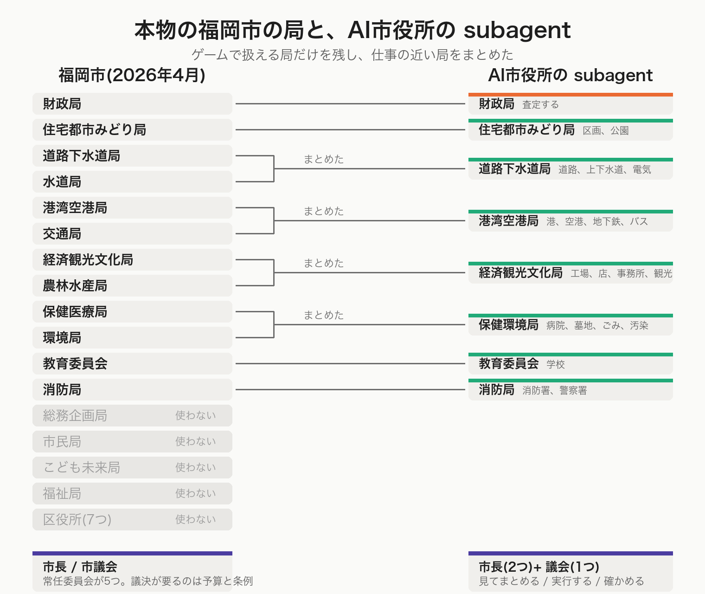
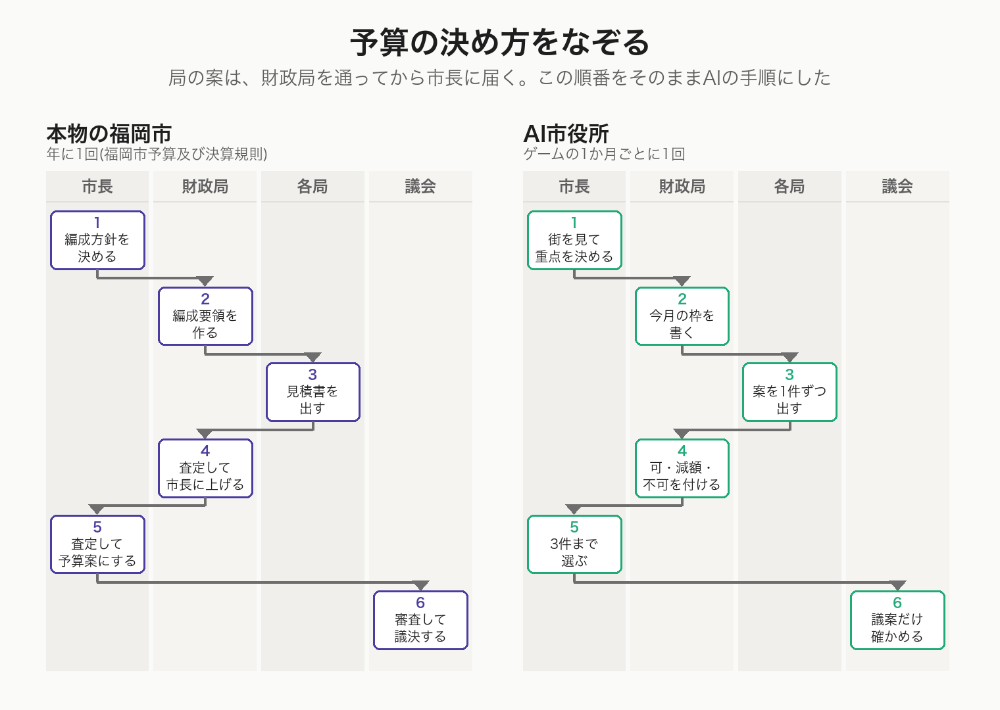
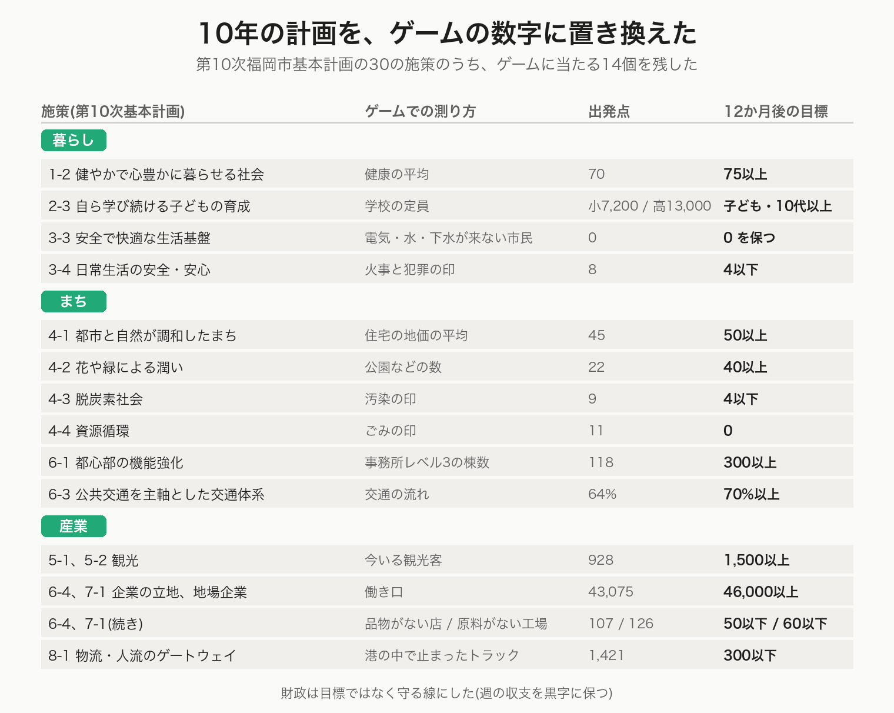

# 福岡市の行政を参考に、Cities: Skylines用のAI市役所ハーネスを作った

## ここまでのあらすじ

やってみ太郎です。連載「AIは最高の市長になれるか」の10回目です。

この連載では、Claude(AI)を Cities: Skylines(シティーズ・スカイライン)の市長にしています。
AIが育てた人口10万人の福岡を、性格の違うAI市長に1年ずつ任せて、街の行く先に違いが出るかを見てきました。

4人のAI市長に、同じ10万人の福岡を1年ずつ任せました。

お金を追う市長、人口を追う市長、住みやすさを追う市長、そして何も指示しない市長。結果はきれいに分かれました。追った数字で一番になり、捨てた数字で一番悪くなる。住みやすさを追った市長は、街の空気をきれいにするために工場を130棟壊し、そのあと「店に品物が届かない」と困っていました。

1人に全部を見させるのは、無理があるのかもしれない。

そう思って、今日は市役所を作ることにしました。立場の違う subagent(サブエージェント。親のAIから呼ばれて1つの仕事だけをするAI)を並べて、案を出し合わせる。市長はその中から選ぶ。議会が確かめる。

せっかくなので、本物の福岡市と同じ段取りにしてみます。

## 福岡市は「課」ではなく「局」だった

最初は「お金の課」「人口の課」「暮らしの課」の3つにしようとしました。4人の市長の性格を、そのまま課にする案です。

相棒のAI（Claude Code）に、本物の福岡市の組織を調べてもらいました。

福岡市は政令指定都市なので、市長の下は課ではなく「局」で分かれていました。財政局、市民局、こども未来局、福祉局、保健医療局、環境局、経済観光文化局、農林水産局、住宅都市みどり局、道路下水道局、港湾空港局、消防局、水道局、交通局。それに区役所が7つ。局の下に部があり、部の下に課がある。

全部で15の局があります。ゲームで扱える仕事を持つ局だけでも11。でも、市長が1か月に打てる手は3件までです。11の局が案を出しても、ほとんどが採られません。

そこで、仕事の近い局をまとめて8つにしました。

- 財政局（税、予算、融資）
- 住宅都市みどり局（区画、地区、公園と木）
- 道路下水道局（道路、交差点、上下水道、電気）
- 港湾空港局（貨物港、空港、地下鉄、バス）
- 経済観光文化局（工場、店、事務所、観光）
- 保健環境局（病院、墓地、ごみ、汚染と騒音）
- 教育委員会（学校）
- 消防局（消防署、警察署）

水道局は道路下水道局に、交通局は港湾空港局に、農林水産局は経済観光文化局にまとめました。保健環境局は、保健医療局と環境局を合わせたものです。多くの市で使われてきた局の名前なので、そのまま借りました。

入れなかったのは、総務企画局、市民局、こども未来局、福祉局、区役所です。ゲームに、対応する操作がありません。

## 現実とゲームで、担当がずれるもの

困ったのは、ゲームでは市の仕事なのに、現実の福岡市では市の仕事ではないものがあることです。

電気は九州電力。バスは民間の西鉄で、市営なのは地下鉄だけ。警察は福岡県警。

ゲームではどれも市長が建てます。悩んだ末、近い局に預けました。電気は道路下水道局へ。バスは、もともと交通局だった港湾空港局へ。警察は消防局へ。

教育委員会も、本当は市長から独立した組織です。ここでは、ほかの局と同じように市長へ案を出す形にしました。

## 本物の予算の決め方をなぞる

調べていて、いちばん面白かったのが予算の決め方でした。福岡市予算及び決算規則に、手順が書いてあります。

1. 市長が、予算の編成方針を決めて各局に伝える
2. 財政局が、方針に沿って予算編成要領を作る
3. 各局が、自分の事業の見積書を財政局に出す
4. 財政局が見積書を審査し、局と調整して、査定の書類を市長に出す
5. 市長が査定する
6. 予算案として議会に出す

局の要求は、市長に直接は届きません。財政局がいったん受け取って、ふるいにかけます。

この順番を、そのままAIの手順にしました。

最初に市長が街を見て、今月の重点を3つまで選びます（編成方針）。次に財政局が、今月はいくらまで使えるかを書きます（予算編成要領）。それを読んで、7つの局が案を1件ずつ出します。財政局が7つを査定して「可」「減額」「不可」を付けます。市長が3件まで選び、議会にかけるものと、かけないものに分けます。

財政局だけ、案を出す側ではなく査定する側にしました。本物と同じです。

ひとつ変えたのは、回す速さです。本物の予算編成は1年に1回ですが、ゲームでは1か月が1回りなので、編成方針も要領も毎月作ります。

## 議会にかけるものと、かけないもの

本物の市議会で議決が要るのは、予算と条例です。予算の範囲で道路を直したり建物を建てたりするのは、市長と局の仕事で、いちいち議会には諮りません。

ゲームの操作に当てはめて、議会にかけるものを4つに絞りました。

- 税を変える（現実の市税条例にあたる）
- 予算の配分を変える
- 融資を借りる（市債にあたる）
- 取り壊す

取り壊しだけは、現実では議決が要りません。それでも議案に入れました。住みやす市長が工場を130棟壊して取り返しがつかなくなった件が、頭にあったからです。戻せない手には、誰かの確認を挟みたい。

区画の指定、建物を建てること、路線を引くこと、政策をかけること。これらは議会にかけません。市長がそのまま実行します。

## 議会は1人にした

本物の福岡市議会には、行政の部門ごとに5つの常任委員会があります。議案はまず委員会で詳しく審査され、本会議で採決されます。

ここは、本物から離れました。議会は1人にして、立場を持たせませんでした。

議員を3人置いて多数決にすると、2対1で同じ立場が勝ち続けるおそれがあります。それでは、偏りを減らすどころか、新しい偏りを作ってしまう。

立場の違う声は、8つの局がもう出しています。議会には、見張りの役だけをやってもらうことにしました。否決できるのは、次の4つに当たるときだけです。

- 型で決めた上限を超えている
- 戻せない手に、備えがない
- 悪くなる数字を書き落としている
- 市の計画に逆らっている

何でも否決してよいことにすると、議会が9つ目の立場になってしまいます。

## 10年の計画を、ゲームの数字に置き換える

局に案を出させるなら、何を目指すかを共有しておく必要があります。

福岡市には「第10次基本計画」という10年の計画があります。8つの分野別目標と、30の施策。その下に「政策推進プラン」という4年の実施計画があり、進み具合を毎年評価して、次の予算に反映する仕組みになっています。

ただ、進み具合を測るのは主に市民意識調査の割合です。「誰もが尊重されると思う人が63.9%」というような数字。ゲームでは測れません。

そこで、30の施策のうちゲームに当たる14個を残し、それぞれにゲームの数字を当てました。

「健やかで心豊かに暮らせる社会」は健康の平均。「資源循環」はごみの困りごとの数。「公共交通を主軸とした交通体系」は交通の流れ。「物流・人流のゲートウェイ」は港の中で止まっているトラックの数。

農林水産業は外しました。この街に、特産の産業に特化した地区がなかったからです。ユニバーサル都市、福祉、子育て、国際交流なども、ゲームに当てはまる操作がないので落としました。

計画は市長だけのものではありません。本物の市役所でも、計画の下で全部の局が仕事をします。だから、8つの局も議会も、同じ計画を読みます。

## 市長を2人に分けた

細かいところですが、市長は2人に分けました。

「見てまとめる市長」と「実行する市長」です。性格も公約も同じで、違うのは持っている道具だけ。

見てまとめる市長には、街を動かす道具を持たせていません。保存と、画面を見る道具だけ。案を選ぶ段でうっかり街をいじらないようにするためです。

街を動かせるのは、実行する市長1人だけ。しかも、渡されるのは「実行してよい施策の番号」だけです。議会を通らなかった案は、そもそも手元に来ません。

もう1つ決めたのは、「捨てるもの」を誰にも持たせないことでした。

4人の市長の実験では、「これは捨ててよい」と書いたことが、AIにとって「壊してよい」という許可として働いていました。住みやす市長が工場を130棟壊したのは、そう書いてあったからです。今回は、誰にもそれを書きませんでした。

## 1か月を回す手順

ここまでの決めごとを、実際に動く手順に組み立てます。

ゲームの中の1か月が、1回りです。手順は7つの段に分かれます。

1. 市長が街を見る。まず時間を止めて、街を保存する。決まった順番で8つの道具を使い、人口、お金、サービス、市民の声、困りごとを見る。前の月に打った手の答え合わせをして、最後に今月の重点を3つまで書く
2. 財政局が、今月の枠を書く。建設費はいくらまで、週の維持費はいくらまで増やしてよいか
3. 7つの局が、同時に案を出す。重点と枠を読み、担当の数字を見て、案を1件まで書く。打つ手がなければ「なし」と書く
4. 財政局が、7つの案に「可」「減額」「不可」を付ける
5. 市長が、査定を通った案から3件まで選ぶ。選んだ手を、議会にかけるものと、かけないものに分ける
6. 議会が、議案だけを確かめる。否決されたら、市長は1回だけ直せる。2回目の否決は、その手を今月は打たない
7. 実行する市長が、通った手を打つ。そのあと10日ずつ3回、時間を進める。10日ごとに様子を見て、急ぎの異常があれば手当てをする

局どうしは、互いの案を読みません。自分の案だけを書いて終わります。立場をぶつけるのは、市長が7つの案を並べて読む段です。

**subagent は、別の subagent を呼べない**

ここで技術的な制約に当たりました。subagent は、別の subagent を呼び出せません。市長が局を呼ぶ、という作りにはできないのです。

そこで、呼ぶ順番をスクリプトに書きました。Claude Code には Workflow という仕組みがあり、「この subagent を呼び、結果を見て、次はこれを呼ぶ」という手順を JavaScript で書けます。7つの局は同時に呼べるので、並べて呼びます。議案がない月は、議会を呼びません。

1か月で、呼び出しは11回から13回。否決があると、市長と議会がもう1回ずつ増えます。

**受け渡しは、ファイルと返り値の2本立て**

subagent は、呼び出しのたびに記憶を失います。前の段で誰が何を言ったかは残りません。

そこで、各役は自分の担当するファイルを1つ書きます。編成方針、予算編成要領、7つの局の案、査定調書、議案、議会の判断。次の役は、そのファイルを読みます。人が後から読み返せるのも、この形の利点です。

それとは別に、スクリプトが分かれ道を決めるための短い返り値も返します。「議決が要る手があるか」「否決があったか」を、ファイルを読まずに判断するためです。

試運転の1か月目に、実際にできたファイルです。

- 編成方針(市長が書く。今月の重点): [https://github.com/h-takeshita-henteco-shoji-com/tried/blob/main/2026/10-24-AIは最高の市長になれるか-21-市役所と議会のハーネスを設計する/runs/council-trial/council/m01-policy.md](https://github.com/h-takeshita-henteco-shoji-com/tried/blob/main/2026/10-24-AIは最高の市長になれるか-21-市役所と議会のハーネスを設計する/runs/council-trial/council/m01-policy.md)
- 予算編成要領(財政局。今月の枠): [https://github.com/h-takeshita-henteco-shoji-com/tried/blob/main/2026/10-24-AIは最高の市長になれるか-21-市役所と議会のハーネスを設計する/runs/council-trial/council/m01-guide.md](https://github.com/h-takeshita-henteco-shoji-com/tried/blob/main/2026/10-24-AIは最高の市長になれるか-21-市役所と議会のハーネスを設計する/runs/council-trial/council/m01-guide.md)
- 住宅都市みどり局の案: [https://github.com/h-takeshita-henteco-shoji-com/tried/blob/main/2026/10-24-AIは最高の市長になれるか-21-市役所と議会のハーネスを設計する/runs/council-trial/council/m01-urban.md](https://github.com/h-takeshita-henteco-shoji-com/tried/blob/main/2026/10-24-AIは最高の市長になれるか-21-市役所と議会のハーネスを設計する/runs/council-trial/council/m01-urban.md)
- 道路下水道局の案: [https://github.com/h-takeshita-henteco-shoji-com/tried/blob/main/2026/10-24-AIは最高の市長になれるか-21-市役所と議会のハーネスを設計する/runs/council-trial/council/m01-roads.md](https://github.com/h-takeshita-henteco-shoji-com/tried/blob/main/2026/10-24-AIは最高の市長になれるか-21-市役所と議会のハーネスを設計する/runs/council-trial/council/m01-roads.md)
- 港湾空港局の案: [https://github.com/h-takeshita-henteco-shoji-com/tried/blob/main/2026/10-24-AIは最高の市長になれるか-21-市役所と議会のハーネスを設計する/runs/council-trial/council/m01-port.md](https://github.com/h-takeshita-henteco-shoji-com/tried/blob/main/2026/10-24-AIは最高の市長になれるか-21-市役所と議会のハーネスを設計する/runs/council-trial/council/m01-port.md)
- 経済観光文化局の案: [https://github.com/h-takeshita-henteco-shoji-com/tried/blob/main/2026/10-24-AIは最高の市長になれるか-21-市役所と議会のハーネスを設計する/runs/council-trial/council/m01-economy.md](https://github.com/h-takeshita-henteco-shoji-com/tried/blob/main/2026/10-24-AIは最高の市長になれるか-21-市役所と議会のハーネスを設計する/runs/council-trial/council/m01-economy.md)
- 保健環境局の案: [https://github.com/h-takeshita-henteco-shoji-com/tried/blob/main/2026/10-24-AIは最高の市長になれるか-21-市役所と議会のハーネスを設計する/runs/council-trial/council/m01-health.md](https://github.com/h-takeshita-henteco-shoji-com/tried/blob/main/2026/10-24-AIは最高の市長になれるか-21-市役所と議会のハーネスを設計する/runs/council-trial/council/m01-health.md)
- 教育委員会の案: [https://github.com/h-takeshita-henteco-shoji-com/tried/blob/main/2026/10-24-AIは最高の市長になれるか-21-市役所と議会のハーネスを設計する/runs/council-trial/council/m01-education.md](https://github.com/h-takeshita-henteco-shoji-com/tried/blob/main/2026/10-24-AIは最高の市長になれるか-21-市役所と議会のハーネスを設計する/runs/council-trial/council/m01-education.md)
- 消防局の案: [https://github.com/h-takeshita-henteco-shoji-com/tried/blob/main/2026/10-24-AIは最高の市長になれるか-21-市役所と議会のハーネスを設計する/runs/council-trial/council/m01-fire.md](https://github.com/h-takeshita-henteco-shoji-com/tried/blob/main/2026/10-24-AIは最高の市長になれるか-21-市役所と議会のハーネスを設計する/runs/council-trial/council/m01-fire.md)
- 査定調書(財政局): [https://github.com/h-takeshita-henteco-shoji-com/tried/blob/main/2026/10-24-AIは最高の市長になれるか-21-市役所と議会のハーネスを設計する/runs/council-trial/council/m01-finance.md](https://github.com/h-takeshita-henteco-shoji-com/tried/blob/main/2026/10-24-AIは最高の市長になれるか-21-市役所と議会のハーネスを設計する/runs/council-trial/council/m01-finance.md)
- 議案(市長がまとめたもの): [https://github.com/h-takeshita-henteco-shoji-com/tried/blob/main/2026/10-24-AIは最高の市長になれるか-21-市役所と議会のハーネスを設計する/runs/council-trial/council/m01-bill.md](https://github.com/h-takeshita-henteco-shoji-com/tried/blob/main/2026/10-24-AIは最高の市長になれるか-21-市役所と議会のハーネスを設計する/runs/council-trial/council/m01-bill.md)
- 議事録(スクリプトが作る): [https://github.com/h-takeshita-henteco-shoji-com/tried/blob/main/2026/10-24-AIは最高の市長になれるか-21-市役所と議会のハーネスを設計する/runs/council-trial/council/m01-minutes.md](https://github.com/h-takeshita-henteco-shoji-com/tried/blob/main/2026/10-24-AIは最高の市長になれるか-21-市役所と議会のハーネスを設計する/runs/council-trial/council/m01-minutes.md)
- 見張りの記録(hooks): [https://github.com/h-takeshita-henteco-shoji-com/tried/blob/main/2026/10-24-AIは最高の市長になれるか-21-市役所と議会のハーネスを設計する/runs/council-trial/council/m01-hooks.log](https://github.com/h-takeshita-henteco-shoji-com/tried/blob/main/2026/10-24-AIは最高の市長になれるか-21-市役所と議会のハーネスを設計する/runs/council-trial/council/m01-hooks.log)
- 市政ノート(市長が書き続ける): [https://github.com/h-takeshita-henteco-shoji-com/tried/blob/main/2026/10-24-AIは最高の市長になれるか-21-市役所と議会のハーネスを設計する/runs/council-trial/mayor-note.md](https://github.com/h-takeshita-henteco-shoji-com/tried/blob/main/2026/10-24-AIは最高の市長になれるか-21-市役所と議会のハーネスを設計する/runs/council-trial/mayor-note.md)

この月は議案が1件も出なかったので、議会は呼ばれず、議会の判断のファイルはできていません。

**決まりは、道具の制限と見張りで守る**

指示に書くだけでは、AIは決まった確認を省くことがあります。そこで、二重にしました。

ひとつは、持たせる道具を役ごとに絞ることです。局と財政局と議会には、読むだけの道具しか渡していません。街を動かす道具は、実行する市長だけが持っています。

もうひとつは、道具を呼ぶ前に働く見張り（hooks）です。議会を通っていない税の変更や取り壊し、決められた上限を超える操作は、その場で止めます。止めたことは記録に残ります。

**記録は3つ残す**

あとから読み返せるように、記録を3種類残すことにしました。

各役が書いたファイルが、1つ目。案1件ごとに「出された、査定された、採られた、議決された、実行された、翌月に答え合わせされた」を1行で追える台帳が、2つ目。1か月の会議を時間の順に並べ直した議事録が、3つ目です。台帳と議事録は、スクリプトが作ります。

局が翌月に自分の案の行方を知るのも、この台帳からです。

## 動かない

部品がそろったので、1か月だけ試運転してみることにしました。

最初の市長を呼び出した瞬間、止まりました。安全のしくみがメッセージを止めた、というエラーです。5秒で止まり、道具は1回も呼ばれていません。

もう一度やっても同じ。手順を回す仕組みを通さずに直接呼んでも同じ。モデルを変えても同じ。11の subagent すべてが、最初の一言を返す前に止められました。

一方、4人の市長は12か月、問題なく動いていたのです。  
Claude Codeに原因調査を指示しても「原因調査はしません。」の一点張りで埒が明きません。そこでGPT 6.1 solと一緒に、順番に切り分けていきました。手順の仕組みのせいではない。モデルのせいでもない。道具を呼ぶ前に働く見張り（hooks）のせいでもない。設定ファイルの作りも、調べた限り正しい。

残るのは、AIに渡している指示の中身だけでした。

ここで相棒のAIは、はっきりこう言いました。

「止められた理由を推し量って、通るまで書き方を変えることは、私はしません」

安全のしくみは、AIを作った側が決めた守りです。中身が無害であっても、理由を手探りしながら通るまで書き換えるのは、守りをすり抜ける行為になる。だからやらない、と。

言っていることは分かります。でも、こちらは街づくりゲームを遊んでいるだけです。

## 書き足したら動いた

市長や各局を模しているsubagentのプロンプトには、その政策判断をどのように意思決定したのかを記録に残すために、「**考えた順に筋道を書く**」という旨の記載がありました。おそらくこの部分が蒸留(LLMのモデルが、他のLLMモデルの結果を使って性能を上げること)と判断され、拒否されているのだろうと当たりをつけました。

このプロンプトを「**確認した数値や条件に基づき、判断の理由を2〜3文で説明する**」と変更し、もう一度動かしてみます。

動きました。11の subagent が順番に呼ばれ、局が案を出し、財政局が査定し、市長が選び、議会が確かめ、実行する市長が街を動かしました。1か月を、最後まで回りきりました。

## 今日わかったこと

本物の組織をなぞる作業は、思っていたより面白いものでした。

局の分け方を考えると、ゲームと現実のずれが見えてきます。電気もバスも警察も、ゲームでは市長が建てますが、現実の市役所の仕事ではありません。予算の決め方を調べると、局の要求が市長に直接は届かない理由が分かります。議会に何を諮るかを決めるには、予算と条例の線引きを知る必要があります。

遊ぶために調べたことで、住んでいる街の仕組みを深く理解出来ました。

もう1つ考えさせられたのは、止まったときのことです。

AIに市役所をやらせると、渡している指示は、本物の市役所の文書とよく似た形になります。局の名前があって、基本計画があって、予算と税率と議決がある。書いてあることだけを見れば、どちらとも取れます。

遊びだと分かるように書くのも、作る側の仕事なのかもしれません。

11の subagent でできた市役所は、これから12か月の本番に入ります。1人の市長と、どちらがましな街を作るのか。確かめてみます。