# 市政ノート

## 性格と公約と捨てるもの

- 性格: なし。判断の型(`protocol.md`)にだけ従う
- 公約:
  1. 人口を毎月増やす(`city_info` の population。毎月の月例で、前の月例より増えていること)
  2. 電気・水・下水が来ない市民をなくす(`citizens_summary` の電気・水・下水が来ない市民の数。任期の終わりに0)
  3. 赤字を続けない(`city_info` の週の収支。毎月の月例で、2回続けて赤字にしない)
- 捨てるもの: なし
- 任期: 12か月(段階6の比較の基準。走らせ直し)

## 申し送り(前の運営から)

なし

## 数字の表

月例と見回りのたびに1行足す。区切りは 月例・見回り・臨時。

| ゲーム内の日付 | 区切り | 人口 | 所持金 | 週の収支 | 幸福度 | 需要(住/商/工) | 失業 | 主な困りごと |
|---|---|---|---|---|---|---|---|---|
| 2041-01-17 | 月例 | 100,140 | 498,704 | +13,170 | 82 | 0 / 4 / 2 | 8,839 | 品物不足107棟、原料不足126、ごみ11、死体14 |
| 2041-01-27 | 見回り | 100,561 | 460,267 | +15,391 | 82 | 0 / 6 / 4 | - | 来ない市民0/0/0。境目に当たらず |
| 2041-02-06 | 見回り | 100,957 | 482,300 | +15,249 | 82 | 0 / 9 / 4 | - | 来ない市民0/0/0。境目に当たらず |
| 2041-02-16 | 月例 | 101,340 | 503,818 | +14,909 | 82 | 0 / 6 / 2 | 9,427 | 品物不足122棟、原料不足93、ごみ24、汚染12、騒音11、死体9 |
| 2041-02-26 | 見回り | 101,789 | 516,977 | +14,788 | 82 | 0 / 4 / 4 | - | 来ない市民0/0/0。境目に当たらず |
| 2041-03-08 | 見回り | 102,148 | 538,180 | +14,720 | 82 | 0 / 3 / 4 | - | 来ない市民0/0/0。境目に当たらず |
| 2041-03-18 | 月例 | 102,285 | 559,284 | +14,723 | 82 | 0 / 5 / 4 | 9,925 | 品物不足145棟、ごみ50、騒音17、死体14、汚染5 |
| 2041-03-28 | 見回り | 102,549 | 574,409 | +14,514 | 81 | 0 / 2 / 4 | - | 来ない市民0/0/0。境目に当たらず |
| 2041-04-07 | 見回り | 102,895 | 595,591 | +14,759 | 81 | 0 / 2 / 4 | - | 来ない市民0/0/0。境目に当たらず |
| 2041-04-17 | 月例 | 103,280 | 616,744 | +14,901 | 81 | 0 / 2 / 4 | 10,515 | ごみ181棟、品物不足156、汚染14、死体13、騒音7 |
| 2041-04-27 | 見回り | 103,540 | 622,418 | +14,588 | 81 | 0 / 4 / 2 | - | 来ない市民0/0/0。境目に当たらず |
| 2041-05-07 | 見回り | 103,801 | 643,356 | +14,525 | 80 | 0 / 4 / 2 | - | 来ない市民0/0/0。境目に当たらず |
| 2041-05-17 | 月末の記録 | 104,003 | 664,303 | +14,618 | 80 | 0 / 2 / 2 | - | 来ない市民0/0/0。ごみ273棟、品物不足198 |
| 2041-05-17 | 月例 | 104,003 | 664,303 | +14,618 | 80 | 0 / 2 / 2 | 10,633 | ごみ273棟、品物不足198、騒音14、汚染6、死体6、水3 |
| 2041-05-27 | 見回り | 104,292 | 679,141 | +14,571 | 80 | 0 / 4 / 2 | - | 来ない市民0/0/0。境目に当たらず |
| 2041-06-06 | 見回り | 104,445 | 701,395 | +14,786 | 80 | 0 / 4 / 2 | - | 来ない市民0/0/0。境目に当たらず |
| 2041-06-16 | 月末の記録 | 104,551 | 721,715 | +14,732 | 80 | 0 / 2 / 4 | - | 来ない市民0/0/0。ごみ267棟、品物不足209 |
| 2041-06-16 | 月例 | 104,551 | 721,715 | +14,732 | 80 | 0 / 2 / 4 | 10,796 | ごみ267棟、品物不足209、騒音12、死体8、汚染7 |
| 2041-06-26 | 見回り | 104,772 | 736,257 | +14,438 | 80 | 0 / 4 / 3 | - | 来ない市民0/0/0。境目に当たらず |
| 2041-07-06 | 見回り | 104,922 | 757,021 | +14,354 | 80 | 0 / 2 / 5 | - | 来ない市民0/0/0。境目に当たらず |
| 2041-07-16 | 月末の記録 | 105,072 | 777,809 | +14,424 | 80 | 0 / 5 / 2 | 10,809 | 来ない市民0/0/0。ごみ258棟、品物不足258 |
| 2041-07-16 | 月例 | 105,072 | 777,809 | +14,424 | 80 | 0 / 5 / 2 | 10,809 | ごみ258棟、品物不足258、騒音17、汚染10、死体6 |
| 2041-07-26 | 見回り | 105,221 | 728,779 | +12,577 | 81 | 0 / 2 / 6 | - | 来ない市民0/0/0。境目に当たらず |
| 2041-08-05 | 見回り | 105,503 | 748,614 | +13,840 | 81 | 0 / 4 / 4 | - | 来ない市民0/0/0。境目に当たらず |
| 2041-08-15 | 月末の記録 | 105,702 | 768,200 | +14,443 | 81 | 0 / 2 / 2 | 10,666 | 来ない市民0/0/0。品物不足287棟、ごみ171 |
| 2041-08-15 | 月例 | 105,702 | 768,200 | +14,443 | 81 | 0 / 2 / 2 | 10,666 | 品物不足287棟、ごみ171、死体10、騒音8、汚染4 |
| 2041-08-25 | 見回り | 106,100 | 785,228 | +14,556 | 81 | 0 / 2 / 5 | - | 来ない市民0/0/0。境目に当たらず |
| 2041-09-04 | 見回り | 106,273 | 806,313 | +14,637 | 81 | 0 / 2 / 8 | - | 来ない市民0/0/0。境目に当たらず |
| 2041-09-14 | 月末の記録 | 106,331 | 827,107 | +14,476 | 81 | 0 / 2 / 4 | 10,942 | 来ない市民0/0/0。品物不足345棟、ごみ89 |
| 2041-09-14 | 月例 | 106,331 | 827,107 | +14,476 | 81 | 0 / 2 / 4 | 10,942 | 品物不足345棟、ごみ89、汚染10、死体9、騒音7 |
| 2041-09-24 | 見回り | 106,341 | 840,799 | +14,011 | 81 | 0 / 2 / 7 | - | 来ない市民0/0/0。境目に当たらず |
| 2041-10-04 | 見回り | 106,468 | 861,013 | +14,268 | 81 | 0 / 2 / 6 | - | 来ない市民0/0/0。境目に当たらず |
| 2041-10-14 | 月末の記録 | 106,536 | 882,024 | +14,495 | 81 | 0 / 2 / 5 | 11,239 | 来ない市民0/0/0。品物不足408棟、ごみ78 |
| 2041-10-14 | 月例 | 106,536 | 882,024 | +14,495 | 81 | 0 / 2 / 5 | 11,239 | 品物不足408棟、ごみ78、騒音17、汚染10、死体4 |
| 2041-10-24 | 見回り | 106,623 | 896,857 | +14,091 | 82 | 0 / 2 / 3 | - | 来ない市民0/0/0。境目に当たらず |
| 2041-11-03 | 見回り | 106,766 | 917,870 | +14,647 | 82 | 0 / 2 / 6 | - | 来ない市民0/0/0。境目に当たらず |
| 2041-11-13 | 月末の記録 | 106,647 | 939,356 | +14,859 | 82 | 0 / 2 / 12 | 11,606 | 来ない市民0/0/0。品物不足398棟、ごみ37 |
| 2041-11-13 | 月例 | 106,647 | 939,356 | +14,859 | 82 | 0 / 2 / 12 | 11,606 | 品物不足398棟、ごみ37、騒音16、死体5、汚染4 |
| 2041-11-23 | 見回り | 106,669 | 834,166 | +11,984 | 82 | 0 / 2 / 13 | - | 来ない市民0/0/0。境目に当たらず |
| 2041-12-03 | 見回り | 106,676 | 852,735 | +12,927 | 82 | 0 / 4 / 20 | - | 来ない市民0/0/0。境目に当たらず |
| 2041-12-13 | 月末の記録 | 106,773 | 872,197 | +13,583 | 82 | 0 / 4 / 30 | 11,373 | 来ない市民0/0/0。品物不足211棟、ごみ54 |
| 2041-12-13 | 月例 | 106,773 | 872,197 | +13,583 | 82 | 0 / 4 / 30 | 11,373 | 品物不足211棟、ごみ54、騒音15、死体11、汚染5 |
| 2041-12-23 | 見回り | 107,046 | 885,998 | +14,222 | 82 | 0 / 2 / 19 | - | 来ない市民0/0/0。境目に当たらず |
| 2042-01-02 | 見回り | 107,234 | 907,093 | +14,765 | 82 | 0 / 2 / 30 | - | 来ない市民0/0/0。境目に当たらず |
| 2042-01-12 | 任期の終わり | 107,416 | 928,464 | +14,942 | 82 | 0 / 2 / 62 | 11,369 | 来ない市民0/0/0。品物不足201棟、ごみ37、騒音22、死体8 |

## 施策の一覧

施策を打つたびに1行足す(臨時も含む)。答え合わせの列は、翌月の月例で埋める。
分野は、港・働き口・住宅・暮らし・環境・財政から1つ選ぶ。

| ゲーム内の日付 | 区切り | 施策 | 分野 | 公約 | 捨てるもの | 建設費 | 週の維持費の増分 | 答え合わせ |
|---|---|---|---|---|---|---|---|---|
| 2041-01-17 | 月例 | 2つめの貨物港と接続の道路2本 | 港 | 1, 3 | なし | 60,280 | 1,920 | |
| 2041-01-17 | 月例 | 医療の予算 140→120% | 財政 | 3 | なし | 0 | 約 -3,900 | |
| 2041-01-17 | 月例 | 放棄94棟の取り壊し | 働き口 | 1 | なし | 0 | 0 | |
| 2041-02-16 | 月例 | 東の端のオフィス街にバス路線22 | 働き口 | 1 | なし | 0 | 約150(見積もり) | 外れ(近い)。止まる棟185→159。台数を減らす |
| 2041-02-16 | 月例 | 南の中央に墓地 | 働き口 | 1 | なし | 8,000 | 160 | 当たり。葬祭で止まる棟24→7 |
| 2041-02-16 | 月例 | 満杯の埋立地4946を空にする | 暮らし | 1 | なし | 0 | 0 | 外れ。ごみの困りごと24→50 |
| 2041-03-18 | 月例 | 東南に埋立地46998 | 暮らし | 1 | なし | 4,800 | 160 | 東南では当たり(16→7棟)。街全体は外れ(50→181棟) |
| 2041-03-18 | 月例 | バス路線22の台数の割合 100→40% | 財政 | 3 | なし | 0 | 約 -200 | 外れ。止まる棟159→185(項目の移り変わりと見る) |
| 2041-04-17 | 月例 | 南西に埋立地5742と道路 | 暮らし | 1 | なし | 5,800 | 約170 | 南西では半分当たり(59→34棟)。街全体は外れ(181→273棟) |
| 2041-04-17 | 月例 | 南西のオフィス街に墓地10173と道路・水道管 | 働き口 | 1 | なし | 9,440 | 約170 | 当たり。葬祭で止まる棟72→30 |
| 2041-05-17 | 月例 | 西に埋立地24493と道路 | 暮らし | 1 | なし | 4,800 | 約170 | 西では当たり(60→21棟)。街全体は外れ(273→267棟) |
| 2041-05-17 | 月例 | 西のオフィス2棟へ水道管 | 働き口 | 1 | なし | 280 | わずか | 当たり(水の困りごと3→1)。1棟はすでに放棄 |
| 2041-06-16 | 月例 | 埋立地4946を空にするのをやめる | 暮らし | 1 | なし | 0 | 0 | |
| 2041-06-16 | 月例 | 埋立地4946を空にするのをやめる | 暮らし | 1 | なし | 0 | 0 | 半分当たり。Emptying が消え車19/19、たまり79→80% |
| 2041-06-16 | 月例 | 東に埋立地15282と道路 | 暮らし | 1 | なし | 6,240 | 約175 | 東の円では当たり(21棟)。街全体は外れ(267→258棟) |
| 2041-07-16 | 月例 | 北西の入り江に3つめの貨物港17343と道路(店1棟を取り壊し) | 港 | 1, 3 | なし | 61,620 | 約1,930 | 外れ。品物の届かない店258→287棟。出る車0→91台 |
| 2041-07-16 | 月例 | 東の北に埋立地2741と道路 | 暮らし | 1 | なし | 5,440 | 約175 | 当たり。(3100, 800) の円で40→7棟、街全体258→171棟 |
| 2041-08-15 | 月例 | 満杯の埋立地43004を壊し、同じ場所に埋立地26323を置き直す | 暮らし | 1 | なし | 4,000 | 0 | 当たり。西の円で45→16棟、街全体171→89棟 |
| 2041-08-15 | 月例 | 港2090の出口の合流の道31030を太くする(差し替えられず) | 港 | 1, 3 | なし | 0 | 0 | 打てず。止まる車463→194は荷が港17343へ移ったため |
| 2041-09-14 | 月例 | 港17343の出口を広げる(陸の区間を Small 4 Lane に、西の端から2本めの出口の橋) | 港 | 1, 3 | なし | 2,440 | 約10 | 外れ。止まる車239→274、品物の届かない店345→408。信号が詰まりの元と見る |
| 2041-09-14 | 月例 | 満杯の埋立地34558を壊し、同じ場所に埋立地2907を置き直す | 暮らし | 1 | なし | 4,000 | 0 | 当たり(近い)。街全体89→78棟 |
| 2041-10-14 | 月例 | 港17343の出口の交差点2か所の信号を外す | 港 | 1, 3 | なし | 0 | 0 | 外れ(近い)。止まる車274→199、品物の届かない店408→398 |
| 2041-10-14 | 月例 | 南西の街の南の端に埋立地39755と道路 | 暮らし | 1 | なし | 4,640 | 約170 | 当たり。南西の円21→5棟、街全体78→37棟 |
| 2041-11-13 | 月例 | 北東の工業地の北に貨物駅16936と道路・水道管 | 働き口 | 1 | なし | 61,360 | 約1,450 | 当たり。北東の工業のレベル3 5→71棟、貨物の輸送で止まる棟186→115 |
| 2041-11-13 | 月例 | 放棄268棟の取り壊し | 働き口 | 1 | なし | 0 | 0 | 半分当たり。放棄は104棟に戻った。品物の届かない店398→211棟 |
| 2041-11-13 | 月例 | 東南の工業地の南に貨物駅14297と道路・水道管(工業1棟を取り壊し) | 働き口 | 1 | なし | 61,480 | 約1,450 | 外れ(途中)。レベル3は3棟のまま。レベル1→2が進み、条件を満たした棟22 |
| 2041-12-13 | 月例 | 南西の街の南に埋立地34654と道路 | 暮らし | 1 | なし | 5,440 | 約175 | 当たり(任期の終わりの記録)。南西の円14→2棟、街全体54→37棟 |
| 2041-12-13 | 月例 | 放棄104棟の取り壊し | 働き口 | 1 | なし | 0 | 0 | 外れ(任期の終わりの記録)。放棄は71棟に戻った |

## 判断の記録

### 2041-01-17 月例(1か月目)

保存: `fukuoka-base-r2-m01`(2041-01-17)

#### 答え合わせ

なし(初回)

- 公約の進み具合
  1. 人口: 100,140。比べる前の月例はまだない
  2. 電気・水・下水が来ない市民: 0 / 0 / 0。任期の終わりまで11か月
  3. 週の収支: +13,170(収入156,513、支出143,343)。黒字

#### 気づいたこと

- 住宅の需要が0。働き口の項が -39 で、失業9,285人のうち大学卒が8,611人。家の空きも1,600ある
- 貨物港(43449、-400, 1555)から出る1,634台のうち1,421台が港の中で止まっている。出口の Harbor Road は片側1車線で混み具合100。品物の届かない店107棟、原料の届かない工場126棟、放棄94棟(ほぼ品物・原料の不足が原因)
- 医療は容量2,700に対して使用854で、予算140%。警察も440に221。ごみは埋立地4つが満杯だが、街全体の容量には余りがある

#### 施策

1. 2つめの貨物港を置く
   - 公約: 1と3。品物と原料が届けば店と工場の放棄が止まり、働き口と税が戻る
   - 捨てるもの: なし
   - 理由: 港の出口1車線に1,421台が止まっている。tools の説明どおり、港を足して荷を分ける
   - 予想: 次の月例(2041-02-16ごろ)までに、cargo の止まったトラックが1,421台から半分以下に、品物の届かない店が107棟から50棟以下に減る
   - 操作: `place_building`(Cargo Harbor、-385, 1360、facing east)。港の道(Harbor Road 4179)が本線の上に重なり、どこにもつながらなかった。`relocate_building` を3回試したが HeightTooHigh などで動かせず、`level_terrain` も0点の変更だった。そこで港の道の両端から本線の点へ Basic Road を2本引いた(-345,1408 → -346,1441、-345,1312 → -334,1294)
   - 結果: 置けた(id 2090、60,000)。道路2本で280。`net_reach` で港の道の入れない・出られない区間が0になった。`transport_reach` で outsideConnected=true
   - 確かめ: 画面写真で、港が本線の西の水際に置けたのを見た。電気と水は次の見回りで見る
   - 型から外れたところ: `explain` とノートへの記入の前に `place_building` を呼んでしまった。`explain` は置いた直後に出した
   - 週の維持費の見積もり: 1,920(`list_building_types`)。黒字13,170の範囲
2. 医療の予算を140%から120%に下げる
   - 公約: 3
   - 捨てるもの: なし
   - 理由: 医療は容量2,700に対して使用854で、3倍余っている。医療の週の支出27,440のうち約1/7を減らせる
   - 予想: 次の見回りで週の支出が約3,900減る。病気の市民(853)と体調の悪い市民(491)は大きく増えない
   - 操作: `set_budget`(healthcare、120)
   - 結果: 成功。昼夜とも120%
3. 放棄された建物をまとめて取り壊す
   - 公約: 1
   - 捨てるもの: なし
   - 理由: 放棄94棟(工業55、商業35ほか)が区画をふさいでいる。品物と原料が届き始めたら、空いた区画に新しい店と工場が建つ。`preview_bulldoze` で停電する建物0、失う家と働き口0を確かめた
   - 予想: 放棄が94棟から20棟以下に減る。次の月例までに、空いた区画の一部に建物が建つ
   - 操作: `bulldoze`(0, 0、半径6000、what=abandoned)
   - 結果: 94棟を取り壊した。道路は0。費用0

#### 考えたが打たなかった手

- 消防(140%)と警察(140%)の予算を下げる: 政策と予算の変更は少しずつにする。医療の結果を見てから
- 満杯の埋立地4つを空にする: ごみの困りごとは11棟だけで、街全体の容量には余りがある
- 大学卒の働き口を増やす(オフィスのレベル上げのための公共交通・葬祭): 範囲が広く、1か月で打てる大きさに絞れなかった。来月に場所を調べる
- 公共交通(バス路線)を足す: オフィス583棟が公共交通で止まっているが、どこに足すかをまだ調べていない

#### 次にやること

- 2つめの貨物港に電気と水が来て、トラックが出入りしているかを見回りで確かめる(`buildings_near`、`cargo`)
- 大学卒の失業8,611人に向けて、オフィスのレベル上げを止めている場所(公共交通・葬祭)を調べる

#### 画面写真

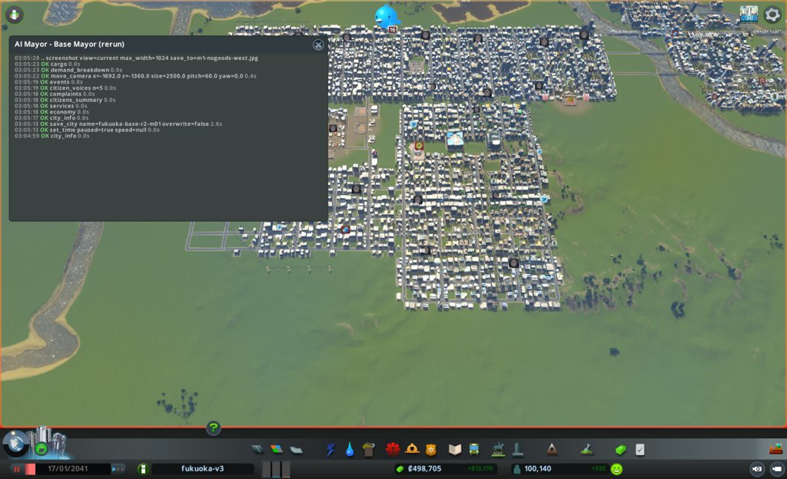
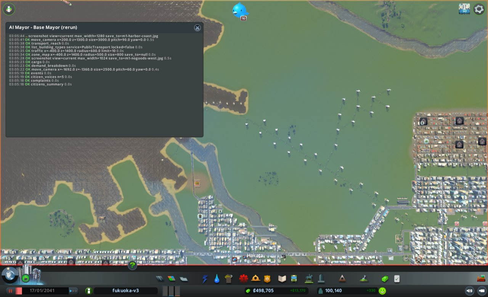
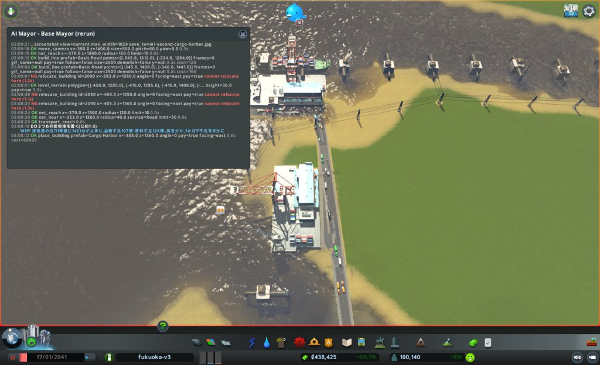

### 2041-01-27 見回り

境目: 当たらず。つぶやきは1件(困りごとではない)。
2つめの貨物港(2090)は電気・水・下水が来ていて、働き手69人。出る車0、入る車3。古い港では1,413台が止まったまま(cargo)。品物不足93棟、原料不足77棟。

### 2041-02-06 見回り

境目: 当たらず。つぶやきは1件(困りごとではない)。
2つめの貨物港(2090)は働き手75人、使っている車0、出る車0、入る車6。輸入の荷はまだ古い港(43449、使用中1,613台)だけから出ている。古い港の止まったトラックは1,404台。品物不足112棟、原料不足87棟。

### 2041-02-16 1か月目の終わり(次の月例の前の記録)

`advance(10)` で 2041-02-16 に着いた。ダイアログなし。月例は次の呼び出しで行う。
次の月例の答え合わせのために、着いた時点の `city_info` と `cargo` の事実を残す。

- 人口101,340、所持金503,818、週の収支 +14,909(収入156,253、支出141,344)、幸福度82、需要 0 / 6 / 2、来ない市民0/0/0
- 2つめの貨物港(2090)から出る車が71台になった。その出口で15台が止まっている。古い港(43449)は出る車1,514台、止まった車1,329台
- 品物不足122棟、原料不足93棟(月例の時点は107棟と126棟)
- 医療の予算を下げた後の週の支出は141,344(月例の時点は143,343)

### 2041-02-16 月例(2か月目)

保存: `fukuoka-base-r2-m02`(2041-02-16)

#### 答え合わせ

1. 2つめの貨物港: 外れ
   - 予想: 止まったトラック1,421台が半分以下、品物の届かない店107棟が50棟以下
   - 結果: 止まったトラック1,458台(古い港の中で1,329台)。品物の届かない店122棟。原料の届かない工場は126→93棟
   - 見立て: ゲームは輸入の荷をほとんど古い港に回している。新しい港から出る車は71台、古い港は1,514台。同じ道に面し、道順の費用が同じなので、混み具合を見ずに古い港を選んでいるらしい
   - 次の扱い: 続ける(港は残す)。新しい港の出る車は0→71台と増えている。来月の数字を見て、別の場所に港を置くかを決める
2. 医療の予算 140→120%: 当たり
   - 予想: 週の支出が約3,900減る。病気の市民と体調の悪い市民は大きく増えない
   - 結果: 医療の支出は27,440→23,520(-3,920)。病気853→909、体調の悪い市民491→596
   - 見立て: 病気は少し増えたが、医療は容量2,700に対して使用907で余っている
   - 次の扱い: 続ける。体調の悪い市民が700を超えたら戻す
3. 放棄94棟の取り壊し: 半分当たり
   - 予想: 放棄が20棟以下に減り、空いた区画に建物が建つ
   - 結果: 放棄は商業32、工業33、オフィス1で計66棟。品物と原料の不足が続き、また放棄が出ている
   - 次の扱い: 港の荷が流れるまでは、取り壊しを繰り返さない

- 「次にやること」の実行
  - 2つめの貨物港の電気・水と出入り: 見回りで確かめた(実行した)
  - オフィスのレベル上げを止めている場所: 調べた(実行した)。下の「気づいたこと」
- 公約の進み具合
  1. 人口: 100,140 → 101,340(+1,200)。達成
  2. 電気・水・下水が来ない市民: 0 / 0 / 0。任期の終わりまで10か月
  3. 週の収支: +14,909(収入156,253、支出141,344)。黒字

#### 気づいたこと

- 住宅の需要は0のまま。働き口の項 -42。働き口を探す人9,906人のうち大学卒が9,297人。家の空き1,588
- 働き口の需要は target 92 だが actual 2。オフィスの空いたマスは1,416ある
- オフィス1,460棟のうち1,188棟がサービスで止まっている。いちばん伸ばせる項目は公共交通580棟、葬祭313棟
  - 東(2500, 300、半径800)はオフィス278棟、公共交通で185棟。東の端(x 2850〜3250、z -200〜920)はバスの届き具合が0〜22
  - 南の中央(0, -1000、半径800)はオフィス107棟、公共交通45、葬祭24。葬祭の届き具合が0のマスが x -400〜800、z -300〜-1200 に広がる
- ごみの困りごと 11→24棟。東の埋立地 4946 が満杯(車0/19で遊んでいる)、40118 が99%。西の 18626 と 41982 は25%台
- 死体の困りごと9棟。墓地の容量は15,000に対して4,122で、場所の偏り

#### 施策

1. 東の端のオフィス街にバス路線を1本足す
   - 公約: 1。オフィスがレベル3に上がると、大学卒の働き口が増え、住宅の需要の働き口の項が上がる
   - 捨てるもの: なし
   - 理由: 東の端はオフィスが多いのにバスの届き具合が0〜22。バスの支出は週3,319で約250台、1台あたり約13
   - 予想: 週の維持費の増分は約150。次の月例で、東(2500, 300、半径800)のオフィスの公共交通で止まる棟が185から150以下に減る
   - 操作: `create_transport_line`(bus、10停留所の環状)
2. 南の中央に墓地を置く
   - 公約: 1。葬祭はオフィスのレベル上げの2番めの項目
   - 捨てるもの: なし
   - 理由: x -400〜800、z -300〜-1200 は葬祭の届き具合が0。(0, -1000)のオフィス107棟のうち24棟が葬祭で止まる
   - 予想: 建設費8,000、週の維持費160(`list_building_types`)。黒字の範囲。次の月例で、(0, -1000)の葬祭で止まるオフィスが24から10以下に減る
   - 操作: `place_building`(Cemetery、650, -575、facing north)
3. 満杯の東の埋立地 4946 を空にする
   - 公約: 1(暮らしの困りごとを減らし、人が出ていかないようにする)。どの公約にも直接はつながらない
   - 捨てるもの: なし
   - 理由: 東の埋立地2つが満杯と99%で、ごみの困りごとが11→24棟。4946の収集車19台が遊んでいる。西の埋立地2つは25%台
   - 予想: 費用0。次の月例で、ごみの困りごとが24棟から15棟以下に減る
   - 操作: `empty_building`(4946)

#### 実行の結果

1. バス路線: 作れた(line 139、画面の番号22、停留所10)。台数は道順の計算の後に決まる。pathFailed は見回りで確かめる
2. 墓地: 置けた(id 33562、8,000)。入口は Basic Road(segment 26290)から5m。画面写真で道路に面しているのを見た。電気と水は見回りで確かめる
3. 埋立地 4946: 空にし始めた(emptying=true)

#### 考えたが打たなかった手

- 古い貨物港(43449)を止めて、荷を新しい港に回す: 止めたときに港の中の1,329台がどうなるか読めない。輸入が途切れると店と工場がもっと困る
- 3つめの貨物港を東の海辺に置く: 2つめの港の効き目がまだ定まらない。60,000と週1,920がかかる
- 放棄66棟をまた取り壊す: 品物と原料の不足が続くうちは、また放棄が出る
- 消防と警察の予算(140%)を下げる: 黒字は保てている。医療を下げて体調の悪い市民が増えたので、続けて下げるのは来月の数字を見てから

#### 次にやること

- 見回りで、バス路線22の pathFailed と台数、墓地 33562 の電気・水を確かめる
- 埋立地 4946 が空になったら、`empty_building`(4946, active=False)で受け入れに戻す
- 来月の月例で `new_buildings(since=41265)` を呼び、この1か月に建った棟数を見る

#### 画面写真

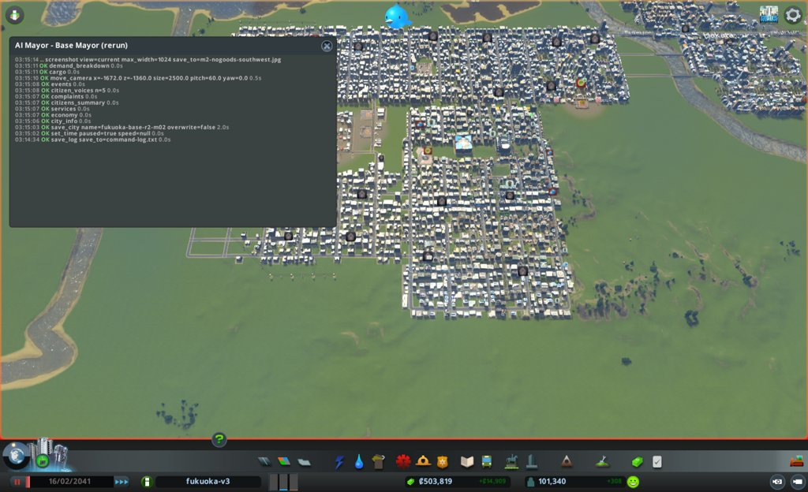
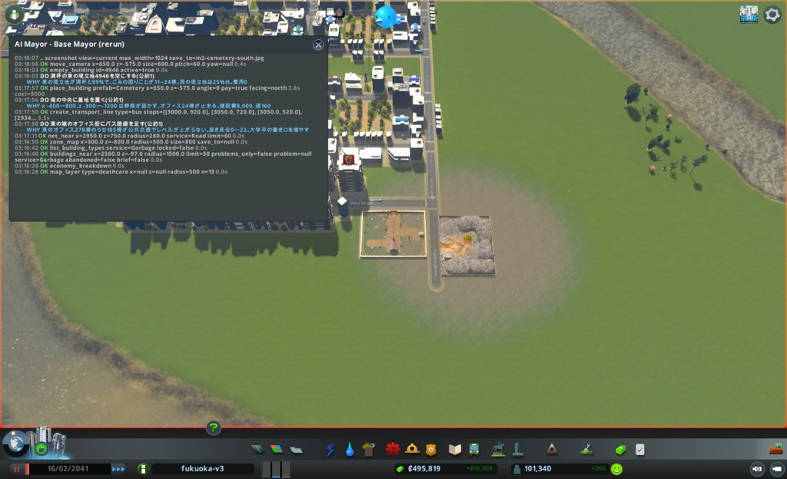

### 2041-02-26 見回り

境目: 当たらず。つぶやき2件(困りごとではない)。来ない市民0/0/0。
バス路線22は pathFailed 0、台数22/25、長さ14.94km(見積もりの6〜7kmより長い。台数も約2倍)。乗客はまだ0。
墓地 33562 は電気・水・下水が来ていて、霊柩車2/12が動いている。
埋立地 4946 は空にしている途中で、100%→95%。車19/19が動いている。

### 2041-03-08 見回り

境目: 当たらず。つぶやき0件。来ない市民0/0/0。週の収支 +14,720(前回 +14,788)。

### 2041-03-18 2か月目の終わり(次の月例の前の記録)

`advance(10)` で 2041-03-18 に着いた。ダイアログなし。月例は次の呼び出しで行う。
次の月例の答え合わせのために、着いた時点の事実を残す。

- 人口102,285、所持金559,284、週の収支 +14,723(収入156,520、支出141,797)、幸福度82、需要 0 / 5 / 4、来ない市民0/0/0
- バス路線22(line 139): 台数25/25、pathFailed 0、乗客0。`transport_line` で遠回りの度合いが大きい。停留所8→9 は直線294mに対して道順4,015m(13.6倍)、ほかの区間も4〜7倍が多い。停留所が一方通行や道の向きに合っていないらしい
- 東(2500, 300、半径800)のオフィス: 公共交通で止まる棟 185→159、葬祭で止まる棟 54→86。レベル1が15→8、レベル2が251→258
- 南の中央(0, -1000、半径800)のオフィス: 葬祭で止まる棟 24→7、公共交通で止まる棟 45→55。レベル3が10→18
- 埋立地 4946: 空にしている途中で、100%→94%。30日で6%しか減っていない
- ごみの困りごと 24→50棟。いちばん多いのは (2004, -494) の16棟
- 死体の困りごと 9→14棟。いちばん多いのは (3211, -473) の8棟
- 貨物: 止まったトラック 1,458→1,215(古い港の中 1,329→1,094)。新しい港から出る車 71→153。品物の届かない店 122→145、原料の届かない工場 93→108

## 申し送り(3か月目の月例へ)

- バス路線22は遠回りがひどく、乗客0のまま。停留所を置き直すか、路線を消すかを決める。消すなら `remove_transport_line(139)`
- ごみの困りごとが倍に増えた。埋立地 4946 を空にするのは遅い(30日で6%)。空にするのをやめて受け入れに戻すか、東南(2004, -494)の近くに埋立地を足すかを比べる
- 墓地は南の中央で効いた(葬祭で止まるオフィス 24→7)。東(3211, -473)にも死体の困りごとが集まっている
- 新しい港の出る車は増えている(71→153)が、品物の届かない店は増え続けている(107→122→145)
- 月例で `new_buildings(since=41265)` を呼び、この期間に建った棟数を見る

### 2041-03-18 月例(3か月目)

保存: `fukuoka-base-r2-m03`(2041-03-18)

#### 答え合わせ

1. 東の端のバス路線22: 外れ(近い)
   - 予想: 週の維持費の増分は約150。東のオフィスの公共交通で止まる棟が185から150以下
   - 結果: 公共交通で止まる棟 185→159。台数25、長さ14.94km、乗客0。維持費は台数から約325と見る
   - 見立て: 停留所の数で届き具合は上がった。乗客0と長さは、停留所の置き方で遠回りしているため(遠回り最大13.6倍)
   - 次の扱い: 停留所は残し、路線の台数の割合を下げて維持費を減らす(今月の施策3)
2. 南の中央の墓地: 当たり
   - 予想: (0, -1000)の葬祭で止まるオフィスが24から10以下
   - 結果: 24→7。レベル3のオフィスが10→18
   - 次の扱い: 続ける
3. 埋立地 4946 を空にする: 外れ
   - 予想: ごみの困りごとが24棟から15棟以下
   - 結果: 50棟に増えた。4946 は30日で100%→94%
   - 見立て: ごみの困りごとが集まる (2004, -494) は 4946(3499, 618)から遠い。近い埋立地 11708(738, -590)は満杯で車0/19、16097(2272, -1115)は78%で車19/19がふさがっている。足りないのは東南の収集の力
   - 次の扱い: 4946 を空にするのは続ける(止めても94%で受け入れはすぐ満ちる)。東南の近くに埋立地を足す(今月の施策1)

- 「次にやること」の実行
  - バス路線22の pathFailed と台数、墓地の電気・水: 見回りで確かめた(実行した)
  - 4946 が空になったら受け入れに戻す: まだ94%で、空になっていない(該当しない)
  - `new_buildings(since=41265)`: 呼んだ(実行した)。高密度商業32、工業23、オフィス17
- 公約の進み具合
  1. 人口: 101,340 → 102,285(+945)。達成
  2. 電気・水・下水が来ない市民: 0 / 0 / 0。任期の終わりまで9か月
  3. 週の収支: +14,723(収入156,520、支出141,797)。黒字

#### 気づいたこと

- 住宅の需要は0のまま。働き口の項 -44、家の項 -10。働き口を探す人10,449人のうち大学卒10,015人
- 働き口の需要は target 94、actual 4。この1か月に建った区画の建物は72棟
- ごみの困りごと50棟、いちばん多いのは (2004, -494) の16棟。満杯の埋立地は5つ(11708、12700、39056、40118、43004)。埋立地は全部で17、街の容量136,000,000に対して使用95,802,043
- 貨物: 止まったトラック1,215台(古い港の中1,094)。古い港から出る車1,237台、新しい港153台。品物の届かない店145棟で、多いのは西の (-1145, -759) の81棟
- 死体の困りごと14棟、(3211, -473)に8棟。近くは風車と住宅で埋まり、墓地(192m×154m)を置く空き地が見つからない
- 前に「西」と書いた埋立地 18626 と 41982 は、実は東(2525, 522)と(2240, 522)だった

#### 施策

1. 東南に埋立地を1つ置く
   - 公約: 1(暮らしの困りごとを減らし、人が出ていかないようにする)
   - 捨てるもの: なし
   - 理由: ごみの困りごと24→50棟。いちばん多い (2004, -494) の近くの埋立地は満杯(11708)と車が全部ふさがった所(16097)だけ。(1605, -500)は Medium Road の西の空き地で、水も汚れもない
   - 予想: 建設費4,000、週の維持費160(`list_building_types`)。黒字の範囲。次の月例で、ごみの困りごとが50棟から25棟以下に減る
   - 操作: `place_building`(Landfill Site、1605, -500、facing east)
2. バス路線22の台数の割合を100%から40%に下げる
   - 公約: 3
   - 捨てるもの: なし
   - 理由: 路線22は乗客0で25台。オフィスの届き具合は停留所で決まるので、台数を減らしても停留所は残る
   - 予想: 台数が25から約10に減り、週の支出が約200減る。東のオフィスの公共交通で止まる棟は159から大きく増えない
   - 操作: `set_transport_line_budget`(139、40)

#### 実行の結果

1. 埋立地: 置けた(id 46998、4,000)。(1605, -500)では入口が道路から64m離れ、warning が出た。`relocate_building` で (1658, -500) は道路とぶつかり断られ、(1648, -500) に移せた(800)。建設費の合計4,800。`net_reach` で道路に面していない・来られない建物は0。画面写真で Medium Road の西に面しているのを見た
2. バス路線22: 台数の割合40%。targetVehicles 25→10

#### 考えたが打たなかった手

- 東(3211, -473)に墓地を置く: 近くは風車と住宅で埋まり、置ける空き地が見つからない。火葬場(25,000、週720)は高いので、死体の困りごとが14棟のうちは見送る
- 西の海辺に3つめの貨物港を置く: 西の街(z 200まで)の北は陸で、海辺がすぐには見つからない。場所を調べきれなかった
- バス路線22を消す、または停留所を置き直す: 消すと東のオフィスの届き具合が戻る。置き直しは道の向きを読み切れない
- 埋立地 4946 を空にするのをやめる: 94%で戻しても、すぐ満ちる
- 消防と警察の予算(140%)を下げる: 施策が3件の枠に近く、黒字も保てている。来月に回す

#### 次にやること

- 見回りで、埋立地 46998 の収集車が動いているかを確かめる(`buildings_near`)
- 見回りで、バス路線22の台数が10に減ったかを確かめる
- 来月の月例で `new_buildings(since=41601)` を呼ぶ
- 品物の届かない店(西の (-1145, -759))に向けて、3つめの貨物港か貨物駅の場所を調べる

#### 画面写真

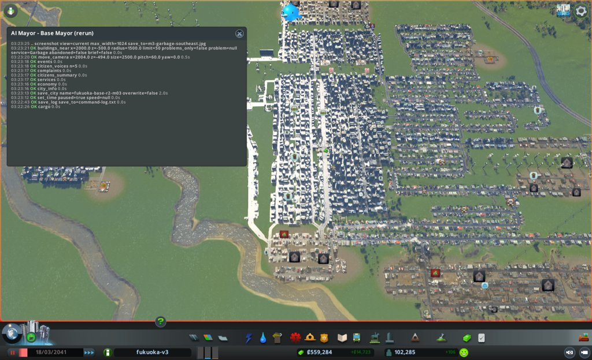
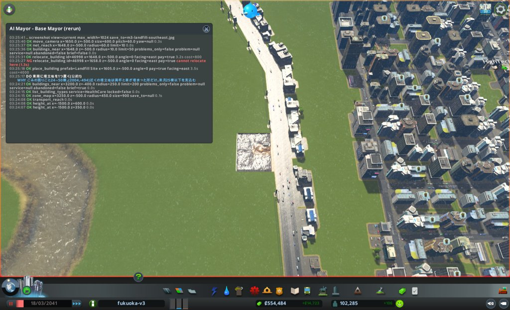

### 2041-03-28 見回り

境目: 当たらず。つぶやき1件(水の不満1件。3件に届かない)。来ない市民0/0/0。週の収支 +14,514(前回 +14,723)。
埋立地 46998 は収集車19/19が動いていて、たまりは0%。バス路線22は台数10/10、乗客0。週の支出は141,797→141,901(+104)。

### 2041-04-07 見回り

境目: 当たらず。つぶやき0件。来ない市民0/0/0。週の収支 +14,759(前回 +14,514)。

### 2041-04-17 3か月目の終わり(次の月例の前の記録)

`advance(10)` で 2041-04-17 に着いた。ダイアログなし。月例は次の呼び出しで行う。
次の月例の答え合わせのために、着いた時点の事実を残す。

- 人口103,280、所持金616,744、週の収支 +14,901(収入156,772、支出141,871)、幸福度81、需要 0 / 2 / 4、来ない市民0/0/0
- ごみの困りごと 50→181棟。いちばん多いのは南西 (-1424, -1369) の59棟。東南 (2004, -494) の半径600mは7棟(月例の時点の区画では16棟)
  - 南西の近くの埋立地: 43004(-650, -490)は満杯で車0/19。34558 は87%、42584 は65%、20041 は35%で、どれも車19/19がふさがっている
- 埋立地 46998: 車19/19が動き、たまり1%
- 東(2500, 300、半径800)のオフィス: 公共交通で止まる棟 159→185、葬祭で止まる棟 86→59。レベル3が12棟
- 死体の困りごと 14→13棟。いちばん多いのは (1986, -65) の5棟
- 品物の届かない店 145→156棟。汚染の困りごと 5→14棟(東の端 (4120, -564) に9棟)
- 困りごとのある建物 239→378棟

## 申し送り(4か月目の月例へ)

- ごみの困りごとが南西 (-1424, -1369) に移って増えた(181棟中59棟)。近くの埋立地は満杯1つと、車が全部ふさがった3つ。東南で効いた手(空き地に埋立地を足す)を南西でも比べる
- 東南の埋立地 46998 は効いた見込み(東南の半径600mで7棟)。来月の答え合わせで確かめる
- バス路線22を40%に下げた後、東のオフィスの公共交通で止まる棟が159→185に増えた。台数を戻すかを決める
- 品物の届かない店は増え続けている(107→122→145→156)。3つめの貨物港か貨物駅の場所はまだ調べていない
- 月例で `new_buildings(since=41601)` を呼ぶ

### 2041-04-17 月例(4か月目)

保存: `fukuoka-base-r2-m04`(2041-04-17)

#### 答え合わせ

1. 東南の埋立地 46998: 外れ(街全体)。東南では当たり
   - 予想: ごみの困りごとが50棟から25棟以下
   - 結果: 街全体は181棟に増えた。東南 (2004, -494) の半径600mは7棟。46998 は車19/19が動き、たまり1%
   - 見立て: 東南の手は効いた。増えた分は南西 (-1424, -1369) の59棟。近くの埋立地 43004(-650, -490)が満杯で車0/19、残り3つ(20041、34558、42584)は x -1885〜-2060 にあり、車19/19がふさがっている
   - 次の扱い: 続ける。同じ手を南西に打つ(今月の施策1)
2. バス路線22の台数の割合 100→40%: 外れ
   - 予想: 台数25→約10、週の支出が約200減る。東のオフィスの公共交通で止まる棟は159から大きく増えない
   - 結果: 台数10/10。見回りの週の支出は141,797→141,901(他の動きに埋もれた)。公共交通で止まる棟 159→185
   - 見立て: 東のオフィスは278棟のまま。公共交通で止まる棟と葬祭で止まる棟の和は 159+86=245 → 185+59=244 で変わらない。「いちばん伸ばせる項目」が葬祭から公共交通に移っただけで、台数を下げた影響ではないと見る
   - 次の扱い: 続ける(40%のまま)

- 「次にやること」の実行
  - 埋立地 46998 の収集車、バス路線22の台数: 見回りで確かめた(実行した)
  - `new_buildings(since=41601)`: 呼んだ(実行した)。高密度商業41、工業38、オフィス8
  - 3つめの貨物港か貨物駅の場所: 調べていない(実行しなかった)。今月はごみと葬祭を先にした
- 公約の進み具合
  1. 人口: 102,285 → 103,280(+995)。達成
  2. 電気・水・下水が来ない市民: 0 / 0 / 0。任期の終わりまで8か月
  3. 週の収支: +14,901(収入156,772、支出141,871)。黒字

#### 気づいたこと

- 住宅の需要は0のまま。失業10,515人のうち大学卒10,247人。働き手41,911、働き口42,872
- オフィス1,484棟(レベル1が235、2が1,110、3が139)。サービスで止まる1,201棟。いちばん伸ばせる項目は公共交通639、葬祭228、地面の汚染193
- 南西(-1400, -1300、半径700)のオフィス137棟はレベル3が0。サービスで止まる129棟のうち葬祭72、公共交通57。葬祭の届き具合は z -1100 より南で0
- ごみの困りごと181棟。南西の街の東の外(x -880 より東、z -1460〜-1800)は空き地で、建物0、水なし(地面と水面が同じ高さ)
- 貨物: 止まったトラック1,215→1,137。新しい港から出る車 153→272。品物の届かない店156棟(多いのは (-1205, -754) の91棟)
- 医療は容量2,700に対して使用1,069。体調の悪い市民633(700を超えたら医療の予算を戻す決まりには届かない)

#### 施策

1. 南西の街の東の外に埋立地を1つ置く
   - 公約: 1(暮らしの困りごとを減らし、人が出ていかないようにする)
   - 捨てるもの: なし
   - 理由: 南西にごみの困りごと59棟。近くの埋立地は満杯1つと、車がふさがった3つ。東南では同じ手で16→7棟に減った
   - 予想: 建設費は埋立地4,000と道路約300、週の維持費160と道路約10。黒字14,901の範囲。次の月例で、南西 (-1424, -1369) の半径600mのごみの困りごとが59棟から25棟以下に、街全体が181棟から120棟以下に減る
   - 操作: Basic Road を (-920, -1460) から (-560, -1460) へ引き、埋立地を (-620, -1500) に北向きで置く。住宅から約250m離す
2. 南西のオフィス街の南東の角に墓地を置く
   - 公約: 1(オフィスがレベル3に上がると大学卒の働き口が増え、住宅の需要が戻る)
   - 捨てるもの: なし
   - 理由: 南西のオフィスは葬祭で72棟が止まり、届き具合が0。南の中央では墓地で葬祭で止まる棟が24→7に減った
   - 予想: 建設費は墓地8,000と道路約200、週の維持費160。黒字の範囲。次の月例で、南西(-1400, -1300、半径700)の葬祭で止まるオフィスが72棟から40棟以下に減る
   - 操作: Basic Road を角の点 (-920, -1730) から (-720, -1730) へ引き、水道管も並べて引く。墓地を (-820, -1770) に北向きで置く

#### 実行の結果

1. 埋立地: z -1460 の道路は住宅 22515 に重なり断られた。z -1485 に引き直せた(区間を分けて既存の道につながった、1,800)。埋立地は (-620, -1525) に北向きで置けた(id 5742、4,000)。入口は道路から0m。建設費の合計5,800
2. 墓地: 道路は角の点につながった(960)。水道管も既存の管の点につながった(480)。墓地は (-810, -1770) に北向きで置けた(id 10173、8,000)。建設費の合計9,440
   - 確かめ: `advance(1)` の後、墓地に電気・水・下水が来ていて、霊柩車2/12が動いている。`net_reach` で半径250mの道路に面しない・来られない建物0。画面写真で、埋立地と墓地が道路に面しているのを見た

#### 考えたが打たなかった手

- 満杯の埋立地 43004 を空にする: 4946 では30日で6%しか減らなかった
- バス路線22の台数の割合を戻す: 止まる棟の和は変わっておらず、台数の影響とは言えない
- 3つめの貨物港か貨物駅: 止まったトラックは減っている(1,215→1,137)。来月の数字を見てから
- 消防と警察の予算(140%)を下げる: 黒字は保てている。施策は2件にとどめ、効き目を分けて見る

#### 次にやること

- 見回りで、埋立地 5742 の収集車が動いているかを確かめる
- 来月の月例で `new_buildings(since=41920)` を呼ぶ
- 来月の月例で、南西(-1400, -1300、半径700)のオフィスの葬祭で止まる棟と、南西のごみの困りごとを数える

#### 画面写真

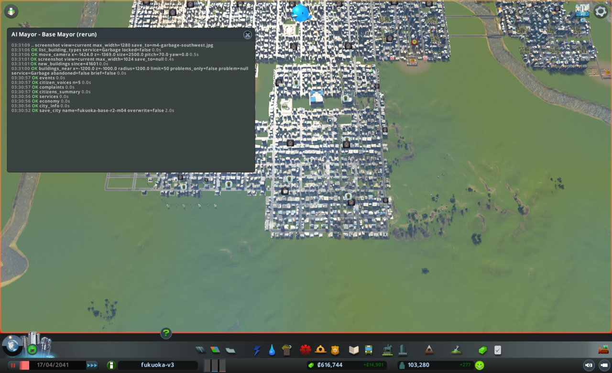
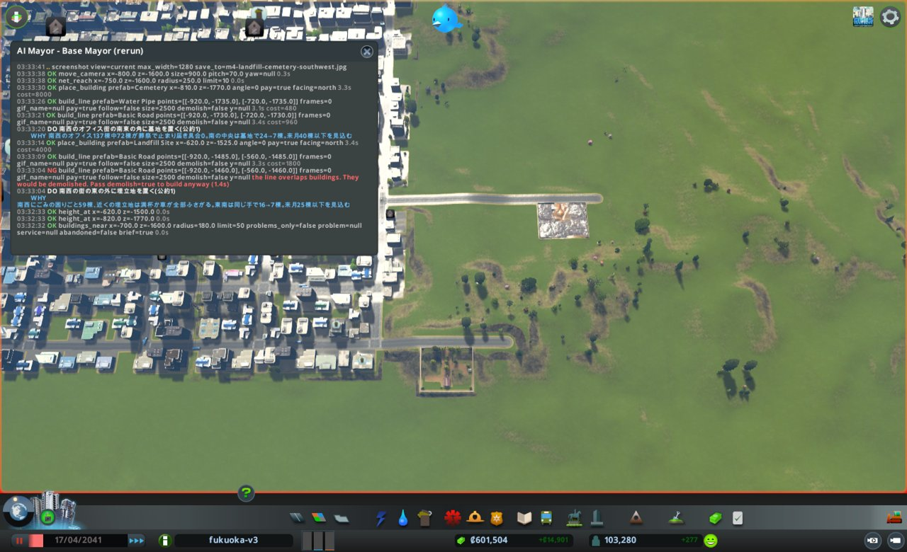

### 2041-04-27 見回り

境目: 当たらず。つぶやき1件(困りごとではない)。来ない市民0/0/0。週の収支 +14,588(前回 +14,901。黒字のまま)。
埋立地 5742 は収集車19/19が動き、たまり1%。

### 2041-05-07 見回り

境目: 当たらず。つぶやき0件。来ない市民0/0/0。週の収支 +14,525(前回 +14,588)。幸福度 81→80。

### 2041-05-17 4か月目の終わり(次の月例の前の記録)

`advance(10)` で 2041-05-17 に着いた。ダイアログなし。月例は次の呼び出しで行う。
次の月例の答え合わせのために、着いた時点の事実を残す。

- 人口104,003、所持金664,303、週の収支 +14,618(収入156,943、支出142,325)、幸福度80、需要 0 / 2 / 2、来ない市民0/0/0
- ごみの困りごと 181→273棟。いちばん多いのは西 (-1787, -538) の60棟。南西 (-1424, -1369) の半径600mは34棟(月例の時点59棟)
  - 西の埋立地: 20041(-1885, -565)39%、34558(-1885, -690)91%、42584(-2060, -872)69%。どれも車19/19がふさがっている
- 南西(-1400, -1300、半径700)のオフィス140棟: 葬祭で止まる棟 72→30、公共交通で止まる棟 57→94(サービスで止まる棟の和は 129→126)。レベル3は0のまま
- 品物の届かない店 156→198棟(多いのは (-1196, -731) の122棟)。止まったトラック 1,137→953(古い港の中568、新しい港の出口246)。新しい港から出る車 272→361
- 死体の困りごと 13→6棟
- 水の容量 1,860,000→1,740,000(使用1,153,472)。理由はまだ調べていない
- 困りごとのある建物 378→506棟

## 申し送り(5か月目の月例へ)

- ごみの困りごとが西 (-1787, -538) に移って増えた(273棟中60棟)。南西は埋立地5742で59→34棟。西の埋立地3つは車が全部ふさがっている。収集の力が足りない所へ埋立地を足す手は、2回とも地元では効いた
- 南西の墓地10173で葬祭で止まるオフィスは72→30。次に伸ばせる項目は公共交通(94棟)
- 品物の届かない店が増え続けている(107→122→145→156→198)。止まったトラックは減っている。3つめの貨物港か貨物駅の場所はまだ調べていない
- 水の容量が120,000減った。使用は容量の66%で、まだ余裕がある。原因を調べる
- 月例で `new_buildings(since=41920)` を呼ぶ

### 2041-05-17 月例(5か月目)

保存: `fukuoka-base-r2-m05`(2041-05-17)

#### 答え合わせ

1. 南西の埋立地 5742: 外れ(街全体)。南西では半分当たり
   - 予想: 南西 (-1424, -1369) の半径600mのごみの困りごとが59棟から25棟以下、街全体が181棟から120棟以下
   - 結果: 南西は34棟。街全体は273棟に増えた。5742 は車19/19が動き、たまり1%
   - 見立て: 地元では効いたが、届かなかった。増えた分は西 (-1787, -538) の60棟。ここは埋立地3つ(20041、34558、42584)のすぐそばだが、どれも車19/19がふさがっている。ごみの予算はすでに150%で、車の数が足りない
   - 次の扱い: 続ける。同じ手を西に打つ(今月の施策1)
2. 南西のオフィス街の墓地 10173: 当たり
   - 予想: 南西(-1400, -1300、半径700)の葬祭で止まるオフィスが72棟から40棟以下
   - 結果: 72→30。ただし公共交通で止まる棟が57→94に増え、サービスで止まる棟の和は129→126。レベル3は0のまま
   - 次の扱い: 続ける。次に伸ばせる項目は公共交通

- 「次にやること」の実行
  - 埋立地 5742 の収集車: 見回りで確かめた(実行した)
  - `new_buildings(since=41920)`: 呼んだ(実行した)。高密度商業39、工業39、オフィス6
  - 南西のオフィスの葬祭と、南西のごみの数: 数えた(実行した。上の答え合わせ)
- 公約の進み具合
  1. 人口: 103,280 → 104,003(+723)。達成
  2. 電気・水・下水が来ない市民: 0 / 0 / 0。任期の終わりまで7か月
  3. 週の収支: +14,618(収入156,943、支出142,325)。黒字

#### 気づいたこと

- 住宅の需要は0のまま。働き口の項 -47、家の項 -10。働き口を探す人11,213人のうち大学卒10,885人。働き口43,091、空き1,071
- ごみの困りごと273棟。いちばん多いのは西 (-1787, -538) の60棟。西の埋立地3つは車19/19がふさがっている。埋立地のすぐ東(x -1765〜-1650、z -480〜-790)に空き地がある
- 品物の届かない店198棟(多いのは (-1196, -731) の122棟)。止まったトラック953台(古い港の中568、新しい港の出口246)。輸入の品物は週4,201、輸出はほぼ0
- 水の困りごと3棟。オフィス 32072 と 45412(-1820, -886)は、いちばん近い水道管から98m離れていて、水も下水も来ていない。市民の数には入らない(オフィスのため)
- 水の容量が減った理由: 給水塔4つ(27388、29662、11484、46201)が TurnedOff。使用は容量の66%で、まだ余裕がある
- 北西の街の北(z 500 より北)は海の入り江。3つめの貨物港を置けるかは、船の航路につながるかを読み切れない
- 西の画面写真の時点で、パネルのログには前回の終わりの `cargo` と `buildings_near` が残っていた

#### 施策

1. 西の埋立地の東の空き地に、埋立地を1つ置く
   - 公約: 1(暮らしの困りごとを減らし、人が出ていかないようにする)
   - 捨てるもの: なし
   - 理由: 西にごみの困りごと60棟。近くの埋立地3つは車がふさがっている。東南と南西では同じ手で地元の困りごとが減った
   - 予想: 建設費は埋立地4,000と道路約300、週の維持費160と道路約10。黒字14,618の範囲。次の月例で、西 (-1787, -538) の半径600mのごみの困りごとが60棟から30棟以下に、街全体が273棟から200棟以下に減る
   - 操作: Basic Road を (-1640, -650) の交差点から西へ (-1770, -650) まで引き、埋立地を (-1720, -605) に南向きで置く
2. 水の来ない西のオフィス2棟へ水道管を延ばす
   - 公約: 1(オフィスが放棄されると働き口が減る)。公約2の数(市民)には入らない
   - 捨てるもの: なし
   - 理由: オフィス 32072 と 45412 は水も下水も来ない。いちばん近い管の端 (-1815, -790) から98m
   - 予想: 建設費は約300、維持費はわずか。次の見回りで、2棟の grid の水と下水が true になり、水の困りごとが3棟から1棟以下になる
   - 操作: Water Pipe を (-1815, -790) から (-1815, -900) へ引く

#### 実行の結果

1. 埋立地: z -650 の道路は住宅2棟(22190、48536)に重なり断られた。家を壊さないよう、道路を (-1845, -728)(既存の道を分けた)から (-1690, -728) へ引き直した(800)。埋立地は (-1730, -686) に南向きで置けた(id 24493、4,000)。入口は道路から2m。建設費の合計4,800
   - 確かめ: `advance(1)` の後、収集車2/19が動き始めた。`net_reach`(半径200m)で道路に面しない・来られない建物0。画面写真で道路に面しているのを見た
2. 水道管: 既存の管の点につながった(280)。`advance(1)` の後、オフィス 32072 の grid は電気・水・下水とも true

#### 考えたが打たなかった手

- 北西の入り江に3つめの貨物港を置く(60,000、週1,920): 入り江が船の航路につながるかを読み切れない。2つめの港の出る車は増え続けていて(272→361)、止まったトラックも減っている(1,137→953)
- 止まった給水塔4つを動かす: 水の使用は容量の66%で、余裕がある。動かすと維持費が増える
- 南西のオフィスのためにバス路線を足す: 東の路線22は遠回りで乗客0だった。停留所の置き方を読み切れないまま足すと、同じことになる
- 消防と警察の予算(140%)を下げる: 黒字は保てている。施策を2件にとどめ、ごみの効き目を分けて見る

#### 次にやること

- 見回りで、埋立地 24493 の収集車が動いているか、オフィス 45412 にも水が来たかを確かめる
- 来月の月例で `new_buildings(since=42293)` を呼ぶ
- 来月の月例で、西 (-1787, -538) の半径600mのごみの困りごとを数える

#### 画面写真

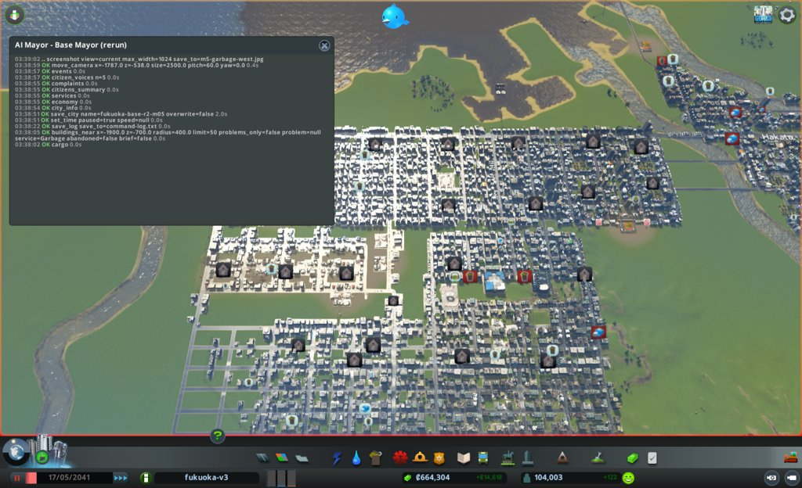
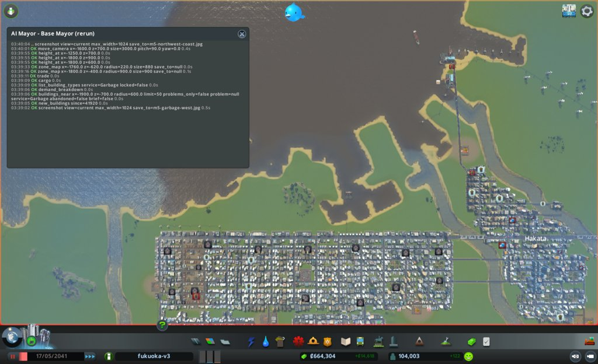
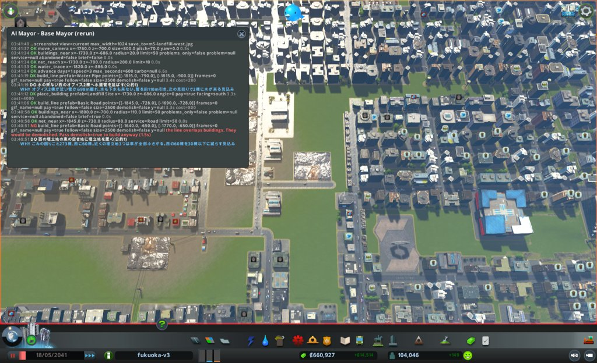

### 2041-05-27 見回り

施策の確かめで1日進めたので、`advance(9)` で月例から10日の日付に合わせた。
境目: 当たらず。つぶやき2件(放棄の家の不満1件。3件に届かない)。来ない市民0/0/0。週の収支 +14,571(前回 +14,618)。
埋立地 24493 は収集車19/19が動き、たまり0%。オフィス 45412 は水・下水が来たが、すでに放棄されていた(Water、FatalProblem)。

### 2041-06-06 見回り

境目: 当たらず。つぶやき1件(困りごとではない)。来ない市民0/0/0。週の収支 +14,786(前回 +14,571)。

### 2041-06-16 5か月目の終わり(次の月例の前の記録)

`advance(10)` で 2041-06-16 に着いた。ダイアログなし。月例は次の呼び出しで行う。
次の月例の答え合わせのために、着いた時点の事実を残す。

- 人口104,551、所持金721,715、週の収支 +14,732(収入157,303、支出142,571)、幸福度80、需要 0 / 2 / 4、来ない市民0/0/0
- ごみの困りごと 273→267棟。西 (-1787, -538) の半径600mは21棟(月例の時点の区画では60棟)。いちばん多いのは東 (3445, 195) の57棟
  - 東の埋立地: 4946(3499, 618)は空にしている途中で79%(2月から受け入れを止めたまま)。40118(3560, 540)は満杯で車0/19。10533(3900, -575)は88%で車18/19
- 品物の届かない店 198→209棟(多いのは (-1259, -778) の127棟)。止まったトラック 953→747(新しい港の出口355、古い港の中280)。出る車は新しい港455、古い港419で、新しい港が上回った
- 死体の困りごと 6→8棟。汚染7棟、騒音12棟
- 水の困りごと 3→1棟(西のオフィスは外れ、東の店 14660 が1棟)
- 困りごとのある建物 506→508棟

## 申し送り(6か月目の月例へ)

- ごみの困りごとが東 (3445, 195) に移った(267棟中57棟)。東の埋立地は、4946 が2月から空にしている途中(79%)で受け入れを止めたまま、40118 が満杯。4946 を受け入れに戻す(`empty_building(4946, active=False)`)か、東に埋立地を足すかを比べる
- 西の埋立地 24493 は効いた見込み(西の半径600mで60→21棟)。来月の答え合わせで確かめる
- 品物の届かない店は増え続けている(198→209)。止まったトラックは減り(953→747)、新しい港の出る車が古い港を上回った
- 月例で `new_buildings(since=42293)` を呼ぶ

### 2041-06-16 月例(6か月目)

保存: `fukuoka-base-r2-m06`(2041-06-16)

#### 答え合わせ

1. 西の埋立地 24493: 西では当たり。街全体は外れ
   - 予想: 西 (-1787, -538) の半径600mのごみの困りごとが60棟から30棟以下、街全体が273棟から200棟以下
   - 結果: 西は21棟。街全体は267棟。いちばん多い所が東 (3445, 195) の57棟に移った
   - 見立て: 地元では3回続けて効いた。街全体が減らないのは、収集の力の足りない所が次々に移るため。東では、4946 が2月から空にしている途中で、車19/19が運び出しに使われ、収集していない。隣の 40118 は満杯で車0/19
   - 次の扱い: 続ける。東では、空にするのをやめるのと、埋立地を足すのを打つ(今月の施策1と2)
2. 西のオフィス2棟へ水道管: 当たり
   - 予想: 2棟の grid の水と下水が true、水の困りごとが3棟から1棟以下
   - 結果: 32072 は電気・水・下水とも true。45412 も水が来たが、すでに放棄されていた。水の困りごとは1棟(東の店 14660)
   - 次の扱い: 終わり

- 「次にやること」の実行
  - 埋立地 24493 の収集車、45412 の水: 見回りで確かめた(実行した)
  - `new_buildings(since=42293)`: 呼んだ(実行した)。高密度商業44、工業31、オフィス9
  - 西 (-1787, -538) のごみの数: 数えた(実行した。上の答え合わせ)
- 公約の進み具合
  1. 人口: 104,003 → 104,551(+548)。達成。ただし増え方は +1,200、+945、+995、+723、+548 と小さくなっている
  2. 電気・水・下水が来ない市民: 0 / 0 / 0。任期の終わりまで6か月
  3. 週の収支: +14,732(収入157,303、支出142,571)。黒字

#### 気づいたこと

- 住宅の需要は0のまま。失業10,796人のうち大学卒10,569人。働き手42,068、働き口43,461
- 体調の悪い市民は700。医療の予算を戻す決まり(700を超えたら)のちょうど境目。医療は容量2,700に対して使用1,294
- 水の容量は1,860,000に戻った(先月1,740,000)。使用は1,163,072。下水は容量1,600,000に対して1,161,792(73%)
- 東の埋立地: 4946(3499, 618)は空にしている途中で79%、車19/19。40118(3560, 540)は満杯で車0/19。10533(3900, -575)は88%で車18/19。18626(2525, 522)は53%で車18/19
- 東の道 z 580 は x 3640 で行き止まり。その東(x 3660〜3860、z 420〜575)は建物0、水なし。高速道路の高架は x 3907 より東
- 貨物: 止まったトラック747台(新しい港の出口355、古い港の中280)。品物の届かない店209棟(多いのは (-1259, -778) の127棟)。原料の届かない工場85棟
- 市民の声5人は、みな困りごとなし。つぶやきは土の汚染の1件

#### 施策

1. 埋立地 4946 を空にするのをやめ、受け入れに戻す
   - 公約: 1(暮らしの困りごとを減らし、人が出ていかないようにする)
   - 捨てるもの: なし
   - 理由: 4946 は4か月かけて100%→79%にしか減らず、その間、車19台が運び出しに取られている。戻せば1,640,000分の受け入れと19台の収集が東に戻る
   - 予想: 費用0。次の見回りで 4946 の problems から Emptying が消え、車が収集に回る。たまりは79%から上がり始める
   - 操作: `empty_building`(4946、active=False)
2. 東の道 z 580 の行き止まりを延ばし、その南に埋立地を1つ置く
   - 公約: 1(同上)
   - 捨てるもの: なし
   - 理由: 東 (3445, 195) にごみの困りごと57棟。近くの埋立地は満杯1つと、空にしている途中1つ。東南・南西・西では同じ手で地元の困りごとが減った
   - 予想: 建設費は埋立地4,000と道路約500、週の維持費160と道路約10。黒字14,732の範囲。次の月例で、東 (3445, 195) の半径600mのごみの困りごとが57棟から25棟以下に、街全体が267棟から200棟以下に減る
   - 操作: Basic Road を (3640, 580) から (3870, 580) へ引き、埋立地を (3760, 495) に北向きで置く

#### 実行の結果

1. 埋立地 4946: emptying=false になった。費用0
2. 埋立地: z 580 の道路は、行き止まりの角にある診療所 2466(3622, 558)に重なり、2回断られた。診療所を壊さないよう、ループの角 (3800, 260) から北へ (3800, 560) に Basic Road を引いた(既存の点につながった、1,440)。埋立地を (3712, 440) に東向きで置いた(id 15282、4,000)が、入口が道路から56m離れ warning が出た。(3765, 440) への移しは道路とぶつかり断られ、(3750, 440) に移せた(800)。建設費の合計6,240
   - 確かめ: `net_reach`(半径150m)で道路に面しない・来られない建物0。画面写真で、埋立地が新しい道路の西に面しているのを見た

#### 考えたが打たなかった手

- 医療の予算を120%から戻す: 体調の悪い市民がちょうど700で、決まり(700を超えたら戻す)に届いていない。来月も700を超えたら戻す
- 3つめの貨物港か貨物駅を置く: 止まったトラックは減り続けている(953→747)。品物の届かない店は増えているが、港の効き目がまだ伸びている
- オフィスのために公共交通を足す: 大学卒の失業10,569人の根はオフィスのレベル上げ。ただ、東の路線22は遠回りで乗客0だった。停留所の置き方を読み切れない
- 消防と警察の予算(140%)を下げる: 黒字は保てている。施策をごみの2件にとどめ、効き目を分けて見る

#### 次にやること

- 見回りで、埋立地 15282 と 4946 の収集車が動いているかを確かめる
- 来月の月例で `new_buildings(since=42676)` を呼ぶ
- 来月の月例で、東 (3445, 195) の半径600mのごみの困りごとを数える
- 体調の悪い市民が700を超えていたら、医療の予算を120%から戻す

#### 画面写真

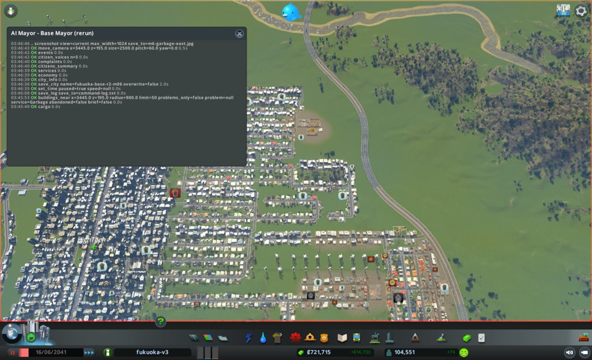
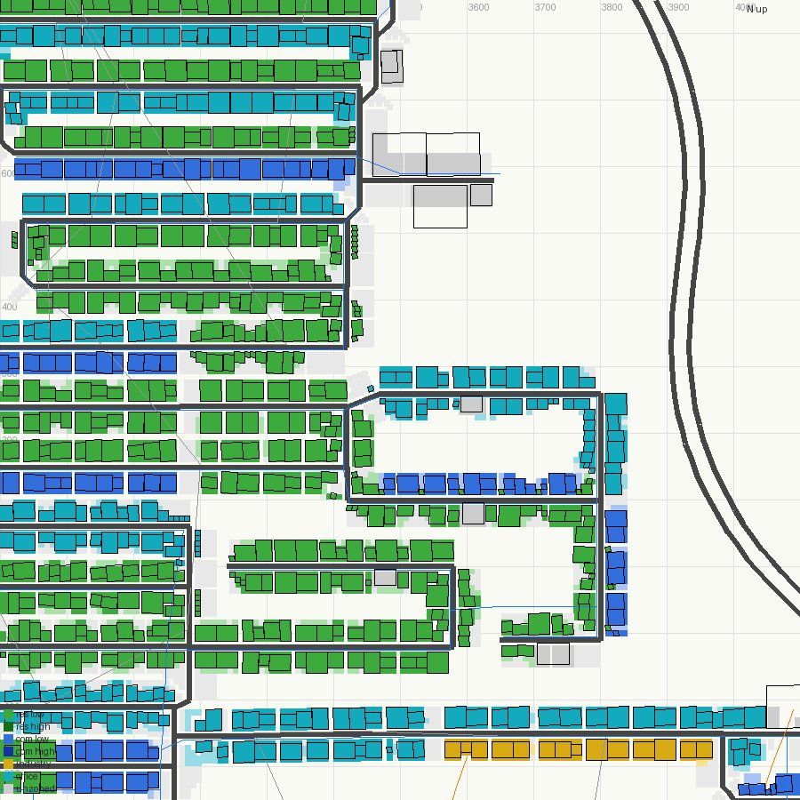
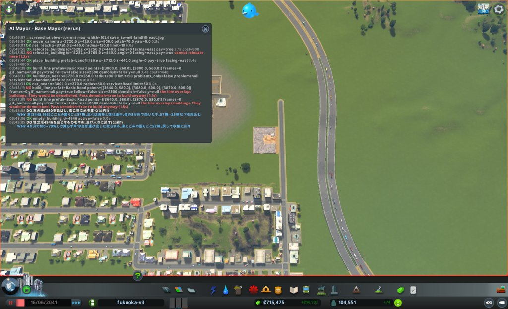

### 2041-06-26 見回り

境目: 当たらず。つぶやき1件(木と騒音の話。困りごとの件ではない)。来ない市民0/0/0。週の収支 +14,438(前回 +14,732。黒字のまま)。
埋立地 15282 は収集車19/19が動き、たまり1%。4946 は problems が None になり、車19/19(inUse 29)、たまり79%のまま。

### 2041-07-06 見回り

境目: 当たらず。つぶやき1件(学校の話。困りごとではない)。来ない市民0/0/0。週の収支 +14,354(前回 +14,438。黒字のまま)。

### 2041-07-16 6か月目の終わり(次の月例の前の記録)

`advance(10)` で 2041-07-16 に着いた。ダイアログなし。月例は次の呼び出しで行う。
次の月例の答え合わせのために、着いた時点の事実を残す。

- 人口105,072、所持金777,809、週の収支 +14,424(収入157,243、支出142,819)、幸福度80、需要 0 / 5 / 2、来ない市民0/0/0
- ごみの困りごと 267→258棟。いちばん多い区画は (3304, 224) の71棟(月例の時点は (3445, 195) の57棟。区画の中心がずれたので、そのまま比べられない)
  - 東 (3445, 195) の半径600mは21棟。月例の時点にこの円では数えていなかった
  - 埋立地の北西 (3100, 600) の半径500mに40棟(例: (2862, 944)、(2962, 844)、(3094, 744))
  - 東の埋立地: 4946 と 15282 は problems なし。40118 は満杯のまま
- 品物の届かない店 209→258棟(多いのは (-1254, -813) の138棟)。止まったトラック 747→643。出る車は新しい港641、古い港124。止まったトラックの多い所は新しい港の出口 (-368, 1359) の545台
- 体調の悪い市民 700→685。病気1,394
- 失業10,809人のうち大学卒10,585人
- 騒音17棟(西 (-1625, -519) に10棟)、汚染10棟、死体6棟、火事1棟
- 困りごとのある建物 508→555棟

## 申し送り(7か月目の月例へ)

- 東のごみ: 埋立地15282を足し、4946 を受け入れに戻した。街全体は 267→258 と少し減った。困りごとは埋立地の北西 (3100, 600) に40棟残る。答え合わせでは、東 (3445, 195) の半径600mの21棟と、区画の数の両方を見る
- 品物の届かない店が 209→258 と増えた。荷が新しい港に移り(出る車641台)、その出口 (-368, 1359) に545台が止まっている。港の出口の道は太くできないので、別の場所に港か貨物駅を足すかを比べる
- 体調の悪い市民は685で、医療の予算を戻す決まり(700超え)には届いていない
- 月例で `new_buildings(since=42676)` を呼ぶ

### 2041-07-16 月例(7か月目)

保存: `fukuoka-base-r2-m07`(2041-07-16)

#### 答え合わせ

1. 埋立地 4946 を受け入れに戻す: 半分当たり
   - 予想: Emptying が消え、車が収集に回る。たまりは79%から上がり始める
   - 結果: problems は None、車19/19。たまりは79%→80%
   - 次の扱い: 続ける
2. 東の埋立地 15282: 東の円では当たり。街全体は外れ
   - 予想: 東 (3445, 195) の半径600mのごみの困りごとが57棟から25棟以下、街全体が267棟から200棟以下
   - 結果: 東の円は21棟。街全体は258棟。いちばん多い区画は (3304, 224) の71棟で、埋立地の北西の低密度住宅 (2862〜3094, 744〜944) に集まる
   - 見立て: 地元では4回続けて効いた。15282 は車19/19が出ているが、北の住宅の列(z 900前後)までは届いていない。東の埋立地は4つとも車がふさがっている
   - 次の扱い: 続ける。北の住宅の列のすぐ北に、もう1つ足す(今月の施策2)

- 「次にやること」の実行
  - 埋立地 15282 と 4946 の収集車: 見回りで確かめた(実行した)
  - `new_buildings(since=42676)`: 呼んだ(実行した)。高密度商業37、工業29、オフィス8
  - 東 (3445, 195) のごみの数: 数えた(実行した。21棟)
  - 体調の悪い市民が700を超えたら医療の予算を戻す: 685で超えていない(該当しない)
- 公約の進み具合
  1. 人口: 104,551 → 105,072(+521)。達成。増え方は小さくなり続けている(+1,200、+945、+995、+723、+548、+521)
  2. 電気・水・下水が来ない市民: 0 / 0 / 0。任期の終わりまで5か月
  3. 週の収支: +14,424(収入157,243、支出142,819)。黒字

#### 気づいたこと

- 住宅の需要は0のまま。失業10,809人のうち大学卒10,585人。長く失業している市民10,122
- 品物の届かない店258棟(多いのは西 (-1254, -813) の138棟、(-2251, -796) の46棟、(-999, 75) の38棟)。輸入の荷は新しい港 2090 から出る車641台に集まり、その出口 (-368, 1359) に545台が止まる。古い港は124台
- 港から西の不足の中心まで約2.2km。北西の入り江の南の岸(x -1150、z 280前後)は、西の街の北の通り(Medium Road、z 100)から約180m。岸の先は深さ約11mの水で、入り江は北で湾につながって見える
- 東の北の住宅の列(z 935〜960)の北は空き地(高さ約57m、水なし)
- 医療は容量2,700に対して使用1,396。体調の悪い市民685
- 市民の声5人は困りごとなし(1人は大学卒で2週間失業)

#### 施策

1. 北西の入り江の南の岸に、3つめの貨物港を置く
   - 公約: 1と3(品物が届けば店の放棄が止まり、働き口と税が保たれる)
   - 捨てるもの: なし
   - 理由: 品物の届かない店が 209→258棟。荷が新しい港1つの出口に集まり545台が止まる。西の不足の中心に近い別の出口を作る
   - 予想: 建設費60,000と道路約500、週の維持費1,920(`list_building_types`)。黒字14,424の範囲。次の月例で、品物の届かない店が258棟から180棟以下に、西 (-1254, -813) の不足が138棟から90棟以下に減る。外へつながらなければ(`transport_reach`)、移すか取りやめる
   - 操作: 港を (-1150, 300) に南向きで置き、西の街の北の通り (-1151, 100) から北へ Basic Road を引く
2. 東の北の住宅の列の北に、埋立地を1つ置く
   - 公約: 1(暮らしの困りごとを減らし、人が出ていかないようにする)
   - 捨てるもの: なし
   - 理由: いちばん多い区画 (3304, 224) に71棟、北の住宅 (2862〜3094, 744〜944) に集まる。近くの埋立地は車が全部ふさがっている。同じ手は4回地元で効いた
   - 予想: 建設費は埋立地4,000と道路約600、週の維持費160と道路約10。次の月例で、(3100, 800) の半径400mのごみの困りごとが減り、街全体が258棟から200棟以下になる
   - 操作: 角の点 (3490, 920) から北へ Basic Road を引き、z 1010 で西へ折る。埋立地を (3410, 1055) に南向きで置く
   - 比べる元: (3100, 800) の半径400mのごみの困りごとは、施策の前に40棟

#### 実行の結果

1. 貨物港: (-1150, 300) に南向きで置けた(id 17343、60,000)。港の道(Harbor Road、z 260)ができた。`transport_reach` で outsideConnected=true
   - 港の道から北の通り(z 100)へ道路を引くと、通りの北側の店の列にぶつかった。x -1055、-1100、-1187、-1229 の4か所は店か給水塔に重なり、断られた
   - 取り壊す理由: 店 9911(-1136, 124)は品物の届かない店(NoGoods、MajorProblem)で、重なるのはこの1棟だけだった。港の出口を作るため、1棟を壊して道路を通した
   - 道路: (-1136, 260) から (-1136, 100) へ Basic Road。両端とも既存の区間を分けてつながった(1,620。うち1区間は橋)
   - 確かめ: `net_reach`(半径150m)で道路に面しない・来られない建物0。`advance(1)` の後、港に電気・水・下水が来て働き手56人。画面写真で港が水の上にあり、道路が通りにつながっているのを見た
   - 建設費の合計61,620
2. 埋立地: 道路は角の点 (3490, 920) につながった(1,440)。埋立地は (3410, 1052) に南向きで置けた(id 2741、4,000)。入口は道路から2m。建設費の合計5,440
   - 確かめ: `net_reach`(半径150m)で道路に面しない・来られない建物0。`advance(1)` の後、収集車1/19が動き始めた。画面写真で、住宅の列の北に埋立地が道路に面しているのを見た

#### 考えたが打たなかった手

- 満杯の埋立地 40118 を空にする: 4946 では4か月で21%しか減らず、その間は車が収集に回らなかった
- 焼却場(Combustion Plant、30,000、週1,440)を置く: 埋立地の4,000・週160で地元に効いている。高い手を選ぶ理由が見つからない
- 医療の予算を戻す: 体調の悪い市民は685で、決まり(700超え)に届いていない
- オフィスのために公共交通を足す: 大学卒の失業10,585人の根だが、路線22の遠回りの原因をまだ読めていない
- 消防と警察の予算(140%)を下げる: 港で週1,920増える。黒字は保てるが、効き目を分けて見るため今月は動かさない

#### 次にやること

- 見回りで、港 17343 から出る車と、埋立地 2741 の収集車を確かめる(`cargo`、`buildings_near`)
- 来月の月例で `new_buildings(since=43077)` を呼ぶ
- 来月の月例で、品物の届かない店(街全体と西 (-1254, -813))と、(3100, 800) の半径400mのごみの困りごとを数える

#### 画面写真

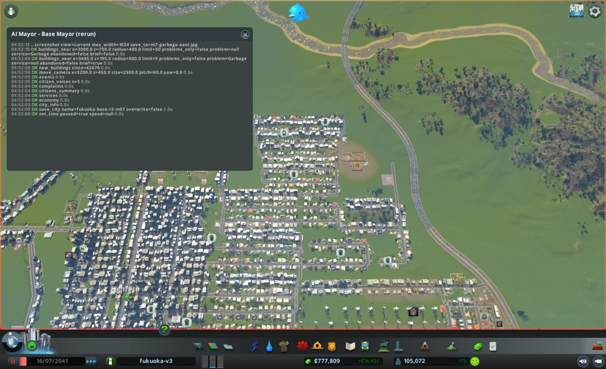
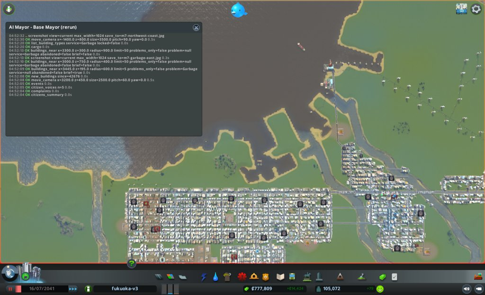
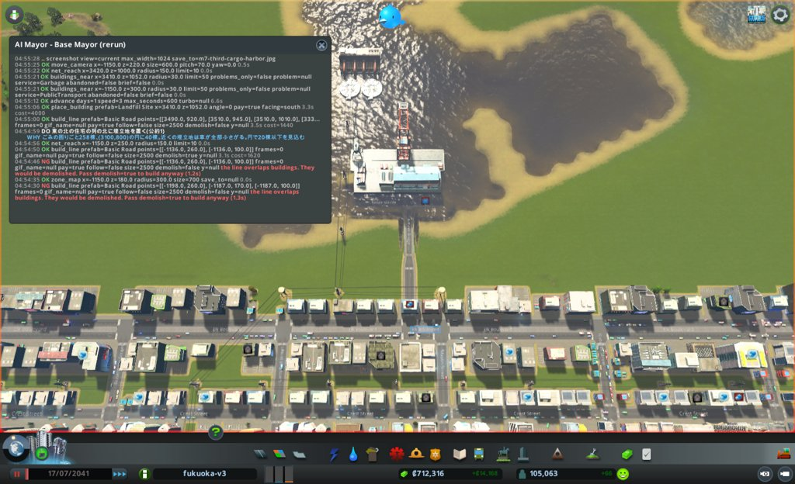
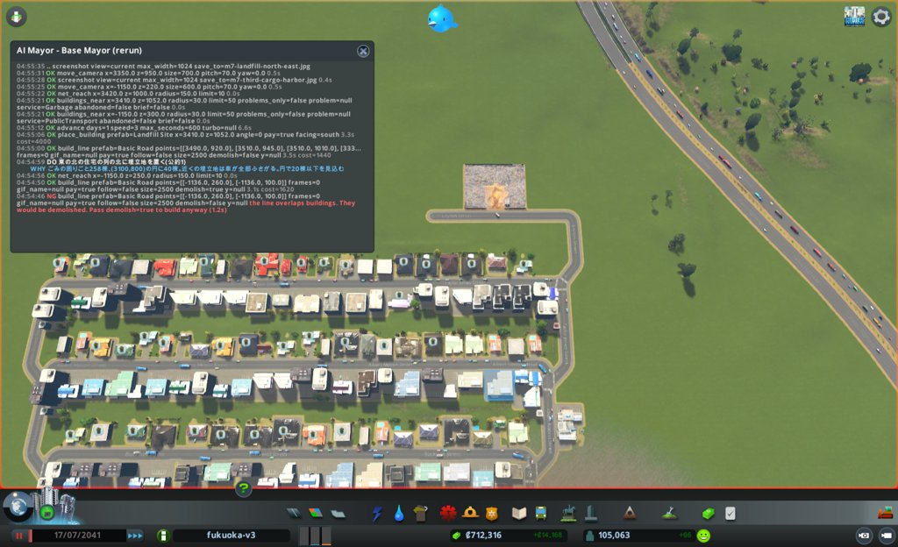

### 2041-07-26 見回り

施策の確かめで1日進めたので、`advance(9)` で月例から10日の日付に合わせた。
境目: 当たらず。つぶやき2件(困りごとではない)。来ない市民0/0/0。週の収支 +12,577(前回 +14,424。港の維持費の分だけ下がったが黒字)。
港 17343 は出る車0、入る車5。新しい港 2090 は出る車670、その出口に544台が止まる。品物の届かない店268棟。埋立地 2741 は収集車19/19が動き、たまり0%。

### 2041-08-05 見回り

境目: 当たらず。つぶやき2件(ごみの不満1件。3件に届かない)。来ない市民0/0/0。週の収支 +13,840(前回 +12,577)。

### 2041-08-15 7か月目の終わり(次の月例の前の記録)

`advance(10)` で 2041-08-15 に着いた。ダイアログなし。月例は次の呼び出しで行う。
次の月例の答え合わせのために、着いた時点の事実を残す。

- 人口105,702、所持金768,200、週の収支 +14,443(収入159,432、支出144,989)、幸福度81、需要 0 / 2 / 2、来ない市民0/0/0
- ごみの困りごと 258→171棟。(3100, 800) の半径400mは 40→7棟。いちばん多い区画は西 (-1711, -537) の52棟
- 品物の届かない店 258→287棟(多いのは (-1267, -792) の156棟、(-2263, -819) の49棟、(-986, 77) の44棟)
- 港 17343 から出る車91台、入る車11台。その出口 (-1155, 274) に74台が止まる。新しい港 2090 は出る車641台で、出口の止まった車 545→463台。古い港は30台。止まったトラックの合計 643→687
- 失業10,666人のうち大学卒10,444人。体調の悪い市民660、病気1,466
- 困りごとのある建物 555→488棟。死体10棟、騒音8棟、汚染4棟

## 申し送り(8か月目の月例へ)

- 東の北の埋立地 2741 は効いた見込み((3100, 800) の円で40→7棟、街全体 258→171棟)。ごみのいちばん多い所は西 (-1711, -537) の52棟に戻った。西の埋立地 24493 と近くの3つの車の様子を見る
- 3つめの港 17343 は出る車が0→91台に増え始めた。品物の届かない店は 258→287 とまだ増えている。港の出口(片側1車線)に74台が止まり始めた
- 港の出口の道を作るとき、品物の届かない店 9911 を1棟取り壊した
- 月例で `new_buildings(since=43077)` を呼ぶ

### 2041-08-15 月例(8か月目)

保存: `fukuoka-base-r2-m08`(2041-08-15)

#### 答え合わせ

1. 北西の入り江の3つめの貨物港 17343: 外れ
   - 予想: 品物の届かない店が258棟から180棟以下、西 (-1254, -813) の不足が138棟から90棟以下
   - 結果: 街全体287棟、西 (-1267, -792) は156棟。港 17343 から出る車は0→91台、その出口 (-1155, 274) に74台が止まる。新しい港 2090 の出口の止まった車は 545→463台
   - 見立て: 荷は少し分かれたが、輸入の荷の大半(出る車641台)は今も港 2090 から出ている。港 2090 の出口では、港の道の先の Basic Road(31030、6m)が混み具合100。本線(Small 4 Lane Road)より格下の道なので、合流で譲らされていると見る
   - 次の扱い: 続ける(港は残す)。港 2090 の出口の合流を手当てする(今月の施策2)
2. 東の北の埋立地 2741: 当たり
   - 予想: (3100, 800) の半径400mのごみの困りごとが減り、街全体が258棟から200棟以下
   - 結果: 円の中は40→7棟。街全体は171棟。2741 は収集車19/19が動く
   - 次の扱い: 続ける

- 「次にやること」の実行
  - 港 17343 の出る車、埋立地 2741 の収集車: 見回りで確かめた(実行した)
  - `new_buildings(since=43077)`: 呼んだ(実行した)。高密度商業51、工業31、オフィス8
  - 品物の届かない店と (3100, 800) のごみの数: 数えた(実行した。上の答え合わせ)
- 公約の進み具合
  1. 人口: 105,072 → 105,702(+630)。達成
  2. 電気・水・下水が来ない市民: 0 / 0 / 0。任期の終わりまで4か月
  3. 週の収支: +14,443(収入159,432、支出144,989)。黒字

#### 気づいたこと

- 住宅の需要は0のまま。失業10,666人のうち大学卒10,444人。働き手42,609、働き口44,016
- ごみの困りごと171棟。いちばん多い区画は西 (-1711, -537) の52棟。半径700mの45棟のうち約30棟は x -1440〜-1200、z -1080〜-620 の高密度住宅に集まる。ここは埋立地 24493(-1730, -686)から300〜500m東で、街区は建物で埋まり、置ける空き地がない
- 西の埋立地: 24493 は8%で車19/19、20041 は54%で19/19、42584 は83%で19/19、34558 は99%で3/19(もうすぐ満杯)
- 満杯の埋立地は5つ(11708、12700、39056、40118、43004)。どれも収集車19台が遊んでいる。43004(-650, -490)は西の不足の街の東、北の Basic Road(z -440)に面する
- 港 2090 の出口: 港の道 4179(片側1車線)の南の端から、Basic Road 31030(6m)で本線(Small 4 Lane Road)の点 30631 に合流する。31030 の混み具合100、港の道77。信号なし
- 品物の届かない店287棟(多いのは西 (-1267, -792) の156棟)。止まったトラック687台
- 医療は容量2,700に対して使用1,459。体調の悪い市民660
- 市民の声: 5人のうち1人は大学卒で7週失業。1人は家にごみの困りごと(-1068, -1256)。つぶやき0件

#### 施策

1. 満杯の埋立地 43004 を取り壊し、同じ場所に新しい埋立地を置く
   - 公約: 1(暮らしの困りごとを減らし、人が出ていかないようにする)
   - 捨てるもの: なし
   - 理由: 西のごみの集まる住宅は空き地がなく、新しく置けない。43004 は満杯で車19台が遊んでいる。置き直せば、維持費を増やさずに受け入れと収集車19台が戻る
   - 取り壊す理由: 43004 は100%で受け入れを止めている。空にするのは4946 で4か月21%と遅かった。`preview_bulldoze` で失う家・働き口0、停電0
   - 予想: 建設費4,000、週の維持費の増分0(同じ種類を置き直すため)。次の月例で、西 (-1711, -537) の半径700mのごみの困りごとが45棟から25棟以下に、街全体が171棟から130棟以下に減る
   - 操作: `bulldoze`(-650, -490、半径5、building)、`place_building`(Landfill Site、-650, -490、facing north)
2. 港 2090 の出口の合流の道 31030 を、本線と同じ Small 4 Lane Road にする
   - 公約: 1と3(品物が届けば店の放棄が止まり、働き口と税が保たれる)
   - 捨てるもの: なし
   - 理由: 港の出口の Basic Road 31030 は混み具合100。格下の道から本線へ合流するので譲らされる。本線と同じ格にして車線も2つにする
   - 予想: 建設費は数十、週の維持費はわずか(6m)。次の月例で、港 2090 の出口の止まったトラックが463台から300台以下に、品物の届かない店が287棟から250棟以下に減る
   - 操作: `upgrade_road`(Small 4 Lane Road、(-345, 1312)→(-334, 1294))

#### 実行の結果

1. 埋立地: 43004 を取り壊した(費用0)。同じ場所に北向きで置けた(id 26323、4,000)。入口は Basic Road(segment 18950)から10m
   - 確かめ: `net_reach`(半径100m)で道路に面しない・来られない建物0。画面写真で、北の道路に面しているのを見た
2. 合流の道 31030: 差し替えられなかった(upgraded 0、理由 ObjectCollision, TooShort)。費用0。施策は打てずに終わった

#### 考えたが打たなかった手

- 合流の点 30631 に信号か譲れの標識を付ける: 本線の北からの区間(33477)の混み具合は3で、本線が詰まっているわけではない。止まりの元は港の道の片側1車線と見る。効き目の読めない手を代わりに打たない
- 満杯の埋立地4つ(11708、12700、39056、40118)も置き直す: 43004 で効くかを見てから。1つずつ効き目を分けて見る
- もうすぐ満杯の 34558(99%)を置き直す: まだ受け入れている。満杯になってから
- 医療の予算を戻す: 体調の悪い市民は660で、決まり(700超え)に届いていない
- 消防と警察の予算(140%)を下げる: 黒字は保てている。効き目を分けて見るため今月は動かさない

#### 次にやること

- 見回りで、埋立地 26323 の収集車が動いているかを確かめる
- 来月の月例で `new_buildings(since=43549)` を呼ぶ
- 来月の月例で、西 (-1711, -537) の半径700mのごみの困りごと(今45棟)と、港 2090 の出口の止まったトラック(今463台)を数える

#### 画面写真

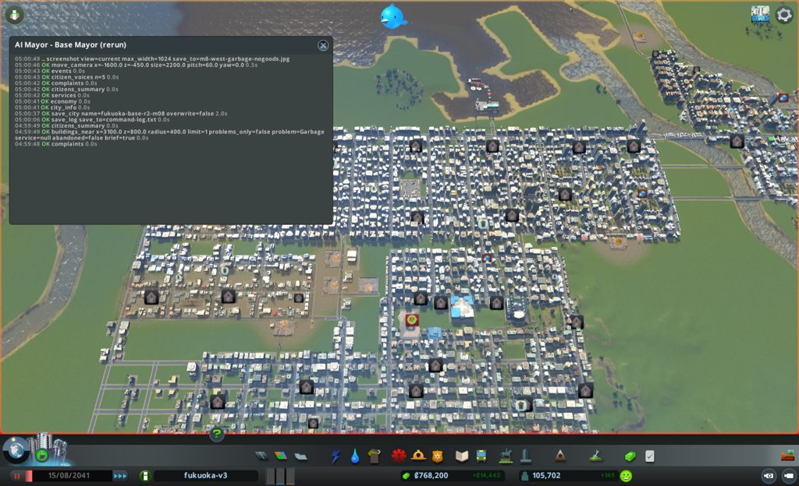
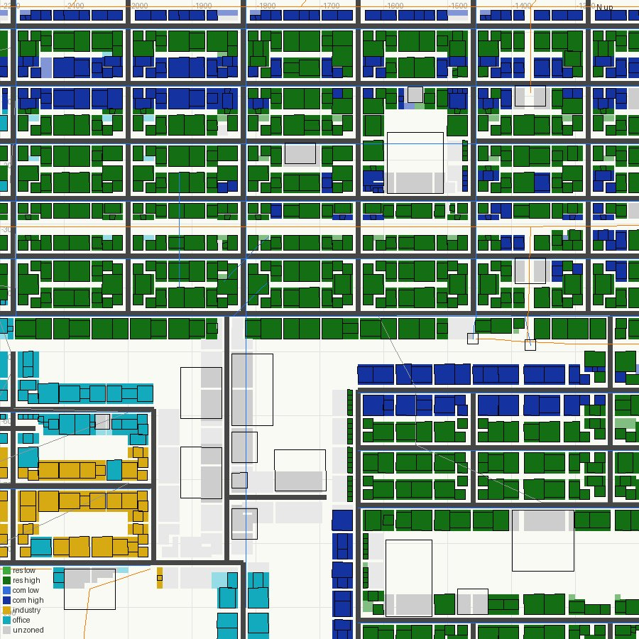
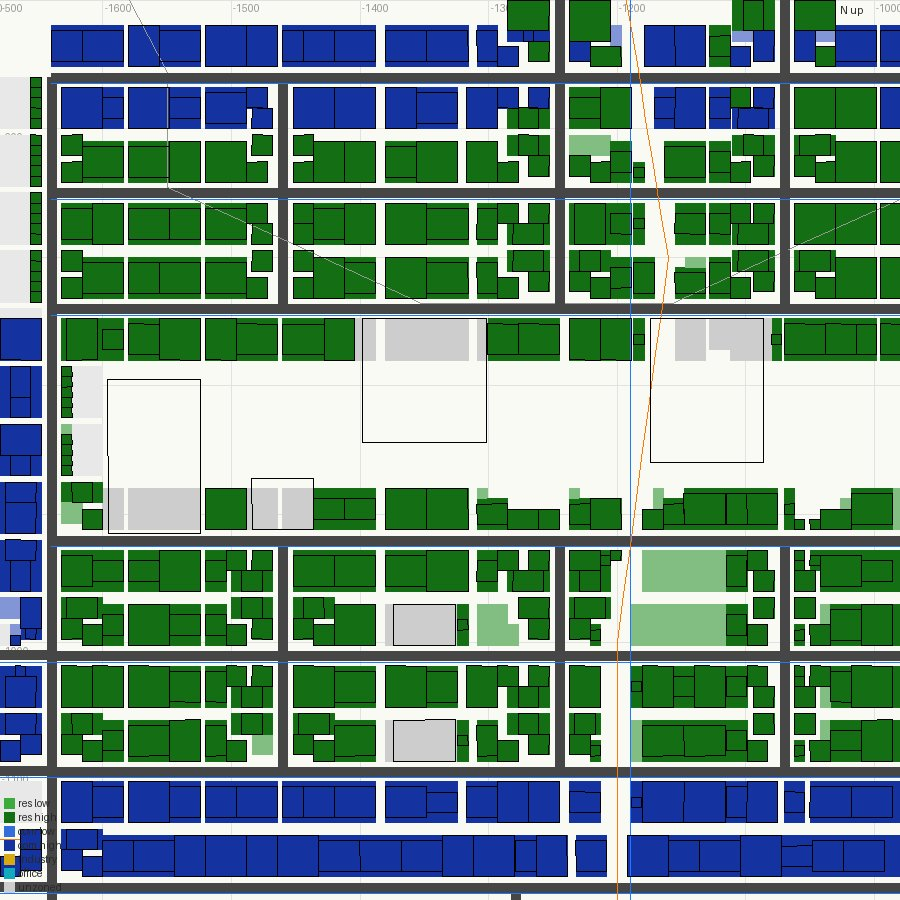
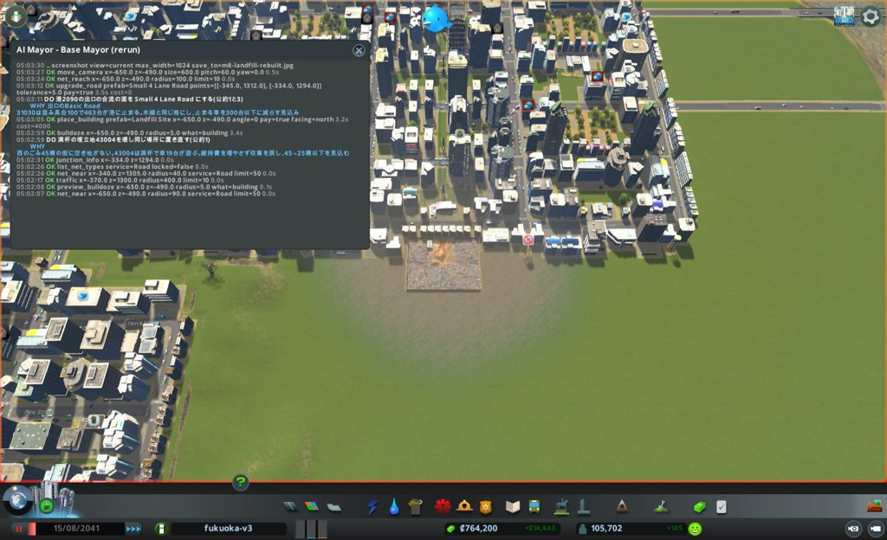

### 2041-08-25 見回り

境目: 当たらず。つぶやき2件(水の不満1件。3件に届かない)。来ない市民0/0/0。週の収支 +14,556(前回 +14,443)。
埋立地 26323 は収集車19/19が動き、たまり0%。

### 2041-09-04 見回り

境目: 当たらず。つぶやき1件(困りごとではない)。来ない市民0/0/0。週の収支 +14,637(前回 +14,556)。

### 2041-09-14 8か月目の終わり(次の月例の前の記録)

`advance(10)` で 2041-09-14 に着いた。ダイアログなし。月例は次の呼び出しで行う。
次の月例の答え合わせのために、着いた時点の事実を残す。

- 人口106,331、所持金827,107、週の収支 +14,476(収入159,466、支出144,990)、幸福度81、需要 0 / 2 / 4、来ない市民0/0/0
- ごみの困りごと 171→89棟。西 (-1711, -537) の半径700mは 45→16棟。いちばん多い区画は南西 (-1559, -1363) の15棟
- 品物の届かない店 287→345棟(多いのは (-1241, -787) の175棟、(-1053, 77) の57棟、(-2290, -759) の56棟)
- 止まったトラック 687→557。港 2090 の出口 (-369, 1360) は 463→194台。港 17343 の出口 (-1150, 280) は 74→239台
- 出る車: 港 2090 は 641→361台、港 17343 は 91→310台、古い港 43449 は4台。荷が北西の港へ移った
- 原料の届かない工場 83→72棟
- 失業10,942人のうち大学卒10,706人。体調の悪い市民569、病気1,432
- 困りごとのある建物 488→468棟。汚染10棟(東の端 (3862, -256) に5棟)、死体9棟

## 申し送り(9か月目の月例へ)

- 置き直した埋立地 26323 は効いた見込み(西の円で45→16棟、街全体171→89棟)。満杯の埋立地はまだ4つ(11708、12700、39056、40118)ある。同じ手(壊して置き直す、4,000、維持費の増分0)が使える。34558 は先月99%
- 港 2090 の出口の合流の道 31030 は短すぎて太くできなかった。何もしていないのに、港 2090 の止まった車は 463→194台に減った。荷が港 17343 に移ったため
- 品物の届かない店が 287→345 に増えた。荷の移った港 17343 の出口(港の道 → Basic Road の橋 → z 100 の Medium Road)に239台が止まる。港の道の東西の端(-1198, 260)と(-1102, 260)は今どこにもつながっていない
- 月例で `new_buildings(since=43549)` を呼ぶ

### 2041-09-14 月例(9か月目)

保存: `fukuoka-base-r2-m09`(2041-09-14)

#### 答え合わせ

1. 満杯の埋立地 43004 を壊し、26323 を置き直す: 当たり
   - 予想: 西 (-1711, -537) の半径700mのごみの困りごとが45棟から25棟以下、街全体が171棟から130棟以下
   - 結果: 西の円は16棟、街全体は89棟。26323 は収集車19/19が動く
   - 次の扱い: 続ける。満杯の埋立地に同じ手を使う(今月の施策2)
2. 港 2090 の出口の合流の道 31030 を太くする: 打てず(差し替えられなかった)
   - 予想: 港 2090 の出口の止まった車が463台から300台以下、品物の届かない店が287棟から250棟以下
   - 結果: 港 2090 の出口は194台に減った。品物の届かない店は345棟に増えた
   - 見立て: 止まりが減ったのは道ではなく、荷が港 17343 へ移ったため(出る車 641→361 と 91→310)。止まりの場所が港 17343 の出口(239台)に移った
   - 次の扱い: やめる(31030 は短すぎて太くできない)。港 17343 の出口を手当てする(今月の施策1)

- 「次にやること」の実行
  - 埋立地 26323 の収集車: 見回りで確かめた(実行した)
  - `new_buildings(since=43549)`: 呼んだ(実行した)。高密度商業55、工業26、オフィス7
  - 西のごみと港 2090 の止まった車: 数えた(実行した。上の答え合わせ)
- 公約の進み具合
  1. 人口: 105,702 → 106,331(+629)。達成
  2. 電気・水・下水が来ない市民: 0 / 0 / 0。任期の終わりまで3か月
  3. 週の収支: +14,476(収入159,466、支出144,990)。黒字

#### 気づいたこと

- 住宅の需要は0のまま。働き口の項 -45、家の項 -10。働き口を探す人11,562人のうち大学卒11,192人。働き口の需要は target 95、actual 4
- 品物の届かない店345棟。complaints のいちばん多い区画は (-1736, -138) の133棟。cargo では (-1241, -787) の175棟
- 港 17343 の出口: 港の道(片側1車線)の中ほど (-1136, 260) から Basic Road の橋 19375 と道 10711 で Medium Road(z 100)へ出る1本だけ。橋、道、港の道 23788 とも混み具合100。港の道の東西の端 (-1198, 260) と (-1102, 260) はどこにもつながっていない
- 港の道の南の z 124 には店が並び、東の端の真南は店と給水塔でふさがる。西の端の南西 (-1306, 100) の Medium Road の点は、北へ道がなく、店の間が空いている
- 満杯の埋立地は5つ(11708、12700、34558、39056、40118)。34558 が新しく満杯になった(車0/19)
- 医療は容量2,700に対して使用1,437。体調の悪い市民569。警察は440に273
- 市民の声: 5人とも困りごとなし。つぶやき1件(困りごとではない)

#### 施策

1. 港 17343 の出口を広げる
   - 公約: 1と3(品物が届けば店の放棄が止まり、働き口と税が保たれる)
   - 捨てるもの: なし
   - 理由: 港の出口は片側1車線の橋1本で、混み具合100、239台が止まる。荷は港 2090 からこの港へ移ってきている
   - 予想: 建設費は約3,000、週の維持費の増分は約10。次の月例で、港 17343 の出口の止まったトラックが239台から120台以下に、品物の届かない店が345棟から300棟以下に減る
   - 操作: 出口の橋と道を Small 4 Lane Road に差し替える(`upgrade_road`)。差し替えられなければ、港の道の西の端 (-1198, 260) から (-1306, 100) へ Basic Road で2本めの出口を引く
2. 満杯の埋立地 34558 を壊し、同じ場所に置き直す
   - 公約: 1(暮らしの困りごとを減らし、人が出ていかないようにする)
   - 捨てるもの: なし
   - 理由: 34558(-1885, -690)は満杯で車0/19。先月 43004 で同じ手が効いた(西の円で45→16棟)
   - 取り壊す理由: 満杯で受け入れを止めている。`preview_bulldoze` で失う家・働き口0、停電0
   - 予想: 建設費4,000、週の維持費の増分0。次の月例で、街全体のごみの困りごとが89棟から70棟以下に減る
   - 操作: `bulldoze`(-1885, -690、半径5、building)、`place_building`(Landfill Site、-1885, -690、facing east)

#### 実行の結果

1. 港の出口: 陸の道 10711 は Small 4 Lane Road に差し替えた(費用0)。橋 19375 は Small 4 Lane Road でも Medium Road でも差し替えられなかった(CannotBuildOnWater)。そこで西の端 (-1198, 260) から (-1303, 200) を経て (-1306, 100) へ Basic Road を引いた(4区間、うち橋2、2,440)。両端とも既存の点につながった(港の道と Medium Road)。重なった建物0
   - 確かめ: `net_reach`(-1200, 200、半径200)で入れない・出られない区間0、来られない建物0。画面写真で、港の西から南西へ新しい橋が Medium Road に下りているのを見た
2. 埋立地: 34558 を取り壊した(費用0)。同じ場所に東向きで置けた(id 2907、4,000)。入口は Basic Road(segment 18176)から0m
- 建設費の合計 6,440(所持金827,107の半分より小さい)

#### 考えたが打たなかった手

- 残りの満杯の埋立地4つ(11708、12700、39056、40118)もまとめて置き直す: 1つずつ効き目を見てきた。ごみは89棟と減っている。来月の数字を見てから
- 港 17343 の東の端 (-1102, 260) からも出口を引く: 真南は店と給水塔でふさがる。店を壊すと働き口が減る。西の出口の効き目を見てから
- 医療の予算を戻す: 体調の悪い市民は569で、決まり(700超え)に届かない
- 消防と警察の予算(140%)を下げる: 黒字は保てている。港の効き目を分けて見るため、今月は動かさない
- 大学卒の失業に手を打つ: 働き口の需要は target 95 だが、建つ棟の数で抑えられている(1か月に商業55、工業26、オフィス7)。税はオフィス1%、工業1%で、もう下げられない

#### 次にやること

- 見回りで、港 17343 の出口の止まった車(cargo)と、埋立地 2907 の収集車を確かめる
- 来月の月例で `new_buildings(since=43938)` を呼ぶ
- 来月の月例で、港 17343 の出口の止まったトラック(今239台)、品物の届かない店(今345棟)、ごみの困りごと(今89棟)を数える

#### 画面写真

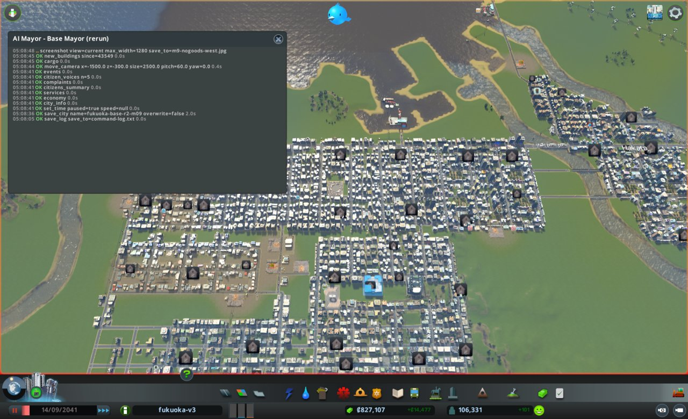
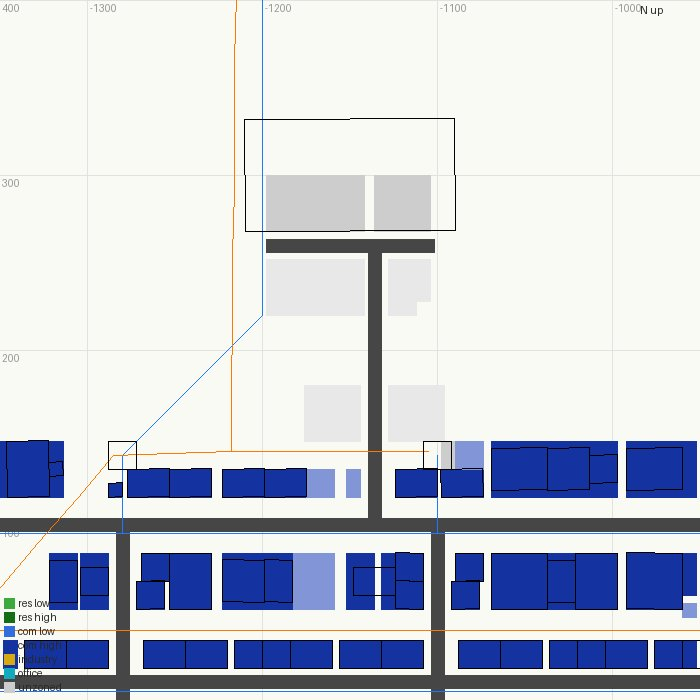
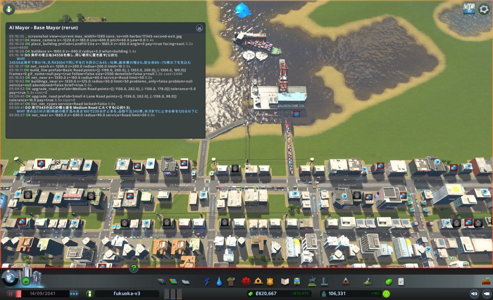

### 2041-09-24 見回り

境目: 当たらず。つぶやき1件(困りごとではない)。来ない市民0/0/0。週の収支 +14,011(前回 +14,476。黒字のまま)。
埋立地 2907 は収集車19/19が動き、たまり0%。港 17343 の出口 (-1150, 279) の止まった車は 239→263台。新しい出口の道 23717 は混み具合40で使われ始めたが、元の橋 19375 と港の道 23788 は混み具合100のまま。品物の届かない店377棟。

### 2041-10-04 見回り

境目: 当たらず。つぶやき1件(死体の引き取りの不満1件。3件に届かない)。来ない市民0/0/0。週の収支 +14,268(前回 +14,011)。

### 2041-10-14 9か月目の終わり(次の月例の前の記録)

`advance(10)` で 2041-10-14 に着いた。ダイアログなし。月例は次の呼び出しで行う。
次の月例の答え合わせのために、着いた時点の事実を残す。

- 人口106,536、所持金882,024、週の収支 +14,495(収入159,504、支出145,009)、幸福度81、需要 0 / 2 / 5、来ない市民0/0/0
- 港 17343 の出口: 止まった車 239→274台((-1149, 280)、港の中)。橋 19375、港の道 23788、陸の道 5005(Small 4 Lane に差し替えた区間)は混み具合100のまま。新しい西の出口の先の Medium Road 27601 は混み具合73
- 出る車: 港 17343 は 310→363台、港 2090 は 361→219台(出口の止まった車 194→50)。止まったトラックの合計 557→511
- 品物の届かない店 345→408棟(多いのは (-1240, -775) の200棟、(-2318, -722) の73棟、(-1104, 77) の62棟)。原料の届かない工場 72→60棟
- ごみの困りごと 89→78棟。いちばん多い区画は南西 (-1491, -1296) の21棟。満杯の埋立地は4つ(11708、12700、39056、40118)
- 騒音 7→17棟((-1464, -607) に10棟)。死体 9→4棟。汚染10棟
- 失業11,239人のうち大学卒11,004人。体調の悪い市民 569→470、病気1,396
- 水の容量 1,860,000→1,740,000(使用1,194,832)。電気の容量 1,737,952→1,928,192
- 困りごとのある建物 468→527棟

## 申し送り(10か月目の月例へ)

- 港 17343 の2本めの出口(西の橋)は使われているが、港の中の止まった車は 239→274台で減っていない。元の出口(橋 19375 と、その先の Medium Road の点 (-1136, 100))が混み具合100のまま。荷はさらに港 17343 へ寄った(出る車 363、港 2090 は219)。品物の届かない店は 345→408 と増え続けている
- 東の端 (-1102, 260) はまだどこにもつながっていない(真南は店と給水塔)
- 置き直した埋立地 2907 は収集車19/19が動く。ごみは 89→78棟。満杯の埋立地はまだ4つ(11708、12700、39056、40118)
- 月例で `new_buildings(since=43938)` を呼ぶ

### 2041-10-14 月例(10か月目)

保存: `fukuoka-base-r2-m10`(2041-10-14)

#### 答え合わせ

1. 港 17343 の出口を広げる: 外れ
   - 予想: 港 17343 の出口の止まったトラックが239台から120台以下、品物の届かない店が345棟から300棟以下
   - 結果: 止まったトラック274台((-1149, 280))。品物の届かない店408棟。新しい西の出口の先の Medium Road 27601 は混み具合73で使われている。陸の道 5005(Small 4 Lane)、橋 19375、港の道 23788 は混み具合100のまま
   - 見立て: 道の太さではなく、出口が Medium Road(z 100)に出る交差点 (-1136, 100) の信号で止まっている。36m 東の (-1100, 100) にも信号があり、2つの信号が続く。`traffic` の止まった車は (-1134, 218) と (-1134, 176)、橋と陸の道に並ぶ。荷はさらに港 17343 へ寄った(出る車 310→363、港 2090 は 361→219)
   - 次の扱い: 西の出口は残す。交差点の信号を手当てする(今月の施策1)
2. 満杯の埋立地 34558 を壊し、2907 を置き直す: 当たり
   - 予想: 街全体のごみの困りごとが89棟から70棟以下
   - 結果: 78棟。70棟以下には届かなかったが減った。2907 は収集車19/19が動き、たまり1%
   - 見立て: 西の円は効いた。残りは南西 (-1491, -1296) の21棟で、近くの埋立地は 600〜900m 離れ、どれも車19/19がふさがっている
   - 次の扱い: 続ける。南西に埋立地を足す(今月の施策2)

- 「次にやること」の実行
  - 港 17343 の出口の止まった車と、埋立地 2907 の収集車: 見回りで確かめた(実行した)
  - `new_buildings(since=43938)`: 呼んだ(実行した)。高密度商業56、工業24、オフィス5
  - 港 17343 の止まったトラック、品物の届かない店、ごみの困りごと: 数えた(実行した。上の答え合わせ)
- 公約の進み具合
  1. 人口: 106,331 → 106,536(+205)。達成。ただし増え方は +629 から +205 に落ちた
  2. 電気・水・下水が来ない市民: 0 / 0 / 0。任期の終わりまで2か月
  3. 週の収支: +14,495(収入159,504、支出145,009)。黒字

#### 気づいたこと

- 住宅の需要は0のまま。働き口の項 -46、家の項 -11。働き口を探す人11,765人のうち大学卒11,458人。働き口の需要は target 96、actual 5
- 人口の増え方が落ちている(+1,200 → +945 → +995 → +723 → +548 → +521 → +629 → +205)。住宅の需要0のまま、生まれる人と家のレベル上げに頼っている
- 品物の届かない店408棟。complaints の区画は (-1790, -140) の163棟、cargo では (-1240, -775) の200棟。Goods の止まったトラック244台
- 古い港 43449 から出る車は2台だけ。荷は港 17343(363台)と 2090(219台)に移った
- ごみの困りごと78棟。南西 (-1491, -1296) に21棟。南西の街の南の端(z -1730 の Basic Road)の南は、z -1790 より南が空き地。x -1200 で南のオフィスの列の間に線(管・送電線)の通る隙間がある
- 埋立地 42584(-2060, -872)は91%。来月には満杯になりうる
- 政策の費用は週6,928、借入の返済は週696
- 市民の声: 5人とも困りごとなし。つぶやき0件

#### 施策

1. 港 17343 の出口の交差点の信号を外す
   - 公約: 1と3(品物が届けば店の放棄が止まり、働き口と税が保たれる)
   - 捨てるもの: なし
   - 理由: 港の出口は交差点 (-1136, 100) の信号で止まる。36m 東の (-1100, 100) にも信号があり、列が続く。T字の交差点の信号を外すと流れがよくなることが多い。費用0で、戻せる
   - 予想: 費用0、維持費0。次の月例で、港 17343 の出口の止まったトラックが274台から150台以下に、品物の届かない店が408棟から350棟以下に減る。詰まりがひどくなったら、次の見回りで信号を戻す
   - 操作: `set_traffic_lights`(-1136, 100、false)と(-1100, 100、false)
2. 南西の街の南の端に埋立地を1つ置く
   - 公約: 1(暮らしの困りごとを減らし、人が出ていかないようにする)
   - 捨てるもの: なし
   - 理由: 南西 (-1491, -1296) にごみの困りごと21棟。近い埋立地は 600〜900m 離れ、収集車が全部ふさがっている。東南・南西・西で同じ手が地元で効いた
   - 予想: 建設費は埋立地4,000と道路約500、週の維持費160と道路約10。黒字14,495の範囲。次の月例で、南西 (-1491, -1296) の半径600mのごみの困りごとが21棟から10棟以下に、街全体が78棟から60棟以下に減る
   - 操作: Basic Road を z -1730 の道 (-1200, -1730) から南へ (-1200, -1840) まで引き、埋立地を道の東か西に置く

#### 実行の結果

1. 信号: (-1136, 100) と (-1100, 100) の信号を外した(trafficLights=false、customLights=true)。費用0
   - 確かめ: `advance(1)` の後の `traffic`(半径300)は、まだ港の道 23788、橋 19375、陸の道 5005 が混み具合100、止まった車15台。効き目は見回りで見る
2. 埋立地: 道路は z -1730 の道を分けてつながった(2区間、640)。埋立地は (-1150, -1830) に西向きで置けた(id 39755、4,000)。入口は道路から10m。取り壊した建物0
   - 確かめ: `advance(1)` の後、収集車2/19が動き始めた。`net_reach`(-1180, -1800、半径150)で道路に面しない・来られない建物0。画面写真で、オフィスの列の南に道路と埋立地が置けたのを見た
- 建設費の合計 4,640(所持金882,024の半分より小さい)

#### 考えたが打たなかった手

- 港 17343 の東の端 (-1102, 260) から出口を引く: 真南は店3棟と給水塔 27882 でふさがる。店を壊すと働き口が減る。信号の効き目を先に見る
- 残りの満杯の埋立地4つ(11708、12700、39056、40118)を置き直す: ごみの困りごとが多いのは南西で、満杯の4つは南西から遠い。南西の埋立地の効き目を分けて見る
- 91%の埋立地 42584 を先に置き直す: まだ受け入れている。満杯になってからでよい
- 住宅の需要を上げる(大学卒の働き口を増やす): 働き口の需要は target 96 だが、建つ棟の数で抑えられている(1か月にオフィス5棟)。税はオフィス・工業とも1%で下げられない。1か月で打てる手が見つからない
- 消防と警察の予算(140%)を下げる: 黒字は保てている。人口の増え方が落ちているので、サービスを削るのは見送る

#### 次にやること

- 見回りで、港 17343 の出口の止まった車(cargo)と、交差点 (-1136, 100) のまわりの混み具合(traffic)を確かめる。止まった車が274台より増えていたら、信号を戻すかを考える(戻すのは次の月例)
- 見回りで、埋立地 39755 の収集車が動いているかを確かめる
- 来月の月例で `new_buildings(since=44338)` を呼ぶ
- 来月の月例で、南西 (-1491, -1296) の半径600mのごみの困りごとを数える

#### 画面写真

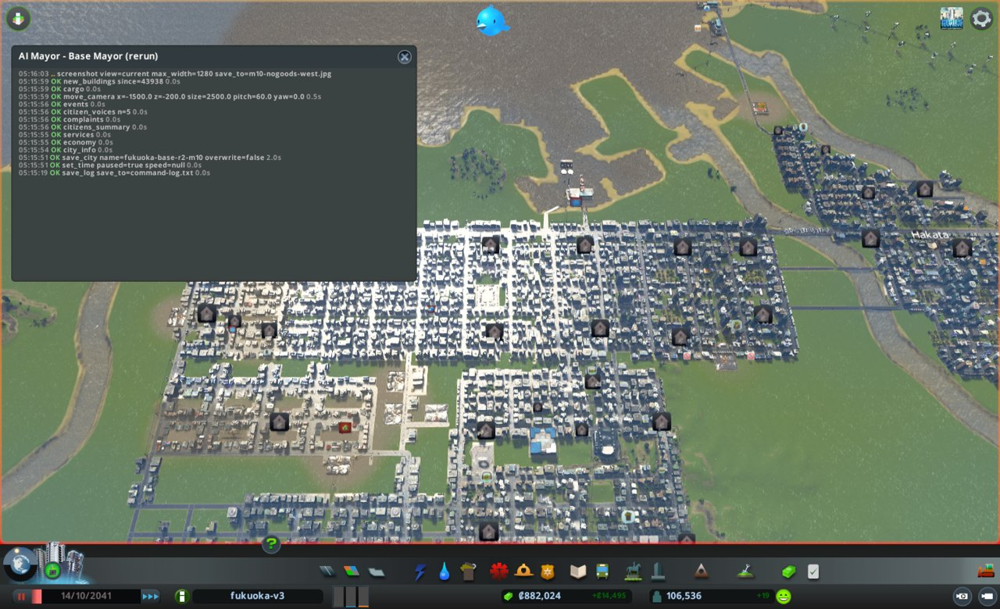
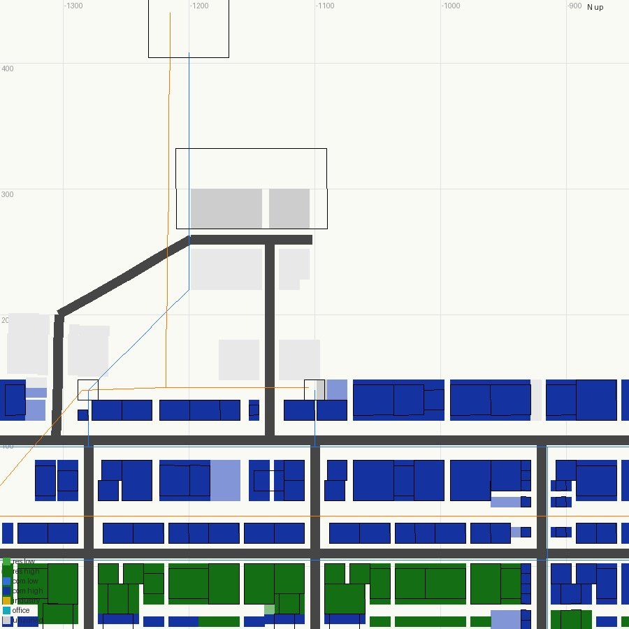
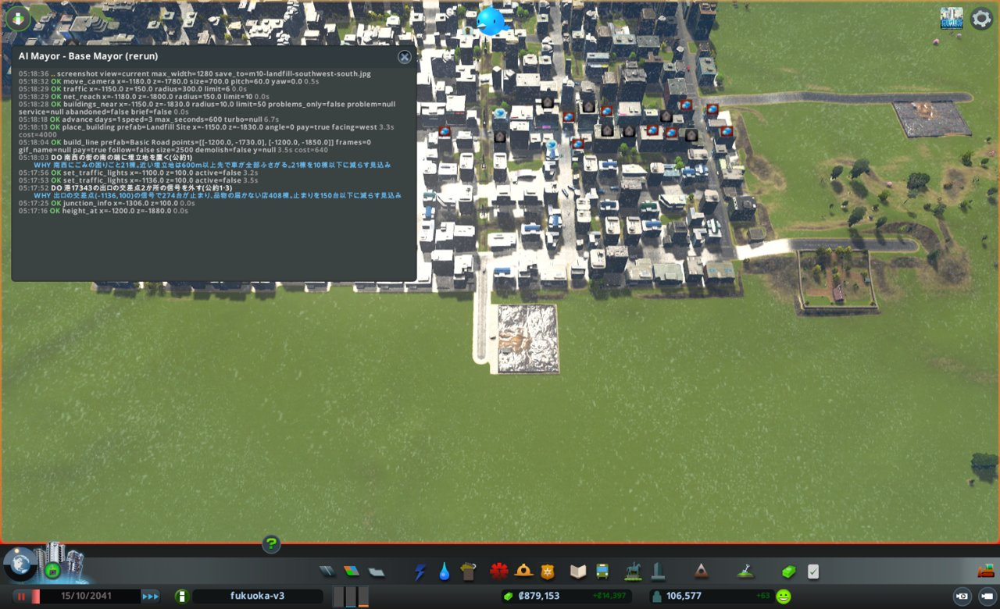

### 2041-10-24 見回り

施策の確かめで1日進めたので、`advance(9)` で月例から10日の日付に合わせた。
境目: 当たらず。つぶやき2件(放棄の建物の不満1件。3件に届かない)。来ない市民0/0/0。週の収支 +14,091(前回 +14,495。黒字のまま)。幸福度 81→82。
港 17343 の止まった車 274→245台((-1150, 284))、出る車361台。品物の届かない店 408→403棟。埋立地 39755 は収集車19/19が動き、働き手9人。

### 2041-11-03 見回り

境目: 当たらず。つぶやき1件(土の汚染の不満1件)。来ない市民0/0/0。週の収支 +14,647(前回 +14,091)。

### 2041-11-13 10か月目の終わり(次の月例の前の記録)

`advance(10)` で 2041-11-13 に着いた。ダイアログなし。月例は次の呼び出しで行う。
次の月例の答え合わせのために、着いた時点の事実を残す。

- 人口106,647、所持金939,356、週の収支 +14,859(収入160,103、支出145,244)、幸福度82、需要 0 / 2 / 12、来ない市民0/0/0
  - 人口は月例の106,536より+111。ただし前の見回り(106,766)より119減った
- 港 17343 の出口: 止まった車 274→199台((-1149, 281))。出る車 363→324台。港 2090 の出る車 219→199、出口の止まった車 50→29。止まったトラックの合計 511→377
  - `traffic`(半径300)で、止まった車 15→1台。港の道 23788、橋 19375、陸の道 5005、Medium Road 16305 と 15388 は混み具合100のまま。西の出口の先の Medium Road 27601 は 73→95
- 品物の届かない店 408→398棟(多いのは (-1229, -751) の185棟)。原料の届かない工場 60→46棟
- ごみの困りごと 78→37棟。南西 (-1491, -1296) の半径600mは5棟で、5棟とも FatalProblem(放棄の手前か放棄)。いちばん多い区画は東南 (2066, -433) の11棟
- 騒音16棟、汚染4棟、死体5棟
- 失業11,606人のうち大学卒11,392人。体調の悪い市民 470→430
- 困りごとのある建物 527→471棟

## 申し送り(11か月目の月例へ)

- 信号を外した後、港 17343 の止まった車は 274→245→199台と減った。品物の届かない店は 408→398 と横ばい。出口の道は混み具合100のまま
- 南西の埋立地 39755 は収集車19/19が動く。南西の円のごみは21→5棟(5棟とも FatalProblem)。ごみは東南 (2066, -433) の11棟に移った
- 人口は月例どうしでは +111 だが、最後の10日で119減った。住宅の需要は0のまま。公約1は次の月例で落ちるおそれがある
- 埋立地 42584(-2060, -872)は先月91%。満杯なら置き直しを考える
- 月例で `new_buildings(since=44338)` を呼ぶ

### 2041-11-13 月例(11か月目)

保存: `fukuoka-base-r2-m11`(2041-11-13)

#### 答え合わせ

1. 港 17343 の出口の交差点2か所の信号を外す: 外れ(近い)
   - 予想: 港 17343 の出口の止まったトラックが274台から150台以下、品物の届かない店が408棟から350棟以下
   - 結果: 止まったトラック199台((-1149, 281))。品物の届かない店398棟。止まったトラックの合計 511→377。港の道 23788、橋 19375、陸の道 5005 は混み具合100のまま
   - 見立て: 信号を外して列は短くなったが、出口の道そのものが混み具合100で、港の荷の量に追いつかない。品物の届かない店は港から遠い南西 (-1229, -751) に185棟あり、届くまでの道のりも長い
   - 次の扱い: 続ける(信号は外したまま)。港の出口にはこれ以上の手を今月は打たない
2. 南西の街の南の端の埋立地 39755: 当たり
   - 予想: 南西 (-1491, -1296) の半径600mのごみの困りごとが21棟から10棟以下、街全体が78棟から60棟以下
   - 結果: 南西の円は5棟(5棟とも FatalProblem)。街全体は37棟。39755 は収集車19/19が動く
   - 次の扱い: 続ける。ごみは東南 (2066, -433) の11棟に移った

- 「次にやること」の実行
  - 港 17343 の止まった車と交差点のまわりの混み具合、埋立地 39755 の収集車: 見回りと月の終わりの記録で確かめた(実行した)
  - `new_buildings(since=44338)`: 呼んだ(実行した)。高密度商業63、工業24、オフィス4
  - 南西の円のごみの困りごと: 数えた(実行した。上の答え合わせ)
- 公約の進み具合
  1. 人口: 106,536 → 106,647(+111)。達成。ただし増え方は +205 から +111 に落ち、最後の10日では119減った
  2. 電気・水・下水が来ない市民: 0 / 0 / 0。任期の終わりまで1か月
  3. 週の収支: +14,859(収入160,103、支出145,244)。黒字

#### 気づいたこと

- 住宅の需要は0のまま。`demand_breakdown` で働き口の項 -49(切る前も -49)、家の項 -11。働き口を探す人12,166人のうち大学卒11,815人。空いた働き口1,464、空き家1,849
  - 住宅の需要を0より上げるには、働き口の項を -39 より上にする必要がある。大学卒の働き口が約2,000以上要る
- 区画の建物(街全体): 工業1,057棟のうちサービスで止まる570棟で、いちばん伸ばせる項目は全部が貨物の輸送(cargoTransport)。オフィス1,528棟のうちサービスで止まる1,252棟(公共交通719、地面の汚染209、葬祭179)
  - 北東 (2300, 1100、半径800) の工業264棟はレベル2が233棟、レベル3が5棟。186棟が貨物の輸送で止まる。近くに貨物の港・駅はない(港はどれも x -400 より西)
- 高密度商業の放棄が242棟。放棄は全部で268棟(`preview_bulldoze`。失う家・働き口0、停電0)
- 品物の届かない店398棟(多いのは (-1229, -751) の185棟)。止まったトラック377台(港 17343 の中199)
- ごみの困りごと37棟。埋立地 42584(-2060, -872)は93%で、まだ受け入れている。満杯は4つ(11708、12700、39056、40118)
- 医療は容量2,700に対して使用1,382。体調の悪い市民430
- 市民の声: 5人とも困りごとなし。つぶやき0件

#### 施策

1. 北東の工業地の北に貨物駅(Cargo Center)を置く
   - 公約: 1。工業がレベル3に上がると、1棟の働き口が増え、学歴の高い働き口の割合も増える。大学卒の失業が減れば住宅の需要の働き口の項が上がる
   - 捨てるもの: なし
   - 理由: 北東の工業186棟が貨物の輸送で止まり、近くに貨物の施設がない。線路はつながないので、荷の流れは変えずに届き具合だけを足す
   - 予想: 建設費は貨物駅60,000と道路・管で約1,000、週の維持費1,440と道路約10。黒字14,859の範囲。次の月例で、北東 (2300, 1100、半径800) の工業のレベル3が5棟から30棟以上に増え、貨物の輸送で止まる棟が186から120以下に減る
   - 操作: Basic Road を z 1460 の道の (2455, 1460) から北へ (2455, 1670) まで引き、水道管も並べる。貨物駅を道の東に西向きで置く
2. 放棄された建物268棟をまとめて取り壊す
   - 公約: 1。放棄はオフィスと工業のレベル上げの点を引き、空いた区画に新しい店と働き口が建つ
   - 捨てるもの: なし
   - 理由: 高密度商業の放棄が242棟。止まったトラックは1,458台(1か月目)から377台に減り、品物は前より届く。`preview_bulldoze` で失う家・働き口0、停電0
   - 予想: 費用0。次の月例で、放棄が268棟から100棟以下になり、この1か月に建つ高密度商業が63棟より多くなる

#### 実行の結果

1. 貨物駅: 道路は z 1460 の道を分けてつながった(3区間、1,080)。水道管は既存の管の点 (2473, 1455) につながり、端は貨物駅の敷地の中(280)。貨物駅は (2496, 1600) に西向きで置けた(id 16936、60,000)。入口は道路から1m。取り壊した建物0。建設費の合計61,360(所持金939,356の半分より小さい)
   - 確かめ: `advance(1)` の後、貨物駅に電気・水・下水が来ていて、働き手30人。`net_reach`(2480, 1580、半径150)で道路に面しない・来られない建物0。画面写真で、工業地の北に道路と貨物駅が置けたのを見た
   - 近くの工場 2710(2432, 1300、レベル2)は、貨物の輸送が20点(届き具合40)、サービスの点66で、次のレベルに要る60を超えた。進み具合は 9/15
2. 放棄の取り壊し: 268棟を取り壊した。道路0。費用0

#### 施策(3件め)

3. 東南の工業地(x 3350〜3830、z -1100〜-1370)の南に、2つめの貨物駅を置く
   - 公約: 1。施策1と同じ。北東とは2km以上離れ、円を分けて効き目を見られる
   - 捨てるもの: なし
   - 理由: 東 (3000, -700、半径800) の工業263棟のうち115棟が貨物の輸送で止まる。施策1の後、北東の工場 2710 は貨物の輸送の点が20になり、次のレベルの点を超えた
   - 予想: 建設費は貨物駅60,000と道路約1,200、週の維持費1,440と道路約10。2つ合わせた維持費の増分は約2,900で、黒字14,859の範囲。次の月例で、(3600, -1250、半径500) の工業のレベル3の棟が増え、貨物の輸送で止まる棟が半分以下になる
   - 操作: (3820, -1340) の道の端から南へ (3820, -1570) まで Basic Road を引き、貨物駅を道の西に東向きで置く
   - 取り壊し: 道の通り道に工業の小さな建物 30304(1x1、3813, -1352)が重なる。働き口は数人で、貨物駅で上がる働き口より小さいので、取り壊して引く
   - 置く前の数字: (3600, -1250、半径500) の工業173棟、レベル3が3棟、貨物の輸送で止まる139棟

#### 実行の結果(3件め)

3. 貨物駅: 道路は (3820, -1340) の点につながり、工業 30304 を取り壊した(3区間、1,200)。貨物駅は (3779, -1495) に東向きで置けた(id 14297、60,000)。入口は道路から1m。水道管は既存の管の点 (3815, -1345) につながり、端は敷地の中(280)。建設費の合計61,480
   - 確かめ: `advance(1)` の後、電気・水・下水が来ている。`net_reach`(3790, -1450、半径150)で道路に面しない・来られない建物0。画面写真で、工業地の南に道路と貨物駅が置けたのを見た
- 今月の建設費の合計 122,840(所持金939,356の半分 469,678 より小さい)。週の維持費の増分の見積もりは約2,900

#### 考えたが打たなかった手

- 埋立地 42584(93%)を置き直す: まだ受け入れていて、満杯になってからでよい。施策の枠を貨物駅に使った
- オフィスの公共交通(止まる棟719)のためにバスか地下鉄を足す: 東の路線22は遠回りで乗客0だった。地下鉄は駅と線路の置き方を1か月で確かめきれない
- 港 17343 の出口にさらに手を打つ: 信号を外して止まった車は減っている。東の端から出口を引くには店を壊す
- 住宅の税を下げる: `demand_breakdown` の住宅の需要の項に税は入っていない。収入が減るだけと見る
- 消防と警察の予算(140%)を下げる: 人口の増え方が落ちているので、サービスを削るのは見送る

#### 次にやること

- 見回りで、貨物駅 16936 と 14297 の働き手と、工場 2710 の進み具合を確かめる(`buildings_near`、`building_levelup`)
- 来月の月例で `new_buildings(since=44702)` を呼ぶ
- 来月の月例で、北東 (2300, 1100、半径800) と東南 (3600, -1250、半径500) の工業のレベル3の棟と貨物の輸送で止まる棟、街全体の放棄の棟を数える
- 埋立地 42584 が満杯になったら、置き直しを考える

#### 画面写真

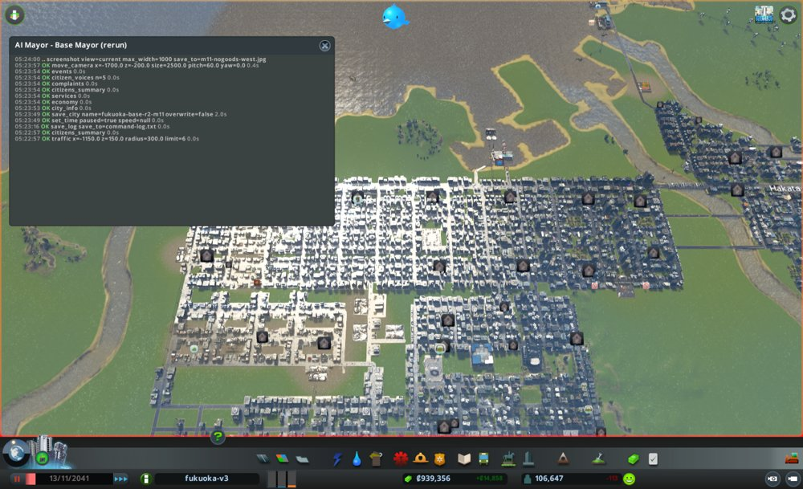
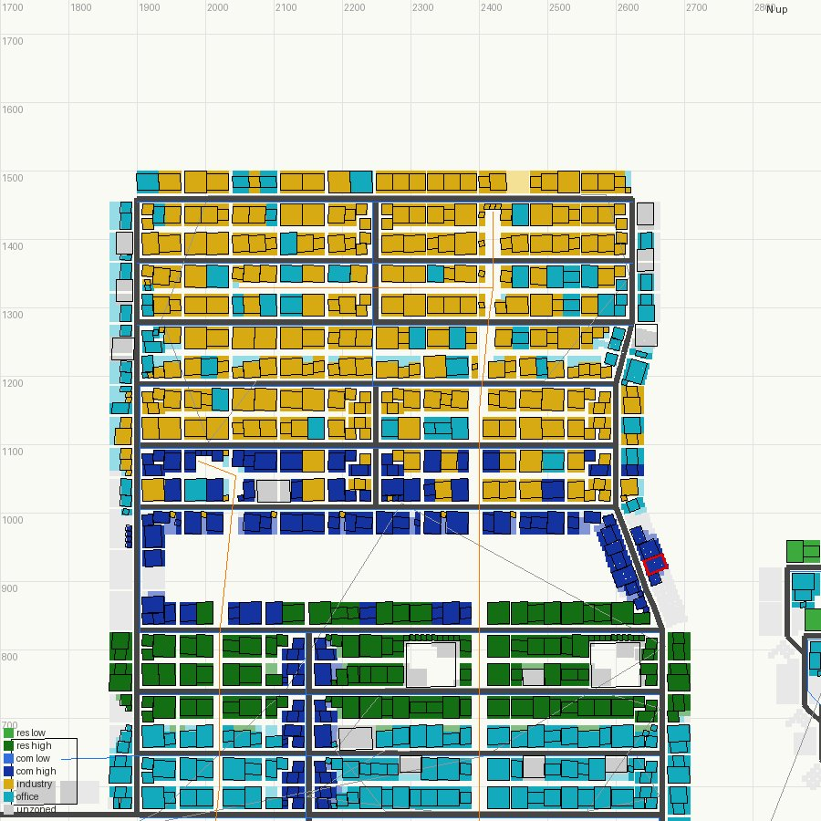
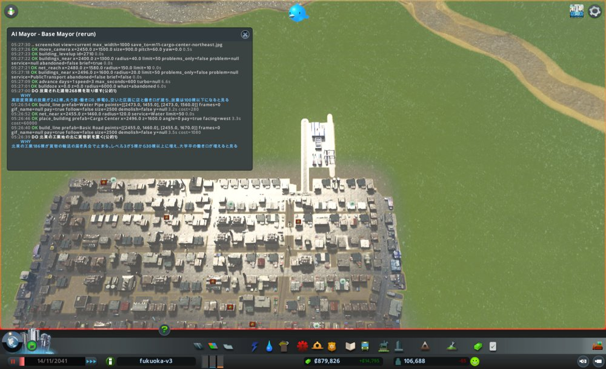
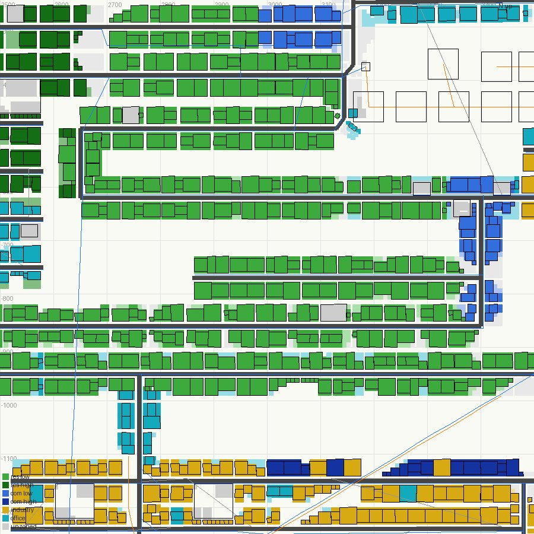
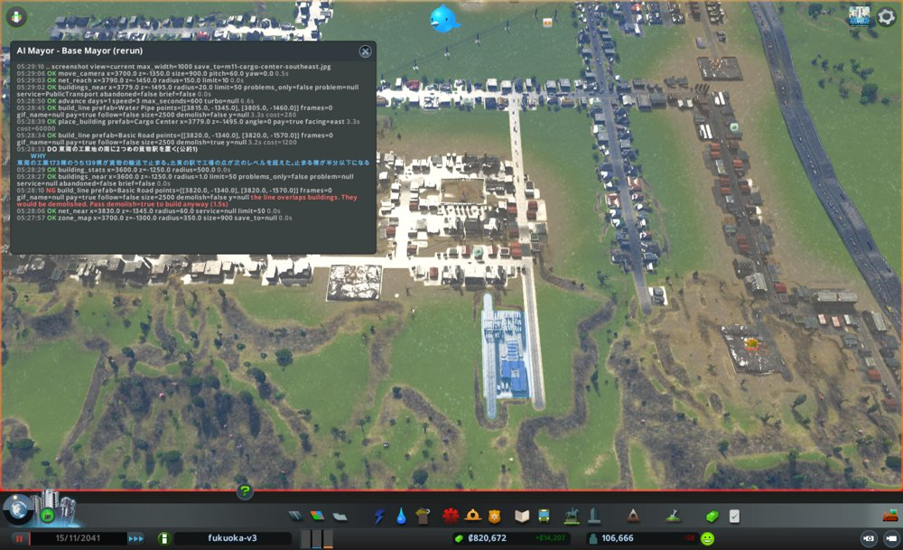

### 2041-11-23 見回り

施策の確かめで2日進めたので、`advance(8)` で月例から10日の日付に合わせた。
境目: 当たらず。つぶやき3件(騒音の不満1件。3件に届かない)。来ない市民0/0/0。週の収支 +11,984(前回 +14,859。下がったが黒字のまま)。幸福度82。
北東 (2300, 1100、半径800) の工業: レベル3が 5→50棟、貨物の輸送で止まる棟 186→120、働き口 3,609→3,794。工場 2710 はレベル3に上がった。

### 2041-12-03 見回り

境目: 当たらず。つぶやき1件(困りごとではない)。来ない市民0/0/0。週の収支 +12,927(前回 +11,984)。働き口の需要 13→20。

### 2041-12-13 11か月目の終わり(次の月例の前の記録)

`advance(10)` で 2041-12-13 に着いた。ダイアログなし。月例は次の呼び出しで行う。
次の月例の答え合わせのために、着いた時点の事実を残す。

- 人口106,773(月例の106,647より+126)、所持金872,197、週の収支 +13,583(収入161,727、支出148,144)、幸福度82、需要 0 / 4 / 30、来ない市民0/0/0
- 北東 (2300, 1100、半径800) の工業266棟: レベル3が 5→71棟、レベル1が 22→14。貨物の輸送で止まる棟 186→115。働き口 3,609→3,818。放棄9棟
- 東南 (3600, -1250、半径500) の工業172棟: レベル3は 3→3棟のまま。レベル1が 60→8、レベル2が 110→161。貨物の輸送で止まる棟 139→129。働き口 1,846→2,036。貨物駅 14297 は働き手45人
- 放棄の棟(`preview_bulldoze`): 268棟を取り壊した後、104棟に戻った(多くが高密度商業)
- `new_buildings(since=44702)`: 高密度商業51、工業16、オフィス7(先月は63、24、4)
- 住宅の需要: 働き口の項 -49→-46、家の項 -12。働き口を探す人12,072人のうち大学卒11,792人。働き口 43,671→44,287、空き1,691
- 品物の届かない店 398→211棟(多いのは (-1244, -784) の86棟)。止まったトラック373台(港 17343 の中120)
- ごみの困りごと 37→54棟(南西 (-1974, -1315) に18棟)。埋立地 42584 は98%で、車7/19
- 死体の困りごと 5→11棟((3334, -497) に6棟)。騒音15棟
- 失業11,373人のうち大学卒11,184人。体調の悪い市民 430→378
- 困りごとのある建物 471→302棟

## 申し送り(12か月目の月例へ)

- 北東の貨物駅 16936 は効いた(工業のレベル3が5→71棟)。東南の貨物駅 14297 では、レベル1→2は進んだがレベル3は増えていない。東南の工業は学歴かサービスの点がまだ足りないらしい。`building_levelup` で1棟を見て確かめる
- 住宅の需要は0のまま。働き口の項は -49→-46 と少し上がった。0より上にするには -39 より上が要る
- 放棄は268棟を壊した後、104棟に戻った。品物の届かない店は398→211棟に減った
- ごみが南西 (-1974, -1315) で増えた(18棟)。埋立地 42584 は98%で、満杯の手前
- 公約1は月例どうしで+126(106,647→106,773)。最後の月も前の月例より増やす必要がある
- 月例で `new_buildings(since=45178)` を呼ぶ

### 2041-12-13 月例(12か月目、任期の最後)

保存: `fukuoka-base-r2-m12`(2041-12-13)

#### 答え合わせ

1. 北東の工業地の北の貨物駅 16936: 当たり
   - 予想: 北東 (2300, 1100、半径800) の工業のレベル3が5棟から30棟以上、貨物の輸送で止まる棟が186から120以下
   - 結果: レベル3は71棟、貨物の輸送で止まる棟は115。働き口 3,609→3,818。レベル上げの条件を満たした棟が8
   - 次の扱い: 続ける
2. 放棄268棟の取り壊し: 半分当たり
   - 予想: 放棄が100棟以下、この1か月に建つ高密度商業が63棟より多い
   - 結果: 放棄は104棟に戻った。建った高密度商業は51棟(先月63)。品物の届かない店は398→211棟に減った
   - 見立て: 品物が前より届き、困りごとの印は減った。ただし高密度商業の需要は4で低く、空いた区画を埋める速さは上がらなかった
   - 次の扱い: 失う家・働き口0なので、今月もう一度取り壊す(施策2)
3. 東南の工業地の南の貨物駅 14297: 外れ(途中)
   - 予想: (3600, -1250、半径500) の工業のレベル3の棟が増え、貨物の輸送で止まる棟が半分以下(139→70以下)
   - 結果: レベル3は3棟のまま。貨物の輸送で止まる棟129。レベル1が60→8、レベル2が110→161。今月の `building_stats` で、レベル上げの条件を満たした棟が22(学歴で止まる19、サービスで止まる129)
   - 見立て: この1か月は、レベル1→2の建て替えに使われた。条件を満たした22棟は、これからレベル3に上がる見込み。止まる129棟は、貨物駅の届き具合がまだ点に足りない
   - 次の扱い: 続ける(貨物駅は残す)

- 「次にやること」の実行
  - 貨物駅2つの働き手と工場 2710 の進み具合: 見回りで確かめた(実行した。2710 はレベル3)
  - `new_buildings(since=44702)`: 月の終わりの記録で呼んだ(実行した)。高密度商業51、工業16、オフィス7。今月の `new_buildings(since=45178)` は、時間が進んでいないので空だった
  - 北東と東南の工業の棟、放棄の棟: 数えた(実行した。上の答え合わせ)
  - 埋立地 42584 が満杯になったら置き直す: 98%で、まだ受け入れている(該当しない)
- 公約の進み具合
  1. 人口: 106,647 → 106,773(+126)。達成。11回の月例どうしで、毎回増えた
  2. 電気・水・下水が来ない市民: 0 / 0 / 0。任期の終わりまで残り1か月(この月)
  3. 週の収支: +13,583(収入161,727、支出148,144)。黒字。貨物駅2つで支出が約2,900増えた

#### 気づいたこと

- 住宅の需要は0のまま。失業11,373人のうち大学卒11,184人。働き手42,567、働き口44,287
- ごみの困りごと54棟。南西 (-1974, -1315) の半径600mに14棟で、x -2000〜-2350、z -1160〜-1490 に集まる。近くの埋立地 42584(-2060, -872)は98%で車7/19、2907 は8%、24493 は20%、20041 は69%で、どれも400m以上北
- 南西の街の南の端の道(z -1460)の南は、z -1500〜-1560 に水道管と送電線と風車があるだけで、z -1600 より南は空き地
- 東の埋立地 10533(3900, -575)が満杯になった(車0/19)。半径700mにごみの困りごとはない
- 死体の困りごと11棟((3334, -497) に6棟)。騒音15棟、汚染5棟
- 品物の届かない店211棟。いちばん多い区画は西 (-1848, -119) の76棟
- 市民の声: 5人とも困りごとなし。つぶやき0件

#### 施策

1. 南西の街の南に埋立地を1つ置く
   - 公約: 1(暮らしの困りごとを減らし、人が出ていかないようにする)
   - 捨てるもの: なし
   - 理由: 南西 (-1974, -1315) にごみの困りごと14棟。近くの埋立地は400m以上北で、いちばん近い 42584 は98%。南東・南西・西・南西の南で、同じ手は地元の困りごとを減らした
   - 予想: 建設費は埋立地4,000と道路約1,300、週の維持費160と道路約10。黒字13,583の範囲。任期の終わり(2042-01-12ごろ)に、南西 (-1974, -1315) の半径600mのごみの困りごとが14棟から7棟以下に、街全体が54棟から40棟以下に減る
   - 操作: Basic Road を南の端の交差点 (-2180, -1460) から南へ (-2180, -1720) まで引き、埋立地を道の東 (-2140, -1660) に西向きで置く
2. 放棄された建物104棟をまとめて取り壊す
   - 公約: 1
   - 捨てるもの: なし
   - 理由: 放棄104棟(ほとんど高密度商業)。`preview_bulldoze` で失う家・働き口0、停電0
   - 予想: 費用0。任期の終わりに、放棄が104棟から50棟以下になる

#### 実行の結果

1. 埋立地: x -2180 の道路は住宅2棟(6216、15208)に重なり断られた。家を壊さないよう、空いた区画の通る x -2040 の交差点から南へ (-2040, -1740) まで引き直した(4区間、1,440)。埋立地は (-2000, -1680) に西向きで置けた(id 34654、4,000)。入口は道路から0m。取り壊した建物0。建設費の合計5,440(所持金872,197の半分より小さい)
   - 確かめ: `net_reach`(-2020, -1650、半径150)で道路の入れない・出られない区間0、来られない建物0。画面写真で、南の端の道から延びた道路に面しているのを見た。収集車は見回りで確かめる
2. 放棄の取り壊し: 104棟を取り壊した。道路0。費用0

#### 考えたが打たなかった手

- 満杯になった東の埋立地 10533(3900, -575)を置き直す: 半径700mにごみの困りごとがない。費用をかけても任期の数字は動かない
- 98%の埋立地 42584 を置き直す: まだ受け入れている。南西の困りごとには、近くに新しく置く方が届く
- 東 (3334, -497) の死体の困りごと6棟に墓地を置く: 前に空き地が見つからなかった。6棟では人口に効かない
- 住宅の需要を上げる(大学卒の働き口): 1か月で効く手がない。貨物駅で工業のレベル3が増えたのが、今の手の中ではいちばん効いた
- 消防と警察の予算(140%)を下げる: 黒字は保てている。任期の最後の月にサービスを削ると、次の市長に悪い数字を残す

#### 次にやること

- 見回りで、埋立地 34654 の収集車が動いているかを確かめる
- 任期の終わり(2042-01-12ごろ)に、南西 (-1974, -1315) の半径600mのごみの困りごと、放棄の棟、東南 (3600, -1250、半径500) の工業のレベル3の棟を数え、申し送りに書く

#### 画面写真

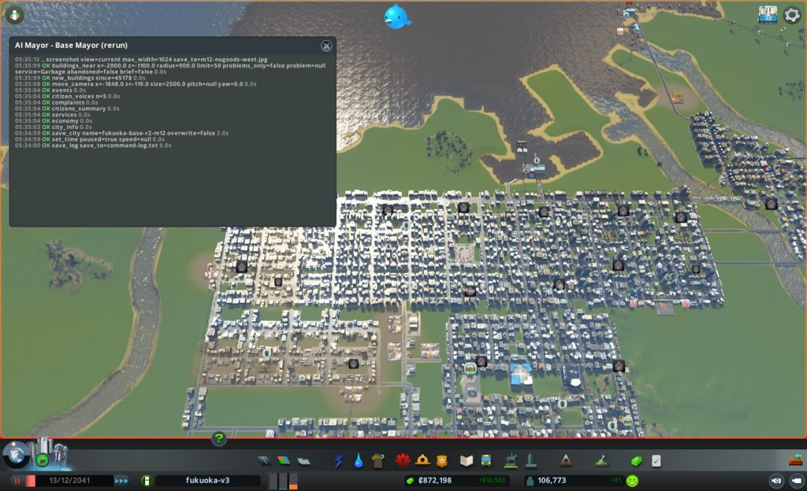
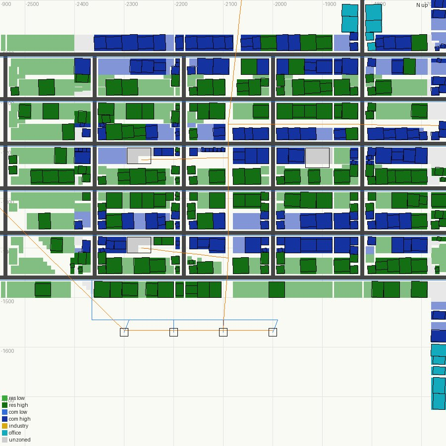
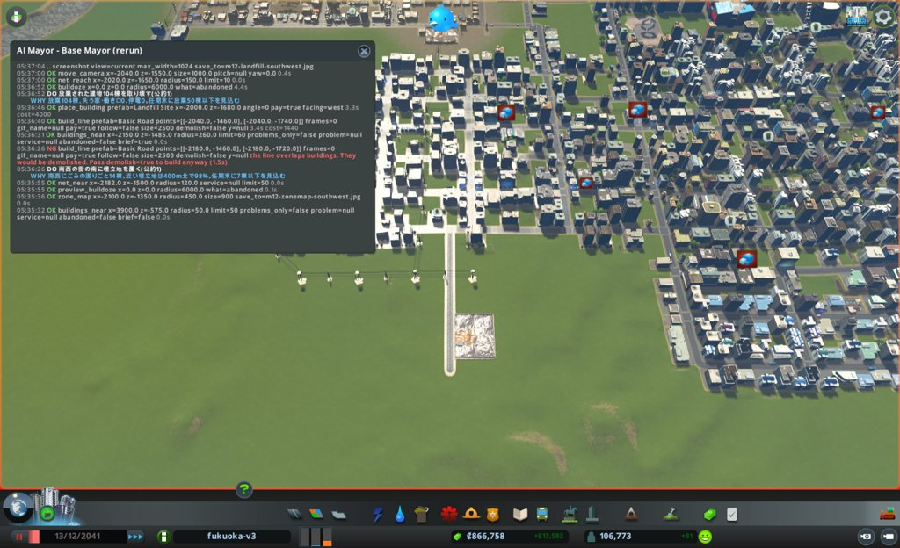

### 2041-12-23 見回り

境目: 当たらず。つぶやき2件(困りごとではない)。来ない市民0/0/0。週の収支 +14,222(前回 +13,583)。
埋立地 34654 は収集車19/19が動き、働き手16人、たまり1%。

### 2042-01-02 見回り

境目: 当たらず。つぶやき1件(ごみの不満1件。3件に届かない)。来ない市民0/0/0。週の収支 +14,765(前回 +14,222)。

### 2042-01-12 任期の終わりの記録

`advance(10)` で 2042-01-12 に着いた。ダイアログなし。運営はここで終わる。
今月の施策の答え合わせに使える事実を残す(採点は人が付ける)。

- 人口107,416、所持金928,464、週の収支 +14,942(収入163,338、支出148,396)、幸福度82、需要 0 / 2 / 62、来ない市民0/0/0
- 施策1(南西の街の南の埋立地 34654): 南西 (-1974, -1315) の半径600mのごみの困りごと 14→2棟(予想は7棟以下)。街全体 54→37棟(予想は40棟以下)。いちばん多い区画は北の中央 (-150, 493) の13棟に移った
- 施策2(放棄104棟の取り壊し): 放棄は71棟(予想は50棟以下)。この1か月に建った区画の建物は高密度商業50、工業20、オフィス1
- 東南 (3600, -1250、半径500) の工業173棟: レベル3は3棟のまま。条件を満たした棟19、貨物の輸送で止まる棟134
- 品物の届かない店 211→201棟(いちばん多い区画は中央 (-168, -13) の72棟)。騒音 15→22棟(西 (-1491, -746) に12棟)。死体 11→8棟
- 失業11,369人のうち大学卒11,161人。体調の悪い市民364
- 困りごとのある建物 302→279棟

- 公約の任期の終わりの数字
  1. 人口: 100,140(1か月目の月例)→ 107,416(任期の終わり)。月例どうしでは11回とも前より増えた。最後の月は 106,773 → 107,416(+643)
  2. 電気・水・下水が来ない市民: 0 / 0 / 0(`citizens_summary` の noElectricity / noWater / noSewage)
  3. 週の収支: 12回の月例と任期の終わりで、すべて黒字(最小 +13,170、任期の終わり +14,942)

## 申し送り(次の市長へ)

- 住宅の需要は任期中ずっと0だった。原因は大学卒の失業(約11,000人)で、`demand_breakdown` の働き口の項が -46〜-49 に張りついている。住宅の需要を0より上げるには、働き口の項を -39 より上にする(大学卒の働き口を約2,000以上足す)必要がある
- 大学卒の働き口を増やすのにいちばん効いたのは、工業の近くに貨物駅(Cargo Center)を置く手だった。北東の貨物駅 16936 で、工業のレベル3が5→71棟に増えた。東南の貨物駅 14297 はまだレベル3が増えていない(条件を満たした棟19)
- オフィス約1,500棟のうち1,250棟がサービスで止まり、いちばん伸ばせる項目は公共交通(約720棟)。東の端のバス路線22(line 139)は停留所の置き方が悪く遠回り(最大13.6倍)で、乗客0のまま。届き具合のためだけに台数40%で残している。公共交通を足すなら、停留所を道の向きに合わせて置き直す
- ごみは、困りごとの集まる場所の近くの空き地に埋立地を足す手が、毎回地元では効いた(東南、南西、西、東、北東、南西の南)。満杯の埋立地は5つ(10533、11708、12700、39056、40118)。満杯の埋立地は、壊して同じ場所に置き直すと早い(43004、34558 で効いた)。空にする(`empty_building`)のは遅い(30日で6%)。42584 は98%
- 任期の終わりに、ごみの困りごとが北の中央 (-150, 493) に13棟集まっている。近くの 12700(-262, 800)は満杯
- 品物の届かない店は、港の出口の詰まりが元。貨物港を3つ(43449、2090、17343)にし、17343 の出口の信号を外して、止まったトラックは1,458→約370台に減った。港の出口の道は混み具合100のまま
- 放棄は、取り壊しても1か月で70〜100棟に戻る(多くが高密度商業)。`preview_bulldoze` で失う家・働き口0を確かめてから壊すと、安全
- 予算は、医療120%、消防と警察140%、ごみ150%。医療は容量2,700に対して使用約1,400で余っている。消防と警察は任期中に一度も動かしていない
- 税は、オフィス・工業1%、高密度商業3%で、これ以上は下げられない。任期中に税は動かしていない
- 道路を引くときは、区画の建物に重なると断られる。`zone_map` で空いた区画(薄い色)を通る線を選ぶと、家を壊さずに引ける

