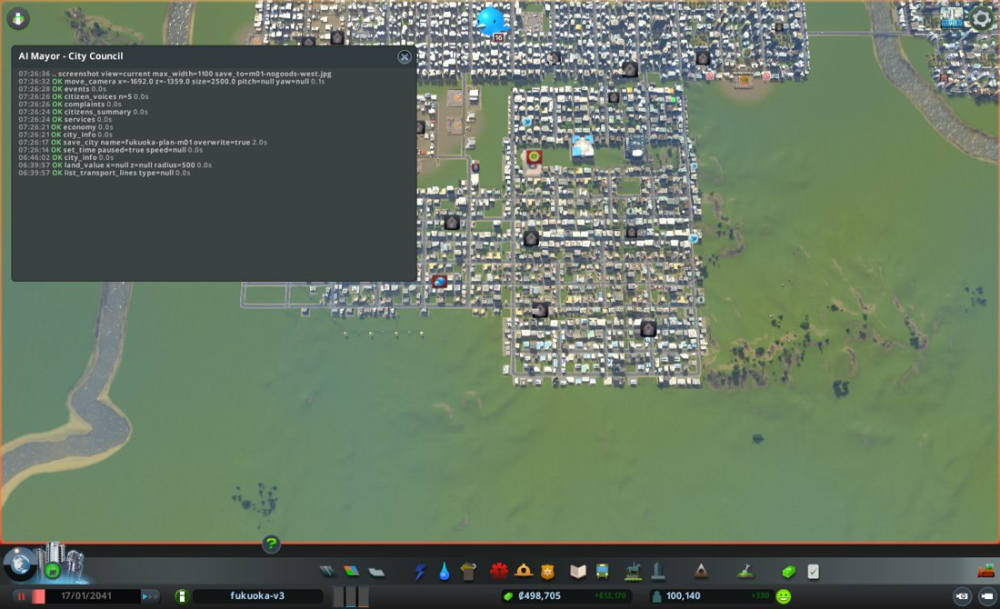
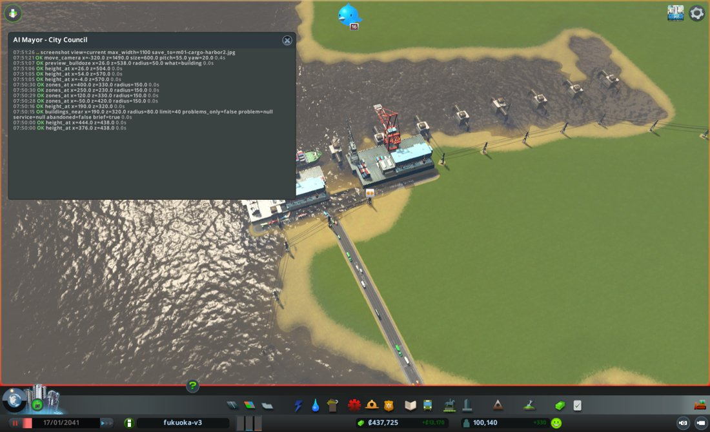
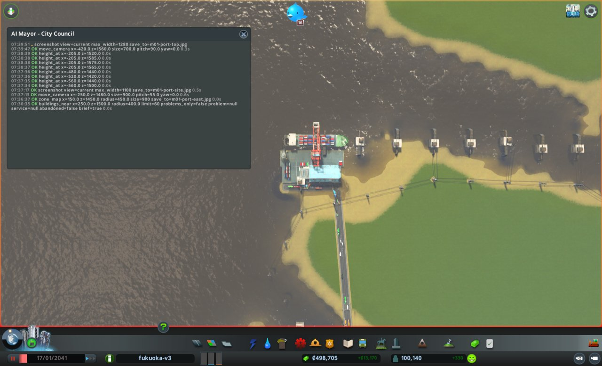
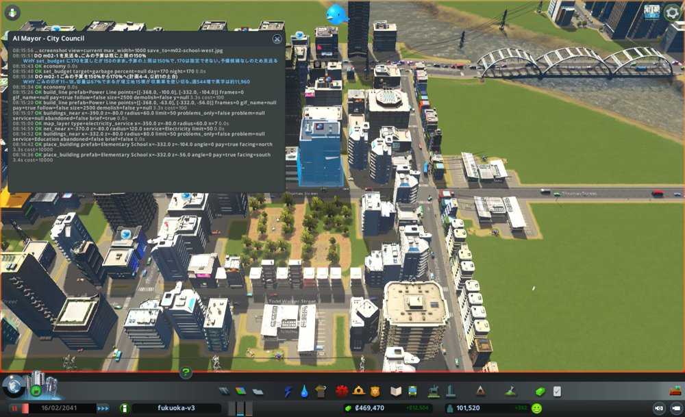
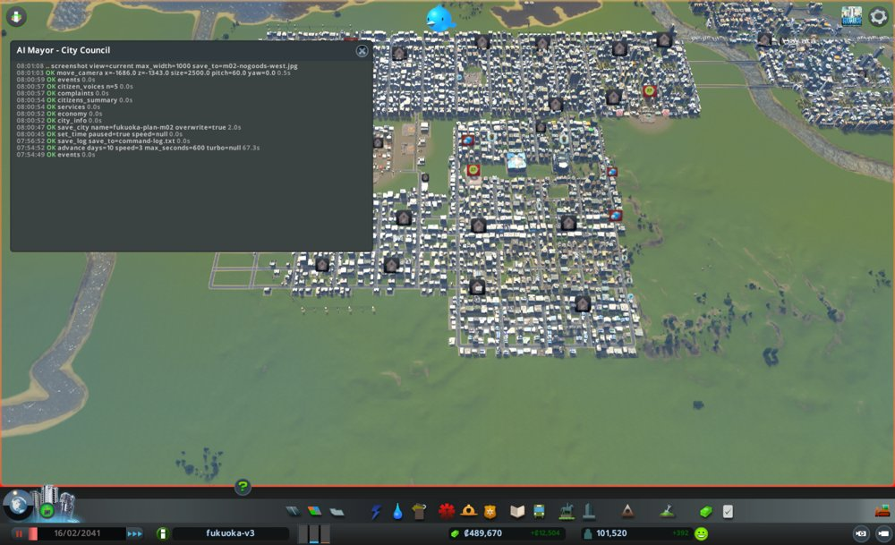

# 市政ノート

## 性格と公約と捨てるもの

<市長の定義(mayors/plan.md)から写す。任期中は書き換えない>

- 性格: なし。判断の型(protocol.md)と、市の計画(city-plan.md)にだけ従う
- 公約:
  1. 人口を毎月増やす(`city_info` の population。毎月の月例で、前の月例より増えていること)
  2. 電気・水・下水が来ない市民をなくす(`citizens_summary` の電気・水・下水が来ない市民の数。任期の終わりに0)
  3. 赤字を続けない(`city_info` の週の収支。毎月の月例で、2回続けて赤字にしない)
- 捨てるもの: なし
- 任期: 12か月

## 申し送り(前の運営から)

なし。出発点は `fukuoka-grow-100k`(2041-01-17)。

## 数字の表

月例と見回りのたびに1行足す。区切りは 月例・見回り・臨時。

| ゲーム内の日付 | 区切り | 人口 | 所持金 | 週の収支 | 幸福度 | 需要(住/商/工) | 失業 | 主な困りごと |
|---|---|---|---|---|---|---|---|---|
| 2041-01-17 | 月例 | 100,140 | 498,704 | +13,170 | 82 | 0 / 4 / 2 | 8,839 | 品物がない店107、原料がない工場126、港で止まったトラック1,421 |
| 2041-01-27 | 見回り | 100,605 | 454,350 | +11,654 | 82 | 0 / 2 / 4 | - | 電気・水・下水が来ない市民 0/0/0。つぶやき1件(放棄された建物)。境目に当たらず |
| 2041-02-06 | 見回り | 101,051 | 471,788 | +12,053 | 82 | 0 / 10 / 2 | - | 電気・水・下水が来ない市民 0/0/0。つぶやき1件(学校の表彰)。境目に当たらず |
| 2041-02-16 | 月例 | 101,520 | 489,669 | +12,504 | 82 | 0 / 10 / 4 | 9,536 | 品物がない店132、原料がない工場121、港で止まったトラック1,484、ごみの印18 |
| 2041-02-26 | 見回り | 101,994 | 487,592 | +12,670 | 82 | 0 / 4 / 2 | - | 電気・水・下水が来ない市民 0/0/0。つぶやき2件(スマートホーム、街路樹の研究)。境目に当たらず |
| 2041-03-08 | 見回り | 102,527 | 506,126 | +12,864 | 82 | 0 / 2 / 2 | - | 電気・水・下水が来ない市民 0/0/0。つぶやき1件(学生の表彰)。境目に当たらず |

## 施策の一覧

施策を打つたびに1行足す(臨時も含む)。答え合わせの列は、翌月の月例で埋める。
分野は、港・働き口・住宅・暮らし・環境・財政から1つ選ぶ。
元の局は英字の名前(urban など)。議決は 要らない / 可決 / 否決。施策の id は m<月2桁>-<番号>(市役所と議会のハーネス、#100)。

| ゲーム内の日付 | 区切り | 施策の id | 施策 | 元の局 | 市の計画の施策 | 議決 | 分野 | 公約 | 建設費 | 週の維持費の増分 | 答え合わせ |
|---|---|---|---|---|---|---|---|---|---|---|---|
| 2041-01-17 | 月例 | m01-1 | 貨物港を2つ目に置き、港の出口を分ける | port | 8-1、6-4・7-1 | 要らない | 港 | 1 | 60,980 | 約1,923 | 外れ。止まったトラック 1,421 → 1,484、品物がない店 107 → 132。新しい港は使われず(出る車 63 対 既存1,532) |
| 2041-01-17 | 月例 | m01-2 | 満杯の埋立地4つを空にする | health | 4-4 | 要らない | 環境 | 土台 | 0 | 0 | 半分当たり。満杯 4 → 2(ただし別の2つ)。ごみの印 11 → 18 で悪化 |
| 2041-01-17 | 月例 | m01-3 | 北部の住宅街に Regular Park を8か所(置けず) | urban | 4-2、4-1 | 要らない | 暮らし | 土台 | 0 | 0 | 打てず。公園22棟のまま |
| 2041-02-16 | 月例 | m02-1 | ごみの予算を150%から170%に上げる(打てず) | health | 4-4 | 可決(予算) | 環境 | 土台 | 0 | 0 | 打てず。予算の上限が150%で170は指定できない |
| 2041-02-16 | 月例 | m02-2 | 都心の南北の道 x=520 を Medium Road に太くする(打てず) | roads | 6-3 | 要らない | 暮らし | 土台 | 0 | 0 | 打てず。沿道11棟の取り壊しが要り、中止条件に当たった |
| 2041-02-16 | 月例 | m02-3 | 西部に Elementary School を2棟建てる | education | 2-3 | 要らない | 暮らし | 土台 | 20,200 | 約400 | 翌月に答え合わせ |

## 判断の記録

### 2041-01-17 月例(1か月目)

#### 答え合わせ

初回のため、なし。

- 前回の「次にやること」: なし(初回)
- 公約の進み具合
  1. 人口を毎月増やす: 今 100,140。初回なので比べる相手がない。残り12か月。住宅の需要が0で、このままでは増えない。届くかは危うい
  2. 電気・水・下水が来ない市民をなくす: 今 0 / 0 / 0。残り12か月。達成中なので、保つことが仕事
  3. 赤字を続けない: 今 +13,170 の黒字。残り12か月。所持金 498,704 にも余裕がある

#### 気づいたこと

- 住宅の需要が0。`demand_breakdown` の内訳は base 50、jobTerm −39、homeTerm −11 で target も0。失業 9,285 に対し空いた働き口は786しかない。失業の93%(8,611)が大学卒で、大学卒の働き口を増やさないと人口は増えない。公約1がいちばん危ない
- 輸入が貨物港1か所(id 43449)に集まり、港から出るトラック1,421台が止まっている。品物がない店107、原料がない工場126も同じ根と見る。工業1,056棟のうち497棟が、荷物の便(cargoTransport)でレベルアップを止められている
- 埋立地4つ(4946、11708、12700、43004)が満杯で受け入れを止め、ごみの印が11。学校も定員不足で、小学校 7,200 < 子ども 8,930、高校 13,000 < 10代 16,097

#### 施策

7つの局の案から3件を選んだ(`council/m01-bill.md`)。建設費の合計68,000(上限125,000)、週の維持費の増え分1,984(枠10,000)。議決の要る施策はない。結果の欄は実行する市長が書く。

**m01-1 貨物港を2つ目に置き、港の出口を分ける(元の局: port)**

- 公約: 1(人口)。工業497棟の荷物の足止めが解ければ1棟の働き口が増え、住宅の需要を縛る jobTerm −39 がゆるむ。公約3は週1,920の支出増で黒字を保てる
- 市の計画: 8-1(主)、6-4・7-1
- 捨てるものに手を出したか: 捨てるものはなし
- 理由: 止まったトラック1,421は目標300の4.7倍で、計画の中でいちばん遠い。止まった場所は貨物港の出口 Harbor Road(密度100)に集まり、その先の4車線道路は密度20〜29で余裕がある。Harbor Road は建物の一部で太くできないため、港を分ける
- 操作: `place_building` で Cargo Harbor 1棟。北の海岸、既存の貨物港(-400,1555)の東100〜250m、x -250〜-100 / z 1560〜1600 の水際。道は Small 4 Lane Road(-340,1368〜-352,1515)へ。置く前に `height_at`、置いた後に `net_reach`・`water_trace`・`transport_reach` で確かめる。つながらなければ置かない
- 費用: 建設費60,000、週1,920
- 予想: 次の月例までに、止まったトラック1,421 → 1,100以下。品物がない店107 → 95以下、原料がない工場126 → 115以下。働き口43,075は横ばいか微増
- 結果: 成功。`place_building` で Cargo Harbor を (-240, 1555)、入口は南向きで設置(id 23793、建設費60,000、取り壊し0棟)。議案の x -250〜-100 のうち西寄りを選んだ。理由は、x=-170 に排水口へ伸びる送電線(segment 8884)が通り、敷地が重なるため。港の Harbor Road は (-288,1515)〜(-192,1515) にでき、道路網から切れていたので、`build_line` で Small 4 Lane Road を (-352,1515)〜(-288,1515) に64m引いて既存の交差点(node 9295)につないだ(費用980、橋1区間)。合計の建設費60,980、週の維持費の増え分は港1,920+道路約2.6
- 確かめ: `buildings_near`(-240,1555) の grid は electricity / water / sewage すべて true。`net_reach`(-270,1515,r200) は notReachable 0、noRoad 0。`transport_reach` は id 23793 が outsideConnected true(viaLaneConnection、outsideLines は新旧の港とも0)。所持金 498,704 → 437,725

**m01-2 満杯の埋立地4つを空にする(元の局: health)**

- 公約: 直接はつながらない。ごみの印11が幸福度と地価を下げているため、公約1の土台として打つ。費用0
- 市の計画: 4-4
- 理由: 満杯の4つは収集車が0/19で出ておらず、近くの住宅からごみが取れない。市全体の容量は使用66%(89,314,762 / 136,000,000)で、足りないのは量ではなく場所の偏り。空にすれば費用なしで止まる
- 操作: `empty_building` を4回。id 4946(3499, 618)、11708(738, -590)、12700(-262, 800)、43004(-650, -490)。後で `services` の garbage.full を確かめる
- 費用: 0 / 0(費用表に載らない操作のため、所持金の変化を確かめる)
- 予想: 次の月例までに、満杯4 → 0、ごみの印11 → 5以下
- 結果: 成功。`empty_building` を4回呼び、4946 / 11708 / 12700 / 43004 のすべてが emptying: true、prefab は Landfill Site。費用は0(所持金は港の分しか減っていない)
- 確かめ: 直後の `services` では garbage.full はまだ count 4(同じ4つの id)。空になるのは運び出しの後なので、見回りと来月の月例で数を見る

**m01-3 北部の住宅街に Regular Park を8か所(元の局: urban)**

- 公約: 直接はつながらない。地価で止まる住宅1,184棟に効けば公約1の土台になる。週64で公約3に響かない
- 市の計画: 4-2、4-1
- 理由: 公園は22棟で目標40に遠く、北部の高密度住宅街には1棟もない。住宅(高密度)1,184棟が地価でレベルアップを止められている
- 操作: `place_building` で Regular Park(9×8、要電気・要道路)を8棟。(-50,420)、(120,330)、(250,230)、(400,330) の各半径150mに2棟ずつ
- 費用: 建設費8,000、週64
- 予想: 次の月例までに、公園22 → 30棟、住宅(高密度)の地価45 → 46前後
- 結果: **打てなかった。0棟。建設費0。** Regular Park は9×8マス(72m×64m)で、議案の4か所(-50,420)(120,330)(250,230)(400,330)の周りに置ける場所がなかった。`preview_bulldoze`(what=building)で11か所を調べ、`height_at` で地面と水面を測った結果は次のとおり
  - 道路沿いの区画は住宅で埋まっている。(-120,420)は7棟・家66、(-30,424)は4棟(小学校を含む)、(40,424)は5棟・家51、(40,496)は3棟・家54、(480,330)は4棟・家34。置けば家を壊すことになる
  - 建物のない白い場所は、博多湾の水面だった。(336,336) ground 35.2 / water 39.8、(280,410) 36.1 / 38.6、(370,410) 39.5 / 39.9、(376,378) 36.3 / 39.4。z=370 の道も Basic Road **Bridge** で、海の上を渡る橋だった
  - 乾いていて建物のない場所は見つかったが、どれも9×8に足りない。(26,538) の周りは x -6〜40・z 500〜570 ほどで幅46m、(404,420) の周りは x 400〜446 で幅46m。東隣には住宅(id 32182、x 446.7〜462.7)がある
  - 家を壊せば置けるが、取り壊しは議決が要る。今月の議案に取り壊しは入っていないので、打たなかった(公約1の人口を減らす手でもある)
- 確かめ: `zones_at`(半径150)の空きマスは (-50,420) 住宅4・商業6、(120,330) 住宅3・商業15、(250,230) 商業26、(400,330) 商業15・未指定24。いずれも散らばっていて、72マスの四角は作れない

#### 考えたが打たなかった手

- 事務所の税を1%から0%へ(economy): 働き口の需要が target 89 / actual 2 で上昇中であり、縛っているのは税率ではないと読んだ。週2,075の税収減が任期中続くため、見立ての弱い手に使わない
- 小学校6校・高校2校(education、108,000): 計画 2-3 には要るが、枠の86%を使い港と両立しない。大学の席9,000に対し大学卒の失業8,611で、学歴は足りており今月の人口に効かない。来月以降に小学校から出し直してもらう
- 小学校6校だけに減らす形(60,000): 港と合わせて120,000で枠の96%、所持金が24%減る。財政の守る線を優先して見送った
- 都心の南北の道を Medium Road へ架け替え(roads、1,300): 同じ月に交通の手を2つ打つと、どちらが流れを動かしたか分からない。港の効き目を測ってから
- 東部に Police Station 1棟(fire、12,000): 犯罪の印3を1以下にしても 3-4 の目標(火事+犯罪で4以下)に届かず、火事側の手が未定
- 融資の借り増しと繰り上げ返済: 所持金498,704に余裕があり、どちらも不要(財政局の要領どおり)

#### 見回り(1か月目)

- 2041-01-27: 人口 100,605(+465)、所持金 454,350、週 +11,654、幸福度82、電気・水・下水が来ない市民 0/0/0、dialog なし。`events` は1件(放棄された建物のつぶやき)。境目に当たらず、臨時はなし
- 2041-02-06: 人口 101,051(+446)、所持金 471,788、週 +12,053、幸福度82、電気・水・下水が来ない市民 0/0/0、dialog なし。`events` は1件(学校の表彰)。境目に当たらず、臨時はなし
- 3回目の `advance(10)` で 2041-02-16 まで進めた。ダイアログは3回とも出ていない

#### 次にやること

- m01-1 の後に `cargo` と `traffic` を見て、港の出口の詰まりと合流点の混み具合を確かめる。港は置けたので、鉄道貨物(Cargo Center)の検討は要らない
- m01-3 は置けなかった。住宅都市みどり局に、次のどちらかで出し直してもらう。(1) 5×5 の Regular Playground / Regular Plaza など小さい公園を、空いた商業マス(250,230 の周りに26マス、400,330 の周りに未指定24マス)に置く。(2) 9×8 の公園を置くために、家を壊す議案を出して議会にかける
- 公園を置く場所を探すときは、建物の有無(`preview_bulldoze`)だけでなく、地面と水面(`height_at`)も先に見る。白く空いて見える所の多くは博多湾だった
- (2285,-120) 付近の止まった車42台の原因を、道路下水道局に調べさせる
- 小学校の増設(計画 2-3)を、来月の枠の中で順に出し直してもらう
- ごみが再発するなら、埋立地を足す案を保健環境局に出させる

#### 画面写真

#### 見たもの(実行と見回りの段)

- `city_info`: 実行前 人口100,140 / 所持金498,704 / 週+13,170。見回り1 100,605 / 454,350 / +11,654。見回り2 101,051 / 471,788 / +12,053。どの時点も幸福度82、電気・水・下水が来ない市民 0/0/0、dialog null
- `net_near`(-300,1500 ほか): 新しい港の Harbor Road は (-288,1515)〜(-192,1515)。既存の道は node 9295 (-352,1515) で終わっていた
- `list_building_types`: Cargo Harbor 15×8マス・60,000・週1,920。Regular Park 9×8マス・1,000・週8。Water Outlet 2×8マス
- `height_at`: 港の水際は z 1555〜1580。公園の候補地は (336,336) ground 35.2 / water 39.8 など、白く見える場所の多くが水面
- `preview_bulldoze`: 公園の候補11か所。道路沿いは住宅4〜7棟(家34〜66)が建ち、空いている所は水面だった
- `buildings_near`: 新しい港 id 23793 の grid は電気・水・下水すべて true
- `net_reach` / `transport_reach`: 港は道路から来られ(notReachable 0)、外の航路にもつながっている(outsideConnected true)
- `services`: garbage.full は実行直後もまだ4つ(運び出しが終わっていない)
- `zones_at`: 公園の候補地の空きマスは散らばっていて、72マスの四角は作れない
- `events`: 見回り1は放棄された建物のつぶやき1件、見回り2は学校の表彰1件

#### 判断の根拠

議会が通した3件のうち、m01-1 と m01-2 は議案どおりに打てました。m01-1 は置く場所だけを x -240 に寄せました。x=-170 には排水口へ伸びる送電線があり、敷地が重なるからです。港の Harbor Road は道路網から切れていたので、64mの道を足してつなぎ、`net_reach` と `transport_reach` で道と航路の両方がつながったことを確かめました。
m01-3 は打てませんでした。北部の住宅街は道路沿いが住宅で埋まり、白く空いて見える場所は博多湾の水面でした(`height_at` で確認)。9×8の公園を置くには家を壊すしかなく、取り壊しは議決が要ります。今月の議案に取り壊しは入っていないので、置かずに記録しました。家を壊すことは公約1(人口を毎月増やす)にも反します。
1か月で人口は 100,140 → 101,051 と増え、週の収支は +12,053 の黒字、電気・水・下水が来ない市民は0のままでした。公約3つはいずれも今月は守れています。

#### 捨てたもの

- 公園のために家を壊す(例: (-120,420) の7棟・家66): 取り壊しの議決がなく、公約1にも反する
- 公園を小さい種類(Regular Playground 5×5 など)に差し替える: 議案の中身を市長が勝手に作り変えないという決まりに従い、来月の議案として住宅都市みどり局に出し直してもらうことにした
- 公園を水面の上や道路のない場所に置く: 道路が要る建物なので働かない

### 2041-02-16 月例(2か月目)

保存: `fukuoka-plan-m02`(2041-02-16)。dialog は null。

#### 答え合わせ

**m01-1 貨物港を2つ目に置く(予想: 止まったトラック 1,421 → 1,100以下、品物がない店 107 → 95以下、原料がない工場 126 → 115以下)**

- 結果: 外れ。止まったトラック **1,484**(増えた)、品物がない店 **132**(増えた)、原料がない工場 **121**(126から微減、予想の115には届かず)。働き口は 43,075 → 42,884 で微減
- 外れた理由の見立て: 港は建ったが、荷が分かれていない。`cargo` の stations は、既存の港(43449)から出る車 1,532 に対し、新しい港(23793)は 63 しかない。止まったトラック 1,484 のうち 1,351 が、今も既存の港の出口 (-398, 1539) に固まっている。港を足しても、ゲームが輸入の発生元として既存の港を選び続けている。道はつながり(先月 `net_reach` で確認)、航路もつながっている(`transport_reach` で outsideConnected true)ので、つなぎの失敗ではなく、荷の割り振りの問題と読む
- 施策の次の扱い: 続ける。ただし「港を足す」だけでは効かないことが分かったので、港湾空港局に、新しい港が使われない理由(出口の道の向き、既存の港への経路の短さ)を調べ直させる。壊してやり直す案は、60,000 を捨てることになるので採らない

**m01-2 満杯の埋立地4つを空にする(予想: 満杯 4 → 0、ごみの印 11 → 5以下)**

- 結果: 半分当たり。`services` の garbage.full は 4 → **2**。ただし中身が入れ替わり、空にした4つ(4946、11708、12700、43004)ではなく、別の2つ(39056、40118)が満杯になった。ごみの印は 11 → **18** で悪化。市全体のごみは 89,314,762 → 91,677,775(容量 136,000,000 の67%)
- 外れた理由の見立て: 空にする操作は効いたが、ごみの発生が処理を上回っている。空にした埋立地へ運び込みが集中し、別の埋立地が次々と満杯になる「もぐら叩き」。量そのものを減らすか、焼却に替えない限り止まらない
- 施策の次の扱い: 空にするだけの手は繰り返さない。保健環境局に、焼却(Incinerator)か埋立地の増設で、処理の量を増やす案を出させる

**m01-3 北部の住宅街に Regular Park を8か所(打てず)**

- 結果: 打てなかったまま。公園は 22 棟で出発点から変わらず(`buildings_near` service=Beautification の total 22)
- 次の扱い: 住宅都市みどり局に、小さい公園(5×5 など)で出し直させる。場所は `height_at` で水面でないことを先に確かめさせる

#### 前回の「次にやること」を実行したか

- 「`cargo` と `traffic` を見て港の詰まりを確かめる」: **実行した**。上のとおり、荷が分かれていないことが分かった
- 「m01-3 を小さい公園か、家を壊す議案で出し直す」: 未。今月の編成方針で住宅都市みどり局に伝える
- 「公園の場所は `height_at` も見る」: 未(今月の案で確かめる)
- 「(2285,-120) 付近の止まった車を道路下水道局に調べさせる」: 未。`traffic` の blockedSpots は (510,94) 24台、(2217,271) 21台、(2241,-928) 19台に移っている
- 「小学校の増設を来月の枠で出し直す」: 未。小学校の定員 7,200 に対し子ども 9,029(先月 8,930)で、差は広がった
- 「ごみが再発するなら埋立地を足す案を出させる」: 再発した。今月の重点に入れる

#### 公約の進み具合

1. 人口を毎月増やす: 101,051(前の見回り)→ **101,520**。前の月例(100,140)比で +1,380。達成中。ただし住宅の需要は0のままで、`demand_breakdown` の jobTerm は −39 → **−43** と悪化。空き家 1,570 が埋まるだけの伸びで、いずれ止まる。残り10か月
2. 電気・水・下水が来ない市民をなくす: **0 / 0 / 0**。達成中。残り10か月
3. 赤字を続けない: 週 **+12,504** の黒字(収入 157,774 / 支出 145,270)。所持金 489,669。出発点 498,704 より 9,035 少ないが、港 60,980 を建てた月としては戻している。残り10か月

#### 気づいたこと

1. **事務所 1,198 棟のレベルアップが「サービス」で止まり、足りないものの最多は公共交通 592 棟。** 事務所のレベル3は 118 棟で、計画 6-1 の目標 300 に遠い。今の公共交通はバス21路線だけで、地下鉄も鉄道もない。レベルが上がれば1棟の働き口が増え、公約1を縛る jobTerm −43(失業 9,982 対 空いた働き口 714)もゆるむ。交通の流れ 65% の改善(6-3)とも重なる。今月いちばん効きそうな梃子
2. **港の手は「足す」だけでは効かない。** 新しい港は出る車 63 で、既存の港 1,532 の4%しか担っていない。止まったトラック 1,484 のうち 1,351 が既存の港の1か所に固まる。原因は荷の割り振りで、設備の数ではない
3. **ごみは悪化している。** 空にした埋立地の代わりに別の2つが満杯になり、印は 11 → 18。失業の内訳は大学卒 9,322 / 9,982(93%)で変わらず、小学校の定員 7,200 < 子ども 9,029 の差も広がった

#### 施策

7つの局の案から3件を選んだ(`council/m02-bill.md`)。建設費の合計20,930(上限150,000)、週の維持費の増え分951(枠9,000)。議決の要る施策は m02-1(予算)の1件。重点に当たるのは m02-1 だけで、重点1(6-1 公共交通)と重点2(8-1 港)は港湾空港局が案なしのため空になった。結果の欄は実行する市長が書く。

**m02-1 ごみの予算を150%から170%に上げる(元の局: health)**

- 公約: 直接はつながらない。ごみの印18が幸福度82と地価46を押し下げているため、公約1の土台として打つ。週544は公約3の黒字12,504の範囲
- 市の計画: 4-4 資源循環
- 捨てるものに手を出したか: 捨てるものはなし
- 理由: ごみの印は 11 → 18 に悪化し、4-4 の目標0からいちばん遠い。`services` のごみは容量136,000,000に対し使用91,677,775(67%)で、足りないのは容量ではない。埋立地17棟のうち15棟が収集車を使い切っている(17〜19/19)ため、予算で車と処理の力を増やす
- 操作: `economy` で garbage が150のままか確認 → `set_budget` で garbage の day=170、night=170 → `economy` で反映を確認。週の収支が +5,000 を下回っていれば見送る
- 費用: 建設費0、週約544
- 予想: 次の月例までにごみの印 18 → 12以下。満杯の埋立地2(39056、40118)を増やさない。確認は `complaints` の Garbage、`services` の garbage.full と used
- 結果: **打てなかった。費用0。** `economy` で garbage は昼夜とも150。`set_budget`(garbage、day=170、night=170)は `ok: true` を返したが、返り値も直後の `economy` も昼夜150のまま変わらなかった。予算の指定できる範囲は50〜150%で、ごみの予算はすでに上限に達している。議案の170は、ゲームで指定できない値だった。予備候補の記載がないため、その場で別の手を作らずに見送った
- 確かめ: `economy` を実行の前後で呼び、garbage が day150 / night150 のまま同じであることを確認した。週の収支は +12,504 のままで、支出は増えていない

**m02-2 都心の南北の道 x=520 を Medium Road に太くする(元の局: roads)**

- 公約: 直接はつながらない。流れが上がれば品物と原料の届きが良くなり、公約1の土台になる。週7は公約3に響かない
- 市の計画: 6-3 公共交通を主軸とした交通体系
- 捨てるものに手を出したか: 捨てるものはなし
- 理由: `traffic` の blockedSpots の最多は (510,94) の24台で、その南北の Basic Road(segment 30429、520,130)は密度100。東西が Medium Road なのに南北だけ1車線で、細い口になっている。先月は港の効き目を測るため見送った案で、今月は交通の手がこれ1件なので切り分けられる
- 操作: `build_line` Medium Road を4回。(520,10)〜(520,55)、(520,55)〜(520,100)、(520,100)〜(520,145)、(520,145)〜(520,190)。既存の node(617、32134、19541、23689、15512)にそろえる。合計約124m。両側の建物が壊れる、または `net_reach` で来られない区間が出るなら見送る
- 費用: 建設費約930、週約7
- 予想: `traffic`(510,94 半径200)の blocked 24 → 12以下。街全体の流れ65%は+1ポイント程度
- 結果: **打てなかった。費用0。** `net_near`(520,110 半径150)で4区間(26707、691、30429、27641)が議案どおり Basic Road・1車線ずつ、両端の node も 617 / 32134 / 19541 / 23689 / 15512 で一致した。最初の区間 (520,10)〜(520,55) を `build_line`(Medium Road)で引くと、`ok: false` と `overlaps` が返り、沿道の11棟(商業8・住宅3。id 2066、3797、9238、21296、42687、32318、3661、19903、42810、17475、44698)を壊さないと引けないと分かった。議案の中止する条件「引き直しで両側の建物が壊れるとき」に当たるため、`demolish=true` は使わず、残り3区間も引かずに見送った。取り壊しは今月の議決に入っていない
- 確かめ: `build_line` が `ok: false` を返し、道路は1区間も変わっていない。所持金も減っていない

**m02-3 西部に Elementary School を2棟建てる(元の局: education)**

- 公約: 直接はつながらない。学歴が上がれば、学歴で止まる住宅のレベルアップが進み、公約1の土台になる。週約400は公約3の範囲
- 市の計画: 2-3 自ら学び続ける子どもの育成
- 捨てるものに手を出したか: 捨てるものはなし
- 理由: 小学校の定員7,200に対し子どもは9,029で、不足1,829は先月(8,930)より広がった。定員は建てれば確実に600増え、差の約3分の1を埋める。先月の「次にやること」で求めた出し直しに、局が108,000から20,000へ縮めて確認済みの2棟で応えた
- 操作: `place_building` で Elementary School を (-332,-56)(入口は南向き)と (-332,-104)(入口は北向き)。置いた後に `buildings_near`(-332,-80 半径80)で電気・水・下水を確かめる。電気が来なければ `build_line`(Power Line)で約40mつなぐ。置けないと返ったらその1棟は見送る
- 費用: 建設費20,000(電気の線を足す場合は約100を加える)、週約400
- 予想: 小学校の定員 7,200 → 7,800。子ども9,029に対する不足が1,829 → 1,229。確認は `services` の education.elementary と `citizens_summary` の age.child
- 結果: **成功(2棟とも)。建設費20,200。** `height_at` は (-332,-56) が ground 45.906 = water、(-332,-104) が 45.955 = water で、どちらも乾いた地面だった。`place_building` で Elementary School を (-332,-56) 入口南向き(id 7654、10,000、取り壊し0棟)、(-332,-104) 入口北向き(id 8831、10,000、取り壊し0棟)。入口はどちらも Small 4 Lane Road(segment 20458)に distance 0 で接した。置いた直後の `buildings_near` では grid の water と sewage が true、electricity だけ false だった。`map_layer`(electricity_service)で電気の端が x=-350 と分かり、議案どおり `build_line`(Power Line)を2本、(-368,-63)〜(-332,-56) と (-368,-100)〜(-332,-104) に引いた(各100、合計200)。両端は insideBuilding が 7876 と 7654、10781 と 8831 で、電気の届く建物と校舎の敷地に入った
- 確かめ: `buildings_near`(-332,-80 半径80、service=Education)で2棟とも problems は None、stats は Students 0/300。grid の electricity は `advance` の後に見回りで確かめる。所持金 489,669 → 469,470(港の月と違い、建設費は20,200のみ)

#### 考えたが打たなかった手

- 東部に Fire House 1棟(fire、12,000・週560): 敷地の確認はいちばん丁寧だったが、3-4 の数字(火事+犯罪)は先月、施策を打たずに 8 → 5 に下がった。偶発の数字に週560を固定で払う前に、もう1か月様子を見る。来月 `complaints` の火事が増えていれば優先して採る
- 東部 (520,398) に Regular Playground 1棟(urban、1,250・週24): 1棟では 4-2(22→40)も 4-1(地価46→50)も動かない。確認済みの置ける場所は来月の案に残す
- 公共交通(地下鉄)の新設: 港湾空港局が駅・線路・車庫の位置と接続を確かめきれず案なし。確認していない場所を市長が足さない
- 港の2本目の出口(-448,1515)〜(-346,1441): 途中が浅い水面で橋の可否が未確認。止まった1,351台が出口の詰まりか荷待ちかも見分けられていない
- 税を動かす: 黒字+12,504で守る線を割っておらず、上げれば住宅の需要0をさらに冷やす。財政局も税の案を添えなかった
- Recycling 政策(ごみ −15%): 住宅の税収の5%で週約6,900の減収。黒字の半分以上を削る

#### 見回り(2か月目)

- 2041-02-26: 人口 101,994(+474)、所持金 487,592、週 +12,670、幸福度82、電気・水・下水が来ない市民 0/0/0、dialog なし。`events` は2件(スマートホーム、街路樹が騒音を減らす研究)。境目に当たらず、臨時はなし。あわせて `buildings_near` で小学校2棟を見ると、grid の電気・水・下水がすべて true になり、生徒は 299/300 と 300/300 で埋まっていた
- 2041-03-08: 人口 102,527(+533)、所持金 506,126、週 +12,864、幸福度82、電気・水・下水が来ない市民 0/0/0、dialog なし。`events` は1件(学生の表彰)。境目に当たらず、臨時はなし
- 3回目の `advance(10)` で 2041-03-18 まで進めた。ダイアログは3回とも出ていない

#### 臨時(2か月目)

なし。3回の見回りで境目に当たらなかった。

#### 次にやること

- m02-1 の差し戻し: ごみの予算は上限150%に達している。保健環境局に、予算以外の手(Incinerator の増設、埋立地の増設、Recycling 政策の費用の見積もり)で出し直させる。議案に「予算を170%に上げる」と書かせないため、局には `set_budget` の範囲が50〜150%であることを伝える
- m02-2 の差し戻し: x=520 の道を太くすると沿道11棟(商業8・住宅3)が壊れる。道路下水道局に、(1) 取り壊し11棟を明記した議案として出し直す、(2) 信号の調整(`set_traffic_lights`、`set_yield_sign`)など壊さない手に替える、のどちらかで出し直させる
- 建設を伴う議案には、`build_line` や `place_building` が重なりを返したときの予備候補を必ず1つ書かせる。今月は m02-1 と m02-2 の両方で予備候補がなく、見送りになった
- m02-3 の答え合わせ: 次の月例で `services` の education.elementary が 7,200 → 7,800 になったか、`citizens_summary` の子どもの数との差を見る
- 港(8-1)と公共交通(6-1)は2か月続けて案なし。港湾空港局に、確かめられる範囲の小さな案(既存の港の出口付近の道路、バス路線の見直し)から出させる

#### 画面写真

#### 見たもの(見る段)

- `city_info`: 人口 101,520 / 所持金 489,669 / 週 +12,504(収入157,774・支出145,270)/ 幸福度82 / 需要 0・10・4 / 電気・水・下水が来ない市民 0/0/0 / 観光客 866 / dialog null
- `economy`: 税は住宅低9・住宅高7・商業低9・商業高3・工業1・事務所1。予算はごみ150、医療・消防・警察140、ほか100
- `services`: 電気 926,768/1,534,912、水 1,136,624/1,860,000、下水 1,135,344/1,600,000。ごみ満杯2(39056、40118)。学校 小7,200 / 高13,000 / 大9,000。働き手42,148・働き口42,884、犯罪率4
- `citizens_summary`: 住民101,524、失業9,536(うち大学卒9,059)、長く失業8,489、健康の平均70、幸福度82、体調が悪い549
- `complaints`: 困りごとの建物180。品物がない132(西部 -1686,-1343 に47)、ごみ18、死9、騒音7、汚染7、火事4、客がいない3、水2、犯罪1
- `citizen_voices(5)`: 5人とも困りごとなし、幸福度は Suberb / Excellent。うち1人は仕事なしの高齢者
- `events`: 1件(工業の廃棄物が土に、というつぶやき)
- `screenshot`: 西部 (-1686,-1343) を引き2500で1枚
- `cargo`: 止まったトラック1,484(うち (-398,1539) に1,351)。港は 43449 が出る車1,532・入る車3、23793 が63・5。品物がない店132、原料がない工場121
- `traffic`: 流れ65%、車5,121、止まった車172、渋滞524、密度の平均20。止まった車の多い場所は (510,94) 24台、(2217,271) 21台
- `demand_breakdown`: 住宅 target 0(base 50、jobTerm −43、homeTerm −10)。働き口 target 93 / actual 4。働き口42,884・空き714、家28,971・空き1,570、失業9,982(大学卒9,322)
- `building_stats`: 事務所1,456棟(レベル 234/1,103/118)、サービスで止まる1,198(公共交通592・葬祭302・地面の汚染178)。住宅(高密度)の地価46、地価で止まる1,199。工業1,058棟は荷物の便で483棟が止まる
- `buildings_near`(service=Beautification、半径6000): 公園など22棟
- `list_transport_lines`: バス21路線のみ。地下鉄・鉄道の路線は0
- `new_buildings`: index 41331(来月の答え合わせの起点)

#### 判断の根拠

先月の3件のうち、当たったものはありませんでした。港は建ったのに荷が分かれず(新しい港は全体の4%)、埋立地は空にした先から別のものが満杯になり、公園は打てていません。数字では、止まったトラック1,484、品物がない店132、ごみの印18と、計画の3つの目標が出発点より悪くなっています。
一方で、公約3つは今月も守れています(人口 +1,380、電気・水・下水 0/0/0、週 +12,504)。ただし人口の伸びは空き家1,570が埋まる分で、住宅の需要は0、jobTerm は −39 から −43 へ悪化しました。働き口を増やさないと、数か月で止まります。
働き口を増やす道は2つあります。新しく建てる(需要の上限で月25〜30棟)か、今ある事務所1,456棟のレベルを上げるかです。後者は `building_stats` が 1,198棟を「サービス不足」で止めており、その最多が公共交通592棟でした。公共交通は 6-1(事務所のレベル3)、6-3(交通の流れ65%)、公約1(働き口)の3つに同時に効きます。これを今月の第一の重点にしました。

#### 捨てたもの

- 事務所の税を下げて働き口を増やす: 先月と同じ理由で見送り。働き口の需要は target 93 で高く、縛っているのは税率ではない
- 新しい港をもう1つ足す: 荷の割り振りが原因と見たので、同じ手を重ねない
- 満杯の埋立地をまた空にする: 一度試して、別の埋立地が満杯になるだけだと分かった

#### 見たもの(実行と見回りの段)

- `city_info`: 実行前 人口101,520 / 所持金489,669 / 週+12,504。見回り1(2041-02-26)101,994 / 487,592 / +12,670。見回り2(2041-03-08)102,527 / 506,126 / +12,864。どの時点も幸福度82、電気・水・下水が来ない市民 0/0/0、dialog null
- `net_near`(520,110 半径150): x=520 の4区間はすべて Basic Road・1車線ずつで、両端の node は議案のとおり。東西は Medium Road(2車線)
- `build_line`(Medium Road、520,10〜520,55): `ok: false`。overlaps に沿道11棟(商業8・住宅3)
- `height_at`: (-332,-56) ground 45.906、(-332,-104) ground 45.955。どちらも water と同じ値で、水面ではない
- `place_building`: Elementary School 2棟(id 7654、8831)。各10,000、取り壊し0棟。入口はどちらも Small 4 Lane Road(segment 20458)に distance 0
- `map_layer`(electricity_service、-350,-80 半径60): x −410〜−350 の列が1、x −330 以東は0。電気の端は x=−350
- `net_near`(-370,-80 半径120、Electricity): 送電線の区間は0本
- `buildings_near`(-390,-80 半径60): x=−368 の列に1×1の店が並ぶ。電気の届く側の足がかりとして 7876(-368,-63)と 10781(-368,-100)を使った
- `build_line`(Power Line)×2: 各100。端は insideBuilding 7876 と 7654、10781 と 8831
- `buildings_near`(-332,-80 半径80、service=Education): 置いた直後は electricity false。`advance(10)` の後は2棟とも electricity / water / sewage すべて true、problems None、生徒 299/300 と 300/300
- `economy`: 実行の前後とも garbage は day150 / night150。`set_budget`(170)は値を変えなかった
- `events`: 見回り1はつぶやき2件、見回り2は1件。どれも火事・病気・停電・断水・ごみ・犯罪・渋滞ではない
- `screenshot`: 西部の都心側を1枚(assets/m02-school-west.jpg)

#### 判断の根拠

議会が通した3件のうち、打てたのは m02-3(小学校2棟)だけでした。m02-2 は、最初の区間を引いた時点で `build_line` が沿道11棟の取り壊しを求め、議案の中止条件「引き直しで両側の建物が壊れるとき」にそのまま当たりました。取り壊しは今月の議決に入っておらず、予備候補の記載もないため、残り3区間も引かずに見送りました。m02-1 は、ごみの予算がすでにゲームの上限150%で、議案の170%が指定できない値でした。どちらも、その場で別の手を作らずに見送っています。
m02-3 は2棟とも置け、入口は4車線道路に接しました。電気だけが届かなかったので、議案に書かれていた手順どおり送電線を2本(各100)引き、`advance` の後に2棟とも電気・水・下水が true になったことを確かめました。生徒は 299/300 と 300/300 で、定員がすぐに埋まっています。
1か月で人口は 101,520 → 102,527 と増え、週の収支は +12,864 の黒字、電気・水・下水が来ない市民は0のままで、公約3つはいずれも守れています。費用は20,400(校舎20,000、送電線400のうち実額200)しか使わず、所持金は 489,669 → 506,126 と増えました。

#### 捨てたもの

- m02-2 を `demolish=true` で押し通す: 取り壊しの議決がなく、商業8・住宅3を壊すことは公約1(人口を毎月増やす)にも反する
- m02-2 を `upgrade_road` に替えて引き直す: 議案の操作は `build_line` と書かれており、道具を替えるのは施策の作り変えに当たる。来月、道路下水道局に出し直させる
- m02-1 を150%のままで別の手(Recycling 政策、埋立地の増設)に替える: 議案にない手を市長がその場で作らない。来月の案に回す
- 臨時で手当てすること: 3回の見回りで境目に当たらなかった

## 人が手を入れたこと

なし。

## 公約の結果

<任期の終わりに書く>

1.
2.
3.

## 次の市長への申し送り

<運営の終わりに書く>

-
