# 市政ノート

## 性格と公約と捨てるもの

市長の定義(基準の市長)から写す。任期中は書き換えない。

- 性格: なし。判断の型(`protocol.md`)にだけ従う
- 公約:
  1. 人口を毎月増やす(`city_info` の population。毎月の月例で、前の月例より増えていること)
  2. 電気・水・下水が来ない市民をなくす(`citizens_summary` の電気・水・下水が来ない市民の数。任期の終わりに0)
  3. 赤字を続けない(`city_info` の週の収支。毎月の月例で、2回続けて赤字にしない)
- 捨てるもの: なし
- 任期: 12か月(2050-01-01 から)

## 申し送り(前の運営から)

なし

## 数字の表

月例と見回りのたびに1行足す。区切りは 月例・見回り・臨時。

| ゲーム内の日付 | 区切り | 人口 | 所持金 | 週の収支 | 幸福度 | 需要(住/商/工) | 失業 | 主な困りごと |
|---|---|---|---|---|---|---|---|---|
| 2050-01-01 | 月例 | 178,872 | 2,082,287 | +9,965(収342,140 / 支332,175) | 85 | 23 / 2 / 60 | 6,584(大卒6,483) | 品物が届かない228棟、死体51棟、汚染32棟。電気・水・下水が来ない市民は0 |
| 2050-01-11 | 見回り | 178,717 | 2,072,753 | +13,745(収341,311 / 支327,566) | 85 | 12 / 2 / 18 | - | 電気・水・下水が来ない市民は0。つぶやき1件(困りごとなし) |
| 2050-01-21 | 見回り | 178,515 | 2,091,864 | +13,262(収341,017 / 支327,755) | 85 | 4 / 2 / 4 | - | 電気・水・下水が来ない市民は0。つぶやき0件 |
| 2050-01-31 | 月例 | 178,716 | 2,108,005 | +11,563(収339,405 / 支327,842) | 85 | 7 / 2 / 9 | 5,863(大卒5,720) | 品物が届かない215棟、死体50棟、汚染36棟、ごみ35棟。電気・水・下水が来ない市民は0 |
| 2050-02-10 | 見回り | 178,646 | 2,124,607 | +11,294(収339,158 / 支327,864) | 85 | 4 / 2 / 5 | - | 電気・水・下水が来ない市民は0。つぶやき2件(死体1件) |
| 2050-02-20 | 見回り | 178,742 | 2,140,925 | +11,361(収339,196 / 支327,835) | 85 | 6 / 2 / 17 | - | 電気・水・下水が来ない市民は0。つぶやき1件 |
| 2050-03-02 | 月例 | 178,791 | 2,157,969 | +12,392(収340,213 / 支327,821) | 85 | 7 / 6 / 18 | 5,850(大卒5,667) | 品物が届かない217棟、死体51棟、ごみ39棟、汚染37棟。電気・水・下水が来ない市民は0 |
| 2050-03-12 | 見回り | 178,841 | 2,178,763 | +13,860(収337,103 / 支323,243) | 85 | 12 / 2 / 13 | - | 電気・水・下水が来ない市民は0。つぶやき1件(放棄された建物の声) |
| 2050-03-22 | 見回り | 179,059 | 2,195,124 | +11,228(収334,498 / 支323,270) | 85 | 2 / 4 / 34 | - | 電気・水・下水が来ない市民は0。つぶやき1件(困りごとなし) |
| 2050-04-01 | 月例 | 179,243 | 2,211,128 | +11,305(収334,540 / 支323,235) | 85 | 4 / 2 / 40 | 5,769(大卒5,574) | 品物が届かない233棟、死体50棟、ごみ40棟、汚染33棟。電気・水・下水が来ない市民は0 |
| 2050-04-11 | 見回り | 179,400 | - | +12,749(収334,535 / 支321,786) | 85 | 10 / 2 / 17 | - | 電気・水・下水が来ない市民は0。つぶやき2件 |
| 2050-04-21 | 見回り | 179,542 | - | +12,064(収333,843 / 支321,779) | 85 | 10 / 4 / 15 | - | 電気・水・下水が来ない市民は0。つぶやき0件 |
| 2050-05-01 | 月例 | 179,366 | 2,263,475 | +11,823(収333,591 / 支321,768) | 85 | 12 / 2 / 6 | 5,725(大卒5,541) | 品物が届かない240棟、ごみ93棟、死体38棟、汚染34棟。電気・水・下水が来ない市民は0 |
| 2050-05-11 | 見回り | 179,254 | 2,271,613 | +11,605(収333,865 / 支322,260) | 85 | 21 / 2 / 10 | - | 電気・水・下水が来ない市民は0。つぶやき2件(困りごとなし) |
| 2050-05-21 | 見回り | 179,409 | 2,286,910 | +10,576(収332,825 / 支322,249) | 85 | 22 / 2 / 21 | - | 電気・水・下水が来ない市民は0。つぶやき1件(困りごとなし) |
| 2050-05-31 | 月末 | 179,403 | 2,302,877 | +10,790(収333,037 / 支322,247) | 85 | 21 / 2 / 32 | - | 品物が届かない250棟、ごみ129棟、死体43棟。電気・水・下水が来ない市民は0 |
| 2050-05-31 | 月例 | 179,403 | 2,302,877 | +10,790(収333,037 / 支322,247) | 85 | 21 / 2 / 32 | 5,679(大卒5,543) | 品物が届かない250棟、ごみ129棟、死体43棟、汚染37棟。電気・水・下水が来ない市民は0 |
| 2050-06-10 | 見回り | 179,511 | 2,322,973 | +20,737(収333,332 / 支312,595) | 84 | 23 / 2 / 50 | - | 電気・水・下水が来ない市民は0。つぶやき2件(水1件) |
| 2050-06-20 | 見回り | 179,191 | 2,347,772 | +16,450(収329,016 / 支312,566) | 85 | 23 / 2 / 55 | - | 電気・水・下水が来ない市民は0。つぶやき0件 |
| 2050-06-30 | 月末 | 179,243 | 2,366,757 | +13,757(収326,368 / 支312,611) | 84 | 24 / 2 / 55 | - | ごみ150棟、品物が届かない251棟、死体54棟。電気・水・下水が来ない市民は0 |
| 2050-06-30 | 月例 | 179,243 | 2,366,757 | +13,757(収326,368 / 支312,611) | 84 | 24 / 2 / 55 | 5,768(大卒5,594) | 品物が届かない251棟、ごみ150棟、死体54棟、汚染36棟。電気・水・下水が来ない市民は0 |
| 2050-07-10 | 見回り | 179,203 | 2,377,555 | +14,101(収327,167 / 支313,066) | 84 | 23 / 2 / 59 | - | 電気・水・下水が来ない市民は0。つぶやき2件(困りごとなし) |
| 2050-07-20 | 見回り | 178,997 | 2,396,423 | +13,133(収326,147 / 支313,014) | 85 | 22 / 2 / 54 | - | 電気・水・下水が来ない市民は0。つぶやき1件(困りごとなし) |
| 2050-07-30 | 月末 | 179,071 | 2,412,600 | +10,683(収323,642 / 支312,959) | 85 | 24 / 2 / 57 | - | 品物が届かない287棟、ごみ123棟、死体52棟。電気・水・下水が来ない市民は0 |
| 2050-07-30 | 月例 | 179,071 | 2,412,600 | +10,683(収323,642 / 支312,959) | 85 | 24 / 2 / 57 | 5,841(大卒5,647) | 品物が届かない287棟、ごみ123棟、死体52棟、汚染40棟。電気・水・下水が来ない市民は0 |
| 2050-08-09 | 見回り | 179,265 | 2,436,233 | +23,223(収338,023 / 支314,800) | 84 | 20 / 2 / 59 | - | 電気・水・下水が来ない市民は0。つぶやき1件(困りごとなし) |
| 2050-08-19 | 見回り | 179,291 | 2,467,729 | +22,047(収336,845 / 支314,798) | 84 | 23 / 2 / 59 | - | 電気・水・下水が来ない市民は0。つぶやき2件(放棄された建物の声1件) |
| 2050-08-29 | 月末 | 179,310 | 2,497,984 | +20,939(収335,681 / 支314,742) | 84 | 21 / 2 / 59 | - | 品物が届かない300棟、ごみ128棟、死体59棟、汚染49棟。電気・水・下水が来ない市民は0 |
| 2050-08-29 | 月例 | 179,310 | 2,497,984 | +20,939(収335,681 / 支314,742) | 84 | 21 / 2 / 59 | 5,848(大卒5,713) | 品物が届かない300棟、ごみ128棟、死体59棟、汚染49棟。電気・水・下水が来ない市民は0 |
| 2050-09-08 | 見回り | 178,984 | 2,491,769 | +17,240(収334,194 / 支316,954) | 84 | 22 / 2 / 58 | - | 電気・水・下水が来ない市民は0。つぶやき2件(困りごとなし) |
| 2050-09-18 | 見回り | 178,627 | 2,516,877 | +17,239(収334,198 / 支316,959) | 84 | 23 / 2 / 58 | - | 電気・水・下水が来ない市民は0。つぶやき2件(騒音の話1件。困りごとの種類に入らない) |
| 2050-09-28 | 月末 | 178,531 | 2,538,371 | +14,738(収331,676 / 支316,938) | 84 | 22 / 2 / 53 | - | 品物が届かない303棟、ごみ104棟、死体75棟、汚染29棟。電気・水・下水が来ない市民は0 |
| 2050-09-28 | 月例 | 178,531 | 2,538,371 | +14,738(収331,676 / 支316,938) | 84 | 22 / 2 / 53 | 5,987(大卒5,845) | 品物が届かない303棟、ごみ104棟、死体75棟、汚染29棟。電気・水・下水が来ない市民は0 |
| 2050-10-08 | 見回り | 178,575 | 2,533,045 | +17,329(収346,568 / 支329,239) | 83 | 23 / 2 / 56 | - | 電気・水・下水が来ない市民は0。つぶやき2件(困りごとなし) |
| 2050-10-18 | 見回り | 178,751 | 2,559,029 | +18,326(収347,576 / 支329,250) | 83 | 23 / 2 / 58 | - | 電気・水・下水が来ない市民は0。つぶやき2件(困りごとなし) |
| 2050-10-28 | 月末 | 178,765 | 2,582,532 | +16,238(収345,481 / 支329,243) | 83 | 23 / 2 / 58 | - | 品物が届かない303棟、ごみ68棟、死体65棟、汚染49棟。電気・水・下水が来ない市民は0 |
| 2050-10-28 | 月例 | 178,765 | 2,582,532 | +16,238(収345,481 / 支329,243) | 83 | 23 / 2 / 58 | 5,515(大卒5,382) | 品物が届かない303棟、ごみ68棟、死体65棟、汚染49棟。電気・水・下水が来ない市民は0 |
| 2050-11-07 | 見回り | 178,647 | 2,572,713 | +14,821(収346,202 / 支331,381) | 83 | 24 / 2 / 57 | - | 電気・水・下水が来ない市民は0。つぶやき2件(困りごとなし) |
| 2050-11-17 | 見回り | 178,676 | 2,595,502 | +16,272(収347,680 / 支331,408) | 83 | 24 / 2 / 56 | - | 電気・水・下水が来ない市民は0。つぶやき1件(ごみ1件) |
| 2050-11-27 | 月末 | 178,945 | 2,619,780 | +16,843(収348,227 / 支331,384) | 83 | 24 / 4 / 57 | - | 品物が届かない308棟、死体46棟、汚染36棟、ごみ24棟。電気・水・下水が来ない市民は0 |
| 2050-11-27 | 月例 | 178,945 | 2,619,780 | +16,843(収348,227 / 支331,384) | 83 | 24 / 4 / 57 | 5,178(大卒4,997) | 品物が届かない308棟、死体46棟、汚染36棟、ごみ24棟。電気・水・下水が来ない市民は0 |
| 2050-12-07 | 見回り | 179,082 | 2,635,221 | +15,711(収347,349 / 支331,638) | 83 | 24 / 4 / 57 | - | 電気・水・下水が来ない市民は0。つぶやき2件(水1件) |
| 2050-12-17 | 見回り | 179,138 | 2,656,732 | +14,916(収346,552 / 支331,636) | 83 | 24 / 4 / 57 | - | 電気・水・下水が来ない市民は0。つぶやき2件(水1件) |
| 2050-12-27 | 任期の終わり | 179,240 | 2,679,971 | +16,011(収347,640 / 支331,629) | 83 | 24 / 2 / 57 | 5,182(大卒5,055) | 品物が届かない305棟、死体49棟、汚染44棟、ごみ11棟。電気・水・下水が来ない市民は0 |

## 施策の一覧

施策を打つたびに1行足す(臨時も含む)。答え合わせの列は、翌月の月例で埋める。
分野は、港・働き口・住宅・暮らし・環境・財政から1つ選ぶ。

| ゲーム内の日付 | 区切り | 施策 | 分野 | 公約 | 捨てるもの | 建設費 | 週の維持費の増分 | 答え合わせ |
|---|---|---|---|---|---|---|---|---|
| 2050-01-01 | 月例 | 南東に新街区(オフィス・高密度住宅) | 住宅 | 1 | なし | 29,020 | 約200 | 区画は建った(住385・オフィス292マス)。人口は −156 で外れた |
| 2050-01-01 | 月例 | 警察の予算 150→130% | 財政 | 3 | なし | 0 | 約 −4,600 | 当たった(支出 30,160、犯罪率5) |
| 2050-01-31 | 月例 | 貨物駅 28755 の出口の道を4車線にする(試し。5区間) | 港 | 1, 3 | なし | 0 | 0 | 効かない(空き待ち499→513台) |
| 2050-03-02 | 月例 | 隣の貨物駅 13893 を動かす(試し) | 港 | 1, 3 | なし | 0 | 0〜1,440 | 効かない(13893 の出す車0のまま、空き待ち513→518台) |
| 2050-03-02 | 月例 | 消防の予算 140→120% | 財政 | 3 | なし | 0 | 約 −4,500 | 当たった(支出 31,920→27,360、火事の印3棟) |
| 2050-04-01 | 月例 | 新街区の南2列の空いた住宅区画をオフィスに(試し。504マス) | 働き口 | 1 | なし | 0 | 0 | 建つことには効いた(191マス)。大卒の失業 6,752→6,712 で減らず外れた |
| 2050-04-01 | 月例 | 貨物駅 28755 を止める(試し) | 港 | 1, 3 | なし | 0 | 約 −1,440 | まだ分からない(品物が届かない店 48→44棟、敷地の中の車 518→251台)。2050-05-31 に効かない(詰まりははけたが店は47棟) |
| 2050-05-01 | 月例 | 西の満杯の埋立地の南に埋立地を2つ置く | 暮らし | 1 | なし | 8,840 | 約327 | 西は少し効いた(23→19棟)。街全体は93→129棟で外れた |
| 2050-05-31 | 月例 | 南の中央の焼却場の南に埋立地を2つ置く(道を80m延ばす) | 暮らし | 1 | なし | 8,400 | 約323 | 置いた場所は効いた(25→6棟)。街全体は129→150棟で外れた |
| 2050-05-31 | 月例 | 医療の予算 150→130%(試し) | 財政 | 3 | なし | 0 | 約 −10,100 | 支出は −10,112 で当たった。死体の印43→54棟(戻す線60の内)。まだ分からない(1回目)。2050-07-30: 死体の印52棟、病気2,099。2か月とも幅の中で、印を増やさない(効かない=悪くならない)と判定 |
| 2050-06-30 | 月例 | 南東の新街区の南に埋立地を2つ置く(道を280m) | 暮らし | 1 | なし | 9,360 | 約331 | 当たった(置いた場所 46→9棟、街全体 150→123棟) |
| 2050-06-30 | 月例 | 西の港 1366 の出口のT字路の信号を外す(試し) | 港 | 1, 3 | なし | 0 | 0 | 効かない(道の上の止まった車 66→46台、南西の品物が届かない店 43→47棟) |
| 2050-07-30 | 月例 | 東の満杯の埋立地 25590 の南に埋立地を2つ置く(道を260m) | 暮らし | 1 | なし | 9,360 | 約330 | 置いた場所は当たった(21→9棟)。街全体は123→128棟で外れた(印は西へ移った) |
| 2050-07-30 | 月例 | 貨物駅 28755 を動かし直す(試し) | 港 | 1, 3 | なし | 0 | 約1,440 | 効かない(東の品物が届かない店 93→93棟、街全体 287→300棟) |
| 2050-07-30 | 月例 | オフィスの税 3→5% | 財政 | 3 | なし | 0 | 0(収入 約 +15,000 の見込み) | 当たった(オフィスの収入 23,775→38,960、放棄0) |
| 2050-08-29 | 月例 | 西に焼却場(Combustion Plant)を1つ置く | 暮らし | 1 | なし | 30,000 | 約1,440 | 当たった(西 31→10棟、街全体 128→104棟) |
| 2050-08-29 | 月例 | 東の街区の1車線の道を4車線に(試し。11区間) | 港 | 1, 3 | なし | 0 | 0 | 効かない(店の印 92→93棟、止まった車 236→222台) |
| 2050-09-28 | 月例 | 医療の予算 130→150% に戻す | 暮らし | 1 | なし | 0 | 約 +10,100 | 支出は当たった(+10,112)。死体の印 75→65棟で、55以下には届かず外れた |
| 2050-09-28 | 月例 | 南に焼却場(Combustion Plant)を1つ置く(試し) | 暮らし | 1 | なし | 30,000 | 約1,440 | 効いた(南 18→0棟、街全体 104→68棟) |
| 2050-09-28 | 月例 | オフィスの税 5→7% | 財政 | 3 | なし | 0 | 0(収入 約 +14,000 の見込み) | 当たった(Office 38,755→53,990、放棄0) |
| 2050-10-28 | 月例 | 南東の満杯の埋立地の南に焼却場を1つ置く(試し) | 暮らし | 1 | なし | 30,000 | 約1,440 | 効いた(南東 10→1棟、街全体 68→24棟) |
| 2050-11-27 | 月例 | 東の死体の印の近くに墓地を1つ置く(試し) | 暮らし | 1 | なし | 8,000 | 約160 | 効かない(半径600 の死体の印 10→14棟、墓地のたまり0) |

## 分からないことの一覧

効き目や原因が分からないことを1行に1つ書く(`protocol.md` の3)。確かめ終えても消さず、結果を埋める。

| 書いた日 | 分からないこと | 確かめた試し | 結果 |
|---|---|---|---|
| 2050-01-01 | 空き地に新しい街区を作ると、需要(住23・働60)のもとで1か月に何マス建つか | 南東の新街区(施策1) | 1か月で高密度住宅385マス、オフィス292マス。ただし人口は増えなかった |
| 2050-01-01 | 品物が届かない店228棟は、貨物駅 28755 の出口の詰まり(敷地の中で492台が空き待ち)が原因か | 2050-01-31 出口の道を4車線に(5区間)。2050-03-02 隣の貨物駅 13893 を動かす | 道を広げても空き待ちは499→513台で効かない。13893 を動かしても変わらない(もとから動いていた)。2050-04-01 に 28755 を止めて試し直し中。2050-05-01: 敷地の中の車 518→251台、(-1118,-1041) の品物が届かない店 48→44棟で、まだ分からない(1回目)。2050-05-31: 敷地の中の詰まりはほぼはけた(20台未満)のに、品物が届かない店は47棟(基準48)、街全体250棟。効かない。詰まりは品物の不足の原因ではなかった(確かめ終えた) |
| 2050-01-31 | 空き家5,028と大卒の失業5,720があるとき、何をすれば人口が増えるか(住宅の需要の2つの項がどちらも負) | 2050-04-01 新街区の南2列をオフィスに塗り替え(オフィスの道に面した空きが0だったため) | 2050-05-01: オフィスは191マス建ったが、働き口の総数は +43、大卒の失業 6,752→6,712。オフィスを足す打ち方は効かない。働き口がどこで減っているかは分からない。2050-05-31: `building_stats` で放棄された高密度商業 119棟(3月103)。働き口の減りは商業の放棄が主の見込み |
| 2050-05-31 | 医療の予算を150%から下げると、死体の印や病気の人が増えるか(病院の使用は41%) | 2050-05-31 医療の予算 150→130%(施策2) | 2050-06-30: 死体の印 43→54棟、(3440,-266) 半径800 は 11→14棟、病院の使用 2,048→2,136、墓地 13,481→13,696、病気 2,053→2,135。少し増えたが、1〜6月の死体の印の幅(38〜54)の中。まだ分からない(1回目)。130%のまま続け、2050-07-30 に同じ数で見る。2050-07-30: 死体の印52棟(先月54)、(3440,-266) 半径800 は13棟(先月14)、病院の使用 2,104、墓地 13,886、病気 2,099(先月2,135)。2か月続けて幅の中で、増え続けていない。130%は死体の印を増やさない(確かめ終えた) |
| 2050-05-31 | 品物が届かない店250棟の原因は何か(28755 の詰まりではなかった) | 2050-06-30 西の港 1366 の出口のT字路(-1964,100)の信号を外す(試し)。2050-07-30 貨物駅 28755 を動かし直す(試し) | 2050-07-30: 信号を外すと港の道の上で止まった車 66→46台に減ったが、(-1106,-839) 半径800の品物が届かない店 43→47棟。港の出口は原因ではない(効かない)。28755 を止めた4月から街全体は 233→287棟に増え、いちばん多い場所は東 (2245,719) 半径800 の93棟。今月 28755 を動かし直して、東の店の印が減るかを見る。2050-08-29: 28755 を動かし直すと品物のトラックは出た(vehiclesLeaving 7→176)が、東の店は93棟のまま。効かない。駅の止め・動かしは原因ではない。東の街区で止まった車236台・混み具合100の1車線の道が多いため、2050-08-29 に東の道を4車線にして試し直す(基準92棟、止まった車236台)。2050-09-28: 店の印93棟、止まった車222台。効かない。品物のトラックは輸入608台・街の中397台で、輸入に頼っている。原因は分からないまま。任期の残り2か月で測れる次の試しを作れず、ここで止める |
| 2050-06-30 | ごみの印は、埋立地を置いた場所では減るのに、なぜ街全体では増え続けるのか(93→129→150棟) | 2050-06-30 南東の新街区に埋立地2つ | 2050-07-30: 街全体 150→123棟で初めて減った。印は満杯の埋立地の近くの街区へ順に移る(西→南の中央→南東→東)。満杯の埋立地は車を出さず(0/19)、近くの動いている埋立地・焼却場は車を出しきっている(19/19、34/34)ため、満杯になった所から順に穴が空く、と見る。今月は東の満杯 25590(3900,-575)の近くに置いて、次の移る先を見る。2050-08-29: 東は 21→9棟に減ったが、街全体は 123→128棟。印は西 (-2296,-221) の41棟へ移った(近くの埋立地4つが満杯か99%で車0〜1/19)。満ちた所から移るという見立てに合う。打ち方を変え、満ちない焼却場を西に置いて、印が移らずに減るかを見る。2050-09-28: 西 31→10棟、街全体 128→104棟。焼却場は効いたが、印は南 (-437,-1390) の21棟へ移った。南の焼却場 33797 はたまり96%で車23/34、埋立地は車19/19。2050-09-28 に南へ焼却場 45006 を置き、印が減り、ほかへ移らないかを見る(基準: 南 半径600 で18棟、街全体104)。2050-10-28: 南 18→0棟、街全体 104→68棟。2050-11-27: 南東に焼却場 15155 を置いて 10→1棟、街全体 68→24棟。2050-12-27: 街全体11棟。満ちない焼却場を、印の移った先に順に置くと、印は消えていく(確かめ終えた) |
| 2050-09-28 | 人口がこの月 −779 減った理由は何か(空き家 5,333→5,495、高齢者25%、死体の印 59→75棟) | まだない。2050-10-28 に `demand_breakdown` の emptyHomes と `citizens_summary` の senior を見る | 2050-10-28: 空き家 5,465、高齢者 45,212。人口は +234 に戻り、死体の印は 75→65棟に減った。死体の印と同じ向きに動いたが、原因かは分からない。死体の印は霊柩車の渋滞(196台が止まった状態)によるため、1か月で測れる試しを作れない |
| 2050-10-28 | 東で火葬場が近くに8か所あるのに、死体の印が残るのはなぜか | まだない。`vehicles_stuck(kind=hearse)` で霊柩車196台が止まった状態、火葬場の多くは先週の処理0 | 見立ては「渋滞で霊柩車が着かない」。道を広げる試し(2050-08-29)は効かなかった。2050-11-27 に東 (3911,-706) に墓地 36061 を置いた(試し。基準: (3650,-600) 半径600 で10棟)。2050-12-27: 14棟に増え、効かない。墓地は30日で霊柩車4/13を出したが、たまりは0で1体も運べていない。霊柩車2台は西の (2870,-492) で Congestion+Blocked。1台は東の家 (4184,-402) へ行くのに西へ1,300m 回っている。施設の場所ではなく、(2870,-492) あたりの道の詰まりと道のつながりが原因と見る(確かめ終えていない) |

## 判断の記録

### 2050-01-01 月例(1か月目)

保存: `fukuoka-base-v3-m01`(2050-01-01)

#### 答え合わせ

なし(初回)

- 公約の進み具合
  1. 人口: 178,872。次の月例で増えていれば守れる
  2. 電気・水・下水が来ない市民: 0 / 0 / 0。任期の終わりまで0を保つ
  3. 週の収支: +9,965。黒字だが、収入の3%しか余っていない

#### 気づいたこと

- 住宅の区画の空きは、すべて建物の裏の空き(高密度住宅709マス、オフィス1,642マス)。道に面した空きは0で、新しい建物を建てる場所がない
- 失業6,584人のほぼ全部(6,483人)が大卒。働き口の空きは3,215で、失業の方が多い。働く場所の需要は60
- 品物が届かない店が228棟。貨物駅 28755(3449, -1555)の敷地の中で、492台のトラックが道へ出る空きを待っている
- 水と下水は容量の80%を使っている。街を広げると、いずれ足りなくなる
- 警察の予算は150%で、留置の容量960に使用446。犯罪率5

#### 施策

1. 南東の空き地に新しい街区を作る(オフィスと高密度住宅)
   - 公約: 1(人口)
   - 捨てるもの: なし
   - 理由: 道に面した区画の空きが0で、建つ場所がない。大卒の失業6,483人にはオフィスの働き口が合う
   - 予想: 2050-01-31 の月例までに、新街区の区画に建物が建ち始め、人口が前の月例より増える(+500人以上)
   - 試し: 一覧の1行目。仮説は「需要(住23・働60)があれば、新しい区画に1か月で建物が建つ」。測る数は `zones_at(1600, -1450, 350)` の、オフィスと高密度住宅の建ったマス(total − empty)。場所は (1350〜2000, -1160〜-1650)。基準は今の値で0(区画がまだない)
   - 操作: `build_line`(Basic Road。(1350,-1060) から南へ背骨と、東西の通り6本と、南北の通り1本)、`build_line`(Water Pipe)、`build_line`(Power Line)、`zone_rect`(北の2本の通りをオフィス、南の4本を高密度住宅)
   - 結果: 成功。建設費の合計 29,020(道路 20,200、水道管 8,340、送電線 480)
     - 道路: 背骨 (1350,-1060)〜(1350,-1640) は既存の点につながった(snapped 1)。東西6本(z=-1240〜-1640、東の端は x=1600〜1960)は背骨につながった
     - 南北の通り x=1600 を1本で引いたら、途中の4か所で東西の通りと別の点ができ、つながらなかった。5区間を `remove_line` で消し(払い戻しなし、2,000)、1区間ずつ引き直して両端がつながった
     - 水道管: (1280,-1060) の既存の管につながった。背骨と東西6本に沿って引いた
     - 送電線: (1360,-1035) の既存の線から (1470,-1180) まで
     - 区画: オフィス808マス、高密度住宅2,200マス(建物のあったマス10は飛ばした)
   - 確かめ: `zone_map(1620,-1380,380)` で、通り沿いに区画が付いたことを見た(assets/m1-new-district-zones.jpg)。電気と水が届くかは、見回りで `zone_map` の赤い枠と `water_trace` で見る
   - 週の維持費の見積もり: 約200(道路3.7km×40、水道管3.8km×10、送電線0.2km)
2. 警察の予算を150%から130%に下げる
   - 公約: 3(財政)
   - 捨てるもの: なし
   - 理由: 留置の容量960に使用446、犯罪率5で余っている。警察の支出は週34,800
   - 予想: 次の見回りまでに週の支出が約4,600減る。犯罪率は5から7以内にとどまる
   - 試し: なし
   - 操作: `set_budget(police, 130)`
   - 結果: 成功。昼130%、夜130%
   - 確かめ: 次の見回りで `economy_breakdown` の PoliceDepartment の支出を見る

#### 考えたが打たなかった手

- 貨物駅 28755 の詰まりを解く(品物が届かない228棟): どの公約にも直接つながらず、出口の道のどこが詰まっているかまだ分からない。一覧の2行目に残し、来月の試しの候補にする
- 医療の予算を下げる(使用1,953 / 容量5,000): 医療の予算は葬祭(霊柩車)も動かす。死体の印が52棟あるので下げない
- オフィスの税を3%から5%に上げる: 新街区のオフィスを建てたい月に需要を下げたくない。警察の予算で黒字を広げる方を先にする
- 満ちた埋立地7つを空にする: ごみの容量は使用が78%で、ごみの印は15棟。急がない

#### 次にやること

- 2050-01-11 の見回り: 新街区の電気・水を `zone_map(1620,-1380,380)` の赤い枠で見る(施策は打たない。赤い枠が多ければ次の月例で送電線を足す)
- 2050-01-31 の月例: 試しの答え合わせ。`zones_at(1600,-1450,350)` の建ったマスを基準0と比べる
- 2050-01-31 の月例: 貨物駅 28755 の詰まりを試しにするか決める。`vehicles_stuck(building=28755)` の空き待ちの台数(今492)を見る

#### 画面写真

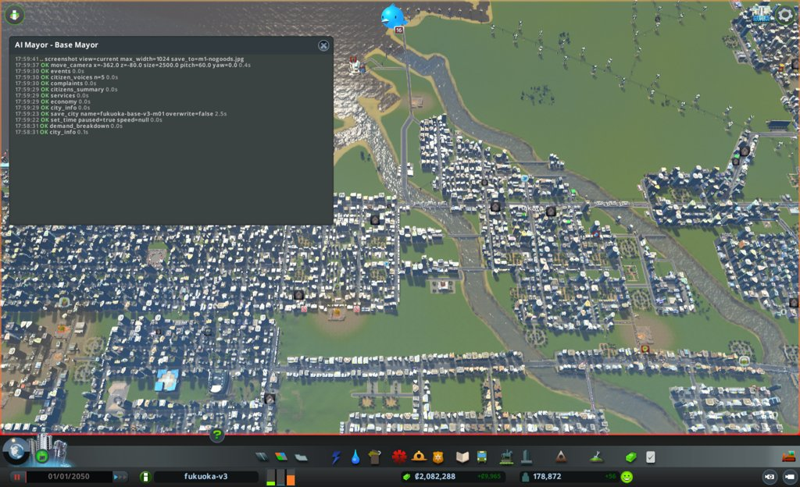
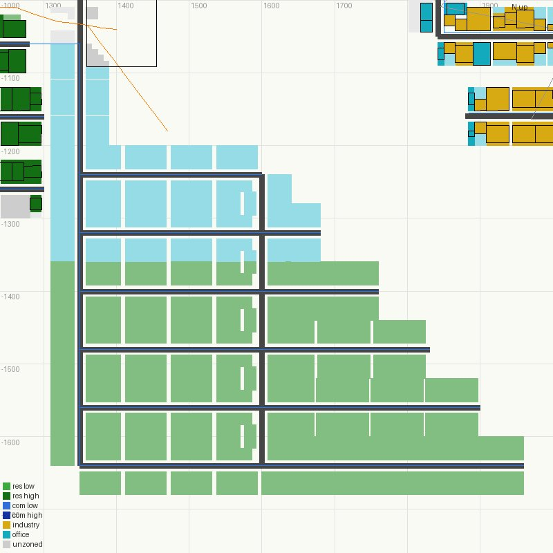

### 2050-01-11 見回り

境目: 当たらず。人口は −155(−0.1%)。週の収支は +9,965 から +13,745 へ良くなった。
新街区: `zone_map(1620,-1380,380)` で、オフィス約10棟と高密度住宅約8棟が建ち始め、赤い枠(電気・水・下水が来ない)はなかった。
需要は 住23→12、働60→18 に下がった。

### 2050-01-21 見回り

境目: 当たらず。人口は −202(−0.1%)で、月の初めから −357。需要は 住4・働4 まで下がった。
公約1(人口を毎月増やす)が、この月は守れないおそれがある。次の月例で、需要が下がった理由を `demand_breakdown` で見る。

### 2050-01-31 1か月目の終わり(次の月例の前に見た数)

`advance(10)` の後に、親への報告のために2つだけ見た。月例(2か月目)は次の呼び出しで行う。

- `city_info`: 人口 178,716(月例の 178,872 から −156)、所持金 2,108,005、週の収支 +11,563(収339,405 / 支327,842)、幸福度85、需要 住7・商2・働9、電気・水・下水が来ない市民 0 / 0 / 0
- `zones_at(1600,-1450,350)`(試しの測る数): 高密度住宅 建った385マス(全2,133、空き1,748)、オフィス 建った292マス(全681、空き389)。基準は0

### 2050-01-31 月例(2か月目)

保存: `fukuoka-base-v3-m02`(2050-01-31)

#### 答え合わせ

1. 南東の新街区(試し): 予想は「区画に建物が建ち始め、人口が +500人以上」
   - 試しの測る数 `zones_at(1600,-1450,350)`: 高密度住宅 建った385マス、オフィス 建った292マス。基準0から増えた → 効いた(区画は1か月で建つ)
   - 人口は 178,872 → 178,716(−156)。予想は外れた
   - 外れた理由の見立て: 家は足りている。`demand_breakdown` で空き家が5,028、失業(需要の数え)7,321に空いた働き口3,211。住宅の需要を決める2つの項がどちらも負で、新しい家に人が入らない
   - 次の扱い: 続ける(区画はそのまま。追加の住宅は作らない)
2. 警察の予算 150→130%: 予想は「支出が約4,600減り、犯罪率は7以内」
   - `economy_breakdown` の PoliceDepartment は 30,160(前は約34,800)。犯罪率5、留置 437/960 → 当たった
   - 次の扱い: 続ける
- 「次にやること」の実行: 3件とも実行した(見回りの zone_map、試しの答え合わせ、`vehicles_stuck(building=28755)` を今見た)
- 公約の進み具合
  1. 人口: 178,716(前の月例から −156)。守れなかった
  2. 電気・水・下水が来ない市民: 0 / 0 / 0。保っている
  3. 週の収支: +11,563。黒字(赤字0回)

#### 気づいたこと

- 区画の建物の空き家が5,028あり、住宅の区画もまだ道に面した空きが1,812マスある。人口を止めているのは家ではなく需要
- 失業の5,720人が大卒。オフィスの区画は道に面した空きが420マスあり、働く場所の需要(9)の範囲で建っている
- 高密度商業1,102棟のうち100棟が放棄。`buildings_near(abandoned)` の10件は、どれも「品物が届かない」の末に放棄された店
- 貨物駅 28755 に関わるトラック595台。敷地の中で空き待ち499台、7日以上止まって見える348台(前回は空き待ち492台)
- 28755 の出口は西の Large Road(x=3400)で、北の (3400,-1340) で Basic Road に変わる。z=-1340 の Basic Road の混み具合は66〜85、x=3480 の Basic Road の区間は80

#### 施策

1. 貨物駅の出口の道を4車線にする(試し)
   - 公約: 1(人口)と3(財政)。品物が届けば店の放棄が減り、働き口と商業の税収が残る
   - 捨てるもの: なし
   - 理由: 品物が届かない店215棟、放棄100棟。出口の先の Basic Road(1車線ずつ)が混み具合66〜91
   - 予想: 次の月例(30日後)までに、28755 の敷地の中の空き待ちが499台から400台以下に減る
   - 試し: 一覧の2行目。仮説は「貨物駅の出口の先の道が細く、トラックが道へ出られない。同じ幅の4車線にすると出られる」
     - 測る数: `vehicles_stuck(building=28755)` の WaitingSpace+Importing+InGrounds の台数。あわせて `traffic(3449,-1555,600)` の averageDensity と flow
     - 場所: 貨物駅 28755(3449,-1555)と、出口の先 (2780〜3495, -1340) と (3480, -1340〜-1240)
     - 基準: 空き待ち(敷地の中)499台。`traffic(3449,-1555,600)` の averageDensity 31、flow 51
   - 操作: `upgrade_road`(Small 4 Lane Road)。z=-1340 の x=2780〜3495 と、x=3480 の z=-1340〜-1240。同じ幅なので建物は壊れない
   - 週の維持費の見積もり: 同じ(どちらも1kmあたり40)
   - 結果: 一部成功。費用0
     - z=-1340(x=2780〜3495): 9区間のうち5区間を4車線にした。飛ばしたのは 682(短すぎる)、11279(もとから4車線)、25094(x≈3040、坂が急)、28970(x=3400〜3480、物にぶつかる)
     - x=3480(z=-1340〜-1290)の 17690 は、物にぶつかって飛ばした。近くに工場3棟と店2棟がある。壊してまで広げない
     - 建物は壊れていない(demolishedBuildings 0)。区画は保たれた

#### 考えたが打たなかった手

- 住宅の税を下げて人を呼ぶ: `demand_breakdown` の住宅の需要に税の項はない。高密度住宅の税1ポイントは週約3万で、黒字(+11,563)を超える
- 新街区の空いた高密度住宅の区画をオフィスに塗り替える: オフィスの道に面した空きはすでに420マスある。建つ速さは需要で決まり、塗り替えても速くならない
- 放棄された店100棟を取り壊す: 品物が届かないままなら、建て直した店もまた放棄される。試しの結果を見てから決める(2050-03-01 の月例で `building_stats` の CommercialHigh の abandoned を見る)
- 出口の残り2区間を、建物を壊して広げる: 工場と店を壊すと働き口が減る。今回の5区間の効き目を先に測る
- オフィスの税を上げる: 黒字は保てており、急がない

#### 次にやること

- 2050-02-10 の見回り: `city_info` と `events`。あわせて `vehicles_stuck(building=28755)` の空き待ちの台数を1回見る(施策は打たない)
- 2050-03-01 の月例: 試しの答え合わせ。`vehicles_stuck(building=28755)` の敷地の中の空き待ち(基準499)と `traffic(3449,-1555,600)`(基準 averageDensity 31、flow 51)
- 2050-03-01 の月例: `building_stats` の CommercialHigh の abandoned(基準100)と、`complaints` の NoGoods(基準215)を見る
- 2050-03-01 の月例: 人口が増えないなら、`demand_breakdown` の空き家(基準5,028)と失業(基準7,321)の動きを見る

#### 画面写真

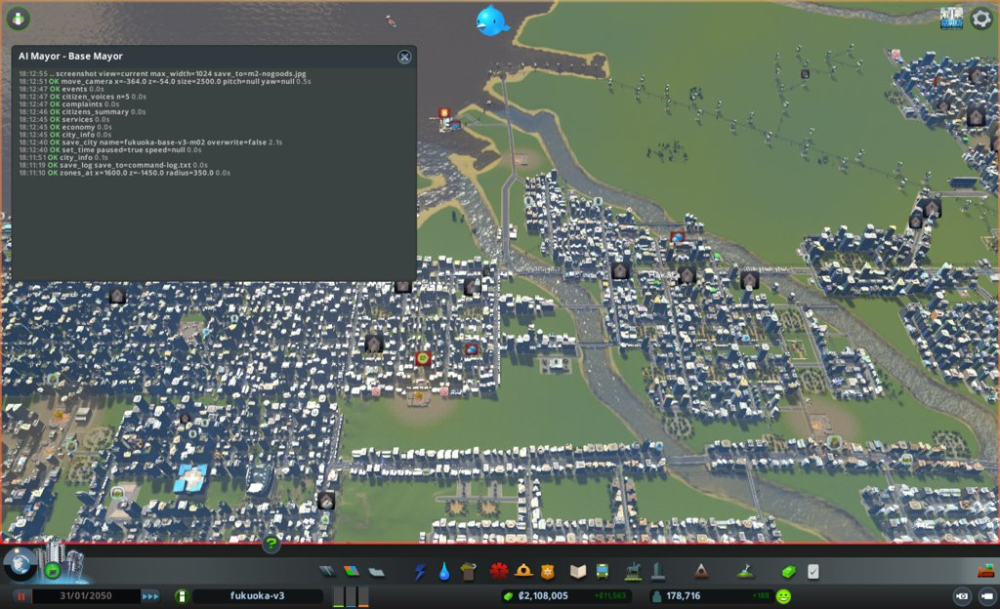
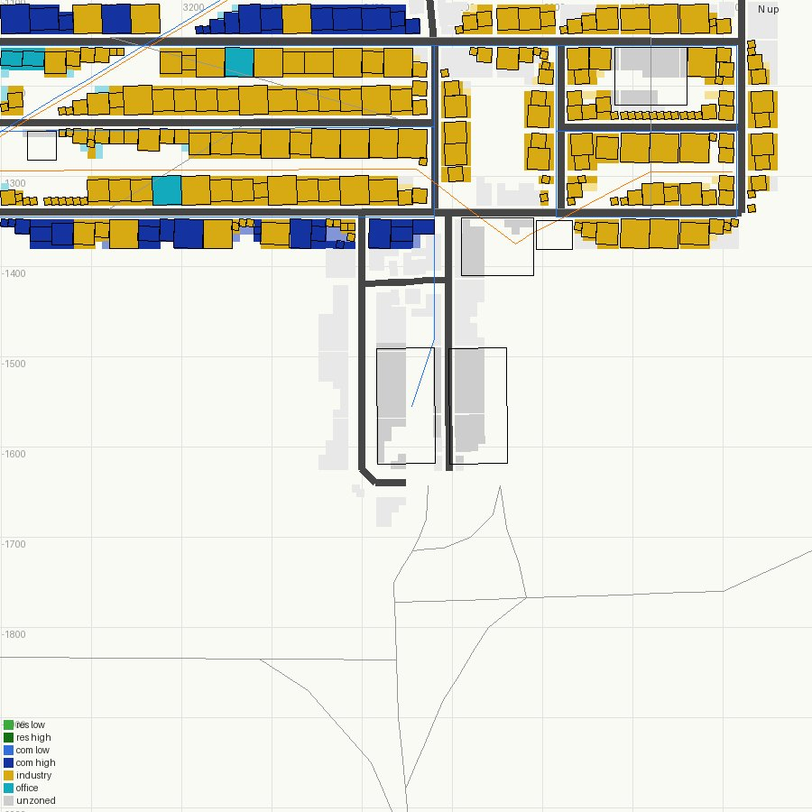

### 2050-02-10 見回り

境目: 当たらず。人口 178,646(−70)、週の収支 +11,294、幸福度85、需要 住4・商2・働5。電気・水・下水が来ない市民 0 / 0 / 0。
つぶやき2件(うち1件は死体が運ばれない声。境目の3件に届かない)。
貨物駅 28755: 敷地の中の空き待ち 504台(基準499)、7日以上止まって見える481台。出口の道を広げた後も減っていない。

### 2050-02-20 見回り

境目: 当たらず。人口 178,742(+96)、週の収支 +11,361、幸福度85、需要 住6・商2・働17。電気・水・下水が来ない市民 0 / 0 / 0。つぶやき1件(困りごとなし)。

### 2050-03-02 2か月目の終わり(次の月例の前に見た数)

`advance(10)` の後に、親への報告のために3つだけ見た。月例(3か月目)は次の呼び出しで行う。

- `city_info`: 人口 178,791(前の月例 178,716 から +75)、所持金 2,157,969、週の収支 +12,392(収340,213 / 支327,821)、幸福度85、需要 住7・商6・働18、電気・水・下水が来ない市民 0 / 0 / 0
- `vehicles_stuck(building=28755)`(試しの測る数): 敷地の中の空き待ち 513台(基準499)、7日以上止まって見える390台。車両8は60日止まって見える
- `traffic(3449,-1555,600)`: averageDensity 29(基準31)、flow 55(基準51)。いちばん混む区間は、広げられなかった 17690(x=3480、85)、25094(x≈3040、76)、28970(x=3400〜3480、65)
- 見立て(次の月例で確かめる): 広げた区間の先の、広げられなかった3区間が詰まりの元に残っている。空き待ちが減らないのは、敷地から道へ出る口そのものが原因かもしれない

### 2050-03-02 月例(3か月目)

保存: `fukuoka-base-v3-m03`(2050-03-02)

#### 答え合わせ

1. 貨物駅 28755 の出口の道を4車線に(試し): 予想は「空き待ちが499台から400台以下」
   - 測る数 `vehicles_stuck(building=28755)`: 敷地の中の空き待ち 513台(基準499)。7日以上止まって見える390台
   - `traffic(3449,-1555,600)`: averageDensity 29(基準31)、flow 55(基準51)
   - 判定: 効かない。道の混み具合はわずかに下がったが、敷地の中の空き待ちは増えた
   - 外れた理由の見立て: 詰まりは出口の先の道ではない。止まった車はすべて同じ点 (3441,-1555) にいる。外から来る貨物列車11本がすべて 28755 に向かい、隣の貨物駅 13893(3529,-1555)を含むほかの7つの貨物駅は出す車が0台。1つの駅に全部の荷が集まり、出口1つから出しきれない
   - 次の扱い: 広げた道はそのまま(費用0、維持費同じ)。打ち方を変えて試し直す(下の施策1)
2. 警察の予算 130%(先月から続ける): 犯罪率4、留置 426/960。保っている
- 「次にやること」の実行: 4件とも実行した(見回りで空き待ちを見た、試しの答え合わせ、`building_stats` の CommercialHigh の放棄 103棟(基準100)と `complaints` の NoGoods 217棟(基準215)、`demand_breakdown` の空き家 5,126(基準5,028)と失業 7,087(基準7,321))
- 公約の進み具合
  1. 人口: 178,791(前の月例 178,716 から +75)。守れた
  2. 電気・水・下水が来ない市民: 0 / 0 / 0。保っている
  3. 週の収支: +12,392。黒字(赤字0回)

#### 気づいたこと

- 品物が届かない店は217棟で、ほぼ変わらない。多い場所は (-1098,-975)、(2236,773)、(-2317,-911)
- 止まったトラック747台のうち515台が貨物駅の敷地の中で、513台が 28755。荷は品物(Goods)が460台
- 貨物列車11本の行き先はすべて 28755。`transport_reach` では 13893、3940、4740、40031 も外とつながっている(outsideConnected true)のに、出す車は0台
- 鉄道の支出 10,973 は、貨物駅8つ×1,440 と線路約2,300 の合計より小さい。止まっている貨物駅があるのかもしれない
- 空き家 5,126、失業(需要の数え)7,087 のうち大卒 6,826、空いた働き口 3,245。住宅の需要が上がらない形は先月と同じ
- 医療の支出は75,840(予算150%)で、病院の使用は 1,942/5,000。消防は31,920(140%)で、火事の印は4棟

#### 施策

1. 隣の貨物駅 13893 を動かす(試し。一覧の2行目の試し直し)
   - 公約: 1(人口)と3(財政)。品物が届けば店の放棄が減り、働き口と商業の税収が残る
   - 捨てるもの: なし
   - 理由: 貨物列車がすべて 28755 に向かい、隣の 13893 は出す車0台。止まっているなら、動かすと荷が2つの出口に分かれる
   - 予想: 次の月例までに、13893 の出す車が0から100台以上になり、28755 の敷地の中の空き待ちが513台から400台以下になる
   - 試し: 仮説は「13893 が止まっている(または列車が選ばない)ため、荷が 28755 の出口1つに集まっている。動かせば荷が分かれる」
     - 測る数: `cargo` の stations の 13893 と 28755 の vehiclesLeaving、`vehicles_stuck(building=28755)` の WaitingSpace+Importing+InGrounds
     - 場所: 貨物駅 28755(3449,-1555)と 13893(3529,-1555)
     - 基準: 13893 の vehiclesLeaving 0、28755 の vehiclesLeaving 774、空き待ち(敷地の中)513台
   - 操作: `set_building_active(13893, true)`
   - 週の維持費の見積もり: 止まっていたなら +1,440(`list_building_types` の Cargo Center)。すでに動いていたなら0
2. 消防の予算を 140% から 120% に下げる
   - 公約: 3(財政)
   - 捨てるもの: なし
   - 理由: 週の黒字は収入の3.6%しかない。消防の支出31,920に対し、火事の印は4棟
   - 予想: 次の見回りまでに週の支出が約4,500減る。火事の印は8棟以内にとどまる
   - 試し: なし
   - 操作: `set_budget(fire, 120)`
   - 結果: 成功。昼120%、夜120%。費用0

施策1の結果: `set_building_active(13893, true)` は成功(active true)。費用0。道具は前の状態を返さないため、止まっていたかは分からない。次の見回りで `cargo` の 13893 の vehiclesLeaving を見て確かめる

#### 考えたが打たなかった手

- 放棄された店103棟を取り壊す: 品物が届かないままなら、建て直した店もまた放棄される。試しで荷が分かれたかを、2050-04-01 の月例で `cargo` の 13893 の vehiclesLeaving で見てから決める
- 医療の予算を150%から下げる(支出75,840、病院の使用39%): 医療の予算は霊柩車も動かす。死体の印が51棟あり、下げると増えるおそれがある
- 教育の予算を下げる: 高校の席 24,360 に10代 22,338 で、ほぼ埋まっている
- 一覧の3行目(空き家と大卒の失業があるとき、何で人口が増えるか)を試しにすること: 今月は2行目の試し直しを選んだ。3行目は、効く手の見当がまだ付かない。働き口の空き3,245が埋まらない理由を、来月 `citizens_summary` と `demand_breakdown` で見て候補を作る

#### 次にやること

- 2050-03-12 の見回り: `city_info` と `events`。あわせて `cargo` の 13893 と 28755 の vehiclesLeaving を1回見る(施策は打たない)
- 2050-04-01 の月例: 試しの答え合わせ。`cargo` の stations(基準 13893 が0、28755 が774)と `vehicles_stuck(building=28755)` の敷地の中の空き待ち(基準513)
- 2050-04-01 の月例: `economy_breakdown` の FireDepartment(基準31,920)と、`complaints` の Fire(基準4)

#### 画面写真

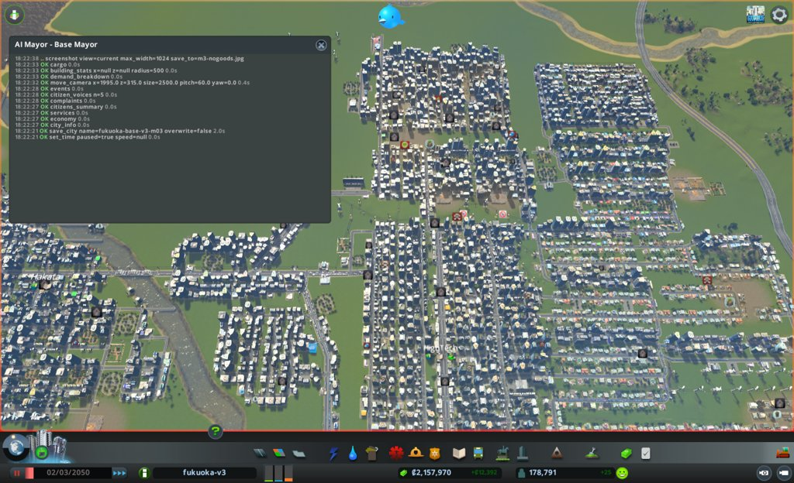

### 2050-03-12 見回り

境目: 当たらず。人口 178,841(+50)、週の収支 +13,860(支出は 327,821→323,243 で −4,578)、幸福度85、需要 住12・商2・働13。電気・水・下水が来ない市民 0 / 0 / 0。つぶやき1件(放棄された建物の声)。
貨物駅: `cargo` で 13893 の vehiclesLeaving は0のまま、28755 は763、28755 の敷地の中の止まった車517台。13893 はもとから動いていたと見る(動かしても何も変わらない)。品物が届かない店は224棟。

### 2050-03-22 見回り

境目: 当たらず。人口 179,059(+218)、週の収支 +11,228、幸福度85、需要 住2・商4・働34。電気・水・下水が来ない市民 0 / 0 / 0。つぶやき1件(困りごとなし)。
収入が 340,213(月例)→337,103→334,498 と下がり続けている。次の月例で `economy_breakdown` の収入の内訳を見る。

### 2050-04-01 3か月目の終わり(次の月例の前に見た数)

`advance(10)` の後に、親への報告のために3つだけ見た。月例(4か月目)は次の呼び出しで行う。

- `city_info`: 人口 179,243(前の月例 178,791 から +452)、所持金 2,211,128、週の収支 +11,305(収334,540 / 支323,235)、幸福度85、需要 住4・商2・働40、電気・水・下水が来ない市民 0 / 0 / 0
- `cargo`(試しの測る数): 13893 の vehiclesLeaving 0(基準0)、28755 は775(基準774)。品物が届かない店233棟(月例は217)
- `vehicles_stuck(building=28755)`: 敷地の中の空き待ち 518台(基準513)。車両8は90日止まって見える
- 見立て(次の月例で確かめる): 13893 を動かしても何も変わらず、試しは効かない見込み。列車が 28755 だけを選ぶ理由は分からない。品物が届かない店は増え続けている

### 2050-04-01 月例(4か月目)

保存: `fukuoka-base-v3-m04`(2050-04-01)

#### 答え合わせ

1. 隣の貨物駅 13893 を動かす(試し): 予想は「13893 の出す車が100台以上、28755 の空き待ちが400台以下」
   - 測る数 `cargo`: 13893 の vehiclesLeaving 0(基準0)、28755 は775(基準774)。`vehicles_stuck(building=28755)` の敷地の中の空き待ち 518台(基準513)
   - 判定: 効かない
   - 外れた理由の見立て: 13893 はもとから動いていた(見回りで vehiclesArriving も0)。列車は南東の鉄道のつなぎ口(7012,-8644)と(7290,-8644)から来て、いちばん近い 28755 だけを選んでいる。隣の駅が動いているかは関係なかった
   - 次の扱い: 13893 はそのまま(費用0)。打ち方を変え、28755 そのものを止めて試し直す(下の施策2)
2. 消防の予算 140→120%: 予想は「支出が約4,500減り、火事の印は8棟以内」
   - `economy_breakdown` の FireDepartment 27,360(基準31,920、−4,560)。`complaints` の Fire 3棟(基準4) → 当たった
   - 次の扱い: 続ける
3. 警察の予算 130%(続けている): 犯罪率5、留置 433/960。保っている
- 「次にやること」の実行: 3件とも実行した(見回りで `cargo` を見た、試しの答え合わせ、FireDepartment と Fire を見た)
- 公約の進み具合
  1. 人口: 179,243(前の月例 178,791 から +452)。守れた。残り8回の月例
  2. 電気・水・下水が来ない市民: 0 / 0 / 0。保っている。任期の終わりまで8か月
  3. 週の収支: +11,305。黒字(赤字0回)。ただし収入は 340,213 → 334,540 と下がっている

#### 気づいたこと

- オフィスの区画は、道に面した空きが0(`zone_summary` の Office emptyFacingRoad 0、空きは全部建物の裏の1,642マス)。工業も0。働く場所の需要40を受ける場所がない
- `demand_breakdown`: 大卒の失業 6,752、空いた働き口 3,017、空き家 5,107。住宅の需要は4
- 高密度住宅は道に面した空きが956マスあり、そのうち南東の新街区 `zones_at(1650,-1620,200)` に空き439マスがある。家は余っている
- 収入の内訳: 住宅 261,541、商業 38,550、オフィス 24,323、工業 5,388
- 品物の輸入は週6,942で、輸出はほぼ0。貨物列車は南東のつなぎ口2つから来て、全部 28755 に入る。28755 に関わるトラック618台のうち、敷地の中の空き待ち518台、338台は7日以上止まって見える
- 品物が届かない店は 233棟(先月217)。多い場所は (-1118,-1041)、(2216,760)、(1021,291)
- 医療の支出75,840(150%)に病院の使用 1,988/5,000。死体の印50棟

#### 施策

1. 南東の新街区の南の2列の、空いた高密度住宅の区画をオフィスに塗り替える(試し。一覧の3行目)
   - 公約: 1(人口)
   - 捨てるもの: なし
   - 理由: 働く場所の需要40なのに、オフィスの道に面した空きが0。大卒の失業6,752に対し、空き家5,107で家は余っている
   - 予想: 次の月例までにオフィスが建ち始め、大卒の失業が6,752から6,000以下に減る。人口は前の月例より増える
   - 試し: 仮説は「オフィスの建つ場所がないため、大卒の失業が減らず、住宅の需要の働き口の項が負のまま。オフィスを建てれば失業が減り、住宅の需要が上がる」
     - 測る数: `zones_at(1650,-1620,200)` の Office の建ったマス(total − empty)。あわせて `demand_breakdown` の大卒の失業(街全体だが、仕組みに最も近い数のため併せて見る)
     - 場所: (1350〜2000, -1565〜-1690)
     - 基準: Office 0マス(高密度住宅 1,057、空き439)。大卒の失業 6,752、emptyJobs 3,017
   - 操作: `zone_rect(1350,-1690,2000,-1565, office)`。建物のあるマスは変わらない
   - 週の維持費の見積もり: 0
2. 貨物駅 28755 を止める(試し。一覧の2行目の試し直し)
   - 公約: 1(人口)と3(財政)。品物が届けば店の放棄が減り、商業の税収が残る
   - 捨てるもの: なし
   - 理由: 28755 の敷地の中で518台が3か月出られない。出口の道を広げても、隣の駅を動かしても変わらなかった
   - 予想: 列車の荷が隣の 13893 などへ移るか、道路で輸入される。次の月例で、(-1118,-1041) 半径800の品物が届かない店が48棟から35棟以下に減る
   - 試し: 仮説は「28755 の敷地から道へ出る口が詰まり、品物が店に届かない。止めれば荷はほかの駅か道路で届く」
     - 測る数: `buildings_near(-1118,-1041,800, problem=NoGoods)` の total。あわせて `cargo` の stations の vehiclesLeaving(13893 ほか)
     - 場所: 品物が届かない店のいちばん多い (-1118,-1041) 半径800。貨物駅は (3449〜3529,-1555)
     - 基準: 品物が届かない店 48棟(街全体233)。13893 の vehiclesLeaving 0、28755 は775
   - 操作: `set_building_active(28755, false)`。悪くなったら(街全体の品物が届かない店が300棟を超えたら)次の月例で戻す
   - 週の維持費の見積もり: −1,440

施策1の結果: `zone_rect` 成功。オフィスに変えたマス504、建物があって飛ばしたマス376。費用0。
確かめ: `zones_at(1650,-1620,200)` で Office 262マス(全部空き)、高密度住宅 795(空き177)。試しの基準は Office の建ったマス0。南の2列の区画はもとから道に面して付いており、道路は引いていない。

施策2の結果: `set_building_active(28755, false)` 成功(active false)。費用0。

#### 考えたが打たなかった手

- 医療の予算を150%から下げる(支出75,840、病院の使用40%): 医療の予算は霊柩車も動かし、死体の印が50棟ある。今月は試しを2つ打つので、財政の手はこれ以上足さない
- 満ちた埋立地10か所を空にする: ごみの容量は使用81%、ごみの印40棟。新街区の近く(1782,-1376)に集まっており、区画の試しの場所と重なるため今月は見送る。来月 `services` の garbage と `complaints` の Garbage(基準40)で見る
- 高密度住宅の税を下げて人を呼ぶ: 住宅の需要に税の項はなく、1ポイントで週約3万減り黒字を超える
- 放棄された店を取り壊す: 28755 を止めた試しで品物が届くかを、2050-05-01 の月例で `buildings_near(-1118,-1041,800, problem=NoGoods)` で見てから決める

#### 次にやること

- 2050-04-11 の見回り: `city_info` と `events`。あわせて `cargo` の stations と noGoods の数を1回見る(施策は打たない。街全体の品物が届かない店が300棟を超えたら、次の月例で 28755 を戻す)
- 2050-05-01 の月例: 試し1の答え合わせ。`zones_at(1650,-1620,200)` の Office の建ったマス(基準0)と `demand_breakdown` の大卒の失業(基準6,752)
- 2050-05-01 の月例: 試し2の答え合わせ。`buildings_near(-1118,-1041,800, problem=NoGoods)` の total(基準48)と `cargo` の stations

#### 画面写真

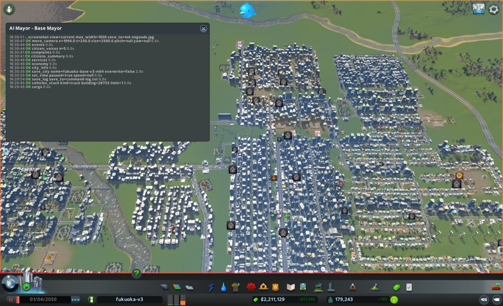
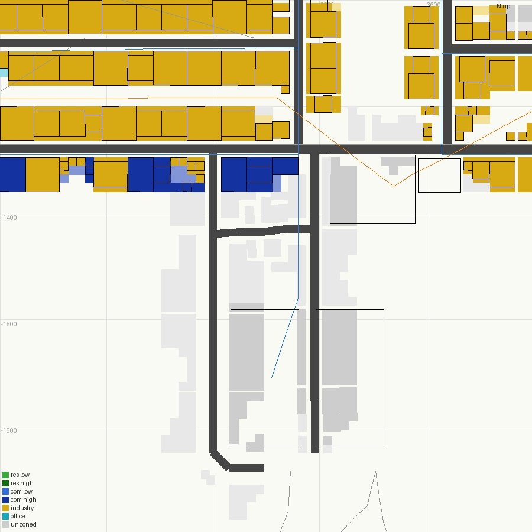

### 2050-04-11 見回り

境目: 当たらず。人口 179,400(+157)、週の収支 +12,749(収334,535 / 支321,786)、幸福度85、需要 住10・商2・働17。電気・水・下水が来ない市民 0 / 0 / 0。つぶやき2件(困りごとなし)。
貨物駅: `cargo` で貨物列車は12本→2本。28755 は止めた後も vehiclesLeaving 663、敷地の中の止まった車432台(518から減った)。13893 などほかの駅は0のまま。品物が届かない店240棟(300に届かない)。

### 2050-04-21 見回り

境目: 当たらず。人口 179,542(+142)、週の収支 +12,064(収333,843 / 支321,779)、幸福度85、需要 住10・商4・働15。電気・水・下水が来ない市民 0 / 0 / 0。つぶやき0件。

### 2050-05-01 4か月目の終わり(次の月例の前に見た数)

`advance(10)` の後に、親への報告のために見た。月例(5か月目)は次の呼び出しで行う。

- `city_info`: 人口 179,366(前の月例 179,243 から +123)、所持金 2,263,475、週の収支 +11,823(収333,591 / 支321,768)、幸福度85、需要 住12・商2・働6、電気・水・下水が来ない市民 0 / 0 / 0
- 試し1 `zones_at(1650,-1620,200)`: Office の建ったマス191(全262、空き71。基準0)。高密度住宅は空き177→44
- 試し1 `demand_breakdown`: 大卒の失業 6,712(基準6,752)、emptyJobs 2,955(基準3,017)、jobs 86,657(基準86,614)、空き家 5,171
- 試し2 `buildings_near(-1118,-1041,800, problem=NoGoods)`: 44棟(基準48)。街全体の品物が届かない店240棟(基準233)
- 試し2 `cargo`: 貨物列車 12→1本。28755 は止めた後も vehiclesLeaving 461、敷地の中の止まった車251台(基準518)。ほかの貨物駅は0のまま。港 46112 の出す車は20→45
- 見立て(次の月例で確かめる): オフィスは建ったが、働き口の総数はほとんど増えず、大卒の失業も減っていない。どこかで同じだけ働き口が減っているのかもしれない。28755 は止めると新しい列車が来なくなり、中の車は少しずつはけている。品物が届かない店はまだ減っていない

### 2050-05-01 月例(5か月目)

保存: `fukuoka-base-v3-m05`(2050-05-01)

#### 答え合わせ

1. 新街区の南2列をオフィスに(試し。一覧の3行目): 予想は「オフィスが建ち、大卒の失業が6,000以下、人口が増える」
   - 測る数 `zones_at(1650,-1620,200)`: Office の建ったマス191(基準0)。建つことには効いた
   - `demand_breakdown` の大卒の失業 6,712(基準6,752)、jobs 86,657(基準86,614、+43)。失業は減らず、予想は外れた
   - 人口は +123 で増えた(この試しの効き目かは分からない)
   - 外れた理由の見立て: 新しいオフィスの働き口の分だけ、ほかで働き口が減っている。品物が届かず放棄される店が働き口を減らしている見込み
   - 次の扱い: 区画はそのまま(費用0)。オフィスを足しても失業は減らないと分かったので、この打ち方は続けない
2. 貨物駅 28755 を止める(試し。一覧の2行目): 予想は「(-1118,-1041) 半径800の品物が届かない店が48棟から35棟以下」
   - 測る数 `buildings_near(-1118,-1041,800, problem=NoGoods)`: 44棟(基準48)。街全体 240棟(基準233)
   - `cargo`: 28755 の敷地の中の止まった車 518→251台。貨物列車 12→1本。ほかの貨物駅の出す車は0のまま。港 46112 の出す車は20→45
   - 判定: まだ分からない(詰まりは半分にはけたが、店まで品物が届いたかはまだ見えない)
   - 次の扱い: 止めたまま続ける。品物が届かない店が300棟を超えたら戻す。来月も「まだ分からない」なら、測る数を店の放棄の数に変えるか、28755 を戻す
3. 消防 120%、警察 130%(続けている): 火事の印3棟、犯罪率5、留置 399/960。保っている
- 「次にやること」の実行: 3件とも実行した(見回りで `cargo` を見た、試し1と試し2の答え合わせ)
- 公約の進み具合
  1. 人口: 179,366(前の月例 179,243 から +123)。守れた。残り7回の月例
  2. 電気・水・下水が来ない市民: 0 / 0 / 0。保っている。任期の終わりまで7か月
  3. 週の収支: +11,823。黒字(赤字0回)。収入は 334,540 → 333,591 と少し下がった

#### 気づいたこと

- ごみの印が40棟→93棟に増えた。いちばん多いのは西 (-2544,-1479) の23棟
- 西の埋立地7つのうち6つが満杯(157、19182、23032、25826、29270、48698)。満杯の埋立地は収集車を出さない(0/19)。動いているのは 24569(95%、19/19)と焼却場 41481(21/34)だけ
- 街全体のごみの容量は 160,000,000 に使用 131,883,388(82%)。満杯は10か所
- 品物が届かない店240棟。いちばん多いのは (2022,256) の73棟
- 死体の印 38棟(先月50)。大卒の失業 5,541(`citizens_summary`)、長く失業している人 4,676
- 水と下水は容量の80%を使っている(1,930,112 / 2,400,000)

#### 施策

1. 西の満杯の埋立地の南に、埋立地を2つ置く
   - 公約: 1(人口)。ごみの印が続くと建物が放棄され、人が減る
   - 捨てるもの: なし
   - 理由: 西の埋立地7つのうち6つが満杯で収集車を出さない。ごみの印は40→93棟
   - 予想: 次の月例までに、(-2300,-1500) 半径800のごみの印が23棟から10棟以下に減る。街全体は93から60以下
   - 試し: なし(満杯の埋立地が車を出さないことは `buildings_near` の stats で見えている)。測る数は `buildings_near(-2300,-1500,800, problem=Garbage)` の total。基準23
   - 操作: `build_line`(Basic Road。(-1820,-1960) から (-1820,-2130) へ)。`place_building`(Landfill Site を (-1860,-2045) で東向き、(-1780,-2045) で西向き)
   - 建設費の見積もり: 道路約850 + 埋立地 4,000×2 = 約8,850(所持金の半分 1,131,737 以内)
   - 週の維持費の見積もり: 埋立地 160×2 + 道路 0.17km×40 = 約327(黒字 11,823 の範囲)
   - 結果: 成功。建設費の合計 8,840
     - 道路: 840。北の端は既存の点 (-1820,-1960) につながった(snapped 1)。南の端は行き止まり
     - 埋立地 23044 を (-1860,-2050) 東向き、8032 を (-1780,-2050) 西向きに置いた。どちらも入口の前が新しい道(segment 29278、距離0)。壊した建物0
   - 確かめ: `zone_map(-1820,-1980,200)` で、道の両側に2つ並んだことを見た(assets/m5-landfills-map.jpg)。収集車が出ているかは、次の見回りで `buildings_near(-1820,-2050,100, service=Garbage)` の stats で見る

今月の試し: 一覧の2行目(28755 を止めた試し)を続ける。新しい操作はしない(止めたまま)。
一覧の3行目は今月は試さない。オフィスを足す打ち方は効かないと分かり、次の打ち方の見当がまだない。働き口が減っている場所を、来月 `building_stats` の放棄の棟数で探す。

#### 考えたが打たなかった手

- 満杯の埋立地を空にする(`empty_building`): 中身はほかの埋立地へ運ばれ、遠くまで車が走る。新しい埋立地の効き目を先に見る
- 焼却場をもう1つ置く(建設費30,000、維持費1,440): 埋立地(4,000、160)の方が安く、収集車も19台出る。ごみの印が次の月例で減らなければ考える
- 医療の予算を150%から下げる(病院の使用 1,993/5,000): 死体の印は38棟に減ったが、医療の予算は霊柩車も動かす。今月はごみの手当てを優先し、財政の手は足さない
- 28755 を戻す: 街全体の品物が届かない店は240棟で、戻す線の300に届かない。敷地の中の詰まりははけつつある

#### 次にやること

- 2050-05-11 の見回り: `city_info` と `events`。あわせて `buildings_near(-1820,-2050,100, service=Garbage)` で新しい埋立地の収集車が出ているかを見る(施策は打たない)
- 2050-05-31 の月例: 施策1の答え合わせ。`buildings_near(-2300,-1500,800, problem=Garbage)` の total(基準23)と `complaints` の Garbage(基準93)
- 2050-05-31 の月例: 試し2の答え合わせ。`buildings_near(-1118,-1041,800, problem=NoGoods)`(基準48、先月44)と `cargo` の stations、28755 の敷地の中の車(基準251)
- 2050-05-31 の月例: 一覧の3行目のために、`building_stats` で放棄の棟数を種類ごとに見る

#### 画面写真

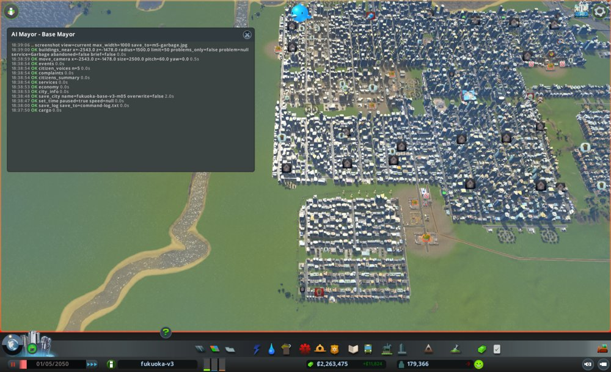
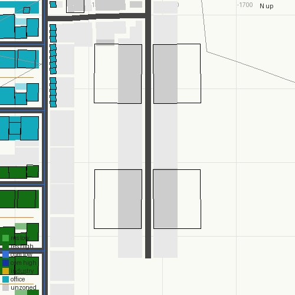

### 2050-05-11 見回り

境目: 当たらず。人口 179,254(−112)、週の収支 +11,605(収333,865 / 支322,260)、幸福度85、需要 住21・商2・働10。電気・水・下水が来ない市民 0 / 0 / 0。つぶやき2件(困りごとなし)。
新しい埋立地: 23044 と 8032 はどちらも収集車 19/19 が出ている。たまりはまだ0%。

### 2050-05-21 見回り

境目: 当たらず。人口 179,409(+155)、週の収支 +10,576(収332,825 / 支322,249)、幸福度85、需要 住22・商2・働21。電気・水・下水が来ない市民 0 / 0 / 0。つぶやき1件(困りごとなし)。
収入は 333,865 → 332,825 と下がり続けている(月例の初めから −766)。

### 2050-05-31 5か月目の終わり(次の月例の前に見た数)

`advance(10)` の後に、親への報告のために見た。月例(6か月目)は次の呼び出しで行う。

- `city_info`: 人口 179,403(前の月例 179,366 から +37)、所持金 2,302,877、週の収支 +10,790(収333,037 / 支322,247)、幸福度85、需要 住21・商2・働32、電気・水・下水が来ない市民 0 / 0 / 0
- 施策1 `buildings_near(-2300,-1500,800, problem=Garbage)`: 19棟(基準23。予想は10棟以下)
- `complaints`: ごみの印 129棟(基準93)で増えた。いちばん多い場所は西から (-453,-1451) の26棟へ移った。品物が届かない店 250棟(基準240)、死体43棟、火事5棟
- 試し2 `buildings_near(-1118,-1041,800, problem=NoGoods)`: 47棟(基準48、先月44)
- 試し2 `vehicles_stuck(building=28755)`: 28755 に関わる車26台(先月の敷地の中251台)。敷地の中は3台で、詰まりはほぼはけた。17台は道の上で7日以上止まって見える
- 見立て(次の月例で確かめる): 新しい埋立地の西では印が少し減ったが、街の南の中央 (-453,-1451) でごみの印が増えた。満杯の埋立地が西だけでなくほかにもあり、収集車の届く範囲が切れているのかもしれない。28755 の詰まりははけたが、品物が届かない店は減っていない。詰まりと品物の不足は別の原因の見込み

### 2050-05-31 月例(6か月目)

保存: `fukuoka-base-v3-m06`(2050-05-31)

#### 答え合わせ

1. 西の満杯の埋立地の南に埋立地を2つ(2050-05-01): 予想は「(-2300,-1500) 半径800のごみの印が23棟から10棟以下、街全体93から60以下」
   - 測る数 `buildings_near(-2300,-1500,800, problem=Garbage)`: 19棟(基準23)。`complaints` の Garbage は129棟(基準93)
   - 判定: 西では少し効いたが、予想は外れた。街全体は増えた
   - 外れた理由の見立て: 新しい埋立地2つは収集車 19/19 を出しきっており、西の需要だけでも足りない。街の南の中央 (-453,-1451) の26棟は、近くの焼却場 33797(-570,-1840)が蓄え 400,000/400,000 で満ち、近くの埋立地 16914(-650,-490)と 25692(738,-590)も満杯で、収集の手が届いていない
   - 次の扱い: 続ける(埋立地はそのまま)。南の中央にも同じ手を打つ(下の施策1)
2. 貨物駅 28755 を止める(試し。一覧の2行目。2回目の答え合わせ): 予想は「(-1118,-1041) 半径800の品物が届かない店が35棟以下」
   - 測る数 `buildings_near(-1118,-1041,800, problem=NoGoods)`: 47棟(基準48、先月44)。街全体 250棟(基準233)
   - `cargo`: 28755 の敷地の中の止まった車は20台未満(上位に出ない。先月251、基準518)。vehiclesLeaving 167、貨物列車1本
   - 判定: 効かない。詰まりはほぼはけたのに、品物が届かない店は減らなかった。仮説「28755 の詰まりが品物の不足の原因」は外れ
   - 次の扱い: 28755 は止めたまま(週 −1,440。品物が届かない店は戻す線の300に届かない)。一覧の2行目は「確かめ終えた」にし、品物の不足の原因は新しい行に分ける
3. 消防 120%、警察 130%(続けている): 火事の印5棟、犯罪率5、留置 396/960。保っている
- 「次にやること」の実行: 4件とも実行した(見回りで埋立地の収集車を見た、施策1の答え合わせ、試し2の答え合わせ、`building_stats` の放棄の棟数)
- 公約の進み具合
  1. 人口: 179,403(前の月例 179,366 から +37)。守れた。残り6回の月例
  2. 電気・水・下水が来ない市民: 0 / 0 / 0。保っている。任期の終わりまで6か月
  3. 週の収支: +10,790。黒字(赤字0回)。収入は 333,591 → 333,037 と下がり続けている

#### 気づいたこと

- `building_stats` の放棄: 高密度商業 119棟(3月は103)、工業12、住宅4。働き口が減っているのは高密度商業の放棄が主(一覧の3行目の手がかり)
- ごみの満杯は10か所(西の5つに加え 16914、25590、25692、45892)。容量 176,000,000 に使用 133,503,388(76%)。総量は余っているのに、満杯の場所の近くで収集車が出ない
- 南の中央の焼却場 33797 は蓄えが満杯(処理 60,000/週)で、収集車 23/34
- 品物が届かない店 250棟。多いのは (-1120,-893) 70棟、(2251,706) 56棟、(953,281) 37棟。止まったトラックは 207台に減った(先月は 28755 の中だけで251台)
- 医療の支出 75,840(150%)、病院の使用 2,048/5,000(41%)。死体の印43棟、墓地の使用 13,481/24,000
- 需要 住21・商2・働32。大卒の失業 5,543、長く失業している人 4,557
- 水と下水は容量の77〜81%を使っている

#### 施策

1. 南の中央の焼却場の南に、埋立地を2つ置く
   - 公約: 1(人口)。ごみの印が続くと建物が放棄され、人が減る
   - 捨てるもの: なし
   - 理由: ごみの印が93→129棟。いちばん多い (-453,-1451) の近くの焼却場は蓄えが満杯、埋立地2つも満杯
   - 予想: 次の月例までに、(-453,-1451) 半径600のごみの印が今の値から半分以下に減る。街全体は129から90以下
   - 試し: なし(満杯の施設が車を出さないことは stats で見えている)。測る数は `buildings_near(-453,-1451,600, problem=Garbage)` の total
   - 操作: `place_building`(Landfill Site を (-650,-1900) と (-560,-1900) に北向き。入口の前は既存の Basic Road z=-1860)
   - 建設費の見積もり: 4,000×2 = 8,000(所持金の半分 1,151,438 以内)
   - 週の維持費の見積もり: 160×2 = 320(黒字 10,790 の範囲)
2. 医療の予算を 150% から 130% に下げる(試し。一覧の4行目)
   - 公約: 3(財政)
   - 捨てるもの: なし
   - 理由: 週の黒字は収入の3.2%で、収入は5か月下がり続けている。病院の使用は容量の41%
   - 予想: 次の見回りまでに週の支出が約10,000減る。死体の印は43棟から60棟以内、病院の使用は容量の60%以内にとどまる
   - 試し: 仮説は「医療の予算を下げても、霊柩車と救急車は足りており、死体の印と病気の人は増えない」
     - 測る数: `complaints` の Death の棟数と、`services` の healthcare.used / deathcare.used。あわせて `citizens_summary` の sick
     - 場所: 死体の印のいちばん多い (3440,-266) 半径800 の `buildings_near(problem=Death)` と、街全体の Death
     - 基準: Death 43棟、healthcare.used 2,048/5,000、deathcare.used 13,481/24,000、sick 2,053。(3440,-266) 半径800 は実行の前に測る
   - 操作: `set_budget(healthcare, 130)`。死体の印が60棟を超えたら次の月例で150%に戻す

基準の追加(実行の前に測った): 施策1の `buildings_near(-453,-1451,600, problem=Garbage)` は25棟。施策2の `buildings_near(3440,-266,800, problem=Death)` は11棟。

施策1の結果: 成功。建設費の合計 8,400
- 1つ目の埋立地 2226 を (-650,-1900) 北向きに置いたら、入口の前に道がなかった(warning。既存の道 z=-1860 の西の端は x=-620)
- 同じ施策の中で、道を (-620,-1860) から (-700,-1860) へ80m延ばした(Basic Road、400。西の端は既存の点につながった snapped 1)
- 2つ目の埋立地 24004 を (-560,-1900) 北向きに置いた。入口の前は既存の道 14176(距離0)。壊した建物0
- 確かめ: 置いた後に `advance(1)` で1日進め(2050-06-01)、`buildings_near(-605,-1900,70, service=Garbage)` で 2226 が収集車 1/19、24004 が 2/19 を出し始めたことを見た。`zone_map(-600,-1880,150)` で道の南に2つ並んだことを見た(assets/m6-landfills-map.jpg)
- 週の維持費の増分: 約323(埋立地 320、道 0.08km)

施策2の結果: `set_budget(healthcare, 130)` 成功。昼130%、夜130%。費用0

今月の試し: 一覧の4行目(医療の予算)。一覧の2行目は確かめ終えた(効かない)。一覧の3行目は、放棄された高密度商業が119棟に増えたことが手がかりだが、品物が届かない原因(5行目)が分からないうちは打つ手がない。5行目は、次の月例までに `cargo` の noGoods の場所と、近くの工業の働き手を見て試しの形にする

#### 考えたが打たなかった手

- 満杯の埋立地10か所を空にする(`empty_building`): 中身は遠くの埋立地へ運ばれ、新しい埋立地もすぐ埋まる。今月置いた2つの効き目を先に測る
- 28755 を動かし直す: 止めても品物が届かない店はほぼ同じで、止めておけば週1,440安い
- 放棄された高密度商業119棟を取り壊す: 商業の需要は2で、建て直されない。品物が届かないままなら、建て直しても放棄される
- 公園の予算150%やバスの予算150%を下げる: 今月は財政の手を医療1つにし、効き目を分けて測る
- 焼却場を足す(30,000、維持費1,440): 埋立地の方が安く、収集車も多い

#### 次にやること

- 2050-06-10 の見回り: `city_info` と `events`。あわせて `economy_breakdown` の HealthCare の支出(基準75,840)を1回見る(施策は打たない)
- 次の月例: 施策1の答え合わせ。`buildings_near(-453,-1451,600, problem=Garbage)`(基準25)と `complaints` の Garbage(基準129)
- 次の月例: 試し(施策2)の答え合わせ。`complaints` の Death(基準43)、`buildings_near(3440,-266,800, problem=Death)`(基準11)、`services` の healthcare.used(基準2,048)と deathcare.used(基準13,481)、`citizens_summary` の sick(基準2,053)
- 次の月例: 一覧の5行目を試しにするため、`cargo` の noGoods の多い場所 (-1120,-893) の近くで、品物を作る工業と、トラックの止まった場所を見る

#### 画面写真

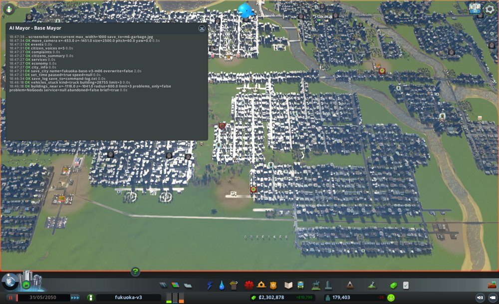
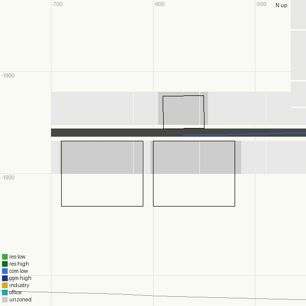

### 2050-06-10 見回り

境目: 当たらず。人口 179,511(+108)、週の収支 +20,737(収333,332 / 支312,595)、幸福度84(−1)、需要 住23・商2・働50。電気・水・下水が来ない市民 0 / 0 / 0。つぶやき2件(うち1件は水の声。境目の3件に届かない)。
`economy_breakdown` の HealthCare は 65,728(基準75,840、−10,112)。

### 2050-06-20 見回り

境目: 当たらず。人口 179,191(−320、−0.2%)、週の収支 +16,450(収329,016 / 支312,566)、幸福度85、需要 住23・商2・働55。電気・水・下水が来ない市民 0 / 0 / 0。つぶやき0件。
人口は月例の 179,403 を下回った。収入も 333,332 → 329,016 と下がった。公約1が今月は守れないおそれがある。

### 2050-06-30 6か月目の終わり(次の月例の前に見た数)

`advance(10)` の後に、親への報告のために見た。月例(7か月目)は次の呼び出しで行う。

- `city_info`: 人口 179,243(前の月例 179,403 から −160)、所持金 2,366,757、週の収支 +13,757(収326,368 / 支312,611)、幸福度84、需要 住24・商2・働55、電気・水・下水が来ない市民 0 / 0 / 0
- 施策1 `buildings_near(-453,-1451,600, problem=Garbage)`: 6棟(基準25。予想は半分以下)
- `complaints`: ごみの印 150棟(基準129)で増えた。いちばん多い場所は南東の新街区 (1625,-1452) の48棟へ移った。品物が届かない店 251棟、死体54棟(基準43)、火事6棟
- 試し(施策2) `buildings_near(3440,-266,800, problem=Death)`: 14棟(基準11)
- 見立て(次の月例で確かめる): 埋立地を置いた場所では印がはっきり減るが、印は満杯の埋立地の近くの別の街区へ移っていく。南東の新街区の近くにも満杯の埋立地があるのかもしれない。死体の印は増えたが、戻す線の60には届いていない。収入は 333,037 → 326,368 と1か月で −6,669 下がった

### 2050-06-30 月例(7か月目)

保存: `fukuoka-base-v3-m07`(2050-06-30)

#### 答え合わせ

1. 南の中央の焼却場の南に埋立地を2つ(2050-05-31): 予想は「(-453,-1451) 半径600のごみの印が半分以下、街全体129から90以下」
   - 測る数 `buildings_near(-453,-1451,600, problem=Garbage)`: 6棟(基準25)。置いた場所は当たった
   - `complaints` の Garbage: 150棟(基準129)。街全体は外れた
   - 外れた理由の見立て: 印は満杯の埋立地の近くへ移っていく。今のいちばん多い場所は南東の新街区 (1625,-1452) の48棟。近くの埋立地 45892(2272,-1115)は満杯で車0/19、25692(738,-590)も満杯。動いている 29981(85%)、12243、焼却場3つは車を出しきっている(19/19、34/34)
   - 次の扱い: 続ける。南東の新街区にも同じ手を打つ(下の施策1)
2. 医療の予算 150→130%(試し。一覧の4行目): 予想は「支出が約10,000減る。死体の印は60棟以内、病院の使用は60%以内」
   - `economy_breakdown` の HealthCare 65,728(基準75,840、−10,112)。支出は当たった
   - `complaints` の Death 54棟(基準43)。(3440,-266) 半径800 は14棟(基準11)。`services` の healthcare.used 2,136/5,000(43%。基準2,048)、deathcare.used 13,696(基準13,481)。`citizens_summary` の sick 2,135(基準2,053)
   - 判定: まだ分からない(1回目)。どれも少し増えたが、死体の印は1〜6月の幅(38〜54)の中で、戻す線の60に届かない
   - 次の扱い: 130%のまま続ける。2050-07-30 の月例で同じ数を見る。死体の印が60を超えたら150%に戻す
3. 消防 120%、警察 130%(続けている): 火事の印6棟、犯罪率5、留置 373/960。保っている
- 「次にやること」の実行: 3件とも実行した(見回りで HealthCare の支出を見た、施策1と試しの答え合わせ、`cargo` で品物の不足の場所とトラックの止まった場所を見た)
- 公約の進み具合
  1. 人口: 179,243(前の月例 179,403 から −160)。守れなかった(守れなかったのは1月に続き2回目)。残り5回の月例
  2. 電気・水・下水が来ない市民: 0 / 0 / 0。保っている。任期の終わりまで5か月
  3. 週の収支: +13,757。黒字(赤字0回)。ただし収入は 333,037 → 326,368 と下がり続け、黒字は医療の予算を下げた分で保っている

#### 気づいたこと

- 収入の内訳: 住宅 255,409(先月の前は 261,541)、商業 36,594、オフィス 23,752、工業 5,367。住宅の税収が下がっている
- `demand_breakdown`: 大卒の失業 6,702、空いた働き口 3,033、空き家 5,345(先月 5,171)。空き家が増えている
- 28755 を止めてから、品物と原料の輸入は西の港 1366(-2000,605)へ移った。1366 の出す車197台。東の工場(3412,-1174 など)行きの原料も、西の港から4km以上走っている
- 1366 の出口は、港から南へ下る Large Road(x=-1965)1本で、(-1964,100) のT字路で Medium Road(z=100)に出る。このT字路は信号つき(ゲームが自動で付けた)
- `traffic(-1900,300,500)`: 止まった車20台、averageDensity 33、flow 57。z=100 の Medium Road と、その北の通りの区間が混み具合100
- `vehicles_stuck(building=1366)`: 91台のうち、道の上で止まっている66台、敷地の中の空き待ち18台
- 原料が届かない工場23棟。多いのは (2404,-972) の13棟
- 品物が届かない店251棟。多いのは (-1106,-839) 67棟、(2245,717) 62棟、(974,251) 34棟。(-1106,-839) 半径800 は43棟
- 5人の市民はみな幸福度「最高」で、困りごとなし

#### 施策

1. 南東の新街区の南に、埋立地を2つ置く
   - 公約: 1(人口)。ごみの印が続くと建物が放棄され、人が減る
   - 捨てるもの: なし
   - 理由: ごみの印のいちばん多い新街区 (1625,-1452) に46棟。近くの埋立地 45892 は満杯で、ほかは車を出しきっている
   - 予想: 次の月例までに、(1625,-1452) 半径600のごみの印が46棟から20棟以下に減る。街全体は150から130以下
   - 試し: なし(前の2回で、置いた場所の印が減ることは見えている)。測る数は `buildings_near(1625,-1452,600, problem=Garbage)` の total。基準46
   - 操作: `build_line`(Basic Road。(1960,-1640) から東へ (2040,-1640)、そこから南へ (2040,-1840))。`place_building`(Landfill Site を (2000,-1760) 東向き、(2080,-1760) 西向き)
   - 建設費の見積もり: 道路約280m(約1,400)+ 埋立地 4,000×2 = 約9,400(所持金の半分 1,183,378 以内)
   - 週の維持費の見積もり: 埋立地 160×2 + 道路 0.28km×40 = 約331(黒字 13,757 の範囲)
2. 西の港 1366 の出口のT字路の信号を外す(試し。一覧の5行目)
   - 公約: 1(人口)と3(財政)。品物が届けば店の放棄が減り、働き口と商業の税収が残る
   - 捨てるもの: なし
   - 理由: 28755 を止めてから荷が西の港に集まり、出口のT字路の先が混み具合100。港の荷の車66台が道の上で止まっている
   - 予想: 次の月例までに、`traffic(-1900,300,500)` の止まった車が20台から10台以下、`vehicles_stuck(building=1366)` の道の上で止まった車が66台から40台以下。(-1106,-839) 半径800の品物が届かない店が43棟から35棟以下
   - 試し: 仮説は「品物は西の港から来るが、港の出口のT字路の信号で車が止まり、南西の店に届くのが遅れる。信号を外すと港から車が早く出て、届く」
     - 測る数: `buildings_near(-1106,-839,800, problem=NoGoods)` の total。あわせて `traffic(-1900,300,500)` の blocked と averageDensity、`vehicles_stuck(building=1366)` の OnRoad+Blocked と WaitingSpace の台数
     - 場所: 港 1366(-2000,605)の出口 (-1964,100) と、品物が届かない店の多い (-1106,-839) 半径800
     - 基準: 品物が届かない店43棟。止まった車20台、averageDensity 33、flow 57。1366 の道の上で止まった車66台、敷地の中の空き待ち18台
   - 操作: `set_traffic_lights(-1964,100, false)`。止まった車が増えたら(30台を超えたら)次の月例で戻す
   - 週の維持費: 0

施策1の結果: 成功。建設費の合計 9,360
- 道路: 1,360。西の端は既存の点 (1960,-1640) につながった(snapped 1)。南の端は行き止まり
- 埋立地 24706 を (2000,-1760) 東向き、11407 を (2080,-1760) 西向きに置いた。どちらも入口の前が新しい道(segment 27942、距離0)。壊した建物0
- 確かめ: `zone_map(2000,-1720,200)` で、道の両側に2つ並び、道が新街区の南の通りにつながったことを見た(assets/m7-landfills-map.jpg)。収集車が出ているかは、次の見回りで `buildings_near(2040,-1760,100, service=Garbage)` で見る
- 週の維持費の増分: 約331

施策2の結果: `set_traffic_lights` 成功。node 19710 の信号は false(customLights true)。費用0

今月の試し: 一覧の5行目(品物の不足の原因)。一覧の4行目(医療の予算)は続けて測る。一覧の3行目は上の「考えたが打たなかった手」に理由を書いた。一覧の6行目(ごみの印が移る理由)は、施策1の後に印の移る先を見てから試しの形にする(2050-07-30 の月例で `complaints` の Garbage の hotspot と、その近くの `buildings_near(service=Garbage)` の満杯を見る)

#### 考えたが打たなかった手

- 28755 を動かし直す: 西の港に荷が集まった原因かもしれないが、動かしていた3か月も品物が届かない店は同じだった。今月は港の出口の試しと場所を分けて、来月の結果を見て決める
- 満杯の埋立地10か所を空にする(`empty_building`): 中身は車を出しきった埋立地へ運ばれる。新しく置く方が、前の2回で効き目が見えている
- 住宅の税を下げる: 住宅の需要に税の項はなく、黒字(13,757)では1ポイント(週約3万)を下げられない
- 公園やバスの予算(150%)を下げる: 医療の試しの答えが出ていない。財政の手を2つ重ねると、どちらが効いたか分からない
- 一覧の3行目(空き家と大卒の失業): 品物の不足(5行目)を先に試す。商業の放棄が働き口を減らしている見立てのため、5行目が分かれば3行目にも効く

#### 次にやること

- 2050-07-10 の見回り: `city_info` と `events`。あわせて `buildings_near(2040,-1760,100, service=Garbage)` で新しい埋立地の収集車を見る(施策は打たない)
- 2050-07-30 の月例: 施策1の答え合わせ。`buildings_near(1625,-1452,600, problem=Garbage)`(基準46)と `complaints` の Garbage(基準150)と、その hotspot
- 2050-07-30 の月例: 試し(施策2)の答え合わせ。`buildings_near(-1106,-839,800, problem=NoGoods)`(基準43)、`traffic(-1900,300,500)`(基準 blocked 20、averageDensity 33)、`vehicles_stuck(building=1366)`(基準 道の上66、空き待ち18)
- 2050-07-30 の月例: 医療の試しの2回目の答え合わせ。`complaints` の Death(基準43、今54)、`buildings_near(3440,-266,800, problem=Death)`(基準11、今14)、`services` の healthcare.used と deathcare.used、`citizens_summary` の sick

#### 画面写真

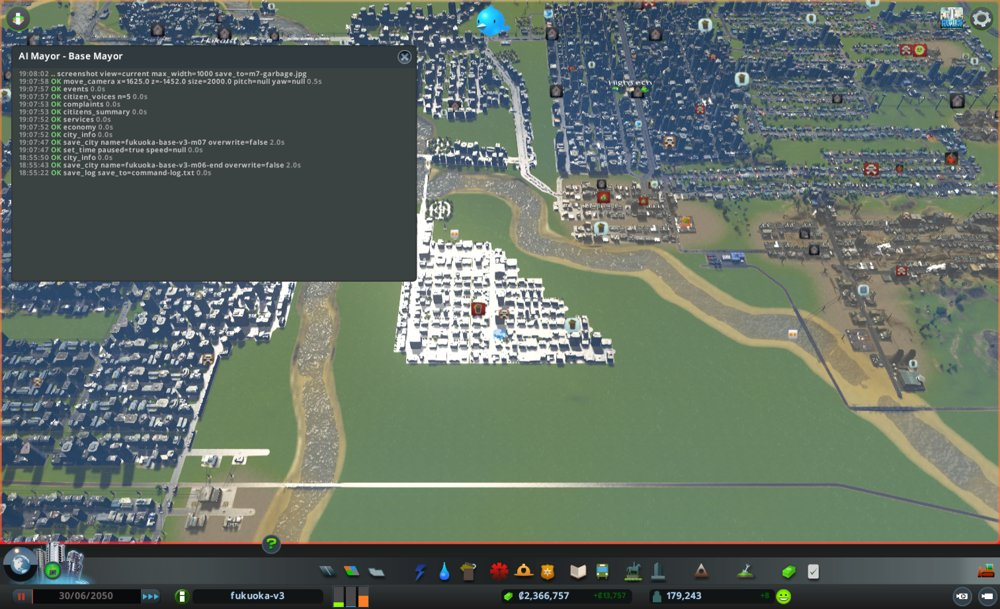
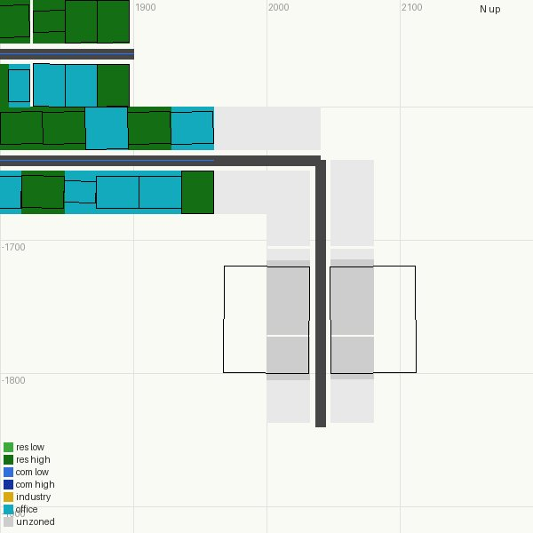

### 2050-07-10 見回り

境目: 当たらず。人口 179,203(−40)、週の収支 +14,101(収327,167 / 支313,066)、幸福度84、需要 住23・商2・働59。電気・水・下水が来ない市民 0 / 0 / 0。つぶやき2件(困りごとなし。「最も魅力的な街」の賞の声)。
新しい埋立地: 24706 と 11407 はどちらも収集車 18/19 が出ている。たまりは1%。

### 2050-07-20 見回り

境目: 当たらず。人口 178,997(−206、−0.1%)、週の収支 +13,133(収326,147 / 支313,014)、幸福度85、需要 住22・商2・働54。電気・水・下水が来ない市民 0 / 0 / 0。つぶやき1件(困りごとなし)。
人口は月例の 179,243 を下回っている。公約1が今月も守れないおそれがある。

### 2050-07-30 7か月目の終わり(次の月例の前に見た数)

`advance(10)` の後に、親への報告のために見た。月例(8か月目)は次の呼び出しで行う。

- `city_info`: 人口 179,071(前の月例 179,243 から −172)、所持金 2,412,600、週の収支 +10,683(収323,642 / 支312,959)、幸福度85、需要 住24・商2・働57、電気・水・下水が来ない市民 0 / 0 / 0
- `events`: 2件。うち1件は死体が運ばれない声
- 施策1 `buildings_near(1625,-1452,600, problem=Garbage)`: 9棟(基準46。予想は20棟以下)
- `complaints`: ごみの印 123棟(基準150)。いちばん多い場所は東 (3519,-102) の27棟へ移った。品物が届かない店 287棟(基準251)、死体52棟(基準54)、火事9棟、汚染40棟
- 試し(施策2) `buildings_near(-1106,-839,800, problem=NoGoods)`: 47棟(基準43)
- 試し(施策2) `traffic(-1900,300,500)`: 止まった車17台(基準20)、averageDensity 32(基準33)、flow 57(基準57)。いちばん混む区間に港の中の Harbor Road(-2000,565)が入った
- 試し(施策2) `vehicles_stuck(building=1366)`: 78台。道の上で止まった車46台(基準66)、敷地の中の空き待ち26台(基準18)
- 見立て(次の月例で確かめる): 埋立地は新街区でも効き、街全体のごみの印も初めて減った。印は次に東 (3519,-102) へ移った。信号を外すと道の上で止まった車は減ったが、港の中の空き待ちは増え、南西の店に品物は届いていない。品物が届かない店は287棟に増え、28755 を戻す線の300に近い。収入は 326,368 → 323,642 と下がり続け、黒字は月例の +13,757 から +10,683 に縮んだ

### 2050-07-30 月例(8か月目)

保存: `fukuoka-base-v3-m08`(2050-07-30)

#### 答え合わせ

1. 南東の新街区の南に埋立地を2つ(2050-06-30): 予想は「(1625,-1452) 半径600のごみの印が46棟から20棟以下、街全体150から130以下」
   - 測る数 `buildings_near(1625,-1452,600, problem=Garbage)`: 9棟(基準46)。`complaints` の Garbage 123棟(基準150) → 当たった
   - 印のいちばん多い場所は東 (3519,-102) の27棟へ移った。近くの埋立地 25590(3900,-575)が満杯(0/19)、焼却場 2267(3604,-30)は 34/34 で車を出しきっている
   - 次の扱い: 続ける。東にも同じ手を打つ(下の施策1)
2. 西の港 1366 の出口のT字路の信号を外す(試し。一覧の5行目): 予想は「止まった車20→10台以下、港の道の上の止まった車66→40台以下、(-1106,-839) 半径800の品物が届かない店43→35棟以下」
   - `traffic(-1900,300,500)`: 止まった車17台(基準20)、averageDensity 32(基準33)、flow 57(基準57)
   - `vehicles_stuck(building=1366)`: 道の上46台(基準66)、敷地の中の空き待ち26台(基準18)
   - `buildings_near(-1106,-839,800, problem=NoGoods)`: 47棟(基準43)
   - 判定: 効かない。港から道への流れは少し良くなったが、店の品物の不足は増えた
   - 外れた理由の見立て: 港の出口の流れは品物の不足の原因ではない。28755 を止めた4月から、街全体の品物が届かない店は 233→287棟に増え続けている。東の店へ品物を運ぶ駅を止めたことが効いているのかもしれない
   - 次の扱い: 信号は外したまま(道の上の止まった車は減った。費用0)。打ち方を変えて、28755 を動かし直す(下の施策2)
3. 医療の予算 130%(試し。一覧の4行目の2回目): 予想は「死体の印60棟以内、病院の使用60%以内」
   - `complaints` の Death 52棟(先月54、基準43)。`buildings_near(3440,-266,800, problem=Death)` 13棟(先月14、基準11)。`services` の healthcare.used 2,104/5,000(42%)、deathcare.used 13,886。`citizens_summary` の sick 2,099(先月2,135)
   - 判定: 130%にしても、死体の印と病気は増え続けていない(1〜7月の幅の中)。予算を下げても悪くならないと確かめ終えた
   - 次の扱い: 130%を続ける。支出は週 −10,112 のまま
4. 消防 120%、警察 130%(続けている): 火事の印9棟(先月6)、犯罪率5、留置 404/960。火事の印は増えたが、8棟の線をわずかに越えただけ。続ける。来月 `complaints` の Fire が12棟を超えたら140%に戻す
- 「次にやること」の実行: 4件とも実行した(見回りで新しい埋立地の車を見た、施策1・試し・医療の答え合わせ)
- 公約の進み具合
  1. 人口: 179,071(前の月例 179,243 から −172)。守れなかった(1月、6月に続き3回目)。残り4回の月例
  2. 電気・水・下水が来ない市民: 0 / 0 / 0。保っている。任期の終わりまで4か月
  3. 週の収支: +10,683。黒字(赤字0回)。収入は 326,368 → 323,642 と下がり続け、黒字は1か月で 3,074 縮んだ

#### 気づいたこと

- 収入の内訳: 住宅 254,170(先月 255,409)、商業 35,598(36,594)、オフィス 23,775、工業 5,366。住宅と商業が下がっている
- `demand_breakdown`: 大卒の失業 6,917(先月 6,702)、空いた働き口 3,208、空き家 5,352(5,345)。住宅の需要は24あるが、空き家は埋まらない
- 品物が届かない店 287棟。多い場所は東 (2245,719) 77棟、南西 (-1117,-864) 72棟、西 (-2371,-671) 41棟。(2245,719) 半径800 は93棟
- 貨物駅は 28755 を止めてから、どれも出す車がほぼ0(28755 は止めたまま 7台、ほか0)。品物の輸入は西の港 1366(出す車210)と 46112(28)に頼っている。東の店まで港から5km近く走る
- 止まったトラック244台のうち、道の上218台。多い場所は (4277,-551)、(1752,-876)、(1868,-1038)
- 5人の市民はみな幸福度「最高」。1人は大卒で2週間失業している
- 水と下水は容量の76%と80%を使っている
- 画面写真: 東 (2067,262) の高密度の街区に、放棄の印(黒い家の形)が点々とある(assets/m8-nogoods.jpg)

#### 施策

1. 東の満杯の埋立地 25590 の南に、埋立地を2つ置く
   - 公約: 1(人口)。ごみの印が続くと建物が放棄され、人が減る
   - 捨てるもの: なし
   - 理由: ごみの印のいちばん多い東 (3519,-102) に27棟。近くの 25590 は満杯で車0/19、焼却場 2267 は 34/34
   - 予想: 次の月例までに、(3519,-102) 半径600 のごみの印が21棟から10棟以下に減る。街全体は123から100以下
   - 試し: 一覧の6行目の続き(印が次にどこへ移るかを `complaints` の hotspot で見る)。測る数は `buildings_near(3519,-102,600, problem=Garbage)` の total。基準21
   - 操作: `build_line`(Basic Road。工業の通りの角 (3860,-620) から南へ (3860,-880))。`place_building`(Landfill Site を (3820,-840) 東向き、(3900,-840) 西向き)
   - 建設費の見積もり: 道路約260m(約1,300)+ 埋立地 4,000×2 = 約9,300(所持金の半分 1,206,300 以内)
   - 週の維持費の見積もり: 埋立地 160×2 + 道路 0.26km×40 = 約330(黒字 10,683 の範囲)
2. 貨物駅 28755 を動かし直す(試し。一覧の5行目)
   - 公約: 1(人口)と3(財政)。品物が届けば店の放棄が減り、働き口と商業の税収が残る
   - 捨てるもの: なし
   - 理由: 28755 を止めた4月から品物が届かない店は 233→287棟。止める前は東の荷を受けていた
   - 予想: 次の月例までに、東 (2245,719) 半径800 の品物が届かない店が93棟から70棟以下に減る。街全体は287から260以下
   - 試し: 仮説は「28755 を止めて、東の店への品物が西の港から5km走るようになり、届くのが遅れている。動かせば東の店に近くから届く」
     - 測る数: `buildings_near(2245,719,800, problem=NoGoods)` の total。あわせて `cargo` の 28755 の vehiclesLeaving と、`vehicles_stuck(building=28755)` の敷地の中の台数
     - 場所: 東 (2245,719) 半径800。貨物駅は (3449,-1555)
     - 基準: 品物が届かない店93棟(街全体287)。28755 の vehiclesLeaving 7
   - 操作: `set_building_active(28755, true)`。敷地の中で止まった車が300台を超えたら、次の月例で止め直すかを決める
   - 週の維持費の見積もり: +1,440
3. オフィスの税を 3% から 5% に上げる
   - 公約: 3(財政)
   - 捨てるもの: なし
   - 理由: 収入が毎月約3,000ずつ下がり、黒字は +10,683。このままだと4か月ほどで0に近づく。オフィスの税収は1ポイント約7,900
   - 予想: 次の見回りまでに、週の収入が約15,000増える。オフィスの放棄は増えない(`building_stats` の Office の放棄。来月の月例で見る)
   - 試し: なし
   - 操作: `set_tax(office, 5)`
   - 基準: `building_stats` の OfficeGeneric 4,074棟、放棄0、働き口53,822

施策1の結果: 成功。建設費の合計 9,360
- 道路: 1,360。まっすぐ南へ引くと工場 12176(3843,-644)に重なると断られた。壊さず、(3860,-620)→(3872,-672)→(3872,-880) と東へずらして引き直した。北の端は既存の点につながった(snapped 1)。南の端は行き止まり
- 埋立地 31897 を (3832,-840) 東向き、36522 を (3912,-840) 西向きに置いた。どちらも入口の前が新しい道(segment 26889、距離0)。壊した建物0
- 確かめ: `zone_map(3870,-750,200)` で、道の両側に2つ並び、北の工業の通りにつながったことを見た(assets/m8-landfills-map.jpg)。収集車は次の見回りで `buildings_near(3872,-840,100, service=Garbage)` で見る
- 週の維持費の増分: 約330

施策2の結果: `set_building_active(28755, true)` 成功(active true)。費用0。週の維持費 +1,440

施策3の結果: `set_tax(office, 5)` 成功。費用0

今月の試し: 一覧の5行目(品物の不足の原因。28755 を動かし直す)。一覧の6行目(ごみの印の移り方)は施策1で続けて見る。一覧の3行目(空き家と大卒の失業)は、5行目の品物の不足が商業の放棄(高密度商業の放棄 135棟。5月119)を通じて働き口を減らしている見立てのため、5行目を先にする。一覧の4行目(医療)は確かめ終えた

#### 考えたが打たなかった手

- 満杯の埋立地10か所を空にする(`empty_building`): 置いた場所で印が減ることは3回見えている。空にする間は受け入れず、中身を運ぶ車も要るため、置く方を続ける
- 放棄された高密度商業135棟を取り壊す: 品物が届かないままなら、建て直した店もまた放棄される。28755 の試しの答えを 2050-08-29 の月例で見てから決める
- 高密度商業の税(3%)を上げる: 品物の不足で店が放棄されている所に、税を重ねたくない
- 公園(150%)やバス(150%)の予算を下げる: 今月はオフィスの税で財政の手を1つ打った。2つ重ねると効き目が混ざる
- 消防の予算を戻す(火事の印 6→9棟): 8棟の線をわずかに越えただけ。来月 `complaints` の Fire が12棟を超えたら140%に戻す

#### 次にやること

- 2050-08-09 の見回り: `city_info` と `events`。あわせて `buildings_near(3872,-840,100, service=Garbage)` で新しい埋立地の収集車と、`cargo` の 28755 の vehiclesLeaving を1回見る(施策は打たない)
- 2050-08-29 の月例: 施策1の答え合わせ。`buildings_near(3519,-102,600, problem=Garbage)`(基準21)と `complaints` の Garbage(基準123)と、その hotspot
- 2050-08-29 の月例: 試し(施策2)の答え合わせ。`buildings_near(2245,719,800, problem=NoGoods)`(基準93)、`complaints` の NoGoods(基準287)、`cargo` の 28755 の vehiclesLeaving(基準7)、`vehicles_stuck(building=28755)` の敷地の中の台数
- 2050-08-29 の月例: 施策3の答え合わせ。`economy_breakdown` の Office の収入(基準23,775)と、`building_stats` の OfficeGeneric の放棄(基準0)
- 2050-08-29 の月例: `complaints` の Fire(今9。12棟を超えたら消防を140%に戻す)

#### 画面写真

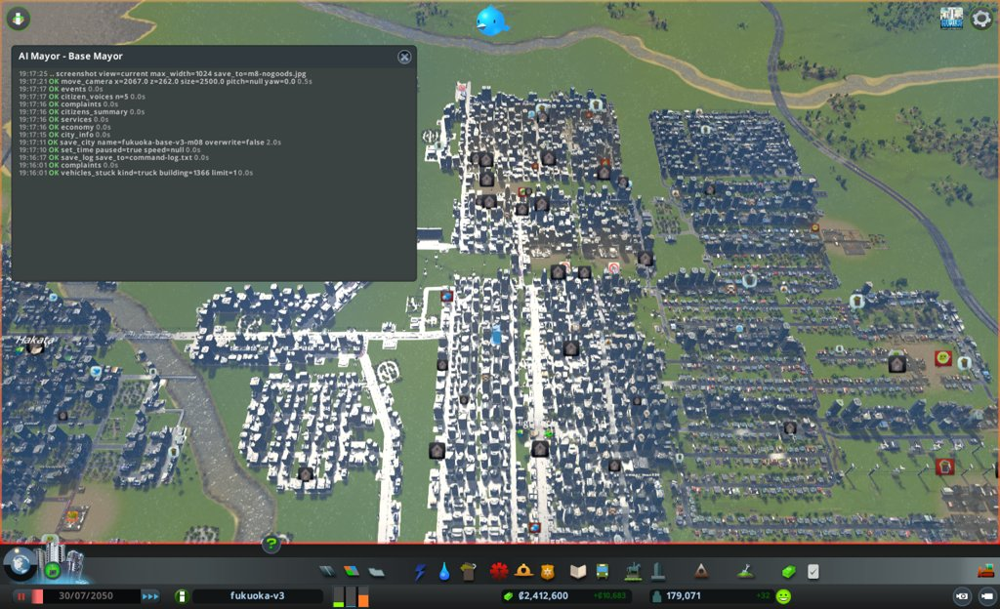
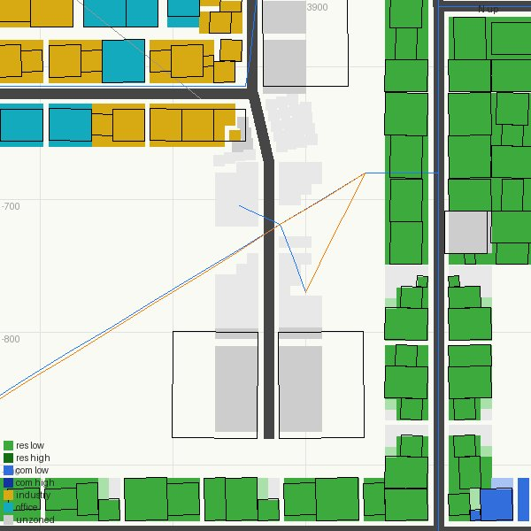

### 2050-08-09 見回り

境目: 当たらず。人口 179,265(+194)、週の収支 +23,223(収338,023 / 支314,800)、幸福度84、需要 住20・商2・働59。電気・水・下水が来ない市民 0 / 0 / 0。つぶやき1件(困りごとなし)。
収入は月例から +14,381(オフィスの税の見込み +15,000 に近い)。支出は +1,841(28755 と埋立地の分)。
新しい埋立地: 31897 と 36522 はどちらも収集車 19/19 が出ている。
貨物駅: 貨物列車 1→9本、28755 に向かう車9台、出す車5台。品物が届かない店290棟(東 (2248,762) は73棟)。

### 2050-08-19 見回り

境目: 当たらず。人口 179,291(+26)、週の収支 +22,047(収336,845 / 支314,798)、幸福度84、需要 住23・商2・働59。電気・水・下水が来ない市民 0 / 0 / 0。つぶやき2件(放棄された建物の声1件。境目の種類に入らない)。

### 2050-08-29 8か月目の終わり(次の月例の前に見た数)

`advance(10)` の後に、親への報告のために見た。月例(9か月目)は次の呼び出しで行う。

- `city_info`: 人口 179,310(前の月例 179,071 から +239)、所持金 2,497,984、週の収支 +20,939(収335,681 / 支314,742)、幸福度84、需要 住21・商2・働59、電気・水・下水が来ない市民 0 / 0 / 0。`events` は0件
- 施策1 `buildings_near(3519,-102,600, problem=Garbage)`: 9棟(基準21。予想は10棟以下)
- `complaints`: ごみの印 128棟(基準123)。いちばん多い場所は西 (-2296,-221) の41棟へ移った。品物が届かない店 300棟(基準287)、死体59棟(基準52)、火事8棟、汚染49棟(基準40)
- 試し(施策2) `buildings_near(2245,719,800, problem=NoGoods)`: 93棟(基準93)
- 試し(施策2) `vehicles_stuck(building=28755)`: 関わる車56台、敷地の中の空き待ち52台(止めていた月末は7台)。動かし直して、敷地の中の詰まりがまた始まっている
- 見立て(次の月例で確かめる): 埋立地は東でも置いた場所に効いたが、印は西 (-2296,-221) へ移り、街全体は増えた。28755 を動かし直しても東の品物が届かない店は93棟で変わらず、街全体は300棟(28755 を戻すと決めていた線)に届いた。死体の印は59棟で、医療を戻す線の60に近い。オフィスの税で収入は +12,000 ほど増え、黒字は +20,939 に広がった

### 2050-08-29 月例(9か月目)

保存: `fukuoka-base-v3-m09`(2050-08-29)

#### 答え合わせ

1. 東の満杯の埋立地 25590 の南に埋立地を2つ(2050-07-30): 予想は「(3519,-102) 半径600 のごみの印が21棟から10棟以下、街全体123から100以下」
   - 測る数 `buildings_near(3519,-102,600, problem=Garbage)`: 9棟(基準21)。置いた場所は当たった
   - `complaints` の Garbage 128棟(基準123)。街全体は外れた。印のいちばん多い場所は西 (-2296,-221) の41棟へ移った
   - 外れた理由の見立て: 西の 24569(-1885,-690)が 99% で車 1/19 に落ち、近くの埋立地4つがすべて満杯か満杯寸前になった。埋立地は数か月で満ち、満ちた所から印が移る。置き足すだけでは追いかけになる
   - 次の扱い: 置いた埋立地はそのまま。打ち方を変え、満ちない焼却場(Combustion Plant)を西に置く(下の施策1)
2. 貨物駅 28755 を動かし直す(試し。一覧の5行目): 予想は「東 (2245,719) 半径800 の品物が届かない店が93棟から70棟以下、街全体287から260以下」
   - 測る数 `buildings_near(2245,719,800, problem=NoGoods)`: 93棟(基準93)。`complaints` の NoGoods 300棟(基準287)
   - `cargo`: 28755 の vehiclesLeaving 176(基準7)。敷地の中で止まった車52台(止めていた月末7台)
   - 判定: 効かない。28755 を止めても動かしても、品物が届かない店は変わらない
   - 外れた理由の見立て: 品物は 28755 から出ている(Goods の local 427台)。届かないのは、出た後の道で止まるため。`traffic(2256,740,800)` で止まった車236台、渋滞の印467台、混み具合100の Basic Road が多い
   - 次の扱い: 28755 は動かしたまま(今月の東の試しの条件を変えないため)。街全体の品物が届かない店は300棟で、戻す線の「300を超えたら」には届いていない。次の試しは東の道(下の施策2)
3. オフィスの税 3→5%(2050-07-30): 予想は「週の収入が約15,000増え、オフィスの放棄は増えない」
   - `economy_breakdown` の Office 38,960(基準23,775、+15,185)。`building_stats` の OfficeGeneric 4,074棟、放棄0、働き口53,822(基準と同じ) → 当たった
   - 次の扱い: 続ける
4. 医療 130%、消防 120%、警察 130%(続けている): 死体の印59棟(戻す線60の内)、火事の印8棟(12棟の内)、犯罪率5、留置 401/960。続ける
- 「次にやること」の実行: 4件とも実行した(見回りで新しい埋立地の車と `cargo` を見た、施策1・試し・施策3の答え合わせ、Fire を見た)
- 公約の進み具合
  1. 人口: 179,310(前の月例 179,071 から +239)。守れた。残り3回の月例
  2. 電気・水・下水が来ない市民: 0 / 0 / 0。保っている。任期の終わりまで3か月
  3. 週の収支: +20,939。黒字(赤字0回)

#### 気づいたこと

- 西 (-2296,-221) 半径1200 の埋立地4つ: 19182、25826、48698 は満杯で車0/19、24569 は 99% で車1/19。ごみを集める車がほとんど出ていない
- ごみの容量は 224,000,000 に使用 139,375,496(62%)。満杯は10か所。容量の余りは東と南の新しい埋立地にあり、西には届いていない
- 焼却場(Combustion Plant)は建設費30,000、週の維持費1,440。満ちることがない
- 東 (2256,740) 半径800: 止まった車236台、渋滞の印467台、混み具合の平均37。混み具合100の区間は z=560 と x=2152、x=2668 の Basic Road(1車線ずつ)に多い。止まった車の多い場所は (2103,309) 43台、(2155,471) 36台
- `cargo`: 品物(Goods)のトラック 輸入554台・街の中427台、止まった181台。品物が届かない店の多い場所は (2256,740) 76棟、(-1113,-915) 70棟、(-2358,-711) 46棟
- `demand_breakdown`: 大卒の失業 6,868、空いた働き口 3,171、空き家 5,333。形は先月と同じ
- 収入: 住宅 250,583(先月 254,170)、商業 35,966、オフィス 38,960、工業 5,260。住宅は下がり続けている
- 5人の市民はみな幸福度「最高」か「とても良い」。1人は重い病気(3週)
- 水と下水は容量の80%を使っている

#### 施策

1. 西のごみの印の多い場所に、焼却場(Combustion Plant)を1つ置く
   - 公約: 1(人口)。ごみの印が続くと建物が放棄され、人が減る
   - 捨てるもの: なし
   - 理由: 西 (-2296,-221) にごみの印41棟。近くの埋立地4つは満杯か満杯寸前で、車がほぼ出ていない。埋立地は数か月で満ちる
   - 予想: 次の月例までに、(-2296,-221) 半径600 のごみの印が31棟から15棟以下に減る。街全体は128から110以下
   - 試し: なし(焼却場が車を出して集めることは、東の焼却場 2267 の 34/34 で見えている)。測る数は `buildings_near(-2296,-221,600, problem=Garbage)` の total。基準31
   - 操作: `place_building`(Combustion Plant を西の端の道 x≈-2770 の西側、(-2790,-520) 付近に東向き)。水・下水が要るので `buildings_near` の grid で確かめ、来なければ水道管を引く
   - 建設費の見積もり: 30,000(所持金の半分 1,248,992 以内)
   - 週の維持費の見積もり: 1,440(黒字 20,939 の範囲)
2. 東の品物が届かない店の多い街区の、混み具合100の Basic Road を4車線にする(試し。一覧の5行目の試し直し)
   - 公約: 1(人口)と3(財政)。品物が届けば店の放棄が減り、働き口と商業の税収が残る
   - 捨てるもの: なし
   - 理由: 28755 を止めても動かしても東の店の印は93棟で変わらない。東の街区では236台が止まり、1車線の道が混み具合100
   - 予想: 次の月例までに、`traffic(2256,740,800)` の止まった車が236台から180台以下、品物が届かない店が92棟から75棟以下に減る
   - 試し: 仮説は「東の街区の1車線の道が詰まり、品物のトラックが店に着けない。同じ幅の4車線にすると流れ、店に品物が届く」
     - 測る数: `buildings_near(2256,740,800, problem=NoGoods)` の total。あわせて `traffic(2256,740,800)` の blocked と congestion
     - 場所: (2256,740) 半径800。広げる道は x=2152(z=483〜605)、z=560(x=2089〜2668)、x=2668(z=330〜650)
     - 基準: 品物が届かない店92棟。止まった車236台、渋滞の印467台、混み具合の平均37
   - 操作: `upgrade_road`(Small 4 Lane Road。同じ幅なので沿道の建物は壊れない。demolish=false)
   - 週の維持費の見積もり: 同じ(どちらも1kmあたり約40)

施策1の結果: 成功。焼却場 3944 を (-2745,-520) 東向きに置いた。建設費 30,000。入口の前は Basic Road(segment 9971、距離1)。壊した建物0
- 確かめ: `advance(1)` の後、`buildings_near(-2745,-520,20, service=Garbage)` で電気・水・下水すべて来ている。収集車 2/34 が出始めた
- 週の維持費の増分: 約1,440

施策2の結果: 一部成功。費用0。壊した建物0、区画は保たれた
- x=2152(z=483〜605): 2区間を4車線にした
- z=560(x=2089〜2668): 8区間のうち4区間を4車線にした。飛ばした4区間(452、5473、18127、24873)は、沿道の埋立地 3565 と 45436 にぶつかる。サービスの建物は壊せないため、そのまま
- x=2668(z=330〜650): 5区間を4車線にした

今月の試し: 一覧の5行目(品物の不足の原因)を、東の道で試し直す。一覧の3行目(空き家と大卒の失業)は、品物の不足が商業の放棄(高密度商業の放棄131棟)を通じて働き口を減らす見立てのため、5行目を先にする。一覧の6行目(ごみの印の移り方)は施策1で見る

#### 考えたが打たなかった手

- 貨物駅 28755 を止め直す(敷地の中の止まった車52台、週の維持費1,440): 東の試しの条件を変えないため。止めても動かしても店の印は変わらないと分かった。来月、東の試しの答えを見て、維持費のために止めるかを決める
- 満杯の埋立地10か所を空にする(`empty_building`): 空にする間は受け入れず、中身を運ぶ車も要る。満ちない焼却場を置く方を選んだ
- 埋立地にぶつかる z=560 の4区間を広げる: 埋立地を動かす(建設費の1/5)のは、試しの効き目を見てからにする
- 3つ目の施策(財政の手): 黒字は +20,939 に広がった。焼却場の維持費 1,440 を引いても黒字が残るので、今月は打たない
- 医療の予算を戻す(死体の印59棟): 戻す線60を越えていない。来月 `complaints` の Death が60棟を超えたら150%に戻す

#### 次にやること

- 2050-09-08 の見回り: `city_info` と `events`。あわせて `buildings_near(-2745,-520,20, service=Garbage)` で焼却場の収集車を1回見る(施策は打たない)
- 2050-09-28 の月例: 施策1の答え合わせ。`buildings_near(-2296,-221,600, problem=Garbage)`(基準31)と `complaints` の Garbage(基準128)と、その hotspot
- 2050-09-28 の月例: 試し(施策2)の答え合わせ。`buildings_near(2256,740,800, problem=NoGoods)`(基準92)と `traffic(2256,740,800)` の blocked(基準236)と congestion(基準467)
- 2050-09-28 の月例: `complaints` の Death(60棟を超えたら医療を150%に戻す)と Fire(12棟を超えたら消防を140%に戻す)

#### 画面写真

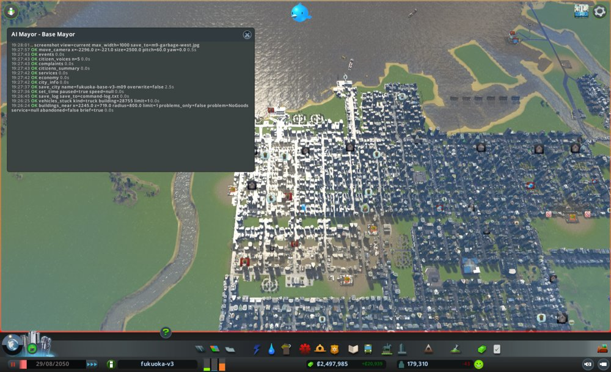
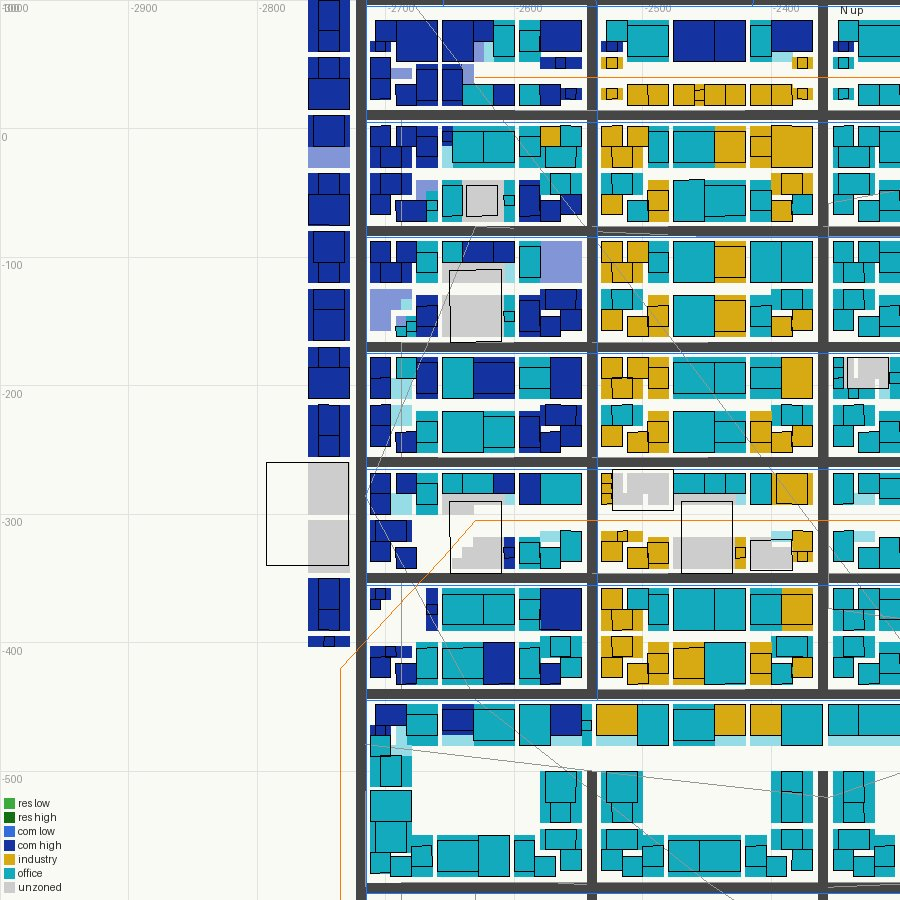
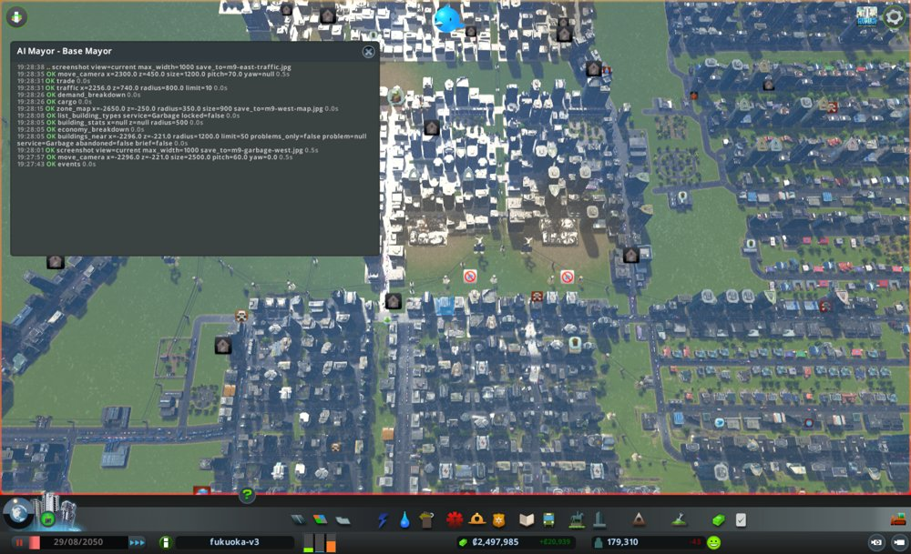

### 2050-09-08 見回り

境目: 当たらず。人口 178,984(−326、−0.2%)、週の収支 +17,240(収334,194 / 支316,954。支出は焼却場の分 +2,212)、幸福度84、需要 住22・商2・働58。電気・水・下水が来ない市民 0 / 0 / 0。つぶやき2件(困りごとの種類に入らない)。
焼却場 3944: 収集車 20/34、たまり 38,890/400,000(9%)、処理 9,120/週。働き手13。

### 2050-09-18 見回り

境目: 当たらず。人口 178,627(−357、−0.2%)。月例の 179,310 から −683 で、公約1(人口を毎月増やす)がこの月は守れないおそれがある。次の月例で `demand_breakdown` の空き家と失業、`building_stats` の放棄を見て理由を探す。週の収支 +17,239、幸福度84、需要 住23・商2・働58。電気・水・下水が来ない市民 0 / 0 / 0。つぶやき2件(困りごとの種類に入らない)。

### 2050-09-28 9か月目の終わり(次の月例の前に見た数)

`advance(10)` の後に、親への報告のために見た。月例(10か月目)は次の呼び出しで行う。

- `city_info`: 人口 178,531(前の月例 179,310 から −779)、所持金 2,538,371、週の収支 +14,738(収331,676 / 支316,938)、幸福度84、需要 住22・商2・働53、電気・水・下水が来ない市民 0 / 0 / 0。`events` は0件
- 施策1 `buildings_near(-2296,-221,600, problem=Garbage)`: 10棟(基準31。予想は15棟以下)
- `complaints`: ごみの印 104棟(基準128。予想は110以下)。いちばん多い場所は南 (-437,-1390) の21棟へ移った。品物が届かない店 303棟(基準300)、死体75棟(基準59。医療を戻す線60を越えた)、火事8棟、汚染29棟(基準49)
- 試し(施策2) `buildings_near(2256,740,800, problem=NoGoods)`: 93棟(基準92。予想は75棟以下)
- 試し(施策2) `traffic(2256,740,800)`: 止まった車222台(基準236。予想は180台以下)、渋滞の印454台(基準467)、混み具合の平均38(基準37)、flow 53。止まった車の多い場所は (2498,557) 34台(広げられなかった z=560 の区間の近く)、(2160,510) 26台、(2715,318) 26台
- 見立て(次の月例で確かめる): 焼却場は西で効き、街全体のごみの印も減った。東の道を広げても止まった車はわずかに減っただけで、店の印は変わらない。死体の印が75棟に増え、決めていた線(60)を越えたので、次の月例で医療を150%に戻す。人口は3回目の減少で、公約1はこの月守れなかった

### 2050-09-28 月例(10か月目)

保存: `fukuoka-base-v3-m10`(2050-09-28)

#### 答え合わせ

1. 西に焼却場 3944 を置く(2050-08-29): 予想は「(-2296,-221) 半径600 のごみの印が31棟から15棟以下、街全体128から110以下」
   - 測る数 `buildings_near(-2296,-221,600, problem=Garbage)`: 10棟(基準31)。`complaints` の Garbage 104棟(基準128) → 当たった
   - 印のいちばん多い場所は南 (-437,-1390) の21棟へ移った
   - 次の扱い: 続ける
2. 東の1車線の道を4車線に(試し。一覧の5行目): 予想は「止まった車が236台から180台以下、品物が届かない店が92棟から75棟以下」
   - 測る数 `buildings_near(2256,740,800, problem=NoGoods)`: 93棟(基準92)。`traffic(2256,740,800)`: 止まった車222台(基準236)、渋滞の印454台(基準467)
   - 判定: 効かない。道の止まった車は6%減っただけで、店の印は変わらない
   - 外れた理由の見立て: 埋立地にぶつかって広げられなかった z=560 の4区間の近く (2498,557) に止まった車34台が残る。ただし、品物の不足は街の3か所(東・南西・西)で同じ形で起きており、1か所の道の詰まりでは説明できない。`cargo` では品物のトラックの輸入608台に対し街の中の品物397台。品物の多くを輸入に頼っている
   - 次の扱い: 広げた道はそのまま(費用0)。品物の不足は、5回の試しで原因に当たらなかった
3. オフィスの税 5%(続けている): Office の収入 38,755(先月 38,960)、`building_stats` の OfficeGeneric 放棄0。保っている
4. 医療 130%: 死体の印75棟で、決めていた戻す線60を越えた → 外れた。今月150%に戻す(下の施策1)。消防 120%: 火事の印8棟(12棟の内)。警察 130%: 犯罪率5、留置 408/960。続ける
- 「次にやること」の実行: 4件とも実行した(見回りで焼却場の車を見た、施策1と試しの答え合わせ、Death と Fire を見た)
- 公約の進み具合
  1. 人口: 178,531(前の月例 179,310 から −779)。守れなかった(3回目)。残り2回の月例
  2. 電気・水・下水が来ない市民: 0 / 0 / 0。保っている。任期の終わりまで2か月
  3. 週の収支: +14,738。黒字(赤字0回)。収入は 335,681 → 331,676 と下がった

#### 見た数字

- `city_info`: 人口 178,531、所持金 2,538,371、週の収支 +14,738(収331,676 / 支316,938)、幸福度84、需要 住22・商2・働53。電気・水・下水が来ない市民 0 / 0 / 0
- `economy`: 税 住低9・住高7・商低9・商高3・工3・オフィス5。予算 ごみ150、医療130、消防120、警察130、教育120、公園150、バス150、船120、ほか100
- `services`: 水 1,926,240 / 2,400,000(80%)、下水 80%、電気 68%。ごみ 63%(満杯11か所)。医療 2,240/5,000。墓地 14,174/24,000。留置 408/960。働き手 82,703、働き口 86,074
- `citizens_summary`: 住民 178,598、高齢者45,025(25%)、失業5,987(大卒5,845)、病気2,236、長い失業4,724。電気・水・下水が来ない 0 / 0 / 0
- `complaints`: 品物が届かない303棟(東 (2059,206) 100棟)、ごみ104棟(南 (-437,-1390) 21棟)、死体75棟(東 (2404,-103) 20棟)、汚染29棟、騒音10棟、火事8棟
- `citizen_voices(5)`: 5人とも幸福度「最高」。困りごとなし。2人は高齢者で仕事なし
- `events`: 0件
- 画面写真: 東の品物と死体の印の多い街区(2250,50)

#### 気づいたこと

- `demand_breakdown`: 空き家 5,495(先月 5,333)、失業(需要の数え)7,298(大卒7,095)、空いた働き口 3,300。家は空き続け、人は増えない
- `building_stats`: 高密度商業 1,113棟のうち放棄169棟(先月の見立て131)。働き口7,480。放棄が増え続けている
- 収入: 住宅 247,549(先月 250,583)。住宅の税収が月に約3,000ずつ下がっている
- 南のごみ: 焼却場 33797(-570,-1840)はたまり96%で車23/34。近くの埋立地 2226 と 24004 は8%なのに車19/19を出しきっている。集める車が足りない。(-437,-1390) 半径600 のごみの印は18棟
- 南の (-700〜-510, -1590〜-1830) は道のない空き地。(-700,-1560) の道の端から南へ道を延ばせる
- 医療の支出は 65,728(130%)。150%に戻すと約 +10,100

#### 施策

1. 医療の予算を 130% から 150% に戻す
   - 公約: 1(人口)。死体が運ばれないと、その建物に印が付き、暮らしが下がる
   - 捨てるもの: なし
   - 理由: 死体の印75棟。先月決めた戻す線60を越えた。病気2,236、高齢者25%
   - 予想: 次の月例までに死体の印が75棟から55棟以下に減る。週の支出は約10,100増える
   - 試し: なし(5月に130%へ下げた試しの戻し)
   - 操作: `set_budget(healthcare, 150)`
2. 南のごみの印の多い場所の近くに、焼却場(Combustion Plant)を1つ置く(試し。一覧の6行目)
   - 公約: 1(人口)
   - 捨てるもの: なし
   - 理由: 西に焼却場を置くと印は31→10棟に減り、印は南へ移った。南の焼却場はたまり96%、埋立地は車を出しきっている
   - 予想: 次の月例までに (-437,-1390) 半径600 のごみの印が18棟から8棟以下、街全体104から90以下
   - 試し: 仮説は「印は、集める車の足りない所へ移る。満ちない焼却場で車を足せば、その場所の印が減り、ほかへ移らない」
     - 測る数: `buildings_near(-437,-1390,600, problem=Garbage)` の total。あわせて `complaints` の Garbage の hotspot の数
     - 場所: (-437,-1390) 半径600
     - 基準: 18棟。街全体104、hotspot 21棟
   - 操作: `build_line`(Basic Road。(-700,-1560) から南へ (-700,-1700))、`place_building`(Combustion Plant を (-676,-1640) に西向き)。水・下水は `buildings_near` の grid で確かめ、来なければ水道管を引く
   - 建設費の見積もり: 道 約1,000 + 焼却場 30,000(所持金の半分 1,269,185 以内)
   - 週の維持費の見積もり: 約1,450
3. オフィスの税を 5% から 7% に上げる
   - 公約: 3(財政)
   - 捨てるもの: なし
   - 理由: 施策1と2で週の支出が約11,500増え、黒字は約3,200に縮む。住宅の税収は月に約3,000ずつ下がっている。7月の +2 で放棄は0だった
   - 予想: 次の見回りまでに Office の収入が 38,755 から約53,000 に増える。次の月例で OfficeGeneric の放棄は20棟以下
   - 試し: なし
   - 操作: `set_tax(office, 7)`

今月の試し: 一覧の6行目(ごみの印の移り方)を施策2で確かめる。一覧の5行目(品物の不足)は5回の試しで原因に当たらず、1か月で測れる次の仮説を作れていない。3行目(空き家と大卒の失業)も、効く手の見当がない。どちらも今月は選ばない

施策1の結果: `set_budget(healthcare, 150)` 成功。昼150%、夜150%。費用0

施策2の結果: 成功。建設費 30,000
- 道を (-700,-1560) から南へ延ばす案は、住宅 36949 にぶつかった。西へ回す案も住宅 10101 にぶつかった。家を壊さないため、道は引かなかった(費用0)
- 代わりに、南の行き止まりの道 z=-1860(segment 3587)の北側の空き地に置いた。焼却場 45006 を (-660,-1834) 南向き。入口の前は Basic Road(距離2)。壊した建物0
- ごみの印の場所 (-700,-1300) からは約550m。予定より遠い。既存の焼却場 33797 と埋立地2つのすぐ西
- 確かめ: `advance(1)` の後、`buildings_near(-660,-1834,15, service=Garbage)` で電気・水・下水すべて来ている。収集車 2/34 が出始めた
- 週の維持費の増分: 約1,440

施策3の結果: `set_tax(office, 7)` 成功。費用0

#### 考えたが打たなかった手

- 放棄された高密度商業169棟を取り壊す: 品物が届かないままなら、建て直した店もまた放棄される。品物の不足の原因が分からない
- 品物の不足の次の試し(工業の区画を東の店の近くに足して、街の中の品物を増やす): 空き地と道を作り、工場が建つまで1か月では測れない。任期の残り2か月で答えが出ない
- 住宅の税を下げて人を呼ぶ: 住宅の需要に税の項はなく、1ポイントで週約3万減り黒字を超える
- 満杯の埋立地11か所を空にする: 西で焼却場が効いたので、同じ打ち方を南で試す方を選んだ
- バスの予算(150%、支出22,092)を下げる: 今月は財政の手をオフィスの税にした。バスを下げると移動が変わり、人口の公約に響くおそれがある

#### 次にやること

- 2050-10-08 の見回り: `city_info` と `events`。あわせて `buildings_near(-660,-1834,15, service=Garbage)` で焼却場 45006 の収集車を1回見る(施策は打たない)
- 2050-10-28 の月例: 施策1の答え合わせ。`complaints` の Death(基準75)と `economy_breakdown` の HealthCare(基準65,728)
- 2050-10-28 の月例: 試し(施策2)の答え合わせ。`buildings_near(-437,-1390,600, problem=Garbage)`(基準18)と `complaints` の Garbage(基準104)と hotspot(基準21)
- 2050-10-28 の月例: 施策3の答え合わせ。`economy_breakdown` の Office(基準38,755)と `building_stats` の OfficeGeneric の abandoned(基準0)
- 2050-10-28 の月例: 人口の減りの理由を `demand_breakdown` の emptyHomes(基準5,495)と `citizens_summary` の senior(基準45,025)で見る

#### 画面写真

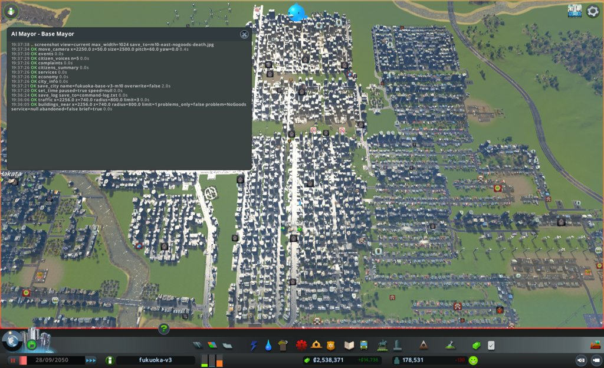
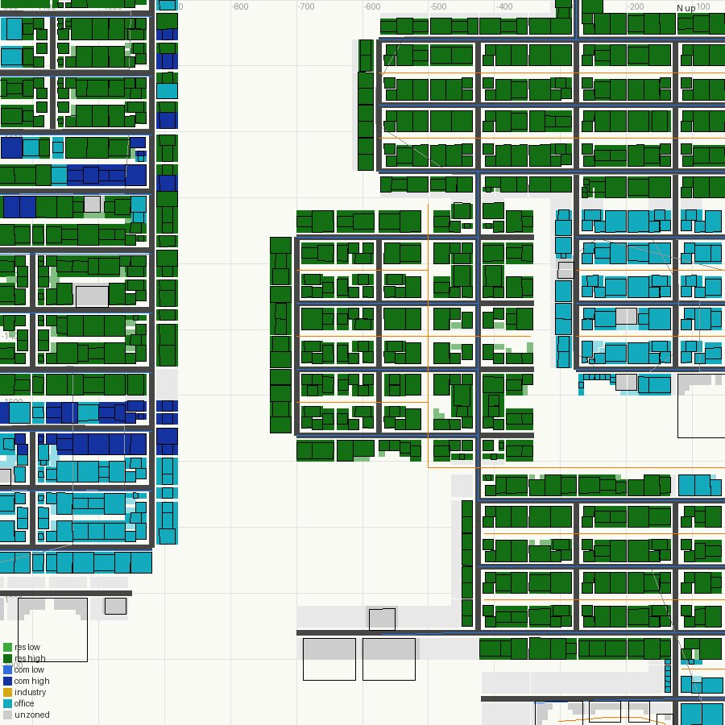

### 2050-10-08 見回り

境目: 当たらず。人口 178,575(+44)、週の収支 +17,329(収346,568 / 支329,239。収入 +14,892、支出 +12,301)、幸福度83、需要 住23・商2・働56。電気・水・下水が来ない市民 0 / 0 / 0。つぶやき2件(困りごとの種類に入らない)。
焼却場 45006: 収集車 23/34、たまり0、処理0/週。働き手15。

### 2050-10-18 見回り

境目: 当たらず。人口 178,751(+176)、週の収支 +18,326(収347,576 / 支329,250)、幸福度83、需要 住23・商2・働58。電気・水・下水が来ない市民 0 / 0 / 0。つぶやき2件(困りごとの種類に入らない)。

### 2050-10-28 10か月目の終わり(次の月例の前に見た数)

`advance(10)` の後に、親への報告のために見た。月例(11か月目)は次の呼び出しで行う。

- `city_info`: 人口 178,765(前の月例 178,531 から +234)、所持金 2,582,532、週の収支 +16,238(収345,481 / 支329,243)、幸福度83、需要 住23・商2・働58、電気・水・下水が来ない市民 0 / 0 / 0。`events` は0件
- 試し(施策2) `buildings_near(-437,-1390,600, problem=Garbage)`: 0棟(基準18。予想は8棟以下)
- `complaints`: ごみの印 68棟(基準104。予想は90以下)。いちばん多い場所は南東 (1845,-1271) の12棟へ移った。死体65棟(基準75。予想は55以下)、品物が届かない店303棟、汚染49棟(基準29)、火事8棟
- `economy_breakdown`: Office 53,990(基準38,755。予想は約53,000)、HealthCare 75,840(基準65,728)、Garbage 26,160
- 見立て(次の月例で確かめる): 南の焼却場は効き、街全体のごみの印も3割減った。印は南東へ移ったが、移った先の数は12棟と小さい。医療を戻して死体の印は減ったが、予想の55には届かない。オフィスの税は見込みどおり収入を増やした(放棄は次の月例で `building_stats` で見る)。人口は増えたので、公約1はこの月守れた

### 2050-10-28 月例(11か月目)

保存: `fukuoka-base-v3-m11`(2050-10-28)

#### 答え合わせ

1. 医療の予算を 130→150% に戻す(2050-09-28): 予想は「死体の印が75棟から55棟以下。支出は約 +10,100」
   - `complaints` の Death 65棟(基準75)。`economy_breakdown` の HealthCare 75,840(基準65,728、+10,112)
   - 判定: 支出は当たった。死体の印は減ったが、55棟以下には届かず外れた
   - 外れた理由の見立て: 霊柩車が渋滞で着かない。`vehicles_stuck(kind=hearse)` で196台がみな止まった状態(Congestion を含む123台、Blocked 74台)。東の火葬場の多くは「先週の処理 0」で、霊柩車は 9/9 出払っている。施設の数ではなく、道の詰まりで届いていない
   - 次の扱い: 150%を続ける
2. 南に焼却場 45006 を置く(試し。一覧の6行目): 予想は「(-437,-1390) 半径600 のごみの印が18棟から8棟以下、街全体104から90以下」
   - 測る数 `buildings_near(-437,-1390,600, problem=Garbage)`: 0棟(基準18)。`complaints` の Garbage 68棟(基準104)、hotspot は南東 (1845,-1271) の12棟(基準21)
   - 判定: 効いた。印は南東へ移ったが、移った先の数は21→12棟と小さくなった。満ちない焼却場で車を足すと、その場所の印は消え、街全体も減る
   - 次の扱い: 続ける。南東の移った先にも同じ手を打つ(下の施策1)
3. オフィスの税 5→7%(2050-09-28): 予想は「Office の収入 38,755 から約53,000。OfficeGeneric の放棄は20棟以下」
   - `economy_breakdown` の Office 53,990。`building_stats` の OfficeGeneric 4,074棟、放棄0 → 当たった
   - 次の扱い: 続ける
4. 消防 120%: 火事の印8棟(12棟の内)。警察 130%: 犯罪率5、留置 412/960。続ける
- 「次にやること」の実行: 5件とも実行した(見回りで焼却場の車を見た、医療・試し・オフィスの税の答え合わせ、`demand_breakdown` と `citizens_summary` で人口の減りを見た)
- 公約の進み具合
  1. 人口: 178,765(前の月例 178,531 から +234)。守れた(守れなかったのは3回)。残り1回の月例
  2. 電気・水・下水が来ない市民: 0 / 0 / 0。保っている。任期の終わりまで1か月
  3. 週の収支: +16,238。黒字(赤字0回)

#### 見た数字

- `city_info`: 人口 178,765、所持金 2,582,532、週の収支 +16,238(収345,481 / 支329,243)、幸福度83、需要 住23・商2・働58。電気・水・下水が来ない市民 0 / 0 / 0。dialog なし
- `economy`: 税 住低9・住高7・商低9・商高3・工3・オフィス7。予算 ごみ150、医療150、消防120、警察130、教育120、公園150、バス150、船120、ほか100
- `services`: 水 1,932,512 / 2,520,000(77%)、下水 1,930,592 / 2,400,000(80%)、電気 66%。ごみ 64%(満杯11か所)。医療 2,242/5,000。墓地 14,357/24,000。留置 412/960。働き手 82,869、働き口 86,329
- `citizens_summary`: 住民 178,763、高齢者45,212(25%)、失業5,515(大卒5,382)、病気2,235、長い失業4,553。電気・水・下水が来ない 0 / 0 / 0
- `complaints`: 品物が届かない303棟(東 (2003,153) 93棟)、ごみ68棟(南東 (1845,-1271) 12棟)、死体65棟(東 (2335,-66) 26棟)、汚染49棟(東 (3928,-411) 20棟)、火事8棟、騒音6棟
- `citizen_voices(5)`: 5人とも幸福度「最高」、困りごとなし。1人は高齢者で仕事なし、2人は学生
- `events`: 0件
- 画面写真: ごみの印の多い南東 (1845,-1270)(assets/m11-garbage-southeast.jpg)

#### 気づいたこと

- `demand_breakdown`: 空き家 5,465(基準5,495)、失業(需要の数え)6,798(大卒6,617)、空いた働き口 3,391
- `building_stats`: 高密度商業 1,116棟のうち放棄166棟(先月169)。オフィス放棄0
- 南東のごみの印10棟(半径600)のうち6棟は工業の街区 (1924〜2020, -1136〜-1184)。すぐ東の埋立地 45892(2272,-1115)は満杯で車0/19。新街区の南の埋立地2つは 19/19 を出しきっている
- 埋立地 45892 の南、道 z=-1240(x 2234〜2306)の南側に、幅約75mの空き地。その南は川(height_at (2100,-1250) で水面が地面より上)
- 死体: 東 (2334,-66) 半径600 の印14棟。近くに火葬場が8か所あるが、多くは先週の処理0で霊柩車は出払っている。霊柩車196台が止まった状態
- 一覧の7行目(人口の減り): 空き家 5,495→5,465、高齢者 45,025→45,212。人口は +234 に戻った。この月は死体の印が75→65棟に減った。減った月と戻った月の差は、死体の印の増減と同じ向き。原因かどうかは分からない

#### 施策

1. 南東の満杯の埋立地 45892 の南に、焼却場(Combustion Plant)を1つ置く(試し。一覧の6行目の続き)
   - 公約: 1(人口)。ごみの印が続くと建物が放棄され、人が減る
   - 捨てるもの: なし
   - 理由: ごみの印は南に焼却場を置くと18→0棟になり、南東の12棟へ移った。近くの埋立地 45892 は満杯で車0/19
   - 予想: 次の月例までに (1845,-1271) 半径600 のごみの印が10棟から4棟以下、街全体68から55以下
   - 試し: 仮説は「印は集める車の足りない所へ移るが、満ちない焼却場で車を足すたびに移った先の数は小さくなる」
     - 測る数: `buildings_near(1845,-1271,600, problem=Garbage)` の total。あわせて `complaints` の Garbage の hotspot の数
     - 場所: (1845,-1271) 半径600
     - 基準: 10棟。街全体68、hotspot 12棟
   - 操作: `place_building`(Combustion Plant を (2272,-1264) に北向き。入口の前は既存の Basic Road z=-1240)。水・下水は `buildings_near` の grid で確かめ、来なければ水道管を引く
   - 建設費の見積もり: 30,000(所持金の半分 1,291,266 以内)
   - 週の維持費の見積もり: 約1,440(黒字 16,238 の範囲)

施策1の結果: 成功。焼却場 15155 を (2272,-1264) 北向きに置いた。建設費 30,000。入口の前は Basic Road(segment 34485、距離0)。壊した建物0
- 確かめ: `advance(1)` の後(2050-10-29)、`buildings_near(2272,-1264,15, service=Garbage)` で電気・水・下水すべて来ている。収集車 2/34 が出始めた
- 週の維持費の増分: 約1,440

今月の試し: 一覧の6行目(ごみの印の移り方)を施策1で確かめる。一覧の7行目(人口の減り)は、死体の印と同じ向きに動いた事実だけを足した。死体の印を減らす手は、霊柩車が渋滞で止まっているため、施設を足しても効かない見込みで、1か月で測れる手を作れない。3行目と5行目は先月と同じ理由で選ばない

#### 考えたが打たなかった手

- 東の死体の印の近くに墓地や火葬場を足す: 近くに火葬場が8か所あり、霊柩車は出払ったまま渋滞で止まっている。施設を足しても車が着かない見込み
- 満杯の埋立地 45892 を空にする(`empty_building`): 空にする間は受け入れず、19台は運び出しに使われる。任期の残り1か月で効き目が出るか分からない。焼却場は2回効いている
- 放棄された高密度商業166棟を取り壊す: 品物が届かないままなら、建て直しても放棄される
- 財政の手: 黒字 +16,238 で、焼却場の維持費 1,440 を引いても残る。今月は打たない
- 住宅の税を下げる: 先月までと同じ理由(需要に税の項がなく、1ポイントで黒字を超える)

#### 次にやること

- 2050-11-07 の見回り: `city_info` と `events`。あわせて `buildings_near(2272,-1264,15, service=Garbage)` で焼却場 15155 の収集車を1回見る(施策は打たない)
- 2050-11-27 の月例: 試し(施策1)の答え合わせ。`buildings_near(1845,-1271,600, problem=Garbage)`(基準10)と `complaints` の Garbage(基準68)と hotspot(基準12)
- 2050-11-27 の月例: `complaints` の Death(基準65)と `buildings_near(2334,-66,600, problem=Death)`(基準14)。任期の終わりなので申し送りを書く

#### 画面写真

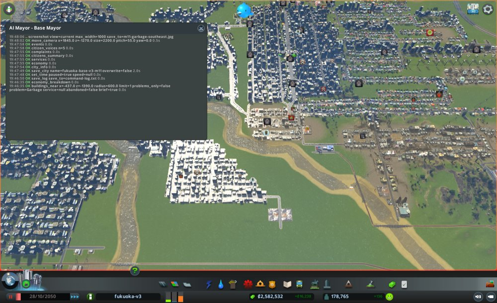

### 2050-11-07 見回り

境目: 当たらず。人口 178,647(−118、−0.07%)、週の収支 +14,821(収346,202 / 支331,381。支出は焼却場の分 +2,138)、幸福度83、需要 住24・商2・働57。電気・水・下水が来ない市民 0 / 0 / 0。つぶやき2件(困りごとの種類に入らない)。
焼却場 15155: 収集車 8/34、たまり0、処理0/週。働き手16。

### 2050-11-17 見回り

境目: 当たらず。人口 178,676(+29)、週の収支 +16,272(収347,680 / 支331,408)、幸福度83、需要 住24・商2・働56。電気・水・下水が来ない市民 0 / 0 / 0。つぶやき1件(ごみの声1件。境目の3件に届かない)。
人口は月例の 178,765 を下回っている。公約1がこの月は守れないおそれがある。

### 2050-11-27 11か月目の終わり(次の月例の前に見た数)

`advance(10)` の後に、親への報告のために見た。月例(12か月目)は次の呼び出しで行う。

- `city_info`: 人口 178,945(前の月例 178,765 から +180)、所持金 2,619,780、週の収支 +16,843(収348,227 / 支331,384)、幸福度83、需要 住24・商4・働57、電気・水・下水が来ない市民 0 / 0 / 0。dialog なし。`events` は0件
- 試し(施策1) `buildings_near(1845,-1271,600, problem=Garbage)`: 1棟(基準10。予想は4棟以下)
- `complaints`: ごみの印 24棟(基準68。予想は55以下)。いちばん多い場所は東 (3560,-535) の5棟へ移った。死体46棟(基準65)、東 (3422,-502) 19棟。品物が届かない店308棟(基準303)、汚染36棟(基準49)、火事8棟。印のある建物 432棟(先月500)
- `buildings_near(2334,-66,600, problem=Death)`: 5棟(基準14)
- 見立て(次の月例で確かめる): 南東の焼却場も効き、ごみの印は街全体で 68→24棟に減った。移った先は5棟で、3回続けて小さくなった。死体の印は施策なしで 65→46棟に減り、いちばん多い場所は東の (3422,-502) へ移った。人口は増え、公約1はこの月守れた

### 2050-11-27 月例(12か月目。任期の最後)

保存: `fukuoka-base-v3-m12`(2050-11-27)

#### 答え合わせ

1. 南東の満杯の埋立地 45892 の南に焼却場 15155 を置く(試し。一覧の6行目): 予想は「(1845,-1271) 半径600 のごみの印が10棟から4棟以下、街全体68から55以下」
   - 測る数 `buildings_near(1845,-1271,600, problem=Garbage)`: 1棟(基準10)。`complaints` の Garbage 24棟(基準68)、hotspot は東 (3560,-535) の5棟(基準12)
   - 判定: 効いた(当たった)。満ちない焼却場を足すと、その場所の印は消え、移った先の数は 21→12→5棟と小さくなった
   - 次の扱い: 続ける(焼却場はそのまま)
2. 医療 150%: 死体の印 65→46棟(施策なし)。オフィスの税 7%: 放棄は前回0。消防 120%: 火事の印8棟。警察 130%: 犯罪率5、留置 424/960。続ける
- 「次にやること」の実行: 3件とも実行した(見回りで焼却場の車を見た、試しの答え合わせ、`complaints` の Death 46(基準65)と `buildings_near(2334,-66,600, problem=Death)` 5棟(基準14))
- 公約の進み具合
  1. 人口: 178,945(前の月例 178,765 から +180)。守れた(守れなかったのは3回)。残りは任期の終わり(2050-12-27)の1回
  2. 電気・水・下水が来ない市民: 0 / 0 / 0。保っている。任期の終わりまで1か月
  3. 週の収支: +16,843。黒字(赤字0回)

#### 見た数字

- `city_info`: 人口 178,945、所持金 2,619,780、週の収支 +16,843(収348,227 / 支331,384)、幸福度83、需要 住24・商4・働57。電気・水・下水が来ない市民 0 / 0 / 0。dialog なし
- `economy`: 税 住低9・住高7・商低9・商高3・工3・オフィス7。予算 ごみ150、医療150、消防120、警察130、教育120、公園150、バス150、船120、ほか100
- `services`: 電気 1,718,928 / 2,457,024(70%)、水 1,937,392 / 2,520,000(77%)、下水 1,935,472 / 2,400,000(81%)。ごみ 65%(満杯11か所)。医療 2,143/5,000。墓地 14,543/24,000(満杯0)。留置 424/960、犯罪率5。働き手 83,230、働き口 86,540
- `citizens_summary`: 住民 178,931、高齢者45,303(25%)、失業5,178(大卒4,997)、病気2,131、長い失業4,163。電気・水・下水が来ない 0 / 0 / 0
- `complaints`: 品物が届かない308棟(東 (1994,124) 100棟)、死体46棟(東 (3422,-502) 19棟)、汚染36棟(東 (3856,-286) 15棟)、ごみ24棟(東 (3560,-535) 5棟)、騒音9棟、火事8棟。印のある建物432棟
- `citizen_voices(5)`: 4人は幸福度「最高」で困りごとなし。1人(大人、学歴なし、ごみの仕事)は家 (4024,-531) に死体の印があり、体調がとても悪い(3週)
- `events`: 0件
- 画面写真: 東の死体・ごみ・汚染の印の多い街区 (3550,-450)(assets/m12-east-garbage-death.jpg)

#### 気づいたこと

- 東の死体の印は (3650,-600) 半径600 で10棟。うち6棟は x≈4024〜4180 の低密度住宅。近くの墓地 9364(4090,-210)と 16836(3720,-1189)はどちらも霊柩車 13/13 を出しきり、先週の処理0。火葬場 39843(3598,-90)は 7/9
- 霊柩車182台が止まった状態(先月196)。Congestion を含むものが約120台。7日以上止まって見えるのは20台
- 大卒の失業は 5,382→4,997 に減った。働き口 86,540 に働き手 83,230

#### 施策

1. 東の死体の印の近くに墓地(Cemetery)を1つ置く(試し。一覧の8行目)
   - 公約: 1(人口)。死体が運ばれない家は暮らしが悪くなり、放棄や転出につながる
   - 捨てるもの: なし
   - 理由: 近くの墓地2つは霊柩車 13/13 を出しきり、遠くから来る霊柩車は渋滞で止まる。家の近くに霊柩車の出る所を足す
   - 予想: 2050-12-27 までに、(3650,-600) 半径600 の死体の印が10棟から5棟以下。街全体46から40以下
   - 試し: 仮説は「死体の印が残るのは、霊柩車の出る所が遠く、渋滞で着かないため。近くに墓地を置けば、短い道のりで運べて印が減る」
     - 測る数: `buildings_near(3650,-600,600, problem=Death)` の total。あわせて新しい墓地の stats(霊柩車の使用、たまった数)
     - 場所: (3650,-600) 半径600。墓地は (3911,-706)
     - 基準: 10棟。街全体46
   - 操作: `place_building`(Cemetery を (3911,-706) に西向き。入口の前は既存の Basic Road x=3872)
   - 建設費の見積もり: 8,000(所持金の半分 1,309,890 以内)
   - 週の維持費の見積もり: 160(黒字 16,843 の範囲)

施策1の結果: 成功。墓地 36061 を (3911,-706) 西向きに置いた。建設費 8,000。入口の前は Basic Road(segment 36611、距離0)。壊した建物0
- 確かめ: `advance(1)` の後(2050-11-28)、`buildings_near(3911,-706,15, service=HealthCare)` で電気・水・下水すべて来ている。霊柩車 2/13 が出始めた

今月の試し: 一覧の8行目(東の死体の印)を施策1で確かめる。6行目(ごみ)は答えが出た。7行目(人口の減り)は死体の印の試しの結果と合わせて見る。3行目と5行目は先月までと同じ理由で選ばない

#### 考えたが打たなかった手

- 東のごみの印 (3560,-535) の5棟に焼却場を足す: 墓地の試しの場所と重なる。5棟と小さく、任期の最後の月に試しの効き目を混ぜない
- 財政の手(税・予算): 黒字 +16,843 で、最後の月に需要や暮らしを動かす理由がない
- 放棄された高密度商業を取り壊す: 品物が届かないままなら、建て直しても放棄される(先月までと同じ)
- 品物が届かない店308棟に手を打つ: 9か月の試しで原因が分からず、1か月で測れる手がない

#### 次にやること

- 2050-12-07 の見回り: `city_info` と `events`。あわせて `buildings_near(3911,-706,15, service=HealthCare)` で墓地 36061 の霊柩車を1回見る(施策は打たない)
- 2050-12-27(任期の終わり): 試しの答え合わせ。`buildings_near(3650,-600,600, problem=Death)`(基準10)と `complaints` の Death(基準46)。`city_info` と `citizens_summary` で公約の結果を書く

#### 画面写真

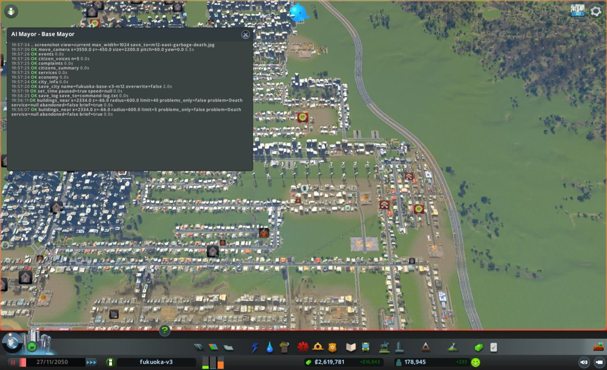
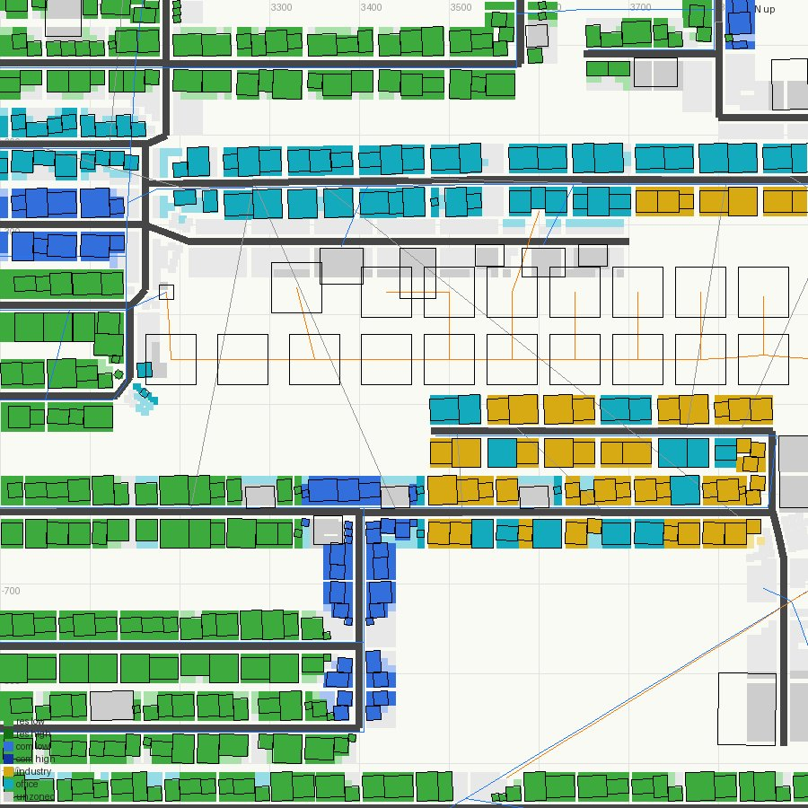

### 2050-12-07 見回り

境目: 当たらず。人口 179,082(+137)、週の収支 +15,711(収347,349 / 支331,638)、幸福度83、需要 住24・商4・働57。電気・水・下水が来ない市民 0 / 0 / 0。つぶやき2件(水の声1件。境目の3件に届かない)。
墓地 36061: 霊柩車 4/13、たまり0、働き手20。

### 2050-12-17 見回り

境目: 当たらず。人口 179,138(+56)、週の収支 +14,916(収346,552 / 支331,636)、幸福度83、需要 住24・商4・働57。電気・水・下水が来ない市民 0 / 0 / 0。つぶやき2件(水の声1件。境目の3件に届かない)。
水の声は2回の見回りで続けて1件ずつ。来ない市民の数は0のままなので、任期の終わりに `complaints` の Water の棟数を見る。

### 2050-12-27 任期の終わり(12か月目の終わり)

`advance(10)` の後に、公約の結果と試しの答え合わせのために見た。施策は打っていない。

- `city_info`: 人口 179,240(前の月例 178,945 から +295)、所持金 2,679,971、週の収支 +16,011(収347,640 / 支331,629)、幸福度83、需要 住24・商2・働57。電気・水・下水が来ない市民 0 / 0 / 0。dialog なし。`events` は1件(困りごとなし)
- `citizens_summary`: 住民 179,213、失業5,182(大卒5,055)、病気2,105、高齢者45,511。電気・水・下水が来ない 0 / 0 / 0
- `complaints`: 品物が届かない305棟(東 (1993,115) 100棟)、死体49棟(東 (2337,87) 18棟)、汚染44棟、ごみ11棟(北東 (1971,1345) 4棟)、火事9棟、騒音4棟。水の印は店1棟(11431、(2658,925))だけで、住宅ではない。印のある建物426棟
- 試しの答え合わせ(墓地 36061): 予想は「(3650,-600) 半径600 の死体の印が10棟から5棟以下、街全体46から40以下」
  - 測る数 `buildings_near(3650,-600,600, problem=Death)`: 14棟(基準10)。街全体49棟(基準46)
  - 墓地 36061: 霊柩車 4/13、たまり 0/3000、先週の処理0。30日で1体も運べていない
  - `vehicles_stuck(kind=hearse, building=36061)`: 2台が西の (2861〜2881,-492) で Congestion+Blocked。1台の行き先は東の家 (4184,-402) で、墓地から西へ1,300m 回っている
  - 判定: 効かない。外れた理由の見立て: 霊柩車の出る所を近くに置いても、車は道の詰まった所を通る道順を取り、着かない。原因は施設の数や場所ではなく、(2870,-492) あたりの道の詰まりと、東の街区への道のつながり
  - 次の扱い: 墓地は置いたまま(維持費約160)。次の市長は、詰まった場所の道を先に見る
- 画面写真: 霊柩車の止まった (2870,-492) のまわり(assets/m12-hearse-jam.jpg)

## 人が手を入れたこと

- 2050-01-01(親): パネルの見出しを `AI Mayor - Base Mayor` にした。録画は OBS でゲームの窓だけ(実時間 2026-10-25 17:47:03 から。ゲームを起動し直したため 17:55 に止まり、17:59:06 から `~/ai-mayor-recordings/base/2026-10-25 17-59-06.mp4` で録り直した)
- 2050-01-01(親): 月例の前に定点の写真を4か所で撮った(`assets/fixed/m01-*.jpg`)
- 親は、市長を呼ぶ文に、運営のフォルダ、何か月目か、街の日付、保存の名前だけを渡す(比べの条件。`council-design.md` の10.6)

## 公約の結果

任期: 2050-01-01〜2050-12-27(12か月)。

1. 人口を毎月増やす: 守れなかった(12回のうち8回守り、4回守れなかった)
   - 最後の数字: 179,240(就任時 178,872 から +368、+0.2%)
   - 守れなかった月: 2050-01-31(−156)、06-30(−160)、07-30(−172)、09-28(−779)
   - 11か月目の月例で「守れなかったのは3回」と書いたが、数字の表を数え直すと、その時点で4回だった。書き違いとして残す
   - 守れなかった理由: 住宅の需要が24前後で止まっていた。空き家が約5,000あり、大卒の失業が約5,000で、住宅の需要の2つの項がどちらも負だった。家や働き口を足しても人は増えず、増減は数百人の幅に収まった
2. 電気・水・下水が来ない市民をなくす: 守れた
   - 最後の数字: 電気0、水0、下水0。任期の36回の見回り・月例で一度も1以上にならなかった
   - 下水は容量の81%、水は77%を使っている。街を広げると足りなくなる
3. 赤字を続けない: 守れた
   - 最後の数字: 週の収支 +16,011。月例で赤字は0回
   - 就任時 +9,965 から広がった。警察・消防の予算を下げ、オフィスの税を3→7%に上げたことが効いた

## 次の市長への申し送り

効いた施策:

- ごみの印は、満ちない焼却場(Combustion Plant。建設費30,000、維持費約1,440)を印の多い所に置くと消える。印は満杯の埋立地の近くへ移るので、移った先に順に置く。街全体で 150→11棟まで減った
- 埋立地を足す手は、すぐに満ちて車を出しきり、印が隣へ移るだけだった。焼却場を先に選ぶ
- オフィスの税は 3→7% に上げても放棄0で、収入が週約3万増えた
- 警察 150→130%、消防 140→120% で、犯罪率・火事の印は変わらず、支出が週約9,000減った

外れた予想と、分からないまま残したこと:

- 品物が届かない店(約300棟)の原因は分からないまま。貨物駅 28755 の出口を広げる、止める、動かし直す、港の信号を外す、東の道を4車線にする、の5回の試しはどれも効かなかった。品物のトラックは輸入に頼っている
- 死体の印(約50棟)は、霊柩車が渋滞で止まって着かないため。墓地を近くに置いても(2050-11-27)1体も運べなかった。霊柩車は (2870,-492) あたりで止まっていた。この辺りの道の詰まりを `traffic` で先に見る
- 空き家約5,000と大卒の失業約5,000が並ぶとき、何をすれば人口が増えるかは分からない。オフィスを足しても、働き口の総数はほとんど増えなかった
- 医療の予算 130% は死体の印を増やさなかった。150% に戻しても、印はそれほど減らなかった

足りなかった道具や情報:

- 品物の流れを、店ごとに「どこから来るはずか」までたどる道具がない。輸入のトラックがどこで止まるかが分からない
- 霊柩車が遠回りする理由(道のつながり、曲がれない交差点)を見る道具がない。`net_reach` は交差点で曲がれる向きを見ない
- 任期の終わりの数字は、`city_info` の人口が毎月数百人しか動かないため、公約1は運に近い。需要の項を動かす手が見つからなかった
