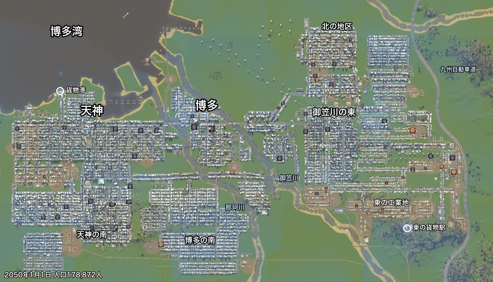
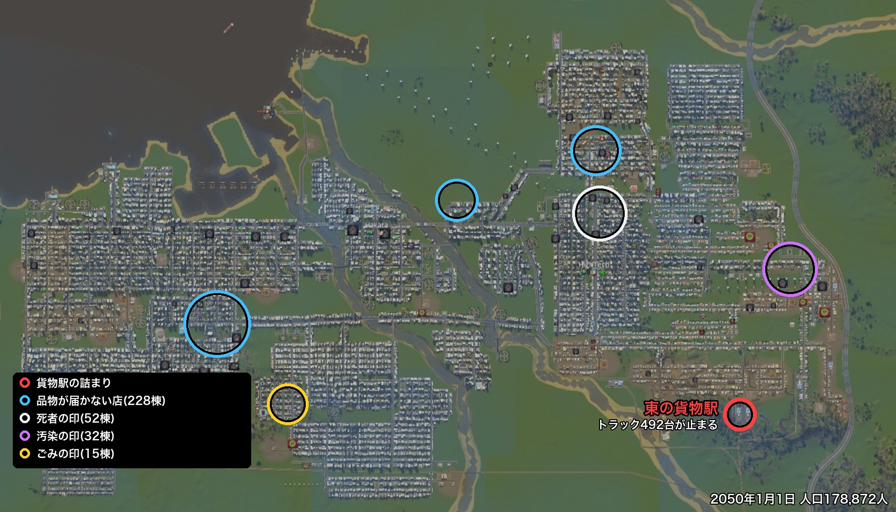
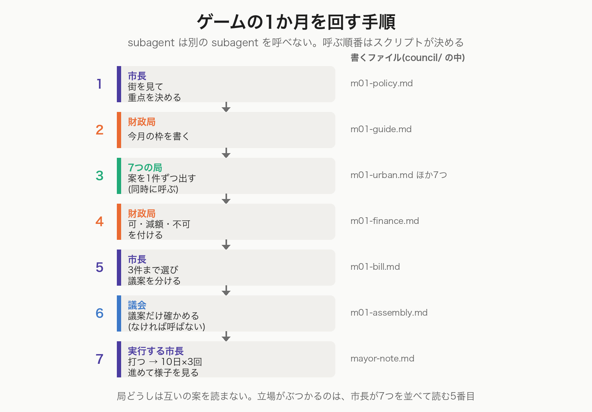
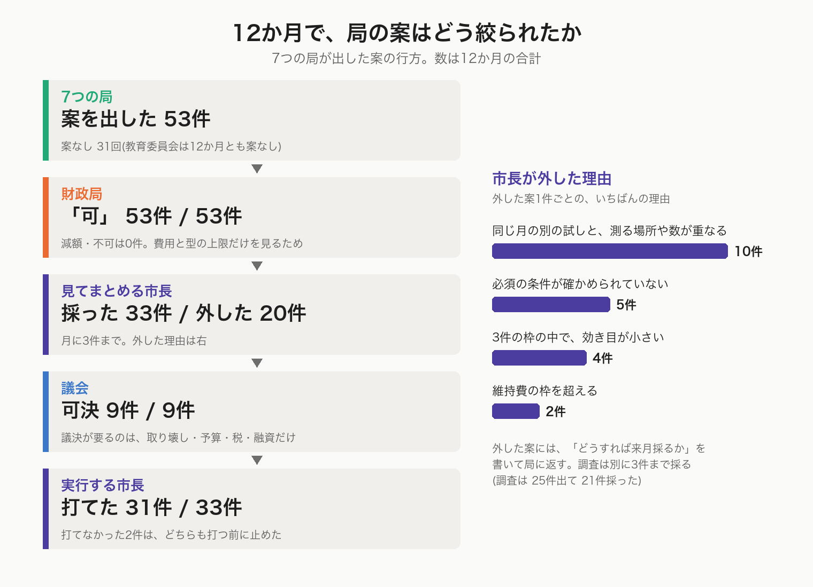
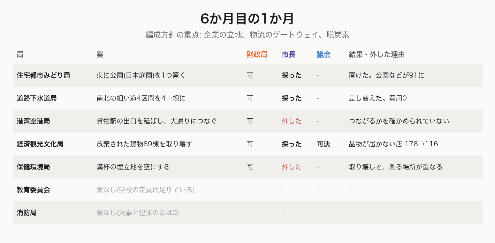
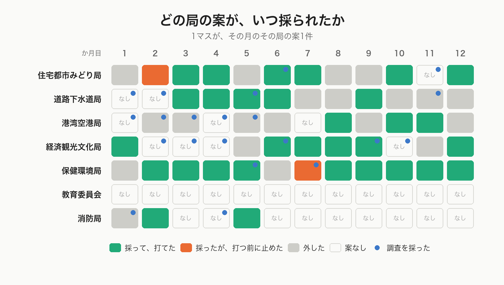
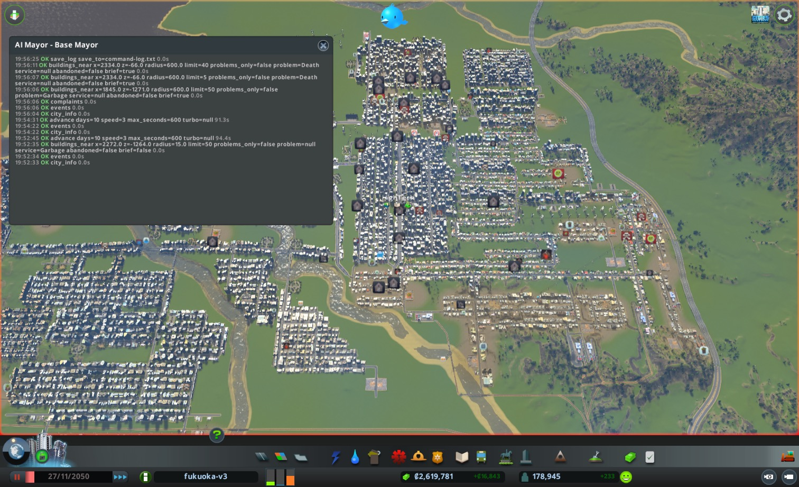
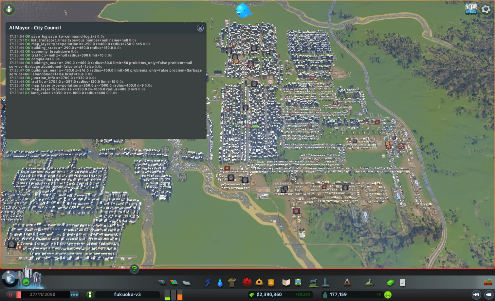
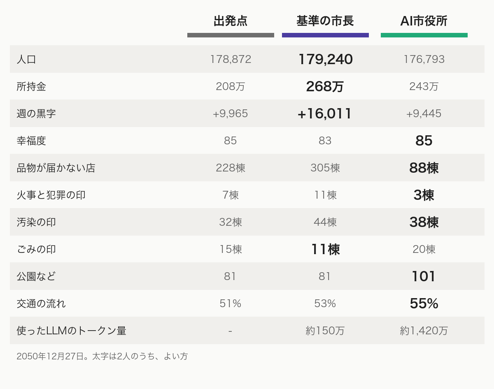
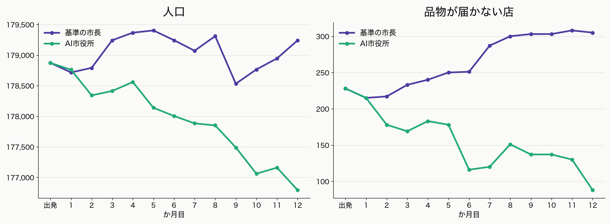

# AI市長とAI市役所ハーネスに福岡を12か月任せて比べた

## 1人で全部を見るか、手分けするか

やってみ太郎です。連載「AIは最高の市長になれるか」の続きです。

この連載では、Claude(AI)を Cities: Skylines(シティーズ・スカイライン。街を作るゲーム)の市長にしています。

前回は、本物の福岡市の段取りをまねて「AI市役所」を作りました。7つの局が案を出し、財政局が値段を確かめ、市長が3件まで選び、議会が確かめる。11人のAIが手分けして、1つの街を動かす仕組みです。どのAIも subagent(サブエージェント。親のAIから呼ばれて、1つの仕事だけをするAI)です。

今回は、その市役所を、1人で全部を見るAI市長と比べます。同じ街を、同じ12か月、それぞれに任せました。

## 17.9万人の街を、新しい出発点にした

これまでの連載では、人口10万人の福岡を使ってきました。でも、10万人の街では差が小さく見えるかもしれません。そこで、比べる前に街を大きくすることにしました。

目標は25万人。街を育てるのも、AIの市長に任せました。

最初は順調でした。働き口の足りない地区に事務所を建て、事務所が上のレベルに上がれない理由(バス停が遠い、近くに交番がない、など)を1つずつ埋めていきます。人口は、ゲームの中の8年で10万人から17.8万人まで増えました。

そこで伸びが止まりました。住宅の需要(この街に住みたい人の多さ)が0に張りついて、新しい家が建たなくなったのです。需要を上げるためだけに高校を39校並べる手も試しましたが、出発点が不自然になるので、取り消しました。

25万人は、あきらめました。11か月ほど手を止めて様子を見たあと、人口17万8,872人の街を、比べの出発点に決めました。

## 出発点の街

出発点の街の全体図です。西に天神、那珂川をはさんで博多、御笠川の東に事務所の多い地区があります。天神の南と博多の南には住宅の街区が広がり、御笠川の東の南側は工業地です。

- 人口:17万8,872人
- お金:208万
- 週の収支:+9,965(黒字ですが、薄い)
- 幸福度:85
- 電気・水・下水が来ない市民:0人
- 働き口:8万6,175。失業は約7,900人で、ほとんどが大学を出た人

問題も、はっきり見えていました。

1つ目は、店に品物が届かないことです。品物が届かない店が228棟あり、困りごとの印(建物の上に出る、困っていることを示すマーク)の3分の2を占めていました。多いのは、天神の南側、北の地区、博多と御笠川の東の間です。

2つ目は、東の貨物駅の詰まりです。貨物駅(荷物を列車からトラックに積み替える駅)の敷地で、トラック492台が止まったまま動きません。

3つ目は、ごみ・汚染・死者です。満杯の埋立地が7つあり、博多の南の西にごみの印が出ていました。御笠川の東の東の端には、工場からの汚染の印が集まっています。御笠川の東の真ん中には、死者の印(遺体を運ぶ車が来ない家)が固まっていました。

そのほか、交通の流れは51%で、交通渋滞がかなりの問題になっているように見えます。

## 1人のAI市長の12か月

1人目は「基準の市長」です。性格は持たせず、判断の型(街を見て、施策を3件まで選び、翌月に答え合わせをする手順)だけに従います。公約は3つ。人口を毎月増やす。電気・水・下水が来ない市民をなくす。赤字を続けない。

基準の市長は、まず南東の空き地に新しい街区を作りました。次に、警察・消防・医療の予算を下げて、黒字を広げます。

品物が届かない店には、何度も手を打ちました。貨物駅の出口の道を4車線にする。隣の貨物駅を動かす。詰まった貨物駅を止める。でも、店は減りませんでした。市長は10か月目に「打った手がどれも効かない」として、この問題の試しをやめています。

ごみは、一時は150棟まで増えました。出発点で満杯の埋立地が多く、足しても追いつかなかったのです。後半に、埋立地を8つ、焼却場を3つ建てて、最後は11棟まで減らしました。

いちばん効いたのは、事務所の税を3%から7%に上げた手です。事務所からの税収は、週2万3,775から5万3,990に、2倍以上になりました。事務所が出ていくこともありませんでした。

## AI市役所の仕組み(おさらい)

2人目は、AI市役所です。前回作った仕組みを、簡単におさらいします。

1か月は、本物の福岡市の予算の決め方をなぞった7つの段で回ります。

1. 市長(見てまとめる市長)が街を見て、今月の重点を3つまで決める(編成方針)
2. 財政局が、今月使ってよいお金の枠を書く(予算編成要領)
3. 7つの局が、担当の数字のために案を1件ずつ出す。原因の分からない問題には、案の代わりに「調査」も出せる
4. 財政局が、案ごとに費用を確かめ、「可」「減額」「不可」を付ける(査定)
5. 市長が、案を3件まで選ぶ。取り壊し・予算・税・融資は「議案」になる
6. 議会が、議案だけを確かめて、可決か否決を出す
7. 実行する市長が、通った案を打ち、10日ずつ3回時間を進めて様子を見る

市長の公約は、基準の市長と同じ3つです。加えて、福岡市の基本計画をまねた「市の計画」を読み、その目標に向けて重点を選びます。

建物を置く案や道路を広げる案は、局が「試すだけの道具」で確かめてから出します。街を変えずに、ゲームが建設を断るかどうか、いくらかかるかだけを見る道具です。12か月で416回使われました。

## AI市役所の12か月

まず、12か月の案の流れを数で見ます。

7つの局は、12か月で53件の案を出しました。

驚いたのは、財政局です。53件すべてに「可」を付けました。減額も不可も、1件もありません。財政局が見るのは「費用が今月の枠に収まるか」「型の上限(税は2ポイントまで、予算は20ポイントまで)を超えないか」だけです。局の案は、どれも枠の内に収まる小さな手だったので、ふるいになりませんでした。

議会も、かけられた9件の議案(取り壊し6件、予算3件)をすべて可決しました。

案を本当に絞っていたのは、市長です。53件のうち33件を採り、20件を外しました。月に3件という枠があるので、毎月だれかの案が落ちます。

市長が外した理由で、いちばん多かったのは「同じ月の別の試しと、測る場所や数が重なる」でした。たとえば、バスの予算を変える案と、交差点に信号を付ける案を同じ月に打つと、道の詰まりが減っても、どちらが効いたのか分かりません。市長は、効き目を見分けられるように、試しを1か月に1つの場所へ散らしていました。

外した案には、市長が「どうすれば来月採るか」を書いて局に返します。

- 「試しの場所が取り壊しと重なる。来月は、取り壊す建物を除いた3棟を基準にして出し直してほしい」(保健環境局へ)
- 「電気と水が届くかを、道具で確かめて書いてほしい」(住宅都市みどり局へ)
- 「維持費の枠を超える。来月、同じ確かめのまま出し直せば比べる」(保健環境局へ)

最後の焼却場の案は、翌月そのまま出し直されて、採られています。

1か月の中身を、6か月目で見てみます。

この月の重点は、企業の立地、物流のゲートウェイ(港や駅で荷物が出入りする所)、脱炭素の3つでした。

5つの局が案を出し、財政局は5件とも「可」。市長は3件を採りました。

港湾空港局の「貨物駅の出口を延ばして大通りにつなぐ」案は、外されました。局自身が「つながるかを試しの道具で確かめられない」と書いていたからです。保健環境局の「満杯の埋立地を空にする」案は、経済観光文化局の取り壊しと測る場所が重なるので、外されました。

教育委員会と消防局は「案なし」です。学校の定員は足りていて、火事と犯罪の印は0。担当の数字が目標を満たしているときは、何も出しません。

採った3件のうち、放棄された建物89棟の取り壊しは議会にかけられ、可決されました。品物が届かない店は、この月に178棟から116棟に減っています。

12か月を通して、どの局の案がいつ採られたかを並べると、こうなります。

いちばん多く採られたのは、保健環境局です。12か月で10件。ごみの印が集まる場所の近くに、埋立地と焼却場を次々に置き、満杯の埋立地を空にし、汚染の出どころを確かめるために焼却場を止めてみました。

住宅都市みどり局は、公園や庭園、岩の飾りを置き続け、公園などを81から101に増やしました。経済観光文化局は、工業の土地の使い方を広げる政策をかけ、放棄された店や工場を3回にわたってまとめて取り壊しました(89棟、31棟、72棟)。道路下水道局は、詰まった交差点に信号を付け、細い道を4本、4車線に広げました。

港湾空港局は、外されることが多い局でした。バスの台数や予算を変える案は、街全体の交通の数を動かすので、ほかの試しと重なりやすいのです。貨物駅の詰まりは、港湾空港局が調査を重ねて「先頭のトラックが理由なく動かない」ところまで突き止めました。そのうえで、7か月目に経済観光文化局が駅を止め、8か月目に駅そのものを取り壊しました。駅の中で止まっていたトラックは消えましたが、品物の入口が1つ減ったことにもなります。

教育委員会は、12か月とも「案なし」でした。学校の定員が、子どもと10代の数をずっと上回っていたからです。

一方で、税には一度も手を付けませんでした。財政局は査定のたびに「税の案」を1件まで添えられる決まりでしたが、12か月で一度も添えていません。

## 比べると

任期の終わり(2050年12月27日)の数字を並べます。

人口とお金は、基準の市長が勝ちました。街の困りごと(品物が届かない店、火事と犯罪、汚染、公園、交通の流れ)は、AI市役所が勝ちました。幸福度は、AI市役所が85を保ち、基準の市長は83に下がっています。電気・水・下水が来ない市民は、どちらも0人のままでした。

月ごとに見ると、差の開き方がはっきりします。

人口は、基準の市長がほぼ横ばいだったのに対し、AI市役所はゆっくり減り続けました。品物が届かない店は、逆に、基準の市長で増え続け、AI市役所では減り続けました。

使ったLLMのトークン量は、大きく違います。LLM(大規模言語モデル。Claude のような、文章を読み書きするAI)は、トークンという単位で文字を読み書きします。基準の市長は12か月で約150万トークン、実時間で約1時間50分。AI市役所は約1,420万トークン、約3時間35分でした。およそ10倍です。

## 考察1:手分けすると、困りごとが減る

AI市役所では、局がそれぞれの担当の数字を毎月見ています。品物が届かない店は経済観光文化局、ごみは保健環境局、公園は住宅都市みどり局。担当の数字が目標から遠いと、その局が必ず案を出します。

基準の市長は、1人で全部を見ます。品物の問題は10か月目に「打った手が効かない」とあきらめ、公園の数は12か月で1つも増えていません。1人だと、目立つ問題から順に手が回り、後ろの問題は置き去りになります。

品物が届かない店が3分の1以下になったのは、手分けの効き目だと思います。

## 考察2:「街全体」を持つ局がいない

一方で、人口とお金は基準の市長に負けました。

どの局も、自分の担当の数字を良くする案を出します。でも、人口を増やす担当も、お金を増やす担当もいません。財政局は案の値段を確かめるのが仕事で、税の案を添えることもできましたが、一度も添えませんでした。市長は局の案から選ぶだけで、自分では手を考えません。

その結果、税に手を付ける案は、12か月で一度も出ませんでした。基準の市長は、事務所の税を上げるだけで週の収入を3万増やしています。この差が、週の収支とお金の差になっています。

人口が減った理由は、まだはっきりしません。市役所は放棄された建物を何度もまとめて壊していますし、貨物駅も壊しました。街の中の困りごとは減っても、人を呼ぶ手は、どの局の仕事にもなっていませんでした。

本物の市役所にも、局をまたいで全体を見る部署(総務企画局など)があります。今回は「ゲームで対応する操作がない」として入れませんでしたが、街全体の数字を持つ役が要るのかもしれません。

## 考察3:交通渋滞に、決め手を打てなかった

出発点の街で目立っていた問題の1つが、交通渋滞でした。交通の流れは51%で、市の計画の目標は60%です。担当は道路下水道局ですが、12か月の終わりでも55%にとどまりました(基準の市長は53%)。

道路下水道局の12か月は、3つの時期に分かれます。

- 1〜2か月目:案なし。いちばん大きな詰まりは、東西の大通りのくびれ(4車線の道の途中で、約120mだけ2車線になっている所)でした。局は試しの道具で、ここを4車線にする形を何度も試しましたが、ゲームに断られます。くびれの中に2つの交差点が16mしか離れずに並んでいて、道を広げると交差点どうしがぶつかるからです。北の道を広げる形も、消防署・診療所・墓地にぶつかりました
- 3〜6か月目:4か月続けて採られました。くびれの交差点に信号を付け、試しの道具が通す別の細い道を4本、4車線に広げました。どれも局所的には効いています。たとえば、ある道の周りで止まった車は84台から7台、別の道では59台から0台になりました
- 7〜12か月目:6回のうち5回、外されました。出した案はどれも信号を付ける試しで、同じ交差点の案を4回出しています。外された理由は、どれも「同じ月の別の試しと重なる」でした。港湾空港局のバスの予算の試しや、経済観光文化局の取り壊しが同じ月にあると、詰まりが減っても信号の効き目と見分けられないからです

ここから、2つのことが見えます。

1つ目は、道路の手が「小さく、局所的」なものに限られたことです。くびれを直すには、2つの交差点を壊し、1つにまとめて引き直す工事が要ります。試しの道具には「この区間を壊したものとして試す」引数もありましたが、局は一度も使いませんでした。新しい幹線道路を通す、立体交差にする、といった大きな手も出ていません。試しの道具で確かめられる、1回で終わる工事を選び続けた結果、街全体の流れは4ポイントしか上がりませんでした。

2つ目は、交通が局をまたぐ問題だったことです。道路は道路下水道局、バスは港湾空港局、貨物駅は港湾空港局と経済観光文化局。どの局の手も、街全体の車の流れを動かします。市長は効き目を見分けるために、試しを1か月に1つの場所へ散らしました。その結果、後から出した道路下水道局の信号の案は、バスや取り壊しの試しと重なるたびに後回しになりました。

本物の市役所なら、交通は「都市交通の計画」として、道路とバスと物流を1つの計画にまとめるところです。局ごとに1件ずつ案を出す今の仕組みでは、局をまたいだ大きな問題ほど、決め手が出にくいようです。

## 考察4:比べるときの注意

1つ、条件の違いがあります。基準の市長を走らせたあとで、建物を置く道具と道路を引く道具を直しました。前は、人には建てられない場所にも建てられたのですが、AI市役所の本番では、人と同じ判定を通るようにしています。試すだけの道具も、AI市役所だけが持っていました。

そのため、建てる手については、AI市役所のほうが厳しい条件で戦っています。

## 考察5:1か月に3件では、変わりきらない

最後に、12か月を見ていて感じたことです。

AI市役所の局は、毎月ちゃんと案を出してきます。それでも、市長が採れるのは月に3件まで。採られなかった案には、市長が「どうすれば来月採れるか」を書いて返します。局はそれを読んで、翌月に出し直します。

保健環境局の焼却場の案は、1か月目に「維持費の枠を超える」と外されました。局は翌月、同じ確かめのまま出し直し、採られています。人の役所の「来年度の予算で」と同じ光景です。

12か月目、AI市役所の街は、品物の届かない店が88棟まで減っていました。でも人口は2,000人減り、お金は基準の市長より25万少ない。

手分けすれば、目の前の困りごとは減る。でも、街をどこへ連れていくかを決める役がいないと、街は大きくならない。

AI市役所は、本物の市役所が抱えている悩みを、そのまま再現したように見えました。

この12か月の様子は、録画を動画にまとめて、YouTube にも上げています。

https://youtu.be/uwIv4_hnYss

## 次回予告

次回は、交通渋滞を解決し、観光地に特化したAI市役所ハーネスへの強化をテーマにします。
