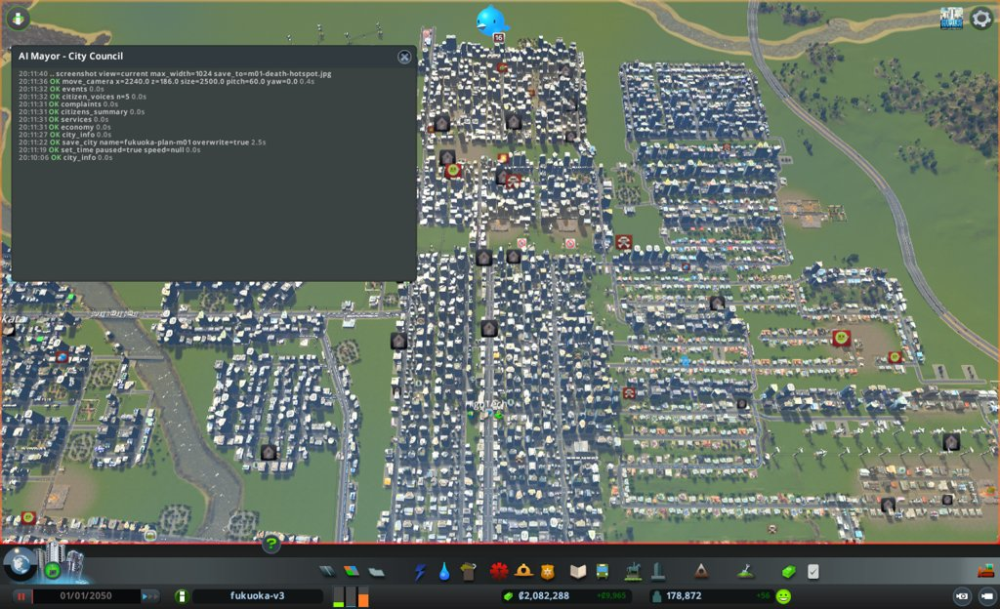
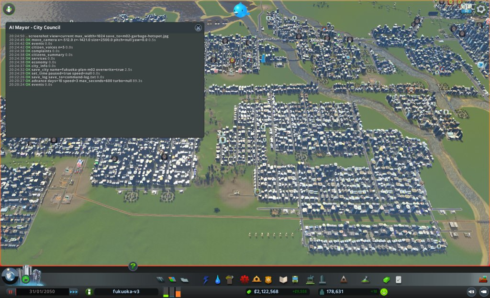
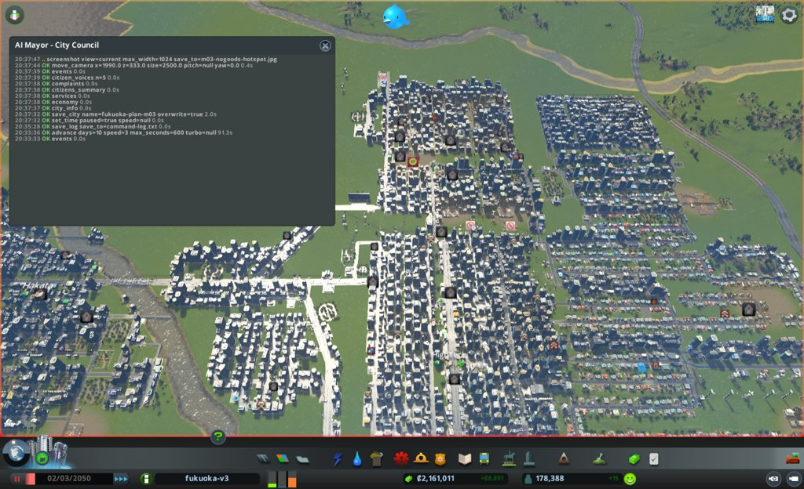
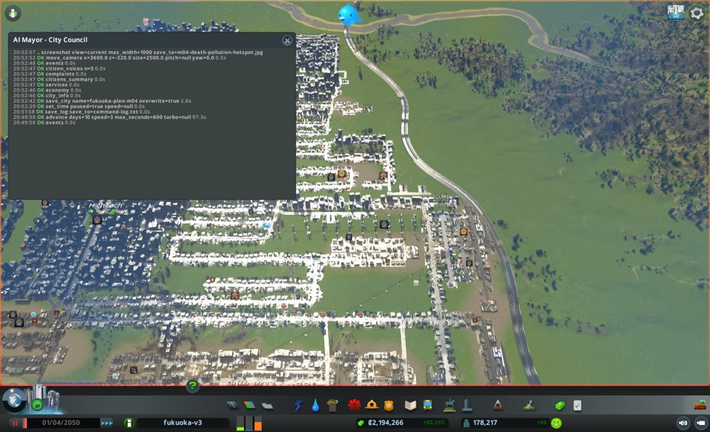
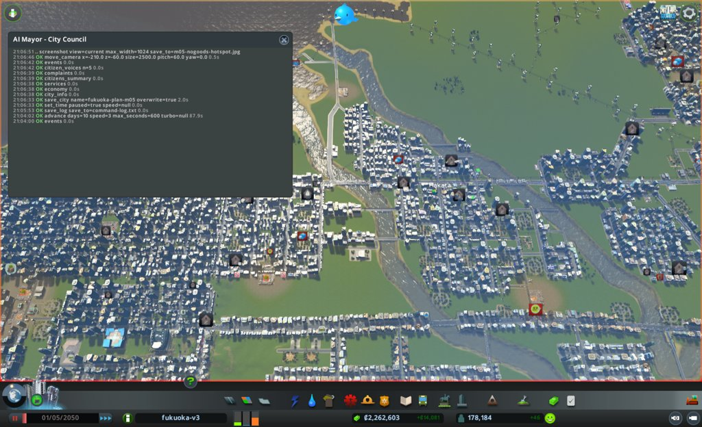
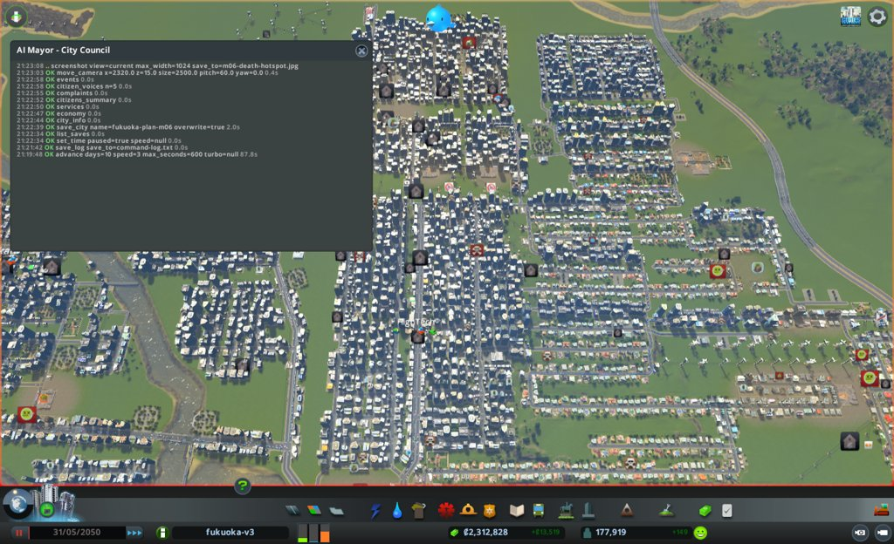

# 市政ノート

## 性格と公約と捨てるもの

市長の定義(mayors/plan.md、計画の市長)から写した。任期中は書き換えない。

- 性格: なし。判断の型(protocol.md)と、市の計画にだけ従う。自分で施策を考えず、局の案から選ぶ
- 公約:
  1. 人口を毎月増やす(`city_info` の population。毎月の月例で、前の月例より増えていること)
  2. 電気・水・下水が来ない市民をなくす(`citizens_summary` の、電気・水・下水が来ない市民の数。任期の終わりに0)
  3. 赤字を続けない(`city_info` の週の収支。毎月の月例で、2回続けて赤字にしない)
- 捨てるもの: なし
- 任期: 12か月
- 編成方針の重点の選び方: 市の計画の施策から、毎月3つまで。公約の進み具合と、市の計画の目標から遠い施策を見て選ぶ

## 申し送り(前の運営から)

なし

## 数字の表

月例と見回りのたびに1行足す。区切りは 月例・見回り・臨時。

| ゲーム内の日付 | 区切り | 人口 | 所持金 | 週の収支 | 幸福度 | 需要(住/商/工) | 失業 | 主な困りごと |
|---|---|---|---|---|---|---|---|---|
| 2050-01-01 | 月例 | 178,872 | 2,082,287 | +9,965(342,140 − 332,175) | 85 | 23 / 2 / 60 | 6,584 | 品物がない228、死体52、汚染32、ごみ15 |
| 2050-01-11 | 見回り | 178,823 | 2,095,465 | +9,239(341,270 − 332,031) | 85 | 21 / 2 / 60 | - | 来ない市民 0/0/0。つぶやき1件(困りごとなし)。境目に当たらず |
| 2050-01-21 | 見回り | 178,624 | 2,109,404 | +9,633(341,851 − 332,218) | 85 | 23 / 2 / 59 | - | 来ない市民 0/0/0。つぶやき0件。境目に当たらず |
| 2050-01-31 | 月例 | 178,631 | 2,122,567 | +9,558(341,808 − 332,250) | 85 | 23 / 2 / 57 | 6,137 | 品物がない226、死体52、汚染36、ごみ32 |
| 2050-02-10 | 見回り | 178,523 | 2,135,923 | +9,050(341,359 − 332,309) | 85 | 23 / 2 / 59 | - | 来ない市民 0/0/0。つぶやき1件(死体のにおい)。境目に当たらず |
| 2050-02-20 | 見回り | 178,425 | 2,148,065 | +8,434(340,683 − 332,249) | 85 | 23 / 2 / 59 | - | 来ない市民 0/0/0。つぶやき1件(学校、困りごとなし)。境目に当たらず |
| 2050-03-02 | 月例 | 178,388 | 2,161,011 | +8,891(341,176 − 332,285) | 85 | 23 / 2 / 58 | 6,122 | 品物がない222、死体49、汚染34、ごみ23 |
| 2050-03-12 | 見回り | 178,186 | 2,173,115 | +8,284(340,155 − 331,871) | 85 | 23 / 2 / 57 | - | 来ない市民 0/0/0。つぶやき1件(放棄された建物)。境目に当たらず |
| 2050-03-22 | 見回り | 178,228 | 2,182,738 | +6,505(338,363 − 331,858) | 85 | 23 / 4 / 59 | - | 来ない市民 0/0/0。つぶやき1件(店の安売り、困りごとなし)。境目に当たらず |
| 2050-04-01 | 月例 | 178,217 | 2,194,266 | +8,245(340,077 − 331,832) | 85 | 24 / 2 / 58 | 5,677 | 品物がない224、死体39、汚染31、ごみ10。満ちた埋立地2 |
| 2050-04-11 | 見回り | 178,116 | 2,220,137 | +18,620(340,334 − 321,714) | 85 | 22 / 4 / 58 | - | 来ない市民 0/0/0。つぶやき2件(騒音1、店の安売り)。境目に当たらず |
| 2050-04-21 | 見回り | 178,211 | 2,241,976 | +14,851(336,565 − 321,714) | 85 | 24 / 2 / 58 | - | 来ない市民 0/0/0。つぶやき0件。境目に当たらず |
| 2050-05-01 | 月例 | 178,184 | 2,262,603 | +14,081(335,768 − 321,687) | 85 | 24 / 2 / 56 | 5,693 | 品物がない238、汚染41、死体36、ごみ14、騒音7、犯罪6。満ちた埋立地4 |
| 2050-05-11 | 見回り | 178,036 | 2,277,541 | +10,084(334,481 − 324,397) | 85 | 24 / 2 / 58 | - | 来ない市民 0/0/0。つぶやき1件(警察の冗談、困りごとなし)。境目に当たらず |
| 2050-05-21 | 見回り | 177,887 | 2,293,531 | +11,492(335,876 − 324,384) | 85 | 23 / 2 / 58 | - | 来ない市民 0/0/0。つぶやき1件(スマートホーム、困りごとなし)。境目に当たらず |
| 2050-05-31 | 月例 | 177,919 | 2,312,827 | +13,519(337,877 − 324,358) | 85 | 24 / 2 / 58 | 5,481 | 品物がない238、死体60、汚染42、ごみ22、騒音13。満ちた埋立地8 |
| 2050-06-10 | 見回り | 177,815 | 2,331,725 | +12,904(336,980 − 324,076) | 85 | 25 / 2 / 56 | - | 来ない市民 0/0/0。つぶやき2件(ごみが2週間で積み上がる1、店の安売り)。境目に当たらず |
| 2050-06-20 | 見回り | 177,729 | 2,351,631 | +13,809(337,835 − 324,026) | 85 | 25 / 2 / 57 | - | 来ない市民 0/0/0。つぶやき1件(水道への不満、ボトルの水でシャワー)。境目に当たらず |

## 施策の一覧

施策を打つたびに1行足す(臨時も含む)。答え合わせの列は、翌月の月例で埋める。
分野は、港・働き口・住宅・暮らし・環境・財政から1つ選ぶ。
元の局は英字の名前(urban など)。議決は 要らない / 可決 / 否決。施策の id は m<月2桁>-<番号>(市役所と議会のハーネス、#100)。

| ゲーム内の日付 | 区切り | 施策の id | 施策 | 元の局 | 市の計画の施策 | 議決 | 分野 | 公約 | 建設費 | 週の維持費の増分 | 答え合わせ |
|---|---|---|---|---|---|---|---|---|---|---|---|
| 2050-01-01 | 月例 | m01-1 | 満杯の埋立地7か所を空にする(試し) | health | 4-4 資源循環 | 要らない | 環境 | なし(公約3を損ねない) | 0 | 0 | 外れ(効かない、逆の向き)。garbage.full 7→0 だが、7棟の storage は94〜95%で、空になっていない。収集車は19/19が空にする仕事に出ている。ごみの印 15→32 |
| 2050-01-31 | 月例 | m02-1 | 空にしている埋立地7棟を受け入れに戻す(試し) | health | 4-4 資源循環 | 要らない | 環境 | なし(公約3を損ねない) | 0 | 0 | 一部当たり(向きは当たり、量は届かず)。ごみの印 32→23(予想20以下)。7棟の印 Emptying→None。garbage.full 0 のまま。ただし 7棟は94〜97%で、157・25692・48698 は99% |
| 2050-03-02 | 月例 | m03-1 | 焼け跡の建物3棟を取り壊す(試し) | fire | 3-4 日常生活の安全・安心 | 可決(取り壊し) | 暮らし | なし(公約1・3を損ねない) | 0 | 0(学校1棟の分は減る見込み) | 当たり(予想より良い)。火事の印 5→1(予想2)、3棟の円の火事の印 3→0。火事+犯罪 5→2 で目標4以下に届いた。小学校の定員は予想13,920に対し14,268のまま(原因は分からない) |
| 2050-03-02 | 月例 | m03-2 | 乗客のほぼいないバス8路線の予算を20ポイント下げる(試し) | port | 6-3 公共交通を主軸とした交通体系 | 可決(予算) | 財政 | 3 | 0 | 0未満(額は見積もれない) | 当たり(台数)。8路線の vehicles 296→255(予想約256)。流れ 54→56%、止まった車 913→679 だが、41台は車7,737台の約0.5%で、流れの変化をこの施策に帰せない。週の支出 332,285→331,832 |
| 2050-04-01 | 月例 | m04-1 | 医療の予算を150から130に下げる(試し) | health | 1-2 健やかで心豊かに暮らせる社会 | 可決(予算) | 暮らし | 3 | 0 | 約 −10,000(局の見積もり) | 支出は当たり、試しは効かない。医療の支出 75,840→65,728(−10,112)。霊柩車 161→163台で減らず、渋滞の印付き 100→97、Blocked 付き 65→78、道順なし 12→24。死体の印 39→36(予想の幅39〜45より少ない)。健康77のまま、体調の悪い人 2,480→2,436 |
| 2050-04-01 | 月例 | m04-2 | 焼け跡の工場12882を取り壊す | fire | 3-4 日常生活の安全・安心 | 可決(取り壊し) | 暮らし | なし(公約1・3を損ねない) | 0 | 0 | 当たり。火事の印 1→0、円の中の火事の印 0棟。ただし犯罪の印が 1→6 に増え、火事+犯罪は 2→6(目標4以下を外れた) |
| 2050-05-01 | 月例 | m05-1 | 汚染の中心の焼却場2267を取り壊す(試し) | health | 4-3 脱炭素社会 | 可決(取り壊し) | 環境 | なし(公約1・2・3を損ねない) | 0 | 0以下(焼却場の維持費の分減る。額は未確認) | まだ分からない(向きが割れた)。円の汚染の平均 84→62 に下がったが、円の汚染の印 8→11 に増えた。円の死体の印 5→3。街の汚染の印 41→42(予想25〜35)。副作用: ごみの印 14→22、満ちた埋立地 4→8、ごみの支出 19,920→17,760 |
| 2050-05-01 | 月例 | m05-2 | 政策 IndustrySpace を街全体で有効にする(試し) | economy | 6-4、7-1 企業の立地、地場企業 | 要らない | 働き口 | 1 | 0 | 4,846 | 外れ(効かない、1か月)。品物がない店 238→238(予想220前後)、原料がない工場 28→36、働き口 86,470→86,458、空き 3,260→3,248。Goods local 403→628台。政策の費用 10,677→15,524(+4,847) |
| 2050-05-31 | 月例 | m06-1 | 乗客の少ない大型バス4路線の予算を200から180に下げる(試し) | port | 6-3 公共交通を主軸とした交通体系 | 可決(予算) | 財政 | 3 | 0 | 0未満(額は見積もれない) | |

## 分からないことの一覧

効き目や原因が分からないことを1行に1つ書く(`protocol.md` の3)。確かめ終えても消さず、結果を埋める。

| 書いた日 | 分からないこと | 確かめた試し | 結果 |
|---|---|---|---|
| 2050-01-01 | 貨物駅 28755(3449, -1555)だけに止まったトラックが492台たまる原因。ほかの貨物駅8か所は出入り0台(`cargo`) | まだ | |
| 2050-01-01 | 死体の印が52棟あるのに、墓地の容量は24,000のうち12,791しか使っていない原因(霊柩車が届かないのか、道が詰まるのか) | m04-1(医療の予算 150→130) | 2050-05-01: 効かない(仮説の経路が起きなかった)。予算を下げても霊柩車は 161→163台で減らず、渋滞の印付き 100→97、Blocked 付き 65→78、道順なし 12→24。死体の印は 39→36 に減ったが、霊柩車が減らずに起きたので、予算の下げによるとは言えない。印の多い区画は(3513, -337)から(3495, -145)で、同じ辺り。汚染の印の区画(3779, -190)と重なる。原因は分からないまま |
| 2050-01-01 | 満杯の埋立地を空にすると、ごみの印が減るか | m01-1(7棟を空にする) | 2050-01-31: 効かない。7棟の storage は100%→94〜95%で、30日で5%ほどしか減らなかった。ごみの印は15→32に増えた |
| 2050-01-31 | m01-1 の後にごみの印が15→32に増えた原因。空にしている7棟の収集車(19/19)がごみ集めに回らないのか、受け入れ先(埋立地157が98%、25692が97%、48698が95%、焼却場31232が99%)が満ちかけているのか | m02-1(7棟を受け入れに戻す) | 2050-03-02: 運び出しの停止が増えた主な原因という見立てに合う。戻すとごみの印は32→23に減り、7棟の Emptying は消えた。ただし15には戻らず、印の多い区画は(-512, -1421)から(1203, -1140)へ移った。残りの差の原因は分からない(下の行) |
| 2050-03-02 | 満ちかけた埋立地(99%が3棟、94〜97%が7棟)が満ちたとき、ごみの印がどれだけ増えるか。印の多い区画(1203, -1140)で、ごみが集まらない原因(収集車の不足か、道の詰まりか) | まだ(試しはしていない) | 2050-04-01 の観察(試しではない): 157 と 48698 が100%で満ちたが、ごみの印は 23→10 に減った。印の多い区画は(1203, -1140)から(2258, 31)へ移り、4棟だけ。満ちたときの増え方と、前の区画の原因は確かめていない。98〜99%が4棟(19182、25826、29270、25692)残る。2050-05-01 の観察: 満ちた埋立地は 2→4(157、16914、25826、48698)、ごみの印は 10→14、区画は(2032, -193)の4棟。2050-05-31 の観察: 満ちた埋立地は 4→8(19182、23032、25692、29270 が加わった)、ごみの印は 14→22、区画は(1237, -1149)の7棟で、3月と同じ辺りに戻った。西の埋立地(x<0)は9棟のうち7棟が100%、24569 が98%。近くの 45892(2272, -1115)は99%で収集車 2/19。つぶやきに「ごみが積み上がっている」が1件 |
| 2050-04-01 | 小学校(5804)を取り壊したのに、`services` の小学校の定員が 14,268 のまま減らない原因(定員の数え方か、別の学校が増えたか) | まだ | 2050-05-01 の観察: 定員は 14,268 のまま。2050-05-31 も 14,268 のまま |
| 2050-05-01 | 犯罪の印が 1→6 に増えた原因(警察の used 441→414 で容量960に余裕があるのに)。いちばん多い区画は(792, -1804)の1棟で、6棟は散らばっている | まだ | 2050-05-31 の観察(試しではない): 犯罪の印は 6→2 に減った(区画は 792, -1298 の事務所1棟)。警察の used 405 / 960。増えた原因も減った原因も確かめていない |
| 2050-05-01 | 死体の印の区画(3495, -145)と汚染の印の区画(3779, -190)が重なる。汚染が体調を下げ、死体を増やしているのか | m05-1(焼却場2267を取り壊す) | 2050-05-31: まだ分からない。円(3604, -30、半径250)の汚染の平均は 84→62 に下がり、円の死体の印は 5→3 に減った。ただし円の汚染の印は 8→11 に増え、真ん中は今も185。街全体の死体の印は 36→60 に増え、いちばん多い区画は汚染から離れた(2321, 16)の29棟へ移った。汚染だけでは死体の増え方を説明できない |
| 2050-05-31 | 焼却場2267を取り壊した後、円(3604, -30)の地面の汚染(真ん中185)がいつ下がり、汚染の印が減るか。取り壊しから30日では印が 8→11 に増えた | m05-1 の続き(1回目のまだ分からない) | |
| 2050-05-31 | 死体の印が 36→60 に増えた原因。いちばん多い区画(2321, 16)の29棟は、`traffic` の止まった車の多い場所(2090, 314)35台、(2155, 469)33台、(1709, 91)28台、(2508, 557)29台の近く。霊柩車は155台で、Blocked 付き85、7日以上止まって見える25台 | まだ | |
| 2050-05-31 | IndustrySpace を有効にしても、1か月で品物がない店(238)と働き口(86,458)が動かなかった。効くまで時間がかかるのか、この街では効かないのか。Goods local は 403→628台に増えた | m05-2(1回目) | |

## 判断の記録

### 2050-01-01 月例(1か月目)

保存: `fukuoka-plan-m01`(2050-01-01)。`city_info` の `dialog` は null。

#### 答え合わせ

なし(初回)

- 前回の「次にやること」: なし(初回)
- 公約の進み具合
  1. 人口: 178,872。次の月例で増えていれば守れる。住宅の需要は23と低く、空き家は4,935ある。失業(需要の数え)7,911のうち大卒が7,720で、空いた働き口3,215より多い。働き口が増えないと人口は伸びにくい
  2. 電気・水・下水が来ない市民: 0 / 0 / 0。任期の終わりまで0を保つ。水の使用は容量の80%(1,925,008 / 2,400,000)、下水も80%で、余裕は大きくない
  3. 週の収支: +9,965。黒字だが、週の支出332,175の3%しかない。予算を150%にしているサービスが多く、施策の維持費で赤字に落ちやすい

#### 市の計画の今の数字(出発点と同じ日)

- 1-2 健康の平均: 78(目標80以上)
- 2-3 小学校の定員14,268 / 子ども11,344、高校24,360 / 10代22,372(目標を満たしている)
- 3-3 電気・水・下水が来ない市民: 0 / 0 / 0(目標を満たしている)
- 3-4 火事4 + 犯罪3 = 7(目標4以下)
- 4-1 住宅(高密度)の地価の平均: 58(目標62以上)
- 4-2 公園など(Beautification): 81(目標100以上)
- 4-3 汚染の印: 32(目標15以下)
- 4-4 ごみの印: 15(目標0)。満ちた埋立地が7か所
- 6-1 事務所のレベル3: 3,227(目標3,500以上)
- 6-3 交通の流れ: 51%(目標60%以上)。止まった車1,008台
- 5-1、5-2 今いる観光客: 1,646(目標2,000以上)
- 6-4、7-1 働き口: 86,175(目標90,000以上)。品物がない店228(目標120以下)、原料がない工場24(目標15以下)
- 8-1 駅・港の敷地の中で止まったトラック: 506(目標250以下)。うち貨物駅28755が492

#### 気づいたこと

- 貨物駅28755の敷地に止まったトラック492台が、8-1の数のほぼ全部を占める。止まったトラックの荷は品物(Goods)が507台で、品物がない店228棟とつながっている見込み(原因は分からない。一覧に足した)
- 死体の印が52棟で、困りごとの種類でいちばん多い住宅側の印。墓地の容量は半分しか使っておらず、原因は分からない(一覧に足した)。つぶやきにも「死んだ人のにおい」がある
- 週の黒字が+9,965と薄い。高密度商業の放棄が114棟あり、つぶやきにも「放棄された建物だらけ」がある

#### 施策

議案の詳細は `council/m01-bill.md`。今月は1件。

##### m01-1 満杯の埋立地7か所を空にする(試し)

- 元の局: health。議決: 要らない
- 公約: 直接つながる公約はない。費用0で公約3を損ねずに、市の計画の 4-4 資源循環を進める
- 捨てるもの: なし(定義に捨てるものがない)
- 理由: `services` の garbage.full が7。局の確認では7棟とも storage 100%、収集車 0 / 19 で止まっている。査定で「可」になった唯一の案で、建設費0・維持費0
- 予想: `complaints` のごみの印 15 → 10以下、`services` の garbage.full 7 → 0。期限は次の月例。根拠は弱い(局の見積もり)
- 響き: 埋立地の空きは 35,114,417 で、7棟の中身 56,000,000 より小さい。別の埋立地が満ちるおそれがある。収集車が増え、交通の流れ51%を下げるおそれもある。次の月例で `services` の garbage.full と used、`traffic` の流れを見る
- 試し: 仮説は、満杯の埋立地を空にすると収集車が戻り、近くの建物のごみの印が減る。測る数は対象7棟の storage と vehicles.inUse(`buildings_near` service=Garbage)。参考に garbage.full と `complaints` の Garbage。場所は対象7棟。基準は storage 100%、収集車0台、garbage.full 7、ごみの印15
- 操作: `empty_building` を 23032、29270、19182、25826、16914、45892、25590 の順に1棟ずつ。予備は 157 と 25692(実行時に満杯なら同じ操作)。実行前に garbage.full が0なら全体を見送り、storage が100%でない棟は見送る
- 費用: 建設費0、週の維持費の増え分0(`empty_building` の費用は道具で確かめていない)
- 結果: 実行前の `services` で garbage.full 7(同じ id)。`buildings_near`(service=Garbage、半径6000)で、7棟とも storage 8,000,000 / 8,000,000(100%)、収集車 0 / 19 を確かめた。`empty_building` を 23032、29270、19182、25826、16914、45892、25590 の順に呼び、7件とも ok、emptying=true。予備の 157 と 25692 は storage 95%で満杯でないため見送った。実行の直後の `city_info` で所持金 2,082,287 は変わらず(費用0)
- 確かめ: 2050-01-11 の `buildings_near` で、23032 は問題 Emptying、storage 7,620,000(95%)、収集車 19 / 19 が出ていた。ほかの6棟と garbage.full は次の月例で見る

#### 考えたが打たなかった手

- roads の道路の置き換え(y=-950 の3区間を Small 4 Lane Road に): 実行可否が未確認。道路の置き換えの引数と沿道の余地が確かめられていない
- port の貨物駅28755の出入口の道2本(試し): 実行可否が未確認。build_line の端が駅の道に吸い付くかが確かめられていない
- health の対象を空きに収まる数に減らす: どの棟がごみの印に効くかの根拠がなく、減らす基準を決められない
- 分からないことの一覧の2項目(貨物駅28755、死体の印)を確かめる試しは、採れる案がなかった。port の試しは1つ目に当たるが、実行条件が未確認だった。死体の印に当たる試しの案は出なかった
- 案なしの局(urban、economy、education、fire)は、どれも担当の数字を調べたうえで、置き場所や効く理由を確認できないこと、目標を満たしていることを理由にしている。局の役割から外れた判断はなかった

#### 次にやること

- 次の月例で、m01-1 の試しを答え合わせする。`buildings_near`(service=Garbage)で対象7棟の storage と vehicles.inUse、`services` の garbage.full と used、`complaints` の Garbage を、今と同じ道具で見る
- 次の月例で、`traffic` の流れ(今51%)を見て、収集車の増加の響きを確かめる
- 重点の 8-1、6-4・7-1、6-3 は、今月採れる案がなかった。分からないことの一覧の2項目を、次の編成方針でも局に伝える

- 空にし終えた棟は、`empty_building(active=False)` で受け入れに戻す必要がある。次の月例で7棟の storage を見て、0%近くなった棟を戻す(局の案として扱う)
- 空にしている間、7棟は受け入れない。運び先の埋立地(157 と 25692 が95%)が満ちるおそれがある。次の月例で `services` の garbage.full を見る

#### 実行と見回り(2050-01-01〜01-31)

- 実行: m01-1 を打った(7棟とも ok)。予備2棟は満杯でなく見送った
- 見回り: 01-11、01-21 の2回。どちらも境目に当たらず、臨時はなし
- 01-31 まで進めた。ダイアログは出なかった(dialogSeq 130 のまま、`advance` の dialogs は3回とも空)

#### 見たもの

- `services`: garbage.full 7(16914, 19182, 23032, 25590, 25826, 29270, 45892)、used 124,885,583 / 160,000,000
- `buildings_near`(service=Garbage、半径6000): 対象7棟とも 100%、収集車 0 / 19。予備 157 は95%、25692 は95%
- `empty_building`: 7件とも ok、emptying=true
- `city_info`: 01-11 人口178,823・所持金2,095,465・+9,239・幸福度85・来ない市民0/0/0。01-21 人口178,624・所持金2,109,404・+9,633・幸福度85・来ない市民0/0/0
- `events`: 01-11 は1件(困りごとなし)、01-21 は0件
- `buildings_near`(23032、01-11): Emptying、95%、収集車 19 / 19

#### 判断の根拠

実行前に garbage.full が7のままで、対象7棟とも storage 100%だったため、中止の条件に当たらず議案どおり打った。予備2棟は95%で「満杯なら」の条件に当たらず見送った。見回りでは人口の減りが0.1%台、収支は黒字、来ない市民は0のままで、境目に当たらなかった。

#### 捨てたもの

- 予備の 157 と 25692 を空にする: 95%で満杯でなく、議案の条件に当たらない
- 見回りでの手当て: 境目に当たらず、施策は打たない決まり

#### 画面写真



### 2050-01-31 月例(2か月目)

保存: `fukuoka-plan-m02`(2050-01-31、同じ月のやり直しのため上書き)。`city_info` の `dialog` は null(dialogSeq 130 のまま)。

#### 答え合わせ

##### m01-1 満杯の埋立地7か所を空にする(試し)

- 予想: ごみの印 15 → 10以下、garbage.full 7 → 0
- 結果: garbage.full は 7 → 0。ごみの印は 15 → 32 に増えた。外れ
- 試しの結果(同じ道具・同じ範囲。`buildings_near` service=Garbage、半径6000)
  - 対象7棟の storage: 基準100% → 23032 94%、29270 95%、19182 95%、25826 95%、16914 95%、45892 94%、25590 95%
  - 対象7棟の収集車: 基準 0 / 19 → 45892 が 18 / 19、ほかの6棟は 19 / 19
  - 参考: garbage.full 7 → 0、`complaints` の Garbage 15 → 32、ごみの used 124,885,583 → 124,310,572
  - 判定: 効かない。30日で中身は5%ほどしか減らず、ごみの印は倍になった
- 外れた理由の見立て: 空にしている棟は受け入れを止め、19台の収集車を運び出しに使う。そのため、そのまわりでごみを集める車が減った見込み。運び先の埋立地(157 98%、25692 97%、48698 95%)と焼却場(31232 99%、25473 93%)も満ちかけている。ごみの印の多い区画(-512, -1421)は、空にしている 23032・29270 と、98%の 157 の近くにある。原因は確かめていないので、分からないことの一覧に足した
- 次の扱い: このままでは空になるまで1年以上かかり、そのあいだ受け入れも止まる。続けるか、`empty_building(active=False)` で受け入れに戻すか、受け入れ先を足すかを、保健環境局の案で決める。今の運び方のまま続けるなら、その理由を案に書いてもらう
- 響き: 交通の流れは 51% → 49%、止まった車は 1,008 → 890 台。流れが下がった分が収集車によるかは分からない

##### 前回の「次にやること」

- m01-1 の答え合わせ(`buildings_near`、`services`、`complaints` を同じ道具で見る): した(上)
- `traffic` の流れを見る: した。49%
- 分からないことの一覧の2項目を編成方針で局に伝える: 今月の編成方針で伝える
- 空になった棟を受け入れに戻す: 0%に近い棟がなく、当たらない。7棟とも94〜95%
- 運び先の埋立地が満ちるかを garbage.full で見る: garbage.full は0。ただし 157 が 95% → 98%、25692 が 95% → 97% に上がった

##### 公約の進み具合

1. 人口: 178,872 → 178,631(−241)。守れなかった。住宅の需要は23のまま。需要の数えの失業 7,504 のうち大卒 7,313 で、空いた働き口 3,310 を上回る。空き家も 4,935 → 5,013 に増えた
2. 電気・水・下水が来ない市民: 0 / 0 / 0。守れている。水の使用は 1,924,240 / 2,400,000(80%)、下水 1,922,320 / 2,400,000(80%)
3. 週の収支: +9,965 → +9,558。黒字を保った。所持金は 2,082,287 → 2,122,567

#### 市の計画の今の数字

- 1-2 健康の平均: 78 → 77(目標80以上)
- 2-3 小学校の定員14,268 / 子ども11,068、高校24,360 / 10代22,323(目標を満たしている)
- 3-3 電気・水・下水が来ない市民: 0 / 0 / 0(目標を満たしている)
- 3-4 火事5 + 犯罪2 = 7(目標4以下。前と同じ7)
- 4-1 住宅(高密度)の地価の平均: 58(目標62以上。変わらず)
- 4-2 公園など(Beautification): 81(目標100以上。変わらず)
- 4-3 汚染の印: 32 → 36(目標15以下)
- 4-4 ごみの印: 15 → 32(目標0)。満ちた埋立地は0だが、空にしている7棟は受け入れていない
- 6-1 事務所のレベル3: 3,227 → 3,229(目標3,500以上)
- 6-3 交通の流れ: 51% → 49%(目標60%以上)
- 5-1、5-2 今いる観光客: 1,646 → 1,598(目標2,000以上)
- 6-4、7-1 働き口: 86,175 → 86,360(目標90,000以上)。品物がない店 228 → 226、原料がない工場 24 → 27
- 8-1 駅・港の敷地の中で止まったトラック: 506 → 508(目標250以下)。うち貨物駅28755が 492 → 504

#### 気づいたこと

- m01-1 は外れた。埋立地を空にする手は、空にする間の受け入れの停止と収集車の取り合いで、ごみの印を増やした見込み。4-4 は出発点より悪い
- 人口が241人減り、公約1を守れなかった。大卒の失業 7,313 が空いた働き口 3,310 を上回り、住宅の需要は23のまま動かない
- 8-1 と品物は先月から動いていない。貨物駅28755 は出る車753台・入る車13台で、ほかの貨物駅8か所は出入り0台のまま

#### 見たもの

- `city_info`: 人口178,631、所持金2,122,567、収入341,808・支出332,250(+9,558)、幸福度85、需要 住23・商2・工57、来ない市民0/0/0、観光客1,598、dialog null
- `economy`: 税 住低9・住高7・商低9・商高3・工3・事務所3。予算 ごみ・医療・警察・公園・バス150、消防140、教育・船120、ほか100(先月と同じ)
- `services`: 電気 1,714,208/2,366,512、水 1,924,240/2,400,000、下水 1,922,320/2,400,000、ごみ 124,310,572/160,000,000・満ちた0、墓地 12,863/24,000、医療 1,946/5,000、働き手82,994・働き口86,360、犯罪率5
- `citizens_summary`: 住民178,641、子ども11,068・10代22,323、健康77、失業6,137(大卒6,021)、長い失業5,260、体調の悪い人2,399
- `complaints`: 品物がない226、死体52(区画の中心1970, 85)、汚染36、ごみ32(区画の中心-512, -1421)、騒音6、火事5、犯罪2
- `citizen_voices`: 5人とも幸福度が最高で、困りごとなし
- `events`: 2件。店の営業時間と観光のつぶやきで、困りごとなし
- `screenshot`: ごみの印の区画(-512, -1421)を引き2500で。assets/m02-garbage-hotspot.jpg
- `buildings_near`(service=Garbage、半径6000): 対象7棟は94〜95%、収集車18〜19/19。157 98%、25692 97%、48698 95%、焼却場31232 99%
- `traffic`: 流れ49%、走る車7,578、止まった車890、渋滞の印2,664
- `cargo`: 敷地の中で止まったトラック508(28755が504)、品物がない店226、原料がない工場27
- `demand_breakdown`: 働き口86,360、空き3,310、失業7,504(大卒7,313)、家55,373、空き家5,013
- `building_stats`: 事務所L3 3,229、住宅(高密度)の地価58、高密度商業の放棄107
- `buildings_near`(service=Beautification、半径6000): 81

#### 画面写真



#### 施策

議案の詳細は `council/m02-bill.md`。今月は1件。議決の要る議案はない。

##### m02-1 空にしている埋立地7棟を受け入れに戻す(試し)

- 元の局: health。議決: 要らない
- 公約: 直接つながる公約はない。費用0で公約3を損ねずに、市の計画の 4-4 資源循環を前の状態へ戻す
- 捨てるもの: なし(定義に捨てるものがない)
- 理由: m01-1 は外れた。7棟は30日で5%しか減らず、ごみの印は15→32。受け入れの停止と収集車の運び出しが印を増やした見込み。査定「可」で、必須条件がすべて確認済みなのはこの案だけ。まとめる段の `buildings_near` でも7棟は Emptying のまま
- 予想: `complaints` のごみの印 32 → 20以下(局の予想、根拠は弱い)。期限は次の月例。7棟は94〜95%で数日で満ち、garbage.full が7に戻るおそれがある
- 響き: 費用0で収支は動かない。収集車の行き先が近くのごみ集めに替わり、交通の流れ49%は悪くならない見込み(未確認)。157・25692・焼却場31232 の負担がまた増える。次の月例で `traffic` の流れと `services` の garbage.full を見る
- 試し: 分からないことの一覧の「ごみの印が15→32に増えた原因」に当たる。仮説は、運び出しを止めると収集車がごみ集めに戻り、印が減る。測る数は `complaints` の Garbage(基準32)、対象7棟の vehicles.inUse(基準18〜19/19)と問題の印(基準 Emptying)、`services` の garbage.full(基準0)。場所は対象7棟とごみの印の区画(-512, -1421)
- 操作: `empty_building(building=<id>, active=False)` を 16914、19182、23032、25590、25826、29270、45892 の順に1棟ずつ。実行前に Emptying でない棟は見送る。storage が20%以下の棟は空にし続ける
- 費用: 建設費0、週の維持費の増え分0
- 結果: 実行前の `buildings_near`(service=Garbage、半径6000、2050-01-31)で、7棟とも問題 Emptying、storage 94〜95%(20%以下の棟なし)、収集車 18〜19 / 19。中止の条件に当たらなかった。`empty_building(active=False)` を 16914、19182、23032、25590、25826、29270、45892 の順に呼び、7件とも ok、emptying=false。直後の `city_info` で所持金 2,122,567 は変わらず(費用0)
- 確かめ: 見回りの記録(下の「実行と見回り」)に書く

#### 考えたが打たなかった手

- port の貨物駅28755の西の出入口を幹線につなぐ試し(査定「可」): 本文に「Cargo Connection の端に Large Road が付くかは、道具では確かめられない」とあり、道路との接続という必須条件が未確認。市長が補って確認済みにはしない
- roads の z=-950 の絞り3区間を4車線にする: 実行可否が未確認。置き換えの方法と沿道の敷地を確かめていない
- health の対象を一部の棟に絞る: どの棟が印に効くかの根拠がない
- 分からないことの一覧のうち、貨物駅28755の項目は port の試しが当たるが、上の理由で採れなかった。死体の印の項目に当たる試しの案は出なかった
- 案なしの局(urban、economy、education、fire)は、どれも担当の数字を調べたうえで、置き場所や効く経路を確認できないこと、目標を満たしていることを理由にしている。economy は品物の主因を港湾空港局の担当と書いたが、自局の手(税・政策)も比べて捨てており、局の役割から外れた判断ではない
- 重点の 6-4・7-1 と 8-1 は、今月も採れる案がなかった

#### 次にやること

- 次の月例で、m02-1 の試しを答え合わせする。`complaints` の Garbage(基準32)と hotspot、`buildings_near`(service=Garbage、半径6000)で対象7棟の問題の印・storage・vehicles.inUse(基準 Emptying、94〜95%、18〜19/19)、`services` の garbage.full(基準0)と used を見る
- 次の月例で、`traffic` の流れ(今49%)を見て、収集車の行き先が替わった響きを確かめる
- 7棟が満ちて garbage.full が出たら、受け入れ先を足すか(保健環境局の案)を次の編成方針で局に伝える
- 人口は2回の見回りとも約100人ずつ減った(178,631 → 178,425)。公約1は次の月例でも守れないおそれがある。編成方針で働き口(大卒の失業)を局に伝える

#### 実行と見回り(2050-01-31〜03-02)

- 実行: m02-1 を打った(7件とも ok、emptying=false)。中止の条件(Emptying でない、20%以下)に当たる棟はなかった。予備候補はない
- 見回り: 02-10、02-20 の2回。どちらも境目に当たらず、臨時はなし。人口の減りは前回比 0.06%、0.05%。週の収支は黒字のまま(+9,050、+8,434)。来ない市民は 0/0/0 のまま
- 03-02 まで進めた。ダイアログは出なかった(dialogSeq 130 のまま、`advance` の dialogs は3回とも空)
- 確かめ(m02-1): 7棟の受け入れと収集車の変化は、見回りでは見ていない(見回りは2つの道具だけ)。次の月例で `buildings_near` で見る

#### 見たもの

- `buildings_near`(service=Garbage、半径6000、実行前): 対象7棟とも Emptying。16914 95%・19/19、19182 95%・19/19、23032 94%・19/19、25590 95%・19/19、25826 95%・19/19、29270 95%・19/19、45892 94%・18/19。ほかに 157 98%、25692 97%、48698 95%、焼却場31232 99%
- `empty_building`: 7件とも ok、emptying=false
- `city_info`: 実行直後 所持金2,122,567(変わらず)。02-10 人口178,523・所持金2,135,923・+9,050・幸福度85・来ない市民0/0/0。02-20 人口178,425・所持金2,148,065・+8,434・幸福度85・来ない市民0/0/0
- `events`: 02-10 は1件(死体のにおい)、02-20 は1件(学校の表彰、困りごとなし)

#### 判断の根拠

実行前に7棟とも Emptying で、storage は94〜95%と20%を大きく上回り、議案の中止の条件に当たらなかった。そのため議案どおり7棟すべてを受け入れに戻した。見回りでは人口の減り、収支、幸福度、来ない市民のいずれも境目に届かず、施策は打たなかった。

#### 捨てたもの

- 一部の棟だけを戻す: 議案に絞る根拠がなく、中止の条件に当たる棟もなかった
- 死体のにおいのつぶやき(1件)への手当て: 境目の3件に届かず、見回りでは施策を打たない決まり

### 2050-03-02 月例(3か月目)

保存: `fukuoka-plan-m03`(2050-03-02、同じ月のやり直しのため上書き)。`city_info` の `dialog` は null(dialogSeq 130 のまま)。

#### 答え合わせ

##### m02-1 空にしている埋立地7棟を受け入れに戻す(試し)

- 予想: ごみの印 32 → 20以下。7棟が数日で満ち、garbage.full が7に戻るおそれ
- 結果: ごみの印は 32 → 23。garbage.full は 0 のまま。向きは当たり、量は予想に届かなかった。一部当たり
- 試しの結果(同じ道具・同じ範囲。`buildings_near` service=Garbage、半径6000)
  - 7棟の問題の印: 基準 Emptying → 7棟とも None
  - 7棟の storage: 基準94〜95% → 16914 95%、19182 97%、23032 94%、25590 95%、25826 95%、29270 97%、45892 94%
  - 7棟の収集車(stats の「in use」): 基準18〜19/19 → 16914 19/19、19182 7/19、23032 8/19、25590 5/19、25826 8/19、29270 6/19、45892 19/19
  - `complaints` の Garbage: 基準32 → 23。印の多い区画は(-512, -1421)から(1203, -1140)へ移った(11棟)
  - `services` の garbage.full: 基準0 → 0。used 124,310,572 → 126,789,566
  - 判定: 効いた(向き)。運び出しを止めると印は減り、仮説に合う。ただし出発点の15には戻らなかった
- 外れた分の見立て: 7棟はまだ94〜97%で、受け入れの余地が小さい。ほかに 157・25692・48698 が99%で、満ちる直前。印の残りは、満ちかけた埋立地の近くでなく、東の(1203, -1140)に集まっている。収集車の届き方か道の詰まりかは確かめていない。分からないことの一覧に足した
- 次の扱い: 戻したまま続ける(元に戻す理由はない)。満ちかけた埋立地が満ちる前に、受け入れ先を足すか、ごみを減らす手を保健環境局の案で決める
- 響き: 交通の流れは 49% → 54%、止まった車は 890 → 913 台。流れが上がった分が m02-1 によるかは分からない

##### 前回の「次にやること」

- m02-1 の答え合わせ(`complaints`、`buildings_near`、`services` を同じ道具で見る): した(上)
- `traffic` の流れを見る: した。54%
- 7棟が満ちて garbage.full が出たら受け入れ先を局に伝える: garbage.full は出ていない。ただし99%が3棟あり、編成方針で伝える
- 編成方針で働き口(大卒の失業)を局に伝える: 今月の編成方針で伝える

##### 公約の進み具合

1. 人口: 178,631 → 178,388(−243)。2か月続けて守れなかった。需要の数えの失業 7,324 のうち大卒 7,126 で、空いた働き口 3,331 の2倍。空き家は 5,013 → 5,087 に増えた。住宅の需要は23のまま
2. 電気・水・下水が来ない市民: 0 / 0 / 0。守れている。水 1,921,600 / 2,520,000(76%)、下水 1,919,680 / 2,400,000(80%)
3. 週の収支: +9,558 → +8,891。黒字を保った。所持金は 2,122,567 → 2,161,011

#### 市の計画の今の数字

- 1-2 健康の平均: 77(目標80以上。変わらず)
- 2-3 小学校の定員14,268 / 子ども10,948、高校24,360 / 10代22,349(目標を満たしている)
- 3-3 電気・水・下水が来ない市民: 0 / 0 / 0(目標を満たしている)
- 3-4 火事5 + 犯罪0 = 5(目標4以下。7から5へ)
- 4-1 住宅(高密度)の地価の平均: 58(目標62以上。変わらず)
- 4-2 公園など(Beautification): 81(目標100以上。変わらず)
- 4-3 汚染の印: 36 → 34(目標15以下)
- 4-4 ごみの印: 32 → 23(目標0)。99%の埋立地が3棟
- 6-1 事務所のレベル3: 3,229 → 3,231(目標3,500以上)
- 6-3 交通の流れ: 49% → 54%(目標60%以上)
- 5-1、5-2 今いる観光客: 1,598 → 1,560(目標2,000以上)
- 6-4、7-1 働き口: 86,360 → 86,315(目標90,000以上)。品物がない店 226 → 222、原料がない工場 27 → 30
- 8-1 駅・港の敷地の中で止まったトラック: 508 → 504(目標250以下)。全部が貨物駅28755

#### 気づいたこと

- m02-1 で、ごみの印は32→23に減った。一方、埋立地は 157・25692・48698 が99%で、満ちるとまた印が増えるおそれがある
- 人口は3か月で −484。大卒の失業 7,126 が空いた働き口 3,331 の2倍で、働き口(6-4、7-1)は3か月動いていない
- 8-1 と品物は3か月動いていない。貨物駅28755 は出る車773台・入る車11台で、止まったトラック504台はすべてここ。この項目と死体の項目は、2か月続けて試しの案が採れていない

#### 見たもの

- `city_info`: 人口178,388、所持金2,161,011、収入341,176・支出332,285(+8,891)、幸福度85、需要 住23・商2・工58、来ない市民0/0/0、観光客1,560、dialog null
- `economy`: 税 住低9・住高7・商低9・商高3・工3・事務所3。予算 ごみ・医療・警察・公園・バス150、消防140、教育・船120、ほか100(先月と同じ)
- `services`: 電気 1,713,152/2,526,912、水 1,921,600/2,520,000、下水 1,919,680/2,400,000、ごみ 126,789,566/160,000,000・満ちた0、墓地 13,033/24,000、医療 1,934/5,000、警察 431/960、働き手82,919・働き口86,315、犯罪率4
- `citizens_summary`: 住民178,384、子ども10,948・10代22,349、健康77、失業6,122(大卒5,984)、長い失業5,059、体調の悪い人2,410
- `complaints`: 品物がない222(区画の中心1990, 334)、死体49(2124, -8)、汚染34、ごみ23(1203, -1140)、騒音8、火事5、地価2、水1
- `citizen_voices`: 5人とも幸福度が最高。1人は大卒の若者で6週の失業
- `events`: 1件(困りごとなし)
- `screenshot`: 品物がない店の区画(1990, 333)を引き2500で。assets/m03-nogoods-hotspot.jpg
- `buildings_near`(service=Garbage、半径6000): 7棟は94〜97%・印 None。157 99%、25692 99%、48698 99%、焼却場31232 92%、41481 94%、33797 93%
- `traffic`: 流れ54%、走る車7,431、止まった車913、渋滞の印2,711
- `cargo`: 敷地の中で止まったトラック504(全部28755)、品物がない店222、原料がない工場30
- `demand_breakdown`: 働き口86,315、空き3,331、失業7,324(大卒7,126)、家55,442、空き家5,087
- `building_stats`: 事務所L3 3,231、住宅(高密度)の地価58、高密度商業の放棄110
- `buildings_near`(service=Beautification、半径6000): 81

#### 画面写真



#### 施策

議案の詳細は `council/m03-bill.md`。今月は2件。どちらも議決が要る(取り壊し1件、予算1件)。

##### m03-1 焼け跡の建物3棟を取り壊す(試し)

- 元の局: fire。議決: 取り壊し
- 公約: 直接つながる公約はない。家0・費用0で公約1と3を損ねずに、市の計画の 3-4 を進める
- 捨てるもの: なし(定義に捨てるものがない)
- 理由: 火事の印5のうち3棟(2002、5804、40369)は "Fire, FatalProblem" のまま、消防車は出ていない。まとめる段の `preview_bulldoze` で、各円の対象1棟・働き口0・家0・停電0を確かめた。消防所や予算を足しても効く経路がない
- 予想: `complaints` の Fire 5 → 2、火事+犯罪 5 → 2(目標4以下)。期限は次の月例。3棟が燃え続けているのか、印だけが残っているのかは確かめていない
- 響き: 5804 は小学校で、定員は 14,268 → 13,920 の見込み。子ども 10,948 を上回る。人口・働き口・品物には響かない見込み
- 試し: 仮説は、焼け跡を取り壊すと消えない火事の印が消える。測る数は `buildings_near`(x=3212, z=-528, radius=700, problem=Fire)の棟数、参考に `complaints` の Fire。場所は3棟の円(各 radius=5)。基準は3棟、街全体5棟。分からないことの一覧には当たらない(新しい試し)
- 操作: `bulldoze(x=3388, z=-742, radius=5, what="all")`、`bulldoze(x=3125, z=-836, radius=5, what="all")`、`bulldoze(x=3125, z=-6, radius=5, what="all")` の順。実行前の `preview_bulldoze` で対象が1棟でない・働き口か家が0でない・停電が0でない円と、火事の印が消えた建物は見送る
- 費用: 建設費0、週の維持費の増え分0(取り壊しの費用は道具で確かめていない)
- 取り壊しの理由(実行の前に書いた): 3棟は焼け跡で "Fire, FatalProblem" のまま。家0・働き口0で、壊しても失う暮らしがなく、火事の印だけが残り続けるため
- 結果: 実行前の `buildings_near`(x=3212, z=-528, radius=700, problem=Fire)で3棟とも "Fire, FatalProblem"。`preview_bulldoze`(各 radius=5)で各円の対象1棟、働き口0・家0・道路0・送電線0・停電0(modelAgreement 1.0)。中止の条件に当たらなかった。`bulldoze` を (3388, -742)、(3125, -836)、(3125, -6) の順に呼び、3件とも ok、removedBuildings 1(2002 Shop07、5804 Elementary School、40369 Villa05)、removedSegments 0。所持金は 2,161,011 のまま(費用0)
- 確かめ: 直後の `buildings_near`(同じ条件)で火事の印の建物は 0 棟(基準3)。`screenshot` は assets/m03-fire-ruins-removed.jpg。`complaints` の Fire は次の月例で見る

##### m03-2 乗客のほぼいないバス8路線の予算を20ポイント下げる(試し)

- 元の局: port。議決: 予算
- 公約: 3(維持費が減り、黒字を厚くする方向。額は見積もれない)
- 捨てるもの: なし(定義に捨てるものがない)
- 理由: `list_transport_lines` で、8路線は車12〜101台に対し乗客2〜15人。空のバスを減らし、6-3 の流れ54%(目標60%)と維持費に効かせる。建設費0で戻せる
- 予想: 8路線の vehicles 296 → 約256。`traffic` の flow 54% の変化は見積もれない(減るバスは車全体の約0.5%)。期限は次の月例
- 響き: 8路線の乗客は前の期間で合わせて42人。一部が車に替えると効きが小さくなる。運賃収入の減りは約42で小さい。停留所は消さないので地価は変わらない見込み
- 試し: 仮説は、乗客のほとんどいない路線の予算を下げると、走るバスが減り、道の上の車が減る。測る数は `list_transport_lines` の対象8路線の vehicles の合計(基準296)。参考に `traffic` の flow(基準54%)。場所は対象の8路線。分からないことの一覧には当たらない(新しい試し)
- 操作: `set_transport_line_budget` を line 139(Bus Line 38)200→180、line 21(39)200→180、line 200(11)100→80、line 210(13)100→80、line 83(24)100→80、line 46(9)100→80、line 9(20)100→80、line 131(19)100→80 の順。実行前に budget が違う路線は見送り、`traffic` の流れが60%以上なら全体を見送る。実行後に `list_transport_lines` で budget と targetVehicles を見る
- 費用: 建設費0、週の維持費の増え分0未満
- 結果: 実行前の `list_transport_lines`(bus)で8路線の budget は 200・200・100×6 で議案どおり。`traffic` の流れ54%(60%未満)。中止の条件に当たらなかった。`set_transport_line_budget` を8回呼び、8件とも ok。新しい targetVehicles は line 139 が 92、21 が 58、200 が 29、210 が 21、83 が 17、46 が 14、9 が 14、131 が 10(合計255。実行前の targetVehicles の合計297)
- 確かめ: 道具の戻り値で budget 180・180・80×6 を確かめた。vehicles の合計(基準296)は次の月例で `list_transport_lines` で見る

#### 考えたが打たなかった手

- urban の Japanese Garden 3棟(試し、査定「可」): 本文に `place_building` の引数を確かめていないとあり、道具の引数という必須条件が未確認。3か所目は住宅 44025 に触れるおそれも残る。市長が補って確認済みにはしない
- roads の z=-950 の絞り3区間を4車線にする: 実行可否が未確認(置き換えの引数、側道の再接続)。査定も対象外
- 分からないことの一覧の3項目(貨物駅28755、死体の印、満ちかけた埋立地とごみの印の区画)に当たる試しの案は、今月も出なかった。貨物駅28755と死体の印は3か月続けて試せていない。代わりの試しは作らない。今月の試しは、局が出した新しい試し2件(m03-1、m03-2)
- 重点の 6-4・7-1、8-1、4-4 は、今月も採れる案がなかった
- 案なしの局(economy、health、education)は、どれも担当の数字を調べ、自局の手(税・政策・建設)を比べたうえで、収支の線を超えること、敷地を確かめられないこと、目標を満たしていることを理由にしている。局の役割から外れた判断はなかった

#### 実行と見回り(2050-03-02〜04-01)

- 実行: m03-1(3棟の取り壊し、3件とも ok)と m03-2(8路線の割合を下げる、8件とも ok)を打った。中止の条件に当たる対象はなかった。予備候補はない
- 見回り: 03-12、03-22 の2回。どちらも境目に当たらず、臨時はなし。人口は前回比 −0.11%、+0.02%。週の収支は黒字のまま(+8,284、+6,505)だが、2回続けて薄くなった(収入が 341,176 → 338,363 に減った)。来ない市民は 0/0/0 のまま
- 04-01 まで進めた。ダイアログは出なかった(dialogSeq 130 のまま、`advance` の dialogs は3回とも空)

#### 次にやること

- 次の月例で m03-1 を答え合わせする。`complaints` の Fire(基準5、予想2)と、`buildings_near`(x=3212, z=-528, radius=700, problem=Fire)の棟数(基準3、実行直後0)を見る。`services` の小学校の定員(予想 13,920)も見る
- 次の月例で m03-2 を答え合わせする。`list_transport_lines` で対象8路線の vehicles の合計(基準296、targetVehicles は実行直後255)を見る。参考に `traffic` の flow(基準54%)・cars・blocked
- 週の収支が +8,891 → +6,505 に薄くなった。収入の減り(約2,800)の内訳を、次の月例で `economy_breakdown` で見る

#### 見たもの

- `set_time`: 2050-03-02 で一時停止を確かめた
- `buildings_near`(x=3212, z=-528, radius=700, problem=Fire、実行前): 2002・5804・40369 の3棟とも "Fire, FatalProblem"。実行後は0棟
- `preview_bulldoze`(3か所、各 radius=5): 対象1棟ずつ、働き口0・家0・道路0・送電線0・停電0、modelAgreement 1.0
- `bulldoze`: 3件とも removedBuildings 1、removedSegments 0
- `city_info`: 実行の前後とも所持金 2,161,011。03-12 人口178,186・所持金2,173,115・+8,284・幸福度85・来ない市民0/0/0。03-22 人口178,228・所持金2,182,738・+6,505・幸福度85・来ない市民0/0/0
- `list_transport_lines`(bus、実行前): 対象8路線の budget 200・200・100×6、vehicles 101・65・36・26・21・18・17・12(合計296)
- `traffic`(実行前): 流れ54%、cars 7,431、blocked 913
- `set_transport_line_budget`: 8件とも ok。targetVehicles 92・58・29・21・17・14・14・10(合計255)
- `screenshot`: 取り壊した3棟の辺りを引き1200で。assets/m03-fire-ruins-removed.jpg
- `events`: 03-12 は1件(放棄された建物)、03-22 は1件(店の安売り)

#### 判断の根拠

実行前の確かめで、3棟とも火事の印が残り、各円の対象は1棟で失うものが0だった。8路線の budget も議案どおりで、流れは54%と60%未満だった。中止の条件に当たらず、議案どおり2件を打った。見回りでは、人口・収支・幸福度・来ない市民のいずれも境目に届かず、施策は打たなかった。

#### 捨てたもの

- 一部の棟・一部の路線だけを打つ: 中止の条件に当たる対象がなく、絞る根拠がない
- 放棄された建物のつぶやき(1件)への手当て: 境目の3件に届かず、見回りでは施策を打たない決まり
- 収支が薄くなったことへの手当て: 黒字のままで境目に当たらない。次の月例で内訳を見る

### 2050-04-01 月例(4か月目)

保存: `fukuoka-plan-m04`(2050-04-01、同じ月のやり直しのため上書き)。`city_info` の `dialog` は null(dialogSeq 130 のまま)。

#### 答え合わせ

##### m03-1 焼け跡の建物3棟を取り壊す(試し)

- 予想: `complaints` の Fire 5 → 2、火事+犯罪 5 → 2。小学校の定員 14,268 → 13,920
- 結果: Fire 5 → 1、犯罪 0 → 1 で、火事+犯罪は 5 → 2。当たり(火事は予想より1棟少ない)
- 試しの結果(同じ道具・同じ範囲): `buildings_near`(x=3212, z=-528, radius=700, problem=Fire)は基準3棟 → 0棟。判定: 効いた。焼け跡の印は、取り壊すと消える
- 外れた点: 小学校の定員は 14,268 のままで、予想の 13,920 に下がらなかった。原因は分からない(分からないことの一覧に足した)。子ども 10,885 は定員を下回り、2-3 の目標は保っている
- 残りの火事の印は工場 12882(2184, -918)の1棟。焼け跡かは見ていない
- 次の扱い: 終わり。3-4 は目標(4以下)に届いた。次の月例も `complaints` の Fire と Crime を見る

##### m03-2 乗客のほぼいないバス8路線の予算を20ポイント下げる(試し)

- 予想: 8路線の vehicles 296 → 約256。流れの変化は見積もれない
- 結果: `list_transport_lines` の8路線の vehicles は 92・58・29・21・17・14・14・10 で合計255。当たり
- 試しの結果: 測る数(8路線の vehicles の合計)は基準296 → 255。判定: 効いた(走るバスは減った)
- 参考: `traffic` の流れ 54% → 56%、cars 7,431 → 7,737、blocked 913 → 679。減ったバス41台は車の約0.5%で、流れの上がり分をこの施策に帰せない。8路線の前の期間の乗客は合わせて89人(前は42人)
- 次の扱い: このまま続ける。バスの支出は今 21,681(前の内訳は見ていないので、減った額は分からない)。週の支出は 332,285 → 331,832(−453)

##### 前回の「次にやること」

- m03-1 の答え合わせ(`complaints` の Fire、`buildings_near` の棟数、`services` の小学校の定員): した(上)
- m03-2 の答え合わせ(`list_transport_lines` の8路線、`traffic`): した(上)
- 収入の減りの内訳を `economy_breakdown` で見る: 見た。住宅 264,841、商業 40,292、事務所 24,436、工業 5,539、公共交通 4,968。前の内訳を取っていないので、どこが減ったかは分からない。月例どうしの収入は 341,176 → 340,077(−1,099)。人口の減り(−171)と同じ向き

##### 公約の進み具合

1. 人口: 178,388 → 178,217(−171)。3か月続けて守れなかった。需要の数えの失業 7,056 のうち大卒 6,870 で、空いた働き口 3,222 の2倍。空き家 5,087 → 5,124。住宅の需要は24
2. 電気・水・下水が来ない市民: 0 / 0 / 0。守れている。水 1,914,528 / 2,400,000(80%)、下水 1,912,608 / 2,400,000(80%)
3. 週の収支: +8,891 → +8,245。黒字を保った。所持金 2,161,011 → 2,194,266

#### 市の計画の今の数字

- 1-2 健康の平均: 77(目標80以上。変わらず)
- 2-3 小学校の定員14,268 / 子ども10,885、高校24,360 / 10代22,305(目標を満たしている)
- 3-3 電気・水・下水が来ない市民: 0 / 0 / 0(目標を満たしている)
- 3-4 火事1 + 犯罪1 = 2(目標4以下。届いた)
- 4-1 住宅(高密度)の地価の平均: 58(目標62以上。変わらず)
- 4-2 公園など(Beautification): 81(目標100以上。4か月変わらず)
- 4-3 汚染の印: 34 → 31(目標15以下)。印の多い区画は(3845, -303)
- 4-4 ごみの印: 23 → 10(目標0)。ただし満ちた埋立地が 0 → 2(157、48698)。98〜99%が4棟
- 6-1 事務所のレベル3: 3,231 → 3,233(目標3,500以上)
- 6-3 交通の流れ: 54% → 56%(目標60%以上)
- 5-1、5-2 今いる観光客: 1,560 → 1,578(目標2,000以上)
- 6-4、7-1 働き口: 86,315 → 86,450(目標90,000以上)。品物がない店 222 → 224、原料がない工場 30 → 29
- 8-1 駅・港の敷地の中で止まったトラック: 504 → 560(目標250以下。悪くなった)。貨物駅28755 が540、港1366 が20

#### 気づいたこと

- 8-1 は 504 → 560 に悪くなった。貨物駅28755 は出る車774台・入る車11台で、4か月同じ形。品物がない店224も動かない。この項目の試しは3か月採れていない
- 人口は4か月で −655。大卒の失業 6,870 が空いた働き口 3,222 の2倍で、働き口は4か月で +275 しか増えていない
- 埋立地2棟が満ちたのに、ごみの印は23→10に減った。98〜99%の4棟が満ちると、受け入れ先の余地はさらに減る

#### 見たもの

- `set_time`: 2050-04-01 で一時停止
- `save_city`: fukuoka-plan-m04(上書き)
- `city_info`: 人口178,217、所持金2,194,266、収入340,077・支出331,832(+8,245)、幸福度85、需要 住24・商2・工58、来ない市民0/0/0、観光客1,578、dialog null
- `economy`: 税 住低9・住高7・商低9・商高3・工3・事務所3。予算 ごみ・医療・警察・公園・バス150、消防140、教育・船120、ほか100(先月と同じ)
- `services`: 電気 1,704,336/2,430,720、水 1,914,528/2,400,000、下水 1,912,608/2,400,000、ごみ 128,909,057/160,000,000・満ちた2(157、48698)、墓地 13,233/24,000、医療 1,926/5,000、警察 441/960、小学校14,268・高校24,360・大学36,540、働き手83,160・働き口86,450、犯罪率5
- `citizens_summary`: 住民178,257、子ども10,885・10代22,305、健康77、失業5,677(大卒5,564)、長い失業4,946、体調の悪い人2,480
- `complaints`: 品物がない224(区画の中心1985, 286)、死体39(3513, -337)、汚染31(3845, -303)、騒音10、ごみ10(2258, 32)、働き手の学歴2、火事1、犯罪1、水1、地価1
- `citizen_voices`: 5人とも幸福度が最高で、困りごとなし。失業は0人
- `events`: 1件(裏庭のたる、困りごとではない)
- `screenshot`: 死体と汚染の印の区画(3600, -320)を引き2500で。assets/m04-death-pollution-hotspot.jpg
- `traffic`: 流れ56%、走る車7,737、止まった車679、渋滞の印2,586
- `cargo`: 敷地の中で止まったトラック560(28755が540、港1366が20)、品物がない店224、原料がない工場29
- `demand_breakdown`: 働き口86,450、空き3,222、失業7,056(大卒6,870)、家55,480、空き家5,124
- `building_stats`: 事務所L3 3,233、住宅(高密度)の地価58、高密度商業の放棄97
- `buildings_near`(service=Beautification、半径6000): 81
- `buildings_near`(x=3212, z=-528, radius=700, problem=Fire): 0棟
- `buildings_near`(service=Garbage、半径6000): 157・48698 100%(LandfillFull)、19182・25826・29270 98%、25692 99%、23032 97%、16914 96%、25590・45892 95%
- `list_transport_lines`(bus): 対象8路線の vehicles 合計255、budget 180・180・80×6
- `economy_breakdown`: 収入 住宅264,841・商業40,292・事務所24,436・工業5,539・公共交通4,968。支出 医療75,840・教育48,120・公共交通37,802(バス21,681)・電気35,392・警察34,800・消防31,920・ごみ19,920・水19,351。政策10,693

#### 画面写真



#### 編成方針

`council/m04-policy.md`。重点は 6-4・7-1 企業の立地(働き口)、8-1 物流・人流のゲートウェイ、4-4 資源循環。

#### 施策

議案の詳細は `council/m04-bill.md`。今月は2件。どちらも議決が要る(予算1件、取り壊し1件)。

##### m04-1 医療の予算を150から130に下げる(試し)

- 元の局: health。議決: 予算
- 公約: 3(週の支出が約10,000減り、薄い黒字を厚くする方向)
- 捨てるもの: なし(定義に捨てるものがない)
- 理由: 霊柩車161台のうち100台が渋滞の印付き、65台が Blocked 付き(`vehicles_stuck` hearse)。墓地は55%、医療は39%の使用で、容量不足ではない。分からないことの一覧の死体の項目に当たる、ただ1つの試しの案
- 予想: 向きは予想できない。死体の印 39 → 39〜45の幅。霊柩車の渋滞の印付き100台が減るかを見る。週の支出 約 −10,000。期限は次の月例。次の月例で Death が45を超えるか、健康の平均が77を下回ったら、150へ戻す案を保健環境局に求める
- 響き: 救急車も減り、健康の平均77と体調の悪い人2,480が悪くなるおそれ。死体の印が増えると幸福度85が下がるおそれ。交通の流れ56%はわずかに上がる見込み
- 試し: 一覧の「死体の印があるのに、墓地を半分しか使っていない原因」の試し。仮説は、予算を下げると霊柩車が減り、道の詰まりが和らいで、区画(3513, -337)に届きやすくなる。測る数は `vehicles_stuck`(hearse)の台数と byState、`complaints` の Death。場所は街全体と区画(3513, -337)。基準は霊柩車161台(渋滞の印付き100、Blocked 付き65、道順なし12)、Death 39、健康77
- 操作: 実行前に `economy` で healthcare 150 / 150 を確かめ、`set_budget(service="healthcare", day=130, night=130)`。中止の条件は、150 / 150 でない、医療の used が3,500超、Death が60超
- 費用: 建設費0、週の維持費の増え分 約 −10,000
- 結果: 実行前の `economy` で healthcare 昼150・夜150、`services` の医療 used 1,926(3,500以下)、`complaints` の Death 39(60以下)。中止の条件に当たらなかった。`set_budget(healthcare, day=130, night=130)` は ok。所持金 2,194,266 は変わらず(費用0)
- 確かめ: 直後の `economy` で healthcare 昼130・夜130。霊柩車の台数と Death は次の月例で `vehicles_stuck`(hearse)と `complaints` で見る

##### m04-2 焼け跡の工場12882を取り壊す

- 元の局: fire。議決: 取り壊し
- 公約: 直接つながる公約はない。家0・費用0で公約1と3を損ねない
- 捨てるもの: なし(定義に捨てるものがない)
- 理由: 12882(2184, -918)は "Fire, FatalProblem" のまま。まとめる段の `preview_bulldoze`(radius=5)で、対象1棟・働き口0・家0・停電0(modelAgreement 1.0)。m03-1 と同じ手で、効く経路は確かめ済み
- 予想: `complaints` の Fire 1 → 0、火事+犯罪 2 → 1。`buildings_near(x=2184, z=-918, radius=30, problem="Fire")` 1棟 → 0棟。期限は次の月例
- 響き: 工業の区画は残り、建て直されれば働き口が増える見込み。そのとき汚染が少し増えるおそれ
- 試し: なし(m03-1 で確かめ済み。局の案は試しとしていたが外した)
- 操作: 実行直前に `buildings_near(x=2184, z=-918, radius=30)` と `preview_bulldoze(x=2184, z=-918, radius=5)` で確かめ、`bulldoze(x=2184, z=-918, radius=5, what="all")`。中止の条件は、火事の印が消えた、対象が1棟でない、働き口か家が0でない、停電が0でない
- 取り壊しの理由(実行の前に書いた): 焼け跡で働き口0・家0。火事の印だけが残り続けるため。消防の予算や SmokeDetectors は焼け跡に効く経路がない
- 費用: 建設費0、週の維持費の増え分0
- 結果: 実行前の `buildings_near(x=2184, z=-918, radius=30)` で 12882 は "Fire, FatalProblem"(ほかの3棟 15170・46082・29287 は印なし)。`preview_bulldoze`(radius=5)は対象1棟(12882)、働き口0・家0・道路0・送電線0・停電0、modelAgreement 1.0。中止の条件に当たらなかった。`bulldoze(x=2184, z=-918, radius=5, what="all")` は ok、removedBuildings 1(12882 H3 2x2 Bigfactory06)、removedSegments 0。所持金 2,194,266 は変わらず(費用0)
- 確かめ: 直後の `buildings_near(x=2184, z=-918, radius=30, problem="Fire")` は0棟(基準1)。`screenshot` は assets/m04-fire-ruin-removed.jpg。`complaints` の Fire は次の月例で見る

#### 考えたが打たなかった手

- port のバス8路線の予算を20ポイント下げる試し(査定「可」、実行条件は確認済み): m04-1 の試しと場所が重なるため採らない。どちらも街全体の道の車の数を動かし、測る数(流れと霊柩車の渋滞)が混ざる。分からないことの一覧に当たる m04-1 を優先した
- roads の z=-950 の絞り1区間を4車線にする: 実行可否が未確認(置き換えの引数、Medium Road 20169 との接続)。査定も対象外
- 分からないことの一覧のうち、貨物駅28755、満ちかけた埋立地、小学校の定員の3項目に当たる試しの案は出なかった。代わりの試しは作らない
- 重点の 6-4・7-1、8-1、4-4 は、今月も採れる案がなかった
- 案なしの局(urban、economy、education)は、どれも担当の数字を調べ、自局の手を比べたうえで、引数や敷地を確かめられないこと、収支の線を超えること、目標を満たしていることを理由にしている。局の役割から外れた判断はなかった

#### 実行と見回り(2050-04-01〜05-01)

- 実行: m04-1(医療の予算 150→130、ok)と m04-2(12882 の取り壊し、ok)を打った。中止の条件に当たる対象はなかった。予備候補はない
- 一時停止の確かめ: `set_time` はこの段の道具に無かった。代わりに `city_info` の paused=true で止まっていることを確かめた
- 見回り: 04-11、04-21 の2回。どちらも境目に当たらず、臨時はなし。人口は前回比 −0.06%、+0.05%。週の収支は +18,620、+14,851 で、月例の +8,245 より厚くなった。支出は 331,832 → 321,714(−10,118)で、m04-1 の見積もり約 −10,000 と同じ程度。来ない市民は 0/0/0 のまま
- 05-01 まで進めた。ダイアログは出なかった(dialogSeq 130 のまま、`advance` の dialogs は3回とも空)

#### 次にやること

- 次の月例で m04-1 を答え合わせする。`vehicles_stuck`(kind=hearse)の台数と byState(基準161台、渋滞の印付き100、Blocked 付き65、道順なし12)、`complaints` の Death と区画(基準39、(3513, -337))、`citizens_summary` の健康の平均(基準77)と体調の悪い人(基準2,480)、`services` の医療の used(基準1,926)、`economy_breakdown` の医療の支出(基準75,840)を見る。Death が45超か健康が77未満なら、150へ戻す案を保健環境局に求める
- 次の月例で m04-2 を答え合わせする。`complaints` の Fire(基準1、予想0)と、`buildings_near(x=2184, z=-918, radius=30, problem="Fire")`(実行直後0棟)を見る
- 04-21 の見回りで収入が 340,334 → 336,565 に減った。次の月例で `economy_breakdown` の収入の内訳を見る

#### 見たもの

- `economy`(実行前): healthcare 昼150・夜150。実行後は 昼130・夜130
- `services`(実行前): 医療 used 1,926 / 5,000、墓地 13,233 / 24,000
- `complaints`(実行前): Death 39(区画の中心3513, -337)、Fire 1(12882)、Crime 1
- `set_budget`: healthcare 130 / 130、ok
- `buildings_near(x=2184, z=-918, radius=30)`(実行前): 12882 "Fire, FatalProblem"。15170(8/8)・46082(7/8)・29287(2/2)は印なし
- `preview_bulldoze(x=2184, z=-918, radius=5)`: 対象1棟、働き口0・家0・道路0・送電線0・停電0、modelAgreement 1.0
- `bulldoze`: removedBuildings 1(12882)、removedSegments 0
- `buildings_near(problem="Fire")`(実行後): 0棟
- `screenshot`: assets/m04-fire-ruin-removed.jpg
- `city_info`: 実行直後 所持金2,194,266(変わらず)。04-11 人口178,116・所持金2,220,137・+18,620・幸福度85・来ない市民0/0/0。04-21 人口178,211・所持金2,241,976・+14,851・幸福度85・来ない市民0/0/0
- `events`: 04-11 は2件(騒音1、店の安売り)、04-21 は0件

#### 判断の根拠

実行前に healthcare は 150 / 150、医療の used 1,926、Death 39 で、m04-1 の中止の条件に当たらなかった。12882 は火事の印が残り、円の対象は1棟で失うものが0だったため、m04-2 も議案どおり打った。見回りでは人口・収支・幸福度・来ない市民のいずれも境目に届かず、施策は打たなかった。

#### 捨てたもの

- port のバス8路線の予算の案: 議案で採られておらず、実行してよい施策に入っていない
- 騒音のつぶやき(1件)への手当て: 境目の3件に届かず、見回りでは施策を打たない決まり

### 2050-05-01 月例(5か月目)

保存: `fukuoka-plan-m05`(2050-05-01、同じ月のやり直しのため上書き)。`city_info` の `dialog` は null(dialogSeq 130 のまま)。

#### 答え合わせ

##### m04-1 医療の予算を150から130に下げる(試し)

- 予想: 向きは予想できない。死体の印 39 → 39〜45。霊柩車の渋滞の印付き100台が減るかを見る。週の支出 約 −10,000
- 結果: 医療の支出 75,840 → 65,728(−10,112)で、支出は当たり。死体の印は 39 → 36 で、予想の幅より少ない
- 試しの結果(同じ道具・同じ範囲。`vehicles_stuck` kind=hearse、`complaints`)
  - 霊柩車: 基準161台 → 163台
  - 渋滞の印付き: 基準100 → 97。Blocked 付き: 基準65 → 78。道順なし: 基準12 → 24
  - 7日以上止まって見える霊柩車: 17台
  - Death: 基準39 → 36。区画は(3513, -337)から(3495, -145)で、同じ辺り
  - 健康の平均: 基準77 → 77。体調の悪い人: 2,480 → 2,436。医療の used: 1,926 → 1,962
  - 判定: 効かない。仮説の経路(霊柩車が減り、詰まりが和らぐ)が起きなかった。台数は減らず、Blocked と道順なしは増えた。死体の印の減り3棟は、この施策に帰せない
- 外れた理由の見立て: 予算130%でも霊柩車の台数を決める上限に届いていないか、台数が予算でなく墓地・火葬場の車の数で決まっている見込み。確かめていない
- 次の扱い: 戻す条件(Death 45超、健康77未満)に当たらない。支出が週 −10,112 減り、健康も悪くなっていないので、130 のまま続ける。死体の項目は、霊柩車の道順なし(24台)と Blocked の場所を見る別の試しが要る。分からないことの一覧に結果を書いた

##### m04-2 焼け跡の工場12882を取り壊す

- 予想: Fire 1 → 0、火事+犯罪 2 → 1。円の中の火事の印 1 → 0棟
- 結果: `complaints` に Fire の行はなく 0。`buildings_near(x=2184, z=-918, radius=30, problem="Fire")` は0棟。火事は当たり
- 外れた点: 犯罪の印が 1 → 6 に増え、火事+犯罪は 2 → 6 で、3-4 の目標(4以下)を外れた。犯罪は取り壊しとは別の場所(いちばん多い区画は 792, -1804 の1棟)。原因は分からない(一覧に足した)
- 次の扱い: 終わり。3-4 は犯罪の側を局に伝える

##### 前回の「次にやること」

- m04-1 の答え合わせ(`vehicles_stuck`、`complaints`、`citizens_summary`、`services`、`economy_breakdown`): した(上)
- m04-2 の答え合わせ(`complaints` の Fire、`buildings_near`): した(上)
- 収入の内訳を `economy_breakdown` で見る: 見た。住宅 264,841 → 261,317、商業 40,292 → 39,967、事務所 24,436 → 24,131、工業 5,539 → 5,442、公共交通 4,968 → 4,908。どれも少しずつ減り、住宅の減り(−3,524)が大半

##### 公約の進み具合

1. 人口: 178,217 → 178,184(−33)。4か月続けて守れなかった。減りは小さくなった。需要の数えの失業 7,002 のうち大卒 6,806 で、空いた働き口 3,260 の2倍。空き家 5,124 → 5,141。住宅の需要は24
2. 電気・水・下水が来ない市民: 0 / 0 / 0。守れている。水 1,910,656 / 2,400,000(80%)、下水 1,908,736 / 2,400,000(80%)
3. 週の収支: +8,245 → +14,081。黒字を保った。所持金 2,194,266 → 2,262,603

#### 市の計画の今の数字

- 1-2 健康の平均: 77(目標80以上。変わらず)
- 2-3 小学校の定員14,268 / 子ども10,852、高校24,360 / 10代22,294(目標を満たしている)
- 3-3 電気・水・下水が来ない市民: 0 / 0 / 0(目標を満たしている)
- 3-4 火事0 + 犯罪6 = 6(目標4以下。2から悪くなった)
- 4-1 住宅(高密度)の地価の平均: 58 → 57(目標62以上)
- 4-2 公園など(Beautification): 81(目標100以上。5か月変わらず)
- 4-3 汚染の印: 31 → 41(目標15以下。悪くなった)。区画は(3779, -190)の18棟
- 4-4 ごみの印: 10 → 14(目標0)。満ちた埋立地 2 → 4
- 6-1 事務所のレベル3: 3,233 → 3,235(目標3,500以上)
- 6-3 交通の流れ: 56% → 53%(目標60%以上)
- 5-1、5-2 今いる観光客: 1,578 → 1,669(目標2,000以上)
- 6-4、7-1 働き口: 86,450 → 86,470(目標90,000以上)。品物がない店 224 → 238、原料がない工場 29 → 28
- 8-1 駅・港の敷地の中で止まったトラック: 560 → 541(目標250以下)。全部が貨物駅28755

#### 気づいたこと

- 汚染の印が 31 → 41 に増え、区画(3779, -190)は死体の印の区画(3495, -145)と重なる。どちらも東の低密度住宅(Villa、Detached)の辺り
- 働き口は5か月で +295 しか増えず、大卒の失業 6,806 は空いた働き口の2倍のまま。人口は4か月続けて減った
- 8-1 は 541 で、5か月とも貨物駅28755 だけに止まっている(出る車815台・入る車10台)。品物がない店は 238 に増え、区画は(-210, -60)の67棟へ移った

#### 見たもの

- `set_time`: 2050-05-01 で一時停止
- `save_city`: fukuoka-plan-m05(上書き)
- `city_info`: 人口178,184、所持金2,262,603、収入335,768・支出321,687(+14,081)、幸福度85、需要 住24・商2・工56、来ない市民0/0/0、観光客1,669、dialog null
- `economy`: 税 住低9・住高7・商低9・商高3・工3・事務所3。予算 ごみ・警察・公園・バス150、消防140、医療130、教育・船120、ほか100
- `services`: 電気 1,699,696/2,399,536、水 1,910,656/2,400,000、下水 1,908,736/2,400,000、ごみ 131,460,188/160,000,000・満ちた4(157、16914、25826、48698)、墓地 13,396/24,000、医療 1,962/5,000、警察 414/960、小学校14,268・高校24,360・大学36,540、働き手83,144・働き口86,470、犯罪率5
- `citizens_summary`: 住民178,175、子ども10,852・10代22,294、健康77、失業5,693(大卒5,569)、長い失業4,707、体調の悪い人2,436
- `complaints`: 品物がない238(区画の中心-210, -60)、汚染41(3779, -190)、死体36(3495, -145)、ごみ14(2032, -193)、騒音7、犯罪6(792, -1804)、地価3、働き手の学歴2、洪水1、水1。火事なし
- `citizen_voices`: 5人とも幸福度が最高で、困りごとなし。失業は0人
- `events`: 2件(スマートホーム、ニュース)。困りごとなし
- `screenshot`: 品物がない店の区画(-210, -60)を引き2500で。assets/m05-nogoods-hotspot.jpg
- `vehicles_stuck`(hearse): 163台、渋滞の印付き97、Blocked 付き78、道順なし24、7日以上17
- `traffic`: 流れ53%、走る車7,554、止まった車791、渋滞の印2,563
- `cargo`: 敷地の中で止まったトラック541(全部28755)、品物がない店238、原料がない工場28
- `demand_breakdown`: 働き口86,470、空き3,260、失業7,002(大卒6,806)、家55,573、空き家5,141
- `building_stats`: 事務所L3 3,235、住宅(高密度)の地価57、高密度商業の放棄106
- `buildings_near`(service=Beautification、半径6000): 81
- `economy_breakdown`: 収入 住宅261,317・商業39,967・事務所24,131・工業5,442・公共交通4,908。支出 医療65,728・教育48,120・公共交通37,784・電気35,392・警察34,800・消防31,920・ごみ19,920・水19,351。政策10,677
- `buildings_near`(x=2184, z=-918, radius=30, problem=Fire): 0棟

#### 画面写真



#### 編成方針

`council/m05-policy.md`。重点は 6-4・7-1 企業の立地(働き口)、8-1 物流・人流のゲートウェイ、4-3 脱炭素社会(汚染)。

#### 施策

議案の詳細は `council/m05-bill.md`。今月は2件。議決が要るのは m05-1(取り壊し)。

##### m05-1 汚染の中心の焼却場2267を取り壊す(試し)

- 元の局: health。議決: 取り壊し
- 公約: 直接つながる公約はない。家0・停電0で公約1と2を損ねず、維持費が減る向きで公約3も損ねない
- 捨てるもの: なし(定義に捨てるものがない)
- 理由: 焼却場まわりの約250m四方が汚染255。円(3604, -30、半径250)の汚染の印8棟は、どれも焼却場の近くの住宅。重点3の 4-3 に当たり、分からないことの一覧の「汚染と死体の重なり」に当たる、ただ1つの試し
- 予想: 円の中の汚染の印 8 → 減る、円の汚染の平均 84 → 下がる(局の予測)。街全体の汚染の印は局の予想 41 → 25〜35 だが、円の中は8棟だけで、下げ幅は小さいおそれ。期限は次の月例(2050-06-01)
- 響き: ごみ処理 週60,000と収集車34台の枠が消え、ごみの印14が増えるおそれ。働き手30人が仕事を失う見込み。発電15MWを失うが足りる見込み
- 試し: 仮説は、焼却場を壊すと周りの汚染が下がり、汚染と死体の印が減る。測る数は `buildings_near(x=3604, z=-30, radius=250, problem="Pollution")` の棟数(基準8)、同じ円の problem="Death"(基準5)、`map_layer(pollution, x=3604, z=-30, radius=200, n=9)` の average(基準84)。副作用は `complaints` の Garbage(基準14)と `services` の garbage.full(基準4)
- 操作: 実行直前に `preview_bulldoze(x=3604, z=-30, radius=15, what="all")` で建物1(2267)・道路区間0を見て、`bulldoze(x=3604, z=-30, radius=15, what="all")`。中止の条件は、建物2以上か道路区間1以上、満ちた埋立地が4より増えたとき
- 費用: 建設費0、週の維持費の増え分0(減る向き。額は未確認)
- 取り壊しで失うもの: 建物1棟、家0、区画の働き口0、停電0。ほかに働き手30人の仕事、発電15MW、ごみ処理 週60,000
- 取り壊しの理由(実行の前に書いた): 焼却場まわりの汚染255の帯の発生源と見て、円の中の汚染の印8棟を減らすため。家0・停電0で、失う暮らしは働き手30人の仕事とごみ処理の枠
- 結果: 実行前の `preview_bulldoze(x=3604, z=-30, radius=15, what="all")` で建物1(2267 Combustion Plant)、道路区間0、送電線0、失う働き口0・家0、停電0(modelAgreement 1.0)。`services` の garbage.full は4(157、16914、25826、48698)で増えていない。中止の条件に当たらなかった。`bulldoze(x=3604, z=-30, radius=15, what="all")` は ok、removedBuildings 1(2267 Combustion Plant)、removedSegments 0。所持金 2,262,603 は変わらず(費用0)
- 確かめ: 直後の `buildings_near(x=3604, z=-30, radius=30)` は 31499(L3 1x1 Detached、印なし)の1棟だけで、2267 は消えた。`screenshot` は assets/m05-combustion-removed.jpg。円の中の汚染と死体の印、汚染の平均、ごみの印と garbage.full は次の月例で見る

##### m05-2 政策 IndustrySpace を街全体で有効にする(試し)

- 元の局: economy。議決: 要らない
- 公約: 1(働き口と品物の供給を通じて、人口の減りを止める向き。効く量は分からない)。公約3は黒字のまま守れる
- 捨てるもの: なし(定義に捨てるものがない)
- 理由: 品物がない店 224 → 238 で、目標120から遠ざかった。重点1の 6-4・7-1 に当たる、ただ1つの実行できる案。週4,846で要領の幅10,000に収まり、戻せる
- 予想: 品物がない店 238 → 220前後(局の予測。数値は見積もれない)。期限は次の月例(2050-06-01)
- 響き: 週の収支 +14,081 → 約 +9,235。工業の汚染が動くかは確かめていない。荷物のトラックが増えると流れ53%が少し下がるおそれ
- 試し: 新しい試し。仮説は、IndustrySpace が工業の産出を増やし、品物がない店が減る。測る数は `cargo` の noGoods(基準238)、`demand_breakdown` の jobs(基準86,470、m05-1 の約30を差し引いて読む)と emptyJobs(基準3,260)。参考に noResources(基準28)、Goods local(基準403台)。場所は街全体。m05-1 の円に工業の建物はなく、場所は分かれる
- 操作: 実行直前に `list_policies` で IndustrySpace が無効、costPerWeek 6,000以下を見て、`set_policy` で IndustrySpace を有効にする。直後に `list_policies` で有効と政策の費用の増え分を見る。中止の条件は、すでに有効、6,000超、週の収支 +5,000 未満、`set_policy` が政策名を受け付けないとき
- 費用: 建設費0、週の維持費の増え分 4,846
- 結果: 実行前の `list_policies` で IndustrySpace は active=false、costPerWeek 4,846(6,000以下)。`city_info` の週の収支 +14,081(+5,000以上)。中止の条件に当たらなかった。`set_policy(IndustrySpace, active=true)` は ok、costPerWeek 4,846
- 確かめ: 直後の `list_policies` で IndustrySpace は active=true。policyExpensesPerWeek は 10,677 のままで、一時停止中のため増え分はまだ出ていない。費用の増え分は見回りの週の支出で見る。noGoods と働き口は次の月例で見る

#### 考えたが打たなかった手

- port のバス6路線の予算を20ポイント下げる試し(査定「可」、実行条件は確認済み): 測る数の流れが、m05-2(荷物のトラック)と m05-1(ごみ収集車の道)の響きと混ざる。m03-2 でも41台の減りは流れに帰せなかった。重点の外で、黒字も足りている
- roads の z=-950 の絞り3区間を4車線にする: 実行可否が未確認で、査定の対象外。採択できる局でもない
- economy の案を「道具名が未確認」として落とす: 道具は市長の定義で `set_policy` と決まり、渡す値(政策名と有効)に選ぶ余地がない。必須条件の未確認には当たらないと判断した
- 分からないことの一覧のうち、貨物駅28755、満ちかけた埋立地、小学校の定員、犯罪の印の4項目に当たる試しの案は出なかった。代わりの試しは作らない。今月の試しは、一覧に当たる m05-1 と、新しい m05-2
- 重点2の 8-1 は、今月も採れる案がなかった
- 案なしの局(urban、education、fire)は、どれも担当の数字を調べ、自局の手を比べたうえで、引数や敷地を確かめられないこと、目標を満たしていることを理由にしている。局の役割から外れた判断はなかった

#### 実行と見回り(2050-05-01〜05-31)

- 実行: m05-1(焼却場2267の取り壊し、ok)と m05-2(IndustrySpace を有効、ok)を打った。中止の条件に当たる対象はなかった。予備候補はない
- 一時停止の確かめ: `set_time(paused=true)` で 2050-05-01 に止まっていることを確かめた
- 見回り: 05-11、05-21 の2回。どちらも境目に当たらず、臨時はなし。人口は前回比 −0.08%、−0.08%。週の収支は +10,084、+11,492 で黒字のまま。支出は 321,687 → 324,397(+2,710)で、IndustrySpace の見積もり +4,846 より小さい(焼却場の維持費の減りと相殺した見込み。内訳は見ていない)。来ない市民は 0/0/0 のまま
- 3回目の `advance(10)` は 2050-05-31 に着いた(議案の期限は 2050-06-01 と書いていた)。ダイアログは出なかった(dialogSeq 130 のまま、`advance` の dialogs は3回とも空)

#### 次にやること

- 次の月例で m05-1 を答え合わせする。`buildings_near(x=3604, z=-30, radius=250, problem="Pollution")`(基準8棟)と同じ円の problem="Death"(基準5棟)、`map_layer(type="pollution", x=3604, z=-30, radius=200, n=9)` の average(基準84)を見る。副作用は `complaints` の Garbage(基準14)と `services` の garbage.full(基準4)、`demand_breakdown` の jobs
- 次の月例で m05-2 を答え合わせする。`cargo` の noGoods(基準238)と noResources(基準28)、Goods local(基準403台)、`demand_breakdown` の jobs(基準86,470、m05-1 の約30を差し引く)と emptyJobs(基準3,260)、`list_policies` の policyExpensesPerWeek(基準10,677)を見る
- 週の支出の増え分が見積もりより小さい。次の月例で `economy_breakdown` の政策の費用とごみの支出(基準19,920)を見る
- 人口は2回の見回りとも約150人ずつ減った(178,184 → 177,887)。公約1は次の月例でも守れないおそれがある

#### 見たもの

- `set_time`: 2050-05-01 で一時停止
- `city_info`(実行前): 人口178,184、所持金2,262,603、+14,081、来ない市民0/0/0、dialog null
- `preview_bulldoze(x=3604, z=-30, radius=15, what="all")`: 建物1(2267 Combustion Plant)、道路区間0、送電線0、働き口0・家0、停電0、modelAgreement 1.0
- `services`(実行前): garbage.full 4(157、16914、25826、48698)、ごみ 131,460,188 / 160,000,000、電気 1,699,696 / 2,399,536
- `bulldoze`: removedBuildings 1(2267)、removedSegments 0
- `buildings_near(x=3604, z=-30, radius=30)`(実行後): 31499 の1棟だけ。2267 はない
- `list_policies`(実行前): IndustrySpace active=false、costPerWeek 4,846、policyExpensesPerWeek 10,677
- `set_policy`: IndustrySpace active=true、costPerWeek 4,846
- `list_policies`(実行後): IndustrySpace active=true、policyExpensesPerWeek 10,677(一時停止中)
- `screenshot`: 焼却場の跡を引き1200で。assets/m05-combustion-removed.jpg
- `city_info`: 05-11 人口178,036・所持金2,277,541・+10,084・幸福度85・来ない市民0/0/0。05-21 人口177,887・所持金2,293,531・+11,492・幸福度85・来ない市民0/0/0
- `events`: 05-11 は1件(警察の冗談)、05-21 は1件(スマートホーム)。困りごとなし

#### 判断の根拠

実行前の `preview_bulldoze` は建物1・道路区間0で、garbage.full は4のまま増えておらず、m05-1 の中止の条件に当たらなかった。IndustrySpace は無効で週4,846(6,000以下)、収支は +14,081 で、m05-2 の中止の条件にも当たらなかった。見回りでは人口の減りが0.1%未満、収支は黒字、来ない市民は0のままで、境目に届かなかった。

#### 捨てたもの

- 議案にない施策(port のバスの案など): 実行してよい施策に入っていない
- 見回りでの手当て: 境目に当たらず、施策は打たない決まり

### 2050-05-31 月例(6か月目)

保存: `fukuoka-plan-m06`(2050-05-31、同じ月のやり直しのため上書きを許して保存)。`city_info` の `dialog` は null(dialogSeq 130 のまま)。

#### 答え合わせ

##### m05-1 汚染の中心の焼却場2267を取り壊す(試し)

- 予想: 円の中の汚染の印 8 → 減る、円の汚染の平均 84 → 下がる。街全体の汚染の印 41 → 25〜35(局の予想)
- 結果: 円の汚染の平均は 84 → 62 に下がった。円の汚染の印は 8 → 11 に増えた。街全体の汚染の印は 41 → 42。一部当たり(平均は当たり、印と街全体は外れ)
- 試しの結果(同じ道具・同じ範囲)
  - `buildings_near(x=3604, z=-30, radius=250, problem="Pollution")`: 基準8棟 → 11棟
  - 同じ円の problem="Death": 基準5棟 → 3棟
  - `map_layer(pollution, x=3604, z=-30, radius=200, n=9)` の average: 基準84 → 62。max は221(南東の端 3754, -230)。真ん中の5×5の点は今も185
  - 判定: まだ分からない(1回目)。焼却場の跡の外側は0に下がったが、真ん中の地面の汚染は185で残り、印は減っていない
- 外れた理由の見立て: 地面の汚染は、出す元を消しても少しずつしか下がらない見込み。30日では、印を付ける強さを下回らなかった。確かめていない
- 副作用: ごみの印 14 → 22、満ちた埋立地 4 → 8。ただし新しく満ちた4棟(19182、23032、29270、25692)は西と中央にあり、前から98〜99%だった。東の焼却場をなくしたことに帰せるかは分からない。ごみの支出は 19,920 → 17,760(−2,160)
- 次の扱い: 戻せない(建物は消えた)。次の月例で、同じ円の汚染の印と平均をもう一度測る。2回続けて「まだ分からない」なら、測る範囲を真ん中の点(3604, -30、半径100)に絞るかを決める。分からないことの一覧に足した

##### m05-2 政策 IndustrySpace を街全体で有効にする(試し)

- 予想: 品物がない店 238 → 220前後(数値は見積もれない)
- 結果: 品物がない店 238 → 238。外れ
- 試しの結果(同じ道具・同じ範囲)
  - `cargo` の noGoods: 基準238 → 238。noResources: 基準28 → 36
  - `cargo` の Goods local: 基準403台 → 628台
  - `demand_breakdown` の jobs: 基準86,470 → 86,458。emptyJobs: 基準3,260 → 3,248
  - `economy_breakdown` の policyExpenses: 基準10,677 → 15,524(+4,847、見積もり4,846と同じ)
  - 判定: 効かない(1か月)。測る数のうち、品物がない店と働き口は動かず、原料がない工場は増えた。Goods local の台数は増えたが、店には届いていない
- 外れた理由の見立て: 品物がない店の原因は工場の産出でなく、運ぶ道(貨物駅28755 の止まったトラック、Goods の止まり548台)にある見込み。確かめていない
- 次の扱い: 週 4,847 の費用がかかり、1か月で測る数が動いていない。続けるか取り消すかを経済観光文化局の案で決める。続けるなら、何か月で何を見るかを案に書いてもらう。分からないことの一覧に足した

##### 前回の「次にやること」

- m05-1 の答え合わせ(`buildings_near` の円2つ、`map_layer`、`complaints` の Garbage、`services` の garbage.full、`demand_breakdown` の jobs): した(上)
- m05-2 の答え合わせ(`cargo`、`demand_breakdown`、policyExpenses): した(上)
- `economy_breakdown` の政策の費用とごみの支出を見る: 見た。政策 15,524(+4,847)、ごみ 17,760(−2,160)。見回りで支出の増えが見積もりより小さかったのは、ごみの支出の減りと相殺したため、と読める
- 人口の減りを見る: 178,184 → 177,919 で、減った

##### 公約の進み具合

1. 人口: 178,184 → 177,919(−265)。5か月続けて守れなかった。需要の数えの失業 6,841 のうち大卒 6,603 で、空いた働き口 3,248 の2倍。空き家 5,141 → 5,268。住宅の需要は24
2. 電気・水・下水が来ない市民: 0 / 0 / 0。守れている。水 1,914,640 / 2,520,000(76%)、下水 1,912,720 / 2,400,000(80%)
3. 週の収支: +14,081 → +13,519。黒字を保った。所持金 2,262,603 → 2,312,827

#### 市の計画の今の数字

- 1-2 健康の平均: 77(目標80以上。変わらず)。体調の悪い人 2,436 → 2,546
- 2-3 小学校の定員14,268 / 子ども10,848、高校24,360 / 10代22,095(目標を満たしている)
- 3-3 電気・水・下水が来ない市民: 0 / 0 / 0(目標を満たしている)
- 3-4 火事2 + 犯罪2 = 4(目標4以下。6から戻った)。火事は工場3222(2152, -1074)と住宅45707(-386, -984)
- 4-1 住宅(高密度)の地価の平均: 57 → 58(目標62以上)
- 4-2 公園など(Beautification): 81(目標100以上。6か月変わらず)
- 4-3 汚染の印: 41 → 42(目標15以下)。区画は(3746, -189)の19棟
- 4-4 ごみの印: 14 → 22(目標0)。満ちた埋立地 4 → 8
- 6-1 事務所のレベル3: 3,235 → 3,236(目標3,500以上)
- 6-3 交通の流れ: 53% → 54%(目標60%以上)
- 5-1、5-2 今いる観光客: 1,669 → 1,662(目標2,000以上)
- 6-4、7-1 働き口: 86,470 → 86,458(目標90,000以上)。品物がない店 238 → 238、原料がない工場 28 → 36
- 8-1 駅・港の敷地の中で止まったトラック: 541 → 518(目標250以下)。全部が貨物駅28755

#### 気づいたこと

- 死体の印が 36 → 60 に増え、いちばん多い区画は(2321, 16)の29棟へ移った。この辺りは `traffic` の止まった車の多い場所(2090, 314)、(2155, 469)、(1709, 91)と重なる。霊柩車155台のうち Blocked 付き85台
- 満ちた埋立地が 4 → 8 に倍増した。西の埋立地は9棟のうち7棟が100%。ごみの印は 22 で、区画は3月と同じ(1237, -1149)に戻った。ごみのつぶやきが1件出た
- 先月の2件の試しは、どちらも測る数を動かさなかった。IndustrySpace は週4,847かかり、品物がない店・働き口は動かず、人口は5か月続けて減った

#### 見たもの

- `set_time`: 2050-05-31 で一時停止
- `save_city`: fukuoka-plan-m06
- `city_info`: 人口177,919、所持金2,312,827、収入337,877・支出324,358(+13,519)、幸福度85、需要 住24・商2・工58、来ない市民0/0/0、観光客1,662、dialog null
- `economy`: 税 住低9・住高7・商低9・商高3・工3・事務所3。予算 ごみ・警察・公園・バス150、消防140、医療130、教育・船120、ほか100(先月と同じ)
- `services`: 電気 1,702,656/2,355,504、水 1,914,640/2,520,000、下水 1,912,720/2,400,000、ごみ 134,120,660/160,000,000・満ちた8(157、16914、19182、23032、25692、25826、29270、48698)、墓地 13,557/24,000、医療 1,960/5,000、警察 405/960、小学校14,268・高校24,360・大学36,540、働き手83,139・働き口86,458、犯罪率5
- `citizens_summary`: 住民177,915、子ども10,848・10代22,095、健康77、失業5,481(大卒5,343)、長い失業4,559、体調の悪い人2,546
- `complaints`: 品物がない238(-262, -67)、死体60(2321, 16)、汚染42(3746, -189)、ごみ22(1237, -1149)、騒音13、火事2、地価2、犯罪2、働き手の学歴1、洪水1、水1
- `citizen_voices`: 5人とも幸福度が最高で、困りごとなし。失業は0人
- `events`: 2件。ごみ収集への苦情1件、学生の発明1件
- `screenshot`: 死体の印の区画(2320, 15)を引き2500で。assets/m06-death-hotspot.jpg
- `buildings_near(x=3604, z=-30, radius=250, problem="Pollution")`: 11棟
- `buildings_near(x=3604, z=-30, radius=250, problem="Death")`: 3棟
- `map_layer(pollution, x=3604, z=-30, radius=200, n=9)`: average 62、max 221
- `cargo`: 敷地の中で止まったトラック518(全部28755)、道で止まった342。Goods import 903・local 628・止まり548。品物がない店238、原料がない工場36
- `demand_breakdown`: 働き口86,458、空き3,248、失業6,841(大卒6,603)、家55,627、空き家5,268
- `economy_breakdown`: 収入 住宅259,733・商業43,646・事務所24,164・工業5,384・公共交通4,948。支出 医療65,728・教育48,120・公共交通37,767・電気35,392・警察34,800・消防31,920・水19,351・ごみ17,760。政策15,524
- `traffic`: 流れ54%、走る車7,681、止まった車719、渋滞の印2,417。止まった車の多い場所 (1527, -761)36、(2090, 314)35、(2155, 469)33
- `building_stats`: 事務所L3 3,236、住宅(高密度)の地価58、高密度商業の放棄118
- `buildings_near`(service=Beautification、半径6000): 81
- `vehicles_stuck`(hearse): 155台、Blocked 付き85、渋滞の印付き90、道順なし11、7日以上25
- `buildings_near`(problem=Fire、半径6000): 3222、45707 の2棟
- `buildings_near`(service=Garbage、半径6000): 満ちた8棟は収集車 0/19。24569 98%、45892 99%(2/19)、25590 97%。空きのあるのは東の 12243 42%、28130 27%、31969 34% など

#### 画面写真



#### 編成方針

`council/m06-policy.md`。重点は 6-4・7-1 企業の立地(働き口)、4-4 資源循環(ごみ)、1-2 健やかで心豊かに暮らせる社会(死体の印)。

#### 施策

議案の詳細は `council/m06-bill.md`。今月は1件。予算の議決が要る。

##### m06-1 乗客の少ない大型バス4路線の予算を200から180に下げる(試し)

- 元の局: port。議決: 予算
- 公約: 3(バスの台数が減り、週の支出が減る向き)。公約1・2は損ねない
- 捨てるもの: なし(定義に捨てるものがない)
- 理由: 4路線は vehicles 348台に対し、乗客は合わせて91人(`list_transport_lines`)。6-3 の流れ54%(目標60%)に向けた手で、今月ただ1つ、査定「可」で実行条件が確認済みの案。ほかの施策がないので、測る数が混ざらない
- 予想: 4路線の vehicles の合計 348 → 約313(局の見積もり)。流れ54%の変化は数値を見積もれない(約35台は走る車7,681台の約0.5%)。週の支出は減る向きで、額は見積もれない。期限は次の月例
- 響き: 停留所は残り、本数だけが減る。運賃の収入は4路線で合わせて91で、減っても小さい。乗客が車に移ると、流れへの効きは弱まる。ごみ収集車・霊柩車・荷物のトラックがわずかに走りやすくなるおそれがあるが、この施策に帰せない
- 試し: 6-3 の新しい試し(分からないことの一覧の項目には当たらない)。仮説は、乗客のほとんどいない大型路線の予算を下げると、走るバスが減り、道の車が減って流れが上がる。測る数は `list_transport_lines(type="bus")` の line 136・127・199・126 の vehicles の合計(基準348)。参考に `traffic`(街全体)の流れ(基準54%)・cars(基準7,681)・blocked(基準719)
- 操作: 実行前に `list_transport_lines(type="bus")` で4路線の budget 200、`traffic` で流れを見る。`set_transport_line_budget` を line 136 → 127 → 199 → 126 の順に、200 → 180 で1回ずつ。直後に `list_transport_lines` で budget 180 を確かめる。中止の条件は、budget が200でない路線(その路線だけ見送る)、流れが60%以上(全体を見送る)
- 費用: 建設費0、週の維持費の増え分 0未満(額は見積もれない)
- 結果: 実行前の `list_transport_lines`(bus、2050-05-31)で4路線の budget は 200・200・200・200、vehicles 190・57・51・50(合計348)、complete=true、pathFailed 0。`traffic` の流れ54%(60%未満)、cars 7,681、blocked 719。中止の条件に当たらなかった。`set_transport_line_budget` を line 136 → 127 → 199 → 126 の順に 180 で呼び、4件とも ok。新しい targetVehicles は 171・51・47・45(合計314。実行前の targetVehicles の合計349)
- 確かめ: 直後の `list_transport_lines`(number 28・37・34・41)で4路線とも budget 180、targetVehicles 171・51・47・45。vehicles は直後なので 190・57・51・50 のまま。vehicles の合計(基準348)は次の月例で見る

#### 考えたが打たなかった手

- roads の z=-950 の絞り3区間を4車線にする: 局が実行可否を「未確認」と書いた(置き換えの引数、沿道の建物との重なり)。査定の対象外で、採択できる局でもない
- health の埋立地を(1388, -1140)に足す試し: 重点2の 4-4 に当たり、分からないことの一覧の「ごみが集まらない原因」にも当たる。ただし局が実行可否を「未確認」と書いた(道の終点が橋の上か、`place_building` の向きの角度)。査定の対象外で、採択できる局でもない
- 分からないことの一覧に当たる試しは、採れる形で出なかった。代わりの試しは作らない。今月の試しは、一覧の外の m06-1
- 政策 IndustrySpace を止めるか続けるか: 経済観光文化局は、2か月目では効かないと言い切れないとして案を出さなかった。止める案が出ていないので、今月は続ける形になる
- 重点1(6-4・7-1)と重点3(1-2)は、今月は採れる案がなかった
- 案なしの局(urban、economy、education、fire)は、どれも担当の数字を調べ、自局の手を比べたうえで、敷地や引数を確かめられないこと、収支の線を超えること、目標を満たしていることを理由にしている。局の役割から外れた判断はなかった

#### 実行と見回り(2050-05-31〜06-30)

- 実行: m06-1 を打った(4件とも ok、budget 180)。中止の条件(budget が200でない、流れ60%以上)に当たる路線はなかった。予備候補はない
- 見回り: 06-10、06-20 の2回。どちらも境目に当たらず、臨時はなし。人口は前回比 −0.06%、−0.05%。週の収支は黒字のまま(+12,904、+13,809)。06-10 は前回の +13,519 より薄くなったが、赤字ではないので境目に当たらない。来ない市民は 0/0/0 のまま。困りごとのつぶやきは各回1件(ごみ、水)で、3件に届かない
- 06-30 まで進めた。ダイアログは出なかった(dialogSeq 130 のまま、`advance` の dialogs は3回とも空)

#### 次にやること

- 次の月例で m06-1 を答え合わせする。`list_transport_lines(type="bus")` で line 136・127・199・126 の vehicles と targetVehicles の合計(基準 vehicles 348、実行直後の targetVehicles 314)を見る。参考に `traffic`(街全体)の流れ(基準54%)・cars(基準7,681)・blocked(基準719)
- 06-20 のつぶやきに水道への不満が1件あった。来ない市民は0のまま。次の月例で `services` の水の used と capacity を見る
- ごみのつぶやき(06-10)が1件。満ちた埋立地8の扱いは、次の編成方針で保健環境局に伝える

#### 見たもの

- `set_time`: 2050-05-31 で一時停止を確かめた
- `list_transport_lines`(bus、実行前): line 136・127・199・126 の budget 200×4、vehicles 190・57・51・50(合計348)、targetVehicles 190・57・52・50、complete=true、pathFailed 0
- `traffic`(実行前): 流れ54%、cars 7,681、blocked 719、congestion 2,417
- `set_transport_line_budget`: 4件とも ok。targetVehicles 171・51・47・45(合計314)
- `list_transport_lines`(number 28・37・34・41、実行後): budget 180×4
- `city_info`: 06-10 人口177,815・所持金2,331,725・+12,904・幸福度85・来ない市民0/0/0・観光客1,687。06-20 人口177,729・所持金2,351,631・+13,809・幸福度85・来ない市民0/0/0・観光客1,650
- `events`: 06-10 は2件(ごみ1、店の安売り)、06-20 は1件(水道への不満)

#### 判断の根拠

実行前に4路線とも budget 200で、流れは54%と60%未満だった。中止の条件に当たらず、議案どおり4路線を180に下げた。見回りでは人口の減りが0.1%未満、収支は黒字、幸福度85、来ない市民0で、困りごとのつぶやきも各回1件だったため、境目に当たらず施策は打たなかった。

#### 捨てたもの

- 一部の路線だけを下げる: 中止の条件に当たる路線がなく、絞る根拠がない
- ごみ・水のつぶやき(各1件)への手当て: 境目の3件に届かず、来ない市民も0で、見回りでは施策を打たない決まり

## 人が手を入れたこと

- 2050-01-01(親): パネルの見出しを `AI Mayor - City Council` にした。録画は OBS でゲームの窓だけ(実時間 2026-10-25 20:10:45 から、`~/ai-mayor-recordings/council/`)
- 2050-01-01(親): 月例の前に定点の写真を4か所で撮った(`assets/fixed/m01-*.jpg`)
- 2050-01-01(親): #100 の試運転の保存 `fukuoka-plan-m01`・`m02` を、上書きの前に `~/ai-mayor-saves-backup/council-trial-100/` へ写した
- 1か月目の確かめの「許されていない Write: 1件」は、運営のフォルダの `log.md`(親の実施記録)の変更を数えたもの。ハーネスの役の書き込みではない
- 2050-03-02(親、2か月目の後): 局の「案なし」が続き、調査を施策として出す枠がないことと、試しの事前の確かめが重いことが分かった。人の判断で、部品は変えずに12か月続ける。設計の穴として記録する

## 公約の結果

1.
2.
3.

## 次の市長への申し送り

-

## 型から外れたこと

### 1か月目(check_council_month.py)

```
### 型から外れたことの確かめ(m01、check_council_month.py)

- 見た範囲: command-log.txt の 2026-10-25 20:10〜20:32(hooks の記録の時刻から)、道具の行 112
- 議会が可決した種類: なし(assembly.json がない)
- 議決が要る道具の呼び出し: 0 回
- 議決のない呼び出し: 0 回
- 臨時(advance の後)の呼び出し: 0 回
- 許されていない Write: 1 件
- hooks の拒否: 0 回

#### 運営のフォルダで、決まりの外の変更(git status)

- `log.md`
```

### 2か月目(check_council_month.py)

```
### 型から外れたことの確かめ(m02、check_council_month.py)

- 見た範囲: command-log.txt の 2026-10-25 20:23〜20:45(hooks の記録の時刻から)、道具の行 103
- 議会が可決した種類: なし(assembly.json がない)
- 議決が要る道具の呼び出し: 0 回
- 議決のない呼び出し: 0 回
- 臨時(advance の後)の呼び出し: 0 回
- 許されていない Write: 1 件
- hooks の拒否: 0 回

#### 運営のフォルダで、決まりの外の変更(git status)

- `log.md`
```

### 3か月目(check_council_month.py)

```
### 型から外れたことの確かめ(m03、check_council_month.py)

- 見た範囲: command-log.txt の 2026-10-25 20:36〜21:01(hooks の記録の時刻から)、道具の行 142
- 議会が可決した種類: 予算、取り壊し
- 議決が要る道具の呼び出し: 11 回
- 議決のない呼び出し: 0 回
- 臨時(advance の後)の呼び出し: 0 回
- 許されていない Write: 1 件
- hooks の拒否: 0 回

#### 運営のフォルダで、決まりの外の変更(git status)

- `log.md`
```

### 4か月目(check_council_month.py)

```
### 型から外れたことの確かめ(m04、check_council_month.py)

- 見た範囲: command-log.txt の 2026-10-25 20:51〜21:15(hooks の記録の時刻から)、道具の行 107
- 議会が可決した種類: 予算、取り壊し
- 議決が要る道具の呼び出し: 2 回
- 議決のない呼び出し: 0 回
- 臨時(advance の後)の呼び出し: 0 回
- 許されていない Write: 1 件
- hooks の拒否: 0 回

#### 運営のフォルダで、決まりの外の変更(git status)

- `log.md`
```

### 5か月目(check_council_month.py)

```
### 型から外れたことの確かめ(m05、check_council_month.py)

- 見た範囲: command-log.txt の 2026-10-25 21:05〜21:31(hooks の記録の時刻から)、道具の行 104
- 議会が可決した種類: 取り壊し
- 議決が要る道具の呼び出し: 1 回
- 議決のない呼び出し: 0 回
- 臨時(advance の後)の呼び出し: 0 回
- 許されていない Write: 1 件
- hooks の拒否: 0 回

#### 運営のフォルダで、決まりの外の変更(git status)

- `log.md`
```

### 6か月目(check_council_month.py)

```
### 型から外れたことの確かめ(m06、check_council_month.py)

- 見た範囲: command-log.txt の 2026-10-25 21:21〜21:47(hooks の記録の時刻から)、道具の行 125
- 議会が可決した種類: 予算
- 議決が要る道具の呼び出し: 4 回
- 議決のない呼び出し: 0 回
- 臨時(advance の後)の呼び出し: 0 回
- 許されていない Write: 1 件
- hooks の拒否: 0 回

#### 運営のフォルダで、決まりの外の変更(git status)

- `log.md`
```

## 費用

### 1か月目

- 合計: 701,415 トークン、道具の呼び出し 185 回

| 役 | モデル | トークン | 道具 | 分 |
|---|---|---|---|---|
| 見る m01(mayor-desk) | claude-opus-5-5 | 64,288 | 23 | 1.6 |
| 要領 m01(finance) | claude-sonnet-5-5 | 41,717 | 8 | 0.3 |
| 案 urban(urban) | claude-sonnet-5-5 | 77,351 | 18 | 0.9 |
| 案 roads(roads) | claude-sonnet-5-5 | 48,671 | 13 | 0.6 |
| 案 port(port) | claude-sonnet-5-5 | 84,711 | 25 | 1.3 |
| 案 economy(economy) | claude-sonnet-5-5 | 59,105 | 16 | 0.8 |
| 案 health(health) | claude-sonnet-5-5 | 59,957 | 12 | 0.7 |
| 案 education(education) | claude-sonnet-5-5 | 38,233 | 7 | 0.3 |
| 案 fire(fire) | claude-sonnet-5-5 | 45,996 | 12 | 0.4 |
| 査定 m01(finance) | claude-sonnet-5-5 | 33,963 | 5 | 0.2 |
| まとめ m01(mayor-desk) | claude-opus-5-5 | 71,989 | 17 | 1.7 |
| 実行 m01(mayor-field) | claude-opus-5-5 | 75,434 | 29 | 6.4 |

### 2か月目

- 合計: 759,229 トークン、道具の呼び出し 187 回

| 役 | モデル | トークン | 道具 | 分 |
|---|---|---|---|---|
| 見る m02(mayor-desk) | claude-opus-5-5 | 80,058 | 26 | 2.0 |
| 要領 m02(finance) | claude-sonnet-5-5 | 49,236 | 8 | 0.3 |
| 案 urban(urban) | claude-sonnet-5-5 | 69,582 | 16 | 0.7 |
| 案 roads(roads) | claude-sonnet-5-5 | 57,274 | 16 | 0.7 |
| 案 port(port) | claude-sonnet-5-5 | 76,495 | 22 | 1.2 |
| 案 economy(economy) | claude-sonnet-5-5 | 55,262 | 12 | 0.6 |
| 案 health(health) | claude-sonnet-5-5 | 63,690 | 11 | 0.5 |
| 案 education(education) | claude-sonnet-5-5 | 50,369 | 9 | 0.3 |
| 案 fire(fire) | claude-sonnet-5-5 | 63,132 | 16 | 0.6 |
| 査定 m02(finance) | claude-sonnet-5-5 | 37,693 | 7 | 0.2 |
| まとめ m02(mayor-desk) | claude-opus-5-5 | 74,751 | 17 | 1.5 |
| 実行 m02(mayor-field) | claude-opus-5-5 | 81,687 | 27 | 6.1 |

### 3か月目

- 合計: 1,004,258 トークン、道具の呼び出し 242 回

| 役 | モデル | トークン | 道具 | 分 |
|---|---|---|---|---|
| 見る m03(mayor-desk) | claude-opus-5-5 | 84,402 | 25 | 1.7 |
| 要領 m03(finance) | claude-sonnet-5-5 | 56,296 | 8 | 0.3 |
| 案 urban(urban) | claude-sonnet-5-5 | 96,317 | 26 | 1.8 |
| 案 roads(roads) | claude-sonnet-5-5 | 72,649 | 14 | 0.7 |
| 案 port(port) | claude-sonnet-5-5 | 81,794 | 19 | 1.1 |
| 案 economy(economy) | claude-sonnet-5-5 | 70,374 | 12 | 0.7 |
| 案 health(health) | claude-sonnet-5-5 | 89,781 | 23 | 1.0 |
| 案 education(education) | claude-sonnet-5-5 | 41,604 | 8 | 0.3 |
| 案 fire(fire) | claude-sonnet-5-5 | 74,902 | 19 | 0.8 |
| 査定 m03(finance) | claude-sonnet-5-5 | 43,432 | 8 | 0.3 |
| まとめ m03(mayor-desk) | claude-opus-5-5 | 117,696 | 24 | 2.7 |
| 議会 m03(assembly) | claude-opus-5-5 | 68,413 | 13 | 0.8 |
| 実行 m03(mayor-field) | claude-opus-5-5 | 106,598 | 43 | 7.1 |

### 4か月目

- 合計: 1,012,108 トークン、道具の呼び出し 203 回

| 役 | モデル | トークン | 道具 | 分 |
|---|---|---|---|---|
| 見る m04(mayor-desk) | claude-opus-5-5 | 116,035 | 28 | 2.2 |
| 要領 m04(finance) | claude-sonnet-5-5 | 63,327 | 8 | 0.3 |
| 案 urban(urban) | claude-sonnet-5-5 | 85,297 | 13 | 0.8 |
| 案 roads(roads) | claude-sonnet-5-5 | 52,547 | 13 | 0.6 |
| 案 port(port) | claude-sonnet-5-5 | 89,331 | 21 | 1.5 |
| 案 economy(economy) | claude-sonnet-5-5 | 77,003 | 12 | 0.7 |
| 案 health(health) | claude-sonnet-5-5 | 89,838 | 16 | 1.0 |
| 案 education(education) | claude-sonnet-5-5 | 43,756 | 8 | 0.3 |
| 案 fire(fire) | claude-sonnet-5-5 | 71,645 | 12 | 0.6 |
| 査定 m04(finance) | claude-sonnet-5-5 | 39,144 | 7 | 0.3 |
| まとめ m04(mayor-desk) | claude-opus-5-5 | 106,842 | 20 | 2.3 |
| 議会 m04(assembly) | claude-opus-5-5 | 77,133 | 12 | 0.7 |
| 実行 m04(mayor-field) | claude-opus-5-5 | 100,210 | 33 | 6.2 |

### 5か月目

- 合計: 1,018,778 トークン、道具の呼び出し 206 回

| 役 | モデル | トークン | 道具 | 分 |
|---|---|---|---|---|
| 見る m05(mayor-desk) | claude-opus-5-5 | 106,596 | 31 | 2.5 |
| 要領 m05(finance) | claude-sonnet-5-5 | 64,270 | 8 | 0.3 |
| 案 urban(urban) | claude-sonnet-5-5 | 86,044 | 12 | 0.7 |
| 案 roads(roads) | claude-sonnet-5-5 | 55,606 | 11 | 0.6 |
| 案 port(port) | claude-sonnet-5-5 | 65,931 | 8 | 0.6 |
| 案 economy(economy) | claude-sonnet-5-5 | 79,556 | 12 | 0.9 |
| 案 health(health) | claude-sonnet-5-5 | 71,735 | 20 | 1.4 |
| 案 education(education) | claude-sonnet-5-5 | 78,892 | 12 | 0.6 |
| 案 fire(fire) | claude-sonnet-5-5 | 56,626 | 15 | 0.6 |
| 査定 m05(finance) | claude-sonnet-5-5 | 42,012 | 9 | 0.3 |
| まとめ m05(mayor-desk) | claude-opus-5-5 | 123,517 | 25 | 3.8 |
| 議会 m05(assembly) | claude-opus-5-5 | 75,278 | 10 | 0.8 |
| 実行 m05(mayor-field) | claude-opus-5-5 | 112,715 | 33 | 6.4 |

### 6か月目

- 合計: 1,182,543 トークン、道具の呼び出し 233 回

| 役 | モデル | トークン | 道具 | 分 |
|---|---|---|---|---|
| 見る m06(mayor-desk) | claude-opus-5-5 | 149,197 | 36 | 3.5 |
| 要領 m06(finance) | claude-sonnet-5-5 | 65,018 | 8 | 0.5 |
| 案 urban(urban) | claude-sonnet-5-5 | 98,876 | 19 | 0.8 |
| 案 roads(roads) | claude-sonnet-5-5 | 61,302 | 14 | 0.6 |
| 案 port(port) | claude-sonnet-5-5 | 116,981 | 22 | 1.2 |
| 案 economy(economy) | claude-sonnet-5-5 | 98,193 | 15 | 1.1 |
| 案 health(health) | claude-sonnet-5-5 | 109,497 | 28 | 1.6 |
| 案 education(education) | claude-sonnet-5-5 | 49,630 | 9 | 0.4 |
| 案 fire(fire) | claude-sonnet-5-5 | 79,039 | 13 | 0.4 |
| 査定 m06(finance) | claude-sonnet-5-5 | 50,078 | 6 | 0.4 |
| まとめ m06(mayor-desk) | claude-opus-5-5 | 116,090 | 21 | 1.9 |
| 議会 m06(assembly) | claude-opus-5-5 | 76,039 | 11 | 0.7 |
| 実行 m06(mayor-field) | claude-opus-5-5 | 112,603 | 31 | 6.5 |
