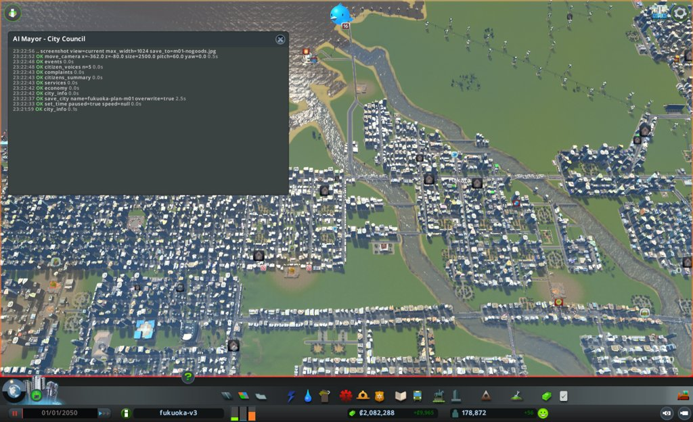
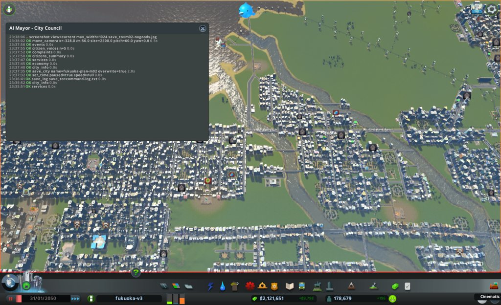
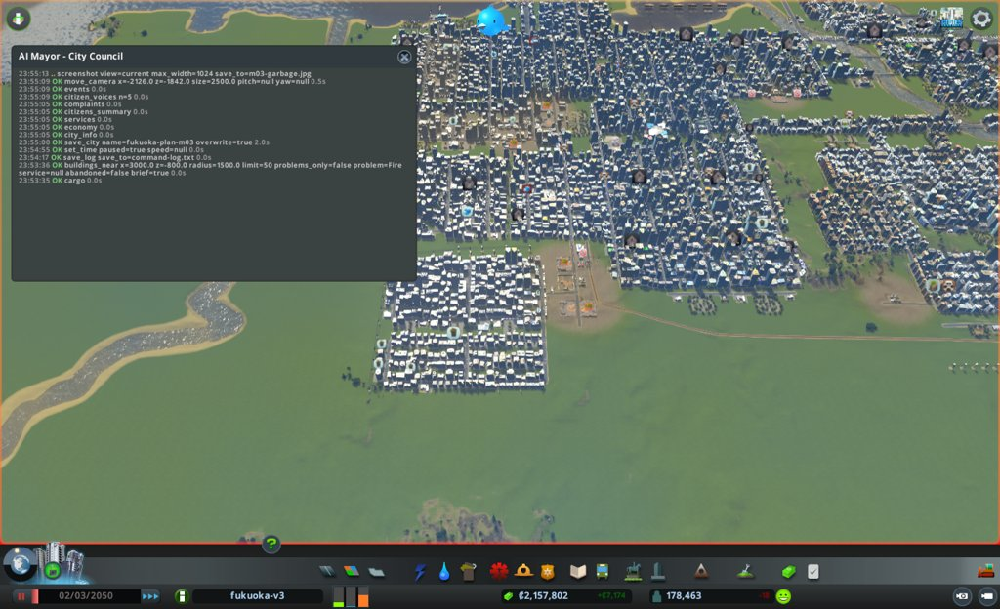
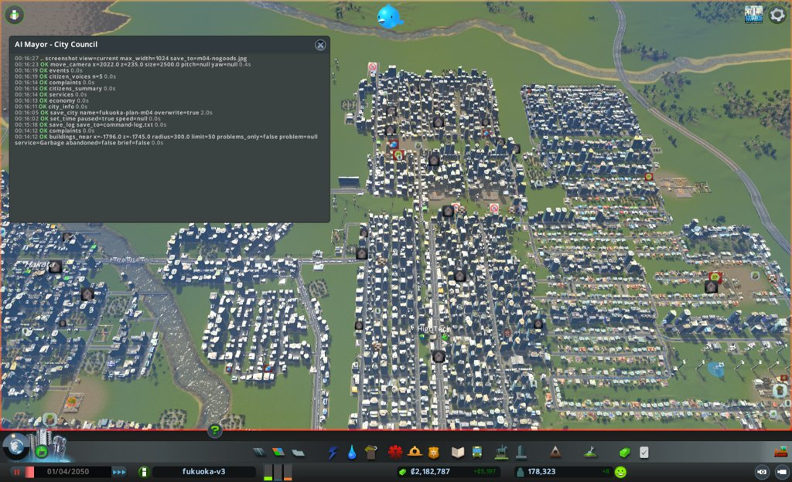
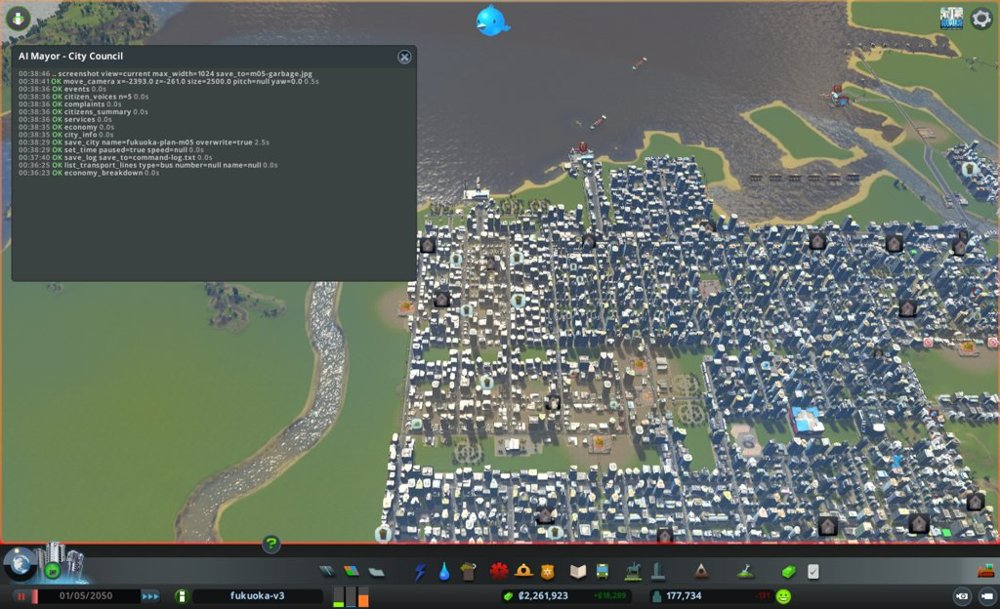
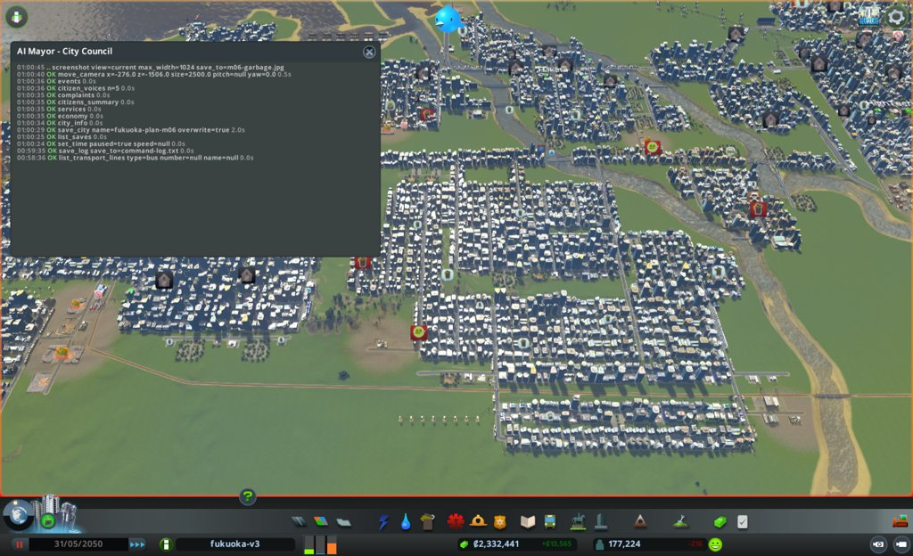

# 市政ノート

## 性格と公約と捨てるもの

市長の定義(mayors/plan.md)から写す。任期中は書き換えない。

- 性格: なし。判断の型(`protocol.md`)と、市の計画にだけ従う。自分で施策を考えず、局の案から選ぶ。毎月の編成方針で、市の計画の施策から重点を3つまで選ぶ(公約の進み具合と、目標から遠い施策を見る)
- 公約:
  1. 人口を毎月増やす(`city_info` の population。毎月の月例で、前の月例より増えていること)
  2. 電気・水・下水が来ない市民をなくす(`citizens_summary` の電気・水・下水が来ない市民の数。任期の終わりに0)
  3. 赤字を続けない(`city_info` の週の収支。毎月の月例で、2回続けて赤字にしない)
- 捨てるもの: なし
- 任期: 12か月

## 申し送り(前の運営から)

なし

## 数字の表

月例と見回りのたびに1行足す。区切りは 月例・見回り・臨時。

| ゲーム内の日付 | 区切り | 人口 | 所持金 | 週の収支 | 幸福度 | 需要(住/商/工) | 失業 | 主な困りごと |
|---|---|---|---|---|---|---|---|---|
| 2050-01-01 | 月例 | 178,872 | 2,082,287 | +9,965 | 85 | 23 / 2 / 60 | 6,584 | 品物がない店228、死者52、汚染32、ごみ15 |
| 2050-01-11 | 見回り | 178,667 | 2,095,043 | +8,875 | 85 | 23 / 2 / 60 | - | 境目なし(人口-0.1%、黒字、電気・水・下水が来ない市民 0/0/0、events 1件で困りごとなし、dialog null) |
| 2050-01-21 | 見回り | 178,475 | 2,107,914 | +9,082 | 85 | 23 / 2 / 59 | - | 境目なし(人口-0.1%、黒字で前回より良い、0/0/0、events 0件、dialog null) |
| 2050-01-31 | 月例 | 178,679 | 2,121,650 | +9,798 | 85 | 24 / 2 / 58 | 6,109 | 品物がない店233、死者56、汚染40、ごみ26 |
| 2050-02-10 | 見回り | 178,569 | 2,134,475 | +9,223 | 85 | 24 / 2 / 59 | - | 境目なし(人口-0.06%、黒字、来ない市民 0/0/0、events 1件で死者の引き取りの声のみ、dialog null) |
| 2050-02-20 | 見回り | 178,577 | 2,146,880 | +8,433 | 85 | 23 / 2 / 59 | - | 境目なし(人口+0.004%、黒字(前回+9,223より少ないが赤字でない)、0/0/0、events 0件、dialog null) |
| 2050-03-02 | 月例 | 178,463 | 2,157,802 | +7,175 | 85 | 23 / 2 / 59 | 6,077 | 品物がない店174、ごみ47、死者42、汚染23 |
| 2050-03-12 | 見回り | 178,306 | 2,167,141 | +6,380 | 85 | 23 / 4 / 18 | - | 境目なし(人口-0.09%、黒字(前回+7,175より少ないが赤字でない)、来ない市民 0/0/0、events 2件(学校の賞、放棄の家)で境目の種類なし、dialog null) |
| 2050-03-22 | 見回り | 178,309 | 2,175,701 | +5,869 | 85 | 23 / 2 / 19 | - | 境目なし(人口+0.002%、黒字(前回+6,380より少ないが赤字でない)、来ない市民 0/0/0、events 1件(安売り)、dialog null) |
| 2050-04-01 | 月例 | 178,323 | 2,182,787 | +5,197 | 85 | 23 / 2 / 15 | 5,901 | 品物がない店222、ごみ74、死者45、汚染41 |
| 2050-04-11 | 見回り | 178,046 | 2,206,870 | +20,711 | 84 | 24 / 2 / 19 | - | 境目なし(人口-0.16%、黒字で前回より良い、幸福度-1、来ない市民 0/0/0、events 2件(学校の賞、騒音)で境目の種類は0件、dialog null) |
| 2050-04-21 | 見回り | 177,988 | 2,235,817 | +19,861 | 84 | 24 / 4 / 50 | - | 境目なし(人口-0.03%、黒字(前回+20,711より少ないが赤字でない)、幸福度±0、来ない市民 0/0/0、events 0件、dialog null) |
| 2050-05-01 | 月例 | 177,734 | 2,261,923 | +18,289 | 84 | 24 / 2 / 58 | 5,662 | 品物がない店230、ごみ132、汚染39、死者34 |
| 2050-05-11 | 見回り | 177,764 | 2,288,746 | +18,631 | 84 | 24 / 4 / 56 | - | 境目なし(人口+0.02%、黒字で前回より良い、幸福度±0、来ない市民 0/0/0、events 2件(リサイクルの声、留守の話)で境目の種類なし、dialog null) |
| 2050-05-21 | 見回り | 177,487 | 2,312,526 | +15,792 | 84 | 25 / 2 / 57 | - | 境目なし(人口-0.16%、黒字(前回+18,631より少ないが赤字でない)、幸福度±0、来ない市民 0/0/0、events 1件(学校の賞)、dialog null) |
| 2050-05-31 | 月例 | 177,224 | 2,332,440 | +13,565 | 84 | 25 / 4 / 57 | 5,409 | 品物がない店239、ごみ146、汚染45、死者40 |
| 2050-06-10 | 見回り | 177,166 | 2,353,722 | +14,821 | 86 | 24 / 2 / 21 | - | 境目なし(人口-0.03%、黒字で前回より良い、幸福度+2、来ない市民 0/0/0、events 2件(スマートホーム、ごみの声1件)で境目の種類は1件、dialog null) |
| 2050-06-20 | 見回り | 177,431 | 2,372,948 | +13,902 | 86 | 24 / 2 / 27 | - | 境目なし(人口+0.15%、黒字(前回+14,821より少ないが赤字でない)、幸福度±0、来ない市民 0/0/0、events 2件(安売り、水の声1件)で境目の種類は1件、dialog null) |

## 施策の一覧

施策を打つたびに1行足す(臨時も含む)。答え合わせの列は、翌月の月例で埋める。
分野は、港・働き口・住宅・暮らし・環境・財政から1つ選ぶ。
元の局は英字の名前(urban など)。議決は 要らない / 可決 / 否決。施策の id は m<月2桁>-<番号>(市役所と議会のハーネス、#100)。

| ゲーム内の日付 | 区切り | 施策の id | 施策 | 元の局 | 市の計画の施策 | 議決 | 分野 | 公約 | 建設費 | 週の維持費の増分 | 答え合わせ |
|---|---|---|---|---|---|---|---|---|---|---|---|
| 2050-01-01 | 月例 | m01-1 | z=-950 の3区間を4車線にそろえる(試し)。失敗: skipped(ObjectCollision 2、TooShort 1)で見送り | roads | 6-3 | 要らない | 暮らし | なし | 0 | 0 | 打てなかったので測らない。道路は変わっていない |
| 2050-01-01 | 月例 | m01-2 | 満杯の埋立地16914を空にする(試し) | health | 4-4 | 要らない | 環境 | なし | 0 | 0 | 半分当たり。full 7→6 は当たり、ごみの印 15→26 で効かない。16914 は30日 95% のまま |
| 2050-01-31 | 月例 | m02-1 | 道に面した空き地34マスを事務所の区画にする(試し) | urban | 6-4、7-1 | 要らない | 働き口 | 1 | 0 | 0 | 当たり。円の中に事務所0 → 3棟、10日で建ちH2〜H3に上がった。空き34 → 2マス |
| 2050-01-31 | 月例 | m02-2 | 埋立地16914を空ける作業から受け入れに戻す(試し) | health | 4-4 | 要らない | 環境 | なし | 0 | 0 | 半分当たり。Emptying が消え車 19 → 16、full 6 のまま。ごみの印 26 → 47 で効かない |
| 2050-01-31 | 月例 | m02-3 | 放棄・焼けた建物128棟と焼けた小学校5804を取り壊す | economy、fire | 6-4、7-1、3-4 | 可決 | 働き口 | なし | 0 | 0 | 一時だけ当たり。品物がない店 233 → 120 → 174(月末)、放棄は1か月で73棟に戻った。火事と犯罪 6 → 1 は当たり |
| 2050-03-02 | 月例 | m03-1 | 空きの店の区画39マスを事務所の区画に塗り替える(試し) | urban | 6-4、7-1 | 要らない | 働き口 | 1 | 0 | 0 | 当たり。4円の Office の空き 39 → 3(予想10以下)、新しい事務所4棟が H2〜H3 に上がった |
| 2050-03-02 | 月例 | m03-2 | 道に面した Unzoned の空き地144マスを事務所の区画にする(試し) | economy | 6-4、7-1 | 要らない | 働き口 | 1 | 0 | 0 | 当たり(建つ側)。2円の事務所 5 / 0 → 17 / 10棟(新しく22、予想5以上)。働き口 86,298 → 86,414(予想 +100〜+600 の下端)。大卒の失業 7,092 → 7,099 で減らない。Water の印2棟 |
| 2050-03-02 | 月例 | m03-3 | 乗客の少ないバス5路線の台数割合を200%から180%に下げる(試し) | port | 6-3 | 可決 | 財政 | 3 | 0 | 0未満(額は未確認) | 当たり。台数 463 → 415、バスの支出 22,094 → 21,615(-479)。乗客 152 → 166 で減らない。週の収支は店の収入の減りで +7,175 → +5,197 |
| 2050-04-01 | 月例 | m04-1 | 満杯の埋立地3つの南に埋立地37856と道80mを足す(試し) | health | 4-4 | 要らない | 環境 | なし | 4,400 | 約163 | 外れ。容量 160M → 168M は当たり。ごみの印 74 → 132(予想60以下)、満杯 8 → 10。新設37856は30日で1%、車 19 / 19。印の集まりは (-2393, -261) の工場の区画に移った |
| 2050-04-01 | 月例 | m04-2 | 事務所の税率を3%から5%に上げる(試し) | economy | 6-4、7-1(財政) | 可決 | 財政 | 3 | 0 | 0 | 当たり。Office の収入 24,598 → 40,091(予想 +10,000〜+16,000)、週の収支 +5,197 → +18,289。働き口 86,454 で 86,000 を割らず、働き口の需要 15 → 58 |
| 2050-04-01 | 月例 | m04-3 | 乗客の少ないバス13路線の台数割合を20ずつ下げる(試し) | port | 6-3 | 可決 | 財政 | 3 | 0 | 0未満(額は未確認) | 当たり。台数 427 → 370、バスの支出 21,615 → 21,014(-601)、乗客 114 → 176。流れ 51% → 54% |
| 2050-05-01 | 月例 | m05-1 | 道に面した Unzoned の空き地24マスを事務所の区画にする(試し) | economy | 6-4、7-1 | 要らない | 働き口 | 1 | 0 | 0 | 半分当たり。Office の空き 24 → 0(予想は半分以下)は当たり。事務所 3 → 5棟(予想 +4棟以上)は外れ。働き口 86,454 → 86,249(予想 +50〜+200)は外れ。放棄の店 98 → 122 の減りに打ち消された |
| 2050-05-01 | 月例 | m05-2 | 西の工場街の地区 RecycleWest だけに Recycling をかける(試し) | health | 4-4 | 要らない | 環境 | なし | 0 | 0(住宅の税収 週230前後減の見込み) | 円の中は当たり。ごみの印 25 → 10(予想15〜20)。街全体は 132 → 146 で、集まりは (-276, -1506) の住宅へ移った。Residential の収入 -3,337(予想 -1,000以内)は外れ。地区の人口は0で、減りの原因は分けられていない |
| 2050-05-01 | 月例 | m05-3 | 乗客の少ないバス18路線の台数割合を20ずつ下げる(試し) | port | 6-3 | 可決 | 財政 | 3 | 0 | 0未満(額は未確認) | 当たり。台数 637 → 545(予想530〜560)、バスの支出 -945(予想 -800〜-1,300)、乗客 332 → 377。バスの収入 -526 で、差し引き週 -419。流れ 54% → 52%(予想54〜55%)は外れ |
| 2050-05-31 | 月例 | m06-3 | 政策 SmokingBan をかける(試し) | health | 1-2 | 要らない | 暮らし | なし | 0 | 0 | |
| 2050-05-31 | 月例 | m06-1 | 放棄の店8棟を壊し、跡68マスを事務所の区画にする(試し) | urban | 6-4、7-1 | 可決 | 働き口 | 1 | 0 | 0 | |
| 2050-05-31 | 月例 | m06-2 | 焼けた事務所3棟を取り壊す | fire | 3-4 | 可決 | 暮らし | なし | 0 | 0 | |

## 分からないことの一覧

効き目や原因が分からないことを1行に1つ書く(`protocol.md` の3)。確かめ終えても消さず、結果を埋める。

| 書いた日 | 分からないこと | 確かめた試し | 結果 |
|---|---|---|---|
| 2050-01-01 | 貨物駅28755(3449, -1555)の敷地の中で、トラック492台が止まっている原因(出口の道の詰まりか、行き先が決まらないのか) | 試しはまだ。調査 s01-1(01-11〜01-31) | 一部分かった。出口の道の詰まりではない(半径300の blocked 0〜1、密度25〜36)。敷地の中の520台は WaitingSpace+Importing、道順 ready、blockCounter 0 で30日止まったまま。輸入の荷を道へ出す空きを待っている。なぜ空きが出ないかは分からない。同じ種類の貨物駅7つは出入り0。2050-04-01 追記(s03-1): 敷地の中の WaitingSpace+Importing は 533 → 553 → 583 と増え続け、7日以上止まった車は590、いちばん長い車は90日。出口の道の blocked は 0〜16 で詰まりではない。Cargo Connection の端の点 (3497, -1555/-1560) は、道路の点 (3495, -1565) と別の点だった。これが出口を塞ぐのかは確かめていない(試しはまだ)。2050-05-01 追記(s04-1): 28755 に紐づくトラック 710 → 686 → 659、WaitingSpace+Importing+InGrounds 591 → 577 → 563 と少しずつ減った。出口は全く通らないのではなく一部通る(524 が道へ出た)。同じ10台(8、36、307 など)は120日止まったまま。新しく来た車(<1day)は 135 → 106。出口近くの blocked は3回とも0。なぜ一部しか出ないかは分からない(試しはまだ)。2050-05-31 追記(s05-1): `junction_info(x=3495, z=-1560)` は2回とも "no road junction within 40m"。道路の点 21285 (3495, -1565) は2つの道路の区間だけをつなぐ。Cargo Connection の端がこの点につながるかは、service="Road" で絞ったため返らず、確かめていない。28755 のトラック 688 → 665、7日以上止まった車 541 → 449、新しく来た車 147 → 216。150日止まった車(8、307、467 など)が残る。`cargo` の 8-1 は 585 → 559(試しはまだ) |
| 2050-01-01 | 空いた働き口が3,215あるのに、大卒の失業が7,720残る原因(学歴の合う働き口が足りないのか、通えないのか) | 試しはまだ。調査 s01-2(01-11〜01-31) | 一部分かった。働き口が足りない側。空いた働き口3,201をすべて埋めても大卒の失業7,205が残る。事務所の空き1,642マスは全部 emptyBehind(道に面さない)で建たず、今月の事務所の新築0。道に面した事務所の区画を足すと建つかは試していない。m02-1 の試しで、道に面した区画には10日で3棟建ちH2〜H3に上がった(効いた)。どれだけ足せば大卒の失業7,092が減るかは分からない。2050-04-01 追記(m03-1、m03-2): 店の空き区画を替えても(4棟)、Unzoned を塗っても(22棟)事務所は建った。ただ1か月で働き口は +116、大卒の失業は 7,092 → 7,099 で減らず、働き口の需要は 59 → 15 に下がった。小さな H1 の事務所が多く、放棄の店の働き口の減りと打ち消し合ったと見るが、確かめていない。2050-05-01 追記: 区画を足さなかった4か月目に、`demand_breakdown` の大卒の失業は 7,099 → 6,866(-233)、働き口 86,414 → 86,454、空いた働き口 3,248 → 3,387。事務所の税を上げた月に減った。何で減ったかは分からない。2050-05-31 追記(m05-1、s05-2): 大卒の失業は 6,866 → 6,699 → 6,612 → 6,525 と減り続けた。同じ30日に働き口は 86,454 → 86,249 と減り、空いた働き口も 3,387 → 3,351 で、働き口が増えて減ったのではない。大卒の働き手の候補(eligibleWorkers)も 82,492 → 82,291、人口も -510。失業の人が街を出て減った見立てだが、確かめていない。道に面した区画に事務所が建つことは m02-1・m03-1・m03-2・m05-1 の4回で確かめ終えた |
| 2050-01-31 | 埋立地16914が空ける途中で95%のまま30日減らない原因(運び先の埋立地が満杯か、収集車が道で止まっているか) | m02-2(受け入れに戻す)と調査 s02-1 | 一部分かった。運ぶ車は道順 ready のまま渋滞で止まり、30日止まった車が9台。31232 行きの残り距離は20日で 4,910 → 3,473m とゆっくり縮む。運び先の満杯ではなく、途中の道の詰まり。止まる位置 (-1656〜-1461, -1394〜-884)、(-613〜-397, -748) は、街全体の密度100の区間 24494 (-1760, -1460) の近く。2050-05-01 追記: 16914 は 96% で受け入れを続けた後、05-01 の `services` で満杯(full)に戻った |
| 2050-03-02 | ごみの印が 15 → 26 → 47 と増え、集まる区画が (-2126, -1842) に移った原因(収集車が渋滞で回れないのか、焼却場33797が満ちたのか) | 調査 s03-3(03-12〜04-01)。試し m04-1(埋立地37856 を足す) | 一部分かった。受け入れ先が満ちた側が大きい。その区画の埋立地157・23032・29270 は3つとも 100%(LandfillFull、車 0 / 19)、焼却場41481 は reserves 95〜99%、車 10 → 16 / 34。41481 の車の一部は (-1816, -1255〜-1387) で Blocked。ごみの印は 72 → 61 → 74、街全体の満杯の埋立地は 6 → 8。2050-05-01(m04-1): 効かない。受け入れ先を1つ足しても、ごみの印は 74 → 132、満杯 8 → 10。新設37856 は30日で 1%(80,000)しか溜まらず、車は 19 / 19 出たまま。印の集まりは (-2393, -261) の工場と港1366 の区画に移った。2050-05-31(m05-2): 出る量を減らす側は、その円では効いた。地区 RecycleWest の Recycling で、(-2393, -261) 半径500 のごみの印は 25 → 10。ただ街全体は 132 → 146 で、集まりは (-276, -1506) の高密度住宅(40棟)に移った。毎月集まる場所が移る原因は分からない |
| 2050-03-02 | 放棄を128棟壊した1か月後に、放棄が73棟(店が多く NoGoods)に戻った。品物が店に届かない原因(貨物駅28755の止まりか、店の周りの道の詰まりか)。品物がない店の多い場所 (-1156, -1055) 46棟、(2230, 800) 32棟、(-2382, -710) 28棟 | 調査 s03-2(03-12〜04-01)。試しはまだ | 一部分かった。28755 で止まった車の行き先に、品物がない店 48389・235 がある。品物の一部は 28755 の中で止まっている。店の周りの道の詰まりは測っていない。品物がない店 187 → 204 → 222、Goods の止まったトラック 485 → 617 と増え続けた。2つの円の店は全部、電気・水・下水が来ている。2050-05-01 追記(s04-2): 28755 の Goods の車の行き先は 2,665〜6,121m 先の店で、(961, 264) から300m以内の店は上位10にない。`buildings_near(problem="NoGoods")` は (961, 264) と (923, 258) の半径300で0棟なのに、`cargo` の spot は同じ場所に37棟と返す(2つの道具の数え方が違う。(2219, 744) では22棟が返る)。品物がない店 222 → 230、放棄の店(商高)78 → 98。2050-05-31: 品物がない店 230 → 239、放棄の店(商高)98 → 122、Goods の止まったトラック 553 → 543。多い場所は (-1110, -813) 62、(2207, 737) 54、(-2332, -812) 31(試しも調査もなし) |
| 2050-04-01 | 汚染の印が 40 → 23 → 41 と上下し、集まる区画が (3823, -183) の低密度の住宅に移った原因。events に土の工業廃棄物の声が1件 | 調査 s04-3(04-11〜05-01)。試しはまだ | 一部分かった。半径500の汚染の印は 14 → 20 → 20棟、MajorProblem 1 → 7棟。どれも低密度の住宅。`map_layer`(pollution)の255前後の点が、z=17〜-83 の x 3523〜3723、z=-483〜-683 の x 3523〜3923、x=4223 の z -283〜-783 に3回とも同じ形で並ぶ。その点に何の建物があるかは確かめていない。2050-05-31: 汚染の印は 39 → 45、集まりは (3763, -175) の低密度の住宅16棟(試しも調査もなし) |
| 2050-04-01 | 週の収支が +9,965 → +9,798 → +7,175 → +5,197 と下がり続ける。店の収入が 39,359 → 36,235 に減った。品物がない店の増えと放棄が原因かは分からない | 試し m04-2(事務所の税 3 → 5) | 手当ては効いた。週の収支 +5,197 → +18,289、Office の収入 24,598 → 40,091。店の収入も 36,235 → 38,286 に戻った。下がった原因(品物がない店と放棄)は確かめていない |
| 2050-05-01 | 人口が4か月続けて減り、4か月目は -589 といちばん大きい(178,323 → 177,734)。住宅の需要24、空き家 5,145。何が出ていく人を増やしたのか(失業、汚染、ごみ、死者)は分からない | まだ(s05-2 の数を参考に見た) | 分からない。5か月目も 177,734 → 177,224(-510)。s05-2 の30日で、失業 5,616 → 5,409、子ども 10,684 → 10,668、10代 22,258 → 22,134、大人 67,338 → 67,022、高齢 45,429 → 45,316 と、どの年齢層も減った。空き家 5,145 → 5,277、住宅の需要25。試しはまだ |
| 2050-05-01 | 新しい埋立地37856 が、車 19 / 19 を出しているのに30日で 1% しか溜まらない原因(車が渋滞で戻れないのか、回る範囲にごみが少ないのか) | 調査 s05-3(05-11〜05-31) | 一部分かった。車が遠くまで行き、渋滞で戻りが遅い側。行き先は 37856 から 1.5〜6km 先(3.7km 東の (3719, -596) など)。満載(20,000)で戻る車が (-921〜-577, -739〜-794) などで Congestion のまま20日。同じ6台が20日たっても行き先へ向かう途中。37856 の周り半径300の blocked は3回とも0。storage は 80,000 → 208,309(2.6%)。なぜ遠くの建物へ行くのかは分からない |
| 2050-05-31 | 週の収支が +18,289 → +13,565 に下がり、Residential の収入が 260,459 → 257,122(-3,337)。人口の減り(-510)か、m05-2 の Recycling か、別の原因か | まだ | |

## 判断の記録

### 2050-01-01 月例(1か月目)

保存: `fukuoka-plan-m01`(2050-01-01。同じ月のやり直しのため上書きした)

#### 答え合わせ

なし(1か月目のため)

- 前回の「次にやること」: なし(1か月目)
- 公約の進み具合
  1. 人口を毎月増やす: 178,872(出発点)/ 次の月例で前回を超えること / 住宅の需要23、空き家4,935。失業7,911が空いた働き口3,215を上回り、需要の働き口の項を下げている。働き口を増やさないと伸びにくい
  2. 電気・水・下水が来ない市民: 0 / 0 / 0 / 任期の終わりまで0を保つ / 水と下水の使用は容量の80%(1,925,008 / 2,400,000)。余裕はあるが、伸びれば足りなくなる
  3. 赤字を続けない: 週の収支 +9,965 / 毎月 / 黒字

#### 気づいたこと

- 貨物駅28755の敷地の中で、トラック492台が止まっている(8-1 の出発点506のほとんど)。同じ時に、品物がない店が228棟ある。品物(Goods)の止まったトラックは507台で、品物の流れが詰まっている
- 失業7,911のうち7,720が大卒。空いた働き口3,215とかみ合っていない。働き口の需要は60で、働き口を足す余地がある
- 埋立地7つが満杯で受け入れを止めた。ごみの容量の使用は78%(124,885,583 / 160,000,000)。ごみの印は15棟だが、満杯が増えると広がる

#### 施策

議案は `council/m01-bill.md`。2件とも議決は要らない。

##### m01-1 東西の道 z=-950 の絞られた3区間を4車線にそろえる(試し、roads)

- 公約: どれにも直接はつながらない。市の計画 6-3 の流れを動かす手の効き目を確かめるため
- 捨てるもの: なし(定義に捨てるものがない)
- 理由: `traffic`(x=2240, z=-950, 半径120)で止まった車54、平均密度95。前後は各向き2車線なのに、間の3区間(segment 19196、36011、3334)だけ各向き1車線。費用約330、維持費の増え分0で、戻せる
- 予想: 同じ範囲の blocked 54 → 27以下、averageDensity 95 → 70以下(見回り1と月末)。街全体の flow 51% は動かないか1ポイント未満。詰まりが北や西の枝へ移る恐れがある
- 試し: 仮説は、絞られた区間を同じ幅にそろえると周りの止まった車が減る。測る数は `traffic`(x=2240, z=-950, 半径120)の blocked と averageDensity。場所は z=-950 の x=2160〜2280。基準は blocked 54、averageDensity 95。一覧の項目の試しではない
- 操作: `net_near(x=2240, z=-950, radius=120, service="Road")` で3区間が Basic Road かを見る → `upgrade_road(prefab="Small 4 Lane Road", points=[[2160,-950],[2280,-950]], tolerance=10, pay=True, demolish=False)` → matched 3、upgraded 3、skipped なしを見る
- 結果: 失敗(見送り)。`net_near` で 19196、36011、3334 は Basic Road のままだった(前後の 1380、30068、13096 は Small 4 Lane Road)。`upgrade_road` は matched 3、upgraded 0、cost 0。skipped は 3334 と 19196 が ObjectCollision、36011 が TooShort。議案の中止する条件(skipped が返った)に当たり、予備候補もないため、demolish=True でのやり直しはしなかった。道路は変わっていない
- 確かめ: 画面写真 `assets/m01-road-z950.jpg`(変わっていないことの記録)。試しの数は見回りで測らない(打っていないため)

##### m01-2 満杯の埋立地 16914 を空にする(試し、health)

- 公約: どれにも直接はつながらない。市の計画 4-4 のごみの印を減らすため
- 捨てるもの: なし
- 理由: 満杯の埋立地7つ。16914(-650, -490)は100%、車0台。全体の空き 35,114,417 で、移す先(28130、12243、31969)にも空きがある。費用0で戻せる
- 予想: `services` の garbage.full.count 7 → 6、`complaints` のごみの印15は減る(数は見積もれない)。期限は月末。16914 は印の集まる区画(-458, -1468)から約1,000m離れていて、効かないこともある
- 試し: 仮説は、満杯の埋立地を空けると収集が戻り、ごみの印が減る。測る数は garbage.full.count(基準7)と complaints の Garbage(基準15)。場所は 16914(-650, -490)。一覧の項目の試しではない
- 操作: `buildings_near(x=-650, z=-490, radius=50, service="Garbage")` で100%を見る → `empty_building(id=16914, active=True)` → 見回りで storage を見る → 空になったら `empty_building(id=16914, active=False)`。予備の 25590、45892 は今月は使わない
- 結果: 成功。実行の直前に `buildings_near` で 16914 は 8,000,000 / 8,000,000(100%)、車 0 / 19、LandfillFull。`services` の garbage.full は7(16914、19182、23032、25590、25826、29270、45892)、使用 124,885,583 / 160,000,000。`empty_building(id=16914, active=True)` は ok、emptying true。費用0
- 確かめ: `buildings_near(x=-650, z=-490, radius=50, service="Garbage")` の 16914 は、見回り1(01-11)・見回り2(01-21)・月末(01-31)のどれも Emptying、7,620,000 / 8,000,000(95%)、車 19 / 19。01-11 から量が減っていない。空になっていないので、`empty_building(id=16914, active=False)` はまだ呼んでいない(空けている最中のまま)。月末の `services` では garbage.full.count 7 → 6(16914 が外れた)、used 124,885,583 → 126,950,203

##### 調査

- s01-1(port): 貨物駅28755のトラック492台は、出口の詰まりか、入口側の空き待ちか。`vehicles_stuck(kind="truck", building=28755, limit=30)`、`cargo()`、`traffic(x=3449, z=-1555, radius=300)`。見回り1・2・月末。一覧の1つ目
- s01-2(urban): 働き口の需要60なのに事務所の空き1,642マスが埋まらず、大卒の失業が残るのはなぜか。`zone_summary(grid=1000)`、`demand_breakdown()`、`new_buildings(since=0)`。見回り1・2・月末。一覧の2つ目
- s01-3(health): ごみの印15棟は、収集車の不足か処理場の満杯か。`buildings_near(x=-458, z=-1468, radius=400, problem="Garbage", limit=30)`、`buildings_near(x=-570, z=-1840, radius=300, service="Garbage")`。見回り1・2・月末

##### 一覧の項目の試しについて

分からないことの一覧の2項目(貨物駅28755の止まり、大卒の失業)を確かめる試しの案は、どの局からも出なかった。代わりの試しは作らず、s01-1 と s01-2 の調査で原因を絞る。

##### 案なしの局

urban、port、education、fire は案なし。理由はどれも、原因が未確認、目標を満たしている、敷地を確かめられない、のどれかで、局の役割から外れた判断ではない。

#### 考えたが打たなかった手

- economy の放棄された建物131棟の取り壊し(取り壊し、査定は可): m01-1 の試しの場所(半径120)に焼けた工場 12882(2184, -918)が入る。半径6000の1つの円では外せない。noGoods の減り方の多くは数えから外れるだけで、s01-1 で貨物駅を測る間に基準が動く。戻せない。来月、当月の根拠で比べ直す
- economy の取り壊しを、試しの場所を外す複数の円に分ける手直し: 新しい座標と preview を補うことになり、確認済みの対象から外れる
- economy・education・roads・fire の調査: 調査は3件まで。economy は s01-1 と、education は s01-2 と同じ問い。roads の3つ目は m01-1 の答え合わせと同じ。fire は目標との差が3と小さい

#### 次にやること

- 見回り1・2と月末: m01-1 の `traffic(x=2240, z=-950, radius=120)`、m01-2 の `buildings_near(x=-650, z=-490, radius=50, service="Garbage")` と `services` の garbage.full を見る
- 来月の月例: s01-1 と s01-2 の結果で、分からないことの一覧の2項目を埋めるか、試しの案を局に求める。economy の取り壊しを当月の根拠で比べ直す

#### 実行と見回りの記録(2050-01-01〜01-31)

- m01-1: 打てなかった。`upgrade_road` が skipped(3334・19196 ObjectCollision、36011 TooShort)を返し、議案の中止する条件に当たった。demolish=True でのやり直しは議案にないので、しなかった。道路の幅をそろえる手は、ぶつかる物(区画の建物か別の道か)を局が確かめ直さないと打てない
- m01-2: 空け始めたが、20日間 95% のまま減っていない(車 19 / 19 が出たまま)。受け入れ先へ運べていないのかは分からない。受け入れに戻す操作(active=False)は空になっていないので呼んでいない
- 見回り2回とも境目なし。臨時なし。hooks に止められた手なし
- 調査 s01-1、s01-2、s01-3 は、見回り1・2と月末に呼び、`council/m01-survey-port.md`、`m01-survey-urban.md`、`m01-survey-health.md` に書いた。s01-2 の new_buildings の次の since は 92375
- 月末の `city_info`(参考、見回りの行ではない): 2050-01-31、人口 178,679(月初 178,872 より 193 少ない)、所持金 2,121,650、週の収支 +9,798、幸福度 85、需要 24 / 2 / 58、電気・水・下水が来ない市民 0 / 0 / 0、dialog null

#### 次にやること(実行の段から)

- 来月の月例: m01-1 の失敗の理由(ObjectCollision の相手、TooShort)を roads に伝え、打ち直すかを局に決めてもらう。試しの数 `traffic(x=2240, z=-950, radius=120)` は打っていないので測らなくてよい
- 来月の月例: 16914 が 95% で止まった理由を health に見てもらう。空けるのを続けるか、`empty_building(id=16914, active=False)` で戻すかを決める。`buildings_near(x=-650, z=-490, radius=50, service="Garbage")` の storage で見る
- 来月の月例: 人口が月初より193減った。公約1の答え合わせで扱う

#### 見たもの(実行と見回り)

- `net_near`(x=2240, z=-950, 半径120, Road): 19196、36011、3334 は Basic Road(各向き1車線)、1380、30068、13096 は Small 4 Lane Road
- `upgrade_road`(Small 4 Lane Road, [[2160,-950],[2280,-950]], tolerance 10): matched 3、upgraded 0、skipped 3、cost 0
- `buildings_near`(x=-650, z=-490, 半径50, Garbage): 実行前 100%・車0、01-11 以降 95%・車19
- `services`: 実行前 garbage.full 7、月末 6
- `city_info`: 01-11 人口 178,667・+8,875、01-21 人口 178,475・+9,082、01-31 人口 178,679・+9,798。どれも幸福度85、来ない市民 0/0/0
- `events`: 01-11 1件(困りごとなし)、01-21 0件

#### 判断の根拠(実行と見回り)

m01-1 は skipped が返り、議案の中止する条件に当たったので打たなかった。demolish=True は議案にない手で、壊れる建物も見積もっていない。m01-2 は 100% を確かめてから打った。95% で止まっても、議案は空になったら戻すとだけ書いているので、空けるのを続けた。

#### 捨てたもの(実行と見回り)

- m01-1 を demolish=True でやり直す: 議案の中止する条件に当たり、壊す建物も見積もっていないため
- 16914 を見回りで受け入れに戻す: 議案の戻す条件(空になった)に当たらないため。続けるか戻すかは来月の月例で決める

#### 画面写真



### 2050-01-31 月例(2か月目)

保存: `fukuoka-plan-m02`(2050-01-31。同じ月のやり直しのため上書きした)

#### 答え合わせ

- m01-1(z=-950 の3区間を4車線に、試し): 打てなかった。`upgrade_road` が skipped(ObjectCollision 2、TooShort 1)を返した。予想と比べる結果はない。外れた理由の見立ては、区間の脇の建物か別の道とぶつかり、短い区間は広げられないこと。次の扱いは、ぶつかる相手を roads が確かめ直すまで打ち直さない。参考に、街全体の `traffic` の busiest に、この東隣の segment 13096(2370, -950)が密度100で出ている
- m01-2(埋立地16914を空にする、試し): 半分当たり。`services` の garbage.full は 7 → 6 で予想どおり。`complaints` のごみの印は 15 → 26 で、減る予想は外れた。16914 は 01-11 から30日、95%(7,620,000 / 8,000,000)・車 19 / 19 のまま減らない。外れた理由の見立ては、空けた荷の運び先(ほかの埋立地)の6つが満杯のままで、収集車が運び先を見つけられないか、道で止まっていること。原因は分からないので、一覧に足した。次の扱いは、health に、続けるか `empty_building(id=16914, active=False)` で戻すかを決めてもらう
- 試しの結果
  - m01-1: 打っていないので測らない
  - m01-2: 測る数 garbage.full.count は基準7 → 6(効いた)。complaints の Garbage は基準15 → 26(効かない)。ごみの印の集まる区画は (-488, -1405) で、16914 から約900m離れている。s01-3 で、その区画の印は10 → 6 → 5棟と入れ替わりながら減ったが、街全体では増えた
- 前回の「次にやること」: 見回り1・2と月末の確かめは、実行する市長が行った(上の記録)。s01-1 と s01-2 の結果で、一覧の2項目を一部埋めた。economy の取り壊しの比べ直しは、今月の局の案が出てからまとめる段で行う
- 公約の進み具合
  1. 人口を毎月増やす: 178,872 → 178,679(-193)。今月は守れなかった。住宅の需要24、空き家4,939。失業7,409が空いた働き口3,201を上回る形は先月と同じ
  2. 電気・水・下水が来ない市民: 0 / 0 / 0。任期の終わりまで0を保つ。水の使用は容量の76%(1,921,488 / 2,520,000)、下水は80%(1,919,568 / 2,400,000)
  3. 赤字を続けない: +9,798。黒字

#### 市の計画の施策の今の数字(2050-01-31)

- 1-2 健康の平均 78(目標80以上)
- 2-3 小学校 14,268 / 子ども 11,075、高校 24,360 / 10代 22,368(満たしている)
- 3-3 来ない市民 0 / 0 / 0(満たしている)
- 3-4 火事4 + 犯罪2 = 6(目標4以下)
- 4-1 住宅(高密度)の地価 58(目標62以上)
- 4-2 公園など 81(目標100以上)
- 4-3 汚染の印 40(出発点32から悪化。目標15以下)
- 4-4 ごみの印 26(出発点15から悪化。目標0)
- 6-1 事務所のレベル3 3,229(目標3,500以上)。今月の事務所の新築0
- 6-3 流れ 51%(目標60%以上)
- 5-1、5-2 観光客 1,636(目標2,000以上)
- 6-4、7-1 働き口 86,342(目標90,000以上)。品物がない店233(目標120以下)、原料がない工場28(目標15以下)
- 8-1 駅・港の敷地の中で止まったトラック 521(うち28755が520。目標250以下)
- 財政: 週 +9,798、所持金 2,121,650(出発点 2,082,287 より多い)

#### 気づいたこと

- 人口が193減った。失業7,409(大卒7,205)が空いた働き口3,201の倍を超え、事務所の空き区画は全部が道に面さず建たない。働き口を増やす手がないと、住宅の需要は上がりにくい
- 悪くなった数字が3つある。ごみの印 15 → 26、汚染の印 32 → 40、死者の印 52 → 56。どれも局の手がまだ打たれていない
- 貨物駅28755の止まったトラックは月の間ずっと 508〜520 台で、30日動かない車が多い。出口の道は詰まっていない

#### 編成方針

`council/m02-policy.md`。重点は 6-4・7-1 企業の立地、8-1 物流のゲートウェイ、4-4 資源循環。

#### 見たもの(月例)

- `city_info`: 2050-01-31、人口 178,679、所持金 2,121,650、収入 342,031、支出 332,233、幸福度 85、需要 24 / 2 / 58、来ない市民 0/0/0、観光客 1,636、dialog null
- `economy`: 税 住低9・住高7・商低9・商高3・工3・事3。予算 ごみ・医療・警察・公園・バス150、消防140、教育・船120、ほか100
- `services`: 電気 1,710,048 / 2,347,632、水 1,921,488 / 2,520,000、下水 1,919,568 / 2,400,000、ごみ 126,950,203 / 160,000,000(満杯6)、医療 1,928 / 5,000、葬祭 12,860 / 24,000、学校 14,268 / 24,360 / 36,540、働き手 83,079 / 働き口 86,342、犯罪率5
- `citizens_summary`: 住民 178,712、子ども11,075・10代22,368、失業6,109(大卒5,976)、健康78、幸福度89、長く失業 5,201
- `complaints`: 印のある建物367。品物なし233、死者56、汚染40、ごみ26、騒音5、火事4、犯罪2
- `citizen_voices(5)`: 5人とも暮らし向きの困りなし。大人の大卒1人が失業5週目
- `events`: 2件(安売り、街の賞)。困りごとなし
- `screenshot`: `assets/m02-nogoods.jpg`(品物がない店の集まる (-328, -56)、引き2500)
- `building_stats`: 住宅(高密度)の地価58、事務所のレベル3 3,229
- `buildings_near`(Beautification、半径8000): 81
- `buildings_near`(x=-650, z=-490, 半径50, Garbage): 16914 Emptying、95%、車 19 / 19
- `traffic`: 流れ51%、止まった車1,027、密度の高い区間に 13096(2370, -950)など
- `demand_breakdown`: 働き口86,342、空き3,201、家55,348、空き4,939、失業7,409(大卒7,205)
- `cargo`: 敷地の中で止まった521(28755 が520)、品物がない店233、原料がない工場28



#### 施策

議案は `council/m02-bill.md`。m02-1 と m02-2 は議決が要らない。m02-3 は取り壊しの議決が要る。

##### m02-1 道に面した空き地34マスを事務所の区画にする(試し、urban)

- 公約: 1(人口を毎月増やす)。働き口が増えると住宅の需要が上がるため
- 捨てるもの: なし(定義に捨てるものがない)
- 理由: 事務所の空き1,642マスは全部が道に面さず、今月の新築0。大卒の失業7,205は空いた働き口3,201の倍超。(2685, 872) 半径40の Unzoned 34マスに道・電気・水・下水があると局が確かめた。費用はほぼ0、維持費0で戻せる
- 予想: 月末までに円の中に事務所が1棟以上建つ。働き口90,000への効果は数で見積もれない。0棟なら、位置ではなく需要か学歴の条件で建たないと分かる
- 試し: 仮説は、道に面した事務所の区画を足すと建つ。測る数は `zones_at(x=2685, z=872, radius=40)` の Office の空き(塗った直後を基準)と `buildings_near(x=2685, z=872, radius=60)` の事務所の棟数(基準0)。場所は (2685, 872) 半径40。一覧の2つ目の試し
- 操作: `zones_at(x=2685, z=872, radius=40)` で Unzoned 空き34を見る → `zone_area(x=2685, z=872, radius=40, type="office")` → `zones_at` で Office 30以上を見る。Office が10未満なら予備 `zone_area(x=2640, z=985, radius=30, type="office")`(先に電気を見る)。Unzoned の空きが20未満、または断られたら見送る
- 結果: 成功。直前の `zones_at` は Unzoned 34(空き34)、CommercialHigh 2(空き0)。`zone_area` は changedCells 34、skippedOccupied 2。所持金は 2,121,650 のまま(費用0)。予備は使っていない
- 確かめ: 塗った直後の `zones_at` は Office 34(空き34)、CommercialHigh 2。試しの基準は Office の空き34、`buildings_near(x=2685, z=872, radius=60)` の事務所0棟(建物7棟はどれも店と住宅。45666 に Water の印)。区画図 `assets/m02-office-zonemap.jpg`、画面写真 `assets/m02-office-zone.jpg`

##### m02-2 埋立地16914を、空ける作業から受け入れに戻す(試し、health)

- 公約: どれにも直接はつながらない。市の計画 4-4 のごみの印を減らすため
- 捨てるもの: なし
- 理由: 16914 は30日、95%・車 19 / 19 で減らない。運ぶ車15台はすべて Congestion で、最大5.4km先の焼却場へ向かう。費用0で戻せる
- 予想: 最初の見回りで Emptying の印 1 → 0、車 19 → 19未満。garbage.full は6のまま(7に戻る恐れ)。ごみの印26の変化は見積もれない。期限は月末
- 試し: 仮説は、空け作業を止めると車と受け入れ枠が戻り、ごみの印が減る。測る数は 16914 の車と storage(主)、garbage.full とごみの印(参考)。場所は 16914(-650, -490)。基準は車 19 / 19、95%、full 6、印26。一覧の3つ目の試し
- 操作: `buildings_near(x=-650, z=-490, radius=50, service="Garbage")` で Emptying・95%を見る → `empty_building(id=16914, active=False)` → 同じ `buildings_near` で Emptying が消えたことを見る。Emptying でない、または storage が90%未満に減っていれば見送る
- 結果: 成功。直前の `buildings_near` で 16914 は Emptying、7,620,000 / 8,000,000(95%)、車 19 / 19。`empty_building(id=16914, active=False)` は ok、emptying false。費用0
- 確かめ: 直後の `buildings_near` で problems None(Emptying が消えた)、stats は "Garbage trucks in use: 0 / 19"(vehicles.inUse は 19 のまま返った)、95%

##### m02-3 放棄・焼けた建物を片づける(取り壊し、economy・fire)

- 公約: どれにも直接はつながらない。市の計画 6-4・7-1 の品物がない店と、3-4 の火事の印のため
- 捨てるもの: なし
- 理由: 放棄の店約110棟が品物がない店233に数えられている。壊す128棟と小学校5804は、失う働き口0・家0・停電0。火事の印4のうち3つは焼けた建物に残る。2002 と 12882 は what="abandoned" の対象に入るので、fire の手順は 5804 だけを残した
- 予想: 品物がない店 233 → 130前後、原料がない工場 28 → 23前後、火事の印 4 → 1(火事と犯罪の合計 6 → 3)。生きている店への品物の流れは直らない
- 試し: なし
- 操作: ノートに取り壊しの理由を書く → `preview_bulldoze(x=0, z=0, radius=6000, what="abandoned")` で targets 128前後、lost 0 / 0、停電0、水の施設・駅なしを見る → `bulldoze(x=0, z=0, radius=6000, what="abandoned")` → `cargo` と `buildings_near(x=0, z=0, radius=6000, abandoned=true, brief=true)` → `services` で小学校の定員が子ども11,075以上を見る → `bulldoze(x=3125, z=-836, radius=5, what="building")`(5804 の1棟だけか見る)。preview の条件が外れたら全部見送る
- 取り壊しの理由: 壊すものは働き口も家も持たず、品物がない店と火事の印に数えられ続けている。壊さない代わりの手(品物の流れを直す)は原因が分からず、確認済みの案がない
- 結果: 成功。`preview_bulldoze(x=0, z=0, radius=6000, what="abandoned")` は targets 128、segments 0、送電線0、lost 0 / 0、buildingsLosingPower 0、waterFacilities・transportStations 空、modelAgreement 1.0(中止の条件に当たらない)。`bulldoze(what="abandoned")` は removedBuildings 128(2002、12882、14595 を含む)。`services` の小学校の定員 14,268 ≥ 子ども11,075 を見てから、`bulldoze(x=3125, z=-836, radius=5, what="building")` は removedBuildings 1(5804 Elementary School のみ)。費用0(所持金 2,121,650 のまま)
- 確かめ: 直後の `cargo` で品物がない店 233 → 120、原料がない工場 28 → 23、敷地の中で止まったトラック 521(変わらず)。`buildings_near(abandoned=true)` の残りは5棟(5804 と電柱4)。5804 を壊した後の `complaints` で火事 4 → 1(39569 (-544, 51) の店)、犯罪 2、印のある建物 367 → 243。`buildings_near(x=3000, z=-800, radius=1500, problem="Fire")` は0棟

##### 調査

- s02-1(health): 満杯の埋立地の中身を運ぶ車が空にならないのは、行き先の遠さか道の詰まりか。`vehicles_stuck(kind="garbage", building=16914, limit=20)`、`buildings_near(x=-650, z=-490, radius=50, service="Garbage")`、`buildings_near(x=-570, z=-1840, radius=300, service="Garbage")`。見回り1・2・月末

##### 一覧の項目の試しについて

一覧の3項目のうち、2つ目(m02-1)と3つ目(m02-2)を試しにした。1つ目(貨物駅28755)の試しは port から出たが、止めて半日〜1日で戻す手順を実行する市長が打てない(`advance(10)` でしか進めず、見回りで施策を打たない)ので採らなかった。1つ目は来月も残る。

##### 案なしの局

education は案なし。理由は目標を満たしていること、EducationBoost を外したときの定員の変化を確かめられないことで、局の役割から外れた判断ではない。

#### 考えたが打たなかった手

- port の貨物駅28755を止めて動かし直す試し: 待つ時間を実行の手順で作れない。止めたまま10日になると、輸入の品物を運ぶ唯一の駅が止まる
- roads の交差点 (2236, -950) の信号の試し: 61m先の焼けた工場12882と放棄の工場14595を m02-3 で壊すので、試しの基準が動く。重点の外
- fire の3棟の取り壊しを単独の施策にする: 2002 と 12882 は economy の取り壊しで壊れる。5804 だけを m02-3 にまとめた

#### 実行と見回りの記録(2050-01-31〜03-02)

- m02-1、m02-2、m02-3 の3件とも打てた(結果は各施策の欄)。予備候補は使っていない。建設費0、維持費の増分0
- 見回り2回とも境目なし。臨時なし。hooks に止められた手なし。ダイアログなし(dialogSeq 132 のまま)
- 調査 s02-1 は、見回り1・2と月末に呼び、`council/m02-survey-health.md` に書いた
- 月末の `city_info`(参考、見回りの行ではない): 2050-03-02、人口 178,463(前の月例 178,679 より 216 少ない)、所持金 2,157,802、週の収支 +7,175、幸福度 85、需要 23 / 2 / 59、来ない市民 0 / 0 / 0、観光客 1,697、dialog null

##### 試しと予想の確かめ(道具の返した事実)

- m02-1: `zones_at(x=2685, z=872, radius=40)` の Office の空きは 34(塗った直後)→ 2(02-10)→ 2(02-20)→ 2(03-02)。`buildings_near(x=2685, z=872, radius=60)` の事務所は 0 → 3棟(02-10: 4381 H1 3x2 Office15、11132 H1 2x3 Office07、24439 H1 3x4 Office14)。03-02 には 4381 が H3 3x4 Office08、11132 が H2 2x2 Office07、24439 が H2 3x4 Office05a に変わっていた
- m02-2: 16914 は 02-10 に 95%(7,640,000)・"17 / 19"、02-20 に 95%(7,676,250)・"17 / 19"、03-02 に 96%(7,696,250)・"16 / 19"。problems はどれも None。`services` の garbage.full は 6 のまま(02-10、02-20、03-02)。`complaints` の Garbage は 26(実行直後)→ 27(02-10)→ 33(02-20)→ 47(03-02)。いちばん多い区画は (-2126, -1842) に移った
- m02-3: `cargo` の品物がない店 233 → 120(直後)→ 174(03-02)。原料がない工場 28 → 23(直後)→ 33(03-02)。`complaints` の NoGoods は 120 → 127(02-10)→ 149(02-20)→ 174(03-02)。火事の印 4 → 1(直後、39569)→ 0(02-10)→ 1(02-20、1242)→ 1(03-02、19149 (2882, 1434))。犯罪の印 2 → 2 → 0(02-10)→ 3(02-20)→ 0(03-02。complaints に出ない)。`buildings_near(x=3000, z=-800, radius=1500, problem="Fire")` は直後・03-02 とも0棟。小学校の定員は 14,268 のまま(03-02)。敷地の中で止まったトラックは 521 → 512(03-02、28755 が501)
- 参考: `services` の水の容量は 2,520,000 → 2,400,000(02-20)→ 2,520,000(03-02)。使用は 1,914,832〜1,918,368

#### 次にやること(実行の段から)

- 来月の月例: m02-1 の試しの答え合わせ。円の中の事務所は3棟(空き2マス)。予備の (2640, 985) は使っていない
- 来月の月例: m02-2 の答え合わせ。16914 は 95〜96% で受け入れを続け、ごみの印は 26 → 47 に増えた。s02-1 の結果を health に渡す
- 来月の月例: m02-3 の答え合わせ。品物がない店は直後に120まで減ったが、月末は174に戻った
- 来月の月例: 人口が前の月例より216減った。公約1の答え合わせで扱う

#### 見たもの

- `zones_at`(x=2685, z=872, 半径40): 実行前 Unzoned 34(空き34)、直後 Office 34(空き34)、02-10・02-20・03-02 は Office の空き2
- `zone_area`(office): changedCells 34、skippedOccupied 2
- `buildings_near`(x=2685, z=872, 半径60): 事務所 0 → 3棟(4381、11132、24439)
- `buildings_near`(x=-650, z=-490, 半径50, Garbage): 実行前 Emptying・95%・"19 / 19"、直後 None・"0 / 19"、03-02 96%・"16 / 19"
- `empty_building`(16914, active False): ok、emptying false
- `preview_bulldoze`(x=0, z=0, 半径6000, abandoned): targets 128、lost 0 / 0、停電0、水の施設・駅なし、modelAgreement 1.0
- `bulldoze`: abandoned で128棟、(3125, -836) 半径5で 5804 の1棟
- `cargo`: 品物がない店 233 → 120 → 174、原料がない工場 28 → 23 → 33、敷地の中で止まった 521 → 512
- `services`: 小学校 14,268、garbage.full 6(実行後も月末も)
- `complaints`: 印のある建物 367 → 243(直後)→ 295(03-02)。火事1、ごみ47、品物なし174、汚染23(03-02)
- `vehicles_stuck`(garbage, 16914): 24 → 21 → 22台、7days+ 14 → 16 → 18台
- `city_info`: 02-10 人口 178,569・+9,223、02-20 178,577・+8,433、03-02 178,463・+7,175。幸福度85、来ない市民 0/0/0
- `events`: 02-10 1件(死者の引き取り)、02-20 0件

#### 判断の根拠

3件とも、議案の中止する条件を直前の道具で確かめ、当たらなかったので打った。m02-1 は Unzoned の空き34(条件は20以上)、m02-2 は Emptying・95%(90%以上)、m02-3 は preview が targets 128・lost 0・停電0で、5804 は小学校の定員14,268が子ども11,075を上回ることを見てから壊した。見回りは2回とも境目に当たらず、施策は打っていない。

#### 捨てたもの

- m02-1 の予備 (2640, 985): 本体で Office 34 になり、予備の条件(10未満)に当たらない
- 月末にごみの印47・品物がない店174が増えたことへの手当て: 見回りの境目に当たらず、施策を打つ段ではない。来月の月例に回す

### 2050-03-02 月例(3か月目)

保存: `fukuoka-plan-m03`(2050-03-02。同じ月のやり直しのため上書きした)

#### 答え合わせ

- m02-1(道に面した空き地34マスを事務所の区画に、試し): 当たり。予想は「月末までに円の中に事務所が1棟以上」。結果は10日で3棟(4381、11132、24439)が建ち、月末に H3・H2・H2 に上がった。Office の空きは 34 → 2。街全体の働き口は 86,342 → 86,298 で、3棟の分は他の増減に埋もれて見えない(予想どおり、街全体では見積もれない)。次の扱いは、道に面した空きを urban に探してもらい、同じ手を広げるかを局に決めてもらう
- m02-2(16914 を受け入れに戻す、試し): 半分当たり。予想の Emptying 1 → 0 と車 19 → 19未満(16 / 19)は当たり。garbage.full は 6 のまま(7 に戻らず)。ごみの印は 26 → 47 に増え、減る見込みは外れた。外れた理由の見立ては、運ぶ車が渋滞の中で30日止まり(s02-1)、印の集まる区画も (-2126, -1842) に移って 16914 から遠いこと。16914 は 96% で受け入れを続けている。次の扱いは、16914 は戻したままにし、ごみの印の増えた原因を一覧に足して health に試しか調査を求める
- m02-3(放棄・焼けた建物の取り壊し): 一時だけ当たり。品物がない店は直後 233 → 120(予想130前後に当たり)、月末 174 に戻った。原料がない工場は 28 → 23 → 33。火事と犯罪は 6 → 1(予想3より良い)。放棄は月末に73棟に戻った(店の多くが NoGoods、FatalProblem)。外れた理由の見立ては、品物の流れが直らないかぎり店が放棄を繰り返すこと。次の扱いは、取り壊しを繰り返す手は数えから外すだけなので主な手にせず、品物が届かない原因を一覧に足す
- 試しの結果
  - m02-1: `zones_at(x=2685, z=872, radius=40)` の Office の空きは基準34 → 2、`buildings_near(x=2685, z=872, radius=60)` の事務所は基準0 → 3棟。効いた。一覧の2つ目に書いた
  - m02-2: 16914 の車は基準 19 / 19 → 16 / 19、storage 95% → 96%。garbage.full 6 → 6、ごみの印 26 → 47。車は戻ったが、印は効かない。一覧の3つ目に s02-1 と合わせて書いた
- 前回の「次にやること」: 実行の段の4項目(m02-1・m02-2・m02-3 の答え合わせ、人口の減り)は、この月例で扱った。s02-1 の結果は一覧の3つ目に書き、health に渡す
- 公約の進み具合
  1. 人口を毎月増やす: 178,679 → 178,463(-216)。2か月続けて守れなかった。住宅の需要23、空き家5,035。失業7,304(大卒7,092)が空いた働き口3,212の倍超の形は変わらない
  2. 電気・水・下水が来ない市民: 0 / 0 / 0。任期の終わりまで0を保つ。水の使用は容量の76%、下水は80%
  3. 赤字を続けない: +7,175。黒字だが、+9,798 から 2,623 減った(収入 342,031 → 339,408)

#### 市の計画の施策の今の数字(2050-03-02)

- 1-2 健康の平均 77(78 から下がった。目標80以上)
- 2-3 小学校 14,268 / 子ども 10,872、高校 24,360 / 10代 22,415(満たしている)
- 3-3 来ない市民 0 / 0 / 0(満たしている)
- 3-4 火事1 + 犯罪0 = 1(目標4以下を満たした)
- 4-1 住宅(高密度)の地価 58(目標62以上)
- 4-2 公園など 81(目標100以上)
- 4-3 汚染の印 23(40 から減った。目標15以下)
- 4-4 ごみの印 47(26 から悪化。目標0)
- 6-1 事務所のレベル3 3,232(目標3,500以上)
- 6-3 流れ 55%(51% から上がった。目標60%以上)
- 5-1、5-2 観光客 1,697(目標2,000以上)
- 6-4、7-1 働き口 86,298(目標90,000以上)。品物がない店174(目標120以下)、原料がない工場33(目標15以下)
- 8-1 駅・港の敷地の中で止まったトラック 512(うち28755が501。目標250以下)
- 財政: 週 +7,175、所持金 2,157,802(出発点より多い)

#### 気づいたこと

- 放棄を128棟壊したのに、1か月で73棟(高密度の店56、工場11)に戻った。どれも NoGoods か NoResources の FatalProblem。品物の止まったトラックは Goods 523台で、品物が店に届かないかぎり放棄が続く
- ごみの印が 15 → 26 → 47 と毎月増えた。集まる区画は (-2126, -1842) の高密度住宅(23棟)。s02-1 の運ぶ車も、街全体の密度100の区間 24494 (-1760, -1460) の近くで止まっている
- 人口は2か月続けて減った。道に面した事務所の区画は10日で建つと分かった(m02-1)。大卒の失業を減らす手として、広げられるかが公約1の分かれ目

#### 編成方針

`council/m03-policy.md`。重点は 6-4・7-1 企業の立地、4-4 資源循環、8-1 物流のゲートウェイ。

#### 見たもの(月例)

- `city_info`: 2050-03-02、人口 178,463、所持金 2,157,802、収入 339,408、支出 332,233、幸福度 85、需要 23 / 2 / 59、来ない市民 0/0/0、観光客 1,697、dialog null(dialogSeq 132)
- `economy`: 税 住低9・住高7・商低9・商高3・工3・事3。予算 ごみ・医療・警察・公園・バス150、消防140、教育・船120、ほか100
- `services`: 電気 1,705,488 / 2,473,856、水 1,914,832 / 2,520,000、下水 1,912,912 / 2,400,000、ごみ 128,742,089 / 160,000,000(満杯6)、医療 1,894 / 5,000、葬祭 13,019 / 24,000(満杯0)、警察 424 / 960、学校 14,268 / 24,360 / 36,540、働き手 83,021 / 働き口 86,298、犯罪率5
- `citizens_summary`: 住民 178,465、子ども10,872・10代22,415、失業6,077(大卒5,930)、健康77、幸福度89、体調が悪い2,546、長く失業 4,934
- `complaints`: 印のある建物295。品物なし174((1978, 217) に48)、ごみ47((-2126, -1842) に23)、死者42、汚染23、騒音7、火事1、地価1、水1
- `citizen_voices(5)`: 5人とも困りごとなし。大卒の大人3人は事務所・工業で働く
- `events`: 2件(家のAIの話)。困りごとなし
- `screenshot`: `assets/m03-garbage.jpg`(ごみの印の集まる (-2126, -1842)、引き2500)
- `building_stats`: 住宅(高密度)の地価58、事務所のレベル3 3,232。放棄 商高56・工業11・住高1・住低1
- `buildings_near`(Beautification、半径8000): 81
- `buildings_near`(半径6000、abandoned): 73
- `traffic`: 流れ55%、止まった車608、密度100の区間に 24494 (-1760, -1460)、24257 (-1845, -650) など
- `demand_breakdown`: 働き口86,298、空き3,212、家55,472、空き5,035、失業7,304(大卒7,092)
- `cargo`: 敷地の中で止まった512(28755 が501)、品物がない店174、原料がない工場33、Goods の止まったトラック523



#### 施策

議案は `council/m03-bill.md`。m03-1 と m03-2 は議決が要らない。m03-3 は予算の議決が要る。建設費の合計0、週の維持費の増え分は0以下。

##### m03-1 空きの店の区画39マスを事務所の区画に塗り替える(試し、urban)

- 公約: 1(人口を毎月増やす)。働き口が増えると住宅の需要が上がるため
- 捨てるもの: なし(定義に捨てるものがない)
- 理由: 大卒の失業7,092が空いた働き口3,212の倍超。事務所の空き1,644マスは道に面さず建たず、道に面した店の空き区画は商業の需要2で建たない。4円の空き・電気・水・下水・道を局が確かめた。費用0で戻せる
- 予想: 4円の Office の空き 39(塗った直後)→ 月末10以下と局は予想(大きめと見る。m03-2 と需要を分け合う)。0棟なら店の空き区画は形か需要で建たないと分かる。街全体の働き口への効き目は見積もれない
- 試し: 仮説は、店の空き区画を事務所に替えると事務所が建つ。測る数は4円の `zones_at` の Office の空きと `buildings_near`(半径40、brief)の事務所の棟数。場所は (2127,425) 半径22、(2127,785) 半径20、(2175,795) 半径20、(2130,682) 半径20。基準は Office の空き39(塗った直後)と事務所の新築0。一覧の2つ目の試し
- 操作: 各円で `zones_at` で CommercialHigh の空き(16 / 6 / 9 / 8、±2)を見る → `zone_area(x=2127, z=425, radius=22, type="office")`、`zone_area(x=2127, z=785, radius=20, type="office")`、`zone_area(x=2175, z=795, radius=20, type="office")`、`zone_area(x=2130, z=682, radius=20, type="office")` → 各円で `zones_at` の Office の空きを見る。空きが半分未満か別の種類の空きがある円は見送る
- 結果: 成功(4円とも)。直前の `zones_at` は (2127,425) CommercialHigh 20 / 空き16、(2127,785) 14 / 空き6、(2175,795) 16 / 空き9(ResidentialHigh 1 は空き0)、(2130,682) 14 / 空き8。議案の数と同じで、中止の条件に当たらない。`zone_area` は changedCells 16 / 6 / 9 / 8(合計39)、skippedOccupied 4 / 8 / 8 / 6。所持金 2,157,802 のまま(費用0)
- 確かめ: 直後の `zones_at` の Office は 16 / 6 / 9 / 8(どれも全部空き、合計39)。CommercialHigh の空きは4円とも0。基準の `buildings_near`(各円の中心、半径40、brief)は、事務所が (2127,425) 0棟、(2127,785) 0棟、(2175,795) 0棟、(2130,682) 1棟(7320 H3 3x2 Office01、前からある)。区画図 `assets/m03-office-shop-zonemap.jpg`、画面写真 `assets/m03-office-shop.jpg`

##### m03-2 道に面した Unzoned の空き地144マスを事務所の区画にする(試し、economy)

- 公約: 1(人口を毎月増やす)
- 捨てるもの: なし
- 理由: m02-1 で同じ種類のマス34に10日で3棟建った。働き口の需要59。(2830,800) と (2830,620) の2円に Unzoned の空き76と68があり、道・電気・水・下水を局が確かめた。費用0で戻せる
- 予想: 月末までに2円で新しい事務所が5棟以上、働き口 +100〜+600 と局は予想。目標90,000には届かない。大卒の失業の減り方は見積もれない
- 試し: 仮説は、道に面した Unzoned の空きを事務所にすると事務所が建つ。測る数は2円の `zones_at` の Office の空きと `buildings_near`(半径90、brief)の事務所の棟数。場所は (2830,800) 半径90 と (2830,620) 半径90。基準は Unzoned の空き76と68、事務所の棟数は実行の直前に数える。一覧の2つ目の試し
- 操作: `zones_at` で2円の Unzoned の空きが40以上を見る → 2円の `buildings_near(brief=true)` で事務所の棟数を数える → `zone_area(x=2830, z=800, radius=90, type="office")` → `zone_area(x=2830, z=620, radius=90, type="office")` → `zones_at` で Office の空き(目安60以上と50以上)を見る。空きが40未満か断られた円は見送る。費用が出たら止める
- 結果: 成功(2円とも)。直前の `zones_at(x=2830, z=800, radius=90)` は Unzoned 122(空き76)、Office 33(空き2)、ResidentialLow 16(空き0)。`zones_at(x=2830, z=620, radius=90)` は Unzoned 123(空き68)。どちらも40以上。`zone_area` は (2830,800) changedCells 76・skippedOccupied 93、(2830,620) changedCells 68・skippedOccupied 55(合計144)。所持金 2,157,802 のまま(費用0)
- 確かめ: 直後の `zones_at` は (2830,800) Office 109(空き78)・Unzoned 46(空き0)、(2830,620) Office 65(空き65)・Unzoned 55(空き0)。目安(60以上、50以上)を満たす。基準の事務所の棟数(`buildings_near`、半径90、brief)は (2830,800) 5棟(9590、12773、22915、27271、27988)、(2830,620) 0棟。区画図 `assets/m03-office-unzoned-zonemap.jpg`(空きは細かく割れたマスが多い)、画面写真 `assets/m03-office-unzoned.jpg`

##### m03-3 乗客の少ないバス5路線の台数割合を200%から180%に下げる(試し、port)

- 公約: 3(赤字を続けない)
- 捨てるもの: なし
- 理由: 週の収支 +9,965 → +7,175 と2か月下がった。5路線は台数50〜190に対し、前の期間の乗客が7〜76人(まとめる段の `list_transport_lines` で確かめた)。バスの支出は週22,094。費用0で戻せる
- 予想: 5路線の台数 463 → 417〜420。バスの支出は数百減る見込み(額は見積もれない)。流れ55%は1ポイント未満
- 試し: 仮説は、乗客の少ない路線の台数を減らすとバスの維持費が減る。測る数は5路線の vehicles の合計(基準463)と `economy_breakdown` のバスの支出(基準22,094)。乗客の減りすぎを5路線の passengersLastPeriod の合計(基準152)で見る。場所は line 21・139・136・127・126。一覧の項目の試しではない
- 操作: `list_transport_lines(type="bus")` で5路線の budget 200 と台数を見る → `set_transport_line_budget(line=21, percent=180)`、`(line=139, ...)`、`(line=136, ...)`、`(line=127, ...)`、`(line=126, ...)` → `list_transport_lines` で budget 180 を見る。budget が200でない路線は飛ばす
- 結果: 成功(5路線とも)。直前の `list_transport_lines(type="bus")` で line 21(39番)65台、139(38番)101台、136(28番)190台、127(37番)57台、126(41番)50台、どれも budget 200・complete true・pathFailed 0。`set_transport_line_budget` は5回とも ok、budget 180、targetVehicles 58 / 92 / 171 / 51 / 45(合計417)。費用0
- 確かめ: 直後の `list_transport_lines`(number で1路線ずつ)で5路線とも budget 180。vehicles はまだ 65 / 101 / 190 / 57 / 50(合計463)。基準の `economy_breakdown` のバスの支出 22,094、収入 4,836。5路線の passengersLastPeriod の合計 152

##### 調査

- s03-1(port): 貨物駅28755のトラックが空き待ちのまま動かないのは、出口の車線のつながりが原因か。`vehicles_stuck(kind="truck", building=28755, limit=10)`、`net_near(x=3495, z=-1558, radius=40)`、`traffic(x=3430, z=-1555, radius=120)`。見回り1・2・月末。一覧の1つ目
- s03-2(economy): 品物がない店の多い場所で、品物が届かない原因は店の周りの道の詰まりか、貨物駅28755の止まりか。`buildings_near(x=-1156, z=-1055, radius=300, problem="NoGoods", limit=30)`、`buildings_near(x=2230, z=800, radius=300, problem="NoGoods", limit=30)`、`cargo()`。見回り1・2・月末。一覧の5つ目
- s03-3(health): ごみの印が (-2126, -1842) に移ったのは、焼却場41481の収集車が回れないためか、受け入れ先が満ちたためか。`vehicles_stuck(kind="garbage", building=41481, limit=20)`、`buildings_near(x=-1796, z=-1745, radius=300, service="Garbage")`、`complaints()`。見回り1・2・月末。一覧の4つ目

##### 一覧の項目の試しについて

一覧の2つ目を、m03-1(店の空き区画)と m03-2(Unzoned)の2つの試しで確かめる。場所は600m以上離れ、測り分けられる。1つ目・4つ目・5つ目は試しの案が確認済みの形で出なかった(health の埋立地は必須条件が未確認)ので、s03-1・s03-3・s03-2 の調査で原因を絞る。3つ目(24494 の詰まり)は今月は扱わない。roads の調査を枠3件の外にしたため。

##### 案なしの局

education と fire は案なし。理由は目標を満たしていることと、確かめられない手を出さないことで、局の役割から外れた判断ではない。

#### 考えたが打たなかった手

- roads の x=-1845 の5区間の差し替え(試し): 本文に衝突の事前確認はできないとあり、m01-1 は同じ幅の差し替えで ObjectCollision になった。必須条件が未確認
- health の埋立地の新設(試し): 土地の購入と敷地の細かい重なりが未確認。予定地の半径70に区画の建物のマスがある。ごみの印47に効く唯一の施策だったが、確認が残る案は採らない決まりに従った
- roads の調査(24494 の詰まり): 調査は3件まで。重点の 8-1・6-4・4-4 を先にした

#### 次にやること

- 見回り1・2と月末: m03-1 の4円と m03-2 の2円で `zones_at` と `buildings_near`、m03-3 の `list_transport_lines(type="bus")` の5路線と `economy_breakdown` のバスの支出を見る。調査 s03-1〜s03-3 を呼ぶ
- 来月の月例: 交通の響きとして、`traffic(x=2830, z=710, radius=200)`(基準 blocked 22、密度52)と `traffic(x=2140, z=610, radius=250)`(基準 blocked 16、密度40)を見る

#### 実行と見回りの記録(2050-03-02〜04-01)

- m03-1、m03-2、m03-3 の3件とも打てた(結果は各施策の欄)。中止の条件には当たらず、予備候補はない。建設費0、維持費の増分0以下
- 見回り2回とも境目なし。臨時なし。hooks に止められた手なし(m03-3 の `set_transport_line_budget` は止められなかった)。ダイアログなし(dialogSeq 132 のまま)
- 調査 s03-1、s03-2、s03-3 は、見回り1・2と月末に呼び、`council/m03-survey-port.md`、`m03-survey-economy.md`、`m03-survey-health.md` に書いた
- 型から外れたこと: 月末の s03-2 で、`buildings_near(x=-1156, z=-1055, ...)` を1回目に誤って brief=true を足して呼んだ。すぐ議案の引数どおりに呼び直し、その値を調査に書いた(返った棟と印は同じ)
- 月末の `city_info`(参考、見回りの行ではない): 2050-04-01、人口 178,323(前の月例 178,463 より 140 少ない)、所持金 2,182,787、週の収支 +5,197(収入 336,820、支出 331,623)、幸福度 85、需要 23 / 2 / 15、来ない市民 0 / 0 / 0、観光客 1,724、dialog null

##### 試しと予想の確かめ(道具の返した事実)

- m03-1: 4円の `zones_at` の Office の空き(基準39、塗った直後)は 16 / 6 / 9 / 8 → 03-12 に 0 / 2 / 9 / 0(合計11)→ 03-22 に 0 / 2 / 1 / 0(3)→ 04-01 に 0 / 2 / 1 / 0(3)。`buildings_near`(半径40、brief)の新しい事務所は 03-12 に3棟(5319 H2 4x3 Office06、6924 H1 1x1 Office、25425 H1 2x2 Office02)、03-22 に4棟(47921 H1 2x2 Office03 が足された)、04-01 も4棟(5319 H2、6924 H2、47921 H2 Office08、25425 H3 Office16 に上がった)。前からの事務所 7320 は残る。円の中の 44785(店)は 03-22 に NoGoods・FatalProblem(放棄)になった
- m03-2: 2円の `zones_at` の Office の空き(塗った直後 78 / 65)は 03-12 に 28 / 33 → 03-22 に 16 / 25 → 04-01 に 14 / 16。`buildings_near`(半径90、brief)の事務所の棟数(基準 5 / 0)は 03-12 に 12 / 6 → 03-22 に 15 / 7 → 04-01 に 17 / 10(新しく22棟)。04-01 にはレベル H1〜H3 が混じる。(2830,800) の 39057、45257 に Water の印(03-22 と 04-01)
- m03-3: 5路線の vehicles の合計(基準463)は 03-12 に 415、03-22 に 417、04-01 に 415(targetVehicles 417。line 139 は 90 / 92)。`economy_breakdown` のバスの支出(基準22,094)は 21,661 → 21,612 → 21,615。バスの収入は 4,836 → 4,799 → 4,974 → 5,170。5路線の passengersLastPeriod の合計(基準152)は 147 → 140 → 166
- 参考: `city_info` の働き口の需要は 59(月初)→ 18 → 19 → 15

#### 次にやること(実行の段から)

- 来月の月例: m03-1 と m03-2 の答え合わせ。2つの試しで新しい事務所26棟、Office の空きは m03-1 が 39 → 3、m03-2 が 143 → 30。働き口の需要は 59 → 15 に下がった
- 来月の月例: m03-3 の答え合わせ。台数 463 → 415、バスの支出 22,094 → 21,615(-479)。週の収支は +7,175 → +5,197 と下がり続けた。下がった主な項目は `economy_breakdown` の Commercial の収入 39,359 → 36,235
- 来月の月例: 人口が前の月例より140減った(3か月続けて)。公約1の答え合わせで扱う
- 来月の月例: ごみの印は月末74。s03-3 で、焼却場41481 の円の埋立地3つが全部 100% になった
- 来月の月例: 交通の響きの2つの `traffic`(上の行)は、この段では呼んでいない

#### 見たもの

- `zones_at`(m03-1 の4円): 実行前 CommercialHigh の空き 16 / 6 / 9 / 8、直後 Office の空き 16 / 6 / 9 / 8、04-01 に 0 / 2 / 1 / 0
- `zone_area`(m03-1): changedCells 16 / 6 / 9 / 8、skippedOccupied 4 / 8 / 8 / 6
- `zones_at`(m03-2 の2円): 実行前 Unzoned の空き 76 / 68、直後 Office の空き 78 / 65、04-01 に 14 / 16
- `zone_area`(m03-2): changedCells 76 / 68、skippedOccupied 93 / 55
- `buildings_near`(brief): 事務所の新築 m03-1 で4棟、m03-2 で22棟(04-01)
- `zone_map`: `assets/m03-office-shop-zonemap.jpg`、`assets/m03-office-unzoned-zonemap.jpg`
- `screenshot`: `assets/m03-office-shop.jpg`、`assets/m03-office-unzoned.jpg`
- `list_transport_lines`: 実行前 5路線 budget 200・463台、実行後 budget 180・targetVehicles 417、04-01 に 415台
- `set_transport_line_budget`: 5回とも ok、budget 180
- `economy_breakdown`: バスの支出 22,094 → 21,615、Commercial の収入 39,359 → 36,235
- `city_info`: 03-12 人口 178,306・+6,380、03-22 178,309・+5,869、04-01 178,323・+5,197。幸福度85、来ない市民 0/0/0
- `events`: 03-12 2件(学校の賞、放棄の家)、03-22 1件(安売り)
- 調査の道具(`vehicles_stuck`、`net_near`、`traffic`、`buildings_near`、`cargo`、`complaints`): 値は各調査のファイル

#### 判断の根拠

3件とも、議案の中止する条件を直前の道具で確かめてから打った。m03-1 は4円の CommercialHigh の空きが議案の数と同じで、ほかの種類の空きもなかった。m03-2 は2円の Unzoned の空きが76と68で、条件の40以上を満たした。m03-3 は5路線の line、budget 200、台数が議案と一致した。見回りは2回とも境目に当たらず、施策は打っていない。

#### 捨てたもの

- 週の収支の下がり(+7,175 → +5,197)への手当て: 赤字ではなく、見回りの境目(悪化して赤字)に当たらない。来月の月例に回す
- ごみの印74と、41481 の円の埋立地3つの満杯への手当て: 見回りの境目に当たらず、施策を打つ段ではない。来月の月例に回す

### 2050-04-01 月例(4か月目)

保存: `fukuoka-plan-m04`(2050-04-01。同じ月のやり直しのため上書きした)

#### 答え合わせ

- m03-1(店の空き区画39マスを事務所に、試し): 当たり。予想は「4円の Office の空き 39 → 月末10以下」。結果は 39 → 3。新しい事務所4棟が建ち、H2〜H3 に上がった。次の扱いは、店の空き区画が残る場所があれば同じ手を広げてよいと urban に伝える。ただ、この近く `traffic(x=2140, z=610, radius=250)` の blocked が 16 → 69 に増えた(密度は 40 → 34)。事務所の通勤の車が加わった恐れがあり、広げる前に roads に見てもらう
- m03-2(Unzoned の空き地144マスを事務所に、試し): 建つ側は当たり。予想は「2円で新しい事務所5棟以上、働き口 +100〜+600」。結果は新しく22棟、働き口は街全体で 86,298 → 86,414(+116、予想の下端)。大卒の失業は 7,092 → 7,099 で減らず、働き口の需要は 59 → 15 に下がった。外れた理由の見立ては、新しい事務所が小さな H1 から始まることと、放棄の店の働き口の減りと打ち消し合ったこと。次の扱いは、事務所を足す手は続けてよいが、大卒の失業に効くかは一覧の2つ目に残す。響きとして `traffic(x=2830, z=710, radius=200)` は blocked 22 → 8、密度 52 → 45 で悪くなっていない。(2830,800) の 39057、45257 に Water の印が付いた
- m03-3(バス5路線の台数割合を180%に、試し): 当たり。予想は「台数 463 → 417〜420、バスの支出は数百減る、流れは1ポイント未満」。結果は台数 415、バスの支出 22,094 → 21,615(-479)、乗客 152 → 166 で減らない。街全体の流れは 55% → 51% に下がったが、バスの5路線の台数を減らしたことが原因とは見ていない(止まった車の多い場所は貨物と店の近く)。次の扱いは、続ける。ただ週の収支は +7,175 → +5,197 と下がり続け、-479 では店の収入の減り(-3,124)を埋められない
- 試しの結果
  - m03-1: 4円の `zones_at` の Office の空き 基準39 → 3、`buildings_near`(半径40)の新しい事務所 基準0 → 4棟。効いた
  - m03-2: 2円の `zones_at` の Office の空き 基準143 → 30、`buildings_near`(半径90)の事務所 基準 5 / 0 → 17 / 10。効いた(建つ側)。大卒の失業に効いたかはまだ分からない
  - m03-3: 5路線の台数 基準463 → 415、バスの支出 基準22,094 → 21,615。効いた。乗客 基準152 → 166
- 前回の「次にやること」: 実行する市長の段で、見回りと調査3件を行った。交通の響きの2つの `traffic` は、この月例で見た(上の m03-1・m03-2)
- 公約の進み具合
  1. 人口を毎月増やす: 178,463 → 178,323(-140)。3か月続けて守れなかった。住宅の需要23、空き家5,065。失業7,293(大卒7,099)が空いた働き口3,248の倍超の形は変わらない
  2. 電気・水・下水が来ない市民: 0 / 0 / 0。任期の終わりまで0を保つ。水の使用は容量の80%(1,912,192 / 2,400,000。容量が 2,520,000 から下がった)、下水は80%
  3. 赤字を続けない: +5,197。黒字だが4か月続けて下がった(+9,965 → +5,197)。このまま月に2,000ずつ下がると、2〜3か月で赤字に近づく

#### 市の計画の施策の今の数字(2050-04-01)

- 1-2 健康の平均 78(目標80以上)
- 2-3 小学校 14,268 / 子ども 10,745、高校 24,360 / 10代 22,365(満たしている)
- 3-3 来ない市民 0 / 0 / 0(満たしている)
- 3-4 火事1 + 犯罪1 = 2(目標4以下を満たしている)
- 4-1 住宅(高密度)の地価 58(目標62以上)
- 4-2 公園など 81(目標100以上)
- 4-3 汚染の印 41(23 から悪化。目標15以下)
- 4-4 ごみの印 74(47 から悪化。目標0)。満杯の埋立地 6 → 8
- 6-1 事務所のレベル3 3,244(3,232 から +12。目標3,500以上)
- 6-3 流れ 51%(55% から下がった。目標60%以上)
- 5-1、5-2 観光客 1,724(目標2,000以上)
- 6-4、7-1 働き口 86,414(目標90,000以上)。品物がない店222(174 から悪化。目標120以下)、原料がない工場35(目標15以下)
- 8-1 駅・港の敷地の中で止まったトラック 605(うち28755が583。512 から悪化。目標250以下)
- 財政: 週 +5,197、所持金 2,182,787(出発点より多い)

#### 気づいたこと

- 目標から遠い3つ(8-1 の止まったトラック、品物がない店、ごみの印)が、どれも月ごとに悪くなっている。28755 の止まった車は 512 → 605、品物がない店 174 → 222、ごみの印 47 → 74
- 週の収支が4か月続けて下がった。下がった主な項目は店の収入(39,359 → 36,235)。品物がない店と放棄の店(商高78棟)が増えた時期と重なる
- 事務所の区画は塗れば建つと2回確かめた。それでも大卒の失業も人口も減ったまま。働き口の数より、品物の流れと財政の下がりを先に止める月だと見る

#### 編成方針

`council/m04-policy.md`。重点は 8-1 物流・人流のゲートウェイ、6-4・7-1 企業の立地・地場企業、4-4 資源循環。

#### 見たもの(月例)

- `city_info`: 2050-04-01、人口 178,323、所持金 2,182,787、収入 336,820、支出 331,623、幸福度 85、需要 23 / 2 / 15、来ない市民 0/0/0、観光客 1,724、dialog null(dialogSeq 132)
- `economy`: 税 住低9・住高7・商低9・商高3・工3・事3。予算 ごみ・医療・警察・公園・バス150、消防140、教育・船120、ほか100
- `services`: 電気 1,704,224 / 2,393,456、水 1,912,192 / 2,400,000、下水 1,910,272 / 2,400,000、ごみ 130,158,709 / 160,000,000(満杯8: 157、19182、23032、25590、25692、25826、29270、45892)、医療 1,977 / 5,000、葬祭 13,179 / 24,000、警察 439 / 960、学校 14,268 / 24,360 / 36,540、働き手 83,084 / 働き口 86,414、犯罪率5
- `citizens_summary`: 住民 178,317、子ども10,745・10代22,365、失業5,901(大卒5,803)、健康78、幸福度89、体調が悪い2,656、長く失業 5,023
- `complaints`: 印のある建物389。品物なし222((2022, 235) に62)、ごみ74((-2430, -1807) に26)、死者45、汚染41((3823, -183) に17)、騒音5、水3、火事1、犯罪1、学歴のある働き手なし1
- `citizen_voices(5)`: 5人とも困りごとなし。大卒の若者が事務所、大人が工業で働く
- `events`: 1件(土の工業廃棄物の声)
- `screenshot`: `assets/m04-nogoods.jpg`(品物がない店の集まる (2022, 235)、引き2500)
- `building_stats`: 住宅(高密度)の地価58、事務所のレベル3 3,244。放棄 商高78・工業13・住高1・住低1
- `buildings_near`(Beautification、半径8000): 81
- `traffic`: 流れ51%、止まった車1,101、止まった車の多い場所 (513, -719) 66、(2291, -940) 56、(2105, 304) 54
- `traffic`(x=2830, z=710, 半径200): blocked 8、密度45。`traffic`(x=2140, z=610, 半径250): blocked 69、密度34
- `demand_breakdown`: 働き口86,414、空き3,248、家55,503、空き5,065、失業7,293(大卒7,099)
- `cargo`: 敷地の中で止まった605(28755 が583、港1366 が22)、品物がない店222、原料がない工場35、Goods の止まったトラック617
- `economy_breakdown`: 店の収入36,235、バスの支出21,615・収入5,170、医療の支出75,840、政策の支出10,549



#### 施策

議案は `council/m04-bill.md`。m04-1 は議決が要らない。m04-2 は税、m04-3 は予算の議決が要る。建設費の合計4,400、週の維持費の増え分は約163(m04-3 の減りは入れない)。

##### m04-1 満杯の埋立地3つの南に埋立地を1棟足す(試し、health)

- 公約: 直接はつながらない。市の計画 4-4 のごみの印を減らすため
- 捨てるもの: なし(定義に捨てるものがない)
- 理由: ごみの印74のうち26が (-2430, -1807) に集まり、周りの埋立地3つは100%、焼却場41481は99%(s03-3)。局は敷地の建物0、区画の建物なし、道31714の端、地形を確かめた。局が未確認とした土地の所有は、`city_info` の ownedTiles 81(全区画を所有)で確かめた。建設費4,400、維持費約163
- 予想: `complaints` のごみの印 74 → 月末60以下(局の予想。量は見積もれない)。garbage.capacity 160,000,000 → 168,000,000。garbage.full は8のまま。新設の車が600m西の印の家まで回るか、運ぶ車の渋滞が直るかは分からない。近くの家に汚染の印が出る恐れがある
- 試し: 仮説は、受け入れ先を足すと収集車の行き先が増え、ごみの印が減る。測る数は `complaints` の Garbage(基準74)、`services` の garbage.full(基準8)、新設の storage と車の数(置いた直後が基準)。場所は (-1862, -2000)。一覧の「ごみの印が集まる原因の手当て」の試し
- 操作: `buildings_near(x=-1862, z=-2000, radius=60, brief=true)` で建物0、`net_near(x=-1820, z=-2000, radius=80, service="Road")` で南への道なしを見る → `build_line(prefab="Basic Road", points=[[-1820,-1960],[-1820,-2040]], pay=True, demolish=False)` で snapped 1 以上、overlaps なしを見る → `place_building(prefab="Landfill Site", x=-1862, z=-2000, facing="east", pay=True)` で entrance.road が null でなく demolished 0 を見る → `services` の capacity 168,000,000 を見る。overlaps、snapped 0、断り、road null、demolished 1以上、建設費5,000超のどれかで見送る
- 結果: 成功。直前の `buildings_near`(半径60、brief)は0棟。`net_near`(半径80、Road)は道31714(点17770 (-1820,-1880) 〜 点7989 (-1820,-1960))の1区間だけで、南への道はなかった。`build_line` は snapped 1(始点が点7989)、split 0、overlaps 空、cost 400。`place_building` は id 37856、cost 4,000、entrance (-1830, -2000) 東向き、road は segment 9377(新しい道、距離2)、demolished 0。建設費の合計 4,400(中止の条件5,000以下)。所持金 2,182,787 → 2,178,387
- 確かめ: 直後の `buildings_near(x=-1862, z=-2000, radius=60, service="Garbage")` で 37856 は problems None、storage 0 / 8,000,000、"Garbage trucks in use: 0 / 19"。直後の `services` の garbage.capacity は 160,000,000 のまま、full 8(時間を進めてから見直す)。`zones_at(x=-1820, z=-2000, radius=50)` は Unzoned 80(空き42)。画面写真 `assets/m04-landfill.jpg`(新しい道の西に埋立地が建った)。試しの基準は Garbage の印74、full 8、新設の storage 0・車 0 / 19

##### m04-2 事務所の税率を3%から5%に上げる(試し、economy)

- 公約: 3(赤字を続けない)
- 捨てるもの: なし
- 理由: 週の収支は4か月続けて下がり +5,197。事務所の税率3%で税収は週24,598。+2は税の幅に収まり、費用0で戻せる
- 予想: `economy_breakdown` の Office の income 24,598 → 月末 +10,000〜+16,000(局の予想。税率に比例する前提)。週の収支 +15,000前後(ほかの2件の増減も入る)。jobs 86,414 が86,000を割らないことを見張る。事務所の需要15の下がり幅と、新しい事務所26棟への響きは見積もれない
- 試し: 仮説は、事務所の税率を2上げると、需要をほとんど下げずに税収が増える。測る数は Office の income(基準24,598)、`demand_breakdown` の jobs(基準86,414)、`city_info` の workplace の需要(基準15)、`building_stats` の OfficeGeneric の jobs(基準53,456)。場所は全市。一覧の「週の収支が下がり続ける原因」の手当て
- 操作: `economy()` で tax.office 3 を見る → `set_tax(target="office", rate=5)` → `economy()` で5を見る。tax.office が3でない、または dialog に破産などの警告があれば見送る
- 結果: 成功。直前の `economy` で tax.office 3、`city_info` の dialog null(中止の条件に当たらない)。`set_tax(target="office", rate=5)` は ok、rate 5。費用0。hooks に止められなかった
- 確かめ: 直後の `economy` で tax.office 5(ほかの税と予算は変わらず)。基準は、`economy_breakdown` の Office の income 24,598、週の収支 +5,197(収入 336,820、支出 331,623)、`demand_breakdown` の jobs 86,414・emptyJobs 3,248、`city_info` の workplace の需要15、`building_stats` の OfficeGeneric 4,008棟・放棄0・jobs 53,456・レベル3 3,244

##### m04-3 乗客の少ないバス13路線の台数割合を20ポイントずつ下げる(試し、port)

- 公約: 3(赤字を続けない)
- 捨てるもの: なし
- 理由: 13路線の乗客は合わせて114人、台数は427台。先月の同じ手は台数 463 → 415、バスの支出 -479 で、乗客は 152 → 166 と減らなかった。費用0で戻せる
- 予想: 13路線の台数 427 → 370前後。バスの支出 21,615 → 数百〜3,000減(額は見積もれない)。乗客の合計は100以上を保つ。流れ51%は1ポイント未満の変化
- 試し: 仮説は、乗客の少ない路線の台数割合を下げると、乗客を減らさずにバスの支出が減る。測る数は13路線の vehicles の合計(基準427)、passengersLastPeriod の合計(基準114)、`economy_breakdown` のバスの支出(基準21,615)。場所は13路線。一覧の項目の試しではない
- 操作: `list_transport_lines(type="bus")` で budget を見る → `set_transport_line_budget` を line 200・210・202・83・46・9・107・131 は80、203 は180、139・21・127・126 は160 で13回 → `list_transport_lines` で変更後の値を見る。5路線以上で budget が議案と違う、または3回続けて断られたら見送る。1路線だけなら飛ばして続ける
- 結果: 成功(13路線とも)。直前の `list_transport_lines(type="bus")` で13路線の budget と台数は議案の表と同じ(台数の合計427、passengersLastPeriod の合計114、line 203 だけ pathFailed 1)。`set_transport_line_budget` は13回とも ok。targetVehicles は 200:29、210:21、202:19、83:17、46:14、9:14、107:12、131:10、203:14、139:82、21:52、127:46、126:40(合計370)。費用0。hooks に止められなかった
- 確かめ: 13回の戻り値の budget はどれも変更後の値。直後の `list_transport_lines(type="bus", name="Bus Line 1")` で line 200・202・210・131 は budget 80、vehicles はまだ 36・23・26・12(targetVehicles 29・19・21・10)。13路線全部の vehicles は見回り1で見る。基準のバスの支出 21,615、収入 5,170

##### 調査

- s04-1(port): 28755 で30日以上止まった車と新しく出る車は別か。出口は全く通らないのか一部通るのか。`vehicles_stuck(kind="truck", building=28755, limit=40)`、`cargo()`、`traffic(x=3430, z=-1555, radius=120)`。見回り1・2・月末。一覧の1つ目
- s04-2(economy): 28755 の Goods の荷と、品物がない店の集まり (961, 264) の店の行き先が重なるか。`buildings_near(x=961, z=264, radius=300, problem="NoGoods", limit=30)`、`vehicles_stuck(kind="truck", building=28755, limit=30)`、`cargo()`。見回り1・2・月末。一覧の5つ目
- s04-3(health): 汚染の印が (3823, -183) に集まる汚染源は何か。`map_layer(type="pollution", x=3823, z=-183, radius=600, n=13)`、`buildings_near(x=3823, z=-183, radius=500, problem="Pollution", limit=30)`。見回り1・2・月末。一覧の6つ目

##### 一覧の項目の試しについて

一覧の4つ目(ごみの印)を m04-1、7つ目(週の収支の下がり)を m04-2 で試す。場所は全市の税と (-1862, -2000) の埋立地で、測る数(Office の income とごみの印)は分けて測れる。1つ目(28755)、5つ目(品物)、6つ目(汚染)は確認済みの試しの案が出なかったので、s04-1〜s04-3 の調査で原因を絞る。2つ目(大卒の失業)と3つ目(16914)は、今月は試しも調査も出なかった。

##### 案なしの局

urban、roads、education、fire は案なし。理由は、置き場所や衝突を確かめられないこと(urban、roads)と、目標を満たしていること(education、fire)。どれも局の役割から外れた判断ではない。

#### 考えたが打たなかった手

- roads の調査(28755 の出口の道路側、(513, -719) の橋): 28755 は s04-1・s04-2 と重なる。橋は重点の外で、調査の枠3件に入らなかった
- urban の調査((3450, 470) の公園の場所): 4-2 は重点の外で、枠に入らなかった
- 8-1 と品物がない店に直接効く施策: 確認済みの案がどの局からも出なかった

#### 次にやること

- 見回り1・2と月末: m04-1 の `complaints` の Garbage と `services` の garbage、新設の `buildings_near`。m04-2 の `economy_breakdown` の Office の income、`demand_breakdown` の jobs、`city_info` の workplace。m04-3 の `list_transport_lines(type="bus")` の13路線と `economy_breakdown` のバスの支出。調査 s04-1〜s04-3
- 来月の月例: m04-2 で事務所の需要と働き口が下がっていないか、公約1(人口)への響きと合わせて答え合わせする

#### 実行と見回りの記録(2050-04-01〜05-01)

- m04-1、m04-2、m04-3 の3件とも打てた(結果は各施策の欄)。中止の条件には当たらず、予備候補はない。建設費の合計 4,400、維持費の増分 約163(m04-3 の減りは別)
- 見回り2回とも境目なし。臨時なし。hooks に止められた手なし(m04-2 の `set_tax`、m04-3 の `set_transport_line_budget` は止められなかった)。ダイアログなし(dialogSeq 132 のまま)
- 調査 s04-1、s04-2、s04-3 は、見回り1・2と月末に呼び、`council/m04-survey-port.md`、`m04-survey-economy.md`、`m04-survey-health.md` に書いた
- 型から外れたこと: m04-3 の操作3(実行の後の確かめ)は、全路線の `list_transport_lines(type="bus")` ではなく、name="Bus Line 1" で絞った呼び出しで4路線だけ見た。13路線の budget は `set_transport_line_budget` の戻り値で見て、全路線の一覧は見回り1(04-11)で見た
- 月末の `city_info`(参考、見回りの行ではない): 2050-05-01、人口 177,734(前の月例 178,323 より 589 少ない)、所持金 2,261,923、週の収支 +18,289(収入 349,531、支出 331,242)、幸福度 84、需要 24 / 2 / 58、来ない市民 0 / 0 / 0、観光客 1,765、dialog null
- 月末の `events`: 1件(空飛ぶ車の話)。困りごとなし

##### 試しと予想の確かめ(道具の返した事実)

- m04-1: `complaints` の Garbage(基準74)は 89(04-11、hotspot (-2401, -1584) 20棟)→ 105(04-21、hotspot (-2381, -294) 23棟)→ 132(05-01、hotspot (-2393, -261) 27棟。例は工場と港1366)。`services` の garbage.capacity は 160,000,000 → 168,000,000(04-11 から)、full(基準8)は 9(04-11、48698 が足された)→ 9 → 10(05-01、16914 が戻った)。used は 130,158,709 → 130,884,422 → 131,520,250 → 131,951,262。新設 37856 は storage 0%・車 19 / 19・働き手6(04-11)→ 1%(40,000)・19 / 19・16人(04-21)→ 1%(80,000)・19 / 19・18人(05-01)。problems はどれも None
- m04-2: `economy_breakdown` の Office の income(基準24,598)は 40,646(04-11)→ 40,366(04-21)→ 40,091(05-01)。週の収支は +5,197 → +20,711 → +19,861 → +18,289。`demand_breakdown` の jobs(基準86,414)は 86,452 → 86,476 → 86,454、emptyJobs 3,248 → 3,267 → 3,420 → 3,387、unemployed 7,293 → 7,095 → 7,108 → 7,033(大卒 7,099 → 6,943 → 6,916 → 6,866)。`city_info` の workplace の需要(基準15)は 19 → 50 → 58。`building_stats` の OfficeGeneric(05-01)は 4,010棟(基準4,008)、放棄1(基準0)、jobs 53,514(基準53,456)、レベル3 3,256(基準3,244)。Commercial の収入は 36,235 → 36,133 → 37,915 → 38,286
- m04-3: 13路線の vehicles の合計(基準427)は 368(04-11)→ 370(04-21)→ 370(05-01)。13路線の passengersLastPeriod の合計(基準114)は 99(04-11)→ 194(04-21)→ 176(05-01)。`economy_breakdown` のバスの支出(基準21,615)は 21,026 → 21,021 → 21,014、収入(基準5,170)は 5,217 → 4,938 → 5,210
- 参考: `building_stats` の CommercialHigh の放棄 78 → 98(05-01)。`cargo` の品物がない店 231 → 241 → 230、原料がない工場 35 → 32 → 30、駅・港の敷地の中で止まったトラック 601 → 606 → 585(28755 が 591 → 578 → 563)。`complaints` の汚染 44 → 40 → 39、火事 5 → 4 → 4、犯罪 1 → 3 → 1

#### 次にやること(実行の段から)

- 来月の月例: m04-1 の答え合わせ。ごみの印は 74 → 132 に増え、hotspot は新設の場所 (-1862, -2000) から離れた (-2393, -261) の工場の区画に移った。満杯の埋立地は 8 → 10(16914 が満杯に戻った)
- 来月の月例: m04-2 の答え合わせ。Office の income は 24,598 → 40,091(+15,493)、働き口の需要は 15 → 58 に上がった。jobs は 86,454 で 86,000 を割っていない
- 来月の月例: m04-3 の答え合わせ。13路線の台数 427 → 370、バスの支出 21,615 → 21,014(-601)、乗客 114 → 176
- 来月の月例: 人口が前の月例より589減った(4か月続けて)。公約1の答え合わせで扱う
- 来月の月例: s04-2 の `buildings_near(x=961, z=264, radius=300, problem="NoGoods")` は3回とも0棟だった。`cargo` の spot (923, 258) 37棟とは合わない。問題の名前か引数を economy に見直してもらう

#### 見たもの

- `buildings_near`(x=-1862, z=-2000, 半径60, brief): 実行前 0棟
- `net_near`(x=-1820, z=-2000, 半径80, Road): 道31714 の1区間だけ
- `build_line`(Basic Road, [[-1820,-1960],[-1820,-2040]]): snapped 1、overlaps 空、cost 400
- `place_building`(Landfill Site, -1862, -2000, east): id 37856、cost 4,000、road segment 9377、demolished 0
- `zones_at`(x=-1820, z=-2000, 半径50): Unzoned 80(空き42)
- `screenshot`: `assets/m04-landfill.jpg`
- `economy`: 実行前 tax.office 3、実行後 5
- `set_tax`(office, 5): ok
- `list_transport_lines`(bus): 実行前 13路線 427台・乗客114、05-01 に 370台・乗客176
- `set_transport_line_budget`: 13回とも ok、targetVehicles の合計370
- `services`: garbage.capacity 160,000,000 → 168,000,000、full 8 → 9 → 9 → 10
- `complaints`: Garbage 74 → 89 → 105 → 132、NoGoods 231 → 241 → 230、Pollution 44 → 40 → 39
- `economy_breakdown`: Office 24,598 → 40,646 → 40,366 → 40,091、バスの支出 21,615 → 21,026 → 21,021 → 21,014
- `demand_breakdown`: jobs 86,414 → 86,452 → 86,476 → 86,454
- `building_stats`: OfficeGeneric 4,008 → 4,010棟、jobs 53,456 → 53,514、レベル3 3,244 → 3,256。CommercialHigh の放棄 78 → 98
- `city_info`: 04-11 人口 178,046・+20,711、04-21 177,988・+19,861、05-01 177,734・+18,289。幸福度 84、来ない市民 0/0/0
- `events`: 04-11 2件(学校の賞、騒音)、04-21 0件、05-01 1件
- 調査の道具(`vehicles_stuck`、`cargo`、`traffic`、`buildings_near`、`map_layer`): 値は各調査のファイル

#### 判断の根拠

3件とも、議案の中止する条件を直前の道具で確かめてから打った。m04-1 は敷地の建物0、overlaps なし、snapped 1、demolished 0、建設費4,400で、5,000以下に収まった。m04-2 は tax.office が3で dialog が null だった。m04-3 は13路線の budget と台数が議案の表と一致した。見回りは2回とも境目に当たらず、施策は打っていない。

#### 捨てたもの

- ごみの印が 74 → 132 に増えたことへの臨時の手当て: 見回りの境目(events のごみのつぶやき3件以上など)に当たらず、臨時の段ではない。来月の月例に回す
- m04-3 の13路線の乗客が見回り1で99と、予想の100を下回ったことへの手当て: 見回り2で194、月末で176に戻り、施策を打つ段でもない

### 2050-05-01 月例(5か月目)

保存: `fukuoka-plan-m05`(2050-05-01。同じ月のやり直しのため上書きした)

#### 答え合わせ

- m04-1(満杯の埋立地3つの南に埋立地37856を足す、試し): 外れ。予想は「ごみの印 74 → 月末60以下、容量 160,000,000 → 168,000,000、満杯は8のまま」。容量は当たったが、ごみの印は 132 に増え、満杯は 10 になった。新設の37856 は30日で 1%(80,000 / 8,000,000)しか溜まらず、車は 19 / 19 出たまま。印の集まりは新設から約1,700m北の (-2393, -261) の工場と港1366 の区画に移った。外れた理由の見立ては、新設の車が道で詰まって戻れないことと、印の増えた区画が新設の回る範囲の外にあること。どちらかは分からないので一覧に足した。次の扱いは、37856 は残す(壊しても戻らない費用で、受け入れ先としては働いている)。同じ手(埋立地を足す)は、車が戻れない理由が分かるまで広げない
- m04-2(事務所の税率を3%から5%に、試し): 当たり。予想は「Office の収入 +10,000〜+16,000、週の収支 +15,000前後、働き口が86,000を割らない」。結果は Office の収入 24,598 → 40,091(+15,493)、週の収支 +5,197 → +18,289、働き口 86,414 → 86,454。働き口の需要は 15 → 58 と下がらず上がった。次の扱いは、5%のまま続ける。事務所の放棄は 0 → 1棟で、来月も `building_stats` の OfficeGeneric の abandoned を見る
- m04-3(バス13路線の台数割合を20下げる、試し): 当たり。予想は「台数 427 → 370前後、バスの支出は数百〜3,000減る、乗客100以上」。結果は台数 370、バスの支出 21,615 → 21,014(-601、予想の下端)、乗客 114 → 176。街全体の流れは 51% → 54%。次の扱いは、続ける。減る額は小さく、財政の主な手にはならない
- 試しの結果
  - m04-1: `complaints` の Garbage 基準74 → 132、`services` の garbage.full 基準8 → 10、37856 の storage 基準0 → 1%・車 0 / 19 → 19 / 19。効かない
  - m04-2: `economy_breakdown` の Office の income 基準24,598 → 40,091、`demand_breakdown` の jobs 基準86,414 → 86,454、`city_info` の workplace 基準15 → 58、`building_stats` の OfficeGeneric の jobs 基準53,456 → 53,514。効いた
  - m04-3: 13路線の vehicles 基準427 → 370、passengersLastPeriod 基準114 → 176、バスの支出 基準21,615 → 21,014。効いた
- 前回の「次にやること」: 実行する市長の段で、見回り2回と調査 s04-1〜s04-3 を行った。m04-2 の事務所の需要と働き口は、上の答え合わせで見た(下がっていない)。s04-2 の `buildings_near(problem="NoGoods")` が0棟だった件は、この月例で (923, 258) 半径300 でも0棟、(2219, 744) 半径300 では22棟と確かめた。`cargo` の spot と数え方が違う事実を一覧の5つ目に書き、economy に伝える
- 公約の進み具合
  1. 人口を毎月増やす: 178,323 → 177,734(-589)。4か月続けて守れなかった。減り幅はいちばん大きい。住宅の需要24、空き家5,145。失業7,033(大卒6,866)が空いた働き口3,387の倍超の形は変わらない。原因は分からないので一覧に足した
  2. 電気・水・下水が来ない市民: 0 / 0 / 0。任期の終わりまで0を保つ。水の使用は容量の80%(1,911,744 / 2,400,000)、下水は80%(1,909,824 / 2,400,000)
  3. 赤字を続けない: +18,289。黒字で、4か月の下がりが止まり上がった

#### 市の計画の施策の今の数字(2050-05-01)

- 1-2 健康の平均 77(目標80以上)
- 2-3 小学校 14,268 / 子ども 10,658、高校 24,360 / 10代 22,279(満たしている)
- 3-3 来ない市民 0 / 0 / 0(満たしている)
- 3-4 火事4 + 犯罪1 = 5(目標4以下を外れた。火事は (2941, 1335) の事務所3棟)
- 4-1 住宅(高密度)の地価 58(目標62以上)
- 4-2 公園など 81(目標100以上)
- 4-3 汚染の印 39(目標15以下)
- 4-4 ごみの印 132(74 から悪化。目標0)。満杯の埋立地 8 → 10
- 6-1 事務所のレベル3 3,256(+12。目標3,500以上)
- 6-3 流れ 54%(51% から上がった。目標60%以上)
- 5-1、5-2 観光客 1,765(目標2,000以上)
- 6-4、7-1 働き口 86,454(目標90,000以上)。品物がない店230(目標120以下)、原料がない工場30(目標15以下)
- 8-1 駅・港の敷地の中で止まったトラック 585(うち28755が563。605 から少し減った。目標250以下)
- 財政: 週 +18,289、所持金 2,261,923(出発点より多い)

#### 気づいたこと

- ごみの印が 15 → 26 → 47 → 74 → 132 と毎月ほぼ倍になった。埋立地を足しても止まらず、集まる場所が毎月移る(今月は工場の区画と港1366)。受け入れ先の数より、車が回れない側を疑う
- 人口の減りが -589 と大きくなった。公約1はこのままでは任期中に戻らない。働き口の需要は58に上がり、事務所を足せば建つ条件はそろっている
- 財政は事務所の税で +18,289 に戻った。所持金 2,261,923 は出発点より約18万多く、建てる手を打つ余地がある

#### 編成方針

`council/m05-policy.md`。重点は 6-4・7-1 企業の立地・地場企業、4-4 資源循環、4-3 脱炭素社会。8-1 は3か月重点にしても確認済みの施策の案が出ず、605 → 585 と少し減ったので、今月は重点から外した(重点の外の案と試しは出してよいと伝えた)。

#### 見たもの(月例)

- `city_info`: 2050-05-01、人口 177,734、所持金 2,261,923、収入 349,531、支出 331,242、幸福度 84、需要 24 / 2 / 58、来ない市民 0/0/0、観光客 1,765、dialog null(dialogSeq 132)
- `economy`: 税 住低9・住高7・商低9・商高3・工3・事5。予算 ごみ・医療・警察・公園・バス150、消防140、教育・船120、ほか100
- `services`: 電気 1,704,784 / 2,437,424、水 1,911,744 / 2,400,000、下水 1,909,824 / 2,400,000、ごみ 131,951,262 / 168,000,000(満杯10: 157、16914、19182、23032、25590、25692、25826、29270、45892、48698)、医療 2,089 / 5,000、葬祭 13,389 / 24,000(満杯0)、警察 454 / 960、学校 14,268 / 24,360 / 36,540、働き手 82,996 / 働き口 86,454、犯罪率5
- `citizens_summary`: 住民 177,746、引っ越し中14、子ども10,658・10代22,279、失業5,662(大卒5,559)、健康77、幸福度89、体調が悪い2,518、長く失業 4,774
- `complaints`: 印のある建物450。品物なし230((1994, 283) に65)、ごみ132((-2393, -261) に27)、汚染39((3883, -299) に23)、死者34、騒音9、火事4((2941, 1335) に3)、水3、洪水1、犯罪1
- `citizen_voices(5)`: 5人のうち1人(大卒の大人)が失業7週目。1人は汚染の印の家に住み体調が悪い
- `events`: 0件
- `screenshot`: `assets/m05-garbage.jpg`(ごみの印の集まる (-2393, -261)、引き2500)
- `building_stats`: 住宅(高密度)の地価58、事務所のレベル3 3,256。放棄 商高98・工業10・住高2・住低1・事務所1
- `buildings_near`(Beautification、半径8000): 81
- `buildings_near`(NoGoods、半径300): (923, 258) は0棟、(2219, 744) は22棟
- `traffic`: 流れ54%、止まった車623、止まった車の多い場所 (2068, 284) 33、(495, -708) 26、(2172, -846) 25
- `demand_breakdown`: 働き口86,454、空き3,387、家55,586、空き5,145、失業7,033(大卒6,866)
- `cargo`: 敷地の中で止まった585(28755 が563、港1366 が22)、品物がない店230、原料がない工場30、Goods の止まったトラック553
- `economy_breakdown`: Office の収入40,091、店の収入38,286、バスの支出21,014・収入5,210、ごみの支出20,160、医療の支出75,840、政策の支出10,526



#### 施策

議案は `council/m05-bill.md`。m05-1 と m05-2 は議決が要らない。m05-3 は予算の議決が要る。建設費の合計0、週の維持費の増え分は0以下(m05-2 で住宅の税収が週230前後減る見込み)。

##### m05-1 道に面した Unzoned の空き地24マスを事務所の区画にする(試し、economy)

- 公約: 1(人口を毎月増やす)。働き口が増えると住宅の需要が上がるため
- 捨てるもの: なし(定義に捨てるものがない)
- 理由: 働き口の需要58に対し、事務所の空き1,667マスは全部が道に面さず建たない。(1928, 1645) 半径30の Unzoned 24マスに道・電気・水・下水が届くと局が確かめ、まとめる段の `zones_at` でも Unzoned 24(空き24)。費用0で戻せる
- 予想: 円の中の事務所は実行直前の数から月末に +4棟以上、Office の空き 24 → 半分以下。参考の働き口 86,454 → +50〜+200。大卒の失業(6,866)への効きは見積もれない
- 試し: 仮説は、道に面した Unzoned を事務所にすると、働き口の需要58が建物になる。測る数は `zones_at(x=1928, z=1645, radius=30)` の Office の空き(基準は塗った直後)と `buildings_near(x=1928, z=1645, radius=60, brief=true)` の事務所の棟数(基準は実行直前)。場所は (1928, 1645) 半径30。一覧の2つ目の試し
- 操作: `zones_at` で Unzoned の空き20以上・ほかの種類なしを見る → `buildings_near(radius=60, brief=true)` で事務所を数える → `zone_area(x=1928, z=1645, radius=30, type="office")` → `zones_at` で Office の空き20以上を見る。空き20未満、断られた、費用が出た、近くに電気の印のどれかで見送る
- 結果: 成功。直前の `zones_at` は Unzoned 24(空き24)、ほかの種類なし。`buildings_near(x=1928, z=1645, radius=60, brief=true)` は事務所3棟(24124 H2 1x1、31536 H2 3x2、42831 H2 2x2。どれも problems None)。`zone_area(type="office")` は changedCells 24、skippedOccupied 0。所持金は 2,261,923 のまま(費用0)
- 確かめ: 塗った直後の `zones_at` は Office 24(空き24)。試しの基準は Office の空き24、事務所3棟。区画図 `assets/m05-office-zonemap.jpg`(円の西に道路が接する)、画面写真 `assets/m05-office-zone.jpg`

##### m05-2 西の工場街の地区だけに Recycling をかける(試し、health)

- 公約: どれにも直接はつながらない。市の計画 4-4 のごみの印を減らすため
- 捨てるもの: なし
- 理由: ごみの印 74 → 132。(-2393, -261) 半径500 に25棟(工場20)。受け入れ先を足す手(m04-1)は効かなかったので、出る量を減らす。Recycling は週の費用0。地区だけなら住宅の税収の減りは週230前後(市長の見積もり)
- 予想: `buildings_near(x=-2393, z=-261, radius=500, problem="Garbage", limit=60)` の total 25 → 月末15〜20(局の予想。根拠は弱い)。23以上なら効かない。Residential の収入 260,459 が1,000以上減らないこと
- 試し: 仮説は、地区だけの Recycling でごみの出る量が15%減り、工場街のごみの印が減る。測る数は上の `buildings_near` の total(基準25)。場所は (-2450, -350) を中心にした南北約700m。一覧の4つ目の試し
- 操作: `list_districts` で RecycleWest がないことと HighTech 8,244・Hakata 671マスを記録 → `paint_district(x=-2450, z=-650/-500/-350/-200/-50, radius=150, name="RecycleWest")` を5回 → `list_districts` で HighTech と Hakata のマスが減っていないことを見る(減っていたら5円を erase=True で消して見送る。市長が足した条件) → `set_district_policy(district="RecycleWest", name="Recycling", active=True)` → `list_districts` と `list_policies` で確かめる
- 結果: 成功。実行前の `list_districts` は HighTech(126、8,244マス)と Hakata(127、671マス)だけで RecycleWest なし。`list_policies` は Recycling 無効・costPerWeek 0、policyExpensesPerWeek 10,526。`paint_district` 5回はどれも ok(district 125、created は1回目だけ true)、マスは 146 → 244 → 342 → 440 → 540。塗った後の `list_districts` で HighTech 8,244・Hakata 671 は減っていない。`set_district_policy(RecycleWest, Recycling)` は ok。費用0
- 確かめ: `list_districts` の RecycleWest(125、中心 -2449, -350、540マス、人口0と返った)の policies は Recycling、EducationBoost、BigBusiness(EducationBoost と BigBusiness は塗った時点で付いていた)。`list_policies` の policyExpensesPerWeek は 10,526 のまま。試しの基準は `buildings_near(x=-2393, z=-261, radius=500, problem="Garbage", limit=60)` の total 25(工場17、診療所2、火葬場1、住宅5。住宅5棟は x -2204〜-2076 で地区の外)。`economy_breakdown` の Residential の収入 260,459、ごみの支出 20,160

##### m05-3 乗客の少ないバス18路線の台数割合を20ポイントずつ下げる(試し、port)

- 公約: 3(赤字を続けない)
- 捨てるもの: なし
- 理由: 18路線は台数637に対し乗客283人。同じ手は m03-3・m04-3 で2回当たった。6-3 の流れ54%は目標60%から遠い。費用0で戻せる
- 予想: 18路線の台数 637 → 530〜560前後。バスの支出 21,014 → -800〜-1,300。参考の流れ 54% → 54〜55%
- 試し: 仮説は、乗客の少ない路線の台数を減らすと、乗客を減らさずにバスの支出が減る。測る数は18路線の vehicles の合計(基準637)、passengersLastPeriod の合計(基準283)、`economy_breakdown` のバスの支出(基準21,014)。場所は18路線。一覧の項目の試しではない
- 操作: `list_transport_lines(type="bus")` で budget を見る → `set_transport_line_budget` を、line 139・127・21・126 は140、136 は160、199・15・31・74・198 は180、200・202・210・9・46・83・107・131 は60 で18回 → `list_transport_lines` で確かめる。budget が違う路線は見送り、代わりに line 58、47 を80に。半分以上違えば全部見送る
- 結果: 成功(18路線すべて)。直前の `list_transport_lines(type="bus")` で18路線の budget は議案の「今」と全部同じ。passengers も議案の値の2倍未満(最大は line 136 の 74、議案の値52)。予備の line 58、47 は使っていない。`set_transport_line_budget` 18回はどれも ok。返った targetVehicles は 139:72、127:40、21:45、126:35、136:152、199:47、15:13、31:15、74:13、198:11、200:22、202:14、210:16、9:11、46:11、83:13、107:9、131:7(合計546)。費用0
- 確かめ: 実行前の18路線の vehicles 合計は637(議案の基準と同じ)、passengersLastPeriod 合計は332(議案の283は passengers の合計)。`economy_breakdown` のバスの支出 21,014、収入 5,210。台数の変化は月末の `list_transport_lines` で見る

##### 調査

- s05-1(port): 28755 の出口の Cargo Connection の端が、道路の点と交差点を作らずに終わっているか。`net_near(x=3496, z=-1560, radius=40, service="Road")`、`junction_info(x=3495, z=-1560)`、`vehicles_stuck(kind="truck", building=28755, limit=40)`。見回り1・月末。一覧の1つ目
- s05-2(economy): 大卒の失業が減った月は、事務所の増えか、税か、別の原因か。`demand_breakdown()`、`building_stats()`、`citizens_summary()`。見回り1・2・月末。一覧の2つ目
- s05-3(health): 37856 が溜まらないのは、車が戻れないためか、ごみが少ないためか。`vehicles_stuck(kind="garbage", building=37856, limit=20)`、`buildings_near(x=-1862, z=-2000, radius=50, service="Garbage")`、`traffic(x=-1862, z=-2000, radius=300)`。見回り1・2・月末。一覧の8つ目

##### 一覧の項目の試しについて

一覧の2つ目を m05-1、4つ目を m05-2 で試す。場所は約4.8km離れ、測り分けられる。m05-3 のバスの台数は、2つの試しの測る数(事務所の棟数、ごみの印)を動かさないと見る。1つ目・2つ目・8つ目は s05-1〜s05-3 の調査でも絞る。3つ目(16914)、5つ目(品物)、6つ目(汚染)、7つ目(人口の減り)は、試しの案も調査も出なかった。代わりの試しは作らない。

##### 案なしの局

education は案なし。理由は、学校の定員が目標を満たしていることと、EducationBoost を外したときの定員の変化を確かめられないこと。局の役割から外れた判断ではない。

#### 考えたが打たなかった手

- urban の店の通りの区画を事務所に塗り替える案: `zone_rect` は tool-reference に建ったマスを変えないと書かれていない。長方形の中に店30棟があり、失う恐れを確かめられない。空きマスが道に面しているかも未確認
- urban の案を `zone_polygon` に替える手直し: 局が確かめた操作から外れるので、しなかった
- roads の交差点 (2155, 330) の信号(試し): 効き方を局も見積もれない。同じ 6-3 に2回当たったバスの手がある
- fire の焼けた事務所19149の取り壊し: 3-4 の差は1で、目標から遠い 6-3 を先にした。来月も比べ直す

#### 次にやること

- 見回り1・2と月末: m05-1 の `zones_at(x=1928, z=1645, radius=30)` と `buildings_near(x=1928, z=1645, radius=60, brief=true)`。m05-2 の `buildings_near(x=-2393, z=-261, radius=500, problem="Garbage", limit=60)` と `economy_breakdown` の Residential の収入。m05-3 は月末に `list_transport_lines(type="bus")` の18路線と `economy_breakdown` のバスの支出。調査 s05-1〜s05-3
- 来月の月例: 3つの試しの答え合わせ。fire の取り壊しを当月の根拠で比べ直す

#### 実行と見回りの記録(2050-05-01〜05-31)

- m05-1、m05-2、m05-3 の3件とも打てた(結果は各施策の欄)。予備候補は使っていない。建設費0、維持費の増分0
- 見回り2回とも境目なし。臨時なし。hooks に止められた手なし。ダイアログなし(dialogSeq 132 のまま)
- 調査 s05-1(見回り1・月末)、s05-2・s05-3(見回り1・2・月末)を呼び、`council/m05-survey-port.md`、`m05-survey-economy.md`、`m05-survey-health.md` に書いた
- 月末の `city_info`(参考、見回りの行ではない): 2050-05-31、人口 177,224(前の月例 177,734 より510少ない)、所持金 2,332,440、週の収支 +13,565(収入 343,864、支出 330,299)、幸福度 84、需要 25 / 4 / 57、来ない市民 0 / 0 / 0、観光客 1,702、dialog null

##### 試しと予想の確かめ(道具の返した事実)

- m05-1: `zones_at(x=1928, z=1645, radius=30)` の Office の空きは 24(塗った直後)→ 0(05-11)→ 0(05-21)→ 0(05-31)。`buildings_near(x=1928, z=1645, radius=60, brief=true)` の事務所は 3(実行直前)→ 5棟(05-11: 新しく 10647 H1 2x2 Office02、41581 H1 4x3 Office06)→ 5棟(05-21: 10647 は H2 2x2 Office08、41581 は H2 4x4 Office06)→ 5棟(05-31、同じ)。どれも problems None。`demand_breakdown` の働き口は 86,464(05-11)→ 86,340(05-21)→ 86,249(05-31)。大卒の失業は 6,699 → 6,612 → 6,525
- m05-2: `buildings_near(x=-2393, z=-261, radius=500, problem="Garbage", limit=60)` の total は 25(実行前)→ 17(05-11)→ 12(05-21)→ 10(05-31)。05-31 の10棟は工場6(15294、25517、27663、35606、37887、41126)、警察7095、火葬場45339、住宅2(32897、44148。x -2100〜-2036 で地区の外)。`economy_breakdown` の Residential の収入は 260,459(05-01)→ 257,122(05-31、-3,337)。ごみの支出は 20,160 のまま。policyExpenses 10,526 → 10,528
- m05-3: `list_transport_lines(type="bus")` の18路線の vehicles 合計は 637(実行前)→ 545(05-31)。targetVehicles は126 の 35 を除いて vehicles と同じ。passengersLastPeriod の合計は 332 → 377、passengers の合計は 283 → 323。passengersLastPeriod が実行前の半分以下になった路線は line 21(30 → 11)、199(59 → 16)、15(12 → 1)、200(22 → 0)。passengers で半分以下の路線はない。`economy_breakdown` のバスの支出は 21,014 → 20,069(-945)、バスの収入は 5,210 → 4,684

#### 次にやること(実行の段から)

- 来月の月例: m05-1 の答え合わせ。円の中の事務所は 3 → 5棟(+2、予想 +4棟以上)、Office の空き 24 → 0(予想は半分以下)
- 来月の月例: m05-2 の答え合わせ。ごみの印は 25 → 10(予想15〜20)。Residential の収入が 3,337 減り、議案の参考の線(1,000以上減らない)を超えた。同じ月に人口は510減った
- 来月の月例: m05-3 の答え合わせ。台数 637 → 545(予想530〜560)、バスの支出 -945(予想 -800〜-1,300)。passengersLastPeriod が半分以下になった4路線(21、199、15、200)を戻すかを決める
- 来月の月例: 週の収支が +18,289 → +13,565 に下がった(収入 349,531 → 343,864)。人口が前の月例より510減った。公約1の答え合わせで扱う

#### 見たもの

- `zones_at`(x=1928, z=1645, 半径30): 実行前 Unzoned 24(空き24)、直後 Office 24(空き24)、05-11・05-21・05-31 は Office の空き0
- `zone_area`(office): changedCells 24、skippedOccupied 0
- `buildings_near`(x=1928, z=1645, 半径60): 事務所 3 → 5棟
- `list_districts`: 実行前 HighTech 8,244・Hakata 671、実行後 RecycleWest 540・HighTech 8,244・Hakata 671
- `paint_district`(RecycleWest、5円): マス 146 → 540
- `set_district_policy`(RecycleWest, Recycling): ok
- `list_policies`: Recycling costPerWeek 0、policyExpensesPerWeek 10,526(実行前後とも)
- `buildings_near`(x=-2393, z=-261, 半径500, Garbage): 25 → 17 → 12 → 10
- `list_transport_lines`(bus): 18路線の budget は実行前に議案と一致。vehicles 637 → 545
- `set_transport_line_budget`: 18回とも ok、targetVehicles 合計546
- `economy_breakdown`: Residential 260,459 → 257,122、バスの支出 21,014 → 20,069、Office 40,091 → 39,405
- `city_info`: 05-11 人口 177,764・+18,631、05-21 177,487・+15,792、05-31 177,224・+13,565。幸福度84、来ない市民 0/0/0
- `events`: 05-11 2件(リサイクルの声、留守の話)、05-21 1件(学校の賞)
- `net_near`、`junction_info`、`vehicles_stuck`、`demand_breakdown`、`building_stats`、`citizens_summary`、`traffic`: 調査 s05-1〜s05-3 で呼んだ(数は調査のファイル)

#### 判断の根拠

3件とも、議案の中止する条件を直前の道具で確かめ、当たらなかったので打った。m05-1 は Unzoned の空き24(条件は20以上)でほかの種類なし、m05-2 は塗った後も HighTech 8,244・Hakata 671 が減らず、Recycling の費用は0のままだった。m05-3 は18路線の budget が議案の「今」と全部一致し、乗客が2倍以上の路線もなかった。

#### 捨てたもの

- m05-3 の予備 line 58、47: 18路線とも budget が一致し、予備の条件に当たらない
- 月末に Residential の収入が 3,337 減ったことへの手当て: 見回りの境目(赤字、人口-5%など)に当たらず、施策を打つ段ではない。来月の月例に回す

### 2050-05-31 月例(6か月目)

保存: `fukuoka-plan-m06`(2050-05-31。同じ月のやり直しのため上書きした。前の運営の同名の保存も上書きした)

#### 答え合わせ

- m05-1(道に面した Unzoned 24マスを事務所の区画に、試し): 半分当たり。予想は「事務所 +4棟以上、Office の空き半分以下、働き口 +50〜+200」。結果は事務所 3 → 5棟(+2)、空き 24 → 0、働き口 86,454 → 86,249(-205)。棟数が少ないのは、2棟が 4x4 と 2x2 の大きめの建物で空きを使い切ったためと見る。働き口が減ったのは、放棄の店(商高)98 → 122 で CommercialHigh の働き口が 7,924 → 7,735 に減った分に打ち消されたと見る。次の扱いは、建つことは4回確かめたので、同じ手を試しとして続けない。働き口を増やすなら、放棄の店を止める手と組み合わせる
- m05-2(地区 RecycleWest だけに Recycling、試し): 測る数では当たり。`buildings_near(x=-2393, z=-261, radius=500, problem="Garbage")` は 25 → 10(予想15〜20より良い)。参考の線の Residential の収入は 260,459 → 257,122(-3,337)で、予想の「1,000以上減らない」は外れ。地区の人口は0と返るので、減りの多くは人口の減り(-510)によると見るが、分けて確かめていない(一覧に足した)。街全体のごみの印は 132 → 146 と増え、集まりは (-276, -1506) の高密度住宅に移った。次の扱いは、RecycleWest の Recycling は続ける。住宅の区画に広げるかは、住宅の税収の減りを測れる形で health に出してもらう
- m05-3(バス18路線の台数割合を20下げる、試し): 当たり。台数 637 → 545(予想530〜560)、バスの支出 21,014 → 20,069(-945、予想 -800〜-1,300)、乗客 332 → 377。ただバスの収入が 5,210 → 4,684(-526)で、差し引きの効きは週 -419。参考の流れは 54% → 52% で予想(54〜55%)を外れた。乗客の半分以下になった4路線(21、199、15、200)を戻すかは port に決めてもらう。次の扱いは、同じ手を広げても差し引きの効きは小さいので、財政の主な手にしない
- 試しの結果
  - m05-1: `zones_at(x=1928, z=1645, radius=30)` の Office の空き 基準24 → 0。`buildings_near(x=1928, z=1645, radius=60, brief=true)` の事務所 基準3 → 5棟。効いた(建つ側)
  - m05-2: `buildings_near(x=-2393, z=-261, radius=500, problem="Garbage", limit=60)` の total 基準25 → 10。効いた。残る10棟のうち工場は6棟
  - m05-3: 18路線の vehicles 基準637 → 545、passengersLastPeriod 基準332 → 377、バスの支出 基準21,014 → 20,069。効いた
- 前回の「次にやること」: 実行の段で、見回り1・2と月末の確かめと、調査 s05-1〜s05-3 を行った(上の記録)。3つの試しの答え合わせは、この月例で行った。fire の取り壊しの比べ直しは、まとめる段で行う
- 公約の進み具合
  1. 人口を毎月増やす: 177,734 → 177,224(-510)。5か月続けて守れなかった。住宅の需要25、空き家5,277。失業6,715(大卒6,525)が空いた働き口3,351の約2倍で、形は変わらない。失業は減っているが、働き口は増えていない
  2. 電気・水・下水が来ない市民: 0 / 0 / 0。任期の終わりまで0を保つ。水の使用は容量の76%(1,904,288 / 2,520,000)、下水は79%(1,902,368 / 2,400,000)
  3. 赤字を続けない: +13,565。黒字。前の月例の +18,289 から 4,724 下がった(収入 349,531 → 343,864)

#### 市の計画の施策の今の数字(2050-05-31)

- 1-2 健康の平均 77(目標80以上)
- 2-3 小学校 14,268 / 子ども 10,668、高校 24,360 / 10代 22,134(満たしている)
- 3-3 来ない市民 0 / 0 / 0(満たしている)
- 3-4 火事4 + 犯罪1 = 5(目標4以下を外れたまま。火事は (2941, 1335) の事務所3棟、犯罪は港32211)
- 4-1 住宅(高密度)の地価 58(目標62以上)
- 4-2 公園など 81(目標100以上)
- 4-3 汚染の印 45(39 から悪化。目標15以下)
- 4-4 ごみの印 146(132 から悪化。目標0)。満杯の埋立地10のまま
- 6-1 事務所のレベル3 3,260(+4。目標3,500以上)
- 6-3 流れ 52%(54% から下がった。目標60%以上)
- 5-1、5-2 観光客 1,702(目標2,000以上)
- 6-4、7-1 働き口 86,249(86,454 から減った。目標90,000以上)。品物がない店239(目標120以下)、原料がない工場31(目標15以下)
- 8-1 駅・港の敷地の中で止まったトラック 559(うち28755が556。585 から減った。目標250以下)
- 財政: 週 +13,565、所持金 2,332,440(出発点より約25万多い)

#### 気づいたこと

- 放棄の店(商高)が 78 → 98 → 122 と毎月増え、店の働き口が減った。事務所を足して増えた働き口(m05-1)を打ち消し、働き口の合計は 86,454 → 86,249 と下がった。品物が届かない形が直らないと、働き口90,000にも公約1にも近づかない
- ごみの印は 15 → 26 → 47 → 74 → 132 → 146。増え方は緩んだが、集まる場所が毎月移る(今月は (-276, -1506) の住宅40棟)。地区の Recycling は円の中では効いた(25 → 10)
- 週の収支が +18,289 → +13,565 に下がった。Residential の収入 -3,337 と Office の収入 -686 が主で、人口の減りと重なる。黒字は保っている

#### 編成方針

`council/m06-policy.md`。重点は 6-4・7-1 企業の立地・地場企業、4-4 資源循環、8-1 物流・人流のゲートウェイ。4-3 は先月重点にしたが案が採られず、45 に悪化した。それでも8-1 を戻したのは、品物の止まりが放棄の店と働き口の減りにつながり、公約1に近いため(重点の外の案と試しも出してよいと伝えた)。

#### 見たもの(月例)

- `city_info`: 2050-05-31、人口 177,224、所持金 2,332,440、収入 343,864、支出 330,299、幸福度 84、需要 25 / 4 / 57、来ない市民 0/0/0、観光客 1,702、dialog null(dialogSeq 132)
- `economy`: 税 住低9・住高7・商低9・商高3・工3・事5。予算 ごみ・医療・警察・公園・バス150、消防140、教育・船120、ほか100
- `services`: 電気 1,699,696 / 2,444,832、水 1,904,288 / 2,520,000、下水 1,902,368 / 2,400,000、ごみ 133,599,571 / 168,000,000(満杯10)、医療 2,100 / 5,000、葬祭 13,549 / 24,000(満杯0)、警察 458 / 960、学校 14,268 / 24,360 / 36,540、働き手 82,827 / 働き口 86,249、犯罪率5
- `citizens_summary`: 住民 177,196、引っ越し中8、子ども10,668・10代22,134、失業5,409(大卒5,298)、健康77、幸福度88、体調が悪い2,626、長く失業 4,406
- `complaints`: 印のある建物479。品物なし239((2028, 214) に68)、ごみ146((-276, -1506) に40)、汚染45((3763, -175) に16)、死者40、騒音6、火事4、水2、洪水1、犯罪1、学歴のある働き手なし1
- `citizen_voices(5)`: 5人とも困りごとなし。大卒の大人・若者3人は事務所・工業・ごみで働く
- `events`: 2件(ごみ収集への不満1、リサイクルの声1)
- `screenshot`: `assets/m06-garbage.jpg`(ごみの印の集まる (-276, -1506)、引き2500)
- `building_stats`: 住宅(高密度)の地価58、事務所のレベル3 3,260。放棄 商高122・工業13・住高2・事務所1
- `buildings_near`(Beautification、半径8000): 81
- `traffic`: 流れ52%、止まった車846、止まった車の多い場所 (2686, 306) 61、(2298, -924) 56、(3278, -275) 38
- `demand_breakdown`: 働き口86,249、空き3,351、家55,644、空き5,277、失業6,715(大卒6,525)
- `cargo`: 敷地の中で止まった559(28755 が556、港1366 が3)、品物がない店239、原料がない工場31、Goods の止まったトラック543



#### 施策

議案は `council/m06-bill.md`。m06-1 と m06-2 は取り壊しの議決が要る。m06-3 は議決が要らない。建設費の合計0、週の維持費の増え分0。

##### m06-1 放棄の店8棟を壊し、跡を事務所の区画にする(試し、urban)

- 公約: 1(人口を毎月増やす)。働き口が増えると住宅の需要が上がるため
- 捨てるもの: なし(定義に捨てるものがない)
- 理由: 放棄の店(商高)98 → 122 で店の働き口が減り、働き口は 86,454 → 86,249。(2150, 580) 半径130 の放棄の店8棟は、まとめる段の `preview_bulldoze` で lost 0 / 0、停電0。塗る4つの円は Office と CommercialHigh だけ。economy の同じ8棟の案は、本文に未確認が残るので採らなかった
- 予想: 円の中の放棄の店 8 → 0、事務所 31棟 → 月末に +4棟以上。円の中の働き口 +50〜+150(見積もれない)。参考の働き口 86,249、品物がない店239
- 試し: 仮説は、放棄の店の跡を事務所の区画にすると、放棄に戻る循環を断ち、事務所が建つ。測る数は `building_stats(x=2150, z=580, radius=130)` の CommercialHigh abandoned(基準8)、OfficeGeneric の棟数(基準31)と働き口(基準420)。場所は (2150, 580) 半径130。一覧の5つ目と2つ目に関わる手当ての試し
- 操作: ノートに取り壊しの理由を書く → `preview_bulldoze(x=2150, z=580, radius=130, what="abandoned")` で targets 8・lost 0 / 0・停電0・水の施設と駅なしを見る → `building_stats(x=2150, z=580, radius=130)` で基準を測る → `bulldoze(x=2150, z=580, radius=130, what="abandoned")` → `zone_area(type="office")` を (2172, 481) r45、(2127, 576) r30、(2168, 629) r30、(2156, 674) r35 の順に → 4つの円の `zones_at` で Office の空きを見る。preview の条件が外れたら見送る。`zone_area` が断られるか changedCells 0 なら残りの `zone_area` を止める
- 取り壊しの理由: 壊す8棟は働き口0・家0の放棄の店で、品物がない店に数えられ続ける。壊すだけの手(m02-3)は1か月で戻った。品物の流れを直す確認済みの案はない
- 結果: 成功。`preview_bulldoze(x=2150, z=580, radius=130, what="abandoned")` は targets 8(1876、10120、16453、20779、35550、36174、42234、44794)、segments 0、送電線0、lost 0 / 0、停電0、水の施設・駅なし、modelAgreement 1.0(中止の条件に当たらない)。基準の `building_stats(x=2150, z=580, radius=130)` は CommercialHigh 17棟(abandoned 8、働き口81)、OfficeGeneric 31棟(働き口420)。`bulldoze(what="abandoned")` は removedBuildings 8(同じ8つの id)。`zone_area(type="office")` は (2172, 481) r45 changedCells 27、(2127, 576) r30 6、(2168, 629) r30 13、(2156, 674) r35 22(計68、どれも断られず)。費用0
- 確かめ: 直後の `zones_at` は (2172, 481) Office 38(空き29)・CommercialHigh 14(空き0)、(2127, 576) Office 12(空き7)・CommercialHigh 8(空き0)、(2168, 629) Office 19(空き14)・CommercialHigh 2(空き0)、(2156, 674) Office 30(空き22)・CommercialHigh 18(空き0)。Office の空きは 4 → 72。区画図 `assets/m06-office-zonemap.jpg`、画面写真 `assets/m06-office-cleared.jpg`

##### m06-2 焼けた事務所3棟を取り壊す(fire)

- 公約: どれにも直接はつながらない。市の計画 3-4 の火事の印を減らすため
- 捨てるもの: なし
- 理由: 火事の印4のうち3つが、働き口0・家0の焼けた事務所(10582、19149、24230)に残る。3棟の `preview_bulldoze` は各1棟、lost 0 / 0、停電0。壊せば火事と犯罪 5 → 2 で、目標4以下に入る
- 予想: `complaints` の火事 4 → 1、犯罪1のまま。合計 5 → 2。新しい火事が起きれば戻る
- 試し: なし
- 操作: ノートに取り壊しの理由を書く → `buildings_near(x=2941, z=1335, radius=300, problem="Fire")` で3棟が Fire, FatalProblem か見る → `bulldoze(what="building", radius=5)` を (2961, 1286)・(2981, 1286)・(2882, 1434) で → 各回 removedBuildings 1 と id を見る → `complaints`。Fire が消えた棟、2棟以上壊れる、id が違う、働き口や家を持つ建物が混ざる、のどれかならその1棟を見送る
- 取り壊しの理由: 焼け跡は建て直されず印が残る(19149 は3か月)。SmokeDetectors は週 57,728 で枠を超え、焼け跡の印も消えない
- 結果: 成功。直前の `buildings_near(x=2941, z=1335, radius=300, problem="Fire")` は3棟(10582、19149、24230)とも Fire, FatalProblem。`bulldoze(what="building", radius=5)` は (2961, 1286) で 10582、(2981, 1286) で 24230、(2882, 1434) で 19149 を、各回 removedBuildings 1 で壊した。費用0
- 確かめ: 直後の `complaints` は火事1(19320 (3130, -320) の店)、犯罪1(港32211)。合計 5 → 2。印のある建物 479 → 468

##### m06-3 政策 SmokingBan をかける(試し、health)

- 公約: どれにも直接はつながらない。市の計画 1-2 の健康の平均を上げるため
- 捨てるもの: なし
- 理由: 健康の平均は 77 のまま5か月動かず、目標80との差3。SmokingBan は `list_policies` で週の費用0。戻せる
- 予想: 健康の平均 77 → 78以上(見積もれない)。sick 2,101、badHealth 2,626 は減る見込み。幸福度84と週の収支 +13,565 の副作用も月末に見る
- 試し: 仮説は、SmokingBan が住民の健康に効く。測る数は `citizens_summary` の average.health(基準77)、sick(基準2,101)、badHealth(基準2,626)。場所は街全体。一覧の項目の外
- 操作: `list_policies` で active=false・costPerWeek 0 を見る → `set_policy(name="SmokingBan", active=True)` → 戻り値の費用0を見る → `list_policies` で active=true を見る。すでに active、費用が0でない、名前がない、のどれかなら見送る
- 結果: 成功。直前の `list_policies` で SmokingBan は active=false、costPerWeek 0、policyExpensesPerWeek 10,528。`set_policy(name="SmokingBan", active=True)` は ok、active true、costPerWeek 0("no direct cost")
- 確かめ: 直後の `list_policies` で SmokingBan は active=true、policyExpensesPerWeek 10,528 のまま

##### 調査

- s06-1(port): 28755 の Cargo Connection の端が道路から17〜18m離れて終わっているのが、車が一部しか出ない原因か。`vehicles_stuck(kind="truck", building=28755, limit=40)`、`traffic(x=3440, z=-1560, radius=150)`、`junction_info(x=3400, z=-1567)`。見回り1・2・月末。一覧の1つ目

##### 一覧の項目の試しについて

一覧の5つ目(品物が店に届かない)と2つ目(働き口)に関わる手当てを m06-1 で試す。原因そのものを確かめる試しではない。1つ目は s06-1 の調査で絞る。3つ目、4つ目、6つ目、8つ目、9つ目、10個目は、試しの案も調査も出なかった。代わりの試しは作らない。試しの場所は (2150, 580)、街全体の健康、(2941, 1335) で、測る数は重ならない。

##### 案なしの局

education は案なし。理由は、学校の定員が目標を満たしていることと、教育予算や EducationBoost を変えたときの定員の変化を確かめられないこと。局の役割から外れた判断ではない。health は重点2(4-4)の案を、住宅への Recycling が税収を減らすとして出さず、1-2 の案を出した。理由が税収の見積もりなので、局の役割から外れた判断ではない。

#### 考えたが打たなかった手

- economy の放棄の店8棟の取り壊しと事務所の区画: urban と同じ8棟。本文に、取り壊した直後のマスが Office に変わるかが未確認と残る
- roads の交差点 (2155, 330) の信号(試し): m06-1 の場所の250m南で、事務所の通勤で測る数が混ざる恐れがある。効きも見積もれない
- port のバス18路線の台数割合を20下げる(試し): 4回目で、差し引きの効きは週 -419 と小さく、流れは動かなかった

#### 次にやること

- 見回り1・2と月末: m06-1 の `building_stats(x=2150, z=580, radius=130)` と4つの円の `zones_at`。m06-2 の `complaints` の Fire と Crime。m06-3 の `citizens_summary` の average.health・sick・badHealth と `city_info` の happiness。調査 s06-1
- 来月の月例: 3つの施策の答え合わせ。m06-1 の結果で、(2207, 737) 周りの残りの放棄の店に広げるかを局に決めてもらう

#### 実行と見回りの記録(2050-05-31〜06-30)

- m06-3、m06-1、m06-2 の3件とも打てた(結果は各施策の欄)。予備候補は使っていない。建設費0、維持費の増分0
- 取り壊しの理由は、実行の前にこのノートの各施策の「取り壊しの理由」に書いてあった(m06-1 は放棄の店8棟が働き口0・家0で品物がない店に数えられ続けるため、m06-2 は焼け跡3棟が働き口0・家0で火事の印を残し続けるため)
- 見回り2回とも境目なし。臨時なし。hooks に止められた手なし。ダイアログなし(dialogSeq 132 のまま)
- 調査 s06-1 は、見回り1・2と月末に呼び、`council/m06-survey-port.md` に書いた
- 月末の `city_info`(参考、見回りの行ではない): 2050-06-30、人口 177,948(前の月例 177,224 より 724 多い)、所持金 2,393,842、週の収支 +15,006(収入 345,348、支出 330,342)、幸福度 86、需要 25 / 2 / 43、来ない市民 0 / 0 / 0、観光客 1,756、dialog null

##### 試しと予想の確かめ(道具の返した事実)

- m06-1: `building_stats(x=2150, z=580, radius=130)` は、基準(実行前)CommercialHigh 17棟・abandoned 8・働き口81、OfficeGeneric 31棟・働き口420 → 06-10 CommercialHigh 9棟・abandoned 1・働き口71、OfficeGeneric 40棟(L1 8、L2 3、L3 29)・働き口448 → 06-20 CommercialHigh 9棟・abandoned 1・働き口71、OfficeGeneric 42棟・働き口484 → 06-30 CommercialHigh 9棟・abandoned 0・働き口77、OfficeGeneric 42棟(L1 1、L2 8、L3 33)・働き口489。4つの円の `zones_at` の Office の空きは、塗った直後 29 / 7 / 14 / 22(計72)→ 06-10 1 / 1 / 2 / 18(計22)→ 06-20 0 / 1 / 2 / 2(計5)→ 06-30 0 / 1 / 2 / 2(計5)
- m06-2: `complaints` の火事と犯罪は、実行直後 1 + 1 = 2 → 06-10 1 + 3 = 4 → 06-20 1 + 4 = 5 → 06-30 2 + 5 = 7。火事の印は 19320 (3130, -320) の店が残る。犯罪の印の集まりは 06-10・06-20 が (-2655, 271) の Expensive Park 27141、06-30 が (3355, 1434) の事務所(12116、13721)
- m06-3: `citizens_summary` の average.health は 基準77 → 87(06-10)→ 87(06-20)→ 86(06-30)。sick は 基準2,101 → 2,068 → 1,996 → 1,958。badHealth は 基準2,626 → 2,505 → 2,472 → 2,490。副作用の確認の `city_info` の happiness は 84 → 86 → 86 → 86、週の収支は +13,565 → +14,821 → +13,902 → +15,006
- 参考: `complaints` の印のある建物 479 → 495(06-10)→ 521(06-20)→ 567(06-30)。ごみの印 146 → 178 → 202 → 248(集まりは (-137, -1604) の84棟)。品物がない店 231 → 230 → 234 → 228。汚染 45 → 35 → 33 → 36。`citizens_summary` の失業 5,409 → 5,175 → 5,189 → 4,955

#### 次にやること(実行の段から)

- 来月の月例: m06-1 の答え合わせ。円の中の放棄の店 8 → 0、事務所 31 → 42棟、働き口 420 → 489(予想 +50〜+150 の中)
- 来月の月例: m06-2 の答え合わせ。焼け跡3棟の印は消えたが、月末の火事と犯罪は 2 + 5 = 7 で目標4以下を外れた。犯罪の印の増えた場所 (3355, 1434)、(-2655, 271) を fire に見てもらう
- 来月の月例: m06-3 の答え合わせ。健康の平均は10日で 77 → 87 になり、目標80を超えた。幸福度は 84 → 86 で下がっていない
- 来月の月例: ごみの印が 146 → 248 と月の中で増え続けた。いちばん大きく悪化した数として health に渡す
- 来月の月例: s06-1 の結果を port に渡す。junction_info(3400, -1567) は3回とも交差点なし、出口の近くの blocked は3回とも0

#### 見たもの

- `list_policies`: 実行前 SmokingBan active=false・costPerWeek 0、実行後 active=true、policyExpensesPerWeek 10,528 のまま
- `set_policy`(SmokingBan, True): ok、costPerWeek 0
- `preview_bulldoze`(x=2150, z=580, 半径130, abandoned): targets 8、lost 0 / 0、停電0、水の施設・駅なし、modelAgreement 1.0
- `bulldoze`: abandoned で8棟、(2961, 1286)・(2981, 1286)・(2882, 1434) 半径5で 10582・24230・19149 の各1棟
- `zone_area`(office): changedCells 27・6・13・22
- `zones_at`: 4円の Office の空き 72(直後)→ 22 → 5 → 5
- `zone_map`(x=2150, z=580, 半径200): `assets/m06-office-zonemap.jpg`
- `screenshot`: `assets/m06-office-cleared.jpg`(壊した跡、引き700)
- `buildings_near`(x=2941, z=1335, 半径300, Fire): 10582、19149、24230 とも Fire, FatalProblem
- `building_stats`(x=2150, z=580, 半径130): 上の試しの確かめ
- `complaints`: 直後 火事1・犯罪1、06-30 火事2・犯罪5、ごみ248
- `citizens_summary`: 健康 87 → 87 → 86、sick 2,068 → 1,996 → 1,958
- `city_info`: 06-10 人口 177,166・+14,821、06-20 177,431・+13,902、06-30 177,948・+15,006。幸福度 86、来ない市民 0/0/0
- `events`: 06-10 2件(スマートホーム、ごみの声)、06-20 2件(安売り、水の声)
- `vehicles_stuck`(truck, 28755): 684 → 685 → 651
- `traffic`(x=3440, z=-1560, 半径150): blocked 0 が3回
- `junction_info`(x=3400, z=-1567): 3回とも "no road junction within 40m"

#### 判断の根拠

3件とも、議案の中止する条件を直前の道具で確かめ、当たらなかったので打った。m06-1 は preview が targets 8・lost 0 / 0・停電0で、zone_area は4回とも changedCells が0より大きかった。m06-2 は3棟とも Fire, FatalProblem のままで、各回 removedBuildings 1・id 一致だった。m06-3 は active=false・費用0を見てからかけた。見回りは2回とも境目に当たらず、施策は打っていない。

#### 捨てたもの

- 月末に火事と犯罪が7に戻ったことへの手当て: 見回りの境目(events のつぶやき3件以上など)に当たらず、施策を打つ段ではない。来月の月例に回す
- ごみの印が248に増えたことへの手当て: events のごみの声は各回1件で境目に当たらない。来月の月例に回す

## 人が手を入れたこと

- 2050-01-01(親): 2回目の運営。1回目は `attempt1/` に移した。ハーネスは調査と道具の説明を足した版(main の d044276)
- 2050-01-01(親): パネルの見出しを `AI Mayor - City Council` にした。録画は OBS でゲームの窓だけ(実時間 2026-10-25 23:22:11 から、`~/ai-mayor-recordings/council/`)。月例の前に定点の写真を4か所で撮った
- 2050-06-30(親、6か月目の後): 道路を太くする道具(`upgrade_road`)を直した。固めた部品を途中で変えたので書く
  - なぜ: 東西の道(Greenway Street、x 2160〜2280、z −950)の4車線化は、ゲームに「ObjectCollision」で断られた。MOD はぶつかった相手を返さず、局は原因を絞れずにあきらめた
  - 確かめ: 人がゲームの道具で同じ区間を試し、同じく断られた(Space already occupied)。赤く塗られたのは、16m しか離れていない2つの交差点の脇の道だった。MOD の不具合ではなく、ゲームの決まり
  - 直したこと: 断られた区間に `colliding`(ぶつかった区間と建物の番号、種類、位置、断る相手か)を付けた。ゲームの画面で人に見える赤い表示と同じ情報。どう直すかは教えない
  - 確かめの途中で、人が手で交差点を作り直した(費用 1,381)。比べの条件を守るため、`fukuoka-plan-v4-m06-end` を読み込み直して取り消した
  - 7か月目から、直した道具で運営する
- 2050-06-30(親、6か月目の後): 建物を置く道具(`place_building`)と線を引く道具(`build_line`)も直した。人の判断で、7か月目から使う
  - なぜ: 2つの道具は、ゲームの道具の判定を通さずに直接建てていた。道路やサービスの建物に重なる場所など、人には建てられない場所にも建った
  - 直したこと: `place_building` は、ゲームの建物の道具と同じ判定(CheckBuildPosition と CheckSpace)で、置けない場所なら断る。`build_line` は、区間ごとにゲームの線を引く道具で試し、取り除けない相手にぶつかるなら断る。どちらも `colliding` を返す
  - 比べへの影響: 基準の市長(#104)は、直す前の道具で12か月を終えた。7か月目からは、市役所だけ人と同じ制限で建てる。比べるときに、この差を書く

## 公約の結果

1.
2.
3.

## 次の市長への申し送り

-

## 型から外れたこと

### 1か月目(check_council_month.py)

```
### 型から外れたことの確かめ(m01、check_council_month.py)

- 見た範囲: command-log.txt の 2026-10-25 23:21〜23:46(hooks の記録の時刻から)、道具の行 128
- 議会が可決した種類: なし(assembly.json がない)
- 議決が要る道具の呼び出し: 0 回
- 議決のない呼び出し: 0 回
- 臨時(advance の後)の呼び出し: 0 回
- 許されていない Write: 0 件
- hooks の拒否: 0 回
```

### 2か月目(check_council_month.py)

```
### 型から外れたことの確かめ(m02、check_council_month.py)

- 見た範囲: command-log.txt の 2026-10-25 23:36〜00:04(hooks の記録の時刻から)、道具の行 149
- 議会が可決した種類: 取り壊し
- 議決が要る道具の呼び出し: 2 回
- 議決のない呼び出し: 0 回
- 臨時(advance の後)の呼び出し: 0 回
- 許されていない Write: 0 件
- hooks の拒否: 0 回
```

### 3か月目(check_council_month.py)

```
### 型から外れたことの確かめ(m03、check_council_month.py)

- 見た範囲: command-log.txt の 2026-10-25 23:53〜00:25(hooks の記録の時刻から)、道具の行 257
- 議会が可決した種類: 予算
- 議決が要る道具の呼び出し: 5 回
- 議決のない呼び出し: 0 回
- 臨時(advance の後)の呼び出し: 0 回
- 許されていない Write: 0 件
- hooks の拒否: 0 回
```

### 4か月目(check_council_month.py)

```
### 型から外れたことの確かめ(m04、check_council_month.py)

- 見た範囲: command-log.txt の 2026-10-26 00:15〜00:47(hooks の記録の時刻から)、道具の行 207
- 議会が可決した種類: 予算、税
- 議決が要る道具の呼び出し: 14 回
- 議決のない呼び出し: 0 回
- 臨時(advance の後)の呼び出し: 0 回
- 許されていない Write: 0 件
- hooks の拒否: 0 回
```

### 5か月目(check_council_month.py)

```
### 型から外れたことの確かめ(m05、check_council_month.py)

- 見た範囲: command-log.txt の 2026-10-26 00:37〜01:09(hooks の記録の時刻から)、道具の行 216
- 議会が可決した種類: 予算
- 議決が要る道具の呼び出し: 18 回
- 議決のない呼び出し: 0 回
- 臨時(advance の後)の呼び出し: 0 回
- 許されていない Write: 0 件
- hooks の拒否: 0 回
```

### 6か月目(check_council_month.py)

```
### 型から外れたことの確かめ(m06、check_council_month.py)

- 見た範囲: command-log.txt の 2026-10-26 00:59〜01:30(hooks の記録の時刻から)、道具の行 184
- 議会が可決した種類: 取り壊し
- 議決が要る道具の呼び出し: 4 回
- 議決のない呼び出し: 0 回
- 臨時(advance の後)の呼び出し: 0 回
- 許されていない Write: 0 件
- hooks の拒否: 0 回
```

## 費用

### 1か月目

- 合計: 819,418 トークン、道具の呼び出し 232 回

| 役 | モデル | トークン | 道具 | 分 |
|---|---|---|---|---|
| 見る m01(mayor-desk) | claude-opus-5-5 | 66,248 | 24 | 1.8 |
| 要領 m01(finance) | claude-sonnet-5-5 | 41,482 | 8 | 0.3 |
| 案 urban(urban) | claude-sonnet-5-5 | 56,325 | 13 | 0.9 |
| 案 roads(roads) | claude-sonnet-5-5 | 62,229 | 17 | 1.0 |
| 案 port(port) | claude-sonnet-5-5 | 81,013 | 16 | 0.7 |
| 案 economy(economy) | claude-sonnet-5-5 | 76,588 | 14 | 0.9 |
| 案 health(health) | claude-sonnet-5-5 | 65,335 | 13 | 0.8 |
| 案 education(education) | claude-sonnet-5-5 | 42,149 | 8 | 0.5 |
| 案 fire(fire) | claude-sonnet-5-5 | 62,136 | 19 | 0.8 |
| 査定 m01(finance) | claude-sonnet-5-5 | 40,474 | 8 | 0.3 |
| まとめ m01(mayor-desk) | claude-opus-5-5 | 88,490 | 21 | 3.1 |
| 実行 m01(mayor-field) | claude-opus-5-5 | 136,949 | 71 | 8.1 |

### 2か月目

- 合計: 1,025,640 トークン、道具の呼び出し 275 回

| 役 | モデル | トークン | 道具 | 分 |
|---|---|---|---|---|
| 見る m02(mayor-desk) | claude-opus-5-5 | 80,186 | 29 | 2.5 |
| 要領 m02(finance) | claude-sonnet-5-5 | 50,263 | 8 | 0.4 |
| 案 urban(urban) | claude-sonnet-5-5 | 82,819 | 23 | 1.4 |
| 案 roads(roads) | claude-sonnet-5-5 | 72,488 | 17 | 0.9 |
| 案 port(port) | claude-sonnet-5-5 | 89,098 | 15 | 0.9 |
| 案 economy(economy) | claude-sonnet-5-5 | 82,564 | 15 | 1.0 |
| 案 health(health) | claude-sonnet-5-5 | 78,991 | 17 | 1.3 |
| 案 education(education) | claude-sonnet-5-5 | 53,190 | 9 | 0.5 |
| 案 fire(fire) | claude-sonnet-5-5 | 71,794 | 21 | 1.1 |
| 査定 m02(finance) | claude-sonnet-5-5 | 49,303 | 11 | 0.4 |
| まとめ m02(mayor-desk) | claude-opus-5-5 | 112,349 | 24 | 3.9 |
| 議会 m02(assembly) | claude-opus-5-5 | 64,858 | 12 | 0.6 |
| 実行 m02(mayor-field) | claude-opus-5-5 | 137,737 | 74 | 8.0 |

### 3か月目

- 合計: 1,359,175 トークン、道具の呼び出し 384 回

| 役 | モデル | トークン | 道具 | 分 |
|---|---|---|---|---|
| 見る m03(mayor-desk) | claude-opus-5-5 | 87,893 | 26 | 2.3 |
| 要領 m03(finance) | claude-sonnet-5-5 | 61,737 | 8 | 0.4 |
| 案 urban(urban) | claude-sonnet-5-5 | 93,425 | 23 | 1.2 |
| 案 roads(roads) | claude-sonnet-5-5 | 102,956 | 23 | 1.5 |
| 案 port(port) | claude-sonnet-5-5 | 121,780 | 22 | 1.8 |
| 案 economy(economy) | claude-sonnet-5-5 | 120,963 | 34 | 2.4 |
| 案 health(health) | claude-sonnet-5-5 | 99,640 | 24 | 1.7 |
| 案 education(education) | claude-sonnet-5-5 | 73,594 | 10 | 0.7 |
| 案 fire(fire) | claude-sonnet-5-5 | 69,557 | 9 | 0.4 |
| 査定 m03(finance) | claude-sonnet-5-5 | 58,559 | 12 | 0.5 |
| まとめ m03(mayor-desk) | claude-opus-5-5 | 138,608 | 21 | 3.5 |
| 議会 m03(assembly) | claude-opus-5-5 | 89,375 | 9 | 0.7 |
| 実行 m03(mayor-field) | claude-opus-5-5 | 241,088 | 163 | 11.0 |

### 4か月目

- 合計: 1,474,197 トークン、道具の呼び出し 340 回

| 役 | モデル | トークン | 道具 | 分 |
|---|---|---|---|---|
| 見る m04(mayor-desk) | claude-opus-5-5 | 111,966 | 34 | 2.9 |
| 要領 m04(finance) | claude-sonnet-5-5 | 64,946 | 8 | 0.4 |
| 案 urban(urban) | claude-sonnet-5-5 | 112,808 | 28 | 1.9 |
| 案 roads(roads) | claude-sonnet-5-5 | 105,773 | 27 | 1.8 |
| 案 port(port) | claude-sonnet-5-5 | 130,760 | 23 | 2.9 |
| 案 economy(economy) | claude-sonnet-5-5 | 101,409 | 17 | 1.6 |
| 案 health(health) | claude-sonnet-5-5 | 117,910 | 30 | 2.0 |
| 案 education(education) | claude-sonnet-5-5 | 47,758 | 8 | 0.4 |
| 案 fire(fire) | claude-sonnet-5-5 | 76,554 | 11 | 0.6 |
| 査定 m04(finance) | claude-sonnet-5-5 | 51,688 | 10 | 0.4 |
| まとめ m04(mayor-desk) | claude-opus-5-5 | 130,270 | 20 | 3.5 |
| 議会 m04(assembly) | claude-opus-5-5 | 111,934 | 12 | 1.0 |
| 実行 m04(mayor-field) | claude-opus-5-5 | 310,421 | 112 | 11.0 |

### 5か月目

- 合計: 1,460,488 トークン、道具の呼び出し 363 回

| 役 | モデル | トークン | 道具 | 分 |
|---|---|---|---|---|
| 見る m05(mayor-desk) | claude-opus-5-5 | 129,006 | 38 | 3.4 |
| 要領 m05(finance) | claude-sonnet-5-5 | 64,080 | 8 | 0.3 |
| 案 urban(urban) | claude-sonnet-5-5 | 112,842 | 25 | 1.7 |
| 案 roads(roads) | claude-sonnet-5-5 | 94,032 | 19 | 0.9 |
| 案 port(port) | claude-sonnet-5-5 | 119,438 | 16 | 1.3 |
| 案 economy(economy) | claude-sonnet-5-5 | 127,266 | 42 | 2.2 |
| 案 health(health) | claude-sonnet-5-5 | 134,586 | 28 | 1.9 |
| 案 education(education) | claude-sonnet-5-5 | 75,705 | 11 | 0.6 |
| 案 fire(fire) | claude-sonnet-5-5 | 66,134 | 17 | 0.8 |
| 査定 m05(finance) | claude-sonnet-5-5 | 57,021 | 12 | 0.5 |
| まとめ m05(mayor-desk) | claude-opus-5-5 | 163,963 | 25 | 4.6 |
| 議会 m05(assembly) | claude-opus-5-5 | 99,022 | 10 | 0.8 |
| 実行 m05(mayor-field) | claude-opus-5-5 | 217,393 | 112 | 9.9 |

### 6か月目

- 合計: 1,346,949 トークン、道具の呼び出し 327 回

| 役 | モデル | トークン | 道具 | 分 |
|---|---|---|---|---|
| 見る m06(mayor-desk) | claude-opus-5-5 | 135,085 | 36 | 3.3 |
| 要領 m06(finance) | claude-sonnet-5-5 | 64,681 | 8 | 0.4 |
| 案 urban(urban) | claude-sonnet-5-5 | 112,863 | 33 | 2.0 |
| 案 roads(roads) | claude-sonnet-5-5 | 93,662 | 16 | 0.7 |
| 案 port(port) | claude-sonnet-5-5 | 126,673 | 24 | 2.8 |
| 案 economy(economy) | claude-sonnet-5-5 | 121,153 | 30 | 1.9 |
| 案 health(health) | claude-sonnet-5-5 | 94,474 | 13 | 0.8 |
| 案 education(education) | claude-sonnet-5-5 | 55,591 | 11 | 0.6 |
| 案 fire(fire) | claude-sonnet-5-5 | 90,850 | 16 | 0.8 |
| 査定 m06(finance) | claude-sonnet-5-5 | 56,907 | 12 | 0.9 |
| まとめ m06(mayor-desk) | claude-opus-5-5 | 141,739 | 29 | 3.5 |
| 議会 m06(assembly) | claude-opus-5-5 | 79,401 | 13 | 0.9 |
| 実行 m06(mayor-field) | claude-opus-5-5 | 173,870 | 86 | 9.0 |
