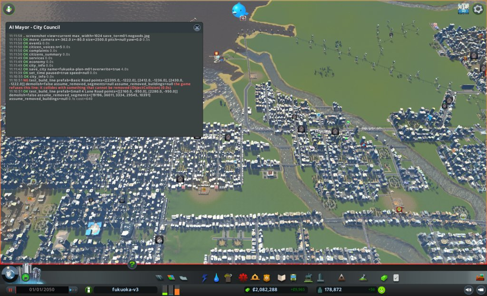

# 市政ノート

## 性格と公約と捨てるもの

市長の定義(mayors/plan.md)から写す。任期中は書き換えない。

- 性格: なし。判断の型(`protocol.md`)と、市の計画にだけ従う。自分で施策を考えず、局の案から選ぶ。毎月の編成方針で、市の計画の施策から重点を3つまで選ぶ(公約の進み具合と、目標から遠い施策を見る)
- 公約:
  1. 人口を毎月増やす(`city_info` の population。毎月の月例で、前の月例より増えていること)
  2. 電気・水・下水が来ない市民をなくす(`citizens_summary` の電気・水・下水が来ない市民の数。任期の終わりに0)
  3. 赤字を続けない(`city_info` の週の収支。毎月の月例で、2回続けて赤字にしない)
- 捨てるもの: なし
- 任期: 12か月

## 申し送り(前の運営から)

なし

## 数字の表

月例と見回りのたびに1行足す。区切りは 月例・見回り・臨時。

| ゲーム内の日付 | 区切り | 人口 | 所持金 | 週の収支 | 幸福度 | 需要(住/商/工) | 失業 | 主な困りごと |
|---|---|---|---|---|---|---|---|---|
| 2050-01-01 | 月例 | 178,872 | 2,082,287 | +9,965 | 85 | 23 / 2 / 60 | 6,584 | 品物がない 228、死体 52、汚染 32、ごみ 15 |
| 2050-01-11 | 見回り | 178,784 | 2,092,313 | +9,753 | 85 | 23 / 2 / 59 | - | 来ない市民 0/0/0。つぶやき3件(困りごとなし)。境目に当たらない |
| 2050-01-21 | 見回り | 178,645 | 2,107,463 | +10,823 | 85 | 23 / 2 / 59 | - | 来ない市民 0/0/0。つぶやき0件。境目に当たらない |

## 施策の一覧

施策を打つたびに1行足す(臨時も含む)。答え合わせの列は、翌月の月例で埋める。
分野は、港・働き口・住宅・暮らし・環境・財政から1つ選ぶ。
元の局は英字の名前(urban など)。議決は 要らない / 可決 / 否決。施策の id は m<月2桁>-<番号>(市役所と議会のハーネス、#100)。

| ゲーム内の日付 | 区切り | 施策の id | 施策 | 元の局 | 市の計画の施策 | 議決 | 分野 | 公約 | 建設費 | 週の維持費の増分 | 答え合わせ |
|---|---|---|---|---|---|---|---|---|---|---|---|
| 2050-01-01 | 月例 | m01-1 | z=-950 の細い3区間を4車線に直す(試し) | roads | 6-3 | 可決(取り壊し) | 暮らし | 3 | 80 | 数円 | |
| 2050-01-01 | 月例 | m01-2 | 満杯の埋立地3か所を止める(試し) | health | 4-3 | 要らない | 環境 | 3 | 0 | 約-480 | |
| 2050-01-01 | 月例 | m01-3 | 高密度住宅街に遊び場3か所 | urban | 4-2 | 要らない | 住宅 | なし | 3,750 | +72 | |

## 分からないことの一覧

効き目や原因が分からないことを1行に1つ書く(`protocol.md` の3)。確かめ終えても消さず、結果を埋める。

| 書いた日 | 分からないこと | 確かめた試し | 結果 |
|---|---|---|---|
| 2050-01-01 | 貨物駅 28755(3449, -1555)の敷地の中でトラック492台が止まる原因は分からない。同じ場所の貨物駅 13893 など9か所は出入り0台 | まだ | |
| 2050-01-01 | 品物がない店228棟と高密度商業の放棄114棟が、貨物駅の詰まりから来るのかは分からない(品物は輸入904台・街の中427台、止まった507台) | まだ | |
| 2050-01-01 | 汚染の印32棟が、満杯の埋立地の稼働から出るのか、地面に残った汚染なのかは分からない | m01-2(3か所を止める) | |

## 判断の記録

### 2050-01-01 月例(1か月目)

保存: `fukuoka-plan-m01`(同じ月のやり直しのため上書き)。

#### 答え合わせ

なし(初回)。

- 前回の「次にやること」: なし(初回)
- 公約の進み具合
  1. 人口: 178,872。来月の月例で、これより増えていること。住宅の需要は23、空き家は4,935戸。大学卒の失業が7,720人と多く、働き口が増えないと住宅の需要は上がりにくい
  2. 電気・水・下水が来ない市民: 0 / 0 / 0。任期の終わりまで0を保つ。水の使用は容量の80%(1,925,008 / 2,400,000)、下水も80%で、余裕は小さくなっている
  3. 週の収支: +9,965(収入342,140、支出332,175)。黒字だが、収入の3%しかない

#### 市の計画の今の数字

| 施策 | 今の値 | 目標 |
|---|---|---|
| 1-2 健康の平均 | 78 | 80以上 |
| 2-3 小学校の定員 / 子ども、高校の定員 / 10代 | 14,268 / 11,344、24,360 / 22,372 | 定員が上を保つ |
| 3-3 電気・水・下水が来ない市民 | 0 / 0 / 0 | 0を保つ |
| 3-4 火事と犯罪の印 | 4 + 3 = 7 | 4以下 |
| 4-1 高密度住宅の地価 | 58 | 62以上 |
| 4-2 公園など | 81 | 100以上 |
| 4-3 汚染の印 | 32 | 15以下 |
| 4-4 ごみの印 | 15 | 0 |
| 6-1 事務所のレベル3 | 3,227 | 3,500以上 |
| 6-3 交通の流れ | 51% | 60%以上 |
| 5-1、5-2 今いる観光客 | 1,646 | 2,000以上 |
| 6-4、7-1 働き口 | 86,175 | 90,000以上 |
| 6-4、7-1 品物がない店 / 原料がない工場 | 228 / 24 | 120以下 / 15以下 |
| 8-1 駅・港の敷地の中で止まったトラック | 506(貨物駅28755 が492) | 250以下 |

#### 気づいたこと

- 貨物駅28755(3449, -1555)の敷地の中で、トラック492台が止まっている。そばの貨物駅9か所は出入り0台。品物の止まったトラックは507台で、品物がない店228棟、高密度商業の放棄114棟と並んでいる
- 失業6,584人のうち、ほぼ全部が大学卒(需要の数えで7,720人)。空いた働き口は3,215。住宅の需要が23にとどまるのは、この失業のため
- 交通の流れは51%、進めない車1,008台。止まる場所は(2309, -925)、(-726, -736)、(2100, 309)。埋立地7つが満杯で、死体の印が52棟((2240, 186)に27棟)

#### 画面写真



#### 施策(まとめる段で書いた。結果は実行する市長が書く)

議案は `council/m01-bill.md`。

##### m01-1 z=-950 の細い3区間を4車線に直す(roads、取り壊しの議決、試し)

- 公約: 3(費用ほぼ0)。市の計画 6-3
- 理由: 渋滞の最多地点(2309, -925)61台のそばで、4車線の道が約80mだけ2車線に絞られる。試しの道具で通ることと、壊れる建物0を局が確かめた
- 予想: blockedSpots (2309, -925) が61台から、月末に40台以下。街全体の流れへの効きは見積もれない
- 操作: `remove_line` で区間36011を消す → `upgrade_road`(Small 4 Lane Road)で3334、19196 → `build_line` で継ぎ目を引き直す → `net_near` で確かめる
- 結果(実行する市長、2050-01-01):
  - 中止の条件の確認: `test_upgrade_road`(assume_removed_segments=[36011])は matched 3、upgraded 2、壊れる建物0。`test_build_line` は ok、費用80、重なる建物なし。中止に当たらない
  - 実行前の基準: `traffic(2309,-925,300)` は blocked 102、blockedSpots (2309,-925) 61台、(2086,-927) 22台、(2457,-947) 17台。街全体の flow 51%、blocked 1,008
  - `remove_line`: 成功、removedSegments 1
  - `upgrade_road`: 成功、matched 2、upgraded 2、壊れた建物0、費用0
  - `build_line`: 成功、snapped 2(両端とも node)、費用80
  - 確かめ: `net_near`(2228,-950 半径60)で、30995(2280→2236)、24089(2236→2220、18m)、7233(2220→2160)が Small 4 Lane Road で、node 5405 と 30823 でつながった。`zones_at`(半径80)で区画は残る。写真 `assets/m01-road-z950.jpg`
  - 建設費 80

##### m01-2 満杯の埋立地3か所を止める(health、議決要らない、試し)

- 公約: 3(週の支出を約480減らす)。市の計画 4-3
- 理由: 25590、25826、16914 は LandfillFull、100%、トラック0。汚染が最大の場所と重なる。止めても電気を失う建物0(`preview_bulldoze`)
- 予想: 3か所の周りの汚染の印13棟が、30日目に減る。全体32→19は上限。働き手およそ60人が職を失う
- 操作: `set_building_active(id, active=False)` を3回
- 結果(実行する市長、2050-01-01):
  - 中止の条件の確認: 3棟とも LandfillFull、storage 8,000,000 / 8,000,000(100%)、トラック 0 / 19。働き手は25590が19、25826が20、16914が19。中止に当たらない
  - 実行前の基準: `complaints` の Pollution 32(hotspot (3882,-296) 16棟)。`buildings_near(3900,-575,700,Pollution)` は13棟(議案の8と違う。今日の値を基準にする)。`map_layer(pollution, 3900,-450,600,n=13)` は average 67、max 255
  - `set_building_active` を25590、25826、16914 に active=False で3回。どれも ok
  - 建設費 0

##### m01-3 高密度住宅街の空き地3か所に遊び場を置く(urban、議決要らない)

- 公約: なし(市の計画 4-2)。週72は m01-2 の減りで吸収する
- 理由: 公園など81→目標100。取り壊し0で道路に面する3か所を局が確かめた
- 予想: 公園などが実行直後に84。地価の効きは見積もれない
- 操作: `place_building("Regular Playground", x=-535/-430/-330, z=-822, facing="south")`
- 結果(実行する市長、2050-01-01):
  - 中止の条件の確認: `test_place_building` を3回。どれも ok、取り壊し0、入口の道路あり(32233、11125、29857、距離1)
  - 実行前の基準: `buildings_near`(Beautification、半径10000)total 81。`land_value(-430,-822,150)` average 46
  - `place_building`: 3棟とも成功。id 45634(-535)、33163(-430)、7280(-330)。入口の道路あり、取り壊し0、費用1,250ずつ
  - 確かめ: `buildings_near`(Beautification)total 84。写真 `assets/m01-playgrounds.jpg`
  - 建設費 3,750

##### 調査

- s01-1(port): 貨物駅28755の止まり方の時間変化
- s01-2(health): 死体の印が(2240, 186)に集まる理由
- s01-3(fire): 火事の印が残る理由

##### 考えたが打たなかった手

- fire の警察署(2400, 850): 高層住宅8550と店14901が壊れ、戻せない。失う家と住民の数が示されず、公約1を下げるおそれがある
- economy と roads の調査: s01-1 と m01-1 の測り方と重なる

##### 実行と見回りの記録(実行する市長)

- 打てた施策: m01-1、m01-2、m01-3(3件とも全部の対象を実行)。打てなかった施策: なし。建設費の合計 3,830
- hooks に止められた手: なし。臨時: なし(見回り2回とも境目に当たらない)。ダイアログ: なし(dialogSeq 142 のまま)
- 調査 s01-1、s01-2、s01-3 は、見回り1・見回り2・月末の3回を `council/m01-survey-port.md`、`m01-survey-health.md`、`m01-survey-fire.md` に書いた
- s01-3 の `buildings_near(problem="Fire")` は、3回とも total 0 だった。同じ日の `complaints` は Fire 4〜6棟を返した。道具の引数は議案どおりで変えていない
- 月末(2050-01-31)に、議案の「確認する道具」で測った値(答え合わせは次の月例で行う)
  - m01-1: `traffic(2309,-925,300)` は blocked 29(前 102)、blockedSpots は (2075,-951) 23、(2083,-751) 3、(2225,-700) 2、(2259,-945) 1。(2309,-925) の地点は一覧に出ない。街全体の flow 53%(この円の戻り値の flow)
  - m01-2: `buildings_near(3900,-575,700,Pollution)` は18棟(前 13)。`complaints` の Pollution 43(前 32)、hotspot (3807,-254) 21棟
  - m01-3: 公園など84(実行直後)。地価は月末に測っていない
  - `city_info`: 人口 178,804、所持金 2,121,287、週の収支 +9,951、幸福度 85、観光客 1,708、来ない市民 0/0/0
- 分からないことの一覧に足す候補(次の月例で市長が決める): 埋立地3か所を止めた後も、周りの汚染の印が13→18棟、全体32→43に増えた理由

##### 次にやること

- 次の月例で、m01-1 の blockedSpots を同じ引数で答え合わせする。(2309,-925) が消え、(2075,-951) 23台が出た。詰まりが西の交差点 (2160,-950) の先へ移ったかを見る(`traffic(x=2309, z=-925, radius=300)` と `traffic(x=2100, z=-950, radius=200)`、2月の月例で)
- 次の月例で、m01-2 を答え合わせする。止めた埋立地の周りで汚染の印が増えた。外れなら、議案の不確かな点どおり焼却場2267(3604,-30)の側を局に調べてもらう。戻す条件(満杯でない埋立地の使用が90%超)は `services` の garbage で確かめる(2月の月例の3番目)
- m01-3 の地価 `land_value(x=-430, z=-822, radius=150)`(前 46)を2月の月例で測る

##### 記録

- 分からないことの一覧の2項目(貨物駅28755)を直接確かめる試しの案は、どの局からも出なかった。いちばん近い m01-1 を試しとして採り、一覧の1行目は調査 s01-1 で追う
- 案なしの局(port、economy、education)の理由は、原因が分からない・目標を満たしているで、局の役割から外れていない

#### 見たもの

(実行と見回りの段で呼んだ道具)

- `city_info`: 2050-01-01 人口178,872、週+9,965。01-11 人口178,784、週+9,753。01-21 人口178,645、週+10,823。01-31 人口178,804、週+9,951。幸福度は4回とも85、来ない市民0/0/0
- `test_upgrade_road`: matched 3、upgraded 2(36011は TooShort)、壊れる建物0
- `test_build_line`: ok、費用80、重なる建物なし
- `traffic`: (2309,-925,300) は実行前 blocked 102・地点61台、月末 blocked 29・地点なし。街全体 flow 51%→53%
- `remove_line`: removedSegments 1
- `upgrade_road`: upgraded 2、費用0
- `build_line`: snapped 2、費用80
- `net_near`: 30995、24089、7233 が Small 4 Lane Road でつながる
- `zones_at`: (2228,-950) 半径80 で区画は残る
- `complaints`: Pollution 32→40→46→43、Death 52→56→53→40、Fire 4→6→4→4
- `buildings_near`: 埋立地3棟は満杯100%・トラック0。汚染の印(3900,-575,700)は13→18棟。公園など81→84
- `map_layer`: pollution (3900,-450,600) average 67、max 255(実行前)
- `set_building_active`: 25590、25826、16914 を止めた
- `test_place_building`: 3か所とも ok、取り壊し0
- `place_building`: 45634、33163、7280。費用1,250ずつ
- `land_value`: (-430,-822,150) average 46(実行前)
- `events`: 見回り1は3件(困りごとなし)、見回り2は0件
- `vehicles_stuck`、`cargo`: 調査 s01-1、s01-2 の欄に書いた

#### 判断の根拠

3件とも、議案の中止の条件(試しの道具の ok、満杯100%とトラック0、取り壊し0と入口の道路)を最終確認で満たしたので、計画どおりの引数で打った。見回り2回とも、所持金・収支・人口・幸福度・来ない市民・つぶやき・ダイアログのどの境目にも当たらなかったので、臨時は行わなかった。

#### 捨てたもの

- 汚染の印が増えたのを見て、埋立地を動かし直すこと: 戻す条件は満杯でない埋立地の使用90%超で、汚染の増えは条件に入っていない。答え合わせは次の月例に回す
- 議案の汚染の基準(8棟)をそのまま使うこと: 実行前に同じ引数で測ると13棟だったので、今日の値を基準にした

## 人が手を入れたこと

- 2050-01-01(親): 5回目の運営。1〜4回目は `attempt1/`〜`attempt4/` に移した。人の判断で、壊してから建てる工事を試せるようにしてから、最初からやり直す。直した中身は `council-design.md` の12.3。部品は main の 4c66e0c(PR #119)で固めた
- 2050-01-01(親): 4回目から変えたこと
  - 試しの道具(`test_upgrade_road`、`test_build_line`、`test_place_building`)に、壊す相手を渡す引数(`assume_removed_segments`、`assume_removed_buildings`)を足した。その相手とのぶつかりを除いて判定する。ゲームの判定そのものは変えない
  - 局の決まりに、壊してから建てる案は、壊す相手を渡して試すと書いた。どこを壊すかは教えない
  - 4回目までの直し(ぶつかった相手を返す、ゲームの判定を通す、試しの道具、打てなかった理由を台帳に残す)は、そのまま使う
- 比べへの影響: 基準の市長(#104)は、直す前の道具で12か月を終えた。市役所だけが、人と同じ制限で建て、試しの道具を持つ。比べるときに、この差を書く
- 2050-01-01(親): パネルの見出しを `AI Mayor - City Council` にした。録画は OBS でゲームの窓だけ(実時間 2026-10-26 11:11:18 から、`~/ai-mayor-recordings/council/`)。月ごとに止めて、次の月の初めに新しいファイルで始める。月例の前に定点の写真を4か所で撮った

## 公約の結果

1.
2.
3.

## 次の市長への申し送り

-

## 型から外れたこと

### 1か月目(check_council_month.py)

```
### 型から外れたことの確かめ(m01、check_council_month.py)

- 見た範囲: command-log.txt の 2026-10-26 11:10〜11:39(hooks の記録の時刻から)、道具の行 230
- 議会が可決した種類: 取り壊し
- 議決が要る道具の呼び出し: 1 回
- 議決のない呼び出し: 0 回
- 臨時(advance の後)の呼び出し: 0 回
- 許されていない Write: 0 件
- hooks の拒否: 0 回
```

## 費用

### 1か月目

- 合計: 1,010,160 トークン、道具の呼び出し 337 回

| 役 | モデル | トークン | 道具 | 分 |
|---|---|---|---|---|
| 見る m01(mayor-desk) | claude-opus-5-5 | 68,875 | 25 | 1.5 |
| 要領 m01(finance) | claude-sonnet-5-5 | 41,141 | 7 | 0.3 |
| 案 urban(urban) | claude-sonnet-5-5 | 101,525 | 52 | 2.7 |
| 案 roads(roads) | claude-sonnet-5-5 | 66,876 | 17 | 0.9 |
| 案 port(port) | claude-sonnet-5-5 | 86,971 | 21 | 1.0 |
| 案 economy(economy) | claude-sonnet-5-5 | 67,846 | 17 | 0.8 |
| 案 health(health) | claude-sonnet-5-5 | 95,566 | 20 | 1.5 |
| 案 education(education) | claude-sonnet-5-5 | 42,355 | 7 | 0.3 |
| 案 fire(fire) | claude-sonnet-5-5 | 79,299 | 34 | 1.4 |
| 査定 m01(finance) | claude-sonnet-5-5 | 48,729 | 9 | 0.4 |
| まとめ m01(mayor-desk) | claude-opus-5-5 | 86,402 | 20 | 2.6 |
| 議会 m01(assembly) | claude-opus-5-5 | 48,451 | 10 | 0.6 |
| 実行 m01(mayor-field) | claude-opus-5-5 | 176,124 | 98 | 10.7 |
