# 観光を最優先にしたAI市役所に、福岡を2年任せた

## 目的

やってみ太郎です。連載「AIは最高の市長になれるか」の続きです。

この連載では、Claude(AI)を Cities: Skylines(シティーズ・スカイライン。街を作るゲーム)の市長にしています。舞台は福岡です。

前回は、「AI市役所」と1人のAI市長に、同じ17.9万人の街を12か月ずつ任せて比べました。AI市役所は、8つの局が案を出し、市長が選び、議会が確かめる仕組みです。どのAIも subagent(サブエージェント。親のAIから呼ばれて、1つの仕事だけをするAI)です。

結果は、困りごとはAI市役所が多く減らし、人口とお金は1人の市長が勝ちました。

今回は、そのAI市役所に「観光」という方針を与えます。目的は、次の2つです。

- 前回見つかった弱点を直したAI市役所で、街を動かせるかを確かめる
- 市長が「観光を一番にする」と決めたら、観光客は増えるのかを確かめる

市の計画には、観光の目標を6つ置きました。

- 今いる観光客:1,646人 → 3,000人以上
- 観光の名所(ゲームの「モニュメント」。人を呼ぶ大きな建物):6棟 → 10棟以上
- 旅客の入口(駅・港・空港。街の外から観光客が入ってくる所):0 → 1つ以上
- 観光の週の収入、名所の訪問の数、場所の魅力(attractiveness)も、それぞれ上げる

## 前回のAI市役所の反省点

前回の記事の考察から、直したいことが4つありました。

**1つ目は、財政局がふるいになっていなかったことです。**
財政局は、局の案53件すべてに「可」を付けました。税の案を添える決まりもありましたが、12か月で一度も添えていません。1人の市長は事務所の税を上げて、週の収入を3万増やしていました。お金の差は、ここで開きました。

**2つ目は、「街全体」を持つ役がいなかったことです。**
どの局も、自分の担当の数字を良くする案を出します。人口を増やす担当も、街をどこへ連れていくかを決める担当もいません。市長は、局の案から選ぶだけでした。

**3つ目は、交通渋滞に決め手を打てなかったことです。**
いちばん詰まっていたのは、東西の大通りの「くびれ」でした。直すには、交差点を壊してまとめ直す工事が要ります。ところが局は、試しの道具で一度に確かめられる、小さな工事ばかりを選びました。

**4つ目は、市長が1か月に3件しか採れなかったことです。**
局は1か月に1件しか案を出せず、市長は3件までしか採れません。採られなかった案は、翌月に回ります。人の役所の「来年度の予算で」と同じ光景でした。

3つ目は、このテーマの前の2回で道具を直しました。「この道を壊したものとして試す」「地形をならしたものとして試す」ができるようになり、道路下水道局は、くびれを壊してから4車線に引き直せました。止まっていた車は、73台から4台になりました。

残りは、市役所の仕組みそのものを直すことにしました。

### 一度、12か月をボツにした

じつは、最初は小さな直しだけで12か月を回しました。市長の公約に観光を足し、局が出せる案を5件にし、市長が採る件数の上限を外した版です。

結果は、観光客が1,646人から1,584人に減りました。局は、名所、公園、広場、遊び場、空き家の取り壊しの5種類を試しましたが、どれも観光客を動かしませんでした。

記録を読み返すと、局は長期の見通しを持たず、毎月その場で案を考えていました。財政局は前回と同じく値段を確かめる役のままで、市の目標には幸福度(市民の満足の目安)も入っていました。

この12か月は、ボツにしました。そして、仕組みを次のように決め直しました。

- 税の案は財政局が持ち、他の7つの局と同じ「案を出す局」にする
- お金のチェックは、議会が受け持つ
- 幸福度は、施策の結果なので、目標にしない
- 各局が自分の長期計画を持ち、毎月の案はその計画に沿わせる

前回の反省と、今回の直し方を並べると、こうなります。

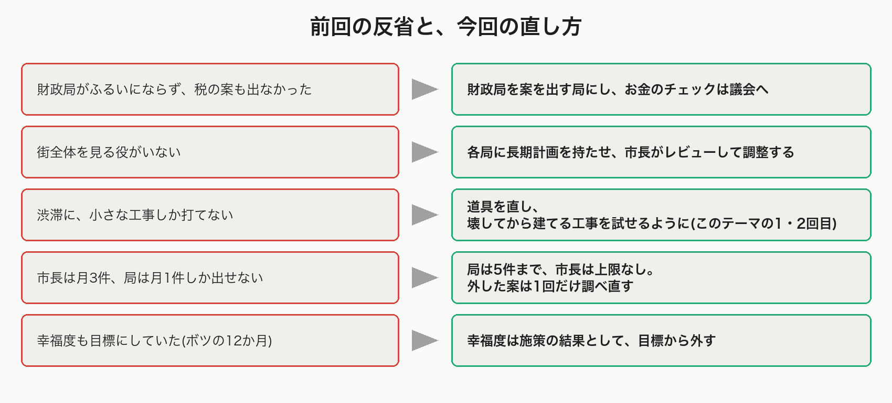

## 新しいAI市役所ハーネスの構造

「ハーネス」は、AIを動かす枠組みのことです。1か月の段ごとに、前回と今回を並べました。

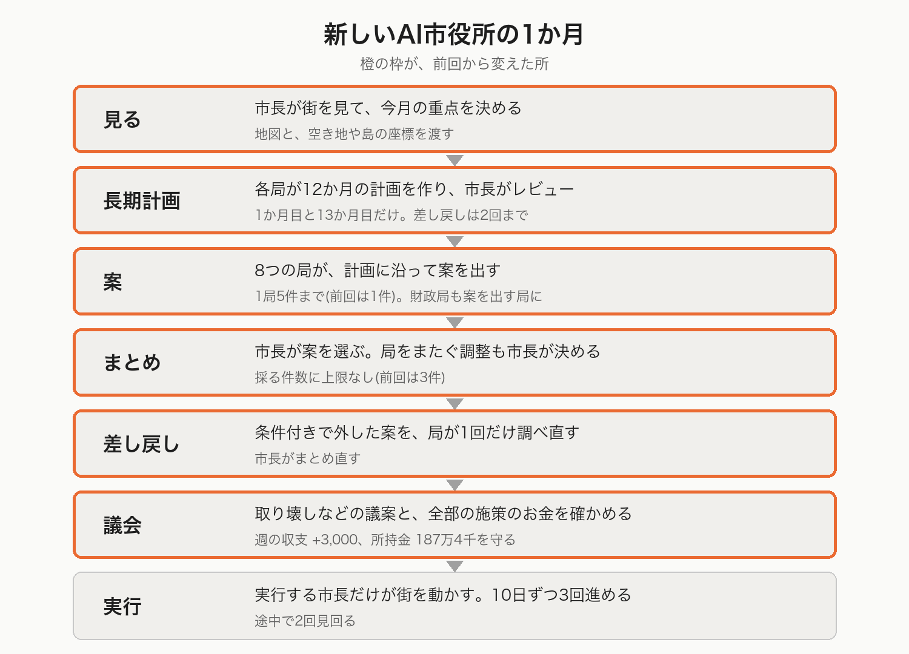

印の意味は、次のとおりです。

- 【新】新しく足した段や仕組み
- 【変】前回からある段の、中身を変えた
- 【廃】前回からある段を、やめた
- 【そのまま】前回と同じ

### 【新】見る段で、地図と座標を渡す

市長が街を見て、今月の重点を決める流れは、前回と同じです。
新しく足したのは、地図です。市長と局は、ゲームの画面を見られません。道具で数字を読むだけです。そこで、地形を測って、空き地や島の座標を書き込んだ地図を、前もって渡しました。

### 【新】長期計画

前回の局は、毎月その場で案を考えていました。そこで、各局に12か月の計画を持たせました。
1か月目に、8つの局がそれぞれ、目標、事業、月ごとの予定、やめる条件を書きます。市長が計画をレビューし、直す所があれば差し戻します。差し戻しは2回までです。

ここで1つ、問題が出ました。局は他の局の計画を読めません。たとえば「駅に道を引くのは道路下水道局か、港湾空港局か」を、局どうしの往復では決められないのです。そこで、局をまたぐ調整は、市長が1回でまとめて決めることにしました。1か月目のレビューは、これで6回から3回に減りました。

### 【変】案は1局5件まで。財政局も案を出す

前回は、7つの局が1件ずつ案を出しました。今回は、8つの局が5件まで出せます。
財政局は、税・予算・政策(ゲームの「条例」のような設定)の案を出す局になりました。ほかの7局と同じ立場です。
原因が分からない問題に、案の代わりに「調査」を出せる仕組みは【そのまま】です。

### 【廃】財政局の査定

前回は、財政局が案ごとに「可」「減額」「不可」を付けていました。53件すべてが「可」で、ふるいになっていませんでした。この段はやめ、お金のチェックは議会に移しました。

### 【変】まとめは件数の上限なし。局をまたぐ調整も市長が決める

前回の市長は、月に3件まで選べました。今回は上限がありません。そのかわり、局をまたぐ調整を、市長が決めます。

### 【新】差し戻し

前回は、外された案は翌月に出し直すしかありませんでした。今回は、市長が「条件がそろえば採る」と外した案を、局が同じ月のうちに1回だけ調べ直します。条件がそろえば、市長がまとめ直します。

### 【変】議会は、全部の施策をお金の目で確かめる

取り壊し・予算・税・融資の議案を4つの点で確かめるのは、前回と同じです。
加えて、すべての施策を「財政」の点で確かめます。守る線は、週の収支が+3,000以上、所持金が187万4千以上です。

### 【そのまま】実行

街を動かせるのは、実行する市長だけです。ほかの役は、道具で見ることと試すことしかできません。10日ずつ3回時間を進め、途中で2回見回ります。これは前回と同じです。

### 役とモデル

- 8つの局(案を出す):Haiku 5.5
- 見てまとめる市長、実行する市長、議会:Sonnet 5.5

観光の担当は2つの局です。経済観光文化局が名所を、港湾空港局が旅客の入口を受け持ちます。

## 2年間の実施と結果

12か月を回したあと、もう12か月続けました。13か月目に、各局が長期計画を作り直しています。録画は OBS(画面を録画するソフト)で、月ごとに1本撮りました。

まず、24か月の観光客と人口です。

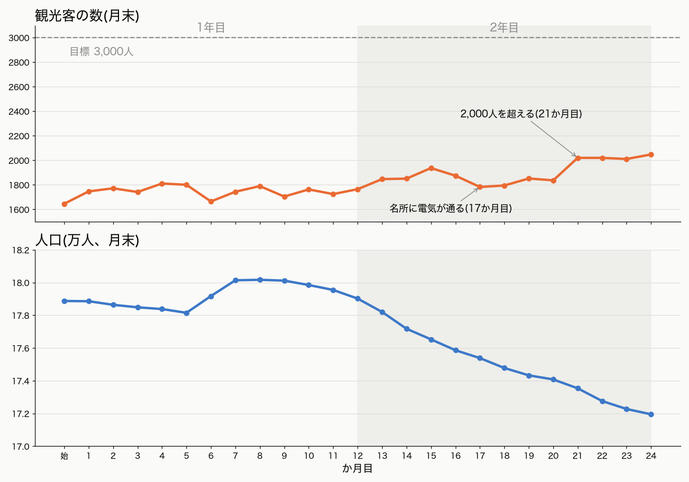

### AI市役所が立てた長期計画

運営の中身に入る前に、AI市役所が立てた長期計画を紹介します。

長期計画は、1か月目と13か月目に作りました。各局の計画は2,000字までで、書くことは4つです。

- 目標:担当の数字を、12か月後にいくつにするか
- 事業:目標のために何をするか。3つまで
- 月ごとの予定:どの月に、どの事業を進めるか
- やめる条件:どうなったら、その事業を閉じるか

局が書いた計画を、市長がレビューします。1か月目は、8局のうち6局が「要是正」でした。指摘は、たとえばこんなものです。

- 住宅都市みどり局へ:公園を100か所以上にするには、約19か所が要る。予定には約9か所しかない
- 道路下水道局へ:島の中の道が、坂で断られたままになっている。2か月目の試しで道・風力・名所がそろうまで、橋を引かないこと
- 港湾空港局へ:駅の第一候補は、道・水・下水がなく、試しも断られた。港など、代わりの入口を並べること

差し戻しを2回して、レビューは3回で終わりました。市長が決めた局をまたぐ調整は14件です。

市長は、8局の計画を1つの「市の長期計画」にまとめます。1年目の観光は、4本の事業になりました。

- 名所を置く:1か月目に2棟、2〜4か月目と6か月目に1棟ずつ
- 旅客の駅を作る:3か月目に前倒しを試す
- 島Bを開く:2か月目に試し、5か月目に橋と風力、8か月目に名所
- 品物がない店を減らす

順番も決めました。島Bは「道路下水道局が試す → 橋と風力を引く → 経済観光文化局に渡す → 名所を置く」の順です。試しが通らなければ、橋は引きません。

お金の枠も、計画に書かれています。建設費の累計の上限は、20万に1か月あたり3万を足した額です。週の維持費の増えは、余裕の6,965に収まる月だけにしました。

13か月目には、計画を作り直しました。このときも差し戻しが2回あり、調整は10件から始まって、24か月目までに27件に増えています。
市長はレビューで、観光についてこう書いています。

> 入口は第16月までに置けないおそれが高いので、経済観光文化局は、入口なしで Tourism と訪問を伸ばす事業を持つこと

市長は、入口が置けない見通しを、この時点で持っていました。

計画は、月ごとに書き換えられます。前提が外れると、局は「計画の変更」に理由を書き、事業を直すか閉じます。観光に関わる事業の予定と実際を並べると、こうなります。

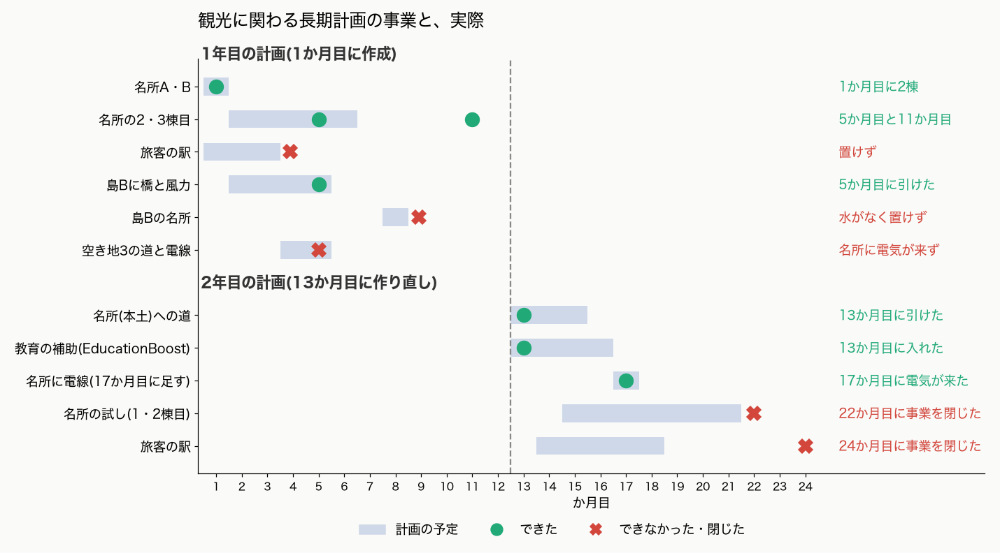

1年目は、名所と島Bの橋は予定どおり進みました。駅と島Bの名所は、置けませんでした。
2年目は、名所への道と教育の補助は予定どおりでした。名所の試しと駅は、予定の月を過ぎても進まず、局が自分で事業を閉じました。

### 1年目:名所は10棟、入口は0

観光の場所と、24か月の結果を地図にまとめました。

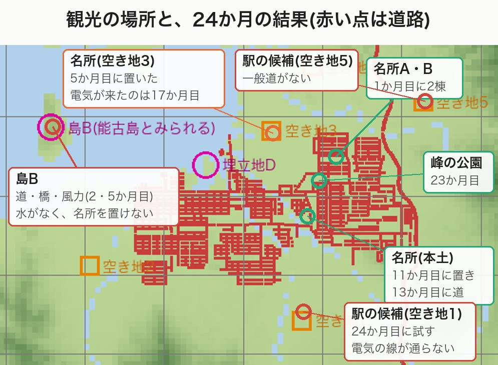

名所は順調でした。1か月目に2棟、5か月目に空き地3に1棟、11か月目に本土に1棟。6棟が10棟になり、目標に届きました。

ただし、空き地3の名所には、電気が来ませんでした。敷地まで電線が届かず、訪問者は週2人、観光客は0人です。電気が通ったのは、1年後の17か月目でした。

入口は、うまくいきませんでした。港湾空港局は、駅と港をほぼ毎月試し、すべてゲームに断られました。断られた理由は4つです。

- 線路の坂がきつすぎる
- 道・水・下水が届かない
- 岸が高すぎて、港が置けない
- すでにある建物と重なる

港湾空港局は6か月目に港の事業を閉じ、場所を変えて試し直しました。それでも置けませんでした。

1年目の終わりの観光客は1,765人。名所を4棟増やしても、119人しか増えませんでした。

### 能古島のような島

画面の中央の海に、能古島のような島があります。地図の上では「島B」と呼びました。

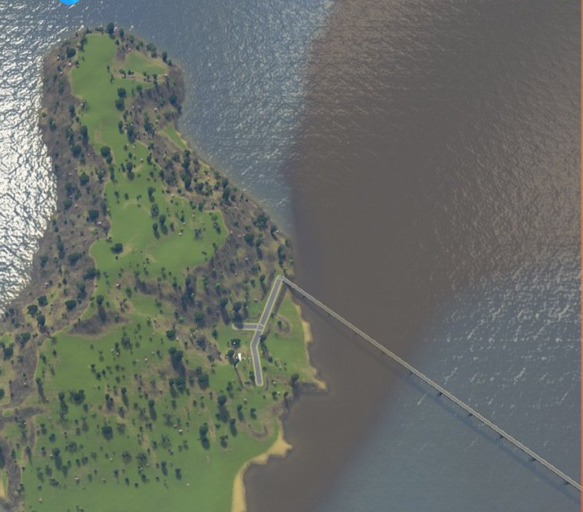

局は、ここを観光の島にしようとしました。2か月目に道を、5か月目に橋と風力発電と送電線を引きました。でも、名所は置けませんでした。島に、水が来ていなかったからです。

AI市役所は、水がないことに気づいていました。2年目には、港湾空港局が「島Bは水が届かない」と書き、本土からの水管を試しで通しています。それでも、水は最後まで引かれませんでした。その理由は、考察で掘り下げます。

### 2年目:観光の案が減った

2年目は、作り直した長期計画で始まりました。市長が決めた調整には、たとえば「名所への道は道路下水道局が引き、経済観光文化局が訪問者を測って渡す」「駅が16か月目までに置けないと決まったら、入口なしで名所を伸ばす計画に直す」といった決めです。

17か月目に、名所の1つに送電線がつながりました。それまで電気が来ていなかった名所です。観光客は21か月目に2,020人になり、初めて2,000人を超えました。

一方で、経済観光文化局は、だんだん案を出さなくなりました。2年目の12か月のうち8か月が「案なし」です。22か月目には、名所を増やす事業を閉じました。理由は2つです。

- 候補の5か所が、どれも道路や住宅、働き口と重なる
- まだ建てていない名所は、いちばん安いものでも維持費が週960。計画で決めた上限の週320を超える

24か月目に、局は上限を外しました。それでも、道に面した空き地は市全体で17マスしかなく、置ける場所は見つかりませんでした。

24か月目には、旅客の入口の事業も閉じました。港湾空港局は最後の月、新しい空き地で駅を試しました。道と水は試しで通りましたが、電気の線が川と既存の道に当たり、通りませんでした。

採った施策を、市の計画のどの分野に向けた手かで分けると、こうなります。

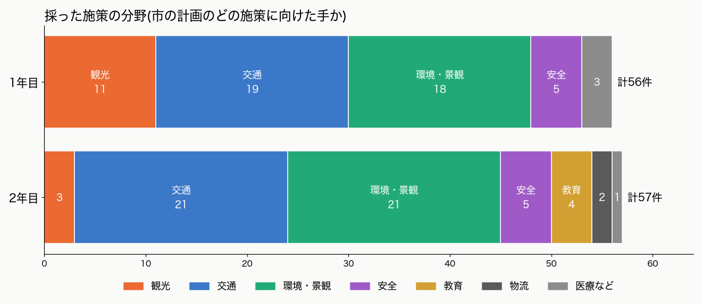

観光に向けた手は、1年目の11件から、2年目は3件に減りました。2年目の3件は、名所への道、名所への送電線、峰の近くの公園です。残りの多くは、信号、道の車線を増やす工事、埋立地、景観の公園でした。

### 2年後の数字

2年目の終わり(ゲームの中の2052年1月1日)に、観光の目標にどこまで届いたかです。

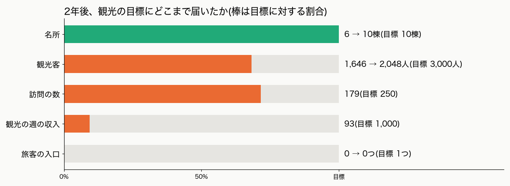

目標に届いたのは、名所の数だけでした。観光の週の収入は、目標の1割にも届いていません。

観光のほかの数字は、こうなりました。

- 人口:178,872人 → 171,949人。16か月続けて減った
- 所持金:208万 → 272万。週の収支は+4,298で、黒字を保った
- 景観(Beautification):87 → 99(目標100)

24か月で、施策は113件採られ、議会の否決は0件でした。使ったトークン(AIが読み書きする文字の単位)は、1か月に約140万〜280万です。

## 考察

観光が進まなかった理由を、ハーネスの構造から掘り下げます。

先に結論を書きます。今のハーネスは、「1つの局が、1か月で、試しの道具で通せる1回の手」を回す形でした。観光の入口や島の開発は、いくつもの局と月と工程にまたがる「事業」です。この形に、乗りませんでした。

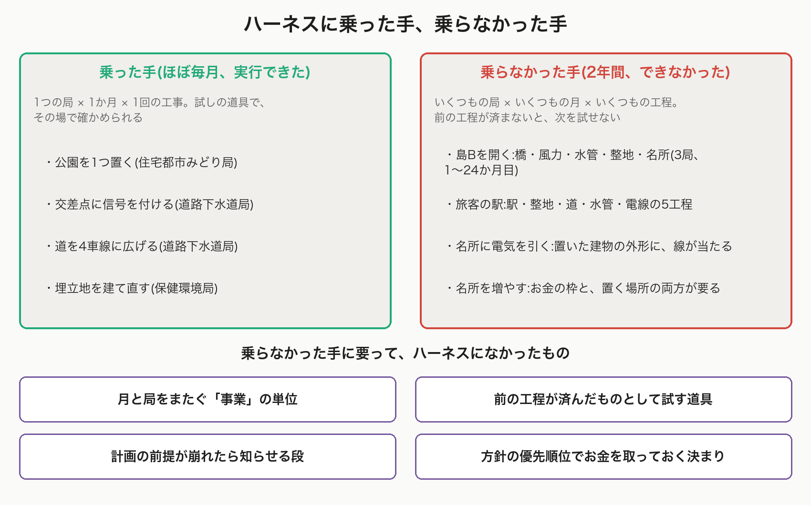

公園、信号、車線を増やす工事は、2年間ほぼ毎月実行できました。乗らなかった手は、原因を5つに分けられます。

### 原因1:実行の単位が「今月、試しで通った1回の手」だった

局は、試しの道具で通った手だけを案にします。市長は、通っていない手を条件付きで外し、局は同じ月に1回だけ調べ直せます。

島Bの駅の案は、駅、整地(地面をならすこと)、道、水管、電線の5つの工程を1つにまとめたものでした。建設費は51,840です。水管と電線は、15か月目に試しで通りました。整地は確かめが残りました。17か月目、市長は「整地の費用と、水管・電線の経路が未確認」として、条件付きで外しました。1回の調べ直しでは、条件はそろいませんでした。

道具も、同じ形でした。試しの道具は、今の街の状態で、1つずつ判定します。「さっき置いた建物があるもの」として、次の線を試すことはできません。

空き地3の名所が、その例です。5か月目に名所は置けました。でも、電気の支線が、置いたばかりの名所の敷地に当たって引けませんでした。電気が来たのは、12か月後の17か月目です。1年目の部分失敗8件のうち7件が、この「置いた建物に、あとの線が当たる」型でした。

### 原因2:計画の前提を、誰も見張っていなかった

島Bに水が来なかった、直接の原因です。

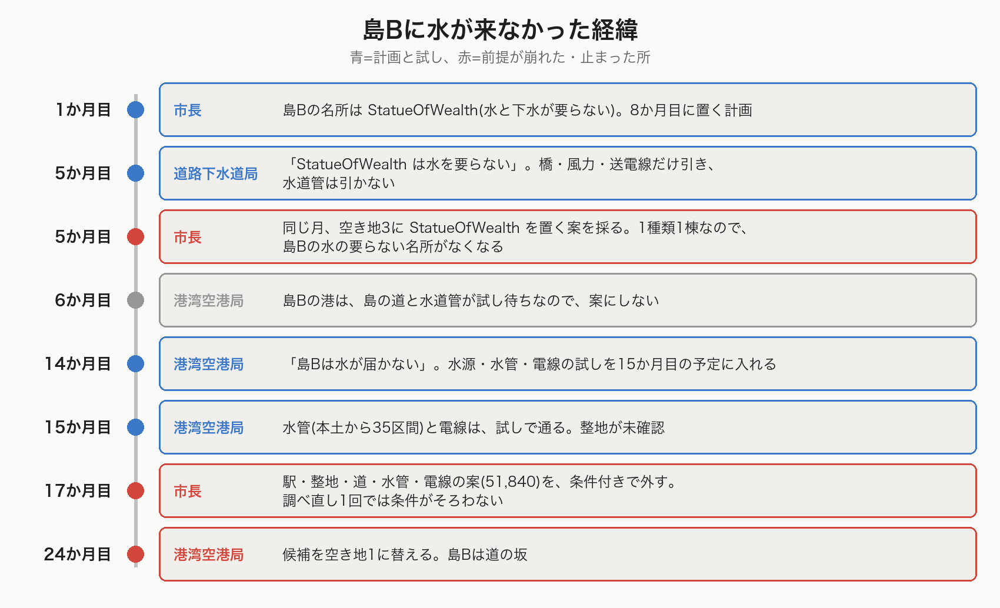

1か月目の計画では、島Bに StatueOfWealth を置く予定でした。水も下水も要らない、ただ1つの名所です。道路下水道局は、この前提で、5か月目に「水道管は引かない」と決めました。

同じ5か月目、市長は、経済観光文化局の「空き地3に StatueOfWealth を置く」案を採りました。名所は1種類につき1棟です。市長は議案に「通れば、島Bは別の種類に替える必要がある」と書いていました。前提が崩れることは、分かっていたのです。

でも、その先が続きませんでした。島Bの計画は、水の要らない名所を失い、水道管もないまま止まりました。局は、ほかの局の計画を読めません。市長の調整は、文章で書くだけです。「前提が崩れたら、関わる局の計画を見直させる」段が、ハーネスにはありませんでした。

### 原因3:観光の責任と、そのための手段が別の局にあった

観光の数字は、経済観光文化局(名所)と港湾空港局(入口)が持ちます。一方、水、電気、道、地形を動かす手段は、道路下水道局が持っています。局どうしの頼みごとは、市長の月1回の調整を通るしかありません。

島Bは、1か月目に計画し、5か月目に橋を引きました。その4か月の間に、原因2が起きています。

もう1つ、私たちが入れた決まりも効いていました。経済観光文化局の定義に、「入口は港湾空港局の担当。入口がないと、名所を増やしても観光客は増えにくい」と書いていたのです。これは、ボツにした12か月から私たちが立てた見立てです。経済観光文化局は、入口を港湾空港局に頼る形になりました。港湾空港局が止まると、経済観光文化局も手を失いました。

局ごとに、24か月の案を並べると、こうなります。

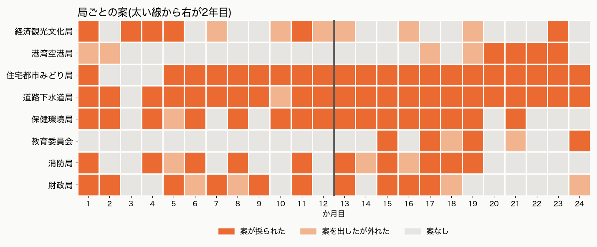

住宅都市みどり局と道路下水道局は、ほぼ毎月、案が採られています。自分の局だけで完結する手です。観光を受け持つ2つの局は、灰色の「案なし」が目立ちます。港湾空港局の案は2年目の後半に4か月続けて採られましたが、どれもバスと貨物の手で、入口の案ではありません。

### 原因4:お金の枠が、方針の優先順位で配られなかった

13か月目、財政局は、教育の補助の政策(EducationBoost)を案にしました。大学を出た人の失業を減らす手で、維持費は週7,940です。市長はこの補助を先に置き、残りの中で、名所は1棟、週320以下まで、と決めました。

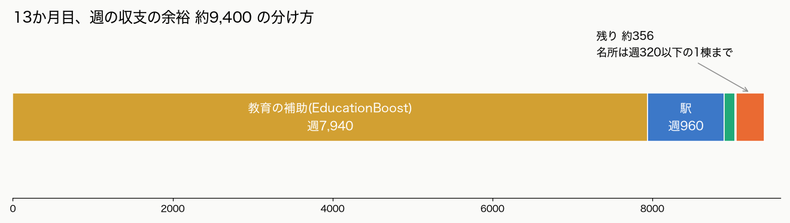

15か月目、港湾空港局は、島Bの駅(週960)を足すと、守る線までの余裕は約256しか残らないと見積もっています。22か月目、経済観光文化局は「残る名所はどれも週960以上で、上限を超える」として、名所の事業を閉じました。

「観光を一番に」は、市長の公約に書いてあります。でも、お金を配る決まりに、優先順位はありません。先に出た案から、枠が埋まりました。守る線と下降規則(3か月続けて下がったら、維持費の増える案を止める)は、維持費の大きい観光の事業ほど、通りにくくしました。

### 原因5:「案なし」に代償がなく、市長は案を作れない

局にとって、「案なし」はいつでも正しい答えです。続けても、何も起きません。経済観光文化局は、2年目の12か月のうち8か月が「案なし」でした。

市長のレビューは、計画の書き方を見ます。事業が進んでいるかは、見ません。そして市長は、局の案から選ぶだけです。局をまたぐ事業を、自分で立ち上げることはできません。

前回の考察で書いた「街全体を持つ役がいない」は、形を変えて残っていました。

### 5つの原因に共通すること

今のハーネスは、本物の市役所の予算査定(案 → 選ぶ → 議決 → 実行)をまねています。毎月、単発の施策を選ぶには向いていました。

観光に要ったのは、別の単位です。島を開くには、水、電気、道、名所を、何か月もかけて順に積み上げます。本物の市役所なら、局をまたぐプロジェクトチームと、何年かに分けて払う予算(債務負担行為)で扱う種類の仕事です。ハーネスには、次の4つがありませんでした。

- 月と局をまたぐ「事業」の単位
- 前の工程が済んだものとして試す道具
- 計画の前提が崩れたら知らせる段
- 方針の優先順位で、お金を取っておく決まり

### 直した仕組みは、働いた

一方で、前回の弱点は、いくつか直りました。

- **財政局が、税の案を出した。** 9か月目に事務所の税を3%から2%に下げ、働き口が増えるかを試しました。効かないと見て、11か月目に戻しています。政策の試しも、教育の補助、公共交通の無料化と続けました
- **守る線が、案を止めた。** 8か月目、財政局のリサイクルの政策は、ほかの施策の維持費を足すと週の収支が約+2,690になり、守る線の+3,000を割るとして、市長に外されました。2年間、週の収支は黒字のままでした
- **局をまたぐ調整が、決まるようになった。** 市長が1回でまとめて決めると、局は自分の計画に書き写して、その月から従いました

単発の手を、安全に、毎月回す力は上がりました。足りなかったのは、何か月もかけて積み上げる力です。

### 人口は、なぜ減ったか

人口は2年目に約7千人減りました。原因は、この記録では分かりません。

いくつかの数字が、同時に動いています。大学を出た人の失業は8,522人から834人に減り、住宅の需要は16から36に上がりました。家に住みたい人はいるのに、人口は減る。数字の並びだけでは、どれが原因か言えません。

前回と同じく、人口を担当する局はいません。

### 注意すること

今回は、どの条件も1回ずつしか回していません。直した仕組みを一度に入れたので、どの直しが効いたかも分けられません。傾向を見る記録です。

## 本テーマの終了

「AI市役所で福岡を観光都市にする」は、ここで終わりにします。

このテーマでは、3つのことをしました。

1. 試しの道具を直し、「壊してから建てる」工事を確かめられるようにした
2. 道路下水道局に、くびれの渋滞を解く工事をさせた
3. 観光を方針にした市役所に、2年間、街を任せた

最初に考えていたのは、「観光を一番にします」と言えば観光客は増える、ということでした。

2年たって分かったのは、方針を決めるだけでは足りないということです。AI市役所は、島に水がないことにも、入口が要ることにも気づいていました。でも、何か月もかけて、いくつもの局で積み上げる事業を、今のハーネスは回せませんでした。

AI市役所の仕組みは、前回より良くなりました。お金を守り、計画に沿って動き、局をまたぐ調整も決まります。単発の手を毎月回す力は、十分にあります。

残った宿題は、ハーネスの側にあります。

- 月と局をまたぐ「事業」を、ハーネスの単位にする
- 前の工程が済んだものとして試せる道具を足す
- 計画の前提が崩れたら、関わる局に知らせる
- 人口を担当する役を、市役所のどこに置くか決める

## YouTubeの動画の案内

2年分の運営は、月ごとに録画しています。この録画に実況を付けて、動画にまとめる予定です。

公開したら、ここに URL を入れます。

(動画の URL)

記録の全文は、リポジトリの `log.md` と、市政ノート(`mayor-note.md`)にあります。
