# 市政ノート

## 性格と公約と捨てるもの

- 性格: なし。判断の型(protocol.md)と市の計画にだけ従う
- 公約:
  1. 人口を毎月増やす(`city_info` の population。毎月の月例で、前の月例より増えていること)
  2. 電気・水・下水が来ない市民をなくす(`citizens_summary` の該当の数。任期の終わりに0)
  3. 赤字を続けない(`city_info` の週の収支。2回続けて赤字にしない)
  4. 観光客を増やし、観光で稼ぐ(`city_info` の tourists.now と、`economy_breakdown` の Tourism の週の収入。毎月、前の月例より増えていること)
- 捨てるもの: なし
- 任期: 12か月

## 申し送り(前の運営から)

なし(1か月目)

## 数字の表

| ゲーム内の日付 | 区切り | 人口 | 所持金 | 週の収支 | 幸福度 | 需要(住/商/工) | 失業 | 主な困りごと |
|---|---|---|---|---|---|---|---|---|
| 2050-01-01 | 月例 | 178,872 | 2,082,287 | +9,965 | 85 | 23 / 2 / 60 | 6,584(大卒が6,483) | 品物がない店228、交通の流れ51%、ごみ満杯の埋立地7 |
| 2050-01-31 | 月末(3回目の advance のあと) | 178,859 | 2,015,489 | +8,421(収入341,792、支出333,371。支出は新しい建物の維持費がまだ入っていない可能性) | 85 | 24 / 2 / 57 | - | 来ない市民 0/0/0、観光客1,747(訪問139)、Tourism 週42、品物がない店222、満杯の埋立地0(45892は空にする途中で94%) |
| 2050-01-21 | 見回り2 | 178,744 | 2,004,231 | +8,825(収入342,196、支出333,371) | 85 | 24 / 2 / 59 | - | 来ない市民 0/0/0、観光客1,730、品物がない店228。境目なし。events は0件。埋立地45892は95%でまだ空にしている途中 |
| 2050-01-11 | 見回り1 | 178,805 | 1,991,238 | +8,484(収入341,633、支出333,149) | 85 | 24 / 4 / 59 | - | 来ない市民 0/0/0、観光客1,669。境目なし。events は雑談3件 |
| 2050-01-31 | 月例(2か月目) | 178,859 | 2,015,489 | +8,421(収入341,792、支出333,371) | 85 | 24 / 2 / 57 | 6,144(大卒5,984) | 来ない市民 0/0/0、観光客1,747(訪問139)、Tourism 週42、品物がない店222、交通の流れ50%(止まった車990)、駅・港の敷地の止まったトラック493、汚染の印45、火事7、犯罪2、ごみ11、満杯の埋立地0 |
| 2050-03-02 | 月例(3か月目) | 178,639 | 2,074,074 | +12,912(収入344,486、支出331,574) | 85 | 24 / 2 / 58 | 5,987(大卒5,843) | 来ない市民 0/0/0、観光客1,772(訪問146)、Tourism 週66、品物がない店230、交通の流れ50%(止まった車832)、駅・港の敷地の止まったトラック504、汚染の印35、火事5、犯罪(crimeRate 5)、ごみ22、満杯の埋立地0、旅客の入口0 |

| 2050-03-12 | 見回り1(3か月目) | 178,450 | 2,086,309 | +8,581(収入346,774、支出338,193) | 85 | 24 / 2 / 58 | - | 来ない市民 0/0/0、観光客1,749、Tourism 74、attractiveness 平均2。境目なし(events は雑談2件) |
| 2050-03-22 | 見回り2(3か月目) | 178,525 | 2,097,125 | +7,396(収入345,612、支出338,216) | 85 | 24 / 2 / 58 | - | 来ない市民 0/0/0、観光客1,770、Tourism 68、attractiveness 平均2。境目なし(events は雑談1件) |
| 2050-04-01 | 月末(3か月目) | 178,486 | 2,110,220 | +9,303(収入347,484、支出338,181) | 85 | 23 / 2 / 58 | - | 来ない市民 0/0/0、観光客1,742(訪問139)、Tourism 58、attractiveness 平均2、品物がない店235、止まったトラック804(28755内517)、ごみ18、汚染35、火事8。境目なし |
| 2050-04-01 | 月例(4か月目) | 178,486 | 2,110,220 | +9,303(収入347,484、支出338,181) | 85 | 23 / 2 / 58 | 5,761(大卒5,667) | 来ない市民 0/0/0、観光客1,742(訪問139)、Tourism 週58、attractiveness 平均2、品物がない店235、交通の流れ53%(止まった車774)、駅・港の敷地の止まったトラック517、汚染の印35、火事8、犯罪1、ごみ18、満杯の埋立地2(157、25692)、旅客の入口0 |

| 2050-05-01 | 月例(5か月目) | 178,380 | 2,111,160 | +10,614(収入345,801、支出335,187) | 85 | 24 / 4 / 58 | 5,684(大卒5,584) | 来ない市民 0/0/0、観光客1,811(訪問138)、Tourism 週24、attractiveness 平均2、品物がない店239、交通の流れ54%(止まった車889)、駅・港の敷地の止まったトラック563(28755が539)、汚染の印29、火事6、犯罪1、ごみ14、満杯の埋立地0、旅客の入口0、健康79 |
| 2050-05-31 | 月例(6か月目) | 178,150 | 2,064,968 | +6,004(収入341,593、支出335,589) | 86 | 25 / 2 / 57 | 5,618(大卒5,507) | 来ない市民 0/0/0、観光客1,801(訪問133)、Tourism 週41、attractiveness 平均2、品物がない店257、交通の流れ51%(止まった車769)、駅・港の敷地の止まったトラック520(28755が500)、汚染の印26、火事6、犯罪2、ごみ17(満杯1: 48698)、旅客の入口0、健康79 |

| 2050-06-30 | 月例(7か月目) | 179,174 | 2,101,000 | +10,489(収入346,067、支出335,578) | 88 | 25 / 4 / 52 | 5,596(大卒5,508) | 来ない市民 0/0/0、観光客1,665(訪問141)、Tourism 週53、attractiveness 平均2、品物がない店255、交通の流れ54%(止まった車852)、駅・港の敷地の止まったトラック560(28755が550)、汚染の印23、火事3、犯罪1、ごみ8(満杯0)、旅客の入口0、健康89 |
| 2050-07-30 | 月例(8か月目) | 180,138 | 2,174,932 | +16,355 | 88 | 22 / 2 / 56 | 5,954(大卒5,954)。citizens_summary の unemployed 6,046 | 来ない市民 0/0/0、観光客1,744(訪問150)、Tourism 週32、attractiveness 平均2、品物がない店227、交通の流れ56%(止まった車944)、駅・港の敷地の止まったトラック518(28755が514)、汚染の印21、火事2、犯罪の印なし(crimeRate 5)、ごみ23(満杯0)、旅客の入口0、健康89 |
| 2050-08-09 | 見回り1(8か月目) | 180,015 | 2,179,078 | +15,509(収入342,682、支出327,173) | 88 | 21 / 2 / 61 | - | 来ない市民 0/0/0、観光客1,762(訪問153)。境目なし。events は雑談3件 |
| 2050-08-19 | 見回り2(8か月目) | 180,184 | 2,200,326 | +14,739(収入341,907、支出327,168) | 88 | 20 / 2 / 62 | - | 来ない市民 0/0/0、観光客1,798(訪問156)。境目なし。events は雑談1件(最も魅力的な街の賞) |
| 2050-08-29 | 月末(8か月目) | 180,168 | 2,221,745 | +14,880(収入342,068、支出327,188) | 88 | 20 / 4 / 62 | - | 来ない市民 0/0/0、観光客1,790(訪問156)、ごみ10、汚染37、Fire の印なし、品物がない店230、交通の流れ52%。境目なし |
| 2050-08-29 | 月例(9か月目) | 180,168 | 2,221,745 | +14,880(収入342,068、支出327,188) | 88 | 20 / 4 / 62 | 6,931(大卒6,849) | 来ない市民 0/0/0、観光客1,790(訪問156)、Tourism 週52、attractiveness 平均2、品物がない店230、交通の流れ52%(止まった車743)、駅・港の敷地の止まったトラック553(28755が532)、汚染の印37、火事なし、犯罪1、ごみ10(満杯0)、旅客の入口0、健康89 |
| 2050-11-07 | 月例(11か月目) | 179,848 | 2,313,772 | +10,680(収入335,847、支出325,167) | 89 | 14 / 2 / 66 | 8,432(大卒8,341) | 来ない市民 0/0/0、観光客1,763(訪問138)、Tourism 週27、attractiveness 平均2、品物がない店209、交通の流れ54%(止まった車723)、駅・港の敷地の止まったトラック580(28755が580)、汚染の印30、火事3、犯罪2、ごみ8(満杯0)、旅客の入口0、健康89、事務所L3 3,275 |
| 2050-10-08 | 月例(10か月目) | 180,117 | 2,270,429 | +8,997(収入336,274、支出327,277) | 89 | 17 / 2 / 63 | 8,401(大卒8,293) | 来ない市民 0/0/0、観光客1,705(訪問140)、Tourism 週42、attractiveness 平均2、品物がない店218、交通の流れ54%(止まった車815)、駅・港の敷地の止まったトラック540(28755が540)、汚染の印27、火事2、犯罪4、ごみ7(満杯0)、旅客の入口0、健康89、事務所L3 3,274 |
| 2050-12-07 | 月例(12か月目) | 179,547 | 2,358,955 | +13,509(収入339,215、支出325,706) | 88 | 16 / 2 / 66 | 8,524(大卒8,402) | 来ない市民 0/0/0、観光客1,725(訪問133)、Tourism 週42、attractiveness 平均2、品物がない店214、交通の流れ53%(止まった車957)、駅・港の敷地の止まったトラック626(28755が626)、汚染の印26、火事1、犯罪1、ごみ9(満杯3: 24569、29981、48698)、旅客の入口0、健康89、事務所L3 3,279、名所10棟 |
| 2051-01-06 | 月例(13か月目) | 179,020 | 2,411,252 | +12,404(収入338,057、支出325,653) | 88 | 16 / 4 / 66 | 8,636(大卒8,522) | 来ない市民 0/0/0、観光客1,765(訪問132)、Tourism 週28、attractiveness 平均2、品物がない店240、交通の流れ54%(止まった車524)、駅・港の敷地の止まったトラック611(28755が611)、汚染の印29、火事3、犯罪1、ごみ12(満杯0)、旅客の入口0、健康89、事務所L3 3,279、名所10棟、Beautification 87 |
| 2051-02-05 | 月例(14か月目) | 178,202 | 2,419,253 | +3,922(収入338,692、支出334,770。EducationBoost 週7,940が入った) | 88 | 19 / 2 / 61 | 7,403(大卒7,279)。demand_breakdown の大卒 unemployed 8,506 | 来ない市民 0/0/0、観光客1,847(訪問143)、Tourism 週49、attractiveness 平均2(最大24)、品物がない店272、原料がない工場45、交通の流れ52%(止まった車873)、駅・港の敷地の止まったトラック621(28755が602)、汚染の印18、火事0、犯罪3、ごみ14(満杯0)、旅客の入口0、健康89、事務所L3 3,280、名所10棟、Beautification 88、住宅(高)地価60 |
| 2051-03-07 | 月例(15か月目) | 177,176 | 2,433,116 | +4,256(収入339,306、支出335,050) | 88 | 21 / 4 / 59 | 6,065(大卒5,957)。demand_breakdown の大卒 unemployed 7,229 | 来ない市民 0/0/0、観光客1,851(訪問148)、Tourism 週37、attractiveness 平均2(最大25)、品物がない店267、原料がない工場49、交通の流れ55%(止まった車428)、駅・港の敷地の止まったトラック653(28755が632)、汚染の印27、火事1、犯罪3、ごみ8(満杯1: 12880)、旅客の入口0、健康89、事務所L3 3,280、名所10棟、Beautification 89、住宅(高)地価60、放棄の商業(高密度)147棟 |
| 2051-04-06 | 月例(16か月目) | 176,528 | 2,473,305 | +12,150(収入337,563、支出325,413) | 88 | 24 / 2 / 53 | 4,713(大卒4,608)。demand_breakdown の大卒 unemployed 6,009 | 来ない市民 0/0/0、観光客1,937(訪問160)、Tourism 週59、attractiveness 平均2(最大25)、品物がない店266、原料がない工場39、交通の流れ53%(止まった車862)、駅・港の敷地の止まったトラック671(28755が659)、汚染の印21、火事4、犯罪1、ごみ4(満杯0)、旅客の入口0、健康88、事務所L3 3,281、名所10棟、Beautification 90、住宅(高)地価59 |
| 2051-05-06 | 月例(17か月目) | 175,864 | 2,502,262 | +7,468(収入333,111、支出325,643) | 88 | 26 / 2 / 45 | 3,523(大卒3,438)。demand_breakdown の大卒 unemployed 4,815 | 来ない市民 0/0/0、観光客1,875(訪問158)、Tourism 週57、attractiveness 平均2(最大25)、品物がない店219、原料がない工場34、交通の流れ52%(止まった車845)、駅・港の敷地の止まったトラック605(28755が596)、汚染の印21、火事なし、犯罪1、ごみ22(満杯3: 24569、29981、48698)、旅客の入口0、健康88、事務所L3 3,282、名所10棟、Beautification 91、住宅(高)地価59 |
| 2051-06-05 | 月例(18か月目) | 175,384 | 2,531,972 | +10,007(収入338,572、支出328,565) | 88 | 28 / 2 / 52 | 2,728(大卒2,631)。demand_breakdown の大卒 unemployed 4,161 | 来ない市民 0/0/0、観光客1,783(訪問159)、Tourism 週74、attractiveness 平均2(最大25)、品物がない店191、原料がない工場31、交通の流れ55%(止まった車896)、駅・港の敷地の止まったトラック589(28755が588)、汚染の印23、火事1、犯罪1、ごみ12(満杯4: 24569、29266、29981、48698)、旅客の入口0、健康87、事務所L3 3,282、名所10棟、Beautification 92、住宅(高)地価59 |
| 2051-07-05 | 月例(19か月目) | 174,778 | 2,555,946 | +7,740(収入336,364、支出328,624) | 88 | 30 / 2 / 49 | 2,003(大卒1,922)。demand_breakdown の大卒 unemployed 3,346 | 来ない市民 0/0/0、観光客1,795(訪問150)、Tourism 週61、attractiveness 平均2(最大25)、品物がない店194、原料がない工場33、交通の流れ52%(止まった車772)、駅・港の敷地の止まったトラック623(28755が617)、汚染の印25、火事1(948)、犯罪1、ごみ15(満杯1: 3565)、RoadNotConnected 4(埋立地23459 など)、旅客の入口0、健康88、事務所L3 3,282、名所10棟、Beautification 93、住宅(高)地価59 |
| 2051-08-04 | 月例(20か月目) | 174,330 | 2,581,541 | +7,697(収入336,073、支出328,376) | 88 | 32 / 2 / 46 | 1,194(大卒1,100)。demand_breakdown の大卒 unemployed 2,661 | 来ない市民 0/0/0、観光客1,852(訪問154)、Tourism 週87、attractiveness 平均2(最大24)、品物がない店202、原料がない工場36、交通の流れ53%(止まった車675)、駅・港の敷地の止まったトラック617(28755が617)、汚染の印22、火事1(23175)、犯罪1、ごみ13(満杯1: 3565)、RoadNotConnected 3、旅客の入口0、健康88、事務所L3 3,283、名所10棟、Beautification 94、住宅(高)地価59 |
| 2051-08-14 | 見回り1(20か月目) | 174,242 | 2,592,021 | +9,620(収入337,928、支出328,308) | 88 | 32 / 4 / 47 | - | 来ない市民 0/0/0、観光客1,784(訪問151)。境目なし(events は雑談3件) |
| 2051-08-24 | 見回り2(20か月目) | 174,078 | 2,603,668 | +8,503(収入336,795、支出328,292) | 88 | 28 / 2 / 47 | - | 来ない市民 0/0/0、観光客1,810(訪問148)。境目なし(events 0件) |
| 2051-09-03 | 月末(20か月目) | 174,078 | 2,616,061 | +8,868(収入337,184、支出328,316) | 88 | 32 / 4 / 47 | - | 来ない市民 0/0/0、観光客1,837(訪問164)、流れ55%(止まった車679)、Beautification 95、汚染の印25、ごみ9、火事1、犯罪2。境目なし |
| 2051-09-03 | 月例(21か月目) | 174,078 | 2,616,061 | +8,868(収入337,184、支出328,316) | 88 | 32 / 4 / 47 | 968(大卒841)。demand_breakdown の大卒 unemployed 2,427 | 来ない市民 0/0/0、観光客1,837(訪問164)、Tourism 週69、attractiveness 平均2(最大25)、品物がない店205、原料がない工場32、交通の流れ55%(止まった車679)、駅・港の敷地の止まったトラック605(28755が604)、汚染の印25、火事1、犯罪2、ごみ9(満杯1: 3565)、RoadNotConnected 3、旅客の入口0、健康87、事務所L3 3,283、名所10棟、Beautification 95、住宅(高)地価59 |
| 2051-10-03 | 月例(22か月目) | 173,537 | 2,643,814 | +5,957(収入335,699、支出329,742) | 87 | 34 / 2 / 43 | 940(大卒852)。demand_breakdown の大卒 unemployed 2,301 | 来ない市民 0/0/0、観光客2,020(訪問171)、Tourism 週105、attractiveness 平均2(最大25)、品物がない店227、原料がない工場29、交通の流れ55%(止まった車642)、駅・港の敷地の止まったトラック632(28755が631)、汚染の印32、火事4、犯罪3、ごみ14(満杯1: 3565)、RoadNotConnected 2、旅客の入口0、健康87、事務所L3 3,281、名所10棟、Beautification 96、住宅(高)地価59 |
| 2051-10-13 | 見回り1(22か月目) | 173,326 | 2,651,614 | +7,074(収入335,390、支出328,316) | 87 | 34 / 2 / 45 | - | 来ない市民 0/0/0、観光客2,012(訪問171)。境目なし(events 雑談3件) |
| 2051-10-23 | 見回り2(22か月目) | 173,011 | 2,661,649 | +6,904(収入335,226、支出328,322) | 87 | 35 / 4 / 39 | - | 来ない市民 0/0/0、観光客1,947(訪問175)。境目なし(events 雑談1件) |
| 2051-11-02 | 月末(22か月目) | 172,759 | 2,672,278 | +7,746(収入336,105、支出328,359) | 87 | 36 / 2 / 43 | - | 来ない市民 0/0/0、観光客2,020(訪問179)、流れ52%、28755 の止まったトラック629(stoppedInBuildings 635)、noGoods 215。境目なし(events 雑談2件)。人口は14か月連続で減少 |
| 2051-11-02 | 月例(23か月目) | 172,759 | 2,672,278 | +7,746(収入336,105、支出328,359) | 87 | 36 / 2 / 43 | 866(大卒740)。demand_breakdown の大卒 unemployed 2,199 | 来ない市民 0/0/0、観光客2,020(訪問179)、Tourism 週130、attractiveness 平均3(最大85)、品物がない店215、原料がない工場29、交通の流れ52%(止まった車625)、駅・港の敷地の止まったトラック635(28755が629)、汚染の印20、火事2、犯罪4、ごみ14(満杯1: 3565)、RoadNotConnected 2、旅客の入口0、健康87、事務所L3 3,281、Beautification 97、住宅(高)地価59 |
| 2051-12-02 | 月例(24か月目) | 172,273 | 2,697,883 | +6,823(収入335,576、支出328,753) | 87 | 36 / 2 / 42 | 957(大卒834)。demand_breakdown の大卒 unemployed 2,380 | 来ない市民 0/0/0、観光客2,011(訪問179)、Tourism 週89、attractiveness 平均3(最大85)、品物がない店201、原料がない工場32、交通の流れ52%(止まった車994)、駅・港の敷地の止まったトラック631(28755が613)、汚染の印43、火事2、犯罪4、ごみ12(満杯1: 3565)、RoadNotConnected 1、旅客の入口0、健康85、事務所L3 3,286、Beautification 99、名所10棟、住宅(高)地価59 |

## 施策の一覧

| ゲーム内の日付 | 区切り | 施策の id | 施策 | 元の局 | 市の計画の施策 | 議決 | 分野 | 公約 | 建設費 | 週の維持費の増分 | 答え合わせ |
|---|---|---|---|---|---|---|---|---|---|---|---|
| 2051-07-05 | 月例(19か月目) | m19-1 | 放棄店 16316 の跡に公園 JapaneseGarden(住宅 17097 を取り壊す)。予想: Beautification 93→94(20月末) | urban-1 | 4-2 | 取り壊し | 公園 | - | 2,500 | 40 | 20月に埋めた: 当たり(94) |
| 2051-07-05 | 月例(19か月目) | m19-2 | 幹線 z=-490 の7区間を4車線化(試し)。予想: blocked 47→20以下(20月末) | roads-1 | 6-3 | 要らない | 道路 | - | 0 | 0 | 20月に埋めた: 当たり(blocked 0)。街全体の流れは53%で動かない |
| 2051-07-05 | 月例(19か月目) | m19-3 | 埋立地 10676 を道の入口つきで建て直す(23459 は外す)。予想: RoadNotConnected 4→3 | health-1 | 4-4 | 取り壊し | ごみ | - | 4,000 | 0 | 20月に埋めた: 当たり(3)。ごみの印15→13 |
| 2051-07-05 | 月例(19か月目) | m19-4 | 焼け跡の事務所 948 を取り壊す。予想: Fire 1→0 | fire-1 | 3-4 | 取り壊し | 火事 | - | 0 | 0 | 20月に埋めた: 948 の印は消えたが、別の建物 23175 に Fire 1(外れ。件数は同じ) |
| 2051-07-05 | 月例(19か月目) | m19-5 | 小学校 25802 を止める(試し)。予想: 窓の最小は0を出さず、維持費 約-200 | education-1 | 2-3 | 要らない | 教育 | 3 | 0 | -200 | 20月に埋めた: 窓の最小3で0は出ず当たり。Education 支出 47,640→47,400(約-240) |
| 2051-08-04 | 月例(20か月目) | m20-1 | 放棄店の跡 (2176,443) に JapaneseGarden。予想: Beautification 94→95 | urban-1 | 4-2 | 取り壊し | 公園 | - | 2,500 | 40 | 21月に埋めた: 当たり(95) |
| 2051-08-04 | 月例(20か月目) | m20-2 | 支線 x=2668 と z=560 を Small 4 Lane に(roads-1)。予想: blocked 53→30以下 | roads-1 | 6-3 | 要らない | 道路 | - | 0 | 0 | 21月に埋めた: 当たり(26)。止まりは (2678,338) 20 に移り、density 100 の区間が3残る |
| 2051-08-04 | 月例(20か月目) | m20-3 | 交差点 (1300,100) の両側を Large Road に(試し)。予想: blocked 71→40以下 | roads-2 | 6-3 | 要らない | 道路 | - | 400 | 2 | 21月に埋めた: 当たり(8)。幅の不足が原因の見立て。1236(Medium)は density 100 のまま |
| 2051-08-04 | 月例(20か月目) | m20-4 | 路線28(line 136)の予算を 200%→180%(試し)。予想: 台数186→約171、乗客は保つ | port-1 | 6-3 | 予算 | バス | - | 0 | 減 | 21月に埋めた: 台数171で当たり。乗客 passengersLastPeriod 110(基準92)。流れ53→55。乗客は揺れる(92→29→110) |

| 2051-09-03 | 月例(21か月目) | m21-1 | 放棄店 24928 の跡 (2160,-318) に JapaneseGarden。予想: Beautification 95→96 | urban-1 | 4-2 | 取り壊し | 公園 | - | 2,500 | 40 | 22月に埋めた: 当たり(96) |
| 2051-09-03 | 月例(21か月目) | m21-2 | 交差点 (2668,330) に信号(試し)。予想: blocked 53→30以下(22月末) | roads-1 | 6-3 | 要らない | 道路 | - | 0 | 未確認 | 22月に埋めた: 当たり(blocked 0。見回りで 13→46→0 と揺れた) |
| 2051-09-03 | 月例(21か月目) | m21-3 | x=-1640 の南北道3区間を Small 4 Lane に。予想: blocked 74→40以下(22月末) | roads-2 | 6-3 | 要らない | 道路 | - | 0 | 0 | 22月に埋めた: 当たり(37。予想40以下)。止まりは (-1632,-1106) 18 に移った |
| 2051-09-03 | 月例(21か月目) | m21-4 | 貨物センター 40031 を再開(試し)。予想: 止まったトラック605と noGoods 205が下がる方向(22月末) | port-1 | 8-1 | 要らない | 物流 | - | 0 | 1,440 | 22月に埋めた: 外れ(stoppedInBuildings 605→632、noGoods 205→227。40031 は車0のまま)。効かない見立て(1回目) |
| 2051-09-03 | 月例(21か月目) | m21-5 | 埋立地 33216 に北から Basic Road を引く。予想: RoadNotConnected 3→2 | health-1 | 4-4 | 要らない | ごみ | - | 240 | 2 | 22月に埋めた: 当たり(2) |

| 2051-10-03 | 月例(22か月目) | m22-1 | 放棄店 6208 と 24321 の跡 (56,22) に JapaneseGarden 48363。予想: Beautification 96→97(22月末) | urban-1 | 4-2 | 取り壊し | 公園 | - | 2,500 | 40 | 23月に埋めた: 当たり(97) |
| 2051-10-03 | 月例(22か月目) | m22-2 | x=-1640 の南北道6区間を Small 4 Lane に。予想: (-1640,-880 r100) blocked 22→10以下、(-1640,-1000 r200) 41→40以下(23月末) | roads-1 | 6-3 | 要らない | 道路 | - | 0 | 0 | 23月に埋めた: 一部当たり。(-1640,-880 r100) blocked 15(予想10以下で外れ)、(-1640,-1000 r200) 30(予想40以下で当たり)。止まりは (-1635,-839) 11 に残る |
| 2051-10-03 | 月例(22か月目) | m22-3 | 3叉路 (2236,-950) に信号(試し)。予想: (2302,-946 r150) blocked 75→50以下(23月末) | roads-2 | 6-3 | 要らない | 道路 | - | 0 | 0 | 23月に埋めた: 当たり(blocked 0。基準75、congestion 48、density 100 の区間3は残る)。揺れが大きく信号の効きと断定しない |
| 2051-10-03 | 月例(22か月目) | m22-4 | 貨物センター 40031 を停止。予想: 週の収支 +5,957→約 +7,400 | port-1 | 8-1 | 要らない | 物流 | 3 | 0 | -1,440 | 23月に埋めた: 当たり(週の収支 +5,957→+7,746。予想約7,400。28755 の止まりは631→629で変わらず) |

| 2051-11-02 | 月例(23か月目)の施策 | m23-1 | 放棄店 10258 の跡 (1856,-46) に JapaneseGarden 10019。予想: Beautification 97→98(24月末) | urban-1 | 4-2 | 取り壊し | 公園 | 3 | 2,500 | 40 | 24月に埋めた: 当たり(Beautification 98予想に対し99。他の公園の完成が混ざる可能性) |
| 2051-11-02 | 月例(23か月目) | m23-2 | 交差点 (2110,-840) の3本を Small 4 Lane に。予想: (2082,-840 r200) blocked 35→20以下(24月末) | roads-1 | 6-3 | 要らない | 道路 | - | 0 | 0 | 24月に埋めた: 外れ(blocked 35→81。止まりが (2058,-871) 30 などへ移った見立て) |
| 2051-11-02 | 月例(23か月目) | m23-3 | 交差点 (3130,-490) に信号(試し)。予想: (3092,-477 r200) blocked 56 より減る | roads-2 | 6-3 | 要らない | 道路 | - | 0 | 0 | 24月に埋めた: 外れ(blocked 56→57で減らず。congestion 69)。効かない見立て(1回目) |
| 2051-11-02 | 月例(23か月目) | m23-4 | 路線28の予算 180%→200%(試し)。予想: passengersLastPeriod 2期続けて92以上(25月末) | port-1 | 6-3 | 予算 | バス | - | 0 | 約220〜270 | 24月に埋めた: まだ分からない(passengersLastPeriod 101 で1期目。2期続けては25月末。台数188) |
| 2051-11-02 | 月例(23か月目) | m23-5 | 峰の近く (1862,360) に JapaneseGarden 29231(試し)。予想: Visitors last week 10〜15 | economy-1 | 5-1、5-2 | 要らない | 観光 | 4 | 2,500 | 40 | 24月に埋めた: 当たり(Visitors 11、Tourists 3。範囲10〜15内)。ただし観光客は2,020→2,011、Tourism 130→89 で街全体は動かず |
| 2051-11-02 | 月例(23か月目) | m23-6 | 空き2か所に木3本(試し)。予想: 近くの騒音と住宅(高)地価の差は小さい | urban-2 | 4-1 | 要らない | 公園 | - | 30 | 未確認 | 24月に埋めた: 当たり(騒音平均33→30、地価67→67。差は小さく木の効きとは言えない) |

## 分からないことの一覧

| 書いた日 | 分からないこと | 確かめた試し | 結果 |
|---|---|---|---|
| 2050-01-01 | 観光の名所や入口(駅・港・空港)を足すと、今いる観光客と Tourism の収入が増えるか | まだ | 基準: 観光客1,646、訪問139、Tourism 週45、attractiveness 平均6、名所6棟、旅客の入口0 |
| 2050-01-01 | 島(A、B、C)や埋立地Dに橋を架けて名所を置けるか(橋、電気、水、下水) | まだ(1回目も試しの案なし) | 基準: 島の建物0。`test_build_line` で橋が架かるかは未確認。2月は道路下水道局の試しの案を求める |
| 2050-02-01 | 木を植えると汚染の印が減るか(m01-5) | m01-5 | 汚染の平均 159→161で変化なし。効かない見立て(期待は小さかった)。区域外の原因は分からない |
| 2050-02-01 | 汚染の印が32から45に増えた原因(住宅地 x3,800 z-270 付近。工場・貨物センター付近か) | まだ | 基準: complaints の Pollution 45、hotspot(3809,-273)の23棟 |
| 2050-02-01 | 火事の印が4から7に増えた原因(hotspot (3255,-805)) | まだ | 基準: Fire 7。消防局が調査を出す候補 |
| 2050-02-01 | 道路の差し替えと信号(m01-3、m01-7)で流れ50%は動くか | m01-3、m01-7、m02-2 | 街全体は51→50→50(3月)。局所の blocked は減った(信号の2か所は 91→64、159→41。測り方が違う)。まだ分からない(2回目)。3月は打ち方を変えて試し直す |
| 2050-03-02 | 焼却場 2267 を止めると汚染は減るが、ごみの印が倍になる(m02-3)。ごみを増やさずに汚染を減らす別の手は何か | m02-3(3/2 に戻した) | 汚染 45→35、ごみ 11→22。戻した後も 3/2 の時点は汚染35、ごみ22。工場群が原因か未確認 |
| 2050-03-02 | 政策 SmallBusiness で Tourism の収入は増えるか(m02-4) | m02-4 | Tourism 42→57→70→66→58。4月もまだ分からない(2回目)。名所・入口の案と場所を分けて測り直す |
| 2050-03-02 | 島Bの道(7区間)に橋と電気を足して名所を置けるか | m02-1(道だけ) | 道は本線と支線がつながった。橋と電線は未確認(電線は ObjectCollision) |
| 2050-03-02 | 人口が3か月続けて減った(178,872→178,859→178,639)原因。空き家5,041、失業7,262(大卒7,082) | まだ | 基準: 人口178,639、需要 住24/商2/工58、大卒の働き口が足りない |
| 2050-04-01 | 政策 RecreationalUse で attractiveness と Tourism は動くか(m03-1) | m03-1 | attractiveness 平均2のまま(4回)。Tourism 66→58。SmallBusiness と重なり切り分け不能。まだ分からない(1回目) |
| 2050-04-01 | 人口が4か月連続で減った(178,872→178,859→178,639→178,486)。失業5,761(大卒5,667)、空き家5,062 | まだ | 基準: 人口178,486、需要 住23/商2/工58。5/1 は178,380で5か月連続の減少。失業5,684(大卒5,584)、空き家5,144 |
| 2050-05-01 | 政策 RecreationalUse を外した後の Tourism 週24への低下は、政策を外したためか(m04-1) | m04-1 | 観光客1,742→1,811は増え、Tourism 58→24。SmallBusiness は有効のまま。因果は切り分け不能。まだ分からない(2回目) |
| 2050-05-01 | 空き地3の送電線の始点 (690,1640) が none のまま。電気を引けるか(m04-4) | m04-4、m05-2、m05-5 | 6/1 時点も公園 30466 と名所 11580 の grid.electricity false(Electricity、MajorProblem)。道の node 4380 から敷地までの支線が敷地に届かず、長さ0の区間が残る。原因は分からない(2回目) |
| 2050-06-01 | 島Bの風力 44460 は電気を出し、名所を置けるか(m05-1) | m05-1 | 橋は通り `net_reach` 12区間、notEnterable 0。風力 44460 は Power Output 4 MW、grid.electricity true。名所はまだ0棟。島に置く名所の種類と電線の接続は未確認 |
| 2050-06-01 | SmallBusiness を外した後の Tourism 週24→41 は政策のためか(m05-4) | m05-4 | 観光客1,811→1,801、Tourism 24→41。週の収入が大きく揺れ、因果は切り分け不能。まだ分からない(3回目)。政策単独の試しは続けない |

| 2050-06-30 | 名所 11580(空き地3)に電気が来ない原因。公園 id 100(風力そば)は電気が来た | m06-1、s06-1 | 6/30 も 11580 は Electricity、MajorProblem。公園 100 は true。敷地に届く支線の端を置く前に決める手が未確認。まだ分からない(3回目)。7月は端を決めてから置く手で試し直す |
| 2050-06-30 | 健康の平均 79→89 は SmokingBan(m06-4)のためか。診療所 m04-6 と切り分けられるか | m06-4 | `citizens_summary` の健康の平均89。切り分け不能。次月も同じ道具で測る(下がれば測り方の差) |
| 2050-06-30 | 人口が7か月で初めて増えた(178,150→179,174)。原因(家の需要25、観光、働き口)は何か | まだ | 基準: 人口179,174、空き家5,203、空き働き口3,536、需要 住25/商4/工52 |
| 2050-06-30 | 東の幹線の4車線化で、止まった車が出口側に移るのか(m06-2 の blocked 50→76) | m06-2 | (3150,-250 r200) 76。出口 (3483,-256) 40、(3303,-285) 38。基準は7月の局が信号などで試す |
| 2050-07-30 | 東の出口 z=-318 の4車線化(m07-2)は blocked を減らし、北東 z=560(m07-3)は増えた。差は何か | m07-2、m07-3 | m07-2: (3350,-290 r150) 60→17。m07-3: (2290,560 r150) 41→47、blockedSpots (2314,557) 26 は隣の Basic Road 24873 の density 100。隣の区間が詰まりを作る見立て(未確認) |
| 2050-07-30 | EducationBoost を外すと大卒の失業と事務所の数字はどうなるか(m07-4) | m07-4 | 週の収支 +10,489→+16,355。大卒の失業5,508→5,954、事務所L3 3,260→3,262。まだ分からない(1回目)。事務所の建て替えは数週かかる。9月も同じ道具で測る |
| 2050-07-30 | ごみの印が 8 から 23 に増えた原因(hotspot (-580,-1307)、高密度住宅10棟)。埋立地は満杯0、使用77,785,610/160,000,000 | まだ | 基準: complaints の Garbage 23。収集車の経路か施設の遠さか未確認 |
| 2050-07-30 | 汚染の印21の中心(3862,-225)の住宅12棟に、何が汚染を出しているか | まだ | 基準: complaints の Pollution 21(6月は23)。8/29 は37(hotspot (3688,-67) 21棟)に増えた。原因は分からない |
| 2050-08-29 | 交差点 (-1100,-440) の信号(m08-2)で blocked が減らなかった理由。止まりが (-1057,-474) 36 へ移った | m08-2 | 8/29 も blockedSpots (-1057,-474) 36。信号だけでは減らない見立て(未確認) |
| 2050-08-29 | 大卒の失業が 5,954→6,849 に増えた。EducationBoost を外したためか(m07-4) | m07-4 | 事務所L3 3,262→3,274、働き口86,779、空き2,688。まだ分からない(2回目)。10月は測り方か打ち方を変える |
| 2050-08-29 | 名所 11580 と公園 30466(空き地3)に電気が来ない原因(5回目の月例で未解決) | m04-4、m05-2、m05-5、m06-1 | 8/29 も Electricity、MajorProblem。公園 100 は問題なし。まだ分からない(4回目)。10月は取り壊しと置き直しを試すか、断念する理由を局が書く。10/8 も Electricity、MajorProblem のまま(5回目) |
| 2050-10-08 | 事務所税 3%→2%(m09-4)で事務所L3と大卒の失業は動くか | m09-4 | 10/8: 事務所L3 3,274(変化なし)、大卒の失業 citizens_summary 8,293(8/29 は6,849)、働き口87,009(86,779)、Office 収入 24,451→16,470。まだ分からない(1回目)。11月に同じ道具で測る |
| 2050-10-08 | 西の幹線 z=-560 の4車線化(m09-2)で blocked が 76→154 に増えた理由。止まりが (-934,-672) へ移ったか | m09-2 | 11/7 は街全体の blockedSpots の上位に(-1100,-480)付近が出ず、(-1678,-1323) 47 が新しい集まり。10/8: (x-1100 z-480 r300)blocked 80、blockedSpots (-934,-672) 33、(-1072,-680) 24、(-1103,-355) 16(合計73。基準66)。隣の Basic Road の density 100(未確認) |
| 2050-10-08 | 公園 23298 に道がつながらない(RoadNotConnected)。公園と風力 19235 の隙間約10mで別の経路はあるか | m09-1 | 10/8 も RoadNotConnected。局が別の経路を試す案を出す。11/7 も RoadNotConnected(Regular Park 23298) |
| 2050-11-07 | 焼却場 10351 を止めても汚染は減らないか(m10-2)。汚染の出どころは何か | m10-2 | 汚染の印27→30、map_layer(2096,822 r300)平均78→76(途中72まで下がり戻る)、ごみ8。効かない見立て。hotspot (3665,-85) の住宅14棟は 10351 の周りではない。出どころは分からない。10351 を戻すかは局が決める |
| 2050-11-07 | 事務所税2%(m09-4)で事務所L3と大卒の失業は動くか(2回目) | m09-4 | 11/7: L3 3,275(10/8は3,274)、大卒の失業 citizens_summary 8,341(8,293)、demand_breakdown 大卒9,227、空き働き口2,602、Office 収入16,472。まだ分からない(2回目)。12月に戻すか続けるかを局が決める |
| 2050-12-07 | 事務所税を3%に戻した後(m11-4)、事務所L3と大卒の失業は動いたか | m11-4 | 12/7: L3 3,279(11/7は3,275)、大卒の失業 citizens_summary 8,402(8,341)、demand_breakdown 大卒9,301、空き働き口2,525。Office 収入 16,472→23,833。税を2%から3%に戻しても L3 は+4で、失業は減らなかった。事務所税は L3 にも大卒の失業にも効かない見立て(確定ではない) |
| 2050-12-07 | 名所10棟目 40850(1580,-530)の道が引けず RoadNotConnected。店 17073、3389 が経路に重なる(m11-1) | m11-1 | 12/7 も RoadNotConnected。grid の電気・水・下水は true。取り壊しを含む別経路は未確認 |
| 2051-01-06 | 信号 (2280,-950)(m11-5)で blocked は下がるか | m11-5 | 1/6: blocked 1(基準72、月末82)。まだ分からない(2回目)。測るたびに大きく揺れる。次は同じ範囲で見回りごとに測るか、外す理由を局が書く |
| 2051-01-06 | 人口が4か月連続で減った(179,848→179,547→179,020)。大卒の失業 citizens_summary 8,522 | まだ | 1/6: 人口179,020、空き家5,159、空き働き口2,449、需要 住16/商4/工66 |
| 2051-02-05 | 人口が5か月連続で減った(179,020→178,202)。EducationBoost(m13-6)後、大卒の失業は citizens_summary で 8,522→7,279 に減ったが人口は減り続ける。関係はあるか | m13-6 | 2/5: 人口178,202、空き家5,322、空き働き口2,892、需要 住19/商2/工61、demand_breakdown の大卒 unemployed 8,506。まだ分からない |
| 2051-02-05 | 汚染の印が29→18に減った原因(m13 の施策に汚染の手はなし。hotspot (3671,-83) の10棟) | まだ | 基準: complaints の Pollution 18。原因は分からない |
| 2051-03-07 | 人口が6か月連続で減った(179,020→178,202→177,176)。放棄の商業(高密度)147棟、品物がない店267、空き家5,478が関わるか | まだ | 3/7: 人口177,176、空き家5,478、空き働き口2,937、需要 住21/商4/工59、demand_breakdown の大卒 unemployed 7,229。放棄の商業147棟は今月初めて数えた(原因は分からない) |
| 2051-03-07 | 信号 (-1640,-1100)(m14-2)の blocked は 62→1→8→33 と揺れた。測り方を変えれば効きは分かるか | m14-2 | 3/7: 揺れて切り分け不能。まだ分からない(1回目) |
| 2051-04-06 | 埋立地 12880 を空にする手(m15-3)が、1か月たっても 95%(7,620,000)のまま進まない。収集車19/19。なぜか | m15-3 | 4/6: Emptying、95%、ごみの印4、garbage.full 0。原因は分からない(1回目)。空けが止まっているのか、受け入れ先が足りないのかは未確認 |
| 2051-04-06 | 信号 (-1640,-1010)(m15-2)の blocked 26→9 は信号の効きか。隣の信号は揺れた | m15-2 | 4/6: 9。まだ分からない(1回目)。見回りごとに測るか、外す理由を局が書く |
| 2051-04-06 | 人口が7か月連続で減った(177,176→176,528)。空き家5,488、働き口86,719、需要 住24/商2/工53 | まだ | 基準: 人口176,528 |
| 2050-12-07 | 人口が3か月連続で減った(180,117→179,848→179,547)。大卒の働き口が足りない構造は変わらないか | まだ | 基準: 人口179,547、需要 住16/商2/工66、空き家5,108、失業 8,524(大卒8,402) |
| 2051-05-06 | 政策 FreeTransport(m16-4)で乗客は増え、流れは上がるか | m16-4 | 5/6: bus の passengersLastPeriod 約5,040→約4,850、流れ53→52、PublicTransport 収入 4,796→0、週の収支 +12,150→+7,468。効かない見立て(1回目。バス1か月のみの測り)。続けるか戻すかを局が決める |
| 2051-05-06 | 焼却場 2267 の停止(m16-3)は2回目も汚染を11〜15に下げず、満杯の埋立地を増やした。ごみを増やさず汚染を減らす手は何か | m16-3 | 汚染 21→18(停止中)→21(再開後)、満杯 0→2→3、Garbage 4→22。停止は効かない見立て(確定ではない) |
| 2051-05-06 | 人口が8か月連続で減った(176,528→175,864)。需要は 住26/商2/工45 で、住宅の需要は上がったが人口は増えない | まだ | 5/6: 人口175,864、空き家5,640、空き働き口3,190、失業3,523(大卒3,438)。原因は分からない |
| 2051-06-05 | 人口が9か月連続で減った(175,864→175,384)。需要は住28だが増えない。空き家5,647、空き働き口3,480、失業 citizens_summary 2,728(大卒2,631)、demand_breakdown の大卒4,161 | まだ | 基準: 人口175,384(s17-2 の結果は財政局の調査ファイルを局が読む) |
| 2051-06-05 | 焼却場 10351 を動かしてごみの印は22→12に下がったが、満杯の埋立地は3→4(24569、29266、29981、48698)。満杯が解けない理由 | m17-5 | 6/5: garbage.full 4、ごみ使用 105,202,770/184,000,000。印は下がり、満杯は増えた。原因は分からない |
| 2051-06-05 | FreeTransport を外した(m17-4)後、乗客と流れは動いたか | m17-4 | 6/5: PublicTransport 収入 4,994(基準0)、bus passengersLastPeriod 合計は目で足して約5,200(4/6は約5,040、5/6は約4,850)、流れ55(5/6は52)。収入は戻った。乗客は戻した後に増えた形跡があるが、1か月の測り。まだ分からない(1回目) |
| 2051-07-05 | 人口が10か月連続で減った(175,384→174,778)。需要は住30だが増えない。空き家5,767、空き働き口3,559 | まだ | 7/5: 人口174,778、失業 citizens_summary 2,003(大卒1,922)、demand_breakdown の大卒3,346。原因は分からない(s17-2 の結果は財政局が読む) |
| 2051-07-05 | 埋立地 23459、10676、33216 の入口に道がない(m18-3)。支線が敷地と重なって断られた。向きを変える、別の置き場所にするなど、道がつながる形は何か | m18-3 | 7/5: RoadNotConnected 4(23459 を含む)。満杯の埋立地は 3565 の1つ。原因は分からない(1回目) |
| 2051-07-05 | 埋立地 3565 だけが満杯のまま空かない理由。ごみの印は12→15に増えた | m18-3 | 7/5: garbage.full 1(3565)。ごみ使用75,736,717/184,000,000。原因は分からない |
| 2051-08-04 | 人口が11か月連続で減った(174,778→174,330)。需要は住32だが増えない。空き家5,838、空き働き口4,011 | まだ | 基準: 人口174,330、失業 citizens_summary 1,194(大卒1,100)、demand_breakdown の大卒2,661。原因は分からない |
| 2051-08-04 | 幹線 z=-490 の4車線化(m19-2)で blocked 47→0 は続くか。density 100 の区間が2つ残る | m19-2 | 8/4: (2790,-490 r150) blocked 0、congestion 39、density 100 の区間 2(6121、429)。当たりの見立て(1回目の続き)。9月も同じ範囲で測る |
| 2051-08-04 | 小学校 25802 の停止(m19-5)後、窓の最小3のまま。43936 の覆いは足りるか | m19-5 | 8/4: (-1370,-1350 r400) 最小3、平均47、education.elementary 13,224、子ども9,017 で足りる。効いた見立て |
| 2051-09-03 | 人口が12か月連続で減った(174,330→174,078)。需要は住32だが増えない。空き家5,914、空き働き口4,362。失業 citizens_summary 968(大卒841)、demand_breakdown の大卒2,427 | まだ(s20-2 の結果は財政局が読む) | 基準: 人口174,078。movingIn 6。原因は分からない |
| 2051-09-03 | 観光客が1,852→1,837、Tourism が週87→69 に減った(m20 は観光の手なし)。揺れか、手がないためか | まだ | 基準: 観光客1,837(訪問164)、Tourism 週69、名所10棟、入口0 |
| 2051-09-03 | 支線 x=2668 の4車線化(m20-2)で止まりが (2678,338) 20 へ移った。density 100 の区間3が残る。隣の交差点の手は要るか | m20-2 | 9/3: (2655,502 r200)26(基準53)。当たりの見立て(1回目の続き) |
| 2051-10-03 | 人口が13か月連続で減った(174,078→173,537)。需要は住34だが空き家5,975、空き働き口4,917。失業 citizens_summary 940(大卒852) | まだ(s21-1 の結果は財政局が読む) | 基準: 人口173,537。movingIn 4。原因は分からない |
| 2051-10-03 | 貨物センター 40031 を再開(m21-4)しても車が0で、28755 の止まりが 605→632 のまま。車が来ない理由と、28755 を減らす別の手は何か | m21-4 | 10/3: 40031 は inUse 0。noGoods 205→227、WaitingSpace 716。週の維持費 約1,440。効かない見立て(1回目)。局が止めるか続けるかを決める |
| 2051-10-03 | 観光客が1,837→2,020、Tourism 69→105 に増えた(m21 に観光の手なし)。何で増えたか | まだ | 基準: 観光客2,020(訪問171)、Tourism 週105、名所10棟、入口0、attractiveness 平均2 |
| 2051-11-02 | 人口が14か月連続で減った(173,537→172,759)。需要は住36だが増えない | まだ | 11/2: 人口172,759、観光客2,020(訪問179)。原因は分からない |
| 2051-11-02 | 28755 の空き待ちトラックは遠い店(3,000〜6,000m)と近い店(436m)の両方に向かい、100日止まる車もある。行き先の遠さだけが原因ではない | s22-2 | 11/2: stoppedInBuildings 635(28755が629)。積み込みの混みが原因の見立て(未確認) |
| 2051-11-02 | 魅力度の高い点 (1818,332) 295 は JapaneseGarden 3棟(1820,300)(1856,306)(1820,355)の周りに出ている。3回の見回りで不変 | s22-1 | 公園を増やせば attractiveness が上がるかは未確認 |
| 2051-11-02 | attractiveness の最大が 25→85(x0 z0 r4000 n9。最大の点は (0,0))、平均2→3 に動いた。同じ引数で何が変わったか。観光客は2,020のまま、Tourism は週105→130 | まだ | 基準: 平均3、最大85。m22 に観光の手はなし。原因は分からない(1回目)。12/2 も平均3、最大85(最大の点 (0,0))で変わらず。原因は分からない(2回目) |
| 2051-12-02 | 人口が15か月連続で減った(172,759→172,273)。需要は住36だが増えない。空き家6,120、空き働き口6,408 | まだ | 基準: 人口172,273。citizens_summary の働き手80,531、失業957。原因は分からない |
| 2051-12-02 | 公園 29231(m23-5)は Visitors 11 でも、観光客2,011・Tourism 週89 は動かない。名所や公園1棟で街全体の観光客は動くか。入口なしで増えるか | m23-5 | 12/2: Visitors 11、Tourists 3。観光客2,020→2,011、Tourism 130→89。1棟では街全体が動かない見立て(1回目) |
| 2051-12-02 | 交差点 (2110,-840) の4車線化(m23-2)で blocked 35→81 に増えた。止まりが周りへ移ったのか | m23-2 | 12/2: 81。blockedSpots (2058,-871) 30、(1955,-874) 17、(2146,-739) 16。density 100 の Basic 3区間(19196、14040、10391)。原因は分からない(1回目) |

## 実行と見回りの記録(23か月目、2051-11-02 から 2051-12-02)

### 実行

- m23-1: `preview_bulldoze`(1856,-46 r12 building)は 10258 のみ(働き口0・家0)。`bulldoze` で 10258 を壊し、`place_building` JapaneseGarden id 10019、cost 2,500、入口 (1872,-46)、segment 21312 に距離0、電気・水あり。取り壊しの理由: 放棄店で働き口0・家0、機能していないため
- m23-2: `traffic`(2082,-840 r200)blocked 35 を確認(条件どおり)。`test_upgrade_road` 3件とも通過のあと `upgrade_road` Small 4 Lane Road 3件(matched 2/3/1、全部 upgraded、skipped なし、cost 0)
- m23-3: `junction_info` canEnableLights true、入る区間 7711 と 2871。`set_traffic_lights` active=true で trafficLights true。cost 0。基準: (3092,-477 r200) blocked 56、spot 44
- m23-4: `set_transport_line_budget` line=136 percent=200。targetVehicles 188。基準: passengersLastPeriod 73、passengers 85、台数170
- m23-5: `test_place_building` ok のあと `place_building` JapaneseGarden id 29231 at (1862,360) south、cost 2,500、入口 (1862,344)、segment 23279 に距離6、electricity/water true
- m23-6: 基準(植える前): `map_layer` noise (2147,-140 r30 n5) 平均33、最小22、最大60。`building_stats`(2150,-120 r100)住宅(高)地価67(24棟、L5 23)。`plant_trees` 空き1 2本 cost 20、空き2 1本 cost 10(計3本、30)。予備は使っていない
- 建設費の合計 5,030(2,500+2,500+30)。所持金は実行前 2,672,278、見回り1で 2,677,720、月末 2,697,883

### 見回りの数字

| ゲーム内の日付 | 区切り | 人口 | 所持金 | 週の収支 | 幸福度 | 需要(住/商/工) | 主な困りごと |
|---|---|---|---|---|---|---|---|
| 2051-11-12 | 見回り1(23か月目) | 172,662 | 2,677,720 | +6,999(収入335,643、支出328,642) | 87 | 36 / 2 / 42 | 来ない市民 0/0/0、観光客2,011(訪問180)。境目なし(events 雑談2件) |
| 2051-11-22 | 見回り2(23か月目) | 172,401 | 2,688,287 | +7,496(収入336,206、支出328,710) | 87 | 37 / 2 / 40 | 来ない市民 0/0/0、観光客1,976(訪問182)。境目なし(events 雑談1件) |
| 2051-12-02 | 月末(23か月目) | 172,273 | 2,697,883 | +6,823(収入335,576、支出328,753) | 87 | 36 / 2 / 42 | 来ない市民 0/0/0、観光客2,011(訪問179)、流れ52%。境目なし |

### 確かめ(12/2 月末)

- m23-1: 公園 10019 は問題なし(buildings_near problems None)。Beautification の街全体の数は数えていない(建物の完成日数は未確認)
- m23-2: (2082,-840 r200) blocked 81(基準35)、blockedSpots (2058,-871) 30、(1955,-874) 17、(2146,-739) 16。予想の20以下は外れの形。止まりが周りへ移った可能性(局が予想していた)。密度100の Basic Road 19196、14040、10391
- m23-3: (3092,-477 r200) blocked 57(基準56)、blockedSpots (3099,-475) 35(基準44)。congestion 69。変化は小さい
- m23-4: 路線28 vehicles 188 / target 188、budget 200、passengersLastPeriod 101(基準73)、passengers 85。流れ52(基準52)。2期続けて92以上かは第25月末まで
- m23-5: 公園 29231 の stats は Visitors last week 11、Tourists last week 3。electricity/water/sewage true。予想は10〜15で範囲内
- m23-6: 月末 noise (2147,-140 r30 n5) 平均30(基準33)、最大80(基準60。幹線側の点)。住宅(高)地価(2150,-120 r100)67(基準67)。変化は小さく、木の効きとは言えない
- 調査: s23-1、s23-2、s23-3 は `council/m23-survey-port.md`、`-health.md`、`-fire.md` に3回分を書いた

### 臨時

なし(境目に当たらなかった)

### 次にやること

- 24月で m23-1 から m23-6 の答え合わせ。hooks に止められた手はなし
- m23-2 は blocked が 35→81 に増えた形で、24月に局へ渡す。m23-4 は第25月末まで乗客を見る
- 人口は15か月連続で減少(172,759→172,273)

## 実行と見回りの記録(22か月目、2051-10-03 から 2051-11-02)

### 実行

- m22-1: `preview_bulldoze`(56,22 r12 building)は 6208 のみ(働き口0・家0)。`bulldoze` で 6208 を壊し、`test_place_building` ok(angleUsed 270、入口 (72,22)、Basic Road 36249、24321 を置く時に壊す、損失0)。`place_building` JapaneseGarden id 48363、cost 2,500。`buildings_near` で problems None。取り壊しの理由: 放棄店で働き口0・家0、NoGoods・FatalProblem で機能していないため
- m22-2: `upgrade_road` Small 4 Lane Road 1回目 matched 4 / upgraded 4、2回目 matched 2 / upgraded 2、skipped なし、cost 0
- m22-3: `junction_info` canEnableLights true を確認。`set_traffic_lights` active=true で trafficLights true。cost 0(所持金は 2,641,314 のまま)
- m22-4: `cargo` で 40031 の vehiclesLeaving 0、vehiclesArriving 0 を確認。`set_building_active` id=40031 active=false
- 実行後の所持金 2,641,314(2,643,814 から -2,500)

### 確かめ(11/2 月末)

- m22-1: 公園 48363 は問題なし。Beautification の街全体の数は月末に数えていない
- m22-2: (-1640,-880 r100) blocked 15(基準22)、blockedSpots (-1635,-839) 11。(-1640,-1000 r200) blocked 30(基準41)
- m22-3: (2302,-946 r150) blocked 0(基準75)、congestion 48
- m22-4: 週の収支 +7,746。28755 の stoppedInBuildings 635(632 から)
- 調査 s22-1 s22-2 s22-3 は `council/m22-survey-economy.md`、`-port.md`、`-roads.md` に3回分を書いた

### 臨時

なし(境目に当たらなかった)

### 次にやること

- 23月で m22-1 から m22-4 の答え合わせ。hooks に止められた手はなし
- 人口が14か月連続で減少。分からないことの一覧に足す

## 判断の記録

### 2050-01-01 月例(1か月目)

#### 答え合わせ

なし(1か月目。前の月の施策はない)

- 前回の「次にやること」: なし
- 公約の進み具合
  1. 人口: 178,872。出発点。2か月目から前月比で見る
  2. 電気・水・下水が来ない市民: 0 / 0 / 0。達成済み。保つ
  3. 赤字: 週の収支 +9,965(収入342,140、支出332,175)。黒字
  4. 観光: 今いる観光客1,646、Tourism 週45。出発点。目標は3,000以上と週1,000以上

#### 気づいたこと

- 観光は入口がない。旅客の駅・港・空港が0で、名所は6棟。attractiveness は平均6で、最大157は(2575, 1224)付近に集中し、街の西側は0が多い
- 交通の流れが51%(止まった車1,008、渋滞2,499)。貨物センター28755の敷地で止まったトラックが492台。市の計画の8-1(目標250以下)と6-3(目標60%以上)の両方に関わる
- 失業6,584のほとんどが大卒(6,483)で、空き働き口は3,215。品物がない店は228、ごみ満杯の埋立地が7つ。健康の平均は78で、目標80にあと2

#### 施策

(結果の欄は実行する市長が書く。詳しくは council/m01-bill.md)

- m01-1 名所 Official Park を B(2118,482)に置く(economy-1、取り壊し3棟)。公約4、5-1・5-2。理由: 名所が6棟で目標10に4棟足りず、置ける場所を確かめられた。予想: B の周り半径150mの attractiveness 平均14が第2月に上がる。建設費 45,000、週 128。結果: (実行後)
- m01-2 名所 Friendly Neighborhood を A(2290,972)に置く(urban-1、取り壊し4棟)。公約4、5-1・5-2。理由: 放棄店の跡で、失う働き口23。予想: A の周り半径200mの attractiveness 平均9が第2月に上がる。建設費 20,000、週 320。結果: (実行後)
- m01-3 東と南西を Small 4 Lane Road に広げる(roads-1)。6-3。理由: 止まった車が東104台・南西55台。予想: 両地点の blocked が減る。費用0。結果: (実行後)
- m01-4 満杯の埋立地6つを建て直し1つを空にする(health-1、取り壊し)。4-4。理由: ごみの印15の原因。予想: garbage.full が7から1。建設費 24,000。結果: (実行後)
- m01-5 木を植える試し(health-2)。4-3。予想: 区域の汚染の平均159が下がる(期待は小さい)。建設費 約2,800。結果: (実行後)
- m01-6 警察署を(1880,930)に置く(fire-1)。3-4。予想: 犯罪の印3が2以下。建設費 12,000、週 480。結果: (実行後)
- 調査: s01-1(貨物センターの止まったトラック)、s01-2(幹線の止まった車)、s01-3(品物がない店)
- 費用の合計: 建設費 約103,800、週の維持費の増え 928。週の収支は約 +9,037、所持金は約 1,978,000 の見込み

##### 実行の結果(実行する市長が書く。2050-01-01、所持金 2,082,287 から 1,979,387 へ。差 102,900)

- m01-1: 成功。preview で壊す3棟(5985、41519、44794、働き口19)を確認して bulldoze。Official Park を place_building(id 46934、費用 45,000、入口は segment 6523 に距離2、電気・水・下水あり)
- m01-2: 成功。preview で4棟(5266、42679、45479、49151、働き口23)を確認して bulldoze。直後の test_place_building は ok、wouldDemolish 0。Friendly Neighborhood を place_building(id 7856、費用 20,000、入口は segment 20165 に距離2)
- m01-3: 成功(一部)。東は 2区間を Small 4 Lane Road に差し替え(費用0)。10391(衝突)、14040・20293(消防署・診療所)、36011(TooShort)は飛ばした。南西は 523 と 18020 が差し替わり、18205 は試し直しても ObjectCollision(隣の 18020 が既に Small 4 Lane Road)で残った
- m01-4: 成功。6組とも bulldoze のあと place_building が通った(新 id 9331 east、3739 west、46633 north、589 north、43676 east、16551 west。各4,000、計24,000)。46633 の入口の道路は距離10。empty_building(45892, active=true)を実行(emptying true)。active=false に戻すのは、空になったと確かめてから
- m01-5: 成功。4角の height_at は ground=water(陸地、52.7〜56.4m)。plant_trees で190本、blocked 93、費用 1,900
- m01-6: 成功。Police Station を place_building(id 45584、費用 12,000、入口は segment 20190 に距離0)
- m01-7: 成功。2か所とも canEnableLights=true を確認して信号を付けた(node 30603、16979)。所持金の差は0(建設費0と実測)。週の維持費は週が回るまで未確認
- m01-8: 成功。economy で roads 昼夜とも100を確認し、set_budget roads 120(昼夜120)
- 実行後の city_info: 所持金 1,979,387。週の収支は表示が更新前(+9,965)のまま

| 2050-01-01 | 月例 | m01-1〜m01-6 | 上のとおり | economy / urban / roads / health / fire | 5-1・5-2 / 6-3 / 4-3 / 4-4 / 3-4 | 取り壊し3件 | 観光・交通・環境・安全 | 4 | 103,800 | 928 | 2月に埋めた(下の答え合わせ) |

#### 考えたが打たなかった手

- port-1(駅の候補地の試し): 今月は操作がなく、下水と旅客線の勾配が未確認。条件付きで、港湾空港局が調べ直す
- roads-2(信号3か所): m01-3 と測る範囲が重なり、費用も未確認。条件付き
- finance-1(RecreationalUse)、finance-2(道路の予算120): 街全体の数字が名所と道の幅の結果と重なる。条件付き
- 火事の調査(消防局)と霊柩車の調査(保健環境局): 調査の上限3件のため。2月に再検討
- 教育委員会は案なし。定員の余裕が足りているため
- 試しの案は、分からないことの(1)に出た(m01-1、m01-2)。(2)島に橋を架けて名所を置けるかは、今月は試しの案が出なかった(道路下水道局は第2月に試す計画)

##### 月末の計測(2050-01-31、道具が返した事実。判定は第2月以降)

- m01-1: `map_layer` attractiveness(x=2118, z=482, radius=150, n=3)の平均27、最大126。基準は平均14(測り方の点数が違う可能性あり)
- m01-2: `map_layer` attractiveness(x=2290, z=972, radius=200、n 既定9)の平均15、最大125。基準は平均9
- m01-3: 東(2300,-930, r300): blocked 30、congestion 71、flow 50。南西(-1100,-1100, r300): blocked 26、congestion 82、flow 50。基準は止まった車が東104台、南西55台(測り方が違う可能性あり)
- m01-4: `services` garbage.full は0(基準7)。45892 は 94% で emptying のまま。`complaints` の Garbage は11(基準15)
- m01-5: `map_layer` pollution(x=3630, z=-115, r100, n=5)の平均161、最大255。基準は平均159。`complaints` の Pollution は45(基準32、判定には使わない)
- m01-6: `complaints` の Crime は2(基準3)、Fire は7(基準4)。犯罪署は 45584 を設置済み
- m01-7: `traffic`(x=2110, z=240, r150): blocked 64、cars 108、congestion 71(基準 blocked 91、cars 124)
- m01-8: `traffic`(x=-500, z=-300, r300): flow 50、blocked 0、congestion 28、cars 75(基準 flow 51、blocked 4、congestion 18、cars 67)
- 週の収支: city_info は +8,421(支出 333,371 のまま。新しい施設の維持費が反映されたかは翌月確認)
- Tourism 週の収入は42(基準45)。観光客 now 1,747(基準1,646)

#### 次にやること

- 局の案を受けて、観光の入口と名所の置き場所(島、空き地)を確かめる
- 埋立地45892: 空になったら `empty_building`(id=45892, active=false) で戻す(月末は94%で空にしている途中)
- 第2月に、m01-1、m01-2 の attractiveness を同じ引数で測り、基準と比べる
- 道路の予算120(m01-8)の判定は4か月目。m01-7 の信号は月末判定済みの数字を翌月の局が読む

#### 画面写真

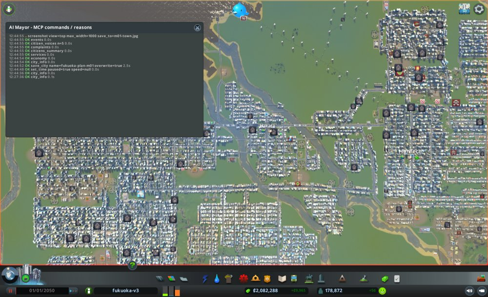

### 2050-01-31 月例(2か月目)

保存: fukuoka-plan-m02(同じ日付の月末の続き。ゲームは 2050-01-31 のまま)。dialog なし、events 0件。

#### 答え合わせ

- m01-1 Official Park(B): 予想は周り半径150mの attractiveness 平均14が上がる。結果は平均27(月末の計測)。当たり。ただし測り方の点数が違う可能性が残る。次の扱い: 続ける。今月は名所が8棟(基準6)
- m01-2 Friendly Neighborhood(A): 予想は平均9が上がる。結果は平均15。当たり。同じ扱い
- m01-3 道の4車線化: 予想は両地点の blocked が減る。結果は東30、南西26(基準104、55)だが測り方が違う。街全体の流れは51→50。まだ分からない(1回目)。一覧に足した
- m01-4 埋立地の建て直し: 予想は満杯が7から1。結果は0。当たり。ただし貨物港 32211 と 46112 に Garbage の印が出ている。ごみの印は15→11
- m01-5 木を植える試し: 予想は汚染の平均159が下がる(期待は小さい)。結果は161。効かない。理由の見立て: 190本では広い区域の汚染に足りない。次の扱い: 続けない。汚染の印は32→45と逆に増え、原因は分からない
- m01-6 警察署: 予想は犯罪の印3が2以下。結果は2。当たり。火事の印は4→7に増えた(原因は分からない)
- m01-7 信号: 予想は blocked が減る。結果は 91→64 で当たり(測る範囲が同じ)
- m01-8 道路の予算120: 流れ50(基準51)。判定は4か月目
- 週の収支の見込み +9,037 に対し、実測 +8,421。維持費の反映が遅れている可能性があり、週が回ったあとに再確認する
- 前回の「次にやること」: 局の案を受けて入口と置き場所を確かめる(これから)、埋立地45892は空(garbage.full 0)なので active=false に戻すかを実行する市長が確かめる(未実行)、m01-1・m01-2 の測り直し(実行済み)
- 公約の進み具合
  1. 人口: 178,859。前月例178,872より13減った。未達(2か月目から前月比で見る)
  2. 来ない市民: 0 / 0 / 0。達成。保つ
  3. 赤字: 週の収支 +8,421。黒字(+9,965から縮んだが守る線+3,000の上)
  4. 観光: 今いる観光客1,747(基準1,646。増えた)、Tourism 週42(基準45。減った)。人数は達成、収入は未達

#### 計画の施策ごとの今の数字(2050-01-31)

- 1-2: 健康の平均78(目標80)
- 2-3: 小学校 14,268 / 子ども11,100、高校 24,360 / 10代22,353。保つ
- 3-3: 来ない市民 0/0/0
- 3-4: 火事7、犯罪2、合わせて9(目標4以下。悪化)
- 4-1: 住宅(高密度)の地価の平均58(目標62)
- 4-2: Beautification 81棟(目標100)
- 4-3: 汚染の印45(目標15以下)
- 4-4: ごみの印11(目標0)、満杯の埋立地0
- 6-1: 事務所のレベル3は3,237棟(基準3,227、目標3,500)
- 6-3: 交通の流れ50%(目標60)。止まった車990
- 5-1・5-2: 観光客1,747、訪問139、Tourism 週42、名所8棟、旅客の入口0。attractiveness の平均は x=0 z=0 r=4000 n=25 で4(基準の測り方と違う)
- 6-4・7-1: 働き口86,515(目標90,000)、品物がない店222、原料がない工場29
- 8-1: 駅・港の敷地の止まったトラック493(貨物センター28755が492。目標250以下)

#### 気づいたこと

- 人口が13減り、需要は住24・商2・工57。商業需要は低く、空き家が4,948、空き働き口が3,390、失業7,455(大卒がほとんど)。大卒の働き口が足りない
- 観光客は増えたが、Tourism の収入は週42で、観光客が落とすお金は増えていない。入口(駅・港・空港)がなく、attractiveness も街の東と中心に偏る(西と北は0が多い)
- 火事が4→7、汚染が32→45と、計画の施策3-4、4-3 が出発点より悪い。交通の流れも50%で、止まった車の多い場所は(2091,302)、(-1681,-1128)、(1541,-763)

#### 次にやること

- 編成方針の重点は 5-1・5-2 観光(入口と名所)、6-3 交通と8-1、4-3 汚染
- 局の案を受けて、島と空き地の使い方を確かめる

#### 施策

(結果の欄は実行する市長が書く。詳しくは council/m02-bill.md)

- m02-1 島Bに Basic Road で道(1,600)と名所入口への支線(320)を引く(roads-3、試し)。公約4、5-1・5-2。理由: 島に道がなく(segments 0)、本線と支線は試しで通る。予想: 島の道と支線がつながる(基準0)。電線は引かない。建設費 1,920、週 約15。結果: (実行後)
- m02-2 幹線の交差点 (-1820,-1010) と (-1820,-1100) に信号(roads-4、試し)。6-3。理由: 1月の信号で blocked が 91→64。予想: `traffic`(x -1800、z -1000、r400)の blocked 159 が減る。建設費 0、週は未確認。結果: (実行後)
- m02-3 焼却場 2267 を止める(health-1、試し)。4-3。理由: 汚染の印の住宅4棟が150m以内。予想: Pollution の印 45 が 35 以下(確かな数字ではない)。建設費 0、週 -1,440。結果: (実行後)
- m02-4 政策 SmallBusiness を有効にする(finance-1、試し)。公約4、5-1・5-2。理由: Tourism が週42で小さい。予想: Tourism が42から増える(量は見積もれない。判定は3か月目の月末)。建設費 0、週 +311。結果: (実行後)
- 調査: s02-1(焼却場停止後の埋立地、health)、s02-2(名所2棟の効き、economy)、s02-3(貨物センター13893、port)
- 費用の合計: 建設費 1,920。週の維持費の増えは約 -1,114(信号を除く)。週の収支は約 +9,500、所持金は約 2,013,500 の見込み

#### 考えたが打たなかった手

- port-1(旅客の駅 (3290,-1790)): 旅客線の端の座標が置いた後でしか分からず、Basic Road に SlopeTooSteep が残る。条件付き。ports から端を計算して試すことを求めた
- 調査 fire(火事が繰り返すか)、調査 urban(名所 A の周りの地価): 調査の上限3件のため。3月に再検討
- urban、economy、education、fire は案なし。市長は代案を作らない
- 4車線化: 局が4月に回した

##### 実行の結果(実行する市長が書く。2050-01-31、所持金 2,015,489)

- m02-1: 成功。本線 Basic Road 6区間(費用1,600、端は未接続)。支線 test ok のあと build_line(費用320、snapped 1 で本線の node 15652 につながった)。`net_near`(x -4600, z 1520, r200)で7区間。Power Line の test は ObjectCollision(segment 14667)で断られ、議案どおり電線は引かない。gameCheck の警告なし
- m02-2: 成功。(-1820,-1010) と (-1820,-1100) とも canEnableLights true を確認して信号を付けた(trafficLights true)。所持金の差0
- m02-3: 成功(のち中止条件で戻した)。2267 を active=false。月末(3/2)の計測: Pollution 45→35、pollution 平均93→67(最大255→188)、Garbage 11→22(議案の上限15を超えた)。garbage.full は0。議案の中止条件どおり 3/2 に active=true へ戻した
- m02-4: 成功。SmallBusiness を有効にした(costPerWeek 311、月末 list_policies で active true、317)。Tourism は 42→57→70→66
- 月末の計測: `traffic`(x -1800, z -1000, r400)は blocked 41、cars 336、congestion 141、flow 50(基準 blocked 159、cars 347、congestion 150)。tourists.now 1,772(visits 146)
- 見立て(事実ではない): 信号は blocked を減らした。焼却場停止は汚染を減らしたが、ごみの印が倍になった

| 2050-01-31 | 月例 | m02-1〜m02-4 | 上のとおり | roads / health / finance | 5-1・5-2 / 6-3 / 4-3 | なし | 観光・交通・環境 | 4 | 1,920 | 約 -1,100(信号は未確認) | 3月に埋めた: m02-1 当たり、m02-2 当たり、m02-3 汚染は当たりでごみは外れ(戻した)、m02-4 まだ分からない |

##### 見回りと月末(2050-02〜03-02)

| ゲーム内の日付 | 区切り | 人口 | 所持金 | 週の収支 | 幸福度 | 需要(住/商/工) | 主な困りごと |
|---|---|---|---|---|---|---|---|
| 2050-02-10 | 見回り1 | 178,767 | 2,034,533 | +14,587 | 85 | 23 / 2 / 59 | 来ない市民 0/0/0、観光客1,786、Tourism 57。境目なし。events 1件 |
| 2050-02-20 | 見回り2 | 178,788 | 2,055,318 | +14,395 | 85 | 23 / 2 / 59 | 観光客1,804、Tourism 70。境目なし。events 1件。3565 に Death の印 |
| 2050-03-02 | 月末 | 178,639 | 2,074,074 | +12,912 | 85 | 24 / 2 / 58 | 観光客1,772(訪問146)、Tourism 66、ごみ22、汚染35、Death 60、火事5、品物がない店230。人口は 178,859 から減少 |

#### 次にやること

- 焼却場 2267 は戻した。汚染の別の手(原因は工場群か)とごみの印22の原因を、保健環境局が調べる
- 島Bの道は電線なし。5月に風力・橋と一緒に検討
- 信号 m02-2 は blocked 159→41。続ける。3月の局が根拠に使う
- SmallBusiness は Tourism が42→66。3か月目の月末まで置く(判定は4月)
- 人口が3か月連続の見込みで減少(178,872→178,859→178,639)。公約1が未達。3月の局が対策を求める
- Death の印(60)が多い。埋立地 3565 にも Death の印

#### 画面写真

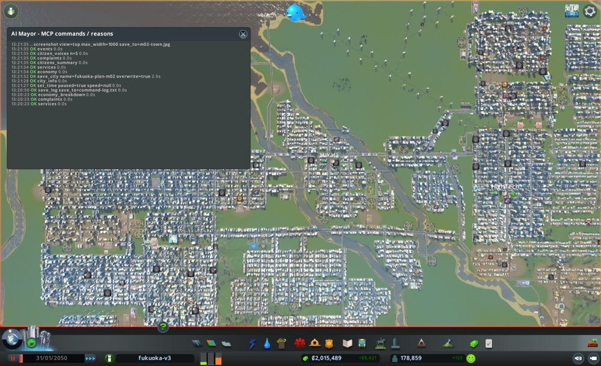

### 2050-03-02 月例(3か月目)

保存: fukuoka-plan-m03(上書き)。dialog なし。events は雑談1件。

#### 答え合わせ

- m02-1 島Bの道: 予想は道と支線がつながる。結果は `net_near`(x -4600, z 1520, r200)で7区間、node 15652 でつながる。当たり。次の扱い: 橋と電気が未確認で、名所は置けない。続ける(5月に風力・橋と検討)
- m02-2 信号: 予想は blocked 159 が減る。結果は 41(月末計測)。当たり。続ける。街全体の流れは50%で動かない
- m02-3 焼却場停止: 予想は Pollution 45→35以下。結果は35だが、ごみの印が11→22で議案の上限15を超え、3/2 に戻した。汚染は当たり、ごみは外れ。理由の見立て: 焼却場の分のごみを受ける先が足りない。次の扱い: 同じ手は続けない。別の手を保健環境局に求める
- m02-4 SmallBusiness: 予想は Tourism が42から増える。結果は66(週70まで上がり戻る)。まだ分からない(1回目)。4月に判定
- 週の収支: 見込み +9,500 に対し実測 +12,912。上振れ(所持金 2,074,074)
- 前回の「次にやること」: 焼却場は戻した(実行済み)、信号は続ける(実行済み)、人口の対策を3月の局に求める(これから)
- 公約の進み具合
  1. 人口: 178,639。前月例178,859より220減った。3か月連続の減少で未達
  2. 来ない市民: 0 / 0 / 0。達成。保つ
  3. 赤字: 週の収支 +12,912。黒字
  4. 観光: 今いる観光客1,772(前1,747。増えた)、Tourism 週66(前42。増えた)。2つとも前月より増えた

#### 計画の施策ごとの今の数字(2050-03-02)

- 1-2: 健康の平均78(目標80)
- 2-3: 小学校 14,268 / 子ども10,963、高校 24,360 / 10代22,350。保つ
- 3-3: 来ない市民 0/0/0
- 3-4: 火事5、犯罪は `complaints` に印なし、合わせて5(目標4以下。あと1)
- 4-1: 住宅(高密度)の地価の平均58(目標62)
- 4-2: Beautification 81棟(目標100)
- 4-3: 汚染の印35(目標15以下)
- 4-4: ごみの印22(目標0)、満杯の埋立地0
- 6-1: 事務所のレベル3は3,240棟(目標3,500)
- 6-3: 交通の流れ50%(目標60)。止まった車832
- 5-1・5-2: 観光客1,772、訪問146、Tourism 週66、名所8棟、旅客の入口0。attractiveness の平均は x=0 z=0 r=4000 n=25 で4
- 6-4・7-1: 働き口86,566(目標90,000)、品物がない店230、原料がない工場34
- 8-1: 駅・港の敷地の止まったトラック504(貨物センター28755。目標250以下)

#### 気づいたこと

- 観光は人数と収入は増えたが、Tourism 週66は目標1,000の7%。入口(旅客の駅・港・空港)は0のまま。attractiveness は街の東と中心に偏り、西と北は0が多い。島や空き地の名所はまだ0棟
- 人口が3か月連続で減り、空き家5,041、失業7,262(大卒が97%)。大卒の働き口が足りず、需要は商業2。公約1が未達
- 汚染35とごみ22は目標(15以下、0)から遠い。焼却場を止める手はごみを倍にした。貨物センター28755 の止まったトラックは504で、8-1 の目標250の2倍

#### 次にやること

- 局の案を受けて、観光の入口と名所の置き場所(島B、空き地1〜5)を確かめる
- 汚染とごみは、焼却場を止めずに減らす手を保健環境局に求める
- 4月に SmallBusiness の判定

#### 施策

(結果の欄は実行する市長が書く。詳しくは council/m03-bill.md)

- m03-1 政策 RecreationalUse を有効にする(economy-1、試し)。公約4、5-1・5-2。採択理由: 名所 B 周りの attractiveness は8で止まり、街全体の平均は2。費用0で建設なしに試せる唯一の確認済みの手。予想: 街全体の attractiveness 平均2、観光客1,772、Tourism 週66が4月末までに増える(量は見積もれない。SmallBusiness と重なるため、分けられなければ保留)。建設費 0、週 0。結果: (実行後)
- 調査: s03-1(貨物センター28755の止まり、port)、s03-2(焼却場2267の再開、health)、s03-3(品物がない店と止まったトラック、economy)
- 費用の合計: 建設費 0、週の維持費の増え 0。週の収支は +12,912 のまま、所持金は約 2,074,000 の見込み

| 2050-03-02 | 月例 | m03-1 | RecreationalUse を有効にする | economy | 5-1・5-2 | なし | 観光 | 4 | 0 | 0 | 4月に埋める |

##### 実行の結果(実行する市長が書く。2050-03-02)

- m03-1: 成功。実行前の `list_policies` で RecreationalUse は active=false、costPerWeek=0。`set_policy` で active=true。費用0。確かめ: 実行後の policyExpenses は 11,012(11,011から変わらず)。attractiveness(x0 z0 r4000 n9)の平均は 3/2・3/12・3/22・4/1 とも2(最大25)。tourists.now は 1,772 → 1,749 → 1,770 → 1,742(訪問 146 → 140 → 140 → 139)。Tourism 週は 66 → 74 → 68 → 58。SmallBusiness と重なるため判定は保留。見立て(事実ではない): attractiveness は動かず、効いた形跡は今のところない
- 調査 s03-1: 28755 の止まった車は 618 → 621 → 637。敷地内 WaitingSpace が 500〜516 で、同じ車が70〜90日止まったまま。周辺の `traffic` は blocked 0、flow 52〜53 で道の渋滞は見えない
- 調査 s03-2: 2267 の貯蔵は 333,750 → 293,968 → 251,468 と減り、処理は動いている。ごみの印は 22 → 15 → 12 → 18、汚染は 29 → 33 → 35
- 調査 s03-3: 品物がない店は 226 → 228 → 235。止まったトラックは 832 → 831 → 804 で、店の数は連動して減っていない
- 保存: この段では行わない

#### 考えたが打たなかった手

- 局の案は economy-1 の1件のみ。urban、roads、port、health、education、fire、finance は案なし(実行条件が確かめられなかったため)。市長は代案を作らない
- 調査 roads、urban、fire、finance: 上限3件のため見送り。4月に再検討
- 試しの案は、分からないことの観光の項目に出た(m03-1)。島や埋立地の項目、汚染の項目、火事の項目は、試しの案が出なかった

#### 見たもの

- `list_policies`: RecreationalUse active=false、costPerWeek=0 を実行前に確認。実行後 policyExpenses 11,012
- `map_layer`: attractiveness 平均2(4回とも)
- `city_info`: 人口 178,486、所持金 2,110,220、観光客 1,742
- `economy_breakdown`: Tourism 週 58
- `vehicles_stuck`、`cargo`、`traffic`、`buildings_near`、`complaints`、`services`: 調査 s03-1〜3 のとおり

#### 判断の根拠

議案の m03-1 は費用0で、実行前の条件(active=false、costPerWeek=0)を満たしたので打った。月内の attractiveness は2のまま動かず、Tourism も 58 まで下がった。SmallBusiness と重なるため、外すかどうかは4月に決める。

#### 捨てたもの

- 他の施策: 議案に出ていないため打たない
- 臨時: 境目に当たらなかったため行わない

#### 次にやること

- 4月: RecreationalUse と SmallBusiness の判定。attractiveness 平均2が動かないので、外すかを局に求める
- 28755 の止まった車は敷地内 WaitingSpace が500台で動かず、道の渋滞は見えない。港湾空港局が原因を検討する
- 2267 は貯蔵が減っており処理は動いている。ごみの印は 12〜18 で揺れる

#### 画面写真

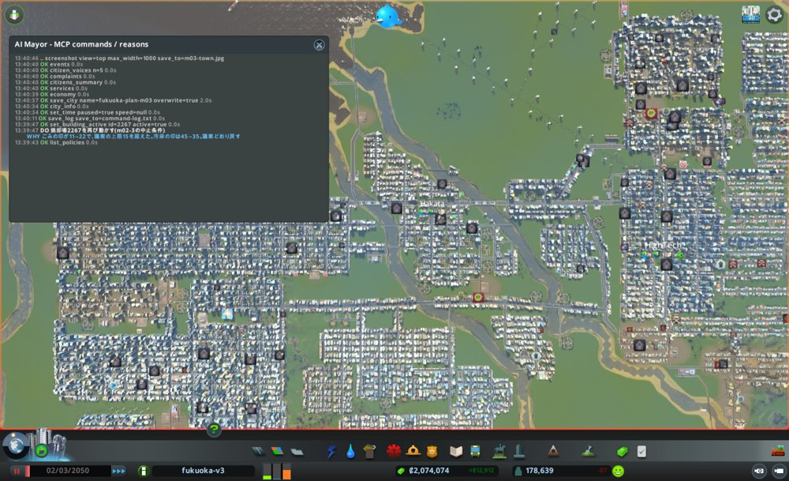

### 2050-04-01 月例(4か月目)

保存: fukuoka-plan-m04(上書き)。dialog なし。events は雑談1件。

#### 答え合わせ

- m03-1 RecreationalUse: 予想は attractiveness 平均2、観光客1,772、Tourism 週66が4月末までに増える。結果は平均2のまま、観光客1,742、Tourism 58。外れ(増えなかった)。理由の見立て: 名所を足さない政策では attractiveness は動かない。SmallBusiness と重なり、効きは切り分けられない。次の扱い: まだ分からない(1回目)。一覧に足した。外すかは局の案で決める
- m02-4 SmallBusiness: Tourism は 42→66→74→68→58。上がって戻った。まだ分からない(2回目)。試し直さないなら理由を書く必要がある。Tourism を動かすには名所と入口を足す手が本筋で、政策の単独試しは基準が混ざって測れない。4月は名所・入口の案と分けて測れる形を局に求める
- m02-3 焼却場 2267: 戻した後の汚染35、ごみ18。続けない
- 週の収支: 3月は +12,912、4月は +9,303。黒字で守る線 +3,000 の上
- 前回の「次にやること」: 入口と置き場所(これから)、汚染とごみの別の手(これから)、SmallBusiness の判定(まだ分からない)
- 公約の進み具合
  1. 人口: 178,486。前月例178,639より153減った。4か月連続の減少で未達
  2. 来ない市民: 0 / 0 / 0。達成。保つ
  3. 赤字: 週の収支 +9,303。黒字
  4. 観光: 今いる観光客1,742(前1,772。減った)、Tourism 週58(前66。減った)。2つとも前月より減り未達

#### 計画の施策ごとの今の数字(2050-04-01)

- 1-2: 健康の平均78(目標80)
- 2-3: 小学校 14,268 / 子ども10,870、高校 24,360 / 10代22,226。保つ
- 3-3: 来ない市民 0/0/0
- 3-4: 火事8、犯罪1、合わせて9(目標4以下)
- 4-1: 住宅(高密度)の地価の平均58(目標62)
- 4-2: Beautification 81棟(目標100)
- 4-3: 汚染の印35(目標15以下)
- 4-4: ごみの印18(目標0)、満杯の埋立地2(157、25692)
- 6-1: 事務所のレベル3は3,243棟(目標3,500)
- 6-3: 交通の流れ53%(目標60)。止まった車774
- 5-1・5-2: 観光客1,742、訪問139、Tourism 週58、名所8棟、旅客の入口0。attractiveness 平均2(x0 z0 r4000 n9、最大25)
- 6-4・7-1: 働き口86,569(目標90,000)、品物がない店235、原料がない工場32
- 8-1: 駅・港の敷地の止まったトラック517(貨物センター28755。目標250以下)

#### 気づいたこと

- 観光は4か月たっても入口0、名所8棟で、attractiveness 平均2。政策だけでは動かず、島と空き地を含む名所と入口の建設が要る。島Bの道は橋と電気が未確認のまま
- 人口は4か月連続で減少。空き家5,062、失業5,761のほとんどが大卒(5,667)。働き口は86,569で目標90,000に届かず、需要は商業2
- 交通の流れは53%に上がった(目標60)。止まったトラックは貨物センター28755に517台

#### 次にやること

- 編成方針の重点は 5-1・5-2 観光(入口と名所、島・空き地)、6-1/6-4 働き口(大卒の失業と人口減)、6-3/8-1 交通と貨物センターの止まり
- RecreationalUse と SmallBusiness の判定を局の案で受ける

#### 画面写真

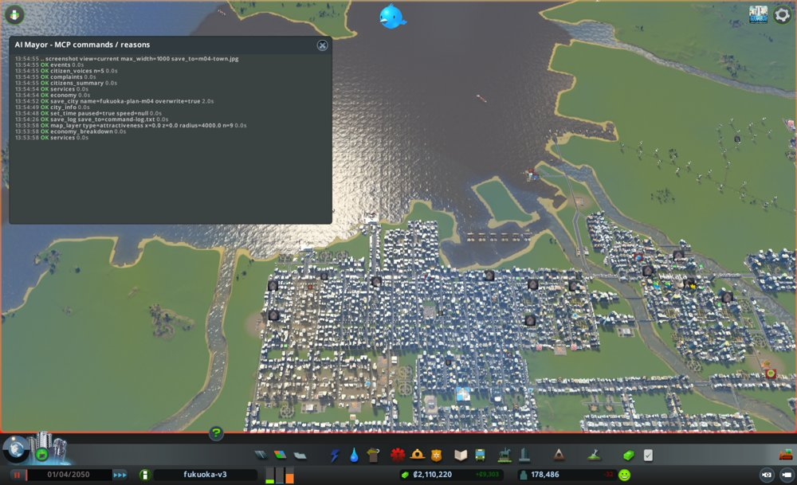

#### 施策

(結果の欄は実行する市長が書く。詳しくは council/m04-bill.md)

- m04-1 政策 RecreationalUse を外す(economy-1)。公約4、5-1・5-2。理由: 3月の試しで attractiveness 平均2、Tourism 66→58 と動かず。予想: 観光の数字は大きく動かない。建設費 0、週 0。結果: (実行後)
- m04-2 東の交差点2か所に信号(roads-2)。6-3。理由: blocked 254 が最大の集まり、過去の信号は 91→64、159→41。予想: blocked 254→150〜200(確かな数字ではない)。建設費 0、週は未確認。結果: (実行後)
- m04-3 z=-1010 の幹線3区間を4車線に(roads-1)。6-3。理由: 条件を満たし費用0。予想: 効きは小さい。建設費 0、週 約0。結果: (実行後)
- m04-4 空き地3に道と送電線(roads-3)。5-1・5-2、4-2 の前提。理由: 名所と公園の置き場所を作る。予想: 道と送電線がつながる。建設費 11,520、週 約55。結果: (実行後)
- m04-5 Fire House を (2262,-1190) に(fire-1、試し)。3-4。理由: 工場 12882 が2回燃えた。予想: 周り200m の火事 1→0。建設費 12,000、週 560。結果: (実行後)
- m04-6 診療所を (-1000,-1585) に(health-1、取り壊し)。1-2。理由: 健康78、放棄商店1棟を壊すだけ。予想: 健康が上がる方向(8月に確認)。建設費 10,000、週 400。結果: (実行後)
- m04-7 満杯の埋立地2つを建て直す(health-2、取り壊し)。4-4。理由: ごみの印18。予想: garbage.full 2→0、ごみの印 15以下。建設費 8,000、週 320。結果: (実行後)
- 調査: s04-1(28755の待ち、port)、s04-2(品物がない店、economy)、s04-3(大卒の失業と事務所の税、finance)
- 費用の合計: 建設費 41,520、週の維持費の増え 約1,335。週の収支は約 +7,970、所持金は約 2,068,700 の見込み

#### 考えたが打たなかった手

- 局の案7件はすべて採った。urban、port、education、finance は案なし。市長は代案を作らない
- 調査 urban(地価)と fire(火事3棟)は上限3件のため見送り。5月に再検討
- 試しの案は fire-1(火事の印の原因)のみ。SmallBusiness の単独試しと島の橋は案が出なかった

##### 実行の結果(実行する市長が書く。2050-04-01、所持金 2,110,220 から)

- m04-6: 成功。preview で 46949 のみ(働き0、家0)を確認して bulldoze。test ok のあと Medical Clinic を place_building(id 18600、費用 10,000、入口は segment 4589 に距離11)。buildings_near で電気・水・下水あり
- m04-7: 成功。25692 と 157 を preview(各1棟、働き0、家0)のあと bulldoze。test ok のあと Landfill Site を 2か所に place_building(id 40097 x745 z-600 入口 segment 14535 距離5、id 2224 x-1862 z-1880 入口 segment 31714 距離2。各4,000)
- m04-5: 成功。test ok(wouldDemolish 0)のあと Fire House を place_building(id 25877、費用 12,000、入口 segment 12301 距離8)。電気・水・下水あり。基準: 火事1棟、覆い平均107(5月末に再測)
- m04-4: 成功。道 test ok のあと Basic Road 18区間(費用 10,440、橋4区間、snapped 1、overlaps なし)、end (-316,1074) は Small 4 Lane Road の node につながった。送電線 test ok(crossings 0)のあと Power Line 6区間(費用 1,080、end (421,1320) が既存の Power Line の node につながった。始点 (690,1640) は connectedTo none)。net_near(x712 z1644 r300)で道5区間と Power Line 5区間を確認(高さ確認は未実施)
- m04-2: 成功。junction_info で 2か所とも canEnableLights true を確認し、(2110,240) node 24624 と (1880,330) node 821 に信号を付けた(trafficLights true)。基準 `traffic`(x2050 z200 r400): blocked 254、cars 476、congestion 233、flow 53
- m04-3: 成功。upgrade_road で matched 3、upgraded 3、skipped 0、費用0
- m04-1: 成功。RecreationalUse を active=false に(costPerWeek 0)。実行前は active=true
- 実行後の services: garbage.full 0、ごみ使用 83,458,885 / 160,000,000

##### 見回りと月末(2050-04〜05-01)

| ゲーム内の日付 | 区切り | 人口 | 所持金 | 週の収支 | 幸福度 | 需要(住/商/工) | 主な困りごと |
|---|---|---|---|---|---|---|---|
| 2050-04-11 | 見回り1 | 178,222 | 2,081,499 | +9,123(収入344,325、支出335,202) | 85 | 24 / 2 / 58 | 来ない市民 0/0/0、観光客1,760、Tourism 59。境目なし(人口は前回比-0.15%)。events は雑談2件 |
| 2050-04-21 | 見回り2 | 178,395 | 2,095,889 | +10,109(収入345,308、支出335,199) | 85 | 24 / 2 / 58 | 来ない市民 0/0/0、観光客1,748、Tourism 44。境目なし。events 0件 |
| 2050-05-01 | 月末 | 178,380 | 2,111,160 | +10,614(収入345,801、支出335,187) | 85 | 24 / 4 / 58 | 来ない市民 0/0/0、観光客1,811(訪問138)、Tourism 24。境目なし |

月末の計測(道具が返した事実。判定は5月の月例):

- m04-1: attractiveness(x0 z0 r4000 n9)平均2、最大25。観光客 1,742 → 1,811、Tourism 58 → 24(週)
- m04-2: `traffic`(x2050 z200 r400)blocked 254 → 92、cars 471、congestion 220、flow 54。blockedSpots は (1722,93) 57、(1839,101) 12、(2110,268) 8(基準の集まりは (1907,92) 46、(2251,294) 43、(2094,293) 40)
- m04-3: `traffic`(x-1820 z-1010 r300)blocked 11、congestion 54、cars 196、flow 54(基準 blocked 14、congestion 83、cars 256)
- m04-4: `net_near`(x712 z1644 r300, Road)で Basic Road 5区間(968、13359、29045、15421、24564)。Power Line は送電線の始点 (690,1640) が connectedTo none、終点は既存の node につながった。`height_at` は未確認
- m04-5: `buildings_near`(x2184 z-918 r200, problem=Fire)工場 12882 が Fire、FatalProblem のまま(1棟、基準1棟)。`map_layer` fire 平均173(基準107)、最小137、最大216
- m04-6: 診療所 18600 は稼働前の数字のみ(Patients 0 / 100)。`services` healthcare capacity 5,000 → 5,100、used 1,736。健康の平均は `citizens_summary` を呼んでいないため未測定
- m04-7: `services` garbage.full 0(基準2)、使用 70,434,757 / 160,000,000。`complaints` の Garbage 14(基準18)、Pollution 29(基準35)、Fire 6(基準8)、Crime 1、NoGoods 239
- 週の収支: +9,303 → +10,614。実測は見込み +7,970 より上(維持費の反映が遅れている可能性)
- 調査 s04-1〜s04-3: `council/m04-survey-port.md`、`m04-survey-economy.md`、`m04-survey-finance.md` に記録

| 2050-04-01 | 月例 | m04-1〜m04-7 | 上のとおり | economy / roads / fire / health | 5-1・5-2 / 6-3 / 3-4 / 1-2 / 4-4 | 取り壊し2件(m04-6、m04-7) | 観光・交通・安全・健康・環境 | 4 | 41,520 | 約1,335(信号は未確認) | 5月に埋めた(5月の答え合わせ): m04-1 まだ分からない、m04-2 当たり、m04-3 小さく当たり、m04-4 送電線は none のまま、m04-5・m04-6 まだ分からない、m04-7 当たり |

##### 次にやること(実行する市長が書く。5月の月例の前)

- m04-1: RecreationalUse を外した。5月に attractiveness と Tourism を同じ引数で測り直す(月末 Tourism 24、観光客1,811)
- m04-2: blocked 254 → 92。(1722,93) に57台の新しい集まりがある。2か月続けて同じ範囲の blocked が増えたら信号を外す規則は、5月に再判定
- m04-4: 道は通ったが、送電線の始点 (690,1640) は none。空き地3の高さ(`height_at`)は未確認
- m04-5: 火事の棟は1のまま(工場 12882)、覆い平均は173。判定は5月(議案は5月末)
- m04-6: 診療所は稼働直後。健康の平均は `citizens_summary` で5月に測る
- hooks に止められた手: なし

##### 取り壊しの理由(実行する市長が書く。2050-04-01、実行前)

- 放棄商店 46949(働き0、家0): 診療所 m04-6 を置く場所を空けるため。健康の平均78を上げる
- 満杯の埋立地 25692 と 157(働き0、家0): 収集車が使えない満杯を建て直し、ごみの印18を減らすため(m04-7)。中のごみ各 8,000,000 は失われる

### 2050-05-01 月例(5か月目)

保存: fukuoka-plan-m05(上書き)。dialog なし。events は雑談2件。

#### 答え合わせ

- m04-1 RecreationalUse を外す: 予想は観光の数字が大きく動かない。結果は観光客1,742→1,811(増)、Tourism 58→24(減)、attractiveness 平均2のまま。Tourism は大きく動いた(予想は外れ)。理由の見立て: 週の収入は月ごとに大きく揺れ、政策の効きと切り分けられない。次の扱い: まだ分からない(2回目)。政策単独の試しは続けない。名所・入口を足す手を本筋にする
- m04-2 東の信号: 予想は blocked 254→150〜200。結果は92(`traffic` x2050 z200 r400)。当たり(予想より良い)。(1722,93) に57台の集まりが残る。続ける
- m04-3 z=-1010 の4車線化: 予想は効きが小さい。結果は blocked 14→11、congestion 83→54(x-1820 z-1010 r300)。小さく当たり。続ける
- m04-4 空き地3に道と送電線: 道は通った。送電線の node 4380(690,1640)は segment 36842 につながるが、「始点が none」の扱いは `net_near` では確かめられていない。高さ(`height_at`)は未確認。まだ分からない
- m04-5 Fire House: 火事の棟は1のまま(工場 12882)、覆い平均173(基準107)。まだ分からない。月末の火事の印は8→6
- m04-6 診療所: 稼働後の healthcare capacity 5,100、used 1,736。健康の平均は78→79。目標80にあと1。続ける
- m04-7 埋立地建て直し: 予想は garbage.full 2→0、ごみの印15以下。結果は0、14。当たり
- 週の収支: 4月 +9,303、5月 +10,614。黒字(守る線 +3,000 の上)。見込み +7,970 より上
- 前回の「次にやること」: RecreationalUse は外した(実行済み)。信号の規則は blocked が減ったので外さない。診療所の健康は測った(79)
- 公約の進み具合
  1. 人口: 178,380。前月例178,486より106減った。5か月連続の減少で未達
  2. 来ない市民: 0 / 0 / 0。達成。保つ
  3. 赤字: 週の収支 +10,614。黒字
  4. 観光: 今いる観光客1,811(前1,742。増えた)、Tourism 週24(前58。減った)。人数は増え、収入は減り未達

#### 計画の施策ごとの今の数字(2050-05-01)

- 1-2: 健康の平均79(目標80)
- 2-3: 小学校 14,268 / 子ども10,641、高校 24,360 / 10代22,231。保つ
- 3-3: 来ない市民 0/0/0
- 3-4: 火事6、犯罪1、合わせて7(目標4以下)
- 4-1: 住宅(高密度)の地価の平均58(目標62)
- 4-2: Beautification 81棟(目標100)
- 4-3: 汚染の印29(目標15以下)
- 4-4: ごみの印14(目標0)、満杯の埋立地0
- 6-1: 事務所のレベル3は3,253棟(目標3,500)
- 6-3: 交通の流れ54%(目標60)。止まった車889
- 5-1・5-2: 観光客1,811、訪問138、Tourism 週24、名所8棟、旅客の入口0(PublicTransport は貨物の港・センター15棟のみ)。attractiveness 平均2(x0 z0 r4000 n9、最大25)
- 6-4・7-1: 働き口86,736(目標90,000)、品物がない店239、原料がない工場33
- 8-1: 駅・港の敷地の止まったトラック563(貨物センター28755が539。目標250以下)

#### 気づいたこと

- 観光は5か月目も入口0、名所8棟、attractiveness 平均2。Tourism は週24と目標1,000の2%。政策では動かず、名所と入口の建設が要る。島Bの道(7区間)と空き地3の道(5区間)はあるが、名所はまだ置いていない
- 人口は5か月連続で減少。失業5,684のうち大卒5,584(98%)。需要は住24・商4・工58。空き働き口は3,562あり、働き口86,736は目標90,000に3,264足りない。大卒向けの働き口が足りない
- 交通は54%(目標60)に上がった。貨物センター28755の止まったトラックは539台(目標250以下の2倍超)。8-1 は悪化している

#### 次にやること

- 編成方針の重点は 5-1・5-2 観光(入口と名所。島B・空き地3)、6-3/8-1 交通と貨物センター、4-4・4-3 ごみと汚染
- 局の案を受けて、島と空き地に名所を置く手を確かめる(橋と電気が前提)

#### 画面写真

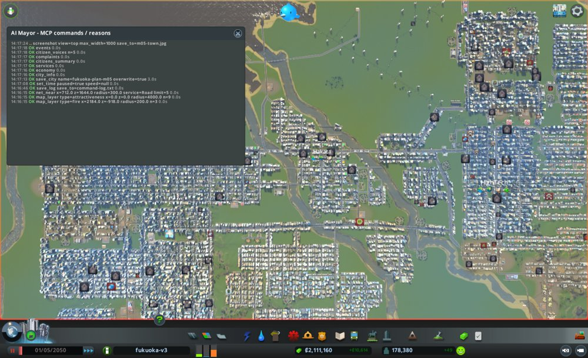

#### 施策

(結果の欄は実行する市長が書く。詳しくは council/m05-bill.md)

- m05-1 島Bに橋・風力・送電線を引く(roads-1、試し)。公約4、5-1・5-2。採択理由: 島の道7区間は本土とつながらず、3本とも試しで通った。予想: `net_reach`(x -4600, z 1550, r400)で島の道が「来られる」になる。建設費 44,780、週 約400。結果: (実行後)
- m05-2 空き地3の東側に公園1か所と支線(urban-1 を P3 のみに手直し)。4-2。採択理由: 西側 P1・P2 は名所 (668,1565) と重なる恐れがあり、確認済みの東側だけ置く。予想: 公園の数 81→82、P3 の電気が来る。建設費 1,140、週 約11。結果: (実行後)
- m05-3 交差点 (2700,330) に信号(roads-2)。6-3。採択理由: 同型の信号が3例で blocked を減らした。予想: blocked 96→40〜60(第6月末)。建設費 0、週は未確認。結果: (実行後)
- m05-4 政策 SmallBusiness を外す(finance-1、試し)。公約3、4。採択理由: 一覧に2回残った項目で、維持費 -311。予想: 週の維持費 -311、Tourism は24前後(判定は6月末)。実行直前に Tourism が66以上なら見送り。結果: (実行後)
- 調査: s05-1(13893 への行き先、port)、s05-2(1694,93 の止まり、roads)、s05-3(焼却場の貯蔵と汚染、health)
- 費用の合計: 建設費 45,920、週の維持費の増え 約 +100。週の収支は約 +10,500、所持金は約 2,065,000 の見込み

#### 考えたが打たなかった手

- economy-1(空き地3の名所): 電気が未確認。条件付きで同じ月に調べ直す。urban-1 の P1・P2 とは敷地が重なる恐れがあり、公園を東側1か所に絞った
- health-1(SmokingBan)、fire-1(SmokeDetectors): 政策の変更は月例で1つまで。SmallBusiness の試しを優先。6月に出し直してよい
- 調査 economy・fire・urban: 上限3件のため。電気は m05-2 の支線の grid で確かめる
- port と education は案なし。市長は代案を作らない。試しの案は m05-1(島)と m05-4(SmallBusiness)が出た

##### 実行の結果(実行する市長が書く。2050-05-01、所持金 2,111,160 から)

- m05-1: 一部成功。風力 Wind Turbine を place_building(id 44460、費用 6,000)。橋 Basic Road は test ok(30区間、橋28)のあと build_line(費用 38,680、両端とも node につながった。(-2720,100) は Medium Road、(-4500,1700) は Basic Road)。送電線は議案の座標 (-4655,1462)→(-4650,1500) が風力の敷地と ObjectCollision で断られた。始点を (-4655,1466) に動かして(動かした距離4m)引き成功(費用 80、始点は insideBuilding 44460)。月末の `net_reach`(x-4600 z1550 r400)は roads 12区間、notEnterable 0、notLeavable 0。風力の stats は Power Output 0 MW、Wind speed 5、grid.electricity false(月末の再確認はしていない)
- m05-2: 一部成功。Regular Park を place_building(id 30466、費用 1,000、入口は segment 968 に距離10)。支線は議案の終点 (740,1612) が公園の敷地と ObjectCollision。終点を (731,1614)、(734,1620) で試し直しても断られ、(727,1626) で通り build_line(費用 100、始点 node 4380 に snapped、終点は insideBuilding 0)。敷地に入れる延長 (727,1626)→(732,1624) を build_line したが、両端が同じ node に snapped して長さ0の区間になった(費用 20)。月末の `buildings_near` は公園に Electricity、MajorProblem の印。Beautification の棟数は再計測していない
- m05-3: 成功。`junction_info` で canEnableLights true、trafficLights false を確認し set_traffic_lights(x2700 z330)。trafficLights true、費用0。実行直後の `traffic`(x2703 z309 r250)は blocked 96、flow 54。月末の再計測はしていない
- m05-4: 成功。実行前の `list_policies` は SmallBusiness active=true、costPerWeek 311。Tourism は 24(66未満)。set_policy で active=false。月末の policyExpenses は 10,960 から 10,596。Tourism 週は月末 41
- m05-5: 一部成功。StatueOfWealth を place_building(id 11580、費用 25,000、入口 (700,1565) は segment 13359 に距離4、取り壊し0)。置いた後の支線 (647,1587)→(668,1565) は ObjectCollision(建物 11580)で断られ、(654,1580)、(651,1583)(TooShort も)でも断られた。議案の中止条件(b)により線は引かず。名所は 11580 が `buildings_near` で Electricity、MajorProblem の印(月末)。月末の Power Line は 1,025 区間から 1,023 区間に減った(置いた建物で既存の送電線の区間が消えた可能性。原因は未確認)
- 費用の合計: 6,000+38,680+80+1,000+100+20+25,000 = 70,880。所持金 5/31 は 2,064,968(10日ごとに収入が入っている)

| 2050-05-01 | 月例 | m05-1〜m05-5 | 上のとおり | roads / urban / roads / finance / economy | 5-1・5-2 / 4-2 / 6-3 / 5-1・5-2 | なし | 観光・交通・財政 | 4 | 70,880 | 約 +500(橋・風力・名所。SmallBusiness -311) | 6月に埋めた(6月の答え合わせ): m05-1 当たり(橋は通り、風力4MW)、m05-2 数は当たり・電気は外れ、m05-3 当たり、m05-4 まだ分からない(3回目)、m05-5 置けたが電気は外れ |

##### 見回りと月末(2050-05-01〜05-31)

| ゲーム内の日付 | 区切り | 人口 | 所持金 | 週の収支 | 幸福度 | 需要(住/商/工) | 主な困りごと |
|---|---|---|---|---|---|---|---|
| 2050-05-11 | 見回り1 | 178,359 | 2,047,890 | +5,292(収入340,857、支出335,565) | 85 | 24 / 2 / 56 | 来ない市民 0/0/0、観光客1,793(訪問133)。境目なし(赤字ではない。+10,614 から縮んだ)。events は雑談5件 |
| 2050-05-21 | 見回り2 | 178,416 | 2,056,174 | +6,126(収入341,726、支出335,600) | 86 | 24 / 2 / 58 | 来ない市民 0/0/0、観光客1,795(訪問129)。境目なし。events 0件 |
| 2050-05-31 | 月末 | 178,150 | 2,064,968 | +6,004(収入341,593、支出335,589) | 86 | 25 / 2 / 57 | 来ない市民 0/0/0、観光客1,801(訪問133)、Tourism 週41、品物がない店257、駅・港の止まったトラック520(28755が500)、止まったトラック843、ごみ17(満杯 48698)、汚染26、火事6、犯罪2、flow 51。境目なし |

月末の計測(道具が返した事実。判定は6月の月例):

- m05-1: `net_reach` の島の道は notEnterable 0、notLeavable 0(基準は来られない7区間)。風力の電気は未確認
- m05-2・m05-5: 公園 30466 と名所 11580 とも `buildings_near` に Electricity の印。`complaints` の Electricity 2棟(hotspot (715,1583))
- m05-3: 月末の再計測はしていない(判定は6月末)
- m05-4: Tourism 週 24 → 41、tourists.now 1,811 → 1,801。週の収入 345,801 → 341,593(商業 45,637 → 39,145。citizen 収入が減った。因果は切り分け不能)
- 調査 s05-1〜s05-3: `council/m05-survey-port.md`、`m05-survey-roads.md`、`m05-survey-health.md`に記録

#### 見たもの

- `city_info`: 人口 178,150(月初 178,380)、所持金 2,064,968、観光客 1,801(月初 1,811)
- `economy_breakdown`: Tourism 週 41、policyExpenses 10,596
- `net_reach`、`buildings_near`、`complaints`、`services`、`traffic`、`cargo`、`vehicles_stuck`、`map_layer`: 上のとおり

#### 判断の根拠

議案の5件を計画の順に打った。建物を先に置いたため、送電線の端が建物の敷地とぶつかる断りが3件出た(風力、公園、名所)。風力は端を4m動かして通り、公園は終点が敷地の外に出て電気が来ず、名所は線を引けなかった。橋は両端がつながり、島の道は本土から入れるようになった。

#### 捨てたもの

- 名所の支線の追加探し: 議案の中止条件(b)に従い、新しい経路を探さなかった
- 臨時: 境目に当たらなかったため行わない

#### 次にやること

- 公園 30466 と名所 11580 に電気が来ていない(Electricity、MajorProblem)。局が、置いた建物の外形を見て支線の端を決め直す案を出す。長さ0の区間(segment 25433、(727,1626))が残っている
- 風力 44460 の電気(Power Output 0 MW)を `buildings_near` で見直す。島の名所は第8月
- 28755 の待ち(500台)は 13893 に行き先が付かず(13893 は 0/0)動かなかった。港湾空港局が6月の手を決める
- (1692,91) 付近の止まりは、信号 m04-2 の範囲に59台の集まりが残る。道幅の案は学校と車庫にぶつかる(局が書いた)
- 満杯の埋立地 48698(5/31)。ごみ17。保健環境局が6月の案を出す
- hooks に止められた手: なし

### 2050-05-31 月例(6か月目)

保存: fukuoka-plan-m06(上書き)。dialog なし。events は雑談1件。

#### 答え合わせ

- m05-1 島Bに橋・風力・送電線: 予想は `net_reach`(x -4600, z 1550, r400)で島の道が「来られる」になる。結果は roads 12区間、notEnterable 0、notLeavable 0。当たり。風力 44460 は Power Output 4 MW、grid.electricity true(5月末は 0 MW)。次の扱い: 続ける。名所はまだ置いていない
- m05-2 空き地3の公園: 予想は公園の数 81→82、電気が来る。結果は Beautification 82棟(当たり)、公園 30466 は grid.electricity false で Electricity の印のまま(外れ)。理由の見立て: 支線の終点が敷地の外にあり、敷地に届く線が長さ0の区間になった。次の扱い: 置いた後でなく、置く前に電気の端を決める
- m05-3 (2700,330) の信号: 予想は blocked 96→40〜60。結果は `traffic`(x2703 z309 r250)blocked 12、flow 51。当たり(予想より良い)
- m05-4 SmallBusiness を外す: 予想は Tourism が24前後。結果は41、観光客 1,811→1,801。外れ。見立て: 週の収入が揺れる。まだ分からない(3回目)。政策の単独の試しは続けない。名所と入口の建設を本筋にする
- m05-5 名所 StatueOfWealth(11580): 置けた(名所9棟)。電気が来ず MajorProblem。Visitors last week 2、Tourists 0。外れ(電気)
- 週の収支: +10,614 から +6,004 へ縮んだ(見込み +10,500 より下)。黒字で守る線 +3,000 の上。所持金 2,064,968
- 前回の「次にやること」: 公園・名所の電気(未解決)、風力の電気(確かめた。4 MW)、28755 の待ち(500台のまま)、埋立地 48698(満杯1)
- 公約の進み具合
  1. 人口: 178,150。前月例178,380より230減った。6か月連続の減少で未達
  2. 来ない市民: 0 / 0 / 0。達成。保つ
  3. 赤字: 週の収支 +6,004。黒字。ただし前月 +10,614 から縮んだ
  4. 観光: 今いる観光客1,801(前1,811。減った)、Tourism 週41(前24。増えた)。人数は減り、収入は増えたが目標1,000の4%

#### 計画の施策ごとの今の数字(2050-05-31)

- 1-2: 健康の平均79(目標80)
- 2-3: 小学校 14,268 / 子ども10,467、高校 24,360 / 10代22,029。保つ
- 3-3: 来ない市民 0/0/0
- 3-4: 火事6、犯罪2、合わせて8(目標4以下)
- 4-1: 住宅(高密度)の地価の平均58(目標62)
- 4-2: Beautification 82棟(目標100)
- 4-3: 汚染の印26(目標15以下)
- 4-4: ごみの印17(目標0)、満杯の埋立地1(48698)
- 6-1: 事務所のレベル3は3,256棟(目標3,500)
- 6-3: 交通の流れ51%(目標60)。止まった車769
- 5-1・5-2: 観光客1,801、訪問133、Tourism 週41、名所9棟(目標10)、旅客の入口0。attractiveness 平均2(x0 z0 r4000 n9、最大25)
- 6-4・7-1: 働き口86,553(目標90,000)、品物がない店257、原料がない工場39
- 8-1: 駅・港の敷地の止まったトラック520(貨物センター28755が500。目標250以下)

#### 気づいたこと

- 観光: 名所は9棟で目標10にあと1だが、attractiveness は平均2のまま。新しい名所(11580)に電気が来ず、訪問者も2人。入口0。島Bは橋と風力(4 MW)ができ、名所を置く前提がそろった
- 人口は6か月連続で減少(178,872→178,150)。失業5,618のうち大卒5,507(98%)。空き働き口3,485、空き家5,257。大卒向けの働き口が足りない
- 週の収支が +10,614→+6,004 に縮んだ。商業の収入が 45,637→39,145 に減り、橋・風力・名所の維持費が加わった。守る線 +3,000 まで余裕は約3,000

#### 次にやること

- 編成方針の重点は 5-1・5-2 観光(島Bの名所、公園・名所の電気、入口)、6-3/8-1 交通と貨物センター、6-1/6-4 働き口
- 局の案を受けて、島Bに名所を置く手と、入口(駅・港)の置き場所を確かめる
- 週の収支が守る線に近づくので、維持費の増える案は費用を数える

#### 画面写真

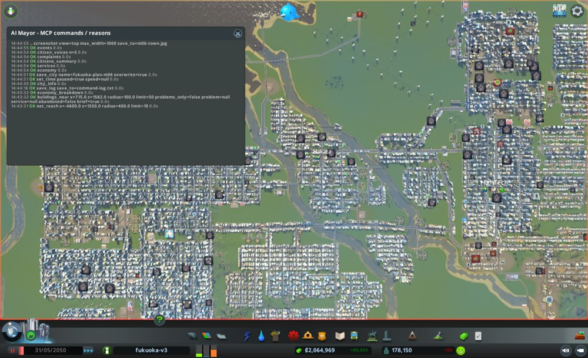

#### 施策

(結果の欄は実行する市長が書く。詳しくは council/m06-bill.md)

- m06-1 空き地3の風力そば (585,1365) に公園1か所と道45m(urban-1)。4-2。採択理由: 公園82棟で目標100に遠く、場所は test で ok。予想: Beautification 82→83、電気が来る。建設費 1,240、週 約10。結果: (実行後)
- m06-2 東の幹線6区間を4車線に(roads-1、試し)。6-3。採択理由: (3150,-250) r200 の blocked 50、test が4回 ok。予想: blocked が50より減る(量は見積もれない)。建設費 約1,500、週 0。結果: (実行後)
- m06-3 島Bの入口 (2152,483) 北の1区間を4車線に(roads-2、試し)。6-3。採択理由: blocked 62、test ok。予想: blocked が62より減る。建設費 約285、週 0。結果: (実行後)
- m06-4 政策 SmokingBan を有効に(health-1、試し)。1-2。採択理由: 健康79で目標80にあと1、費用0。予想: 健康79→80以上(7月初め)。建設費 0、週 0。結果: (実行後)
- m06-5 満杯の埋立地 48698 を空にする(health-2)。4-4。採択理由: full 1、費用0で戻せる。予想: garbage.full 1→0。建設費 0、週 0。結果: (実行後)
- m06-6 焼け跡6棟を取り壊す(fire-1、試し、取り壊し)。3-4。採択理由: 火事の印6は全部焼け跡で、失う働き口0・家0。予想: Fire 6→0、火事+犯罪 8→2。建設費 0、週 0。結果: (実行後)
- 調査: s06-1(公園の電気、urban)、s06-2(東の街の電気・水、economy)
- 費用の合計: 建設費 約3,025、週の維持費の増え 約10。週の収支は約 +5,990、所持金は約 2,062,000 の見込み

| 2050-05-31 | 月例 | m06-1〜m06-6 | 上のとおり | urban / roads / health / fire | 4-2 / 6-3 / 1-2 / 4-4 / 3-4 | 取り壊し1件(m06-6) | 環境・交通・健康・安全 | 4(間接) | 約3,025 | 約10 | 7月に埋めた(7月月例の答え合わせ): m06-1 電気は当たり・数は外れ、m06-2 外れ、m06-3 小さく当たり、m06-4 当たり、m06-5 当たり、m06-6 部分的に当たり |

#### 考えたが打たなかった手

- finance-1(道路の予算100)・finance-2(EducationBoost を外す): 前者は交通の試しと測る範囲が重なる。後者は政策の枠を SmokingBan に使う。7月以降に出し直せる
- port・economy は案なし(入口・名所の実行対象が確認できない)、education は案なし(定員に余裕)。市長は代案を作らない。観光の入口0・名所の追加0が続くことは、公約4の最大の穴として記録
- 試しの案は m06-2、m06-3、m06-4、m06-6 が出た。分からないことの(1)公園・名所の電気は m06-1 と s06-1 で見る

##### 実行の結果(実行する市長が書く。2050-05-31、所持金 2,064,968 から)

- m06-1: 成功。test ok のあと Regular Park を place_building(id 100、費用 1,000、入口 (585,1333))。道は議案の始点 (585,1333) が公園の敷地(72×64、z 1333〜1397)と重なり断られたため、始点を (585,1325) に8m動かして test ok、build_line(費用 200、終点は node に snapped 1)。公園の grid.electricity は実行直後・6/10・6/30 とも true
- m06-2: 成功。upgrade_road 4回とも matched/upgraded 3,1,1,1、skipped 0、費用0
- m06-3: 成功。matched 1、upgraded 1、skipped 0、費用0
- m06-4: 成功。実行前 SmokingBan active=false、costPerWeek 0。set_policy で active=true
- m06-5: 成功。empty_building(48698, active true)。6/30 に garbage.full 0 を確認し active=false に戻した
- m06-6: 成功。6棟とも preview で1棟・働き口0・家0を確認して bulldoze。実行直後の complaints に Fire なし
- 確かめ(6/30): Fire 3(別の場所、事務所2棟 hotspot (2926,1470))、Crime 1、Garbage 8(基準17)、Pollution 23(基準26)。traffic(x3150 z-250 r200)blocked 50→76、flow 54(blockedSpots (3155,273) 31、(3266,290) 24)。traffic(x2156 z483 r200)blocked 62→58、flow 54。Beautification の棟数は未再測。SmokingBan の健康は7月初めに `citizens_summary` で測る
- 費用: 1,000+200 = 1,200。所持金 6/30 は 2,101,000。週の収支 +10,489(収入346,067、支出335,578)

| 2050-05-31 | 月例(実行) | m06-1〜m06-6 | 上のとおり | urban / roads / health / fire | 4-2 / 6-3 / 1-2 / 4-4 / 3-4 | 取り壊し1件(m06-6、6棟) | 環境・交通・健康・安全 | 4(間接) | 1,200 | 約10 | 7月に埋める |

##### 見回りと月末(2050-06-10〜06-30)

| ゲーム内の日付 | 区切り | 人口 | 所持金 | 週の収支 | 幸福度 | 需要(住/商/工) | 主な困りごと |
|---|---|---|---|---|---|---|---|
| 2050-06-10 | 見回り1 | 178,408 | 2,072,859 | +6,556(収入342,140、支出335,584) | 88 | 24 / 2 / 56 | 来ない市民 0/0/0、観光客1,776(訪問135)。境目なし。events 3件(ごみの苦情1) |
| 2050-06-20 | 見回り2 | 178,904 | 2,086,538 | +10,310(収入345,871、支出335,561) | 88 | 25 / 2 / 57 | 来ない市民 0/0/0、観光客1,741。境目なし。events 2件(断水の苦情1) |
| 2050-06-30 | 月末 | 179,174 | 2,101,000 | +10,489(収入346,067、支出335,578) | 88 | 25 / 4 / 52 | 来ない市民 0/0/0、観光客1,665(訪問141)、Tourism 週53。境目なし |

- 調査 s06-1・s06-2: `council/m06-survey-urban.md`、`m06-survey-economy.md` に記録(公園 id 100 は電気あり。名所 11580 は電気なし。東の街は電気・水とも0の点が多い)
- 臨時: 行わない(境目に当たらなかった)

#### 見たもの

- `city_info`: 人口 179,174(月初 178,150)、所持金 2,101,000、観光客 1,665(月初 1,801)
- `economy_breakdown`: Tourism 週53
- `traffic`、`complaints`、`services`、`buildings_near`、`map_layer`: 上のとおり

#### 判断の根拠

議案の6件を計画の順に打った。建物(公園)を先に置いたため、道の始点が公園の敷地と重なり、8m動かして通した。電気の届く場所では公園に電気が来た。取り壊し6棟はすべて働き口0・家0で、直後に Fire の印が消えた。

#### 捨てたもの

- 臨時: 境目に当たらなかったため行わない
- 観光の入口・名所: 議案に出ていないため打たない

#### 次にやること

- 7月初めに `citizens_summary` で健康(基準79、badHealth 1,700)を測り SmokingBan を判定する
- 東の幹線(3150,-250)の blocked 50→76 は増えた。流れが移った可能性。局が7月に判定する
- 名所 11580 の電気(支線の端)は未解決。東の街は電気・水が届かない点が多い
- 埋立地 48698 は active=false に戻した
- hooks に止められた手: なし

##### 取り壊しの理由(実行する市長が書く。2050-05-31、実行前)

- 焼け跡・倒壊6棟(工場12882、住宅26395、公園31698、店2002、小学校5804、住宅13425): 各 `preview_bulldoze` で1棟、働き口0・家0を確認。消防が出動しない焼け跡が火事の印6を残すため、取り壊して火事+犯罪8を目標4以下へ近づける(m06-6)。小学校の定員は14,268→13,920、公園は1減る

### 2050-06-30 月例(7か月目)

保存: fukuoka-plan-m07(上書き)。dialog なし。events は0件。

#### 答え合わせ

- m06-1 空き地3の風力そばの公園(id 100): 予想は Beautification 82→83、電気が来る。結果は電気 true(当たり)、Beautification は82棟(外れ)。理由の見立て: m06-6 で焼け跡の公園 31698 を取り壊し、1棟増えて1棟減った。次の扱い: 公園は増やす案を続ける(目標100)
- m06-2 東の幹線4車線化(3150,-250 r200): 予想は blocked が50より減る。結果は76(`traffic`、flow 54)。外れ(増えた)。理由の見立て: 幹線を広げて流れが集まり、東側の出口(3483,-256 に40台、3303,-285 に38台)に移った。次の扱い: 続けない。止まりの先頭を見て信号などを足す
- m06-3 島Bの入口の4車線化(2156,483 r200): 予想は blocked 62より減る。結果は58。小さく当たり
- m06-4 SmokingBan(試し): 予想は健康79→80以上。結果は `citizens_summary` の健康の平均89。当たり(予想より大きい)。ただし平均の出し方が変わった可能性があり、同じ道具・同じ項目で次月も測る。診療所 m04-6 の効きも混ざる(切り分けられない)
- m06-5 埋立地 48698: 予想は満杯1→0。結果は0(garbage.full 0)。当たり
- m06-6 焼け跡6棟の取り壊し(試し): 予想は Fire 6→0。結果は Fire 3(別の場所、事務所2棟 hotspot (2926,1470))、Crime 1。火事+犯罪は8→4で目標4以下に届いた。部分的に当たり
- 週の収支: +6,004 から +10,489 に戻った(見込み +5,990 より上)。守る線 +3,000 の上
- 前回の「次にやること」: SmokingBan の健康を測った(実行済み)、東の幹線の blocked 増は判定した(外れ)、名所 11580 の電気は未解決(11580 は今月も Electricity、MajorProblem)、観光の入口と名所の追加は議案に出なかった(未実行)
- 公約の進み具合
  1. 人口: 179,174。前月例178,150より1,024増えた。7か月で初めて増えた。達成
  2. 来ない市民: 0 / 0 / 0。達成。保つ
  3. 赤字: 週の収支 +10,489。黒字
  4. 観光: 今いる観光客1,665(前1,801。減った)、Tourism 週53(前41。増えた)。人数は減り、収入は増えたが目標1,000の5%。未達

#### 計画の施策ごとの今の数字(2050-06-30)

- 1-2: 健康の平均89(目標80。達成。測り方が変わった可能性は上のとおり)
- 2-3: 小学校 14,268 / 子ども10,319、高校 24,360 / 10代21,927。保つ(m06-6 で小学校1棟を壊したが `services` の定員は14,268のまま)
- 3-3: 来ない市民 0/0/0
- 3-4: 火事3、犯罪1、合わせて4(目標4以下。達成)
- 4-1: 住宅(高密度)の地価の平均59(目標62)
- 4-2: Beautification 82棟(目標100)
- 4-3: 汚染の印23(目標15以下)
- 4-4: ごみの印8(目標0)、満杯の埋立地0
- 6-1: 事務所のレベル3は3,260棟(目標3,500)
- 6-3: 交通の流れ54%(目標60)。止まった車852
- 5-1・5-2: 観光客1,665、訪問141、Tourism 週53、名所9棟(目標10)、旅客の入口0(PublicTransport は貨物の港・センターと Metro Entrance 2、Bus Depot 2)。attractiveness 平均2(x0 z0 r4000 n9、最大25)
- 6-4・7-1: 働き口86,557(目標90,000)、品物がない店255、原料がない工場35
- 8-1: 駅・港の敷地の止まったトラック560(貨物センター28755が550。目標250以下)

#### 気づいたこと

- 人口が7か月で初めて増えた(+1,024)。需要は住25・商4・工52。空き家5,203、空き働き口3,536、失業5,596(大卒5,508)。大卒の働き口の不足は続く
- 観光は7か月目も入口0、attractiveness 平均2。名所 11580(空き地3)に電気が来ない状態が2か月続く。島Bは橋と風力(4 MW)がそろい、名所の置き場は準備済みだが名所は0棟。観光の収入は目標の5%のまま
- 貨物センター28755 の止まった車は550台で、8-1 の目標250の2倍超。品物がない店は255まで増えた

#### 次にやること

- 編成方針の重点は 5-1・5-2 観光(入口、島B・空き地3の名所)、8-1 貨物センターの止まり、6-4 品物がない店と働き口
- 局の案で、島Bに名所を置く手と、旅客の入口(駅・港)の置き場所を確かめる
- 名所 11580 の電気は、支線の端を置く前に決める案を求める

#### 画面写真

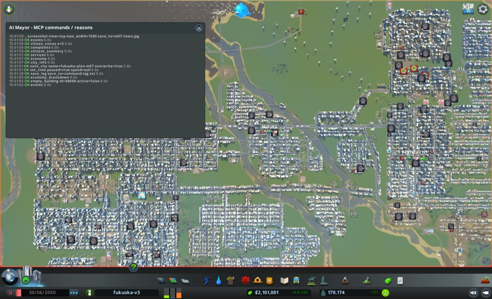

#### 施策

(結果の欄は実行する市長が書く。詳しくは council/m07-bill.md)

- m07-1 風力の網の空きに公園を1か所 (588,1232)(urban-1)。公約4(間接)、4-2。採択理由: 公園82棟で目標100に遠く、電気の届く点で test ok。予想: Beautification 82→83、電気が来る。建設費 1,000、週 8。結果: (実行後)
- m07-2 東の出口 z=-318 の3区間を4車線に(roads-1、試し)。6-3。採択理由: (3303,-285) の blocked 38、test ok、費用0。予想: `traffic`(x3350 z-290 r150)の blocked 60→40以下。建設費 0、週 0。結果: (実行後)
- m07-3 北東 z=560 の2区間を4車線に(roads-2、試し)。6-3。採択理由: (2293,557) の blocked 27、test ok、費用0。予想: `traffic`(x2290 z560 r150)の blocked 41→30以下。建設費 0、週 0。結果: (実行後)
- m07-4 政策 EducationBoost を外す(finance-1、試し)。公約3、4。6-1。採択理由: 定員に余裕があり、週 7,940 の余地が出る。予想: Education の支出 48,120→約40,180、大卒の失業と事務所の数字の方向は不明。建設費 0、週 -7,940。結果: (実行後)
- 調査: s07-1(28755の止まり、port)、s07-2(汚染の印、health)、s07-3(公園後の地価、urban)
- 費用の合計: 建設費 1,000、週の維持費の増え 約 -7,930。週の収支は約 +18,400、所持金は約 2,100,000 の見込み

#### 考えたが打たなかった手

- economy-1(11580の取り壊し): 名所が9→8に下がり、置き直しが未確認(島Bの試しは AlreadyExists)。条件付きで同じ月に調べ直す
- port・health・fire は案なし。市長は代案を作らない。調査 fire は上限3件のため見送り(火事は毎月 complaints で見る)
- 試しの案は m07-2、m07-3、m07-4 が出た。分からないことの(1)11580 の電気、(2)島Bの名所は、試しの案が出なかった

##### 実行の結果(実行する市長が書く。2050-06-30)

- m07-1: 成功。test ok(wouldDemolish 0、入口 segment 34548 に距離15.2)のあと Regular Park を place_building(id 32260、費用 1,000)。`buildings_near`(x588 z1232 r40)で problems None、grid.electricity true、water true、sewage true。基準の地価(`map_layer` landvalue x588 z1232 r100 n5)は平均2、最小0、最大9
- m07-2: 成功。test の upgraded 3 を再確認し、upgrade_road(Small 4 Lane Road、z=-318)で matched 3、upgraded 3、skipped 0、費用0。基準 `traffic`(x3350 z-290 r150): blocked 60、cars 104、congestion 42、flow 54。blockedSpots (3303,-285) 38、(3438,-265) 22
- m07-3: 成功。test の upgraded 2 を再確認し、upgrade_road(z=560)で matched 2、upgraded 2、skipped 0、費用0。基準 `traffic`(x2290 z560 r150): blocked 41、cars 50、congestion 46、flow 54。blockedSpots (2293,557) 27、(2166,536) 9、(2416,558) 5
- m07-4: 成功。実行前の list_policies で EducationBoost active=true、costPerWeek 7,940(議案どおり)。set_policy で active=false。基準: 大卒の失業5,508、Office 収入24,741、Education 支出48,120、事務所レベル3 3,260、education 定員 小14,268 / 高24,360
- 取り壊し: なし。hooks に止められた手: なし

| 2050-06-30 | 月例 | m07-1〜m07-4 | 上のとおり | urban / roads / finance | 4-2 / 6-3 / 6-1 | なし | 観光・交通・財政 | 3、4 | 1,000 | 約 -7,930 | 8月に埋めた(8月の答え合わせ): m07-1 当たり、m07-2 当たり、m07-3 外れ、m07-4 週の収支は当たり・大卒の失業は増えた(まだ分からない) |

##### 見回りと月末(2050-07)

| ゲーム内の日付 | 区切り | 人口 | 所持金 | 週の収支 | 幸福度 | 需要(住/商/工) | 主な困りごと |
|---|---|---|---|---|---|---|---|
| 2050-07-10 | 見回り1 | 179,508 | 2,127,433 | +19,012(収入345,104、支出326,092) | 88 | 23 / 2 / 57 | 来ない市民 0/0/0、観光客1,734(訪問146)。境目なし。events は雑談3件(水の不満1件) |
| 2050-07-20 | 見回り2 | 179,856 | 2,151,284 | +16,406(収入342,533、支出326,127) | 88 | 22 / 4 / 60 | 来ない市民 0/0/0、観光客1,729。境目なし。events は電力の不満1件 |
| 2050-07-30 | 月末 | 180,138 | 2,174,932 | +16,355(収入342,510、支出326,155) | 88 | 22 / 2 / 56 | 来ない市民 0/0/0、観光客1,744(訪問150)、Tourism 週32、Education 支出38,592、大卒の失業5,954、事務所レベル3 3,262、汚染の印21、火事2、ごみ23、品物がない店227。境目なし |

月末の計測(道具が返した事実。判定は8月の月例):

- m07-1: Regular Park 32260 は problems None。Beautification の棟数は `buildings_near` で街全体を数えていないため未測定。地価(x588 z1232 r100 n5)は平均2→4(最大9→11)。7/10 と月末は同じ値
- m07-2: `traffic`(x3350 z-290 r150) blocked 60→17(cars 104→70、congestion 42、flow 56)。blockedSpots は (3255,-288) 17 のみ(基準は (3303,-285) 38、(3438,-265) 22)
- m07-3: `traffic`(x2290 z560 r150) blocked 41→47(cars 69、congestion 59、flow 56)。blockedSpots は (2314,557) 26、(2160,529) 14、(2412,557) 7(基準 (2293,557) 27)。増えた
- m07-4: EducationBoost 外した後。Education 支出48,120→38,592(週の収支は +10,489→+16,355)。services の education 定員は小14,268 / 高24,360 のまま(子ども10,256、10代21,813)。大卒の失業5,508→5,954、事務所レベル3 3,260→3,262、Office 収入24,741→24,435
- 週の収支: +10,489 → +16,355。人口 179,174 → 180,138(増)。観光客1,665→1,744、Tourism 週53→32
- 調査 s07-1〜s07-3: `council/m07-survey-port.md`、`m07-survey-health.md`、`m07-survey-urban.md` に記録

##### 次にやること(実行する市長が書く。8月の月例の前)

- m07-1〜m07-4 の判定は8月の月例。m07-3 は blocked 41→47 で増えた(隣の Basic 区間 24873 に density 100)
- m07-4: 大卒の失業が増えた。定員は足りている。事務所レベルの建て替えは数週かかるので8月に再測する
- 貨物センター28755 の止まった車は645台(7days+ が517台)。周辺の道路の blocked は0で、敷地内 WaitingSpace が原因の見立て
- hooks に止められた手: なし。臨時: 行っていない

#### 見たもの

- `explain`、`test_place_building`、`place_building`、`buildings_near`: m07-1 の実行と確認
- `test_upgrade_road`、`upgrade_road`、`traffic`: m07-2、m07-3 の実行と基準・月末の計測
- `list_policies`、`set_policy`、`citizens_summary`、`economy_breakdown`、`building_stats`、`services`: m07-4 の実行と基準・月末
- `city_info`、`events`: 見回り2回と月末
- `vehicles_stuck`、`cargo`、`map_layer`、`complaints`: 調査 s07-1〜s07-3

#### 判断の根拠

議案の4件を、建物(公園)、道路2か所、政策の順に打った。どれも議案の条件(test ok、costPerWeek 7,940)を満たし、費用は建設費1,000のみだった。月末は週の収支が +16,355 に上がり、守る線 +3,000 を大きく上回る。m07-2 は blocked が減り、m07-3 は増えた。

#### 捨てたもの

- 臨時: 境目に当たらなかったため行わない
- 議案にない手: 打たない(電気の来ない名所 11580 の取り壊しなど)

### 2050-07-30 月例(8か月目)

保存: fukuoka-plan-m08(上書き)。dialog なし。events は0件。

#### 答え合わせ

- m07-1 風力の網の公園(id 32260): 予想は Beautification 82→83、電気が来る。結果は `buildings_near`(service=Beautification)の total 83、problems None、grid.electricity true。当たり。地価(x588 z1232 r100 n5)は平均4(月末と同じ)。続ける
- m07-2 東の出口 z=-318 の4車線化: 予想は blocked 60→40以下。結果は17(`traffic` x3350 z-290 r150、flow 56)。当たり(予想より良い)。続ける
- m07-3 北東 z=560 の4車線化: 予想は blocked 41→30以下。結果は47(blockedSpots (2314,557) 26)。外れ(増えた)。理由の見立て(事実ではない): 隣の Basic Road 24873(density 100)が詰まりを作る。次の扱い: 同じ手は続けない。隣の区間は未確認で、一覧に足した
- m07-4 EducationBoost を外す: 予想は Education 支出 48,120→約40,180。結果は38,592。当たり。週の収支は +10,489→+16,355。大卒の失業は5,508→5,954に増え、事務所L3は3,260→3,262。大卒の失業は予想の方向がなかった。まだ分からない(1回目)。9月に同じ道具で測る
- 前回の「次にやること」: 名所 11580 の電気は今月も Electricity、MajorProblem(未解決。4回目)。貨物センター28755 の止まりは514台(続く)。観光の入口と名所の追加は議案に出ていない(未実行)
- 公約の進み具合
  1. 人口: 180,138。前月例179,174より964増えた。2か月続けて増えた。達成
  2. 来ない市民: 0 / 0 / 0。達成。保つ
  3. 赤字: 週の収支 +16,355。黒字
  4. 観光: 今いる観光客1,744(前1,665。増えた)、Tourism 週32(前53。減った)。人数は増え、収入は減り、目標1,000の3%。未達

#### 計画の施策ごとの今の数字(2050-07-30)

- 1-2: 健康の平均89(目標80。達成)
- 2-3: 小学校 14,268 / 子ども10,256、高校 24,360 / 10代21,813。保つ
- 3-3: 来ない市民 0/0/0
- 3-4: 火事2、犯罪の印なし、合わせて2(目標4以下。達成)。crimeRate 5
- 4-1: 住宅(高密度)の地価の平均59(目標62)
- 4-2: Beautification 83棟(目標100)
- 4-3: 汚染の印21(目標15以下)
- 4-4: ごみの印23(目標0。6月は8から増えた)、満杯の埋立地0
- 6-1: 事務所のレベル3は3,262棟(目標3,500)
- 6-3: 交通の流れ56%(目標60)。止まった車944
- 5-1・5-2: 観光客1,744、訪問150、Tourism 週32、名所9棟(目標10)、旅客の入口0。attractiveness 平均2(x0 z0 r4000 n9、最大23)
- 6-4・7-1: 働き口86,731(空き2,785。目標90,000)、品物がない店227、原料がない工場33
- 8-1: 駅・港の敷地の止まったトラック518(貨物センター28755が514。目標250以下)

#### 気づいたこと

- 観光は8か月目も入口0。名所は9棟で、島Bは橋と風力がそろったまま0棟、空き地3の名所 11580 は電気が来ない。Tourism は週32で目標の3%
- 週の収支は +16,355 まで伸び、所持金は2,174,932。観光の建設に使える余裕が出た
- ごみの印が 8→23 に増えた(hotspot (-580,-1307) の高密度住宅)。満杯の埋立地は0なので、収集の経路か施設の遠さが疑われる(未確認)。貨物センター28755 は514台で、目標250の2倍

#### 次にやること

- 編成方針の重点は 5-1・5-2 観光(入口、島B・空き地3・空き地の名所)、8-1 と旅客の入口、4-4 ごみ
- 局の案で、島Bに名所を置く手、旅客の入口、11580 の電気の手を確かめる

#### 画面写真

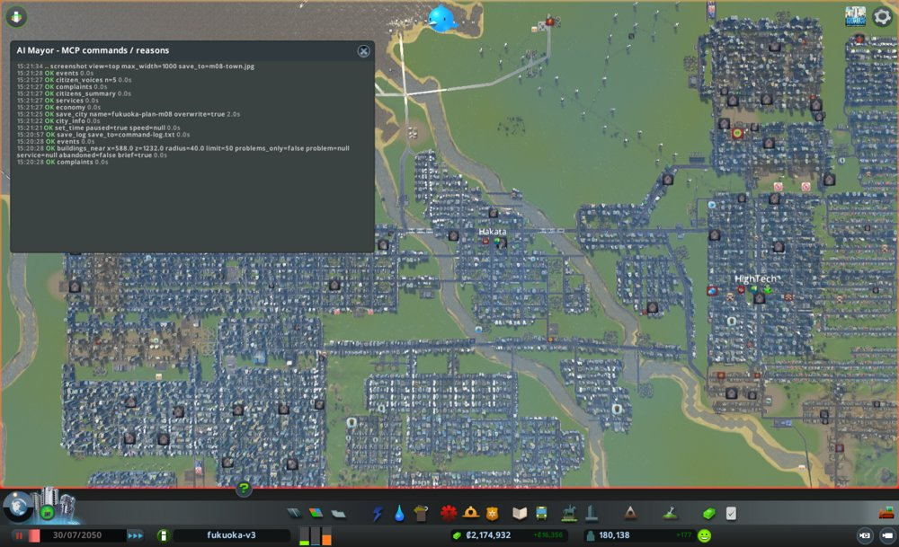

#### 施策

(結果の欄は実行する市長が書く。詳しくは council/m08-bill.md)

- m08-1 公園を (752,1290) に1か所と道60m(urban-1)。4-2。採択理由: 公園83棟で目標100に遠く、test が ok、電気あり。予想: Beautification 83→84、電気の印なし。建設費 1,320、週 10.4。結果: (実行後)
- m08-2 交差点 (-1100,-440) に信号(roads-1)。6-3。採択理由: blocked 45 のうち42台がこの交差点。予想: `traffic`(x-1098 z-459 r150)の blocked 45 より減る。建設費 0、週 0。結果: (実行後)
- m08-3 x=-1845(z -620〜-830)を4車線に(roads-2)。6-3。採択理由: density 100 の区間、test ok、費用0。予想: `traffic`(x-1845 z-760 r160)の blocked 21 より減る(隣の Basic 区間に移る恐れ)。建設費 0、週 0。結果: (実行後)
- m08-4 西のごみ hotspot に埋立地を足す(health-1、取り壊し)。4-4。採択理由: 焼却場 33797 が満杯で hotspot が受け皿なし。失う家12・働き口0。予想: ごみの印 23→15以下。建設費 4,640、週 約165。結果: (実行後)
- m08-5 火元の事務所2棟を壊し Fire House を置く(fire-1、取り壊し)。3-4。採択理由: 2か月燃え続けた放棄建物。失う働き口0・家0。予想: Fire 2→0。建設費 12,000、週 560。結果: (実行後)
- 調査: s08-1(28755の待ち、port)、s08-2(汚染の出どころ、health)、s08-3(ごみ収集車、finance)
- 費用の合計: 建設費 17,960、週の維持費の増え 約735。週の収支は約 +15,620、所持金は約 2,157,000 の見込み

#### 考えたが打たなかった手

- finance-1(Recycling と事務所税4%): 条件付き。事務所税が m07-4 の測りと重なり、ごみの測りが m08-4 と重なる。補いの効きがゼロなら収支が 2,944 で守る線を割る。差し戻して調べ直す
- 経済観光文化局は案のファイルが見つからず、港湾空港局と教育委員会は案なし。観光の入口と名所の追加は、市長が代案を作らないため今月は動かさない。公約4の最大の穴として記録
- 調査 urban(4-1 の地価の空き)は上限3件のため見送り。9月に再検討
- 試しの案は、finance-1 が出たが差し戻した。分からないことの(1)島Bの名所、(2)11580 の電気は、試しの案が出なかった

##### 実行の結果(実行する市長が書く。2050-07-30、所持金 2,174,932 から 2,156,932)

- m08-1: 成功。test ok のあと Regular Park を place_building(id 473、費用 1,000、入口 (720,1290))。続けて Basic Road [[712,1350],[712,1290]](費用 320、snapped 1)。`buildings_near` で problems None、grid.electricity true。入口の road は null のまま(道の端 (712,1290) と入口 (720,1290) は8m。つながりは次の見回りで確認)
- m08-2: 成功。junction_info で canEnableLights true を確認し、node 32647 に信号を付けた(trafficLights true)。基準 `traffic`(x-1098 z-459 r150): blocked 45、cars 91、flow 56、blockedSpots (-1098,-459) 42
- m08-3: 成功。test の upgraded 4 を再確認し、upgrade_road(Small 4 Lane Road)で matched 4、upgraded 4、skipped 0、費用0。基準 `traffic`(x-1845 z-760 r160): blocked 21、cars 85、flow 56、blockedSpots (-1836,-829) 14、(-1846,-775) 7
- m08-4: 成功。preview_bulldoze は 5772 の1棟(家12、働き口0)のみで bulldoze(removedBuildings 1)。Landfill Site は電気・水・下水を要らない。test ok のあと place_building(id 14587、費用 4,000、x-700 z-1180、80x64 m)。議案の道 [[-575,-1160],[-700,-1148]] は建物の外形に重なり test が断ったため、端点を動かした経路 [[-575,-1160],[-640,-1134],[-700,-1134]](終点は入口 (-700,-1148) から14m。許容15m内)で test ok、build_line 費用 680(議案の道 640 より+40)。segment 762 と 31355。終点 (-700,-1134) は connectedTo none。埋立地が入口の道に届くかは次の見回りで確認
- m08-5: 成功。preview_bulldoze は 957 と 27740 の2棟(働き口0、家0)のみ。bulldoze(removedBuildings 2)のあと test ok(wouldDemolish 0)、Fire House を place_building(id 16576、費用 12,000、入口 segment 10025 に距離0)
- 月末の計測(2050-08-29、道具が返した事実。判定は9月の月例):
  - m08-1: 公園 473 は problems None、grid.electricity true。Beautification の街全体の棟数は未測定。観光客 now 1,790
  - m08-2: `traffic`(x-1098 z-459 r150) blocked 45→52、cars 100、flow 52。blockedSpots (-1057,-474) 36、(-1101,-376) 8(基準 (-1098,-459) 42)。交差点の真上の集まりは動き、数は減っていない
  - m08-3: `traffic`(x-1845 z-760 r160) blocked 21→16、cars 113、flow 52。blockedSpots (-1846,-754) 8、(-1907,-831) 8(基準 (-1836,-829) 14、(-1846,-775) 7)
  - m08-4: `complaints` の Garbage 23→10。西の hotspot (-580,-1307) の `buildings_near`(problem=Garbage)は10棟→0棟。埋立地 14587 は 3% full、problems None、ごみ収集車 4/19。残るごみの印の hotspot は (2215,-185)
  - m08-5: `buildings_near`(x2926 z1470 r100, problem=Fire)は0棟。`complaints` に Fire の印なし。Fire House 16576 を置いた
  - 週の収支 +16,355→+14,880(見込み +15,620)。人口 180,138→180,168、観光客 1,744→1,790、Tourism 週は未測定
  - 調査 s08-1〜s08-3: `council/m08-survey-port.md`、`m08-survey-health.md`、`m08-survey-finance.md` に記録
- hooks に止められた手: なし。取り壊しの理由: 5772 は埋立地の場所を空けるため(ごみの印23を減らす)。957、27740 は2か月燃え続けた放棄の事務所で、Fire House を同じ場所に置くため

| 2050-07-30 | 月例 | m08-1〜m08-5 | 上のとおり | urban / roads / health / fire | 4-2 / 6-3 / 4-4 / 3-4 | 取り壊し2件(m08-4、m08-5) | 環境・交通・安全 | 4(間接) | 17,680(実費。道の経路変更で +40) | 約735 | 9月に埋めた(9月の答え合わせ): m08-1 当たり、m08-2 外れ、m08-3 当たり、m08-4 当たり、m08-5 当たり |

##### 次にやること(実行する市長が書く。9月の月例の前)

- m08-1〜m08-5 の判定は9月の月例。m08-2 は blocked 45→52 で減らず(交差点の真上から (-1057,-474) 36 へ移動)、m08-3 は 21→16
- m08-1: 公園 473 の入口の道は端 (712,1290) と入口 (720,1290) が8m離れる。つながりと Beautification の棟数を9月に測る
- m08-4: 埋立地 14587 の道の終点 (-700,-1134) は入口 (-700,-1148) から14m。収集は4/19台が動き、西の hotspot の印は消えた
- 貨物センター28755 の止まった車は632台(7days+ が500台)。敷地内 WaitingSpace のまま
- 観光の入口と名所の追加は議案に出なかった(未実行)
- hooks に止められた手: なし。臨時: 行っていない

#### 見たもの

- `explain`、`test_place_building`、`place_building`、`test_build_line`、`build_line`、`junction_info`、`set_traffic_lights`、`test_upgrade_road`、`upgrade_road`、`preview_bulldoze`、`bulldoze`: 議案5件の実行
- `traffic`、`buildings_near`、`complaints`、`city_info`、`events`: 基準と月末の計測、見回り2回
- `vehicles_stuck`、`map_layer`: 調査 s08-1〜s08-3

#### 判断の根拠

議案の5件を、公園(建物のあとに道)、信号、4車線化、埋立地(取り壊し、建物、道)、Fire House(取り壊し、建物)の順に、取り壊しを `advance` の前にすべて済ませて打った。埋立地の道は議案の経路が建物の外形に重なり、端点を許容内で動かして test が通った。月末は西のごみ印が消えて Garbage 23→10、週の収支は +14,880 で守る線 +3,000 の上を保った。

#### 捨てたもの

- 臨時: 境目に当たらなかったため行わない
- 議案にない手: 観光の入口・名所は議案に出ていないため打たない

### 2050-08-29 月例(9か月目)

保存: fukuoka-plan-m09(上書き)。dialog なし。events は雑談1件。

#### 答え合わせ

- m08-1 公園 (752,1290): 予想は Beautification 83→84。結果は `buildings_near`(service=Beautification)total 84。当たり。続ける
- m08-2 交差点 (-1100,-440) の信号: 予想は blocked 45より減る。結果は52(月末)。外れ。理由の見立て(未確認): 止まりが (-1057,-474) 36 に移った。次の扱い: 同じ手は続けない。一覧に足した
- m08-3 x=-1845 の4車線化: 予想は blocked 21より減る。結果は16。当たり
- m08-4 西の埋立地: 予想は Garbage 23→15以下。結果は10(今月も10)。当たり
- m08-5 Fire House: 予想は Fire 2→0。結果は `complaints` に Fire の印なし。当たり
- 週の収支: 見込み +15,620 に対し +14,880。守る線 +3,000 の上。所持金 2,221,745
- 前回の「次にやること」: 観光の入口と名所の追加は議案に出ていない(未実行。9か月続けて入口0)。11580 の電気は未解決
- 公約の進み具合
  1. 人口: 180,168。前月例180,138より30増えた。3か月続けて増えた。達成
  2. 来ない市民: 0 / 0 / 0。達成。保つ
  3. 赤字: 週の収支 +14,880。黒字
  4. 観光: 今いる観光客1,790(前1,744。増えた)、Tourism 週52(前32。増えた)。2つとも増えたが、Tourism は目標1,000の5%

#### 計画の施策ごとの今の数字(2050-08-29)

- 1-2: 健康の平均89(目標80。達成)
- 2-3: 小学校 14,268 / 子ども10,012、高校 24,360 / 10代21,601。保つ
- 3-3: 来ない市民 0/0/0
- 3-4: 火事の印なし、犯罪1、合わせて1(目標4以下。達成)
- 4-1: 住宅(高密度)の地価の平均59(目標62)
- 4-2: Beautification 84棟(目標100)
- 4-3: 汚染の印37(目標15以下。8月の月初21から増えた)
- 4-4: ごみの印10(目標0)、満杯の埋立地0
- 6-1: 事務所のレベル3は3,274棟(目標3,500)
- 6-3: 交通の流れ52%(目標60)。止まった車743
- 5-1・5-2: 観光客1,790、訪問156、Tourism 週52、名所9棟(目標10)、旅客の入口0。attractiveness 平均2(x0 z0 r4000 n9、最大25)
- 6-4・7-1: 働き口86,779(空き2,688。目標90,000)、品物がない店230、原料がない工場28
- 8-1: 駅・港の敷地の止まったトラック553(貨物センター28755が532。目標250以下)

#### 気づいたこと

- 観光は9か月目も入口0。名所は9棟で、島Bは橋と風力があるが名所0棟、空き地3の名所 11580 と公園 30466 に電気が来ない。attractiveness 平均2のまま。公約4は9か月、建設の手が1件も打てていない
- 大卒の失業が6,849(失業者の99%)。働き口の空きは2,688。EducationBoost を外した後に失業が増えた。人口は3か月続けて増えた
- 汚染の印が37に増えた(hotspot (3688,-67) 21棟)。貨物センター28755 の止まったトラックは532台

#### 次にやること

- 編成方針の重点は 5-1・5-2 観光(入口と名所、島B・空き地)、8-1 と旅客の入口、4-3 汚染
- 局の案で、旅客の入口と島B・空き地の名所の置き方を確かめる

#### 画面写真

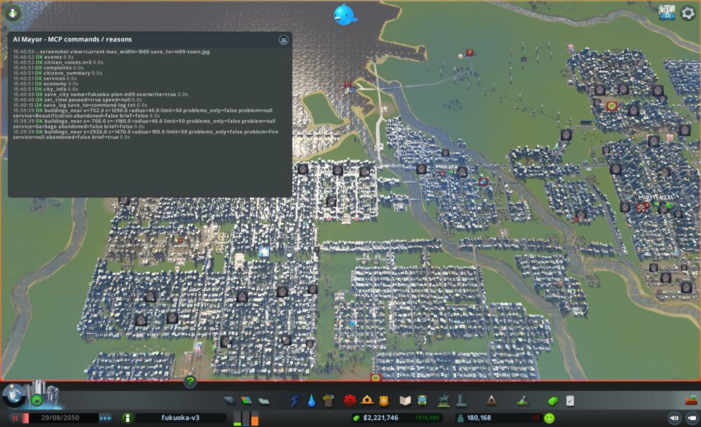

#### 施策

(結果の欄は実行する市長が書く。詳しくは council/m09-bill.md)

- m09-1 公園を (690,1190) に1か所と道101m(urban-1)。4-2。採択理由: 公園84棟で目標100に遠く、test が ok、電気あり。予想: Beautification 84→85、公園の problems なし。建設費 1,520、週 約12。結果: (実行後)
- m09-2 西の z=-560 幹線の3区間を4車線に(roads-1)。6-3。採択理由: 8月の信号が効かず、下流の1車線(density 100)が元と見立て。test ok、費用0。予想: `traffic`(x-1100 z-480 r300)の blockedSpots 合計 66→40以下。建設費 0、週 0。結果: (実行後)
- m09-3 東南の x=1560(z 10〜100)を4車線に(roads-2)。6-3。採択理由: density 100 の区間が Medium Road への入口につながる。test ok、費用0。予想: `traffic`(x1570 z40 r200)の blockedSpots 合計 33→15以下。建設費 0、週 0。結果: (実行後)
- m09-4 事務所税を 3%→2% に(finance-1、試し、税)。6-1。採択理由: 大卒の失業が失業者のほぼ全員。見込み週の収支 +6,730 で守る線の上。予想: 事務所の建設・レベル3が増え、大卒の失業が下がる(量は見積もれない)。建設費 0、税収 週 約 -8,150。結果: (実行後)
- 調査: s09-1(東 (2114,284) の blocked の位置、roads)、s09-2(汚染の出どころ、health)
- 費用の合計: 建設費 1,520、週の維持費の増え 約12、税収 約 -8,150。週の収支は約 +6,718、所持金は約 2,220,000 の見込み

#### 考えたが打たなかった手

- port・economy・health・education・fire は案なし。市長は代案を作らない。観光の入口と名所の追加は、9か月続けて動かない。公約4の最大の穴として記録。代わりに plan-city.md の調整17・18で、10月に道路下水道局が空き地3の接続と名所の送電線を試すよう求めた
- 試しの案は m09-4(finance-1)だけが出た。分からないことの(1)観光の名所・入口、(2)島Bの名所、(3)11580 の電気は、試しの案が出なかった。(4)信号 (-1100,-440) は m09-2 と s09-1 が関わる

##### 実行の結果(実行する市長が書く。2050-08-29、所持金 2,221,745)

- m09-1: 一部。Regular Park を place_building(id 23298、x690 z1190、費用 1,000、入口 (722,1190)、angleUsed 270)。公園は幅72×奥行64 m。道は議案の経路が公園の外形に重なり test が断った。端点を動かして3回試した((736,1190)、(728,1190)、(727,1190) 直線)。いずれも公園、隣の公園 473、風力 19235(x760 z1185 の56m角。公園との隙間は約10m)のどれかに重なり断られた。上限(許容15m内で1回の試し)を超えたので道は引かず。公園は `buildings_near` で problems RoadNotConnected、電気 true。月末の Beautification 全体は 85棟(84から増えた。道なしでも数えられた)
- m09-2: 成功。test の matched 5/2/1 を取り直し、すべて upgraded、skipped なし。upgrade_road(Small 4 Lane Road)で同じ数、費用0
- m09-3: 成功。matched 2、upgraded 2、skipped なし、費用0
- m09-4: 成功。実行前の economy で office 3、週の収支 +14,880、所持金 2,221,745 を確認。set_tax office 2。economy で office 2 を確認
- 基準(8/29): `traffic`(x-1100 z-480 r300)blockedSpots 66(36/22/8)。`traffic`(x1570 z40 r200)blockedSpots 33(18/15)
- 月末の計測(9/28、判定は10月の月例):
  - m09-2: blocked 76→154、blockedSpots (-1073,-497) 50、(-1093,-661) 35、(-947,-664) 17(合計102)。flow 55。busiest は Basic Road 25388 (-1100,-400)、22372 (-1216,-650)、8821 (-1245,-624) の density 100
  - m09-3: blocked 62→50、blockedSpots (1513,77) 25、(1737,93) 11、(1576,-69) 10(合計46)。flow 55
  - m09-4: 週の収支 +14,880→+10,106(収入337,380、支出327,268)。Office 収入 24,451→16,468。10/8: 収入336,274、支出327,277、+8,997。事務所の棟数・大卒の失業は月末に測っていない(10月の月例で測る)
  - 観光: 9/28 観光客1,663、Tourism 週52。10/8 観光客1,705(訪問140)
  - 人口: 180,168→180,164(9/28)→180,117(10/8)
- 調査 s09-1、s09-2: `council/m09-survey-roads.md`、`m09-survey-health.md` に記録
- hooks に止められた手: なし。取り壊し: なし。臨時: 行っていない
- 手順のずれ: advance を4回呼んだ(8/29→9/8→9/18→9/28→10/8)。月末の計測は3回目の後(9/28)に行い、4回目は余分

| 2050-08-29 | 月例 | m09-1〜m09-4 | 上のとおり | urban / roads / finance | 4-2 / 6-3 / 6-1・6-4 | 税 | 環境・交通・財政 | 4(間接)・3 | 1,000 | 約12 + 税収 約 -4,800(実測) | 10月に埋めた: m09-1 棟数は当たり(道は未接続)、m09-2 外れ、m09-3 小さく当たり、m09-4 まだ分からない(1回目) |

##### 見回りと月末(2050-09〜10)

| ゲーム内の日付 | 区切り | 人口 | 所持金 | 週の収支 | 幸福度 | 需要(住/商/工) | 主な困りごと |
|---|---|---|---|---|---|---|---|
| 2050-09-08 | 見回り1 | 180,298 | 2,230,009 | +6,671(収入333,908、支出327,237) | 89 | 19 / 4 / 63 | 来ない市民 0/0/0、観光客1,795、Tourism 未測定。境目なし(events 雑談2件)。収支は事務所税の影響で下がったが黒字 |
| 2050-09-18 | 見回り2 | 180,169 | 2,243,119 | +9,563(収入336,825、支出327,262) | 89 | 19 / 2 / 64 | 来ない市民 0/0/0、観光客1,738。境目なし(events 雑談2件) |
| 2050-09-28 | 月末 | 180,164 | 2,257,478 | +10,112(収入337,380、支出327,268) | 89 | 19 / 2 / 64 | 来ない市民 0/0/0、観光客1,663(訪問148)、Tourism 週52、Beautification 85棟、Garbage 8、Pollution 23、Fire 2。境目なし |

#### 次にやること

- m09-1: 公園 23298 に道が付いていない(RoadNotConnected)。入口 (722,1190) の前の隙間が公園と風力の間で約10m。道をつなぐ別の経路は、局が10月に案を出す
- m09-2: blocked が 76→154 に増えた(隣の Basic Road の density 100 に詰まりが移った見立て。未確認)。10月の局が判定する
- m09-4: 週の収支は +10,112 で守る線 +3,000 の上。事務所の棟数、大卒の失業、Office 収入を10月の月例で測る
- hooks に止められた手: なし。臨時: 行っていない

#### 見たもの

- `test_place_building`、`place_building`、`test_build_line`: m09-1 の公園と道の試し
- `test_upgrade_road`、`upgrade_road`、`traffic`: m09-2、m09-3 と基準、月末の計測
- `economy`、`set_tax`: m09-4
- `city_info`、`events`、`complaints`、`economy_breakdown`、`buildings_near`、`map_layer`: 見回り、月末、調査 s09-1・s09-2

#### 判断の根拠

議案の4件を、公園(建物のあとに道)、4車線化2件、事務所税の順に打った。公園の道は、議案の座標と許容15m内の3回の試しがすべて建物の外形に重なり断られ、引かなかった。週の収支は事務所税で +14,880 から約 +10,100 に下がったが、守る線 +3,000 の上にある。

#### 捨てたもの

- 公園の道: 許容内の端点で通らなかった。局が新しい経路を出す
- 臨時: 境目に当たらなかったため行わない

### 2050-10-08 月例(10か月目)

保存: fukuoka-plan-m10(上書き)。dialog なし。events は雑談2件。

#### 答え合わせ

- m09-1 公園 (690,1190): 予想は Beautification 84→85。結果は85棟。当たり。ただし公園 23298 は RoadNotConnected のまま。次の扱い: 道の別経路を局が出す
- m09-2 z=-560 の4車線化: 予想は blockedSpots 合計 66→40以下。結果は73(blocked 80)。外れ。理由の見立て(未確認): 隣の Basic Road(density 100)に詰まりが移る。次の扱い: 同じ手は続けない。一覧に足した
- m09-3 x=1560 の4車線化: 予想は blockedSpots 合計 33→15以下。結果は21(blocked 62→21)。小さく当たり
- m09-4 事務所税2%: 予想は事務所とレベル3が増え、大卒の失業が下がる。結果は L3 3,274のまま、大卒の失業8,293(8月 6,849)、Office 収入 24,451→16,470。外れの形だが、建て替えは数週かかる。まだ分からない(1回目)
- 週の収支: 見込み +6,718 に対し +8,997。守る線 +3,000 の上。所持金 2,270,429
- 前回の「次にやること」: 公園の道の別経路は局の案待ち(未実行)。観光の入口と名所の追加は、10か月続けて動いていない
- 公約の進み具合
  1. 人口: 180,117。前月例180,168より51減った。未達(3か月続いた増加が止まった)
  2. 来ない市民: 0 / 0 / 0。達成。保つ
  3. 赤字: 週の収支 +8,997。黒字
  4. 観光: 今いる観光客1,705(前1,790。減った)、Tourism 週42(前52。減った)。2つとも減り未達

#### 計画の施策ごとの今の数字(2050-10-08)

- 1-2: 健康の平均89(目標80。達成)
- 2-3: 小学校 14,268 / 子ども9,609、高校 24,360 / 10代21,303。保つ
- 3-3: 来ない市民 0/0/0
- 3-4: 火事2、犯罪4、合わせて6(目標4以下)
- 4-1: 住宅(高密度)の地価の平均59(目標62)
- 4-2: Beautification 85棟(目標100)
- 4-3: 汚染の印27(目標15以下)
- 4-4: ごみの印7(目標0)、満杯の埋立地0
- 6-1: 事務所のレベル3は3,274棟(目標3,500)
- 6-3: 交通の流れ54%(目標60)。止まった車815
- 5-1・5-2: 観光客1,705、訪問140、Tourism 週42、名所9棟(目標10)、旅客の入口0。attractiveness 平均2(x0 z0 r4000 n9、最大25)
- 6-4・7-1: 働き口87,009(空き2,782。目標90,000)、品物がない店218、原料がない工場27
- 8-1: 駅・港の敷地の止まったトラック540(貨物センター28755が540。目標250以下)

#### 気づいたこと

- 観光は10か月目も入口0、名所9棟。Tourism 週42は目標1,000の4%で、観光客も減った。島Bは名所0、空き地3の名所 11580 と公園 30466 は Electricity の印が5回目。残り2か月で、公約4を動かすには建設の手が要る
- 大卒の失業が citizens_summary で8,293(失業者の99%)に増え、事務所税2%は効きが見えない。空き働き口は2,782
- 貨物センター28755 の止まったトラック540は目標250の2倍。ごみ7、汚染27、火事2は前月から下がった

#### 次にやること

- 編成方針の重点は 5-1・5-2 観光(名所と attractiveness)、5-1・5-2(入口) 旅客の駅・港・空港、4-3 汚染
- 局の案で、旅客の入口と島B・空き地の名所、公園 23298 の道を確かめる

#### 画面写真

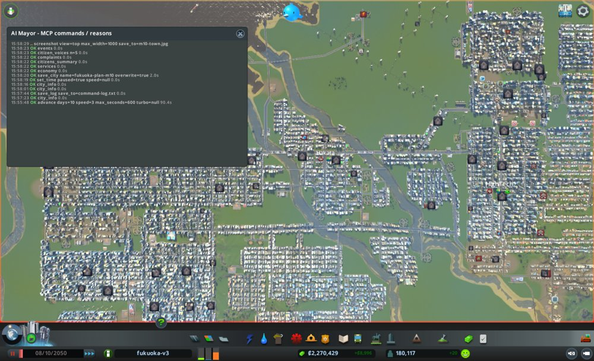

#### 施策

(結果の欄は実行する市長が書く。詳しくは council/m10-bill.md)

- m10-1 公園を (762,1368) に1か所(urban-1)。4-2。採択理由: Beautification 85棟で目標100に遠く、test ok、入口の道 15421、電気あり。予想: Beautification 85→86、公園の problems なし。建設費 1,000、週 8。結果: (実行後)
- m10-2 焼却場 10351 を止める(health-1、試し)。4-3。採択理由: 汚染の印27のうち10棟が 10351 の約50m以内。予想: 汚染の印が減る方向(量は見積もれない)、ごみの印は15以下。15超なら戻す。建設費 0、週 -1,440。結果: (実行後)
- 調査: s10-1(事務所税2%の効き、finance)、s10-2(死体の印、health)、s10-3(犯罪の印の山、fire)
- 費用の合計: 建設費 1,000、週の維持費の増え 約 -1,432

#### 考えたが打たなかった手

- economy-1(名所 Servicing Services を (1580,-530))は条件付き。電気・水のつなぎ口と入口の道の接続が未確認
- roads-1(駅への接続)と roads-2(名所への送電線)は不可。駅の場所が決まらず、roads-2 は economy-1 と同じ場所
- port、education、fire、finance は案なし。市長は代案を作らない
- 試しの案は m10-2 だけ。観光の名所・入口、島B、11580 の電気、公園 23298 の道は、実行できる試しの案が出なかった

##### 実行の結果(実行する市長が書く。2050-10-08、所持金 2,270,429)

- m10-1: 成功。test_place_building ok のあと Regular Park を place_building(id 19278、費用 1,000、入口 (730,1368)、segment 15421 に距離10、angleUsed 90)。buildings_near で problems None、electricity true。月末 Beautification 86棟(85から増)
- m10-2: 成功。10351 は Combustion Plant、problems None、稼働中を確認。set_building_active(active false)で problems TurnedOff、処理 0 / week。基準: Pollution 27、map_layer 平均78、Garbage 7
- 月末(11/7): Pollution 30(hotspot が (3665,-85) の14棟に移り、10351 周りではない)、map_layer(2096,822 r300)平均 78→77→75→72、Garbage 7→9→13→8(15を超えず、戻していない)。週の収支 +10,680

| 2050-10-08 | 月例 | m10-1 | 公園を (762,1368) に置く | urban | 4-2 | なし | 環境 | 4(間接) | 1,000 | 8 | 11月に埋めた: 当たり(Beautification 85→86、電気 true) |
| 2050-10-08 | 月例 | m10-2 | 焼却場 10351 を止める試し | health | 4-3 | なし | 環境 | 3 | 0 | -1,440(見込み) | 11月に埋めた: 効かない(汚染の印27→30、map_layer 平均78→76。ごみは8で15以下) |

##### 見回りと月末(2050-10〜11)

| ゲーム内の日付 | 区切り | 人口 | 所持金 | 週の収支 | 幸福度 | 需要(住/商/工) | 主な困りごと |
|---|---|---|---|---|---|---|---|
| 2050-10-18 | 見回り1 | 180,059 | 2,284,474 | +10,705(収入335,835、支出325,130) | 89 | 16 / 2 / 66 | 来ない市民 0/0/0、観光客1,772。境目なし。events 雑談2件。Garbage 9、Pollution 28 |
| 2050-10-28 | 見回り2 | 179,947 | 2,298,936 | +10,145(収入335,274、支出325,129) | 89 | 16 / 2 / 64 | 来ない市民 0/0/0、観光客1,761。境目なし。events 雑談2件。Garbage 13、Pollution 27 |
| 2050-11-07 | 月末 | 179,848 | 2,313,772 | +10,680(収入335,847、支出325,167) | 89 | 14 / 2 / 66 | 来ない市民 0/0/0、観光客1,763(訪問138)、Tourism 週27、Beautification 86棟、Garbage 8、Pollution 30。境目なし |

- 調査 s10-1〜s10-3: `council/m10-survey-finance.md`、`m10-survey-health.md`、`m10-survey-fire.md` に記録
- hooks に止められた手: なし。取り壊し: なし。臨時: 行っていない

#### 次にやること

- m10-2: 10351 は止めたまま。11月の月例で Pollution の棟数(基準27→30)と map_layer 平均(78→72)、Garbage(8)を判定する。ごみが15を超えたら active=true に戻す
- m10-1: 公園 19278 の電気は true。棟数 86、目標100にあと14
- 人口が 180,117→179,848 と減少。Tourism 週27は目標1,000の3%

#### 見たもの

- `test_place_building`、`place_building`、`buildings_near`: m10-1
- `set_building_active`、`complaints`、`map_layer`、`services`: m10-2 と見回り
- `city_info`、`events`、`economy_breakdown`、`new_buildings`、`demand_breakdown`、`vehicles_stuck`: 見回り、月末、調査

#### 判断の根拠

議案の2件を、公園、焼却場停止の順に打った。2件とも議決が要らず、実行前の条件(test ok、10351 稼働中)を満たした。月末までにごみの印は15を超えず、週の収支も +10,680 で守る線の上にあるため、10351 は止めたまま11月の月例に渡す。

#### 捨てたもの

- economy-1(名所 (1580,-530))と roads-1、roads-2: 議案で採らなかったため打たない
- 臨時: 境目に当たらなかったため行わない

### 2050-11-07 月例(11か月目)

保存: fukuoka-plan-m11(上書き)。dialog なし。events は雑談1件。

#### 答え合わせ

- m10-1 公園 (762,1368): 予想は Beautification 85→86、problems なし。結果は86棟、電気 true。当たり
- m10-2 焼却場 10351 停止(試し): 予想は汚染の印が減る方向、ごみ15以下。結果は汚染27→30、map_layer(2096,822 r300)平均78→76(途中72まで下がり戻る)、ごみ8。汚染は外れ、ごみは範囲内。理由の見立て(未確認): 汚染の中心は (3665,-85) の住宅14棟で、10351 の周りではない。次の扱い: 効かない。10351 を戻すかは局の案で決める。一覧に足した
- m09-4 事務所税2%: L3 3,274→3,275、大卒の失業 8,293→8,341。まだ分からない(2回目)。税を戻すか続けるかは、財政局の案で決める
- 週の収支: +8,997→+10,680。所持金 2,313,772。黒字で守る線の上
- 前回の「次にやること」: 10351 の判定(実行済み)。公園 19278 の電気 true(確認済み)。観光の入口と名所の追加は、11か月続けて動いていない
- 公約の進み具合
  1. 人口: 179,848。前月例180,117より269減った。未達(2か月連続で減)
  2. 来ない市民: 0 / 0 / 0。達成。保つ
  3. 赤字: 週の収支 +10,680。黒字
  4. 観光: 今いる観光客1,763(前1,705。増えた)、Tourism 週27(前42。減った)。人数は増え、収入は減り未達

#### 計画の施策ごとの今の数字(2050-11-07)

- 1-2: 健康の平均89(目標80。達成)
- 2-3: 小学校 14,268 / 子ども9,363、高校 24,360 / 10代20,993。保つ
- 3-3: 来ない市民 0/0/0
- 3-4: 火事3、犯罪2、合わせて5(目標4以下。あと1)
- 4-1: 住宅(高密度)の地価の平均59(目標62)
- 4-2: Beautification 86棟(目標100)
- 4-3: 汚染の印30(目標15以下)
- 4-4: ごみの印8(目標0)、満杯の埋立地0
- 6-1: 事務所のレベル3は3,275棟(目標3,500)
- 6-3: 交通の流れ54%(目標60)。止まった車723
- 5-1・5-2: 観光客1,763、訪問138、Tourism 週27、名所9棟(目標10)、旅客の入口0。attractiveness 平均2(x0 z0 r4000 n9、最大25)
- 6-4・7-1: 働き口87,275(空き2,602。目標90,000)、品物がない店209、原料がない工場33
- 8-1: 駅・港の敷地の止まったトラック580(貨物センター28755が580。目標250以下)

#### 気づいたこと

- 観光は11か月目も入口0。名所9棟、Tourism 週27は目標1,000の3%。残り1か月で、建設の手(名所1棟、旅客の入口)が試せるかが公約4の最後の機会。11580 と公園 30466 の Electricity、公園 23298 の RoadNotConnected は未解決
- 人口は2か月連続で減り、需要は住14と低い。空き家5,080、失業8,432(大卒8,341)。大卒の働き口が足りない構造は変わらない
- 28755 の止まったトラックは580で、目標250の2倍強。汚染は焼却場の停止で動かず、出どころ(住宅地 (3665,-85))は分からない

#### 次にやること

- 編成方針の重点は 5-1・5-2 観光(名所と attractiveness)、5-1・5-2(入口) 旅客の駅・港・空港、8-1 貨物センターの止まり
- 局の案で、名所1棟(目標10)と旅客の入口を確かめる。島と空き地も候補にする
- 分からないことのうち、汚染の出どころ(10351 は効かず)と空き地3の電気を、試しか調査の案にする

#### 画面写真

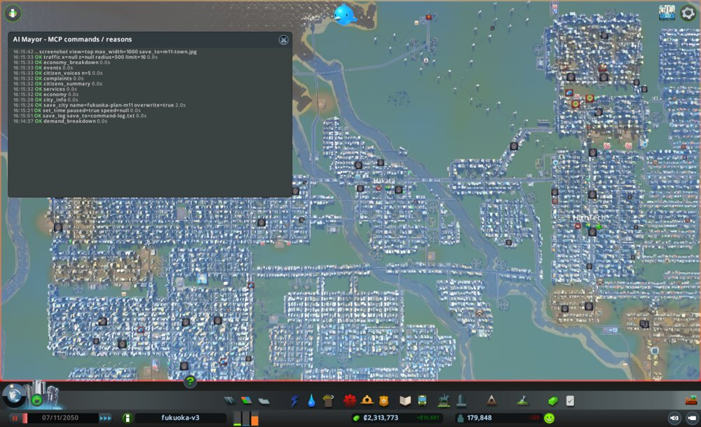

#### 施策

(結果の欄は実行する市長が書く。詳しくは council/m11-bill.md)

- m11-1 名所 Servicing Services を (1580,-530) に置き、道・電気・水をつなぐ(economy-1)。公約4、5-1・5-2。理由: 名所9棟で目標10にあと1。予想: 名所 9→10。attractiveness と観光客の増えは見積もれない。建設費 約21,040、週 約340。結果: (実行後)
- m11-2 公園を (658,1400) に置く(urban-1)。4-2。理由: 電気と道を確かめた1か所。予想: Beautification 86→87。建設費 1,000、週 8。結果: (実行後)
- m11-3 焼け跡の事務所 37356 を取り壊す(fire-1、取り壊し)。3-4。理由: 働き口0、家0。予想: Fire 3→2、合計 5→4。建設費 0。結果: (実行後)
- m11-4 事務所税を 2% から 3% に戻す(finance-1、税)。公約3。理由: 2%は事務所の建設も大卒の失業も動かさなかった。予想: 週の収支 +10,680→約 +18,600。結果: (実行後)
- m11-5 交差点 (2280,-950) に信号(roads-1、試し)。6-3。理由: 合流の待ち。予想: blocked 72→50以下(不確か)。建設費 0。結果: (実行後)
- 調査: s11-1(28755の空き待り、port)、s11-2(名所の効き、economy)、s11-3(-1678,-1323の止まり、roads)
- 費用の合計: 建設費 22,040、週の維持費の増え 348(税収 約 +8,000 は見込み)。所持金は約 2,291,700 の見込み

#### 考えたが打たなかった手

- health-1(埋立地と 2267 停止、取り壊し): 受け皿不足の根拠が弱く、働き口75を失う。条件付き
- 調査 health と fire: 上限3件のため見送り
- 教育委員会と港湾空港局は案なし。旅客の入口は、下水の網が候補地に届かず置けない。市長は代案を作らない
- 試しの案は m11-5(信号)。汚染の出どころと空き地3の電気は、試しの案が出なかった

##### 実行の結果(実行する市長が書く。2050-11-07、所持金 2,313,772 から)

- 順序: 議決が要る m11-3(取り壊し)と m11-4(税)を advance の前に先に打った。m11-6 の2267停止は議決が要らず、見回りで判定
- m11-3: 成功。preview_bulldoze で対象は 37356 のみ(働き口0、家0、電気影響0)。FatalProblem が残るのを buildings_near で確認して bulldoze(what=abandoned、removedBuildings 1)。月末の complaints は Fire 1、Crime 1(合計2。出発点の3-4の目標4以下)
- m11-4: 成功。economy で office 2 を確認して set_tax(office=3)。economy で office 3 を確認。月末の Office 収入 23,833(11月7日は16,472)。週の収入 335,847→339,215
- m11-1: 部分実行。place_building は成功(id 40850、費用 20,000、入口 (1528,-530)、ports は空、road null の warning)。建物は96×104で、道は引けなかった。議案の道 [[1566,-530],[1534,-530],[1534,-470]] は建物の外形に重なると test_build_line が断った(overlaps 40850)。端点を動かして3回試した: [[1534,-530],[1534,-470]] は 40850 に重なり、[[1516,-530],[1516,-498],[1530,-470]] は店 17073 と 40850、[[1514,-530],[1514,-470],[1530,-470]] は店 3389 と 17073 に重なる。上限内の試しでも通らず、道は引かず見送り(店の取り壊しは議決の対象外のため行わない)。送電線は議案の端 (1580,-530) と (1626,-526)、(1633,-526) が ObjectCollision(40850)で断られ、(1640,-526) まで短くして build_line(費用120、始点は既存の node につながり、終点は connectedTo none)。水道管は [[1694,-536],[1580,-530]] を build_line(費用280、insideBuilding 40850)。見回り1の buildings_near で grid の electricity、water、sewage とも true。problems は RoadNotConnected のまま(月末も)。名所は9→10棟
- m11-2: 見送り。実行前の `map_layer`(electricity_service, x=658, z=1400, radius=10, n=3)の average が 0(中央の点 (658,1400) も 0、西の列だけ 1)で、議案の中止条件に当たった。test_place_building は ok のまま。置いていない
- m11-6: 部分実行。place_building は成功(id 39575、費用 4,000、入口の道は segment 2880 に距離4)。見回り1で `complaints` のごみは 6 だが、`services` の garbage.full が 2(24569、48698)で、議案の条件(0)に合わず、2267 は止めなかった。月末 complaints: Pollution 26、Garbage 9
- m11-5: 成功。junction_info で canEnableLights true を確認して set_traffic_lights(trafficLights true)。基準 `traffic`(x2290 z-950 r150)blocked 72。見回り1: 2、見回り2: 0、月末(12/7): 82(blockedSpots (2293,-922) 67)。外す条件は見回りの blocked で、見回り1・2は基準以下。月末は 82 で基準を超えたが、見回りの後なので外していない
- 費用: 建設費 20,000 + 120 + 280 + 4,000 = 24,400。月末の所持金 2,358,955

| 2050-11-07 | 月例 | m11-1 | 名所 Servicing Services を (1580,-530) に置く | economy | 5-1・5-2 | なし | 観光 | 4 | 20,400 | 約340 | 12月に埋める(名所10棟、道は未接続) |
| 2050-11-07 | 月例 | m11-3 | 焼け跡の事務所 37356 を取り壊す | fire | 3-4 | 取り壊し | 安全 | なし | 0 | 0 | 12月に埋める(Fire 3→1) |
| 2050-11-07 | 月例 | m11-4 | 事務所税 2%→3% | finance | 財政 | 税 | 財政 | 3 | 0 | 0 | 12月に埋める(Office 16,472→23,833) |
| 2050-11-07 | 月例 | m11-5 | 交差点 (2280,-950) に信号 | roads | 6-3 | なし | 交通 | なし | 0 | 未確認 | 12月に埋める(試し。blocked 72→2→0→82) |
| 2050-11-07 | 月例 | m11-6 | 埋立地を (3250,-362) に置く | health | 4-3、4-4 | なし | 環境 | なし | 4,000 | 160 | 12月に埋める(2267 は止めず) |

##### 見回りと月末(2050-11〜12)

| ゲーム内の日付 | 区切り | 人口 | 所持金 | 週の収支 | 幸福度 | 需要(住/商/工) | 主な困りごと |
|---|---|---|---|---|---|---|---|
| 2050-11-17 | 見回り1 | 179,825 | 2,315,777 | +18,525(収入344,219、支出325,694) | 88 | 16 / 4 / 66 | 来ない市民 0/0/0、観光客1,724。境目なし。events 雑談3件。Garbage 6、garbage.full 2 |
| 2050-11-27 | 見回り2 | 179,798 | 2,338,772 | +15,802(収入341,460、支出325,658) | 88 | 16 / 4 / 66 | 来ない市民 0/0/0、観光客1,704。境目なし。events 雑談1件 |
| 2050-12-07 | 月末 | 179,547 | 2,358,955 | +13,509(収入339,215、支出325,706) | 88 | 16 / 2 / 66 | 来ない市民 0/0/0、観光客1,725(訪問133)、Tourism 週42、Pollution 26、Garbage 9、Fire 1、Crime 1。境目なし。人口は 11/7 の 179,848 から減少 |

- 調査 s11-1〜s11-3: `council/m11-survey-port.md`、`m11-survey-economy.md`、`m11-survey-roads.md` に記録
- hooks に止められた手: なし。臨時: 行っていない

#### 見たもの

- `test_place_building`、`place_building`、`test_build_line`、`build_line`、`buildings_near`: m11-1、m11-6
- `preview_bulldoze`、`bulldoze`、`economy`、`set_tax`: m11-3、m11-4
- `junction_info`、`set_traffic_lights`、`traffic`: m11-5 と調査
- `map_layer`、`complaints`、`services`、`city_info`、`events`、`economy_breakdown`、`vehicles_stuck`: 見回り、月末、調査

#### 判断の根拠

議決の要る2件を advance の前に先に打った。名所は建物を置けたが、置いた建物が議案の道の経路に重なったため、道は引けなかった。電気と水は届いた(grid true)。公園は電気が中止条件に当たって見送り、埋立地は置いたが、garbage.full が2で2267の停止条件に合わず止めなかった。

#### 捨てたもの

- m11-2 公園: 実行前の electricity_service が 0 で中止条件に当たった
- 2267 の停止: garbage.full が 0 でなく条件に合わなかった
- 店 17073、3389 の取り壊しによる道の通し: 議案にない取り壊しのため行わない

#### 次にやること

- 名所 40850 の道: 敷地の西 (1528,-530) の前は店 17073、3389 が道の経路に重なる。局が別の経路か、取り壊しを含む案を出す
- 信号 m11-5: 月末の blocked 82(基準72)。続けるか外すかは12月の局が決める
- 2267: garbage.full 2(24569、48698)。0 になれば止める判定を局が決める

### 2050-12-07 月例(12か月目)

保存: fukuoka-plan-m12(上書き)。dialog なし。events は0件。

#### 答え合わせ

- m11-1 名所 Servicing Services(1580,-530): 予想は名所 9→10。結果は10棟(`buildings_near` service=Monument)、電気・水・下水は true、道は RoadNotConnected のまま。名所の数は当たり。attractiveness 平均は2のまま、観光客1,763→1,725、Tourism 27→42。観光への効きは分からない(名所の道が通っていない)。次の扱い: 道を通す別経路の案を局が出す
- m11-2 公園 (658,1400): 実行前の電気が0で見送り。Beautification は86棟のまま(目標100)
- m11-3 焼け跡の取り壊し: 予想は Fire 3→2。結果は Fire 1、Crime 1(合わせて2)。当たり(予想より良い)
- m11-4 事務所税 2%→3%: 予想は週の収支 +10,680→約 +18,600。結果は +13,509。向きは当たり、量は外れ(Office 収入 16,472→23,833)。事務所L3 3,275→3,279、大卒の失業 8,341→8,402。税は L3 も失業も動かさなかった見立て。一覧に足した
- m11-5 信号 (2280,-950)(試し): 予想は blocked 72→50以下。結果は見回りで 2、0、月末で 82。まだ分からない(1回目)。月末の blockedSpots (2293,-922) 67、(2498,-946) 51。測るタイミングで揺れる
- m11-6 埋立地 (3250,-362): 置いた。garbage.full は 3(24569、29981、48698)。ごみの印は 9、汚染は 26(11/7は汚染30、ごみ8)
- 週の収支: +10,680→+13,509。所持金 2,358,955。守る線(+3,000、1,874,000)の上
- 前回の「次にやること」: 名所の道は引けていない(未実行)、信号は続けるか局が決める(これから)、2267 は止めず(garbage.full 3)
- 公約の進み具合
  1. 人口: 179,547。前月例179,848より301減った。3か月連続の減少で未達
  2. 来ない市民: 0 / 0 / 0。達成
  3. 赤字: 週の収支 +13,509。黒字(12か月とも黒字)
  4. 観光: 今いる観光客1,725(前1,763。減った)、Tourism 週42(前27。増えた)。人数は減り、収入は増えたが目標1,000の4%で未達

#### 計画の施策ごとの今の数字(2050-12-07)

- 1-2: 健康の平均89(目標80。達成)
- 2-3: 小学校 14,268 / 子ども9,189、高校 24,360 / 10代20,609。保つ
- 3-3: 来ない市民 0/0/0。達成
- 3-4: 火事1、犯罪1、合わせて2(目標4以下。達成)
- 4-1: 住宅(高密度)の地価の平均59(目標62。あと3)
- 4-2: Beautification 86棟(目標100。あと14)
- 4-3: 汚染の印26(目標15以下)
- 4-4: ごみの印9(目標0)、満杯の埋立地3
- 6-1: 事務所のレベル3は3,279棟(目標3,500)
- 6-3: 交通の流れ53%(目標60)。止まった車957
- 5-1・5-2: 観光客1,725(目標3,000)、訪問133(目標250)、Tourism 週42(目標1,000)、名所10棟(目標10。達成)、attractiveness 平均2(目標12。x0 z0 r4000 n9、最大24)、旅客の入口0(目標1以上)
- 6-4・7-1: 働き口87,426(空き2,525。目標90,000)、品物がない店214(目標120以下)、原料がない工場36(目標15以下)
- 8-1: 駅・港の敷地の止まったトラック626(貨物センター28755が626。目標250以下)

#### 気づいたこと

- 観光は最終月も入口0、attractiveness 平均2で、人数も収入も目標に遠い。名所は10棟に届いたが、10棟目は道が通らず、attractiveness は動かなかった。最後の月に打てる観光の手は、10棟目の道を通すか、入口を足すか、名所を足すか(島B、空き地を含む)
- 人口は3か月連続で減り、失業8,524のほとんどが大卒(8,402)。空き家5,108、空き働き口2,525。事務所税は効かなかった
- 3-4 は目標を達成(合わせて2)。8-1 は626で目標250の2.5倍、悪化が続く。貨物センター28755の敷地で止まったトラックは Goods の輸入が主(526台)

#### 次にやること

- 編成方針の重点は 5-1・5-2 観光(名所の道と attractiveness)、5-1・5-2(入口) 旅客の駅・港・空港、8-1 貨物センターの止まり
- 最終月なので、効果が出る見込みのある確認済みの手に絞る

#### 画面写真

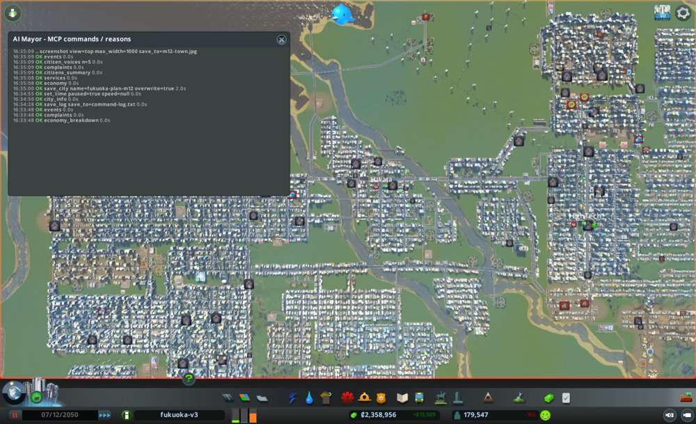

#### 施策

(結果の欄は実行する市長が書く。詳しくは council/m12-bill.md)

- m12-1 公園を (440,1150) に1か所と道35m(urban-1)。4-2。採択理由: 電気の中央が1、試しが ok。予想: Beautification 86→87、公園の problems なし。建設費 1,160、週 9.4。結果: (実行後)
- m12-2 区間 10647 を Large Road に太くする(roads-2、試し)。6-3。採択理由: (1689,94) の blocked 89、試しが ok。予想: blocked 89 より減る(量は見積もれない)。建設費 200、週 約2。結果: (実行後)
- m12-3 満杯の埋立地 24569、29981、48698 を空にする(health-1)。4-4。採択理由: 容量に余裕があり、費用0。予想: garbage.full 3→0、Garbage 9以下。建設費 0。結果: (実行後)
- m12-4 焼却場 2267 を止める(health-2、試し、条件つき)。4-3。条件: 見回りで garbage.full 0 かつ Garbage 9以下。予想: Pollution 26→15前後(Garbage は増える恐れ)。建設費 0、週 -1,440。結果: (実行後)
- 調査: なし
- 費用の合計: 建設費 1,360、週の維持費の増え 約 -1,429。所持金は約 2,357,600 以上の見込み

#### 考えたが打たなかった手

- economy-1 と roads-1(名所 40850 の道)は、入口の向きが未確認で条件付き。同じ月のうちに調べ直し
- port、education、fire、finance は案なし。市長は代案を作らない。調査を出した局はない
- 試しの案は m12-2(道)と m12-4(汚染の出どころ)。分からないことの一覧の「汚染の出どころ」に対応

##### 実行の結果(実行する市長が書く。2050-12-07、所持金 2,358,955)

- m12-1: 成功(一部)。Regular Park を place_building(id 26494、費用 1,000、入口 (440,1182)、道なしの警告)。electricity_service の中央は 1。議案の道の始点 (440,1182) は公園の外形に重なり test が overlaps で断られたため、始点を 8m 離して (440,1190) にし、test ok のあと build_line(費用 120、snapped 1、終点 node につながった)。始点側は connectedTo none で、公園の入口との間に約8mの隙間が残る。公園の problems は None、電気 true。Beautification は 86 から 87(2051-01-06)
- m12-2: 成功。test ok(cost 200)のあと upgrade_road で区間 10647 を Large Road(新 id 36554、matched 1、upgraded 1、skipped なし、費用 200)。`traffic`(x1689 z94 r150): blocked 89 → 32、blockedSpots (1689,94) 68 → (1747,103) 21。西の区間 109 は Medium Road のまま density 100
- m12-3: 成功。empty_building を 24569、29981、48698 に実行(emptying true)。12/17 の `services` で garbage.full は 0。active=false に戻す操作は行っていない
- m12-4: 見送り。条件は見回りで garbage.full 0 かつ Garbage 9以下。見回り1(12/17)は full 0 だが Garbage 14、見回り2(12/27)は full 0(Garbage は未測定)。議案の「見回り1か2で Garbage 9以下」を満たさず、止めていない。01-06 の Garbage は 12、Pollution 29

##### 見回りと月末(2050-12〜2051-01-06)

| ゲーム内の日付 | 区切り | 人口 | 所持金 | 週の収支 | 幸福度 | 需要(住/商/工) | 主な困りごと |
|---|---|---|---|---|---|---|---|
| 2050-12-17 | 見回り1 | 179,535 | 2,375,617 | +12,136(収入337,839、支出325,703) | 88 | 16 / 2 / 66 | 来ない市民 0/0/0、観光客1,708。境目なし。events 雑談3件。Garbage 14 |
| 2050-12-27 | 見回り2 | 179,305 | 2,393,026 | +12,209(収入337,893、支出325,684) | 88 | 16 / 2 / 66 | 来ない市民 0/0/0、観光客1,718。境目なし。events 1件(ごみ収集のつぶやき1件) |
| 2051-01-06 | 月末 | 179,020 | 2,411,252 | +12,404(収入338,057、支出325,653) | 88 | 16 / 4 / 66 | 来ない市民 0/0/0、観光客1,765(訪問132)、Beautification 87、汚染29、ごみ12、火事3、犯罪1、満杯の埋立地0。境目なし |

- 12か月の最終値: 人口 179,020(出発点 178,872)、観光客 1,765(出発点 1,646)

#### 見たもの

- `city_info`: 人口、所持金、週の収支、観光客(見回り2回と月末)
- `events`、`services`、`complaints`: 見回りと月末
- `traffic`: (1689,94) r150 の blocked 89 → 32
- `buildings_near`: Beautification 87、公園 26494 の problems None

#### 判断の根拠

議決の要らない3件を advance の前に打った。公園は議案の道の始点が公園の外形に重なったため、許された範囲(15m以内)で始点を8m動かした。焼却場 2267 の停止は、Garbage が 9 以下にならず条件を満たさなかったので止めなかった。

#### 捨てたもの

- m12-4 焼却場 2267 の停止: Garbage 14(12/17)で条件の 9 以下に届かなかった
- economy-1、roads-1: 議案で差し戻し済みのため打たない

### 2051-01-06 月例(13か月目)

保存: fukuoka-plan-m13(上書き)。dialog なし。events は雑談1件。12か月の任期のあと、運営を続けた月(人が続行を決めた)。公約と計画の目標は変えない。

#### 答え合わせ

- m12-1 公園 (440,1150): 予想は Beautification 86→87、公園の problems なし。結果は87、problems なし(`buildings_near` Beautification total 87)。当たり。道の始点と公園の間に約8mの隙間が残る
- m12-2 区間 10647 を Large Road に(試し): 予想は blocked 89より減る。結果は `traffic`(x1689 z94 r150)blocked 32、blockedSpots (1747,103) 21。当たり。街全体の流れは54%
- m12-3 満杯の埋立地を空にする: 予想は garbage.full 3→0。結果は0(`services`)。ごみの印は12(前9)。満杯は当たり、ごみの印は動かない
- m12-4 焼却場 2267 の停止: 条件に当たらず見送り。判定なし
- m11-5 信号 (2280,-950)(試し): 今月の `traffic`(x2290 z-950 r150)は blocked 1、congestion 44。基準72、月末82と大きく揺れる。まだ分からない(2回目)
- m11-1 名所 40850: 道は引けず、RoadNotConnected のまま。名所は10棟、attractiveness 平均2のまま
- 週の収支: +13,509→+12,404。所持金 2,411,252。守る線(+3,000、1,874,000)の上
- 前回の「次にやること」: 名所の道(未実行)、観光の入口(未実行。0のまま)
- 公約の進み具合(期限は12か月で終わり、続行月も同じ測り方で記録)
  1. 人口: 179,020。前月例179,547より527減った。4か月連続の減少で未達
  2. 来ない市民: 0 / 0 / 0。達成
  3. 赤字: 週の収支 +12,404。黒字
  4. 観光: 今いる観光客1,765(前1,725。増えた)、Tourism 週28(前42。減った)。人数は増え、収入は減った。目標(3,000、週1,000)に遠い

#### 計画の施策ごとの今の数字(2051-01-06)

- 1-2: 健康の平均89(目標80。達成)
- 2-3: 小学校 14,268 / 子ども9,008、高校 24,360 / 10代20,256。保つ
- 3-3: 来ない市民 0/0/0。達成
- 3-4: 火事3、犯罪1、合わせて4(目標4以下。ぎりぎり)
- 4-1: 住宅(高密度)の地価の平均60(目標62。あと2)
- 4-2: Beautification 87棟(目標100。あと13)
- 4-3: 汚染の印29(目標15以下)
- 4-4: ごみの印12(目標0)、満杯の埋立地0
- 6-1: 事務所のレベル3は3,279棟(目標3,500)
- 6-3: 交通の流れ54%(目標60)。止まった車 524
- 5-1・5-2: 観光客1,765(目標3,000)、訪問132(目標250)、Tourism 週28(目標1,000)、名所10棟(達成)、attractiveness 平均2(目標12。x0 z0 r4000 n9、最大25)、旅客の入口0(目標1以上。Cargo Harbor と Cargo Center だけ)
- 6-4・7-1: 働き口87,170(空き2,449。目標90,000)、品物がない店240(目標120以下)、原料がない工場42(目標15以下)
- 8-1: 駅・港の敷地の止まったトラック611(貨物センター28755が611。目標250以下)

#### 気づいたこと

- 観光は入口0、attractiveness 平均2のまま。名所10棟でも、Tourism は週28で目標の3%。10棟目 40850 は道がなく、空き地3の名所 11580 と公園 30466 は電気が来ない
- 人口は4か月連続で減り、大卒の失業が8,522(`citizens_summary`)、`demand_breakdown` の大卒 unemployed 9,329。空き家5,159、空き働き口2,449。需要は住16、商4、工66
- 貨物センター28755の止まったトラックは611で、主に Goods の輸入(止まり570)。目標250の2.4倍

#### 次にやること

- 編成方針の重点は 5-1・5-2 観光(入口、名所の道、島と空き地)、8-1 貨物センターの止まり、6-4 品物がない店と働き口
- 分からないことの一覧から、試しを1件採る

#### 画面写真

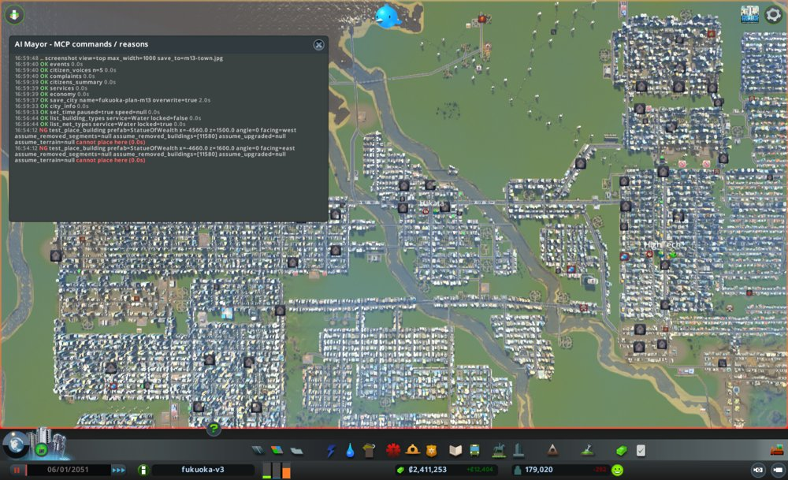

#### 施策

(結果の欄は実行する市長が書く。詳しくは council/m13-bill.md)

- m13-1 JapaneseGarden を (2168,194) 東向きに置く。先に店 6565・12125 を `bulldoze(2170,190,r30)` で取り壊す(urban-1、取り壊し)。4-2。採択理由: 公園87で目標100に13足りず、入口・電気・水を test で確認。予想: Beautification 87→88(月末)。建設費 2,500、週 40。結果: (実行後)
- m13-2 交差点 (1536,-114) に信号(roads-1、試し)。6-3。採択理由: blocked 51、canEnableLights true。予想: blocked 51より減る(量は見積もれない)。建設費 0。結果: (実行後)
- m13-3 名所 40850 の東に Basic Road (1703,-536)→(1640,-530)(roads-2、試し)。5-1・5-2、公約4。採択理由: test ok、費用320。予想: RoadNotConnected が14月末までに消える。建設費 320、週 約2.5。結果: (実行後)
- m13-4 埋立地 24569、48698、29981 の空けを止める(health-1)。4-4。採択理由: 長距離の収集車が混みの一因。予想: ごみの印12→9以下(不確か)。費用 0。結果: (実行後)
- m13-5 焼け跡 Villa 30596、6720 を取り壊す(fire-1、取り壊し)。3-4。採択理由: 火事3+犯罪1=4で上限。予想: 火事3→1。費用 0。結果: (実行後)
- m13-6 政策 EducationBoost を有効に(finance-1、試し)。6-4・7-1。採択理由: 大卒の失業8,522、判定は16月末。予想: 減る方向(逆向きもありうる)。週 7,940。結果: (実行後)
- 調査: s13-1(economy、40850の訪問)、s13-2(roads、止まり2か所)、s13-3(finance、大卒の失業の内訳)
- 費用の合計: 建設費 2,820、週の維持費の増え 約 7,983。週の収支は約 +4,420、所持金は約 2,408,000 の見込み

#### 考えたが打たなかった手

- economy-1(南回り): 調整2で roads-2 に任せたため不可
- health-2(2267 の停止): 実行条件は14月の見回りで決まるため、今月は不可。14月に出し直す
- port、education は案なし。市長は代案を作らない。調査 urban・health・fire は上限3件のため採らない
- urban-1 の取り壊し引数 r10 は 6565 が対象外だったので、r30 の引数に直した(市長の `preview_bulldoze` で確認)

##### 実行の結果(実行する市長が書く。2051-01-06、所持金 2,411,252 から)

- m13-1: 成功。preview(2170,190,r30)は 6565(働き口4)と 12125、失う働き口4・家0。bulldoze 2棟のあと、JapaneseGarden を place_building(id 12077、費用 2,500、入口 (2184,194) は segment 30179 に距離0、電気・水あり)。Beautification は月末 88(`buildings_near` service=Beautification の total)
- m13-2: 成功。junction_info で canEnableLights true、trafficLights false を確認し、set_traffic_lights で true。基準 `traffic`(1536,-114,r150)blocked 51。月末は blocked 30、blockedSpots (1579,-51) 14
- m13-3: 成功(道は引けた)。test ok(cost 320)のあと build_line(費用 320、始点 (1703,-536) は node につながった、終点 (1640,-530) は connectedTo none、名所 (1580,-530) まで約60m)。40850 は月末も RoadNotConnected。Visitors last week 5、Tourists 1→2
- m13-4: 成功。empty_building(active=false)を 24569、48698、29981 に実行(戻り値は emptying false)。月末の `services` garbage.full 0。ごみの印は 12→14(`complaints`)
- m13-5: 成功。buildings_near(problem=Fire)で 30596 に Fire、6720 に Fire(homes occupied 0)を確認。preview 各1棟、家は 0 と 2。bulldoze 2回で各1棟。月末の `complaints` に Fire の印なし(3→0)。Crime は 3(基準1)
- m13-6: 成功。実行前に EducationBoost active false、costPerWeek 7,940、同じ月に他の政策変更なし。set_policy で active true。週の収支は 1/16 +2,216、1/26 +2,041(守る線 +3,000 を下回る)、2/5 +3,922。支出は 325,653→334,965→334,784→334,770
- 調査 s13-1〜s13-3: council/m13-survey-economy.md、roads.md、finance.md に記録
- 保存: この段では行わない

| 2051-01-06 | 月例 | m13-1〜m13-6 | 上のとおり | urban / roads / health / fire / finance | 4-2 / 6-3 / 5-1・5-2 / 4-4 / 3-4 / 6-4・7-1 | 取り壊し(m13-1、m13-5) | 景観・交通・観光・環境・安全・雇用 | 4 | 2,820 | 約 7,983 | 14月に埋める |

##### 見回りと月末(2051-01〜02-05)

| ゲーム内の日付 | 区切り | 人口 | 所持金 | 週の収支 | 幸福度 | 需要(住/商/工) | 失業 | 主な困りごと |
|---|---|---|---|---|---|---|---|---|
| 2051-01-16 | 見回り1 | 178,730 | 2,411,172 | +2,216(収入337,181、支出334,965) | 88 | 17 / 2 / 65 | 8,314(大卒8,219) | 来ない市民 0/0/0、観光客1,788。週の収支は赤字ではないので境目なし(EducationBoost の週 7,940 が入った。守る線 +3,000 の下)。events 3件(ごみ収集のつぶやき1件) |
| 2051-01-26 | 見回り2 | 178,688 | 2,414,364 | +2,041(収入336,825、支出334,784) | 88 | 18 / 2 / 55 | 7,795(大卒7,720) | 来ない市民 0/0/0、観光客1,742。境目なし。events 2件(断水のつぶやき1件) |
| 2051-02-05 | 月末 | 178,202 | 2,419,253 | +3,922(収入338,692、支出334,770) | 88 | 19 / 2 / 61 | 7,403(大卒7,279) | 来ない市民 0/0/0、観光客1,847(訪問143)、Tourism 週49、Beautification 88、ごみ14、汚染18、火事なし、犯罪3、満杯の埋立地0、品物がない店272、流れ52%。境目なし |

#### 見たもの

- `preview_bulldoze`: m13-1 は 6565・12125、働き口4・家0。m13-5 は 30596(家0)と 6720(家2)
- `test_place_building`、`test_build_line`、`junction_info`、`list_policies`: 実行前の条件を確認(議案どおり)
- `traffic`: 信号 (1536,-114) blocked 51→30。(3297,-248) 42→21、(2257,307) 52→52(中間は 15、27)
- `buildings_near`: Beautification 88、40850 は RoadNotConnected のまま
- `complaints`: Fire なし、Garbage 14、Pollution 18、Crime 3
- `citizens_summary`、`demand_breakdown`: 大卒の失業 8,524→7,279(citizens_summary)
- `economy_breakdown`: Tourism 週49、policyExpenses 10,594

#### 判断の根拠

議案の6件を、決められた順(取り壊しと建物を先、advance の前)で打った。実行前の条件は、preview・test・list_policies のすべてで議案と一致し、予備候補は使っていない。道の終点は名所まで約60mあり、RoadNotConnected が消えなかったことは事実として残す。EducationBoost を入れた後、週の収支は1/16、1/26 に +3,000 を下回ったが、月末は +3,922。赤字ではなく、臨時の境目にも当たらない。

#### 捨てたもの

- 臨時: 境目に当たらなかったため行わない
- 議案にない手: 打たない(局の案以外は作らない)

#### 次にやること

- 14月: 40850 は RoadNotConnected のまま。南回りの案は14月に局が出す(議案の中止条件)
- EducationBoost: 判定は16月(2051-04)の月末。月末の週の収支 +3,922 は守る線の上。+4,900 を切った状態が3か月続くかを数える
- 焼却場 2267 の停止は、Garbage 9以下の条件を満たすまで見送り(12→14)
- 信号 (1536,-114): blocked 51→30。続けて測る

### 2051-02-05 月例(14か月目)

保存: fukuoka-plan-m14(上書き)。dialog なし。events は0件。任期12か月の後の続行月。公約と計画の目標は変えない。

#### 答え合わせ

- m13-1 JapaneseGarden: 予想は Beautification 87→88。結果は88。当たり
- m13-2 信号 (1536,-114)(試し): 予想は blocked 51より減る。結果は月末30。当たり(量は見積もれず)。街全体の流れは52%で動かない
- m13-3 名所 40850 の道: 予想は RoadNotConnected が消える。結果は消えず(`complaints` に残る。終点は名所まで約60m)。外れ。理由の見立て: 道の終点が名所の入口に届かない。次の扱い: 南回りの案を局が出す
- m13-4 埋立地の空けを止める: 予想はごみの印12→9以下。結果は14。外れ(不確かな予想)。理由の見立て: ごみの印は収集車の経路の揺れで、満杯(0)とは別の原因。次の扱い: 続けず、焼却場 2267 の停止も条件を満たさず見送り
- m13-5 焼け跡の取り壊し: 予想は火事3→1。結果は0。当たり。犯罪は3(基準1)
- m13-6 EducationBoost(試し): 判定は16月末。大卒の失業 citizens_summary 8,522→7,279(減る方向)。人口は減り続けた。週の収支は+3,922で守る線の上。まだ分からない(1回目)
- 週の収支: +12,404→+3,922。EducationBoost の維持費の分で下がった。守る線(+3,000)の上だが余裕は922。+4,900を切る状態が3か月続くかの数えが始まる(1回目)
- 前回の「次にやること」: 南回りの案は局が出す(今月)、EducationBoost は16月に判定、信号は続けて測る
- 公約の進み具合
  1. 人口: 178,202。前月例179,020より818減った。5か月連続の減少で未達
  2. 来ない市民: 0 / 0 / 0。達成
  3. 赤字: 週の収支 +3,922。黒字(ただし余裕は小さい)
  4. 観光: 今いる観光客1,847(前1,765。増えた)、Tourism 週49(前28。増えた)。2つとも増えた。目標(3,000、週1,000)には遠い

#### 計画の施策ごとの今の数字(2051-02-05)

- 1-2: 健康の平均89(目標80。達成)
- 2-3: 小学校 14,268 / 子ども8,924、高校 24,360 / 10代19,797。保つ
- 3-3: 来ない市民 0/0/0。達成
- 3-4: 火事0、犯罪3、合わせて3(目標4以下。達成)
- 4-1: 住宅(高密度)の地価の平均60(目標62。あと2)
- 4-2: Beautification 88棟(目標100。あと12)
- 4-3: 汚染の印18(目標15以下。あと3)
- 4-4: ごみの印14(目標0)、満杯の埋立地0
- 6-1: 事務所のレベル3は3,280棟(目標3,500)
- 6-3: 交通の流れ52%(目標60)。止まった車873
- 5-1・5-2: 観光客1,847(目標3,000)、訪問143(目標250)、Tourism 週49(目標1,000)、名所10棟(達成)、attractiveness 平均2(目標12。x0 z0 r4000 n9、最大24)、旅客の入口0(目標1以上。Cargo 系と Metro Entrance 2つのみ)
- 6-4・7-1: 働き口87,129(空き2,892。目標90,000)、品物がない店272(目標120以下。悪化)、原料がない工場45(目標15以下)
- 8-1: 駅・港の敷地の止まったトラック621(貨物センター28755が602。目標250以下)

#### 気づいたこと

- 観光は人数も収入も前月より増えたが、Tourism 週49は目標の5%。旅客の入口は0、attractiveness 平均2のまま。島と空き地の名所は0棟。観光は市長の方針で今月も重点
- 人口は5か月連続で減り178,202。空き家5,322、大卒の失業8,506(demand_breakdown)。EducationBoost で citizens_summary の大卒の失業は減ったが、人口の減りは止まらず、週の収支の余裕は922に縮んだ
- 品物がない店が272で最悪を更新。止まったトラックの主は Goods の輸入(597)で、貨物センター28755の敷地内が602。汚染の印は18、火事は0で、3-4 と 4-3 は目標に近づいた

#### 次にやること

- 編成方針の重点は 5-1・5-2 観光(入口、名所の道、島と空き地)、8-1・6-4 貨物センターの止まりと品物がない店、4-2 公園
- 分からないことの一覧から、試しを1件採る

#### 画面写真

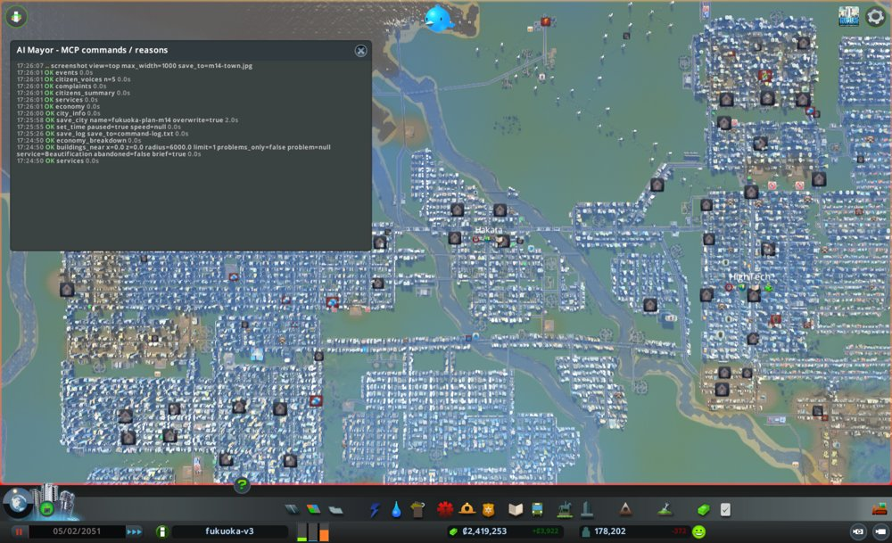

#### 施策

(結果の欄は実行する市長が書く。詳しくは council/m14-bill.md)

- m14-1 放棄された店 39889 を取り壊し、JapaneseGarden を (1856,306) 東向きに置く(urban-1、取り壊し)。4-2。採択理由: 公園88で目標100に12足りず、失うものが0で入口・電気・水を確認済み。予想: Beautification 88→89(月末)。建設費 2,500、週 40。結果: (実行後)
- m14-2 交差点 (-1640,-1100) に信号(roads-2)。6-3。採択理由: blocked 62で最多、同型の信号が13月に51→30。予想: blocked 62より減る(量は見積もれない)。建設費 0、週は未確認。結果: (実行後)
- m14-3 埋立地を (1800,-570) 東向きに置き、道 (1832,-570)→(1880,-570) をつなぐ(health-1)。4-4。採択理由: ごみの印14、取り壊しなしで置け、運搬を短くできる。予想: ごみの印14→9〜12(不確か、月末)。建設費 4,240、週 約162。結果: (実行後)
- 調査: s14-1(roads、信号の効き)、s14-2(health、埋立地の効き)、s14-3(finance、週の収支と大卒の失業)
- 費用の合計: 建設費 6,740、週の維持費の増え 約 202。週の収支は約 +3,720、所持金は約 2,412,500 の見込み

##### 実行の結果(実行する市長が書く。2051-02-05、所持金 2,419,253)

- m14-1: 成功。preview で 39889 のみ(働き0、家0)を確認して bulldoze。test ok(wouldDemolish 0)のあと JapaneseGarden を place_building(id 39519、費用 2,500、入口 (1872,306) は segment 26867 に距離0、電気・水あり)。予備候補は使っていない
- m14-2: 成功。junction_info で canEnableLights true(node 31583)を確認し、set_traffic_lights で信号を付けた(trafficLights true)。費用0。予備候補は使っていない
- m14-3: 成功(道の端を動かした)。Landfill Site を place_building(id 44370、費用 4,000、入口 (1832,-570))。議案の道 (1832,-570)→(1880,-570) は埋立地に重なり test が overlaps で断った。端を 12m 東の (1844,-570) にして(上限15m以内)test ok、build_line(Basic Road 1区間、費用 200、端 (1880,-570) は節点 31276 につながった)。道の西端は接続なし(埋立地の入口まで12m)。buildings_near で grid は要らない項目のみ、使用中の車 0/19
- 費用の合計: 6,700(2,500 + 4,000 + 200)
- 保存: この段では行わない

##### 見回りと月末(2051-02〜03-07)

| ゲーム内の日付 | 区切り | 人口 | 所持金 | 週の収支 | 幸福度 | 需要(住/商/工) | 失業 | 主な困りごと |
|---|---|---|---|---|---|---|---|---|
| 2051-02-15 | 見回り1 | 177,735 | 2,419,768 | +5,359(収入340,401、支出335,042) | 88 | 19 / 2 / 62 | 7,037(大卒6,926) | 来ない市民 0/0/0、観光客1,869、Tourism 74、ごみ10。境目なし(人口 -0.26%)。events 3件(停電のつぶやき1件) |
| 2051-02-25 | 見回り2 | 177,522 | 2,426,637 | +4,368(収入339,431、支出335,063) | 88 | 20 / 2 / 61 | 6,470(大卒6,365) | 来ない市民 0/0/0、観光客1,864、ごみ10。境目なし。events 1件(雑談) |
| 2051-03-07 | 月末 | 177,176 | 2,433,116 | +4,256(収入339,306、支出335,050) | 88 | 21 / 4 / 59 | 6,065(大卒5,957) | 来ない市民 0/0/0、観光客1,851(訪問148)、Tourism 週37、Beautification 89、ごみ8、汚染27、火事1、犯罪3、満杯の埋立地1(12880)。境目なし |

月末の計測(道具が返した事実。判定は15月の月例):

- m14-1: Beautification 89(基準88)
- m14-2: `traffic`(x-1684 z-1060 r150)blocked 62→1→8→33、congestion 45→50→58、flow 53→54→55。測るたびに大きく揺れる
- m14-3: `complaints` の Garbage 14→10→10→8。`services` garbage.full 1(12880)、使用 97,339,229 / 184,000,000。新しい埋立地 44370 を出た車が見回り2の標本に1台
- 調査 s14-1〜s14-3: `council/m14-survey-roads.md`、`m14-survey-health.md`、`m14-survey-finance.md` に記録

#### 見たもの

- `preview_bulldoze`、`test_place_building`、`test_build_line`、`junction_info`: 実行前の条件を確認(m14-3 の道は端を12m動かした)
- `traffic`、`complaints`、`vehicles_stuck`、`services`、`citizens_summary`、`economy_breakdown`: 調査 s14-1〜s14-3 のとおり
- `buildings_near`: Beautification 89
- `city_info`: 人口 177,176、所持金 2,433,116、観光客 1,851

#### 判断の根拠

議案の3件を、取り壊しと建物を先、advance の前に打った。m14-3 の道は議案の座標では埋立地に重なり、端を建物の外形から離す向きに12m動かして通った。月末の週の収支は +4,256 で守る線 +3,000 の上だが、+4,900 を切った状態が続いている(数えは2回目)。人口は6か月連続で減り、境目には当たらなかった。

#### 捨てたもの

- 臨時: 境目に当たらなかったため行わない
- 議案にない手: 打たない(局の案以外は作らない)

#### 次にやること

- 15月: 信号 (-1640,-1100) の blocked は揺れる(1→8→33)。同じ範囲で測り続けるか局が決める
- 15月: 埋立地 44370 の道は西端が入口まで12m空いている。収集車が使えているか(使用中の車 0/19 から見回り2で1台)を局が確かめる
- 週の収支 +4,900 を切る状態の数え(2回目: 2/5 +3,922、3/7 +4,256)

#### 考えたが打たなかった手(旧)

- fire-1(警察署、週480): 3-4 は目標を満たしており、入れると守る線の余裕が240になる。不可
- roads-1(名所 40850 の南回りの道): 入口の位置と向きが未確認。条件付きで同じ月に調べ直す
- port、economy、education、finance は案なし。市長は代案を作らない。分からないことの一覧の試しの案は、どの局からも出なかった

### 2051-03-07 月例(15か月目)

保存: fukuoka-plan-m15(上書き)。dialog なし。events は雑談1件。任期12か月の後の続行月。公約と計画の目標は変えない。

#### 答え合わせ

- m14-1 JapaneseGarden (1856,306): 予想は Beautification 88→89。結果は89。当たり。続ける
- m14-2 信号 (-1640,-1100): 予想は blocked 62より減る。結果は 1→8→33(月末)。基準より減ったが測るたびに大きく揺れる。まだ分からない(1回目)。一覧に足した。街全体の流れは52→55%
- m14-3 埋立地 44370: 予想はごみの印14→9〜12。結果は8(月末)。当たり(予想より良い)。満杯は1(12880)
- 週の収支: +3,922→+4,256。+4,900 を切る状態の数えは2回目(3回続くと、維持費が増える施策を議会が否決する)
- 前回の「次にやること」: 信号の測り方は局が決める(今月)、埋立地の道は西端が入口まで12m空き(未確認)、週の収支の数え(2回目)
- 公約の進み具合
  1. 人口: 177,176。前月例178,202より1,026減った。6か月連続の減少で未達
  2. 来ない市民: 0 / 0 / 0。達成
  3. 赤字: 週の収支 +4,256。黒字(守る線 +3,000 の上、余裕は1,256)
  4. 観光: 今いる観光客1,851(前1,847。増えた)、Tourism 週37(前49。減った)。人数は増えたが収入は減り未達

#### 計画の施策ごとの今の数字(2051-03-07)

- 1-2: 健康の平均89(目標80。達成)
- 2-3: 小学校 14,268 / 子ども8,842、高校 24,360 / 10代19,442。保つ
- 3-3: 来ない市民 0/0/0。達成
- 3-4: 火事1、犯罪3、合わせて4(目標4以下。達成。ぎりぎり)
- 4-1: 住宅(高密度)の地価の平均60(目標62。あと2)
- 4-2: Beautification 89棟(目標100。あと11)
- 4-3: 汚染の印27(目標15以下。2月は18から悪化)
- 4-4: ごみの印8(目標0)、満杯の埋立地1(12880)
- 6-1: 事務所のレベル3は3,280棟(目標3,500)
- 6-3: 交通の流れ55%(目標60。あと5)。止まった車428
- 5-1・5-2: 観光客1,851(目標3,000)、訪問148(目標250)、Tourism 週37(目標1,000)、名所10棟(達成)、attractiveness 平均2(目標12。最大25)、旅客の入口0(目標1以上。Cargo 系と Metro Entrance 2つのみ)
- 6-4・7-1: 働き口86,636(空き2,937。目標90,000)、品物がない店267(目標120以下)、原料がない工場49(目標15以下)
- 8-1: 駅・港の敷地の止まったトラック653(28755が632。目標250以下。悪化)

#### 気づいたこと

- 観光は人数は微増だが Tourism 週37は目標の4%。旅客の入口は15か月たっても0、attractiveness 平均2のまま。島と空き地の名所は0棟。島Bには道と風力 44460 があり、空き地3の名所 11580 と公園 30466 には電気が来ない(Electricity、MajorProblem)。40850 は RoadNotConnected のまま
- 貨物センター28755の止まったトラックが632(Goods の輸入が主)で、8-1 の目標250の2.5倍。品物がない店は267、原料がない工場は49で、いずれも目標から遠い。放棄された商業(高密度)が147棟あり、品物がない店と関わる可能性(未確認)
- 人口は6か月連続で減り、空き家5,478、大卒の失業7,229。週の収支は +4,256 で、+4,900 を切る状態が2回続いた

#### 次にやること

- 編成方針の重点は 5-1・5-2 観光(入口、島・空き地の名所と道)、8-1・6-4 貨物センターの止まりと品物がない店、4-2 公園
- 分からないことの一覧から、試しを1件採る

#### 画面写真

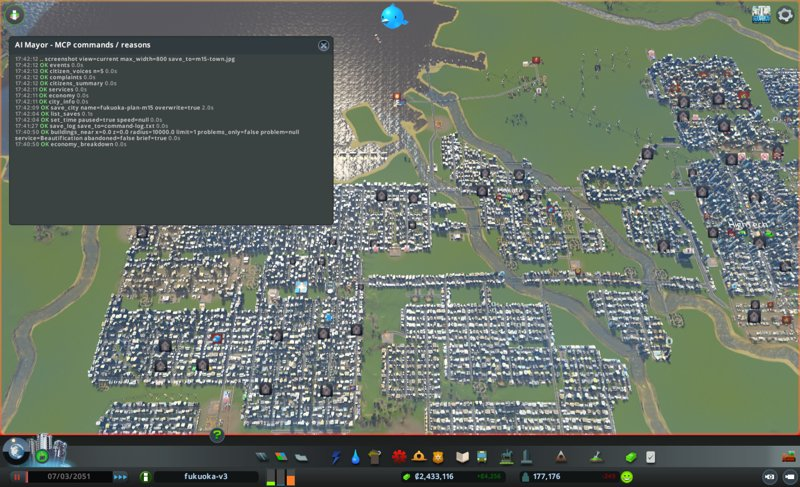

#### 施策

(結果の欄は実行する市長が書く。詳しくは council/m15-bill.md)

- m15-1 放棄店2棟(32056、12473)を取り壊し、JapaneseGarden を (1856,183) 東向きに置く(urban-1、取り壊し)。4-2。採択理由: 公園89で目標100に11足りず、失うものが働き口0・家0で入口・電気・水を確認済み。予想: Beautification 89→90(月末)。建設費 2,500、週 40。結果: (実行後)
- m15-2 交差点 (-1640,-1010) に信号(roads-1、試し)。6-3。採択理由: canEnableLights true、13月の信号で 51→30。予想: `traffic`(x -1640 z -1010 r100)の blocked が基準26より下がる(量は見積もれない。判定は16月末)。建設費 0、週は未確認。結果: (実行後)
- m15-3 満杯の埋立地 12880 を空にする(health-1)。4-4。採択理由: garbage.full 1、ほかの埋立地に余裕。予想: ごみの印8→0に近づく(4月末)。建設費 0、週 0。結果: (実行後)
- m15-4 小学校 15301 を止める(education-1)。2-3。採択理由: 定員が子どもの1.61倍。予想: 定員 14,268→13,920、週の支出 約 -160〜-200(16月末)。建設費 0、週 約 -200。結果: (実行後)
- m15-5 警察署を (-575,1095) 西向きに置く(fire-1)。3-4。採択理由: 貨物港 32211 の警察の届きが0で犯罪の印が残る。予想: 犯罪3→2以下(16月末)。建設費 12,000、週 480。結果: (実行後)
- m15-6 医療の予算を 130 にする(finance-1、予算の議決)。守る線、1-2。採択理由: 容量5,100に対し使用785。予想: 週の収支 +4,256→約 +14,400(見積もり。月末と16月末)。健康は80以上を保つ。建設費 0、週 約 -10,200。結果: (実行後)
- 調査: s15-1(port、28755の空き待ち)、s15-2(health、死体の印42)、s15-3(roads、東の出口の止まり)
- 費用の合計: 建設費 14,500、週の維持費の増え 約 -9,880(医療の予算の見積もりを含む)。医療の予算が効かなくても週の収支は約 +3,900 で、守る線の上。所持金は約 2,418,600 の見込み

#### 考えたが打たなかった手

- 局の案6件はすべて採った。port と economy は案なし。市長は代案を作らない。観光の入口と名所は今月も進まない(島Bの駅は整地の試しが未確認、島Bの名所は水・下水の管が未確認)
- 財政局の調査(医療の予算の効き): 上限3件のため見送り。効きは m15-6 の確認方法で追う
- 分からないことの試しの案は、m15-2(信号の揺れ)のみ。観光、島の橋、人口の減りは試しの案が出なかった

##### 実行の結果(実行する市長が書く。2051-03-07、所持金 2,433,116 から。議決あり: 取り壊し、予算)

- m15-1: 成功。preview で壊す2棟(12473 の店、32056 のホテル。働き口0・家0)を確認して bulldoze。test ok(wouldDemolish 0)のあと JapaneseGarden を place_building(id 3801、費用 2,500、入口 (1872,183) は segment 5651 に距離0)。grid の電気・水は true。月末の Beautification は 90 棟
- m15-6: 成功。実行前 healthcare 昼夜150を確認し、`set_budget` 130(昼夜130)。月末の HealthCare 支出は 76,440 から 66,248
- m15-5: 成功。test ok のあと Police Station を place_building(id 34351、費用 12,000、入口は Harbor Road segment 33455 に距離5)。月末の `map_layer` police(-640,1074 r300 n5)は平均59、最小32、最大86(0なし)。`services` police 容量 980→1,000
- m15-4: 成功。実行前 elementary 14,268、子ども 8,842 を確認。15301 を active=false。月末の `services` elementary は 13,920。`map_layer` education_elementary(-1350,-1076 r300 n5)は最小 63→38、平均 176→119(0にならず)
- m15-3: 成功。実行前 12880 は満杯(8,000,000/8,000,000)。empty_building active=true(emptying true)。月末は 95%(7,620,000)で空け途中、収集車 19/19。`services` garbage.full は 0。active=false に戻す操作は空きの終了後(次月以降)
- m15-2: 成功。junction_info で canEnableLights true、trafficLights false を確認し、`set_traffic_lights` active=true(trafficLights true)。基準 `traffic`(-1640,-1010 r100)blocked 26。月末は blocked 9(blockedSpots (-1641,-1009) 8)、flow 53。判定は16月末
- 調査 s15-1〜s15-3: `council/m15-survey-port.md`、`m15-survey-health.md`、`m15-survey-roads.md` に3回分を記録

| 2051-03-07 | 月例 | m15-1〜m15-6 | 上のとおり | urban / roads / health / education / fire / finance | 4-2 / 6-3 / 4-4 / 2-3 / 3-4 / 守る線 | 取り壊し、予算 | 景観・交通・環境・教育・安全・財政 | 3 | 14,500 | 約 -9,880(見積もり。実測は HealthCare 支出 -10,192) | 16月に埋めた: m15-1 当たり(90)、m15-2 blocked 26→9で当たり(揺れの前例あり)、m15-3 ごみ8→4でほぼ当たり(12880は空け進まず)、m15-4 定員13,920で当たり、m15-5 犯罪1で当たり、m15-6 週の収支 +12,150で当たり |

##### 見回りと月末(2051-03-07〜04-06)

| ゲーム内の日付 | 区切り | 人口 | 所持金 | 週の収支 | 幸福度 | 需要(住/商/工) | 主な困りごと |
|---|---|---|---|---|---|---|---|
| 2051-03-17 | 見回り1 | 177,145 | 2,437,243 | +12,784(収入338,213、支出325,429) | 88 | 20 / 2 / 58 | 来ない市民 0/0/0、観光客1,854(訪問149)。境目なし。events は雑談2件 |
| 2051-03-27 | 見回り2 | 176,872 | 2,455,370 | +12,913(収入338,353、支出325,440) | 88 | 23 / 2 / 56 | 来ない市民 0/0/0、観光客1,867(訪問155)。境目なし(人口は前回比-0.15%)。events は雑談2件 |
| 2051-04-06 | 月末 | 176,528 | 2,473,305 | +12,150(収入337,563、支出325,413) | 88 | 24 / 2 / 53 | 来ない市民 0/0/0、観光客1,937(訪問160)、Tourism 週59、Beautification 90、健康88、小学校定員13,920、満杯の埋立地0(12880は空け途中95%)、品物がない店266、原料がない工場39、止まったトラック1,049(28755が659)、火事4、犯罪1、ごみ4、汚染21、電気なし(名所11580・公園30466)。境目なし |

月末の計測(道具が返した事実。判定は16月の月例):

- 週の収支: +4,256 → +12,150(守る線 +3,000 の上、+4,900 の上に戻った)
- 人口は 177,176 → 176,528(7か月連続の減少)。観光客 1,851 → 1,937、Tourism 週37 → 59
- `citizens_summary`: 健康の平均88(目標80以上)、失業4,713(大卒4,608)

#### 見たもの

- `preview_bulldoze`、`test_place_building`、`junction_info`: 実行前の条件を確認(議案どおり、端点・座標の変更なし)
- `economy`、`services`、`citizens_summary`、`map_layer`、`traffic`、`economy_breakdown`、`complaints`、`buildings_near`: 各施策の確かめと月末の計測
- `vehicles_stuck`、`cargo`: 調査 s15-1、s15-2。`traffic`: 調査 s15-3

#### 判断の根拠

議案の6件を、取り壊し(m15-1)と予算(m15-6)を先に、advance の前にすべて打った。医療の予算 150→130 で HealthCare の支出は 76,440→66,248 と、見積もり(約 -10,200)とほぼ同じに減り、週の収支は +4,256 から +12,150 になった。健康の平均は88で目標80の上。人口は7か月連続で減ったが、境目には当たらなかった。

#### 捨てたもの

- 臨時: 境目に当たらなかったため行わない
- 議案にない手: 打たない(局の案以外は作らない)

#### 次にやること

- 16月: 埋立地 12880 の空けが終わったら `empty_building`(id 12880、active false)で戻す(月末は95%で空け途中)
- 16月: 信号 (-1640,-1010)(m15-2)の blocked を同じ範囲で測る(基準26、月末9)
- 16月: 小学校 15301 の休止後の覆い(最小38)と、止まった生徒の行き先を見る。週の収支が +4,900 の上に戻った(+12,150)
- 16月: 警察署 34351 の効き(犯罪の印)を `complaints` で見る。観光の入口と名所は今月も進まない(economy と port の案待ち)

### 2051-04-06 月例(16か月目)

保存: fukuoka-plan-m16(上書き)。dialog なし。events は雑談1件。任期12か月の後の続行月。公約と計画の目標は変えない。

#### 答え合わせ

- m15-1 JapaneseGarden (1856,183): 予想は Beautification 89→90。結果は90(`buildings_near` Beautification total 90)。当たり。続ける
- m15-2 信号 (-1640,-1010): 予想は blocked 26 より下がる。結果は `traffic`(x-1640 z-1010 r100)blocked 9(blockedSpots (-1641,-1009) 8)、flow 53。基準より減った。ただし隣の信号(m14-2)は 1→8→33 と揺れた前例があり、1点の測りでは確定しない。次の扱い: 続ける。同じ範囲で見回りごとに測る
- m15-3 埋立地 12880 を空にする: 予想はごみの印8→0に近づく。結果は4(`complaints` Garbage 4)。ほぼ当たり。ただし 12880 は先月と同じ 95%(7,620,000)、収集車19/19で、空けが進んでいない。原因は分からない。一覧に足した
- m15-4 小学校 15301 を止める: 予想は定員 14,268→13,920、週の支出 -160〜-200。結果は定員13,920(`services`)、子ども8,782。当たり。Education 支出 47,880(基準は未測定のため増減は未確認)。覆いは最小38、平均119(0にならず)
- m15-5 警察署 34351: 予想は犯罪3→2以下。結果は犯罪の印1(40850 のみ)。当たり。police 容量1,000、使用435
- m15-6 医療の予算130: 予想は週の収支 +4,256→約 +14,400、健康80以上を保つ。結果は +12,150、健康88。当たり。+4,900 の上に戻り、下降の規則は解けた
- 前回の「次にやること」: 12880 の active=false(空け途中のため未実行)、信号の測り(実行済み)、小学校の覆い(実行済み)、警察の効き(実行済み)
- 公約の進み具合
  1. 人口: 176,528。前月例177,176より648減った。7か月連続の減少で未達
  2. 来ない市民: 0 / 0 / 0。達成
  3. 赤字: 週の収支 +12,150(収入337,563、支出325,413)。黒字
  4. 観光: 今いる観光客1,937(前1,851。増えた)、Tourism 週59(前37。増えた)。2つとも前月より増えた

#### 計画の施策ごとの今の数字(2051-04-06)

- 1-2: 健康の平均88(目標80。達成)
- 2-3: 小学校 13,920 / 子ども8,782、高校 24,360 / 10代19,063。保つ
- 3-3: 来ない市民 0/0/0。達成
- 3-4: 火事4(hotspot (1197,-1019) の住宅3棟)、犯罪1、合わせて5(目標4以下。あと1)
- 4-1: 住宅(高密度)の地価の平均59(目標62。あと3)
- 4-2: Beautification 90棟(目標100。あと10)
- 4-3: 汚染の印21(目標15以下。あと6)
- 4-4: ごみの印4(目標0)、満杯の埋立地0(12880は空け途中95%)
- 6-1: 事務所のレベル3は3,281棟(目標3,500)
- 6-3: 交通の流れ53%(目標60。3月は55)。止まった車862
- 5-1・5-2: 観光客1,937(目標3,000)、訪問160(目標250)、Tourism 週59(目標1,000)、名所10棟(達成)、attractiveness 平均2(目標12。x0 z0 r4000 n9、最大25)、旅客の入口0(目標1以上。Cargo 系と Metro Entrance 2つ、Bus Depot のみ)
- 6-4・7-1: 働き口86,719(空き3,097。目標90,000)、品物がない店266(目標120以下)、原料がない工場39(目標15以下)
- 8-1: 駅・港の敷地の止まったトラック671(28755が659。目標250以下。悪化)

#### 気づいたこと

- 観光は人数も収入も前月より増え、訪問も160で過去15か月の最高。ただし Tourism 週59は目標の6%、attractiveness 平均2のまま、旅客の入口は16か月0。島と空き地の名所は0棟。空き地3の名所 11580 と公園 30466 は電気なし、40850 は RoadNotConnected のまま。観光は市長の方針で今月も重点
- 貨物センター28755の止まったトラックが659(Goods の輸入673台中が主)で、8-1 の目標250の2.6倍。品物がない店266、原料がない工場39も目標から遠い。止まった車は敷地内が671で道の上は378
- 人口は7か月連続で減り176,528。空き家5,488、大卒の失業(demand_breakdown)6,009、citizens_summary は4,608。週の収支は +12,150 で余裕が出たので、観光や公園への投資ができる

#### 次にやること

- 編成方針の重点は 5-1・5-2 観光(入口、島・空き地の名所と道)、8-1・6-4 貨物センターの止まりと品物がない店、4-2 公園
- 分からないことの一覧から、試しを1件採る

#### 画面写真

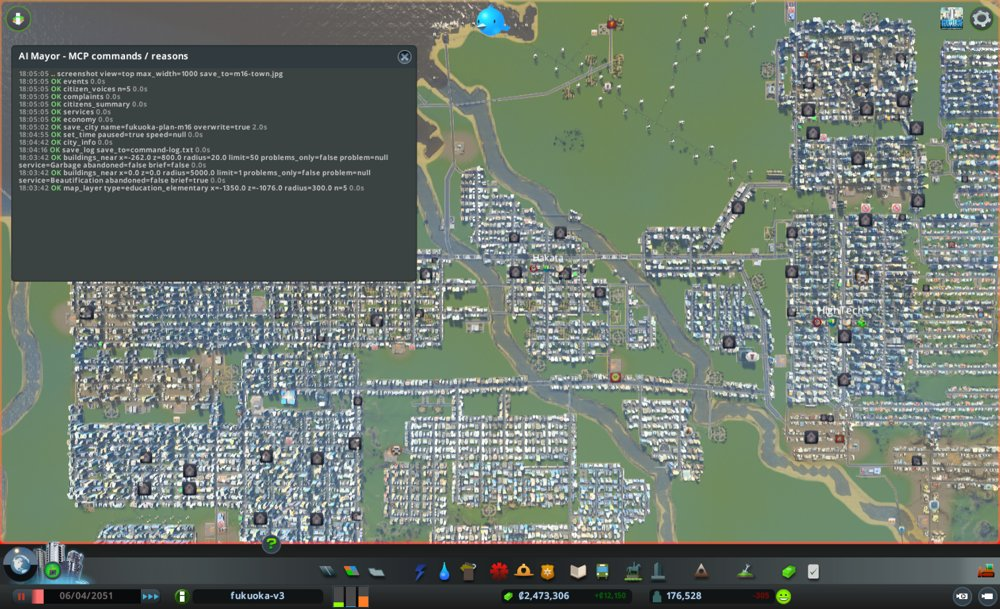

#### 施策

(結果の欄は実行する市長が書く。詳しくは council/m16-bill.md)

- m16-1 空き地 (1820,355) に JapaneseGarden(urban-1)。4-2。採択理由: 公園90棟で目標100にあと10、test ok、取り壊し0。予想: Beautification 90→91、電気と水が来る。建設費 2,500、週 +40。結果: (実行後)
- m16-2 交差点 (1692,100) に信号(roads-1)。6-3。採択理由: blocked 64 が最大、同型で2回下がった。予想: blocked 64→25〜45(r100)。建設費 0、週は未確認。結果: (実行後)
- m16-3 焼却場 2267 を止める(health-1、試し)。4-3。採択理由: 汚染21、前例 45→35。予想: 汚染 21→11〜15、ごみ 4→8〜10(上限15で戻す)。建設費 0、週 約 -1,440。結果: (実行後)
- m16-4 政策 FreeTransport(finance-1、試し)。6-3。採択理由: 流れ53%、運賃収入は週4,796だけ。予想: バスの passengers 増、流れ53%が上がるか(量は見積もれない)。建設費 0、運賃収入 -4,796/週。結果: (実行後)
- 調査: s16-1(13893 が車を出さない理由、port)、s16-2(霊柩車の止まり、health)、s16-3(小学校の覆い、education)
- 費用の合計: 建設費 2,500、週の収支は約 +8,750、所持金は約 2,470,000 の見込み

##### 実行の結果(実行する市長が書く。2051-04-06、所持金 2,473,305 から。議決なし)

- m16-1: 成功。直前の test ok(wouldDemolish 0、入口 (1820,339)、道 29165 距離1)。JapaneseGarden を place_building(id 46572、費用 2,500)。buildings_near で grid electricity true、water true、problems None
- m16-2: 成功。junction_info で canEnableLights true を確認し、set_traffic_lights active=true。再確認で trafficLights true。基準 `traffic`(x1703 z104 r100): blocked 64(blockedSpots (1705,104) 62)、flow 53、congestion 25、cars 122
- m16-3: 成功。実行前 garbage.full 0、Garbage 4、electricity 容量 2,318,624 に対し使用 1,707,040。set_building_active(2267, false)。基準: Pollution 21、`map_layer` pollution(x3650 z-50 r300 n9)平均51、最大253
- m16-4: 成功。実行前 economy_breakdown の PublicTransport 収入 4,796。set_policy FreeTransport active=true(costPerWeek 0、運賃収入は0になる)。基準: `list_transport_lines`(bus)の passengersLastPeriod の合計は約5,040(目で足した概算)、flow 53

| 2051-04-06 | 月例 | m16-1〜m16-4 | 上のとおり | urban / roads / health / finance | 4-2 / 6-3 / 4-3 / 6-3 | なし | 景観・交通・環境・財政 | 3 | 2,500 | 約 +40(公園)、-1,440(焼却場)、運賃収入 -4,796 | 17月に埋める |

##### 見回りと月末(2051-04-06〜05-06)

| ゲーム内の日付 | 区切り | 人口 | 所持金 | 週の収支 | 幸福度 | 需要(住/商/工) | 主な困りごと |
|---|---|---|---|---|---|---|---|
| 2051-04-16 | 見回り1 | 176,242 | 2,483,188 | +8,218(収入331,595、支出323,377) | 88 | 26 / 2 / 55 | 来ない市民 0/0/0、観光客1,889(訪問158)。境目なし。events は雑談2件。m16-3 の中止条件(3)に当たり 2267 を再開(下の臨時) |
| 2051-04-26 | 見回り2 | 176,042 | 2,491,964 | +5,951(収入331,492、支出325,541) | 88 | 26 / 2 / 55 | 来ない市民 0/0/0、観光客1,853。収支は縮んだが黒字のため境目なし。events は雑談2件 |
| 2051-05-06 | 月末 | 175,864 | 2,502,262 | +7,468(収入333,111、支出325,643) | 88 | 26 / 2 / 45 | 来ない市民 0/0/0、観光客1,875(訪問158)、Tourism 週57、Pollution 21、Garbage 22、満杯の埋立地3(24569、29981、48698)、品物がない店219、止まったトラック956(28755が596)、交通の流れ52%。境目なし |

##### 臨時(2051-04-16、1件、議決の要る道具は使っていない)

- きっかけ: 見回り1で `services` の garbage.full が 0→2(29981、48698)。m16-3 の中止条件(3)に当たった。Garbage の印は7(上限15の内)
- 操作: `set_building_active`(id 2267、active true)で焼却場を再開。電気は容量 2,264,576 に対し使用 1,709,984 で余裕があった
- 結果: 再開後の月末も garbage.full 3(24569、29981、48698)、Garbage の印22。再開で満杯が解けたとは言えない(満杯は12月にも同じ3か所があった)

##### 実行後の測り(道具が返した事実。判定は17月の月例)

- m16-1: 公園 46572 は problems None、電気・水 true。月末の Beautification 91棟(`buildings_near` Beautification total 91)
- m16-2: `traffic`(x1703 z104 r100)blocked 64 → 11(4/16)→ 6(4/26)→ 17(5/6)。blockedSpots は (1705,104) 62 → (1644,103) 11 → (1622,104) 6 → (1712,101) 16。r200 は5/6 で blocked 36(基準102)。flow 53 → 55 → 55 → 52
- m16-3: Pollution 21 → 18(4/16、停止中)→ 21(5/6、再開後)。`map_layer` pollution(x3650 z-50 r300)平均 51 → 48(停止中)→ 50(5/6)。4/16 に中止条件(3)で戻した。停止の間に汚染の印は3減ったが、満杯の埋立地も増えた
- m16-4: FreeTransport 有効。5/6 の economy_breakdown で PublicTransport の収入 4,796 → 0(バス支出 21,760)。bus の passengersLastPeriod 合計は約5,040(4/6)→ 約4,850(5/6、目で足した概算)。街全体の flow 53 → 55 → 55 → 52。週の収支は +12,150 → +7,468(守る線 +3,000 の上)
- 調査: s16-1〜s16-3 は `council/m16-survey-port.md`、`m16-survey-health.md`、`m16-survey-education.md` に書いた。13893 は電車の着きなし(vehicles 0)で車を出さない。火葬場 39843 は処理が週0のまま、霊柩車は8台中3〜5台が Congestion+Blocked で最長60日。小学校の覆いは0にならず、定員と子どもの比は1.58

#### 見たもの

- `test_place_building`、`junction_info`、`economy_breakdown`、`services`、`complaints`: 実行前の条件を確認(議案どおり)
- `buildings_near`、`traffic`、`map_layer`、`list_transport_lines`: 各施策の確かめと月末の測り
- `vehicles_stuck`、`cargo`、`citizens_summary`: 調査 s16-1〜s16-3

#### 判断の根拠

議案の4件を、議決の要らない手だけなので、advance の前にすべて打てた。m16-3 は中止条件(3)に当たり、見回り1で戻した。m16-4 の乗客数は増えず、街全体の流れも動かなかったので、17月の月例で続けるかを決める材料にする。週の収支は +7,468 で守る線 +3,000 の上。

#### 捨てたもの

- 議案にない手: 打たない
- 臨時の追加手当て: 議決が要る道具は使わず、焼却場の再開の1件だけにした

#### 次にやること

- 17月: m16-4(FreeTransport)の乗客約5,040→約4,850、流れ53→52 を見て、続けるか戻すかを局が決める。戻す手は `set_policy`(FreeTransport、active false)
- 17月: m16-2 の信号 (1692,100) の blocked は 64→6〜17 で下がった。続ける
- 17月: 満杯の埋立地3つ(24569、29981、48698)と Garbage 22 を保健環境局が扱う。2267 は再開済み
- 17月: 火葬場 39843 の霊柩車の止まり(最長60日)を道路下水道局に渡すか決める

#### 考えたが打たなかった手

- economy-1(空き地3の Transport Tower): 建物の port と下水が未確認、維持費 約978が調整8の枠超え。条件付きで調べ直し
- fire-1(Fire House): 電気が建てて確かめるまで未確認。条件付きで調べ直し
- 調査 fire: 上限3件のため
- port と education は案なし。市長は代案を作らない。試しの案は health-1 と finance-1 が出た

### 2051-05-06 月例(17か月目)

保存: fukuoka-plan-m17(上書き)。dialog なし。events は雑談2件。任期12か月の後の続行月。公約と計画の目標は変えない。

#### 答え合わせ

- m16-1 JapaneseGarden (1820,355): 予想は Beautification 90→91。結果は91。当たり。続ける
- m16-2 信号 (1692,100): 予想は blocked 64→25〜45(r100)。結果は 6〜17(5/6 は17)、r200 は36(基準102)。当たり。続ける。街全体の流れは53→52で動かない
- m16-3 焼却場 2267 を止める(試し): 予想は汚染 21→11〜15、ごみ 4→8〜10。結果は汚染18(停止中)、満杯が0→2に増え、中止条件(3)で再開。再開後は汚染21、ごみ22。外れ。理由の見立て: 停止の分のごみを受ける先がなく、満杯の埋立地が増えた(前例45→35と同じ型)。次の扱い: 同じ手は続けない。一覧に足した
- m16-4 FreeTransport(試し): 予想は bus の乗客が増え、流れ53%が上がる。結果は乗客約5,040→約4,850、流れ52。運賃収入4,796が0になり、週の収支は +12,150→+7,468。外れ。理由の見立て: 無料でも乗る人は増えず、収入だけ減った(1か月の測り)。次の扱い: 戻す案を局に求める(戻すと収入が約4,800戻る)
- 週の収支: +12,150→+7,468。守る線 +3,000 の上、+4,900 の上
- 前回の「次にやること」: m16-4 の判断(これから局が決める)、信号は続ける(実行済み)、満杯の埋立地3つ(これから)、火葬場 39843 の霊柩車(これから)
- 公約の進み具合
  1. 人口: 175,864。前月例176,528より664減った。8か月連続の減少で未達
  2. 来ない市民: 0 / 0 / 0。達成
  3. 赤字: 週の収支 +7,468(収入333,111、支出325,643)。黒字
  4. 観光: 今いる観光客1,875(前1,937。減った)、Tourism 週57(前59。減った)。2つとも前月より減り未達

#### 計画の施策ごとの今の数字(2051-05-06)

- 1-2: 健康の平均88(目標80。達成)
- 2-3: 小学校 13,920 / 子ども8,786、高校 24,360 / 10代18,728。保つ
- 3-3: 来ない市民 0/0/0。達成
- 3-4: 火事の印なし、犯罪1(40850)、合わせて1(目標4以下。達成)
- 4-1: 住宅(高密度)の地価の平均59(目標62。あと3)
- 4-2: Beautification 91棟(目標100。あと9)
- 4-3: 汚染の印21(目標15以下。あと6)
- 4-4: ごみの印22(目標0。悪化)、満杯の埋立地3(24569、29981、48698)
- 6-1: 事務所のレベル3は3,282棟(目標3,500)
- 6-3: 交通の流れ52%(目標60)。止まった車845
- 5-1・5-2: 観光客1,875(目標3,000)、訪問158(目標250)、Tourism 週57(目標1,000)、名所10棟(達成)、attractiveness 平均2(x0 z0 r4000 n9、最大25。目標12)、旅客の入口0(Cargo 系、Metro Entrance 2つ、Bus Depot 2つのみ)
- 6-4・7-1: 働き口86,773(空き3,190。目標90,000)、品物がない店219(目標120以下)、原料がない工場34(目標15以下)
- 8-1: 駅・港の敷地の止まったトラック605(28755が596。目標250以下)

#### 気づいたこと

- 観光は人数も収入も今月は減り、公約4が未達。入口は17か月0、attractiveness 平均2で、島と空き地の名所は0棟。attractiveness の最大は街の西(-3000,0 の25)と北東にあり、地形資料の島B、空き地1〜5は今月も未使用。島Bには道と風力があり、空き地3の名所 11580 と公園 30466 は電気なしのまま
- 週の収支が +12,150→+7,468 に縮んだ原因の大半は FreeTransport(運賃収入約4,800の消失)。乗客は増えていない。戻せば約 +12,200 に戻る見込み(見積もり)
- 満杯の埋立地が3つ(12月と同じ3か所)で、ごみの印は4→22。品物がない店は266→219、原料がない工場は39→34に減った。需要は工業45に下がり、住宅26に上がった

#### 次にやること

- 編成方針の重点は 5-1・5-2 観光(入口、島と空き地の名所)、8-1・6-4 貨物センター28755の止まり、4-4 ごみ(満杯3つ)
- 分からないことの一覧から、試しを1件採る(FreeTransport を戻す手は、試しの結果を受けた対応)

#### 画面写真

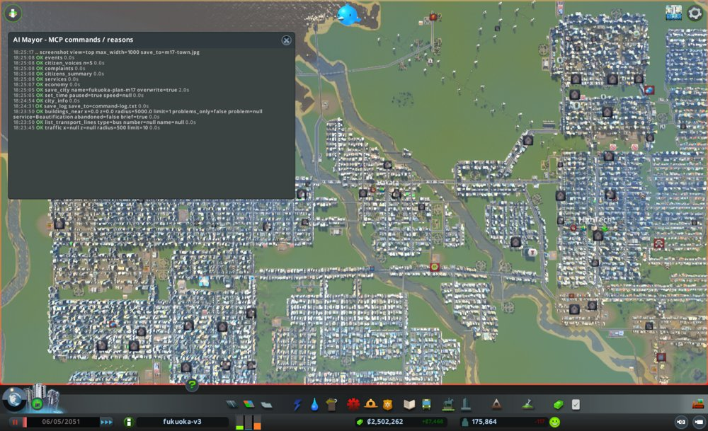

#### 施策

(結果の欄は実行する市長が書く。詳しくは council/m17-bill.md)

- m17-1 公園 JapaneseGarden を (1820,300) に置く(urban-1)。4-2。採択理由: test ok、電気・水あり。予想: Beautification 91→92。建設費 2,500、週 40。結果: (実行後)
- m17-2 交差点 (2155,330) に信号(roads-1)。6-3。採択理由: canEnableLights true、16月の同型が当たり。予想: `traffic`(x2256 z296 r150)blocked 55 が下がる。建設費 0、週は未確認。結果: (実行後)
- m17-3 送電線を名所 11580 と公園 30466 につなぐ(roads-2、試し)。5-1・5-2、4-2。採択理由: 起点を網の端 (603,1533) に変えて test が通った。予想: 30466 の電気が true(11580 は不確か)。建設費 480、週 約12。結果: (実行後)
- m17-4 FreeTransport を外す(finance-1、roads-3)。公約3、6-3。採択理由: 16月の試しで乗客・流れが動かず収入が消えた。予想: PublicTransport 収入 0→約4,800、週の収支 約+12,260。費用 0。結果: (実行後)
- m17-5 焼却場 10351 を動かす(health-1)。4-4。採択理由: TurnedOff・満杯で、電気・水・下水・道あり。予想: ごみの印 22→15以下、汚染は21を超えない。建設費 0、週 約1,440。結果: (実行後)
- m17-6 小学校 43936 を止める(education-1、試し)。2-3。採択理由: 止めた後の比 1.545、15301 の前例は当たり。予想: 覆いの最小 8 が0にならない。建設費 0、週 -160。結果: (実行後)
- m17-7 消防署 Fire House を (1330,-1078) に置く(fire-1、試し)。3-4。採択理由: test ok、電気・水・下水あり。予想: 東側の届き (1330,-1040) が4より上がる。建設費 12,000、週 560。結果: (実行後)
- 調査: s17-1(28755の空き待ち、port)、s17-2(人口の減りの原因、finance)、s17-3(汚染の発生源、health)
- 費用の合計: 建設費 14,980、週の維持費の増え 1,892(運賃収入の戻り 約+4,800)。週の収支は約 +10,400、所持金は約 2,487,000 の見込み

##### 実行の結果(実行する市長が書く。2051-05-06、所持金 2,502,262 から。議決なし。advance の前に7件を全部打った)

- m17-1: 成功。直前の test ok。JapaneseGarden を place_building(id 31332、費用 2,500、入口は segment 29165 に距離6)。buildings_near で電気・水 true、problems None。月末の Beautification 92棟(`buildings_near` total 92)
- m17-2: 成功。junction_info で canEnableLights true・trafficLights false を確認し、set_traffic_lights active=true。再確認 trafficLights true。基準 `traffic`(x2256 z296 r150): blocked 55、flow 52、congestion 44、cars 95。月末(6/5): blocked 22、flow 55、congestion 40、cars 97、blockedSpots (2255,318) 15
- m17-3: 成功。test 2本とも ok、node 17930 は網にあり。本線 Power Line 3区間(費用 420、end 2つとも node に snapped)、枝 1区間(費用 60、split 1、端 (633,1575) は connectedTo none)。月末の `buildings_near`(x712 z1600 r120): 名所 11580 StatueOfWealth と公園 30466 Regular Park とも grid.electricity true(基準 false)、problems None。water は両方 false(needs water false)
- m17-4: 成功。実行前 FreeTransport は active true。bus の passengersLastPeriod 合計は目で足して約4,840(4,850 以下)。set_policy active=false。list_policies で active false、policyExpensesPerWeek 10,766→10,903(建物数の増えによる。FreeTransport は 0)。月末の economy_breakdown: PublicTransport の収入 4,994(基準 0)、バス収入 4,994
- m17-5: 成功。実行前 10351 は TurnedOff、貯め 400,000/400,000、処理0。set_building_active active=true。月末: problems None、貯め 286,354(71%)、Processing 60,000/週、ごみ収集車 11/34、Power Output 15 MW。Garbage の印 22→18(5/16)→12(5/26)→12(6/5)。Pollution の印 21→26→22→23。ただし `services` の満杯の埋立地は 3→4(24569、29266、29981、48698)。economy_breakdown の Garbage 支出 20,640
- m17-6: 成功。実行前の map_layer(education_elementary、x-1370 z-1350 r400 n9)最小 8(0でない)。set_building_active(43936, false)。月末の同じ map_layer: 最小 3(-1570,-1750)、平均 75(基準 116)。0 は出ず。`services` education.elementary 13,920→13,572。citizens_summary の child 8,929(比 1.52)。戻す条件(0)に当たらず
- m17-7: 成功。直前の test ok(wouldDemolish 0、入口 segment 11664 距離 11.7)。Fire House を place_building(id 46124、費用 12,000)。buildings_near problems None。map_layer(fire、x1330 z-1040 r120 n5): 基準(置いた後に測った)は平均 6、月末は平均 113、最小 90。(1330,-1040) は 4→130、(1390,-1040) は 0→114
- 見回りの数字(表): 5/16 見回り1 人口 175,646、所持金 2,502,282、週の収支 +10,541、幸福度 88、需要 27/2/53、観光客 1,890(訪問155)、来ない市民 0/0/0、境目なし(events は雑談2件)。5/26 見回り2 人口 175,488、所持金 2,518,101、週の収支 +10,943、需要 28/2/49、観光客 1,866(訪問156)、境目なし(events は雑談2件)。6/5 月末 人口 175,384、所持金 2,531,972、週の収支 +10,007、幸福度 88、需要 28/2/52、観光客 1,783(訪問159)、Tourism 週74、満杯の埋立地4、止まったトラック(駅・港の敷地)589(28755 が588)、汚染の印23、ごみ12、火事1、犯罪1、品物がない店191、原料がない工場31、交通の流れ(信号の範囲)55。境目なし
- 調査: s17-1 は `council/m17-survey-port.md`、s17-2 は `m17-survey-finance.md`、s17-3 は `m17-survey-health.md` に書いた(見回り1・見回り2・月末の事実のみ)
- 臨時: なし(境目に当たらなかった)
- 保存: この段では行わない

| 2051-05-06 | 月例 | m17-1〜m17-7 | 上のとおり | urban / roads / health / finance / education / fire | 4-2 / 6-3 / 4-4 / 5-1・5-2 / 2-3 / 3-4 | なし | 景観・交通・環境・財政・教育・安全 | 3,4 | 14,980 | 約 +1,892(運賃収入の戻り +4,994、小学校 -160 を含む) | 18月に埋めた: m17-1 当たり(92)、m17-2 当たり(blocked 55→22)、m17-3 当たり(電気 true)、m17-4 当たり(収入 4,994 が戻る)、m17-5 ごみは当たり(22→12)・満杯は外れ(3→4)、m17-6 当たり(覆い最小3)、m17-7 当たり(届き 4→130) |

#### 見たもの

- `test_place_building`、`junction_info`、`list_policies`、`map_layer`、`net_near`、`test_build_line`: 実行前の条件を確認(議案どおり)
- `buildings_near`、`traffic`、`economy_breakdown`、`services`、`map_layer`: 各施策の確かめと月末の測り
- `vehicles_stuck`、`cargo`、`demand_breakdown`、`citizens_summary`、`complaints`: 調査 s17-1〜s17-3

#### 判断の根拠

議案の7件はどれも議決が要らないので、advance の前にすべて打てた。実行前の条件はどれも議案どおりで、予備候補は使わなかった。月末の測りでは、電気は両施設に届き、焼却場 10351 は処理が動いてごみの印が22から12に下がった。満杯の埋立地が3から4に増えた点は18月の判断材料にする。

#### 捨てたもの

- 議案にない手: 打たない
- 臨時: 境目に当たらなかったため行わない
- 新しい候補地の探し直し: 行わない(議案の候補で足りた)

#### 次にやること

- 18月: m17-3 は電気が届いた(水は needs なし)。名所 11580 の Visitors は週2
- 18月: m17-4 で運賃収入が戻った(PublicTransport 4,994)。乗客と流れの変化は `list_transport_lines` で確かめる
- 18月: m17-5 は動いた。満杯の埋立地4つ(24569、29266、29981、48698)の扱いを保健環境局が決める
- 18月: m17-6 は覆い最小3で0にならなかった。続けるか戻すかは教育委員会が決める
- 18月: 島Bの旅客駅(port-1)は条件付きの差し戻しのまま

#### 考えたが打たなかった手

- port-1(島Bの旅客駅): 整地の実費と水管・電線の経路が未確認。条件付きで差し戻し
- 経済観光文化局は案なし。名所を置ける場所を局が確認できなかった。市長は代案を作らない
- roads の調査(Medium Road の密度): 上限3件のため見送り。信号の結果を見て第18月に出し直す
- 試しの案は m17-3、m17-6、m17-7

### 2051-06-05 月例(18か月目)

保存: fukuoka-plan-m18(上書き)。dialog なし。events は雑談1件。任期12か月の後の続行月。公約と計画の目標は変えない。

#### 答え合わせ

- m17-1 JapaneseGarden (1820,300): 予想は Beautification 91→92。結果は92(`buildings_near` Beautification total 92)。当たり。続ける
- m17-2 信号 (2155,330): 予想は blocked 55 が下がる。結果は月末 22(r150)。当たり。続ける。街全体の流れは52→55
- m17-3 送電線: 予想は 30466 の電気が true。結果は11580・30466 とも true。今月の `complaints` に Electricity なし。当たり。名所 11580 の Visitors は週2で小さい。RoadNotConnected は 23298(公園)に残る
- m17-4 FreeTransport を外す: 予想は PublicTransport 収入 0→約4,800、週の収支 約+12,260。結果は収入4,994、週の収支 +10,007(他の維持費増あり)。当たり。bus の passengersLastPeriod は約5,200(目で足した概算)で、外す前の約4,850より多い。一覧に足した(まだ分からない)
- m17-5 焼却場 10351: 予想はごみの印 22→15以下。結果は12。当たり。ただし満杯の埋立地は3→4(24569、29266、29981、48698)で、これは外れ。理由の見立て: 印は収集の改善で下がったが、満杯の埋立地は別の原因(貯めが満ちたまま空かない)で残る。一覧に足した
- m17-6 小学校 43936 を止める(試し): 予想は覆いの最小が0にならない。結果は3。当たり。定員13,572、子ども8,929(比1.52)。続ける
- m17-7 Fire House (1330,-1078): 予想は東側の届きが4より上がる。結果は 4→130。当たり。火事の印は1
- 週の収支: 見込み +10,400 に対し実測 +10,007。守る線 +3,000 の上、+4,900 の上
- 前回の「次にやること」: m17-4 の乗客と流れの確認(実行済み)、満杯の埋立地4つの扱い(これから局が決める)、小学校の続行(続ける)、島Bの旅客駅(条件付きのまま)
- 公約の進み具合
  1. 人口: 175,384。前月例175,864より480減った。9か月連続の減少で未達
  2. 来ない市民: 0 / 0 / 0。達成
  3. 赤字: 週の収支 +10,007(収入338,572、支出328,565)。黒字
  4. 観光: 今いる観光客1,783(前1,875。減った)、Tourism 週74(前57。増えた)。人数は減り、収入は増えた。人数は未達

#### 計画の施策ごとの今の数字(2051-06-05)

- 1-2: 健康の平均87(目標80。達成)
- 2-3: 小学校 13,572 / 子ども8,929、高校 24,360 / 10代18,390。保つ
- 3-3: 来ない市民 0/0/0。達成
- 3-4: 火事1、犯罪1、合わせて2(目標4以下。達成)
- 4-1: 住宅(高密度)の地価の平均59(目標62。あと3)
- 4-2: Beautification 92棟(目標100。あと8)
- 4-3: 汚染の印23(目標15以下。あと8)
- 4-4: ごみの印12(目標0)、満杯の埋立地4
- 6-1: 事務所のレベル3は3,282棟(目標3,500)
- 6-3: 交通の流れ55%(目標60)。止まった車896
- 5-1・5-2: 観光客1,783(目標3,000)、訪問159(目標250)、Tourism 週74(目標1,000)、名所10棟(達成)、attractiveness 平均2(x0 z0 r4000 n9、最大25。目標12)、旅客の入口0(Cargo 系、Metro Entrance、Bus Depot のみ。buildings_near total 15)
- 6-4・7-1: 働き口87,258(空き3,480。目標90,000)、品物がない店191(目標120以下)、原料がない工場31(目標15以下)
- 8-1: 駅・港の敷地の止まったトラック589(28755が588。目標250以下)

#### 気づいたこと

- 観光は Tourism が週74で過去18か月の高い方に入ったが、観光客は1,783に減り、目標3,000の6割。入口は18か月0、attractiveness 平均2のまま。島と空き地の名所は0棟(空き地3の名所 11580 は電気が来たが Visitors 週2)。地形資料の島B、空き地1(9.4km²)、2、4、5は未使用
- 品物がない店は219→191、原料がない工場34→31と減り、貨物センター28755の止まったトラックは588(目標250の2.4倍)で動かない。Goods の輸入1,049台のうち620台が止まる
- 人口は9か月連続で減り175,384。需要は住28まで上がったが増えない。空き家5,647。週の収支は +10,007 で、公園や観光に使える余裕が残る

#### 次にやること

- 編成方針の重点は 5-1・5-2 観光(入口、島・空き地の名所)、8-1・6-4 貨物センターと品物がない店、4-4 ごみ(満杯4つ)
- 分からないことの一覧から、試しを1件採る

#### 画面写真

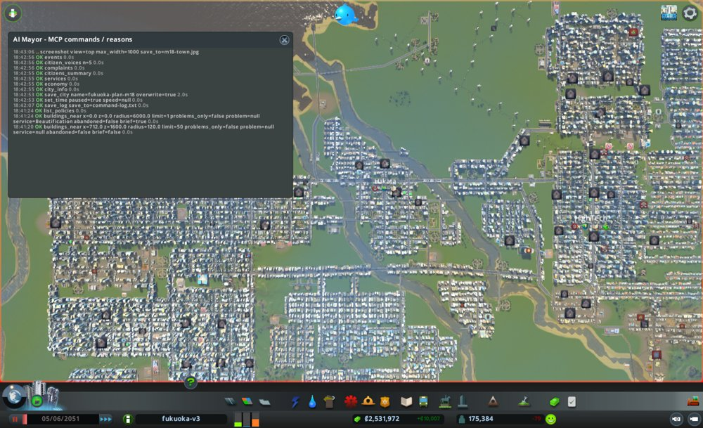

#### 施策

(結果の欄は実行する市長が書く。詳しくは council/m18-bill.md)

- m18-1 空き (1795,250) に JapaneseGarden(urban-1)。4-2。採択理由: test ok(入口の道 16524、壊す建物0)、電気・水あり。予想: Beautification 92→93。建設費 2,500、週 40。結果: (実行後)
- m18-2 幹線 z=10 の3区間を Small 4 Lane Road に(roads-1、試し)。6-3。採択理由: test ok(cost 0、skipped 0)、密度100の1車線3区間。予想: `traffic`(x1497 z62 r200)の blocked 67 が下がる方向(量は見積もれない)。建設費 0、週 0。結果: (実行後)
- m18-3 満杯の埋立地4つを取り壊し、近くに建て直す(health-1、取り壊し議決)。4-4。採択理由: 4か所とも置く試しと支線の試しが ok、失う働き口・家0。予想: garbage.full 4→0、ごみの印12→0〜5。建設費 16,920、週 約7。結果: (実行後)
- m18-4 焼け跡 1573 を取り壊す(fire-1、取り壊し議決)。3-4。採択理由: 火事の印1は 1573 だけ、失う働き口・家0。予想: Fire 1→0。建設費 0、週 0。結果: (実行後)
- 調査: s18-1(28755 の空き待ちの原因、port)、s18-2(SW 角の覆い、education)
- 費用の合計: 建設費 19,420、週の維持費の増え 約47。週の収支は約 +9,960、所持金は約 2,512,500 の見込み

#### 考えたが打たなかった手

- finance-1(医療予算 130→110): deathcare への響きが未確認。条件付きで差し戻し
- education-1(小学校 25802 を止める): 43936 の窓の最小が3で、重なる窓を同月に止めると調査 s18-2 の測りを濁す。不可
- port と economy は案なし。市長は代案を作らない。観光の入口0は公約4の最大の穴として記録
- 試しの案は m18-2(信号の効きの揺れ)

##### 実行の結果(実行する市長が書く。2051-06-05、所持金 2,531,972 から。advance の前に全部打った)

- m18-3: 部分実行。preview 4か所とも埋立地1棟・働き0・家0を確認して bulldoze(24569、29266、29981、48698)。place_building: 8031(-1885,-690。入口は道 30735 に距離0。道あり)、23459(2712,-1602)、10676(-2761,-300)、33216(3499,650)の4棟、各4,000。後の3棟は entrance.road が null。支線3本は test_build_line が各 overlaps で断られた(23459、10676、33216 の敷地と重なる。外形 80x64)。端点を局の座標から15m以内で2回動かして試し直しても同じ。道は引かず、支線は未実行。月末 `services` garbage.full は1(3565)。`complaints` RoadNotConnected に 23459
- m18-4: 成功。preview は 1573(H4 3x4 Tenement11)1棟、働き0・家0。bulldoze 済み。月末 `buildings_near`(problem=Fire、r30)total 0。Fire の印は 948(3724,-226)の1件
- m18-1: 成功。直前の test ok。JapaneseGarden を place_building(id 18474、費用 2,500、入口は segment 16524 に距離1)。月末 Beautification 93棟
- m18-2: 成功。直前の test ok(matched 3、skipped 0、cost 0)。upgrade_road で3区間を Small 4 Lane Road に(費用0)。`traffic`(x1497 z62 r200): 実行直後 blocked 67、flow 55、月末 blocked 37、flow 52、congestion 57。blockedSpots は (1574,-62) 19、(1659,91) 9、(1515,10) 9
- 見回り: 6/15 見回り1 人口 175,191、所持金 2,528,819、週の収支 +10,767(収入339,404、支出328,637)、幸福度 88、需要 29/2/50、観光客1,748(訪問158)、来ない市民 0/0/0、events 雑談1件、境目なし。6/25 見回り2 人口 175,100、所持金 2,544,341、週の収支 +10,493、需要 30/2/50、観光客1,798(訪問155)、events 雑談2件、境目なし。7/5 月末 人口 174,778、所持金 2,555,946、週の収支 +7,740(収入336,364、支出328,624)、幸福度 88、需要 30/2/49、観光客1,795(訪問150)、来ない市民 0/0/0、満杯の埋立地1(3565)、ごみの印15、汚染25、火事1、品物がない店194、境目なし(週の収支は前回より下がったが黒字)
- 調査: s18-1 は `council/m18-survey-port.md`、s18-2 は `m18-survey-education.md` に書いた
- 臨時: なし
- 保存: この段では行わない

| 2051-06-05 | 月例 | m18-1〜m18-4 | 上のとおり | urban / roads / health / fire | 4-2 / 6-3 / 4-4 / 3-4 | 取り壊し(埋立地4、焼け跡1) | 景観・交通・環境・安全 | 4 | 約 19,000(m18-3 の支線なし。埋立地16,000+公園2,500) | 約 +40 | 19月に埋めた: m18-1 当たり(93)、m18-2 当たり(blocked 67→37)、m18-3 満杯は一部当たり(4→1)・ごみの印は外れ(12→15)・入口の道が3棟なし、m18-4 外れ(火事の印は1のまま。別の建物 948) |

| 2051-07-05 | 月末(18か月目) | 174,778 | 2,555,946 | +7,740 | 88 | 30 / 2 / 49 | - | 来ない市民 0/0/0、観光客1,795(訪問150)、満杯の埋立地1、ごみ15、汚染25、火事1、Beautification 93、品物がない店194。境目なし |

#### 見たもの

- `preview_bulldoze`、`test_place_building`、`test_build_line`、`test_upgrade_road`: 実行前の確認
- `traffic`: (1497,62) blocked 67→37、貨物センター周辺 blocked 0〜2
- `services`: garbage.full 4→1
- `complaints`: RoadNotConnected 4(23459 を含む)、Garbage 15
- `map_layer`: 小学校の覆い最小3(3回とも)

#### 判断の根拠

議案の4件を advance の前に打った。m18-3 は埋立地を建て直せたが、3棟は敷地が道と重なる形で支線が引けず、入口に道がない。m18-4、m18-1、m18-2 は議案どおり成功した。

#### 捨てたもの

- m18-3 の支線3本: 端点を15m以内で動かしても敷地と重なり断られた。代案を作らず見送り
- 臨時: 境目に当たらなかったため行わない

#### 次にやること

- 19月: 埋立地 23459、10676、33216 の入口に道がない(支線なし)。道路下水道局が建物の向きか経路を直す案を出す
- 19月: m18-2 の blocked は 67→37。測りは揺れる。同じ範囲で測り直す
- 19月: s18-2 は最小3で0にならず。43936 の停止は続ける

### 2051-07-05 月例(19か月目)

保存: fukuoka-plan-m19(上書き)。dialog なし。events は雑談1件。任期12か月の後の続行月。公約と計画の目標は変えない。

#### 答え合わせ

- m18-1 JapaneseGarden (1795,250): 予想は Beautification 92→93。結果は93(`buildings_near` total 93)。当たり。続ける
- m18-2 幹線 z=10 の4車線化(試し): 予想は blocked 67 が下がる方向。結果は `traffic`(x1497 z62 r200)で 37。当たり。街全体の流れは52%で動かない。測りが揺れるので1か月の測りとして扱う
- m18-3 埋立地の建て直し: 予想は満杯4→0、ごみの印12→0〜5。結果は満杯1(3565)、ごみの印15。満杯は一部当たり、ごみの印は外れ。理由の見立て: 3棟は入口に道がなく(RoadNotConnected)、収集の経路が増えていない。次の扱い: 道がつながる形を道路下水道局が試す。一覧に足した
- m18-4 焼け跡 1573 の取り壊し: 予想は Fire 1→0。結果は1のまま(別の建物 948 の印)。外れ。理由の見立て: 印の出る建物が別にある。次の扱い: 948 は局が決める
- 週の収支: 見込み +9,960 に対し実測 +7,740。守る線 +3,000 の上、+4,900 の上。ただし2か月で +10,007→+7,740 と下がった
- 前回の「次にやること」: 埋立地3棟の道(これから)、m18-2 の測り直し(実行済み)、小学校 43936 の停止は続ける(続けた)
- 公約の進み具合
  1. 人口: 174,778。前月例175,384より606減った。10か月連続の減少で未達
  2. 来ない市民: 0 / 0 / 0。達成
  3. 赤字: 週の収支 +7,740(収入336,364、支出328,624)。黒字
  4. 観光: 今いる観光客1,795(前1,783。増えた)、Tourism 週61(前74。減った)。人数は増え、収入は減った。2つはそろわず未達
- 試しの結果: m18-2(信号でなく4車線化)は 67→37。基準と同じ範囲で測った。続ける。bus の乗客は約4,950(目で足した概算。6/5 は約5,200、5/6 は約4,850)、運賃収入は4,997(基準4,994)で、FreeTransport を外した後の動きは小さい。まだ分からない(2回目)。バスの路線の組み替えが要るかは局が決める

#### 計画の施策ごとの今の数字(2051-07-05)

- 1-2: 健康の平均88(目標80。達成)
- 2-3: 小学校 13,572 / 子ども8,926、高校 24,360 / 10代18,193。保つ
- 3-3: 来ない市民 0/0/0。達成
- 3-4: 火事1(948)、犯罪1(40850)、合わせて2(目標4以下。達成)
- 4-1: 住宅(高密度)の地価の平均59(目標62。あと3)
- 4-2: Beautification 93棟(目標100。あと7)
- 4-3: 汚染の印25(目標15以下。あと10)
- 4-4: ごみの印15(目標0)、満杯の埋立地1(3565)、RoadNotConnected 4
- 6-1: 事務所のレベル3は3,282棟(目標3,500)
- 6-3: 交通の流れ52%(目標60)。止まった車772。blockedSpots の上位は (2710,309) 72
- 5-1・5-2: 観光客1,795(目標3,000)、訪問150(目標250)、Tourism 週61(目標1,000)、名所10棟(達成)、attractiveness 平均2(x0 z0 r4000 n9、最大25。目標12)、旅客の入口0(PublicTransport 15棟は Cargo、Metro Entrance、Bus Depot など)
- 6-4・7-1: 働き口87,331(空き3,559。目標90,000)、品物がない店194(目標120以下)、原料がない工場33(目標15以下)
- 8-1: 駅・港の敷地の止まったトラック623(28755が617。目標250以下)

#### 気づいたこと

- 観光は人数が1,795に増え、Tourism は週61に減った。入口は19か月0、attractiveness 平均2のまま、島と空き地の名所は0棟(空き地3の名所 11580 は電気が来たが Visitors 週2)。地形資料の島B、空き地1(9.4km²)、2、4、5は未使用
- 人口は10か月連続で減り174,778。需要は住30と高いが、空き家5,767で増えない。週の収支は +10,007→+7,740 に縮んだが守る線の上
- 貨物センター28755の止まったトラックは617で目標250の2.5倍。Goods の輸入1,045台のうち602台が止まる。埋立地は満杯1に減ったが、3棟の入口に道がない

#### 次にやること

- 編成方針の重点は 5-1・5-2 観光(入口、島・空き地の名所)、8-1・6-4 貨物センターと品物がない店、4-4 ごみ(道のない埋立地3棟)
- 分からないことの一覧から、試しを1件採る

#### 画面写真

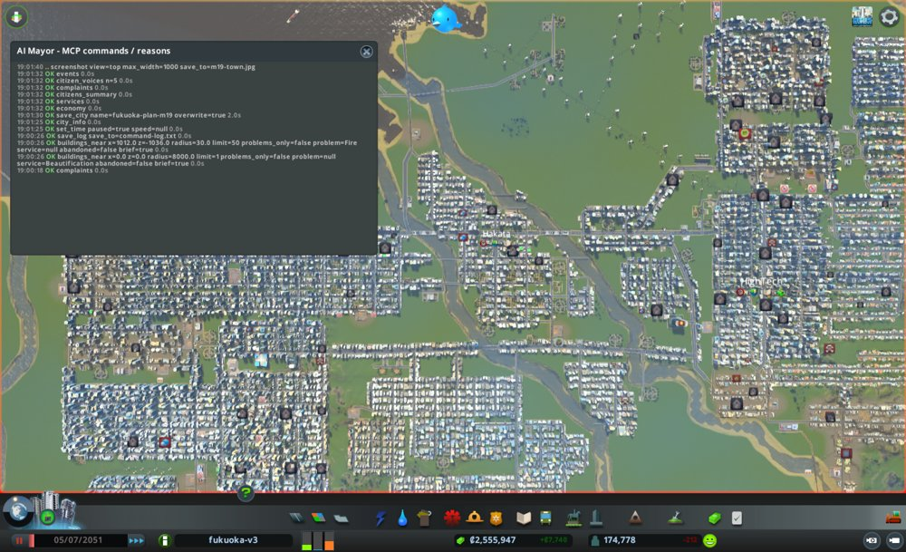

##### 実行の結果(実行する市長が書く。2051-07-05、所持金 2,555,946 から。advance の前に全部打った)

- m19-1: 成功。preview は 17097(家2)と 16316(働き0・家0)のみ。bulldoze 2回のあと JapaneseGarden を place_building(id 46916、費用 2,500、入口は segment 636 に距離0、電気・水あり)。8/4 Beautification 94棟(`buildings_near` total 94)
- m19-2: 成功。直前の test ok(matched 7)。upgrade_road で7区間を Small 4 Lane Road に(matched 7、upgraded 7、skipped 0、費用0、壊した建物0)。`traffic`(x2790 z-490 r150): 基準 blocked 47 → 7/15 0 → 7/25 0 → 8/4 0。flow 52→52→54→53。density 100 の区間は 4車線化後も 2〜3区間残る
- m19-3: 成功。preview は 10676 のみ(道路0、働き0、家0)。事前に test_place_building(10676 を除く仮定)ok。bulldoze のあと Landfill Site を place_building(新 id 28071、費用 4,000、入口 (-2729,-300) は道 4323 に距離1)。8/4 `buildings_near`: 2% full、収集車 2/19。`complaints` RoadNotConnected 3(基準4。残りは 23459 を含む)
- m19-4: 成功。preview は 948 のみ(働き0・家0)。bulldoze(what abandoned)で 948 を壊した。8/4 `complaints` の Fire は別の建物 23175(-1256,-1420)の1件。948 の印は消えた
- m19-5: 成功。実行前 25802 は稼働中(Students 223/348)。set_building_active(25802, false)。`map_layer` education_elementary(x-1370 z-1350 r400 n9): 基準 最小3・平均75 → 7/15 最小3・平均47 → 7/25 最小3・平均47 → 8/4 最小3・平均47。0 は出ず、戻さない。`services` education.elementary 13,572→13,224。`economy_breakdown` Education 週の支出 47,400(基準47,640)
- 見回り: 7/15 見回り1 人口 174,837、所持金 2,560,305、週の収支 +7,375(収入335,795、支出328,420)、幸福度 88、需要 30/2/50、観光客1,837(訪問148)、来ない市民 0/0/0、events 雑談2件、境目なし。7/25 見回り2 人口 174,594、所持金 2,570,431、週の収支 +6,806(収入335,217、支出328,411)、幸福度 88、需要 31/4/49、観光客1,874(訪問151)、来ない市民 0/0/0、events 雑談2件、境目なし(週の収支は前回より下がったが黒字)。8/4 月末 人口 174,330、所持金 2,581,541、週の収支 +7,697(収入336,073、支出328,376)、幸福度 88、需要 32/2/46、観光客1,852(訪問154)、Tourism 週87、来ない市民 0/0/0、満杯の埋立地1(3565)、ごみの印13、汚染22、火事1(23175)、犯罪1、品物がない店202、境目なし
- 調査: s19-1 は `council/m19-survey-finance.md`、s19-2 は `m19-survey-port.md`、s19-3 は `m19-survey-economy.md` に書いた(見回り1、見回り2、月末。s19-3 は見回り1と月末)
- 臨時: なし。保存: この段では行わない

| 2051-07-15 | 見回り1(19か月目) | 174,837 | 2,560,305 | +7,375 | 88 | 30 / 2 / 50 | - | 来ない市民 0/0/0、観光客1,837(訪問148)。境目なし(events は雑談2件) |
| 2051-07-25 | 見回り2(19か月目) | 174,594 | 2,570,431 | +6,806 | 88 | 31 / 4 / 49 | - | 来ない市民 0/0/0、観光客1,874(訪問151)。境目なし(events は雑談2件) |
| 2051-08-04 | 月末(19か月目) | 174,330 | 2,581,541 | +7,697 | 88 | 32 / 2 / 46 | - | 来ない市民 0/0/0、観光客1,852(訪問154)、Tourism 週87、品物がない店202、ごみ13(満杯1: 3565)、汚染22、火事1、犯罪1、RoadNotConnected 3、止まったトラック(28755)754、Beautification 94。境目なし |

#### 見たもの

- `preview_bulldoze`、`test_place_building`、`test_upgrade_road`: 実行前の確認
- `traffic`: (2790,-490 r150) blocked 47→0
- `map_layer`: 小学校の覆い 最小3(3回とも)、平均75→47
- `complaints`: RoadNotConnected 4→3、Fire は 948 から 23175 へ
- `buildings_near`: Beautification 93→94

#### 判断の根拠

議案の5件を advance の前にすべて打ち、失敗はなかった。m19-2 は blocked が 0 になったが、density 100 の区間が残るため、測りの揺れを考えて1か月の測りとして扱う。m19-5 は覆いの最小が 0 を出さず、戻す条件に当たらなかった。

#### 捨てたもの

- 臨時: 境目に当たらなかったため行わない
- 議案の予備候補: 使う場面がなかった

#### 次にやること

- 20月: m19-2 の blocked 0 が続くか、同じ範囲で測る。m19-5 の覆い最小3と、Education の支出を測り直す
- 20月: 23459 と 33216 の入口に道がない(RoadNotConnected 3)。火事の印が 23175 に移った
- 20月: 調査 s19-1〜s19-3 の結果は council/m19-survey-*.md を局が読む

### 2051-08-04 月例(20か月目)

保存: fukuoka-plan-m20(上書き)。dialog なし。events は0件。任期12か月の後の続行月。公約と計画の目標は変えない。

#### 答え合わせ

- m19-1 JapaneseGarden: 予想は Beautification 93→94。結果は `buildings_near`(Beautification)total 94。当たり。続ける
- m19-2 幹線 z=-490 の4車線化(試し): 予想は blocked 47→20以下。結果は `traffic`(x2790 z-490 r150)で blocked 0、flow 53。当たり。街全体の流れは53%で目標60に届かない。density 100 の区間が2つ残る
- m19-3 埋立地 10676 の建て直し: 予想は RoadNotConnected 4→3。結果は3。当たり。ごみの印は15→13
- m19-4 焼け跡 948 の取り壊し: 予想は Fire 1→0。結果は別の建物 23175 の印で1のまま。外れ。理由の見立て: 印が出る建物が次々に移る。次の扱い: 局が 23175 を決める
- m19-5 小学校 25802 の停止(試し): 予想は窓の最小が0を出さない。結果は最小3、平均47、Education 支出 47,640→47,400。当たり。続ける
- 週の収支: 見込み +9,960 に対し実測 +7,697。守る線 +3,000 の上、+4,900 の上。3か月で +10,007→+7,740→+7,697
- 前回の「次にやること」: m19-2 と m19-5 の測り直し(実行済み)、埋立地 23459・33216 の道(未実行。3棟のうち10676 は建て直した。局が案を出す)、調査 s19-1〜s19-3 の結果は局が読む
- 公約の進み具合
  1. 人口: 174,330。前月例174,778より448減った。11か月連続の減少で未達
  2. 来ない市民: 0 / 0 / 0。達成
  3. 赤字: 週の収支 +7,697(収入336,073、支出328,376)。黒字
  4. 観光: 今いる観光客1,852(前1,795。増えた)、Tourism 週87(前61。増えた)。2つとも前月より増えて達成。ただし目標3,000と週1,000には遠い
- 試しの結果: m19-2 は同じ範囲で 47→0。続ける。m19-5 は最小3のまま。続ける。バスの組み替え(分からないことの一覧の乗客の件)は、乗客の数字を今月は新しく測っていない

#### 計画の施策ごとの今の数字(2051-08-04)

- 1-2: 健康の平均88(目標80。達成)
- 2-3: 小学校 13,224 / 子ども9,017、高校 24,360 / 10代17,997。保つ
- 3-3: 来ない市民 0/0/0。達成
- 3-4: 火事1(23175)、犯罪1(40850)、合わせて2(目標4以下。達成)
- 4-1: 住宅(高密度)の地価の平均59(目標62。あと3)
- 4-2: Beautification 94棟(目標100。あと6)
- 4-3: 汚染の印22(目標15以下。あと7)
- 4-4: ごみの印13(目標0)、満杯の埋立地1(3565)、RoadNotConnected 3
- 6-1: 事務所のレベル3は3,283棟(目標3,500)
- 6-3: 交通の流れ53%(目標60)。止まった車675。blockedSpots の上位は (1302,120) 39
- 5-1・5-2: 観光客1,852(目標3,000)、訪問154(目標250)、Tourism 週87(目標1,000)、名所10棟(達成)、attractiveness 平均2(x0 z0 r4000 n9、最大24。目標12)、旅客の入口0(PublicTransport 15棟は Cargo、Metro Entrance、Bus Depot のみ)
- 6-4・7-1: 働き口87,498(空き4,011。目標90,000)、品物がない店202(目標120以下)、原料がない工場36(目標15以下)
- 8-1: 駅・港の敷地の止まったトラック617(28755が617。目標250以下)。Goods の輸入1,025台のうち616台が止まる

#### 気づいたこと

- 観光は人数1,852、Tourism 週87と、ともに前月より増えた。ただし入口は20か月0、attractiveness の平均は2のまま(最大24。街の北西・南東に点在)。地形資料の島B、空き地1(9.4km²)、2、4、5の名所は0棟のまま。入口(旅客の駅・港・空港)の案は18か月以上出ていない
- 貨物センター28755の止まったトラックは617で目標250の2.5倍。品物がない店202は、(-1096,-899) 55棟、(2254,813) 44棟に集まる。輸入 Goods が28755で詰まり、店に届かない形が続く
- 人口は11か月連続で減り174,330。需要は住32と高いが、空き家5,838。週の収支 +7,697で守る線の上だが、3か月で縮んだ

#### 次にやること

- 編成方針の重点は 5-1・5-2 観光(入口、島・空き地の名所)、8-1・6-4 貨物センターと品物がない店、4-4 ごみ(道のない埋立地2棟と満杯3565)
- 分からないことの一覧から、試しを1件採る

#### 画面写真

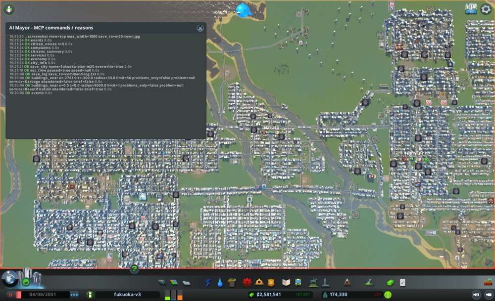

#### 施策

(結果の欄は実行する市長が書く。詳しくは council/m20-bill.md)

- m20-1 放棄店の跡 (2176,443) に JapaneseGarden を西向きに置く(urban-1、取り壊し3棟)。4-2。採択理由: 公園94で目標100に6足りず、入口 segment 6523・電気・水を test で確認。失う働き口30、家0。予想: Beautification 94→95(21月末)。建設費 2,500、週 40。結果: (実行後)
- m20-2 支線 x=2668(z 330〜560)と z=560(x 2594〜2668)を Small 4 Lane にする(roads-1)。6-3。採択理由: blocked 53 で止まりの上位、19月の同型で 47→0。予想: `traffic`(2655,502 r200)の blocked 53→30以下(21月末)。建設費 0、週 0。結果: (実行後)
- m20-3 交差点 (1300,100) の両側を Large Road にする(roads-2、試し)。6-3。採択理由: blocked 71 で最大、test ok。予想: `traffic`(1302,120 r200)の blocked 71→40以下(21月末)。減らなければ信号の待ちが原因とみる。建設費 400、週 約2。結果: (実行後)
- m20-4 路線28(line 136)の予算を 200% から 180% にする(port-1、試し、予算の議決)。6-3。採択理由: 乗客92に対して台数186。予想: 台数186→約171、乗客は保つ、流れは少し上がる(量は見積もれない)。建設費 0、週は減る。結果: (実行後)
- 調査: s20-1(economy、名所の訪問)、s20-2(finance、人口の減り)、s20-3(health、2267 の周りの汚染)
- 費用の合計: 建設費 2,900、週の維持費の増え 約 +42 未満(バスの減りを除く)。週の収支は約 +7,650 以上、所持金は約 2,578,000 の見込み

#### 考えたが打たなかった手

- 採択できる案4件はすべて採った。economy、health、education、fire、finance は案なし。市長は代案を作らない。観光の入口と名所、貨物センターの止まりは今月も案が出なかった
- 調査 urban(地価)、roads(北脚)は上限3件のため見送り
- 分からないことの試しの案は、m20-3(幅の不足か信号の待ちか)と m20-4(バスの台数)。観光、島の橋は試しの案が出なかった

##### 実行の結果(実行する市長が書く。2051-08-04、所持金 2,581,541 から実行後 2,576,341。差 5,200 は建設費 2,900 ではなく、実測の差。見回りで回復)

- m20-1: 成功。preview(radius 32)で 29473、34163、42442 の3棟(働き口30、家0、電気を失う建物0)を確認して bulldoze。JapaneseGarden を place_building(id 13376、費用 2,500、facing west、入口は segment 6523 に距離0、電気・水あり)。月末の `buildings_near`(Beautification)で 13376 を確認、街全体 total 95(基準94)
- m20-2: 成功。test と本番とも matched 3 / upgraded 3(x=2668)、matched 1 / upgraded 1(z=560 東端)。費用0、壊した建物0。月末(2655,502 r200)blocked 26、flow 55(基準 blocked 53)。見回り2は 65 と揺れた。blockedSpots の上位は (2678,338) 20。支線の北の交差(2678,338)へ移った形
- m20-3: 成功。区間 17667 と 33219 を Large Road に差し替え(各 200、計400)。月末(1302,120 r200)blocked 8、congestion 34、flow 55(基準71)。見回り1は 2、見回り2は 0。区間 1236(Medium Road)は density 100 のまま
- m20-4: 成功。実行前に line 136 は vehicles 186、budget 200 を確認。set_transport_line_budget(136, 180)で targetVehicles 171。月末 vehicles 171、passengersLastPeriod 110(基準92。見回り2は29)、pathWaiting 2、街全体の flow 55(基準53)

| 2051-08-04 | 月例(20か月目) | m20-1〜m20-4 | 上のとおり | urban / roads / port | 4-2 / 6-3 | 取り壊し1件、予算1件 | 公園・道路・バス | - | 5,200未満(計画は2,900) | 約 +42 未満 | 21月に埋める。月末の測り: m20-1 当たり(95)、m20-2 blocked 26(53から減)、m20-3 blocked 8(71から減)、m20-4 台数171で乗客保つ |

##### 見回りと月末(2051-08-14〜09-03)

- 見回り1(8/14): 人口174,242、所持金2,592,021、週の収支+9,620、幸福度88、観光客1,784。境目なし
- 見回り2(8/24): 人口174,078、所持金2,603,668、週の収支+8,503、幸福度88、観光客1,810。境目なし
- 月末(9/3): 人口174,078、所持金2,616,061、週の収支+8,868、幸福度88、観光客1,837(訪問164)。境目なし。臨時は行わず
- 調査: s20-1(`council/m20-survey-economy.md`)、s20-2(`m20-survey-finance.md`)、s20-3(`m20-survey-health.md`)に3回分を書いた。見立ては書かない
- 事実のみ(調査より): 人口は 174,330→174,242→174,078→174,078。movingIn は 11→16→6。汚染 map_layer の平均 47→49→49、焼却場 2267 の周りの Pollution 印の住宅 8→9→6
- 議決が要る道具は、最初の advance の後は使っていない

#### 次にやること(20月の実行から)

- 21月の月例で、m20-1(95を確認済み)、m20-2(blocked 26。見回りは53→65→26と揺れた)、m20-3(8)、m20-4(171台、乗客92→29→110と揺れた)を同じ引数で答え合わせする
- 旅客の入口0と名所の置き場所は、今月も案なし。21月の局に求める
- 人口は3回測っても174,078〜174,330で減り続ける(11か月連続)。s20-2 の結果は財政局が読む

#### 見たもの

- `city_info`、`economy`、`services`、`citizens_summary`、`complaints`、`citizen_voices`、`events`、`screenshot`: 型の8つ
- `economy_breakdown`: Tourism 週87、収入336,073、支出328,376
- `traffic`、`cargo`、`demand_breakdown`、`building_stats`、`map_layer`、`buildings_near`: 計画の施策ごとの数字

### 2051-09-03 月例(21か月目)

保存: fukuoka-plan-m21(上書き)。dialog なし。events は0件。任期12か月の後の続行月。公約と計画の目標は変えない。

#### 答え合わせ

- m20-1 JapaneseGarden: 予想は Beautification 94→95。結果は `buildings_near`(Beautification)total 95。当たり。続ける
- m20-2 支線 x=2668 の4車線化: 予想は blocked 53→30以下。結果は `traffic`(2655,502 r200)で 26、flow 55。当たり。止まりは (2678,338) 20 に移り、density 100 の区間が3残る
- m20-3 交差点 (1300,100) の Large Road(試し): 予想は blocked 71→40以下。結果は (1302,120 r200)で 8。当たり。幅の不足が原因の見立て。1236(Medium Road)は density 100 のまま
- m20-4 路線28の予算180%(試し): 予想は台数186→約171で乗客を保つ。結果は vehicles 171、passengersLastPeriod 110(基準92)、街全体の flow 53→55。当たり。乗客は 92→29→110 と揺れる
- 週の収支: 見込み +7,650 以上に対し実測 +8,868。守る線 +3,000、+4,900 の上
- 前回の「次にやること」: m20 の4施策の測り直し(実行済み)。旅客の入口0と名所の置き場所の案(今月も局に求める)
- 公約の進み具合
  1. 人口: 174,078。前月例174,330より252減った。12か月連続の減少で未達
  2. 来ない市民: 0 / 0 / 0。達成
  3. 赤字: 週の収支 +8,868(収入337,184、支出328,316)。黒字
  4. 観光: 今いる観光客1,837(前1,852。減った)、Tourism 週69(前87。減った)。2つとも前月より減り未達。m20 に観光の手はなかった
- 試しの結果: m20-3 は 71→8、m20-2 は 53→26 で続ける。m20-4 は台数を減らしても乗客を保ち、流れも55に動いたが、乗客の測りが揺れるので、結論は出さず次月も同じ道具で測る

#### 計画の施策ごとの今の数字(2051-09-03)

- 1-2: 健康の平均87(目標80。達成)
- 2-3: 小学校 13,224 / 子ども9,049、高校 24,360 / 10代18,024。保つ
- 3-3: 来ない市民 0/0/0。達成
- 3-4: 火事1(48237)、犯罪2(18931 など)、合わせて3(目標4以下。達成)
- 4-1: 住宅(高密度)の地価の平均59(目標62。あと3)
- 4-2: Beautification 95棟(目標100。あと5)
- 4-3: 汚染の印25(目標15以下。あと10)。hotspot (3747,-94) 12棟
- 4-4: ごみの印9(目標0)、満杯の埋立地1(3565)、RoadNotConnected 3
- 6-1: 事務所のレベル3は3,283棟(目標3,500)
- 6-3: 交通の流れ55%(目標60)。止まった車679。blockedSpots の上位は (2689,302) 38、(-1725,-1042) 37、(4100,-244) 37
- 5-1・5-2: 観光客1,837(目標3,000)、訪問164(目標250)、Tourism 週69(目標1,000)、名所10棟(達成)、attractiveness 平均2(x0 z0 r4000 n9、最大25。目標12)、旅客の入口0(PublicTransport 15棟は Cargo、Metro Entrance、Bus Depot のみ)
- 6-4・7-1: 働き口87,380(空き4,362。目標90,000)、品物がない店205(目標120以下)、原料がない工場32(目標15以下)
- 8-1: 駅・港の敷地の止まったトラック605(28755が604。目標250以下)。Goods の輸入1,025台のうち582台が止まる

#### 気づいたこと

- 観光は人数も Tourism も前月より減った(1,852→1,837、87→69)。入口は21か月0、attractiveness 平均2のまま。島B、空き地1(9.4km²)、2、4、5の名所は0棟。観光の手が3か月出ていない
- 貨物センター28755の止まったトラックは604で目標250の2.4倍。品物がない店205は (-1053,-829) 58棟、(2314,783) 45棟に集まる。Goods の輸入1,025台が28755に詰まる形が続く
- 人口は12か月連続で減り174,078。需要は住32だが空き家5,914。大卒の失業(demand_breakdown 2,427)は減った。週の収支は +8,868 で守る線の上

#### 次にやること

- 編成方針の重点は 5-1・5-2 観光(入口、島・空き地の名所)、8-1(貨物センターの止まり。6-4 の品物がない店と合わせる)、4-2 公園(あと5)
- 分からないことの一覧から、試しを1件採る

#### 画面写真

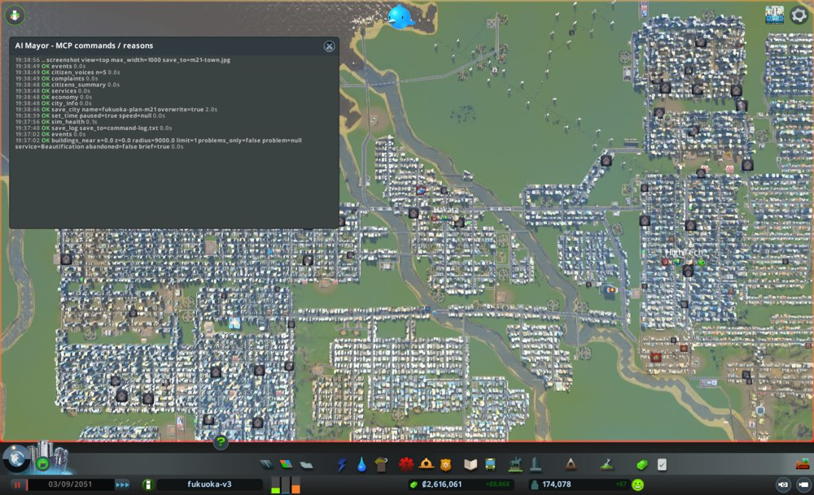

#### 見たもの

- `city_info`、`economy`、`services`、`citizens_summary`、`complaints`、`citizen_voices`、`events`、`screenshot`: 型の8つ
- `economy_breakdown`: Tourism 週69、収入337,184、支出328,316
- `traffic`、`cargo`、`demand_breakdown`、`building_stats`、`map_layer`、`buildings_near`、`list_transport_lines`: 計画の施策ごとの数字と、m20 の答え合わせ

#### 施策

(結果の欄は実行する市長が書く。詳しくは council/m21-bill.md)

- m21-1 放棄店 24928 の跡 (2160,-318) に JapaneseGarden を東向きに置く(urban-1、取り壊し1棟)。4-2。採択理由: 公園95で目標100にあと5。`test_place_building` ok、入口 segment 4530 に8m、電気・水・下水 true。失う働き口0、家0。予想: Beautification 95→96(21月末)。建設費 2,500、週 40。結果: (実行後)
- m21-2 交差点 (2668,330) に信号(roads-1、試し)。6-3。採択理由: blocked 53、止まりの上位 (2689,302) 38台。canEnableLights true。予想: `traffic`(2689,302 r150)の blocked 53→30以下(22月末)。2回の測りで基準より増えたら外す。建設費 0、週は未確認。結果: (実行後)
- m21-3 x=-1640 の南北道3区間を Small 4 Lane に(roads-2)。6-3。採択理由: blocked 74、`test_upgrade_road` で matched 3、cost 0。予想: `traffic`(-1725,-1042 r200)の blocked 74→40以下(22月末)。建設費 0、週 0。結果: (実行後)
- m21-4 休止中の貨物センター 40031 を再開(port-1、試し)。8-1、6-4。採択理由: 止まったトラック605が目標250の2.4倍。道・電気・水・下水が届くことを確認。予想: `cargo` の stoppedInBuildings 605→下がる方向、noGoods 205→下がる方向(量は見積もれない。22月末)。28755 の止まりが変わらず40031に車が来なければ止める。建設費 0、週 1,440。結果: (実行後)
- m21-5 埋立地 33216 に北から Basic Road (3499,692)→(3465,720) を引く(health-1、再調査で採用)。4-4。採択理由: 再調査で入口 (3499,682) 北向き、道の始点まで10m、`test_build_line` ok。予想: RoadNotConnected 3→2(22月末)、33216 の storage が 0 から増える。建設費 240、週 約2。結果: (実行後)
- 調査: s21-1(finance、人口の減り)、s21-2(health、汚染の出どころ)、s21-3(urban、住宅(高)の地価)
- 費用の合計: 建設費 2,740、週の維持費の増え 約1,482。週の収支は約 +7,390、所持金は約 2,613,300 の見込み

##### 実行の結果(実行する市長が書く。2051-09-03、所持金 2,616,061 から約 2,613,300)

- m21-1: 成功。`preview_bulldoze`(2176,-318 r12 abandoned)は 24928 の1棟、働き口0・家0。`bulldoze` で壊し、`place_building` JapaneseGarden(id 12168、費用 2,500、angleUsed 270、入口は segment 4530 に距離8)。`buildings_near`(Beautification, r200)で 12168 を確認
- m21-2: 成功。`junction_info` で canEnableLights true を確認し、`set_traffic_lights` active=true(node 4025、trafficLights true)。費用0。直後の `traffic`(2689,302 r150): blocked 53(基準どおり)、(2689,302) 38
- m21-3: 成功。`test_upgrade_road` matched 3、cost 0 のあと `upgrade_road`(matched 3、upgraded 3、skipped 0、cost 0、壊れた建物なし)。直後の `traffic`(-1725,-1042 r200): blocked 74、(-1725,-1042) 37(基準どおり)
- m21-4: 成功。`set_building_active`(40031, active=true)。維持費の反映は週が回ったあと確認
- m21-5: 成功。`test_build_line` ok のあと `build_line` Basic Road (3499,692)→(3465,720)(費用 240、終点は node に snapped、overlaps なし)。`net_reach`(3499,650 r200)は notEnterable 0・notLeavable 0・noRoad 0。`buildings_near` で 33216 の problems は None(storage 0%、収集車 0/19)。予備候補(南案)は使わず

#### 考えたが打たなかった手

- health-1(埋立地 33216 の道): 最初は入口の向きが未確認で条件付き。再調査で確認でき、m21-5 として採った
- education-1(小学校 15022 を止める): 再調査でも止めると覆いの縁が 0 に落ちる見込みで、不可
- economy、fire、finance は案なし。観光の入口と名所は今月も施策にできなかった(economy は場所の実行条件が未確認、port は整地なしで駅の道が引けない)。市長は代案を作らない
- 調査 roads と port は上限3件のため見送り
- 試しの案は m21-2(信号)と m21-4(貨物センター)。観光、島の橋の試しは出なかった

##### 見回りと月末(2051-09〜10)

| ゲーム内の日付 | 区切り | 人口 | 所持金 | 週の収支 | 幸福度 | 需要(住/商/工) | 主な困りごと |
|---|---|---|---|---|---|---|---|
| 2051-09-13 | 見回り1 | 173,978 | 2,624,775 | +7,909(収入337,731、支出329,822) | 88 | 32 / 4 / 47 | 来ない市民 0/0/0、観光客1,876(訪問167)。境目なし(events は雑談2件。水道の苦情1件)。m21-2 blocked 13(基準53)、m21-3 blocked 28(基準74)、cargo stoppedInBuildings 610(基準605。40031 はまだ車0) |
| 2051-09-23 | 見回り2 | 173,755 | 2,635,070 | +7,188(収入336,960、支出329,772) | 88 | 33 / 2 / 46 | 来ない市民 0/0/0、観光客1,976(訪問169)。境目なし(events は雑談1件)。m21-2 blocked 46(基準53。(2693,305) 39)、m21-3 blocked 17(基準74)、vehicles_stuck(28755) 768台のうち WaitingSpace 716、7日以上止まり538 |
| 2051-10-03 | 月末(21か月目) | 173,537 | 2,643,814 | +5,957(収入335,699、支出329,742。40031 の維持費が入った) | 87 | 34 / 2 / 43 | 来ない市民 0/0/0、観光客2,020(訪問171)、Tourism 週105、Beautification 96棟(m21-1 当たり)、品物がない店227、原料がない工場29、流れ55%、ごみ14、汚染32、火事4、犯罪3、RoadNotConnected 2(33216 は消えた。m21-5 当たり)。m21-2 blocked 0(基準53、見回り1 13・2 46)、m21-3 blocked 37(基準74、見回り 28・17)、cargo stoppedInBuildings 632(基準605。28755 は631)、WaitingSpace 716(見回り2と同じ)、40031 は車0のまま。境目なし。events は雑談1件 |

##### 月末の判定材料(2051-10-03、22月の答え合わせに使う)

- m21-4 の中止条件: 「40031 へ車が来ず、かつ 28755 の WaitingSpace が増えた」。40031 は車0(inUse 0、vehiclesLeaving/Arriving 0)だが、WaitingSpace は 716→716 で増えていない。週の収支 +5,957 は +5,000 の上。条件を満たさないので止めず、続けた。週の収支が +5,000 に近いので、22月に再確認する
- m21-3 の中止条件(2回の測りで基準74より増えた): 28→17→37 でいずれも基準より下。戻さない。止まりが (-1632,-1106) 18 に出ている(隣の Basic Road 33705 が density 100)
- m21-2 の中止条件(2回続けて基準53を超えた): 13→46→0 で超えていない。外さない
- 調査 s21-1〜s21-3: 3回分を council/m21-survey-finance.md、m21-survey-health.md、m21-survey-urban.md に書いた(見立てはなし)

### 2051-10-03 月例(22か月目)

保存: fukuoka-plan-m22(上書き)。dialog なし。events は0件。任期12か月の後の続行月。公約と計画の目標は変えない。

#### 答え合わせ

- m21-1 JapaneseGarden: 予想は Beautification 95→96。結果は `buildings_near`(Beautification)total 96。当たり。続ける
- m21-2 交差点 (2668,330) の信号(試し): 予想は blocked 53→30以下。結果は `traffic`(2689,302 r150)で 0(見回りは 13→46→0)。当たり。ただし揺れが大きく、信号の効きと断定しない
- m21-3 x=-1640 の4車線化: 予想は blocked 74→40以下。結果は `traffic`(-1725,-1042 r200)で 37。当たり。止まりは (-1632,-1106) 18 に移り、隣の Basic Road 33705 が density 100
- m21-4 貨物センター 40031 の再開(試し): 予想は stoppedInBuildings 605 と noGoods 205 が下がる方向。結果は 632 と 227 で逆に増え、40031 は車0のまま。外れ。理由の見立て: 輸入トラックは 28755 に向かう決まりで、40031 に割り振られない(未確認)。次の扱い: 局が、止めるか、別の手に替えるかを決める。週の維持費 約1,440 を払っている
- m21-5 埋立地 33216 の道: 予想は RoadNotConnected 3→2。結果は 2(33216 は消えた)。当たり
- 週の収支: 見込み +7,390 に対し実測 +5,957。40031 の維持費が入った。守る線 +3,000 の上、+4,900 の上だが、近づいた
- 前回の「次にやること」: 重点の観光(入口、島・空き地の名所)は m21 でも施策にならなかった(未実行)。試しは m21-2、m21-4 を採った(実行済み)
- 公約の進み具合
  1. 人口: 173,537。前月例174,078 より541減った。13か月連続の減少で未達
  2. 来ない市民: 0 / 0 / 0。達成
  3. 赤字: 週の収支 +5,957(収入335,699、支出329,742)。黒字
  4. 観光: 今いる観光客2,020(前1,837。増えた)、Tourism 週105(前69。増えた)。2つとも前月より増え達成。ただし m21 に観光の手はなく、原因は分からない
- 試しの結果: m21-2 は 53→0 で続ける(揺れる)。m21-4 は効かない見立て(1回目)。次月、局が止めるかを決める

#### 計画の施策ごとの今の数字(2051-10-03)

- 1-2: 健康の平均87(目標80。達成)
- 2-3: 小学校 13,224 / 子ども9,077、高校 24,360 / 10代18,151。保つ
- 3-3: 来ない市民 0/0/0。達成
- 3-4: 火事4、犯罪3、合わせて7(目標4以下。9月の3から悪化)
- 4-1: 住宅(高密度)の地価の平均59(目標62。あと3)
- 4-2: Beautification 96棟(目標100。あと4)
- 4-3: 汚染の印32(目標15以下。9月の25から悪化)。hotspot (2110,329) 10棟
- 4-4: ごみの印14(目標0)、満杯の埋立地1(3565)、RoadNotConnected 2
- 6-1: 事務所のレベル3は3,281棟(目標3,500。9月の3,283から-2)
- 6-3: 交通の流れ55%(目標60)。止まった車642。blockedSpots の上位は (2302,-946) 51、(-920,-857) 48、(3099,-471) 47
- 5-1・5-2: 観光客2,020(目標3,000)、訪問171(目標250)、Tourism 週105(目標1,000)、名所10棟(達成)、attractiveness 平均2(x0 z0 r4000 n9、最大25。目標12)、旅客の入口0(PublicTransport 15棟は Cargo、Metro Entrance、Bus Depot のみ)
- 6-4・7-1: 働き口87,121(空き4,917。目標90,000)、品物がない店227(目標120以下)、原料がない工場29(目標15以下)
- 8-1: 駅・港の敷地の止まったトラック632(28755が631。目標250以下)。Goods の輸入1,041台のうち609台が止まる

#### 気づいたこと

- 観光客は2,020、Tourism は週105で、どちらも前月より増えた(原因は分からない)。目標3,000と週1,000にはまだ遠い。入口は22か月0、名所は10棟で達成済み、attractiveness 平均は2のまま。島B、空き地1〜5の名所は0棟
- 貨物センター28755の止まったトラックは631で、40031 を再開しても増えた。品物がない店227は (-1058,-807) 60棟、(2285,735) 55棟、(-2372,-767) 32棟に集まる
- 人口は13か月連続で減り173,537。需要は住34で空き家5,975。週の収支は +5,957 で、40031 の維持費が入って +8,868 から下がった

#### 次にやること

- 編成方針の重点は 5-1・5-2 観光(入口、島・空き地の名所)、8-1(貨物センターの止まり)、6-3(交通の流れ)
- 分からないことの一覧から、観光の入口と名所の試し(1行目)を1件採る

#### 画面写真

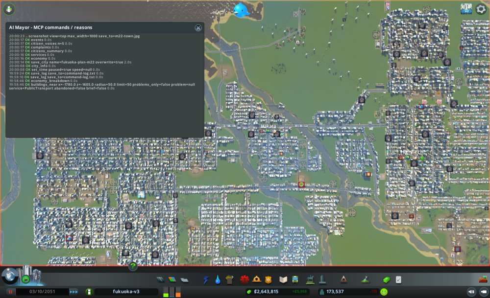

#### 見たもの

- `city_info`、`economy`、`services`、`citizens_summary`、`complaints`、`citizen_voices`、`events`、`screenshot`: 型の8つ
- `economy_breakdown`: Tourism 週105、収入335,699、支出329,742
- `traffic`、`cargo`、`demand_breakdown`、`building_stats`、`map_layer`、`buildings_near`: 計画の施策ごとの数字と、m21 の答え合わせ

#### 施策

(結果の欄は実行する市長が書く。詳しくは council/m22-bill.md)

- m22-1 放棄店 6208 の跡 (56,22) に JapaneseGarden(urban-1)。4-2、取り壊し(働き口0・家0)。採択理由: Beautification 96 で目標100にあと4、損失0の場所を確認済み。予想: Beautification 96→97(22月末)。建設費 2,500、週 +40。結果: (実行後)
- m22-2 x=-1640 の残り Basic 6区間を Small 4 Lane に(roads-1)。6-3。採択理由: 21月の3区間が 74→37 と効いた。予想: (-1640,-880) r100 の blocked 22→10以下。建設費 0、週 0。結果: (実行後)
- m22-3 3叉路 (2236,-950) に信号(roads-2、試し)。6-3。採択理由: 上位の止まり (2302,-946) blocked 75、差し替えは 36011 が断る。予想: blocked 75→50以下、増えたら外す。建設費 0。結果: (実行後)
- m22-4 貨物センター 40031 を止める(port-1)。8-1(効きは週の収支)、公約3。採択理由: m21-4 の再開は外れ、車0で維持費 1,440 だけ出る。予想: 週の収支 +5,957→約 +7,400。結果: (実行後)
- 調査: s22-1(economy、魅力度の高い点)、s22-2(port、28755 の行き先の遠さ)、s22-3(roads、x=-920 の止まりの上流か下流か)
- 費用の合計: 建設費 2,500、週の維持費の増え 約 -1,400。週の収支は約 +7,360、所持金は約 2,641,300 の見込み

#### 考えたが打たなかった手

- port-2(路線28の予算を 200% に戻す、予算): 乗客が 92→29→110→53 と揺れ、1期間で判断できない。維持費 約+2,400 の見積もりも粗い。条件付き
- urban-2(幹線沿いの木、試し): 植える空きが未確認。条件付き
- economy、health、education、fire、finance は案なし。観光の入口と名所は22か月めも施策にならず、市長は代案を作らない。観光と島の橋の試しの案は出なかった
- 調査 health・fire・finance は上限3件のため見送り

### 2051-11-02 月例(23か月目)

保存: fukuoka-plan-m23(上書き)。dialog なし。events は0件。任期12か月の後の続行月。公約と計画の目標は変えない。

#### 答え合わせ

- m22-1 JapaneseGarden 48363: 予想は Beautification 96→97。結果は `buildings_near`(Beautification)total 97。当たり。続ける(目標100にあと3)
- m22-2 x=-1640 の4車線化: 予想は (-1640,-880 r100) blocked 22→10以下、(-1640,-1000 r200) 41→40以下。結果は 15 と 30。後者は当たり、前者は外れ(15)。理由の見立て: 止まりが (-1635,-839) 11 の1点に残り、区間 5336 が density 100(未確認)。次の扱い: 局が、その点の隣接を調べるか決める
- m22-3 3叉路 (2236,-950) の信号(試し): 予想は (2302,-946 r150) blocked 75→50以下。結果は 0。当たり。ただし congestion 48、density 100 の区間3。揺れの前例があり、効きとは断定しない
- m22-4 貨物センター 40031 の停止: 予想は週の収支 +5,957→約 +7,400。結果は +7,746。当たり。28755 の止まりは631→629で変わらない(停止の影響なし)
- 週の収支: +5,957→+7,746。守る線 +3,000、+4,900 の上
- 前回の「次にやること」: 観光の試しを1件採る(m22 の4施策に観光はなし。未実行)。調査 s22-1〜3 は実行済み
- 公約の進み具合
  1. 人口: 172,759。前月例173,537より778減った。14か月連続の減少で未達
  2. 来ない市民: 0 / 0 / 0。達成
  3. 赤字: 週の収支 +7,746(収入336,105、支出328,359)。黒字
  4. 観光: 今いる観光客2,020(前2,020。増えず同数)、Tourism 週130(前105。増えた)。観光客は増えず未達、収入は増えた
- 試しの結果: m22-3 は 75→0 で続ける(揺れる)。m22-4 は当たり。m21-4 の「効かない」(1回目)は、止めても 28755 が変わらないので、効かない見立てを保つ(2回目の確認)

#### 計画の施策ごとの今の数字(2051-11-02)

- 1-2: 健康の平均87(目標80。達成)
- 2-3: 小学校 13,224 / 子ども9,169、高校 24,360 / 10代18,185。保つ
- 3-3: 来ない市民 0/0/0。達成
- 3-4: 火事2(40458)、犯罪4(40850、47076 など)、合わせて6(目標4以下。10月の7から1減、まだ超過)
- 4-1: 住宅(高密度)の地価の平均59(目標62。あと3)
- 4-2: Beautification 97棟(目標100。あと3)
- 4-3: 汚染の印20(目標15以下。10月の32から減)。hotspot (3842,-292) 12棟
- 4-4: ごみの印14(目標0)、満杯の埋立地1(3565)、RoadNotConnected 2(23459 など)
- 6-1: 事務所のレベル3は3,281棟(目標3,500。変わらず)
- 6-3: 交通の流れ52%(目標60。10月の55から悪化)。止まった車625。blockedSpots の上位は (3092,-477) 44、(1083,95) 28、(2082,-840) 22
- 5-1・5-2: 観光客2,020(目標3,000)、訪問179(目標250)、Tourism 週130(目標1,000)、名所10棟(達成。今月は数え直していない)、attractiveness 平均3(x0 z0 r4000 n9、最大85。目標12)、旅客の入口0(PublicTransport 15棟は Cargo、Metro Entrance、Bus Depot のみ)
- 6-4・7-1: 働き口87,217(空き6,011。目標90,000)、品物がない店215(目標120以下)、原料がない工場29(目標15以下)
- 8-1: 駅・港の敷地の止まったトラック635(28755が629。目標250以下)。Goods の輸入1,039台のうち616台が止まる

#### 気づいたこと

- 観光客は2,020で前月と同数、Tourism は週130に増え、訪問は179で最高。入口は23か月0、名所は10棟のまま。attractiveness の最大が 25→85 に動いた(同じ引数。原因は分からない)。島B、空き地1〜5の名所は0棟
- 人口は14か月連続で減り172,759。空き家6,054、空き働き口6,011、働き手81,130に対し働き口87,217。失業 citizens_summary は866まで減り、働き手の不足が出ている
- 貨物センター28755の止まったトラックは629で、40031 の再開も停止も変えなかった。48243(1864,1680)も TurnedOff。週の収支は +7,746 まで戻った

#### 次にやること

- 編成方針の重点は 5-1・5-2 観光(入口、島・空き地の名所)、8-1・6-4(貨物センターの止まりと品物がない店)、6-3(交通の流れ52%)
- 分からないことの一覧から、観光の入口と名所の試し(1行目)を1件採る

#### 画面写真

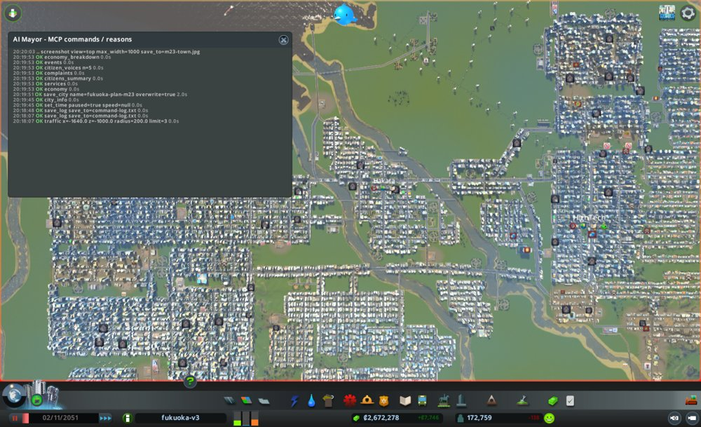

#### 見たもの

- `city_info`、`economy`、`services`、`citizens_summary`、`complaints`、`citizen_voices`、`events`、`screenshot`: 型の8つ
- `economy_breakdown`: Tourism 週130、収入336,105、支出328,359
- `traffic`、`cargo`、`demand_breakdown`、`building_stats`、`map_layer`、`buildings_near`、`list_loans`: 計画の施策ごとの数字と、m22 の答え合わせ

#### 施策

(結果の欄は実行する市長が書く。詳しくは council/m23-bill.md)

- m23-1 放棄店 10258 の跡 (1856,-46) に JapaneseGarden(urban-1)。4-2、取り壊し(働き口0・家0)。採択理由: Beautification 97 で目標100にあと3、損失0の場所が確認済み。予想: 97→98(24月末)。建設費 2,500、週 +40。結果: (実行後)
- m23-2 交差点 (2110,-840) の3本を Small 4 Lane に(roads-1)。6-3。採択理由: (2082,-840) r200 の blocked 35、3本とも Basic で density 100、試しで3区間通る。予想: blocked 35→20以下(24月末)。費用0。結果: (実行後)
- m23-3 交差点 (3130,-490) に信号(roads-2、試し)。6-3。採択理由: 最上位の止まり (3092,-477) blocked 56、差し替えは断られる。予想: 56より減る(量は見積もれない)。効かなければ外す。費用0。結果: (実行後)
- m23-4 路線28の予算を 180%→200%(port-1、試し、予算の議決)。6-3。採択理由: 2期続けて乗客92未満(73、85)。予想: 乗客が2期続けて92以上(第25月末)。判定は乗客と台数に絞る。週 約 +220〜270。結果: (実行後)
- m23-5 (1862,360) に JapaneseGarden(economy-1、試し)。5-1・5-2、公約4。採択理由: 魅力度の峰は公園3棟の周り、確認済みの場所。予想: 新しい公園の Visitors last week 10〜15(24月末)。建設費 2,500、週 +40。結果: (実行後)
- 調査: s23-1(port、13893 と 28755)、s23-2(health、汚染の一帯と幹線の混み)、s23-3(fire、48237 と消防署の出動)
- 費用の合計: 建設費 5,000、週の維持費の増え 約 +300〜350。週の収支は約 +7,400、所持金は約 2,667,000 の見込み

#### 考えたが打たなかった手

- urban-2(幹線沿いの木、試し): 植える位置と本数が未確認。条件付き
- 財政局の調査(区127 の基準): 上限3件のため見送り。24月に再検討
- health、education、fire、finance は案なし(education は4校目の覆い0の根拠が出せず、fire は出動0/8で追加の根拠なし)。市長は代案を作らない
- 分からないことの一覧の試し: 観光(m23-5)、6-3(m23-3、m23-4)で採った。8-1 は試しの案が出ず、調査 s23-1 で見る

### 2051-12-02 月例(24か月目)

保存: fukuoka-plan-m24(上書き)。dialog なし。events は雑談1件。任期12か月の後の続行月。公約と計画の目標は変えない。

#### 答え合わせ

- m23-1 JapaneseGarden 10019: 予想は Beautification 97→98。結果は `buildings_near`(Beautification)total 99。当たり(上振れ)。続ける(目標100にあと1)
- m23-2 (2110,-840) の3本を4車線化: 予想は (2082,-840 r200) blocked 35→20以下。結果は81。外れ。理由の見立て: 止まりが (2058,-871) 30、(1955,-874) 17 へ移り、density 100 の Basic 3区間が残る(未確認)。次の扱い: 局が、移った先を調べるか、続けない理由を書く
- m23-3 (3130,-490) の信号(試し): 予想は blocked 56より減る。結果は57。外れ。congestion 69。効かない見立て(1回目)。局が外すか決める
- m23-4 路線28の予算200%(試し): 予想は passengersLastPeriod 2期続けて92以上(第25月末)。結果は101(1期目)、台数188。まだ分からない。25月末に判定
- m23-5 公園 29231(試し): 予想は Visitors 10〜15。結果は11(Tourists 3)。当たり。ただし観光客2,020→2,011、Tourism 週130→89 で、街全体は動かない
- m23-6 木3本(試し): 予想は騒音と地価の差が小さい。結果は騒音33→30、地価67→67。当たり(木の効きとは言えない)
- 週の収支: +7,746→+6,823。守る線 +3,000、+4,900 の上
- 前回の「次にやること」: 観光の試し(m23-5)は実行。調査 s23-1〜3 は実行済み
- 公約の進み具合
  1. 人口: 172,273。前月例172,759より486減った。15か月連続の減少で未達
  2. 来ない市民: 0 / 0 / 0。達成
  3. 赤字: 週の収支 +6,823。黒字
  4. 観光: 今いる観光客2,011(前2,020。減)、Tourism 週89(前130。減)。未達
- 試しの結果: m23-5 は当たりだが街全体は動かず(1回目)。m23-3 は効かない見立て(1回目)

#### 計画の施策ごとの今の数字(2051-12-02)

- 1-2: 健康の平均85(目標80。達成。11月の87から-2)
- 2-3: 小学校 13,224 / 子ども9,436、高校 24,360 / 10代18,277。保つ
- 3-3: 来ない市民 0/0/0。達成
- 3-4: 火事2(47239 など)、犯罪4(23459 など)、合わせて6(目標4以下。11月と同じ)
- 4-1: 住宅(高密度)の地価の平均59(目標62。あと3)
- 4-2: Beautification 99棟(目標100。あと1)
- 4-3: 汚染の印43(目標15以下。11月の20から悪化)。hotspot (2081,505) 16棟
- 4-4: ごみの印12(目標0)、満杯の埋立地1(3565)、RoadNotConnected 1(23298)
- 6-1: 事務所のレベル3は3,286棟(目標3,500。11月の3,281から+5)
- 6-3: 交通の流れ52%(目標60)。止まった車994(11月の625から増)。blockedSpots の上位は (1670,93) 50、(1882,-903) 46、(3138,-282) 37
- 5-1・5-2: 観光客2,011(目標3,000)、訪問179(目標250)、Tourism 週89(目標1,000)、名所10棟(達成)、attractiveness 平均3(x0 z0 r4000 n9、最大85。目標12)、旅客の入口0(PublicTransport 15棟は Cargo、Metro Entrance、Bus Depot のみ)
- 6-4・7-1: 働き口87,063(空き6,408。目標90,000)、品物がない店201(目標120以下)、原料がない工場32(目標15以下)
- 8-1: 駅・港の敷地の止まったトラック631(28755が613。目標250以下)。Goods の輸入1,056台のうち700台が止まる

#### 気づいたこと

- 観光客は2,011、Tourism は週89で、どちらも前月より減った。公園 29231 は Visitors 11 でも街全体は動かない。入口は24か月0、島B、空き地1〜5の名所は0棟のまま
- 止まった車が625→994に増えた。(1670,93) 50 と (1882,-903) 46 が新しい上位。(2082,-840) 周りは 35→81
- 汚染の印が20→43に増えた(hotspot (2081,505) の住宅16棟)。原因は分からない。人口は15か月連続で減り172,273

#### 次にやること

- 編成方針の重点は 5-1・5-2 観光(入口、島・空き地の名所)、8-1・6-4、6-3(交通の流れ)
- 分からないことの一覧から、観光の試し(1行目、島の橋)を1件採る

#### 画面写真

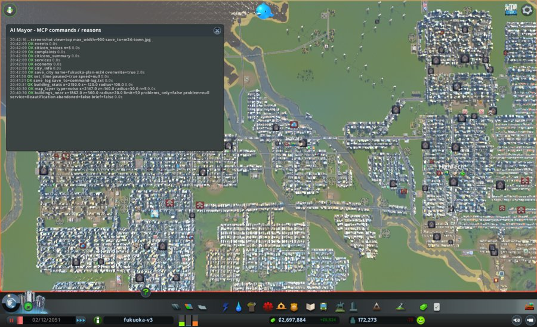

#### 見たもの

- `city_info`、`economy`、`services`、`citizens_summary`、`complaints`、`citizen_voices`、`events`、`screenshot`: 型の8つ
- `economy_breakdown`: Tourism 週89、収入335,576、支出328,753
- `traffic`、`cargo`、`demand_breakdown`、`building_stats`、`map_layer`、`buildings_near`、`list_transport_lines`: 計画の施策ごとの数字と、m23 の答え合わせ

#### 施策

- m24-1 放棄店 30881 の跡 (2128,423) に JapaneseGarden(urban-1、取り壊し議決)。4-2。採択理由: Beautification 99 で目標100にあと1、損失は働き口0・家0。予想: 99→100(24月末)。建設費 2,620、週 +41。結果: 部分実行。30881 を取り壊し(損失 働き口0・家0)、JapaneseGarden 13006 を (2128,423) facing south に設置(費用2,500)。電気・水・下水 true、困りごと None。道路 (2128,407)→(2152,407) は test_build_line が3回(局の座標、(2145,406)、(2135,395) 起点)とも公園 13006 との重なりで断られ、引かず(入口の16m以内に Small 4 Lane 6523 が既にある)。月末 `buildings_near`(Beautification)total 100(目標到達)。Visitors last week 7(Tourists 3)
- m24-2 (2082,-840) の4車線を Basic に戻す(roads-1)。6-3。採択理由: 4車線化後 blocked 35→81で戻す条件に当たる。予想: blocked 81→30〜50。費用0。結果: 成功。`upgrade_road` matched 2、upgraded 2、費用0。(2082,-840) r200 の blocked は戻す直前81、月末85(止まりは (2134,-908) 53 に移動)。flow 52 のまま(52%より下がらず)。見回り1は (1882,-903) r120 blocked 2、(2110,-840) r80 blocked 2
- m24-3 小学校 24888 を止める(education-1、試し)。2-3。採択理由: 止めた後も定員は子どもの1.37倍、過去の止めは当たり。予想: 覆いが0にならず、定員13,224→12,924。週 約 -160〜-200。結果: 成功。24888(Elementary School、困りごと None、生徒229/348)を `set_building_active` で停止。月末 `services` の小学校定員 12,876。月末 `map_layer`(education_elementary)は基準で0でなかった点が0になった所なし(z=-1250 の行は 24、52、100、155、176、148、82、21、37。基準は 25、80、163、253、280、218、116、21、37)。戻さず継続。weeklyExpenses は 328,753→328,585
- 調査: s24-1(roads、(1882,-903) の止まり)、s24-2(health、汚染と発電所 10351)、s24-3(fire、26833 の出動)
- 費用の合計: 建設費 2,620、週の維持費の増え 約 -160(公園 +41、小学校 -160〜-200)。守る線の内側

#### 考えたが打たなかった手

- finance-1(HeavyTrafficBan): 23月の調査で汚染は道の混みと関係なしと分かっており、物流(noGoods 201、止まり631)を悪くする恐れ。不可
- port、economy は案なし(電気の経路、名所の置き場所が未確認)。health、fire も案なし。市長は代案を作らない
- 分からないことの観光の試しは、案が出なかった

#### 見回りと月末(24か月目)

| ゲーム内の日付 | 区切り | 人口 | 所持金 | 週の収支 | 幸福度 | 需要(住/商/工) | 主な困りごと |
|---|---|---|---|---|---|---|---|
| 2051-12-12 | 見回り1(24か月目) | 172,098 | 2,704,477 | +5,809(収入334,388、支出328,579) | 86 | 37 / 2 / 41 | 来ない市民 0/0/0、観光客2,089(訪問180)。境目なし(events は雑談3件) |
| 2051-12-22 | 見回り2(24か月目) | 171,969 | 2,711,802 | +5,160(収入333,721、支出328,561) | 86 | 34 / 2 / 42 | 来ない市民 0/0/0、観光客2,078(訪問183)。境目なし(events は雑談1件) |
| 2052-01-01 | 月末(24か月目) | 171,949 | 2,717,838 | +4,298(収入332,883、支出328,585) | 86 | 36 / 2 / 42 | 来ない市民 0/0/0、観光客2,048(訪問175)、Tourism 週93、Beautification 100、汚染の印(complaints)27、火事2、犯罪3、ごみ8、満杯の埋立地1(3565)。境目なし。週の収支は+4,298で、前月例+6,823から下がったが黒字。守る線+3,000の上、+4,900(下降の規則の目安)は下回る |

- 調査 s24-1〜3 は council/m24-survey-roads.md、-health.md、-fire.md に3回分を記録
- 臨時: なし(境目に当たらず)

#### 次にやること(月末時点)

- 週の収支が+4,298で+4,900を切った。次の月例で、維持費が増える施策は守る線の規則に当たるかを財政局が見る
- 24888 の停止は継続。25月で定員が子どもの1.1倍を切らないか `services` と `citizens_summary` で見る
- (2082,-840) 周りは (2134,-908) に止まりが移り blocked 85。局が移った先を調べる

## 公約の結果

(任期の終わりに書く)

## 次の市長への申し送り

(運営の終わりに書く)
