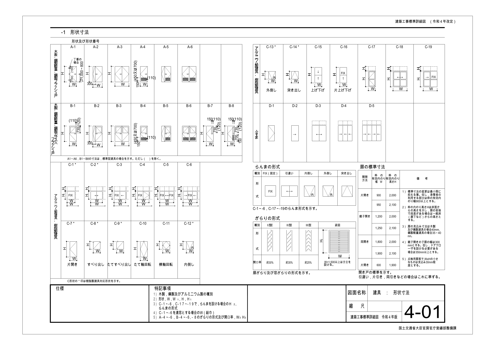
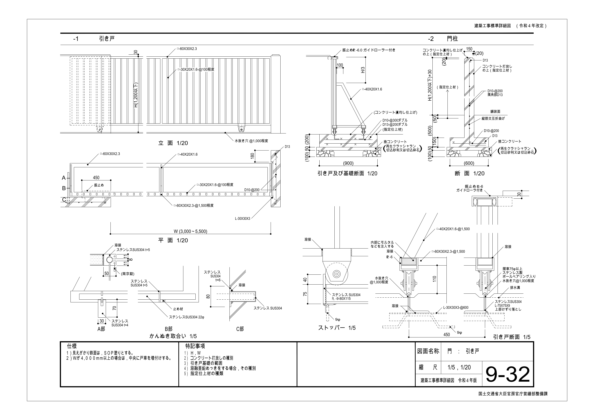
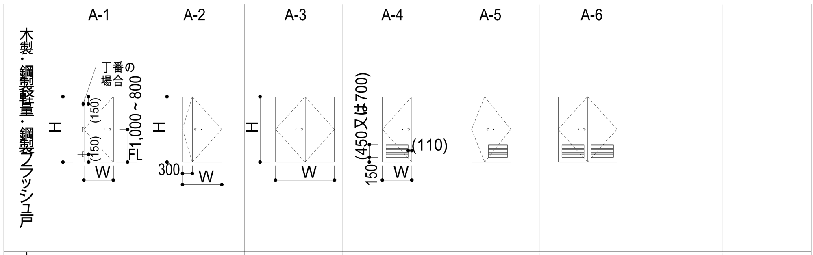
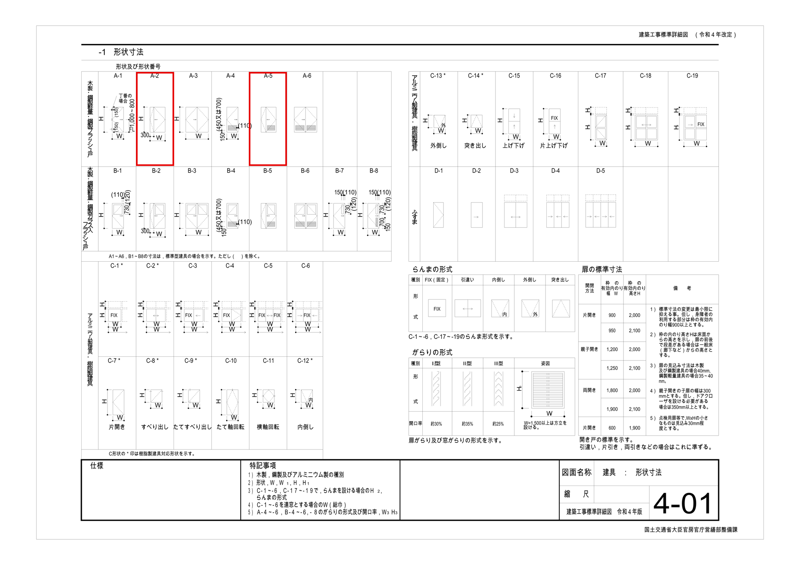
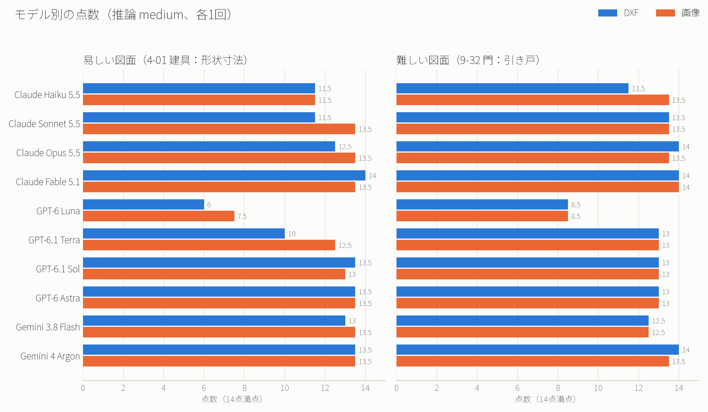

# AIに建築の図面を読ませて、3社10のモデルで比べた

## はじめに

やってみ太郎です。へんてこ商事で、中小企業のDXやAI導入の相談役と、システム開発をしています。

ここ最近、建設業や機械製造業のお客様から、図面についての相談が増えてきました。

- AIで、図面の意味を読み取れないか
- AIに、図面を描かせられないか
- AIで、図面からパース（完成予想図）や見積書、ほかの図面を作れないか

お客様の気持ちは、とても分かります。図面を読む仕事も描く仕事も、人の手間がかかるからです。
ただ、私は聞かれるたびに「たぶん、ここまではできると思います」と答えていました。その答えの根拠は、私が自分で少し試した感触だけでした。

そこで私は、一度きちんと理論立てて調べることにしました。新しい連載「AIと図面のコラボレーション」です。

連載の1本目のテーマは、いちばん手前の「読む」です。
人が図面を渡したときに、AIはそこに何が描かれているかを説明できるのか。私はこれを、Claude、GPT、Gemini の3社の10のLLMで比べました。
LLM（大規模言語モデル）は、文章で指示を受けて答えるAIのことです。ChatGPT や Claude の中で動いているのが、このLLMです。

私が使った図面は、国土交通省が公開している「建築工事標準詳細図」の2枚です。この図面集は、公共建築でよく使う納まり（部材どうしの取り合い方）を、標準の図として示したものです。

1枚目の図面は「建具：形状寸法」です。この図面には、扉や窓の形を番号で分類した一覧と、寸法の表がまとまっています。

2枚目の図面は「門：引き戸」です。この図面は、門の引き戸を、立面・平面・断面と部分の詳細で描いています。

私は機械の図面も試したかったのですが、公開できる形で手に入る図面が見つかりませんでした。そのため、今回は建築の図面だけにしました。

## 「説明して」では測れない

私が最初に考えたのは、LLMに「この図面を説明して」と頼むことでした。

でも、少し想像してみると、この頼み方では比べられないことに気づきました。
あるLLMは表題を読み上げ、別のLLMは部材を細かく並べ、また別のLLMは使い方の提案まで書くかもしれません。どの答えも「説明」ではあります。ただ、どの答えが良いのかは、決められません。

私がお客様に「このAIなら図面を読めます」と言うには、そのAIが何を読めて、何を読めないのかを、言葉にできる必要があります。
そのためには、LLMに聞くことと、その正解を、先に決めておくしかありません。

ここからが、私が今回いちばん時間をかけたところです。

## 問いを3つの軸で組む

私は、LLMへの問いを、3つの軸を掛け合わせて作りました。

### 軸1 図面の難しさ

私は、易しい図面と、難しい図面を用意しました。

- 易しい図面: 建具の形状の一覧（1枚目）。この図面は形と表が中心で、図はどれも単純です。
- 難しい図面: 門の引き戸（2枚目）。この図面には、立面・平面・断面と部分の詳細が1枚に並び、縮尺も 1/20 と 1/5 の2つがあります。読む人は、図と図を照らし合わせないと、この図面を読めません。

私は、中くらいの難しさの図面も、もう1枚用意しています。ただ、今回は時間の都合で、易しい図面と難しい図面だけを試しました。

### 軸2 渡し方

私は、同じ図面を、2つの形でLLMに渡しました。

- DXF: CADのデータを交換するための形式です。DXFのファイルには、線や文字が、座標の付いたデータとして入っています。
- 画像: 人が見るのと同じ、絵としての図面です。

DXFで渡すと、LLMは文字を文字として取り出せます。その代わり、LLMが受け取るのは「どこからどこまで線が引いてあるか」という数字の並びです。
画像で渡すと、LLMは人と同じように絵として図面を見られます。その代わり、細かい文字はつぶれるかもしれません。

私が同じ問いを両方の形で聞けば、LLMにとってどちらの形が読みやすいのかが分かります。
ちなみに、私はDXFを、国交省のPDFから、画像を通さずに線と文字を移して作りました。もし画像からDXFを作ると、LLMの読み取りの結果に、変換の誤りが混ざってしまうからです。

### 軸3 何を読むか

図面を「読む」といっても、その中身はいろいろです。私は、読むことを5つに分けました。

- 図面の種類と対象: LLMは、これが何の図面かを言えるか
- 描かれた要素: LLMは、描かれているものを、意味のあるものとして見分けられるか
- 要素の関係: LLMは、図と図、図と表のつながりを読めるか
- 注記と仕様: LLMは、図面に書き込まれた指示を読めるか
- 図面から分からないこと: LLMは、図面に書かれていないことを、言い切らずに止まれるか

最後の「分からないこと」は、私が特に入れたかった軸です。
実務でいちばん怖いのは、AIが、図面に書いていないことを、もっともらしく埋めてしまうことだからです。

逆に、私は寸法を読む力を、今回の問いから外しました。寸法の読み取りには、単位や測る位置の取り違えなど、別の難しさがあるからです。寸法を読む力は、連載の別の回で正面から扱います。

## 実務で聞く形の問い

私は、LLMへの問いを、どれも実務の場面に置いた形にしました。
お客様が図面に向かって聞きたいのは、「この扉にしたいんだけど、どれを選べばいい？」「これ、この図で決まってるの？」という、仕事の中で出てくる問いだからです。

たとえば、私は次のような問いを作りました。

- 会議室の入口に、ガラスのない両開きの扉を付けたい。どの形状番号を選べばよいか
- すべり出し窓の上に、FIX（開かない窓）のらんまを付けたい。この図の形状で表せるか
- 樹脂製のサッシで、外倒しの窓は使えるか
- 引き戸の幅が 4,500mm になった。戸車について何をする必要があるか
- 会議室の入口に A-3 を使う。扉の幅は何 mm になるか

らんまは、扉や窓の上にある小窓のことです。

問いを実務の形にすると、LLMが図面の1か所を読むだけでは答えられない問いが増えます。
たとえば2つ目の問いに答えるには、LLMは、すべり出し窓の形を探し、らんまが付く形状の範囲を注記で確かめ、その範囲にすべり出し窓がないことに気づく必要があります。LLMは、図と表と注記を組み合わせて読まないと、この問いに答えられません。

最後の問いの正解は、「この図では決まらない」です。この図面には、標準の寸法の候補が2つあり、どちらにするかは設計者が図面に書き足して決めます。
答えがあるように見えて、実は図面に答えがない。私は、こういう問いを、どの読み方にも混ぜました。

## 難しさと正解の決め方

### 難しさは、根拠の数で決める

私は、問いごとに、易・中・難の難しさを付けました。
問いの難しさの決め方は、LLMがその問いに答えるために、図面の何か所を組み合わせる必要があるかです。

- 易: LLMは、図面の1か所を読めば答えられる
- 中: LLMは、図面の2か所を組み合わせる必要がある
- 難: LLMは、図面の3か所以上を組み合わせるか、「この図では決まらない」と判断する必要がある

たとえば「両開きの扉はどれか」という問いは、LLMが扉の形を1つ見れば答えられるので、易です。
ただ、この問いにも落とし穴がありました。1枚目の図面の扉の欄には、「片開き」「両開き」といった名前が書かれていません。扉の開き方は、破線の記号でしか表されていないんです。

人には一目で分かる記号でも、DXFの中では、ただの斜めの線の集まりです。この差が、あとで結果に出てきます。

### 正解は、4つの項目で書く

私は、それぞれの問いの正解を、1つの文ではなく、4つの項目で書きました。

- 必須の要素: LLMの答えに入っていなければならない事実
- 許す言い換え: 表記の揺れ。たとえば「1,200」と「1200」
- 根拠の場所: 答えが図面のどこに書かれているか
- 言ってはいけないこと: 図面にない断定や、よくある取り違え

私が根拠の場所を決めておいたのは、当てずっぽうで当たった答えを見分けるためです。LLMの答えの内容が合っていても、根拠が違えば、私は部分正答にしました。

私は、判定を、正答、部分正答、誤答、適切な保留、誤った断定の5段階で始めました。
「分からない」が正解の問いでは、LLMが言い切らずに止まった答えが「適切な保留」です。

### 正解は、図面と照らして1問ずつ確かめる

問いと正解の下書きは、AI（Claude）に作ってもらいました。私は、その下書きをそのまま信じるわけにはいきません。

そこで私は、1問ずつ、根拠になる場所に赤い枠を付けた図面の画像を用意して、下書きと照らし合わせました。

読みにくい縦書きの区分名や、がらり（換気のための羽板）の描き方など、私は迷う所を1つずつ決めました。

### 試して、判定を1つ足した

私は、本番の前に、1問だけでLLMを試しました。
すると、ある小さいLLMが、DXFを読んでこう答えました。

> 図面からは特定できません。ガラスなしの両開き扉に対応する形状番号は、この図面には記載がありません。

この問いの答えは、図面に描かれています。それなのに、そのLLMは「分からない」と言っていました。
この答えは、5段階のどれにも当てはまりませんでした。誤答とも違いますし、適切な保留でもありません。

そこで私は、「不要な保留」という判定を足して、判定を6段階にしました。
LLMが言い切りすぎる失敗と、LLMが慎重すぎる失敗。どちらの失敗も実務では困るので、私は2つを分けて数えることにしました。

## 3社10のLLMに解かせる

私が比べたのは、各社の小さいLLMから最上位のLLMまでの10です。

- Claude: Haiku 5.5、Sonnet 5.5、Opus 5.5、Fable 5.1
- GPT: 6 Luna、6.1 Terra、6.1 Sol、6 Astra
- Gemini: 3.8 Flash、4 Argon

私は、LLMを動かすのに、各社のCLI（コマンドで動かす道具）を使いました。私は1問ごとに新しい会話を始め、図面だけを置いた空のフォルダで、LLMに問いを解かせています。図面のファイルの名前も「drawing.dxf」にして、LLMがファイルの名前から答えを推測できないようにしました。

準備の途中で、私はひとつ驚いたことがあります。
私がCLIを動かすと、私が普段のために書いている「文章の書き方のルール」が、毎回こっそりLLMに渡っていたんです。そのルールは Claude と GPT にだけ渡り、Gemini には渡っていませんでした。
このままだと、答え方の違いがLLMの力によるものなのか、私のルールによるものなのか、分からなくなります。私は、ルールを読ませない設定にしてから、本番を流しました。

本番の実行は、2枚の図面、14問ずつ、10のLLM、2つの渡し方で、全部で560回です。
私は、答えのLLMの名前と渡し方を伏せて、記号に置き換えてから採点しました。

## 結果

点数は、正答を1点、部分正答を0.5点とした14点満点です。

### 上位のLLMは、ほぼ満点で横並び

Claude Fable 5.1、Opus 5.5、Gemini 4 Argon、GPT-6 Astra、Sol の点数は、どちらの図面でも12.5〜14点に集まりました。
標準詳細図くらいの図面なら、上位のLLMは、ほとんど読めると言ってよさそうです。

一方で、GPT-6 Luna の点数だけは6〜8.5点と、ほかのLLMから大きく離れました。

### DXFでは、LLMが記号を読めない

点数に差が出たのは、易しい図面をDXFで渡したときでした。小さいLLMほど、点が落ちています。

点が落ちた原因は、さっきの扉の記号です。この図面では、扉の開き方が、名前ではなく破線で描かれています。
DXFの文字だけを拾ったLLMは、図面に「両開き」という文字がないので、「特定できない」と答えました。あるLLMは、答えの中に自分で「描画して確認はしていません」と書いていました。

私が面白いと思ったのは、いくつかのLLM（Opus、Sonnet、Terra など）の動き方です。
これらのLLMは、DXFを渡されると、自分でプログラムを書いて、DXFを絵（SVG）に描き直していました。そして、描き直した絵を見て答えていました。
これらのLLMは、人が図面を開いて眺めるのと同じことを、自分で道具を作ってやっていたわけです。

逆に、難しい図面では、DXFと画像の点数の差がほとんどありませんでした。
門の引き戸の問いの多くは、LLMが注記の文字を読めば答えられたからです。

### LLMは、どれも注記を読める

表題、仕様、備考など、図面に文字で書かれていることを聞く問いには、ほぼすべてのLLMが正答しました。

たとえば「車いすの人も通る片開きの扉は、枠の幅をいくつ以上にするか」という問いです。この問いの答えは、表の横の備考に「900以上」と書いてあり、20件の答えがすべて正答でした。

難しい図面の点数が、易しい図面の点数と変わらなかったのも、このためです。
点数を決めていたのは、図面の難しさよりも、問いの種類でした。

### LLMにとって難しいのは「決まらない」で止まること

LLMの点数がいちばん低かったのは、「この図では決まらない」が正解の問いです。

「会議室の入口に A-3 を使う。扉の幅は何 mm になるか」という問いでは、表の候補から1つを選んで言い切るLLMがありました。
「すべり出し窓の上にらんまを付けられるか」という問いでは、上位のLLMでも「表せます」と言い切ったものがありました。そのLLMは、DXFの中の縦の並びを読み違え、らんまの付いた別の窓を、すべり出し窓だと思い込んでいたんです。

## 採点して気づいたこと

### 言葉の線引きを決める

私は、560件の採点を、サブエージェント（親のAIから呼ばれて、1つの仕事だけをするAI）に任せました。
ただ、採点したサブエージェントが判定に迷った答えが、100件以上ありました。

迷った答えの多くは、言葉の重さの問題です。
たとえば「引き戸の寸法も、扉の標準寸法の表に従えばよいか」という問いです。図面には「開き戸の標準を示す。引き戸はこれに準ずる」と書いてあります。
あるLLMは答えに「従えばよい」と書き、別のLLMは「準じてよい」と書きました。どちらのLLMも、注記は正しく引いています。私は、この2つの答えを同じに扱うか、分けるかを決める必要がありました。

私は、こういう線引きを、問いごとに1つずつ決めていきました。
線引きを1つ決めると、私は似た答えをまとめて判定できます。採点は、答えに点を付ける作業というより、線引きを決める作業でした。

### 正解の方が間違っていた

私がいちばん考えさせられたのは、難しい図面の次の問いです。

> 引き戸を開けたとき、戸が寄る部分の下にも基礎は必要か

私が用意していた正解は、「この図では決まらない。基礎の範囲は、図面に書き足して決める」でした。

ところが、上位のLLMの多くは、次のように答えていました。

> 必要です。戸車はレールの上を転がって戸が開くので、戸が寄る部分の下にもレールとそれを受ける基礎が続いている必要があります。ただし、基礎をどこまで延ばすかはこの図面には寸法がなく、特記で決める扱いです。

私はこの答えを読んで、LLMの答えの方が正しいと思いました。
戸車がレールを走るなら、戸が寄る位置にもレールは要ります。図面で決まらないのは、「基礎をどこまで延ばすか」だけです。立面図には、開いたときの戸と戸車が破線で描かれていて、その下にもレールが続いています。

正解を下書きしたAIも、その正解を確かめた私も、この区別を見落としていました。
私は、採点の途中で、この問いの正解を広げました。

## 学び

私は最初、「図面が難しくなれば、AIは読めなくなるだろう」と思っていました。
結果は違いました。LLMの点数を決めていたのは、図面の難しさより、何を聞くかでした。

注記に書いてあることを聞けば、どのLLMも答えます。
文字のない記号を読ませたり、「決まらない」で止まれるかを試したりすると、LLMの間にはっきり差が出ます。

この結果は、お客様の相談にもそのまま当てはまりそうです。
「AIは図面を読めますか」という問いには、私は答えようがありません。
「この図面の、このことを、このAIに聞くと、どのくらい当たるか」という問いなら、私は答えられます。問いを設計すること自体が、検証の中身でした。

そして、正解を作る側も間違えます。
戸が寄る部分の基礎の問いで、LLMの答えに教えられたのは、私にとって、ちょっと悔しくて、ちょっと嬉しい瞬間でした。

## 次にやること

- 中くらいの図面（建具と壁の取り合いの図）でも試す
- LLMに考えさせる量（推論の強さ）を変えて、点数が変わるかを見る
- 同じ条件で何度か解かせて、LLMの答えの揺れを確かめる
- 連載の次の回で、寸法を読む力と、部材を数える力を試す

問い、正解、LLMの答えの全文、採点の記録は、リポジトリに置いています。
https://github.com/h-takeshita-henteco-shoji-com/tried/tree/main/2026/10-29-AIと図面のコラボレーション-01-AIに図面が何を表すか説明させる
