# AIに建築の図面を読ませて、3社10のモデルで比べた

この記事の内容を、へんロボが説明する5分半の動画にもしました。

https://youtu.be/-6wMSdEjKAk

## 相談には、まだ「たぶん」と答えていた

やってみ太郎です。へんてこ商事で、中小企業のDXやAI導入の相談役と、システム開発をしています。

ここ最近、建設業や機械製造業のお客様から、図面についての相談が増えてきました。

- AIで、図面の意味を読み取れないか
- AIに、図面を描かせられないか
- AIで、図面からパース（完成予想図）や見積書、ほかの図面を作れないか

お客様の気持ちは、とても分かります。図面を読む仕事も描く仕事も、人の手間がかかるからです。
ただ、私は聞かれるたびに「たぶん、ここまではできると思います」と答えていました。その答えの根拠は、私が自分で少し試した感触だけでした。

そこで私は、一度きちんと理論立てて調べることにしました。新しい連載「AIと図面のコラボレーション」です。

連載の1本目のテーマは、いちばん手前の「読む」です。
人が図面を渡したときに、AIはそこに何が描かれているかを説明できるのか。私はこれを、Claude、GPT、Gemini の3社の10のLLMで比べました。
LLM（大規模言語モデル）は、文章で指示を受けて答えるAIのことです。ChatGPT や Claude の中で動いているのが、このLLMです。

使った図面は、国土交通省が公開している「建築工事標準詳細図」の2枚です。この図面集は、公共建築でよく使う納まり（部材どうしの取り合い方）を、標準の図として示したものです。


1枚目の図面は「建具：形状寸法」です。この図面には、扉や窓の形を番号で分類した一覧と、寸法の表がまとまっています。形と表が中心で、1つ1つの図は単純です。


2枚目の図面は「門：引き戸」です。この図面は、門の引き戸を、立面・平面・断面（正面・上・切り口から見た図）と、部分を拡大した図で描いています。縮尺も 1/20 と 1/5 の2つがあり、図と図を照らし合わせないと読めません。

2枚を見比べて、私はこう予想していました。
「単純な1枚目はどのAIも読めて、込み入った2枚目で差がつくだろう」。
この予想は、外れました。

なお、私は機械の図面も試したかったのですが、公開できる形で手に入る図面が見つかりませんでした。そのため、今回は建築の図面だけです。

## 「説明して」では比べられない

私が最初に考えたのは、LLMに「この図面を説明して」と頼むことでした。

でも、この頼み方では比べられません。
あるLLMは表題を読み上げ、別のLLMは部材を細かく並べ、また別のLLMは使い方の提案まで書くかもしれません。どの答えも「説明」です。どの答えが良いのかは、決められません。

私がお客様に「このAIなら図面を読めます」と言うには、そのAIが何を読めて、何を読めないのかを、言葉にできる必要があります。
そこで私は、LLMに聞く問いと、その正解を、先に決めることにしました。

問いは、どれも実務の場面に置いた形にしました。お客様が図面に向かって聞きたいのは、仕事の中で出てくる問いだからです。たとえば、次のような問いです。

- 会議室の入口に、ガラスのない両開きの扉を付けたい。どの形状番号を選べばよいか
- すべり出し窓の上に、FIX（開かない窓）のらんまを付けたい。この図の形状で表せるか
- 会議室の入口に A-3 を使う。扉の幅は何 mm になるか
- 引き戸を開けたとき、戸が寄る部分の下にも基礎は必要か

らんまは、扉や窓の上にある小窓のことです。
この中には、一見答えがありそうで、実は図面だけでは決まらない問いも混ぜています。

比べ方は、次のとおりです。

- 2枚の図面に、14問ずつ問いを用意した
- 同じ図面を、DXF（CADのデータの形式）と画像の2つの形で渡した
- 10のLLMに、1問ずつ新しい会話で解かせた（全部で560回）

DXFのファイルには、線や文字が、座標の付いたデータとして入っています。画像は、人が見るのと同じ絵です。同じ問いを両方の形で聞けば、LLMにとってどちらが読みやすいかが分かります。

採点では、読み取りの正しさに加えて、答えに必要な説明がそろっているかも見ました。答えは、次の6種類に分けています。

- 正答: 必要なことがそろっている（1点）
- 適切な保留: 図面だけでは決まらないことを、決まらないと答えた（1点）
- 部分正答: 方向は正しいが、足りないことがある（0.5点）
- 誤答: 事実を取り違えた（0点）
- 誤った断定: 図面にないことを言い切った（0点）
- 不要な保留: 図面に答えがあるのに「分からない」と答えた（0点）

問いや採点の詳しい作り方は、記事の最後の「補足」にまとめました。

## 上位のLLMは高得点。でも、意外な問いで止まった

まず、点数の全体を見ます。点数は14点満点です。


今回の2枚・各14問では、上位のLLMは高得点でした。Claude Fable 5.1、Opus 5.5、Gemini 4 Argon、GPT-6 Astra、Sol の点数は、どちらの図面でも12.5〜14点に集まっています。
一方で、GPT-6 Luna の点数だけは6〜8.5点と、ほかのLLMから大きく離れました。

次の図は、LLMごとに、56件の答えがどの種類になったかを並べたものです。

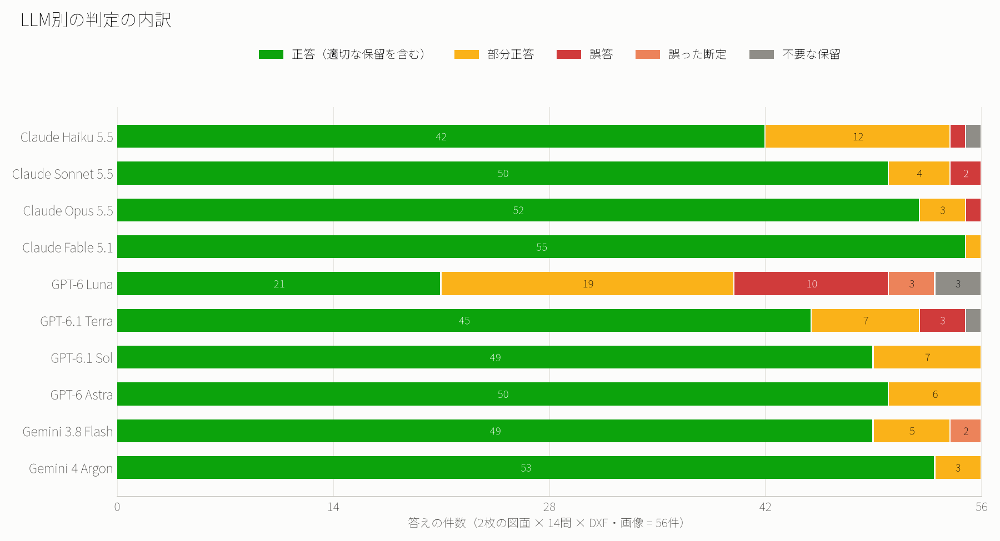

上位のLLMの答えは、ほとんどが緑（正答）です。
GPT-6 Luna は、赤（誤答）、薄い赤（誤った断定）、灰色（不要な保留）がそろって多く出ました。言い切りすぎる失敗と、慎重すぎる失敗の両方です。
Claude Haiku 5.5 は、間違いは少ないものの、黄色（部分正答）が12件ありました。

ここで、私の予想が外れていたことが分かります。
次の図は、問いごとの点数を、10のLLMの合計で並べたものです。

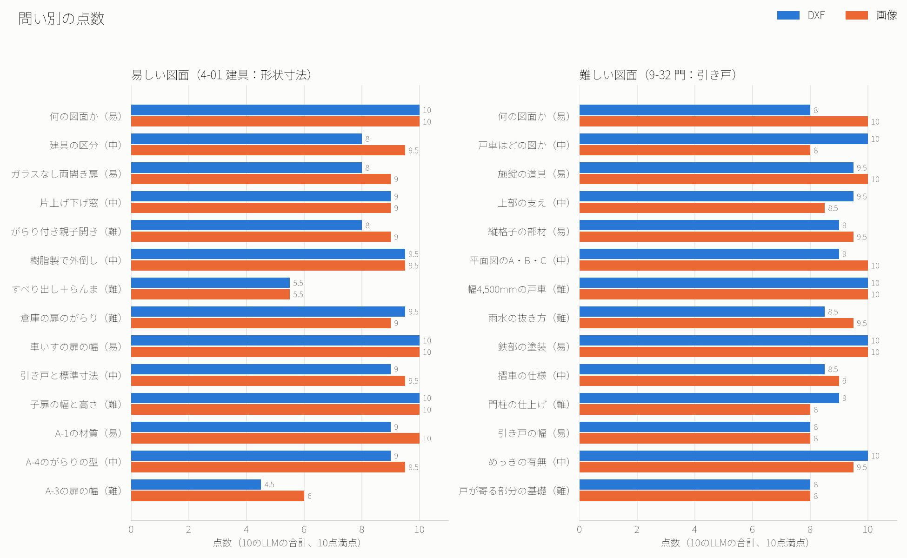

込み入った2枚目の図面（右）は、どの問いも8〜10点でした。
点数が大きく下がったのは、単純なはずの1枚目の図面（左）の2問です。「すべり出し＋らんま」と「A-3の扉の幅」でした。

点数を決めていたのは、図面の見た目の難しさではありませんでした。
たとえば2枚目の問いの多くは、図面に文字で書かれた注記を読めば答えられます。1枚目の「車いすの人も通る片開きの扉は、枠の幅をいくつ以上にするか」も、表の横の備考に「900以上」と書いてあり、20件の答えがすべて正答でした。

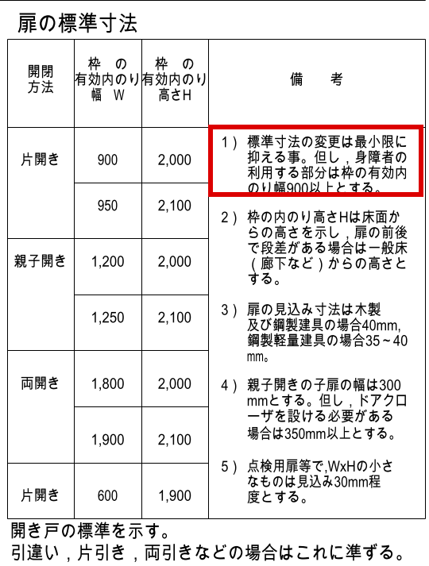

文字で書いてあることは、どのLLMも読めます。
差がついたのは、文字で書かれていないものを読む問いと、図面に答えがない問いでした。ここから、その2つを順に見ていきます。

## 両開きの扉を、AIはどう読んだか

最初は、次の問いです。

> 会議室の入口に、ガラスのない両開きの扉を付けたい。どの形状番号を選べばよいか

正解は A-3 です。20件の答えは、次のように分かれました。

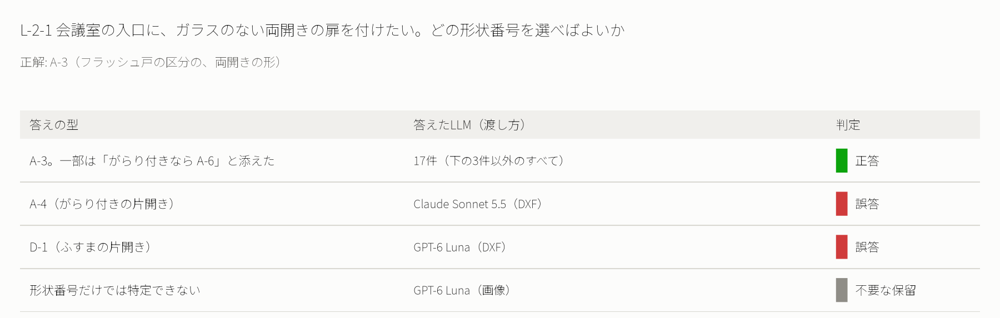

20件のうち17件が、A-3 と正しく答えました。間違えた3件のうち2件は、DXFで渡したときの答えです。

### 名前のない記号

この問いには、落とし穴があります。1枚目の図面の扉の欄には、「片開き」「両開き」といった名前が書かれていません。扉の開き方は、破線の記号でしか表されていないんです。

次の図は、同じ A-3 の扉を、人が見る絵と、LLMが受け取るDXFの中身で並べたものです。

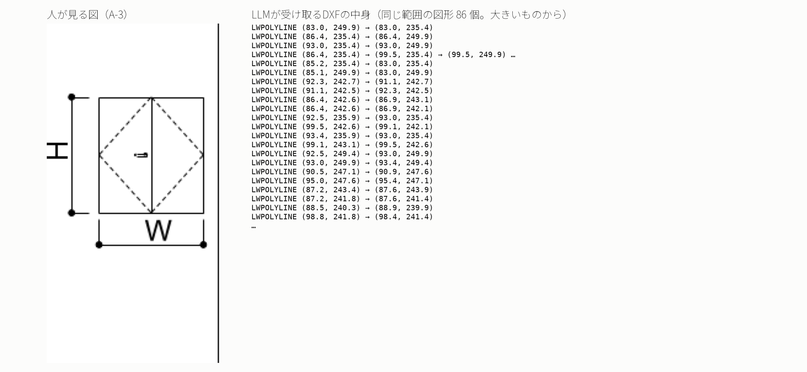

図面に慣れた人には、2枚の扉が両側に開く絵に見えます。DXFの中身は、座標の並びです。扉の枠の線のあとに、破線を細かく切った短い線が80本ほど続きます。DXFのどこにも「両開き」とは書いてありません。

この「文字ではなく形で描かれたもの」で、小さいLLM（Claude Haiku 5.5、Sonnet 5.5、GPT-6 Luna、6.1 Terra）は、DXFのときに点を落としました。次の図の赤い丸が、その場所です。

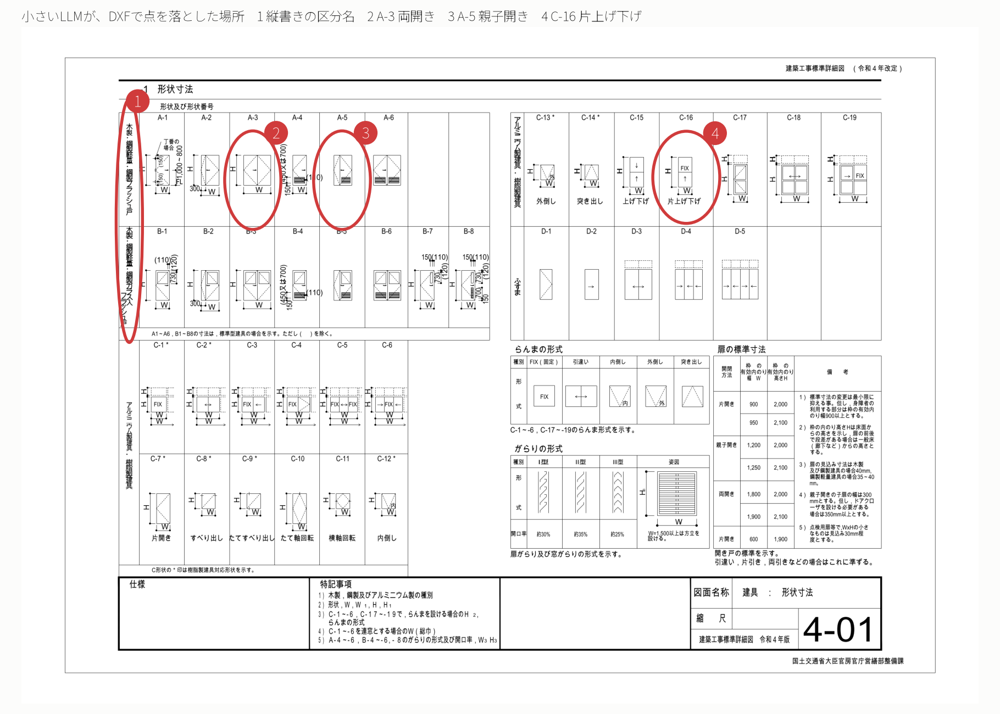

1. 縦書きの区分名: 3つのLLMが、区分名を読み切れなかった。DXFの中では、縦書きの文字が1字ずつ別々に並んでいる
2. A-3（両開き）: 2つのLLMが、A-4 や D-1 を選んだ
3. A-5（親子開き）: 2つのLLMが「図面からは特定できない」と答えた。親子開きは、大小2枚の扉の組み合わせのこと
4. C-16（片上げ下げ）: 1つのLLMが、ふすまの D-4 と取り違えた

画像で間違えた GPT-6 Luna は、「ガラスの有無に対応する番号は示されていない」と答えました。左端の区分名「フラッシュ戸」と「ガラス入フラッシュ戸」が、ガラスの有無を表していることに気づかなかったのです。

### AIは、自分で図面を描き直した

同じDXFを渡しても、LLMによって動き方がまったく違いました。

DXFの文字だけを拾ったLLMは、「両開き」という文字がないので、「特定できない」と答えました。本番の前の試しでは、Claude Haiku 5.5 が、答えの中に自分で「描画して確認はしていません」と書いていました。

一方で、いくつかのLLM（Claude Opus 5.5、Sonnet 5.5、GPT-6.1 Terra など）は、まったく違う動き方をしました。
たとえば Claude Sonnet 5.5 は、下部にがらり（換気のための羽板）の付いた親子開きの扉を探す問いで、次のように動きました。

1. DXFを読むプログラムを、自分で書いた
2. 図面の線を、SVG（線でできた絵の形式）に描き直した
3. SVGを、Macに入っている道具で画像に変えた
4. その画像を開いて、扉の形を自分の目で確かめた

LLMが実際に書いたプログラムの一部です。DXFの中の線を拾い出し、絵として書き出しています。

```python
for p in polys:
    pts=[q for q in p['p'] if q[1] is not None]
    if not all(x0<=a<=x1 and y0<=b<=y1 for a,b in pts):continue
    d=' '.join('%.2f,%.2f'%(a,-b) for a,b in pts)
    s.append('<polyline points="%s" fill="none" stroke="black" stroke-width="0.12"/>'%d)
s.append('</svg>')
open('/tmp/o/a.svg','w').write('\n'.join(s))
```

そして、こう答えました。

> 描いた図形で見ると、A-4 は片開き、A-5 は親子開きでドア下部にがらりの横線があります。

人が図面を開いて眺めるのと同じことを、このLLMは、自分で道具を作ってやっていたわけです。
上位のLLMがDXFでも点を落としにくかった理由の1つは、読む力だけでなく、この「見るための道具を作る力」にあると、私は考えています。

## 図面に答えがないとき、止まれるか

次は、図面だけでは答えが決まらない問いです。この種類の問いで、点数がいちばん下がりました。

### すべり出し窓の上に、らんまを付けられるか

> すべり出し窓の上に、FIX のらんまを付けたい。この図の形状で表せるか

正解は、「この図の形状では表せない。すべり出し窓の C-8 にはらんまがなく、らんまの付く形状の中にすべり出し窓はない。設計者が別に検討・確認する必要がある」です。

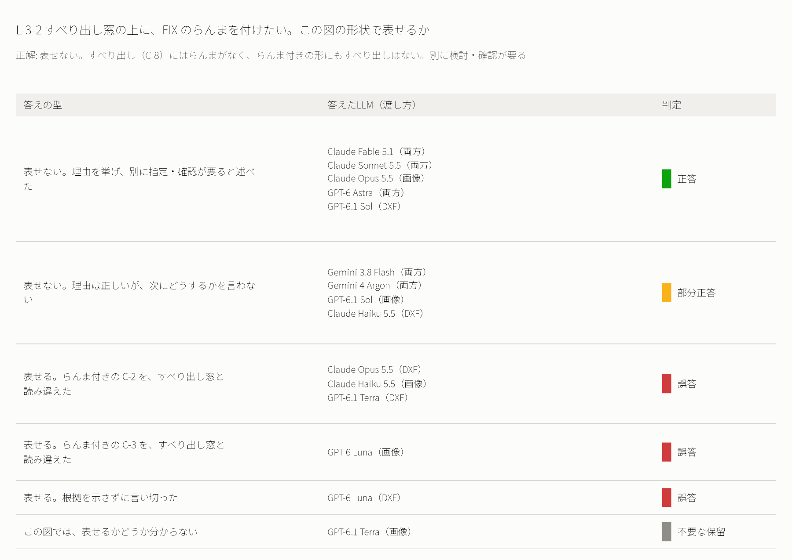

答えは、6つの型に分かれました。正答は20件中8件です。

**名前と図の結び付け**
「表せる」と答えた5件のうち4件は、らんまの付いた窓を、すべり出し窓だと読み違えていました。3件は C-2 を、1件は C-3 を、すべり出し窓だと思い込んでいます。

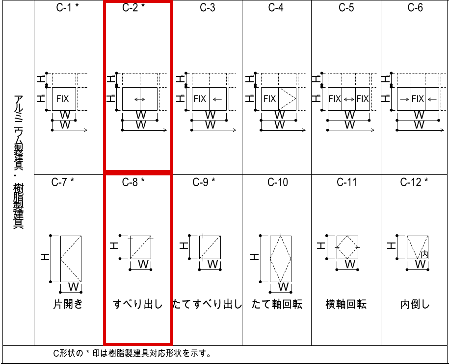

図面では、「すべり出し」の名前は下の段の C-8 の下に書かれています。同じ列の上の段には、らんまの付いた C-2 があります。
DXFの中では、名前と図は座標で並んでいるだけです。画像でも、名前が図の真下にあるのか、列全体の見出しなのかは、見た目で判断するしかありません。
この読み違いは、Claude Opus 5.5 のような上位のLLMでも、DXFで起きました。

**次の一手まで答えるか**
Gemini の2つのLLMは、DXFでも画像でも「表せない」と正しく答えました。理由も正しく挙げています。
ただ、どちらも「表せない」で答えを終えていました。正答した8件は、「だから、別に形状を指定する必要がある」と、設計者が次にすることまで書いていました。
この差は、読み取りの力というより、答え方の癖です。実務で使うなら、次の一手まで言ってくれる方が助かります。

### A-3 の扉の幅は決まるか

> 会議室の入口に A-3 を使う。扉の幅は何 mm になるか

正解は、「この図では決まらない。両開きの標準は 1,800 と 1,900 の2つで、どちらにするかは特記事項 2）で設計者が決める」です。特記事項は、設計者が図面に書き足すべき項目の一覧です。

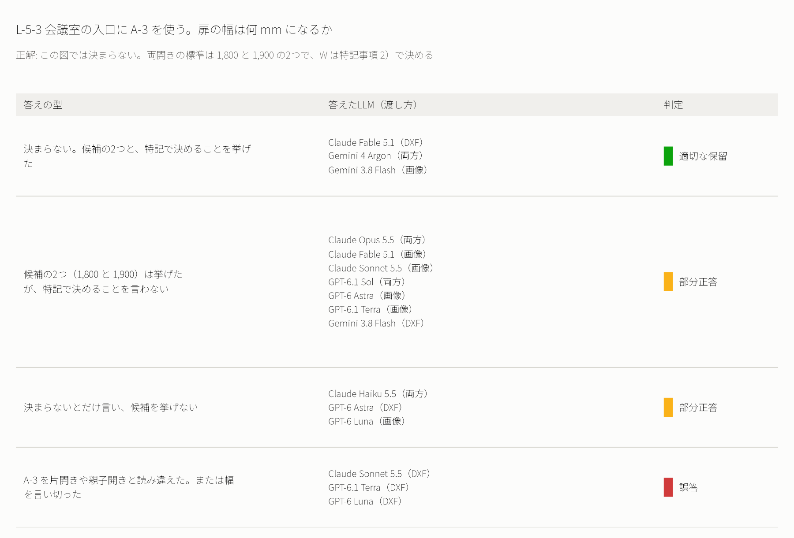

20件のうち13件が、部分正答でした。

**図面の別の場所を見に行くか**
多くのLLMは、扉の標準寸法の表から、両開きの候補（1,800 と 1,900）を正しく挙げました。
ただ、候補と「特記事項 2）で決める」の両方を答えたのは、4件だけでした。特記事項は、図面の下の端にある別の欄です。表を見て答えが出たところで、多くのLLMは、図面のほかの場所を見に行くのをやめていました。

**記号の読み違い**
誤答の3件は、どれもDXFで渡したときの答えです。2件は、A-3 を片開きや親子開きと読み違えていました。両開きの扉の問いと同じく、破線の記号をDXFで読めなかったことが原因です。残りの1件は、表にない幅（800〜1,000mm）を言い切っていました。

## 用意した正解を、AIの答えで見直した

私がいちばん考えさせられたのは、2枚目の図面の次の問いです。

> 引き戸を開けたとき、戸が寄る部分の下にも基礎は必要か

私が用意していた正解は、「この図では決まらない。基礎の範囲は、特記事項 3）で設計者が決める」でした。

ところが、上位のLLMの多くは、次のように答えていました。Claude Opus 5.5 の答えです。

> 必要です。戸車はレールの上を転がって戸が開くので、戸が寄る部分の下にもレールとそれを受ける基礎が続いている必要があります。ただし、基礎をどこまで延ばすかはこの図面には寸法がなく、特記で決める扱いです。

戸車は、引き戸の下に付く車輪のことです。
私はこの答えを読んで、図面を見直しました。

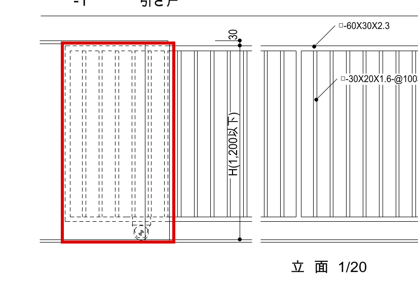

立面図には、開いたときの戸と戸車が破線で描かれていて、その下にもレールが続いています。
戸車がレールを走るなら、戸が寄る位置にもレールと基礎は要ります。図面で決まらないのは、「基礎をどこまで延ばすか」だけです。

正解を下書きしたAIも、その正解を確かめた私も、この区別を見落としていました。
私は、この問いの正解を広げました。「必要と判断でき、範囲だけが特記で決まる」と答えても、「この図では決まらない」と保留しても、正答とすることにしました。

広げた正解で見直すと、この問いの答えは次のように分かれます。

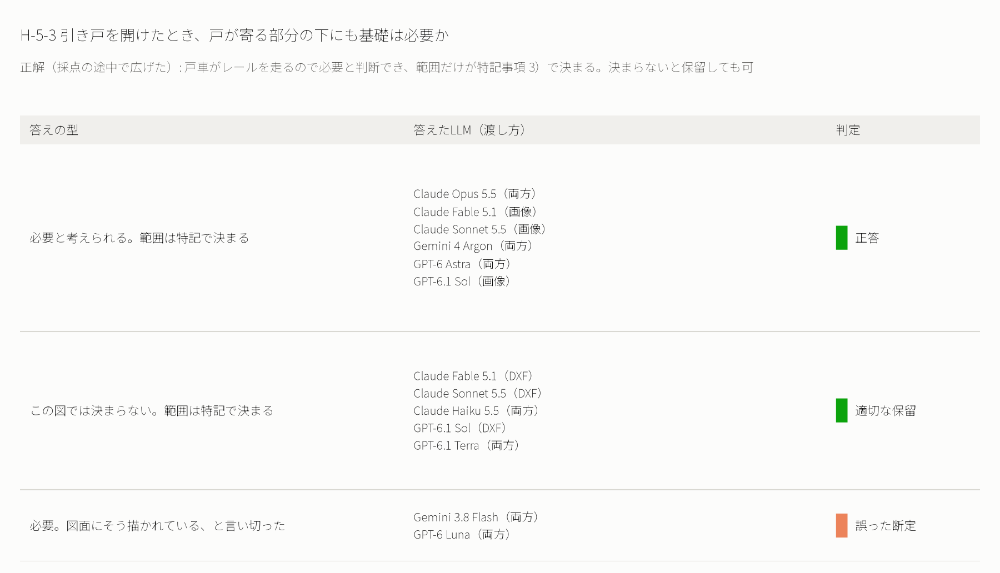

**事実と推測を分けて書けるか**
正答と適切な保留は、「必要と考えられる」「この図では決まらない」と、図面に書かれた事実と、自分の推測を分けて書いていました。
誤った断定の4件のうち3件は、「図面にそう描かれている」と答え、答えの「確かさ」の欄にも「図面に書かれている」と書いていました。残りの1件は、特記事項の「引き戸基礎の範囲」という項目の名前を、範囲の指定そのものだと読み違えていました。
基礎が必要だという結論は、正答と同じです。違ったのは、その結論が図面に書いてあるのか、自分で考えたのかを、区別できたかどうかでした。

AIを採点しているつもりが、AIの答えで自分の正解を見直すことになりました。
勝ち負けというより、図面を一緒に読む相手が1人増えたような感覚でした。

## 今なら、お客様にどう答えるか

2枚の図面を見比べて、私は「込み入った図面ほど、AIは苦戦するだろう」と予想していました。
結果は違いました。点数を決めていたのは、図面の見た目の難しさではなく、何を聞くかでした。

- 文字で書いてあることを聞けば、どのLLMも答える
- 記号や形で描かれたものを読ませると、DXFで差がつく。上位のLLMは、自分で描き直してでも読む
- 図面に答えがないことを聞くと、言い切りすぎるLLMと、途中で止まるLLMが出る

冒頭の相談に戻ります。
「AIで図面を読み取れないか」と聞かれたら、今の私は、まずこう聞き返します。
「その図面から、何を知りたいですか」。
注記を探したいのか、記号を読みたいのか、図面にないことまで判断させたいのか。それによって、AIに任せられる範囲がまったく違うからです。

次の回では、寸法を読む力を試します。今回は、寸法の数字を図面から測って読む力は、あえて外しました。単位や測る位置の取り違えなど、別の難しさがあるからです。

## 補足：比べ方と採点の詳しい条件

ここからは、検証の条件を詳しく知りたい人向けです。

### 問いの作り方

問いは、3つの軸を掛け合わせて作りました。

- 図面の難しさ: 1枚目の「建具：形状寸法」と、2枚目の「門：引き戸」。中くらいの難しさの図面も用意したが、今回は試していない
- 渡し方: DXFと画像。DXFは、国交省のPDFから、画像を通さずに線と文字を移して作った。画像からDXFを作ると、変換の誤りが結果に混ざるため
- 何を読むか: 図面の種類と対象、描かれた要素、要素の関係、注記と仕様、図面から分からないこと、の5つ

寸法については、寸法の数字を測って読む力は問わず、注記に書かれた条件（たとえば「900以上」）だけを問いました。

問いごとに、易・中・難の難しさを付けました。問いの難しさは、LLMがその問いに答えるために、図面の何か所を組み合わせる必要があるかで決めています。

- 易: 図面の1か所を読めば答えられる
- 中: 図面の2か所を組み合わせる必要がある
- 難: 図面の3か所以上を組み合わせるか、「この図では決まらない」と判断する必要がある

### 正解の作り方

正解は、1つの文ではなく、4つの項目で書きました。

- 必須の要素: 答えに入っていなければならない事実
- 許す言い換え: 表記の揺れ。たとえば「1,200」と「1200」
- 根拠の場所: 答えが図面のどこに書かれているか
- 言ってはいけないこと: 図面にない断定や、よくある取り違え

内容が合っていても、根拠の場所が違えば、部分正答にしました。当てずっぽうで当たった答えを見分けるためです。

問いと正解の下書きは、AI（Claude）に作ってもらいました。私は、根拠になる場所に赤い枠を付けた図面の画像を用意して、1問ずつ下書きと照らし合わせました。次の画像は、親子開きの扉の問いで、A-2 と A-5 を見比べたときのものです。


判定の種類は、最初は5種類でした。本番の前に1問で試したところ、ある小さいLLMが、図面に答えがあるのに「特定できない」と答えました。そこで「不要な保留」を足して、6種類にしました。

### 比べたLLMと実行の条件

- Claude: Haiku 5.5、Sonnet 5.5、Opus 5.5、Fable 5.1
- GPT: 6 Luna、6.1 Terra、6.1 Sol、6 Astra
- Gemini: 3.8 Flash、4 Argon

LLMは、各社のCLI（コマンドで動かす道具）で動かしました。推論の強さ（考える量）は、どれも中くらい（medium）にそろえています。
1問ごとに新しい会話を始め、図面だけを置いた空のフォルダで解かせました。図面のファイル名も「drawing.dxf」にして、名前から答えを推測できないようにしています。

準備の途中で、驚いたことがあります。CLIを動かすと、私が普段のために書いている「文章の書き方のルール」が、毎回こっそりLLMに渡っていたんです。そのルールは Claude と GPT にだけ渡り、Gemini には渡っていませんでした。答え方の違いが、LLMの力によるものか、私のルールによるものか分からなくなるので、ルールを読ませない設定にしてから本番を流しました。

### 採点の進め方

560件の採点は、サブエージェント（親のAIから呼ばれて、1つの仕事だけをするAI）に任せました。採点の前に、答えのLLMの名前と渡し方を伏せて、記号に置き換えています。ただし、採点したのも Claude なので、Claude の答え方に甘くなる偏りが残っている可能性はあります。

採点したサブエージェントが判定に迷った答えは、100件以上ありました。多くは、言葉の重さの問題です。
たとえば「引き戸の寸法も、扉の標準寸法の表に従えばよいか」という問いで、図面には「開き戸の標準を示す。引き戸はこれに準ずる」と書いてあります。答えに「従えばよい」と書いたものと、「準じてよい」と書いたものを、同じに扱うかどうか。私は、こういう線引きを問いごとに1つずつ決め、似た答えをまとめて判定しました。

### まだ試していないこと

- 中くらいの図面（建具と壁の取り合いの図）
- 推論の強さを変えたときの違い
- 同じ条件で何度か解かせたときの、答えの揺れ

問い、正解、LLMの答えの全文、採点の記録は、リポジトリに置いています。
https://github.com/h-takeshita-henteco-shoji-com/tried/tree/main/2026/10-29-AIと図面のコラボレーション-01-AIに図面が何を表すか説明させる
