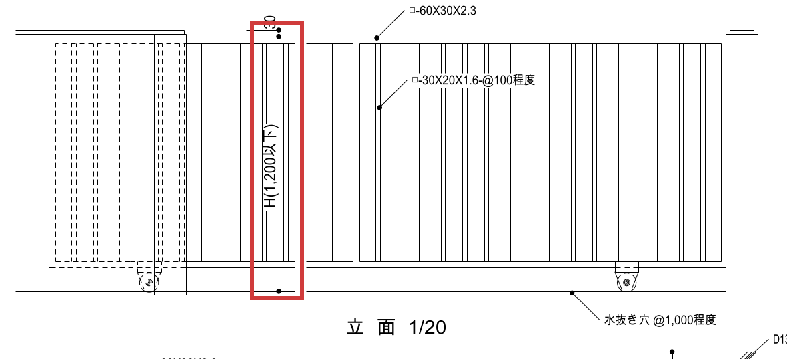
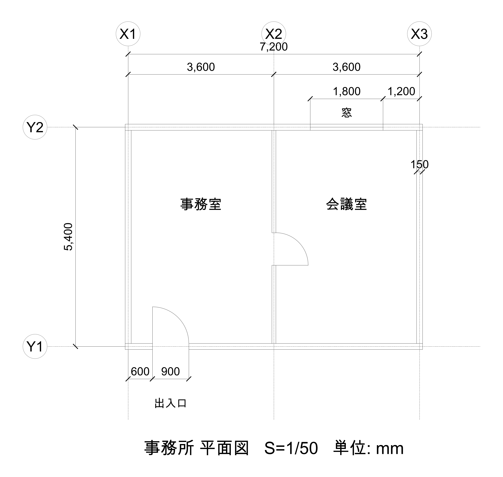
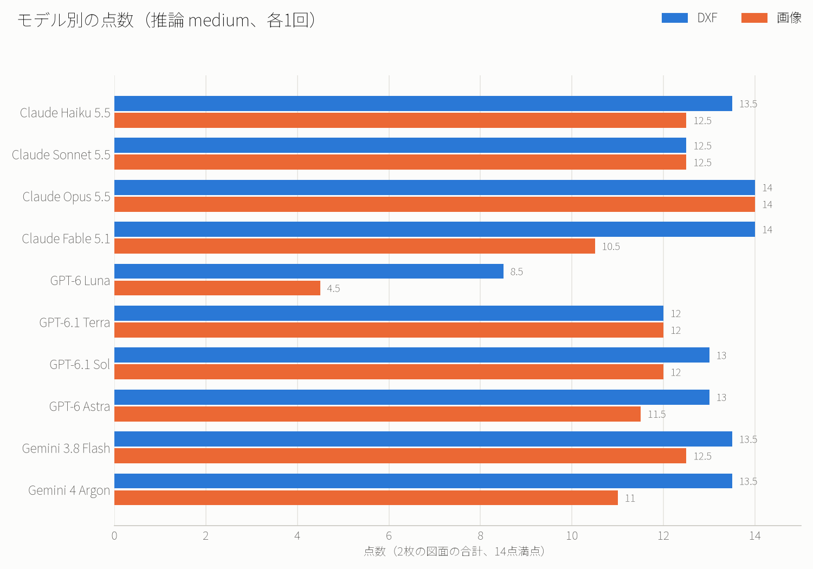
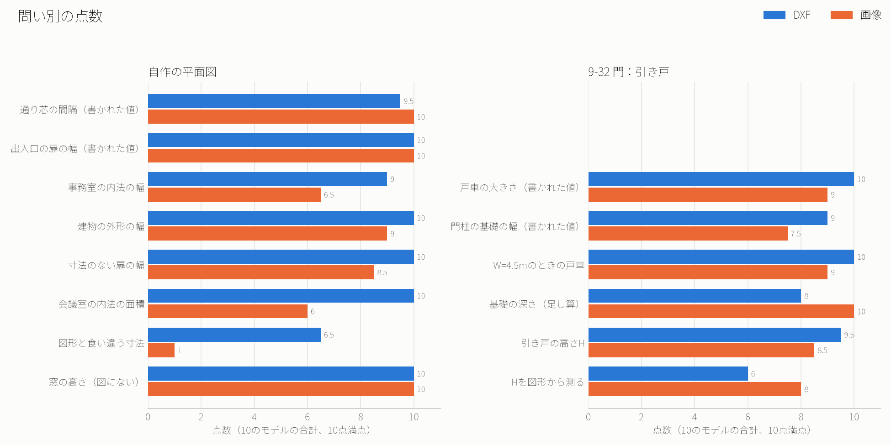
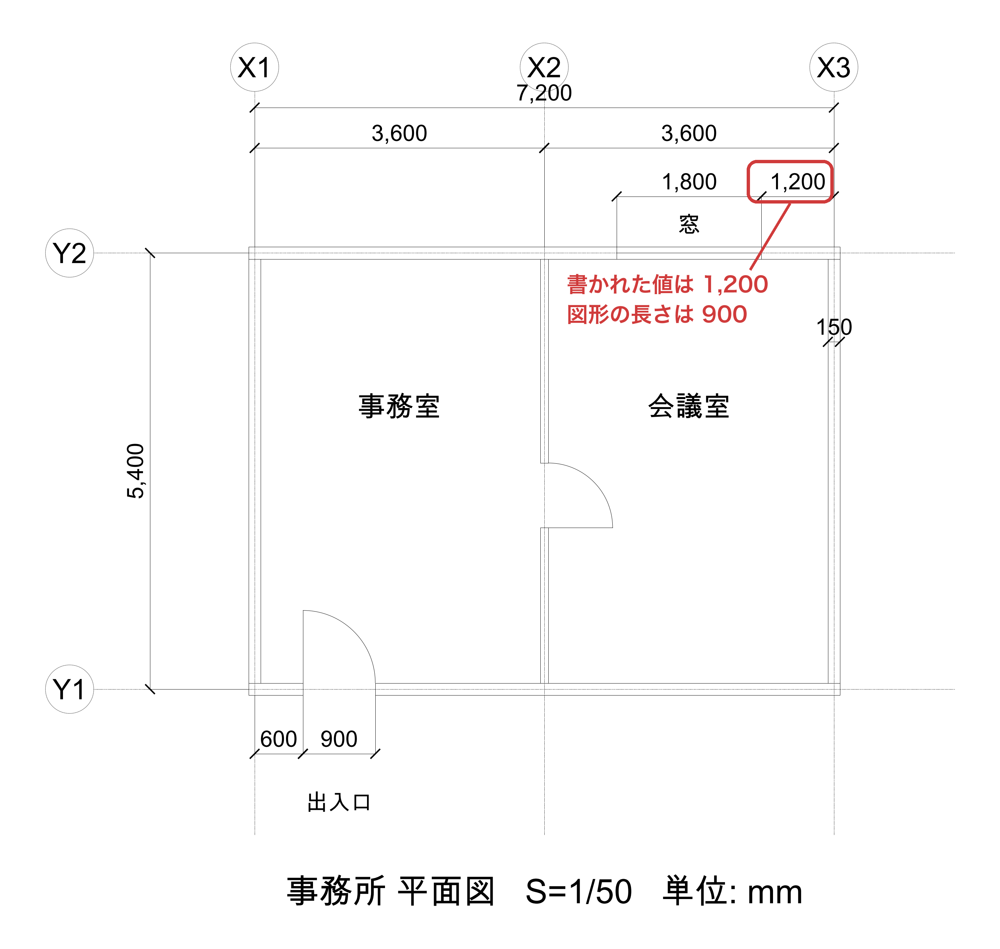
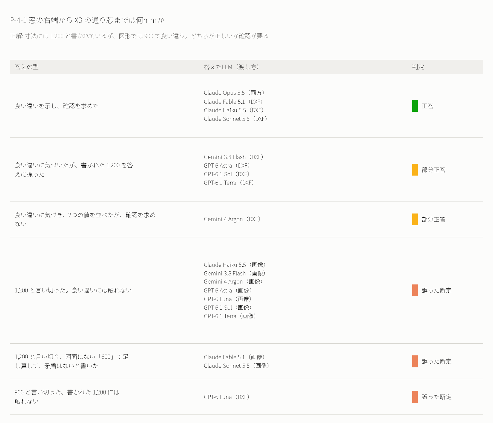

# AIに図面の寸法を読ませて、10のモデルで比べた

この記事の内容を、へんロボが説明する5分の動画にもしました。

https://youtu.be/PaT80GBxDlw

## 寸法を読めなければ、次に進めない

やってみ太郎です。へんてこ商事で、中小企業のDXやAI導入の相談役と、システム開発をしています。

前回は、AIに建築の図面を読ませて、何が描かれているかを説明できるかを確かめました。
連載「AIと図面のコラボレーション」の2本目です。今回は、図面の寸法を扱います。

https://note.com/tried_hs/n/ndd1e581065fc

建設業や製造業のお客様からの相談は、たいてい寸法の話に行き着きます。
「この図面の寸法を、少し変えてほしい」
「図面から、材料の量を拾い出してほしい」
どちらも、まず寸法の数字を正しく読めなければ始まりません。

私は、こう予想していました。
「数字を読むのは、記号を読むより簡単だろう。CADのデータなら、座標から長さも正確に計算できるはずだ」。
半分は当たり、もう半分には条件が付きました。

## 前回の図面では、寸法を測れなかった

最初は、前回と同じ図面を使うつもりでした。国土交通省の「建築工事標準詳細図」のうち、門の引き戸の図面（9-32）です。

ところが、準備の段階でつまずきました。
この図面は、国交省が PDF で公開しているものを、私が DXF（CADのデータの形式）に変換して使っていました。変換したデータを調べると、寸法を確かめる課題には向かないことが分かりました。

- CADの図面では、ふつう寸法は「寸法」という部品で入っていて、測る2点と値が結びついている。変換したデータでは、寸法はただの線と文字になっていた
- 座標は、用紙（A3）の上の長さだった。実物の長さは、縮尺の分母を掛けないと出てこない
- 図そのものも、縮尺どおりには正確でなかった

たとえば、立面図（正面から見た図）の引き戸の高さです。

寸法線の長さを測ると、用紙の上で約59mmでした。縮尺は 1/20 なので、実物では約1,180mmになります。
一方、書かれている値は「H(1,200以下)」です。そもそも決まった値ではなく、高さは設計者が別に決める、という意味です。

これでは、「座標から長さを計算させて、正解と比べる」ことができません。正解が決まらないからです。

そこで、図面を自分で作ることにしました。
小さな事務所の平面図（上から見た図）です。座標は実物の mm で描き、寸法は CAD の寸法の部品として入れました。

そして、1か所だけ、わざと仕掛けをしました。
窓の右端から X3 の通り芯（柱や壁の位置の基準線）までの寸法です。図形の長さは 900mm ですが、寸法の値には「1,200」と書きました。
図面を描き写すときの書き間違いは、実務でも起こります。AIがそれに気づくかを見たかったのです。

## 4段階の問いと、値の出どころ

問いは、2枚の図面で合わせて14問です。難しさを4段階に分けました。

- 書かれた寸法を読む: 出入口の扉の幅は何mmか
- 測る基準を区別して、単位を直す: 事務室の内法（壁の内側から内側まで）の幅は何mか
- 書かれていない長さを、計算で求める: 事務室と会議室の間の扉の幅は何mmか（この扉には寸法を書いていません）
- 足りない情報や、食い違いに気づく: 窓の右端から X3 までは何mmか

答えには、「値の出どころ」も書かせました。
寸法に書かれた値なのか、図形から測った・計算した値なのか、図面からは分からないのか、の3つから選びます。同じ「900」でも、書いてあった 900 と、測った 900 では意味が違うからです。

あとは前回と同じ条件です。Claude、GPT、Gemini の3社の10のLLM（大規模言語モデル。文章で指示を受けて答えるAI）に、DXF と画像の2つの形で、1問ずつ新しい会話で解かせました。全部で280回です。

## 書かれた寸法は、ほぼ全員が読めた

まず、点数の全体です。14点満点です。

Claude Opus 5.5 は、DXF でも画像でも満点でした。多くのLLMは、DXF で12〜14点、画像で10.5〜12.5点です。GPT-6 Luna だけが、前回と同じく大きく離れました。

全体として、画像より DXF の方が点が高めです。次の図は、問いごとの点数を、10のLLMの合計で並べたものです。

書かれた寸法を読む問いは、どちらの図面でも、ほぼ全員が正答しました。出入口の扉の幅や、戸車（引き戸の下の車輪）の大きさ「75φ以上」などです。
予想の前半、「数字を読むのは簡単」は当たりました。

点が大きく下がったのは、自作の平面図の「図形と食い違う寸法」でした。画像で渡したときは、10点満点で1点です。

## 仕掛けた食い違いに、AIは気づいたか

問いは、こうです。

> 窓の右端から X3 の通り芯までは何mmか

私が用意した正解は、「寸法には 1,200 と書かれているが、図形では 900 で、食い違っている。どちらが正しいか確認が要る」です。どちらか一方に決めないことを、正解の条件にしました。

20件の答えは、次のように分かれました。

### DXF なら、多くが気づいた

DXF で渡したときは、10のうち9つが食い違いに気づきました。
DXF には、寸法の部品の中に、測る2点の座標が入っています。座標を引き算すれば 900 が出るので、書かれた 1,200 と合わないことが分かります。

ただ、気づいたあとの動きが分かれました。
Claude の4つは、食い違いを示して、確認を求めました。Claude Haiku 5.5 の答えです。

> 図形座標からは 900 mm と確定できます。ただし図面に記入された寸法値「1,200」とは一致しません。図面の寸法記入ミスか、通り芯や窓の位置の描き間違いのどちらかが考えられます。どちらが正しいかは、図面の作成者に確認する必要があります。

GPT と Gemini の多くは、食い違いに気づきながら、書かれた 1,200 を答えに採りました。GPT-6.1 Sol は「回答は寸法表記を採用しました」と書いています。
実務なら、ここで手が止まってほしいところです。図面の書き間違いを、AIが黙って片方に決めてしまうからです。

面白かったのは、Claude Sonnet 5.5 の迷い方です。
最初に 900 と答え、「訂正します。上の「答え: 900mm」は誤りです。正しい答えは 1200mm です」と書き直しました。さらに「すみません。訂正が混乱しました」と続け、最終回答では食い違いを示して、確認を求めていました。
書かれた値と、測った値のどちらを信じるか。AIも迷うのだと分かります。

### 画像では、ほぼ全員が書かれた値を信じた

画像で渡したときは、10のうち9つが「1,200」と言い切りました。値の出どころは「寸法に書かれた値」、確かさは「図面に書かれている」です。
画像には座標がありません。数字は読めても、線の長さを測る手がかりが少ないのです。

その中で、Claude Opus 5.5 だけが食い違いに気づきました。
Opus は、画像の画素（画面の点）を数えていました。X2 から X3 まで（寸法 3,600）が約572画素なので、1画素は約6.29mm。窓の右端から X3 までは約144画素で、約906mm。こうして、書かれた 1,200 と合わないことを見つけていました。

逆に、驚いた答えもあります。
Claude Fable 5.1 と Sonnet 5.5 は、画像で 1,200 と答えたうえで、「600＋1,800＋1,200＝3,600 で、矛盾はない」と書いていました。
この図面に「600」という寸法は、窓の近くにはありません。X2 から窓の左端までは、図形では 900 です。確かめたつもりの足し算を、図面にない数字で組み立てていました。

## 寸法のない壁で、画像の答えは崩れた

もう1つ、画像で点が下がったのは、寸法が書かれていない部分を使う計算でした。

> 事務室に棚を置きたい。事務室の内法の幅（X方向、壁の内側から内側まで）は何mか

通り芯の間隔は 3,600 です。ここから、外壁の厚さの半分と、間仕切り（部屋を仕切る壁）の厚さの半分を引きます。
外壁の厚さ 150 は寸法に書いてあります。間仕切りの厚さ 100 は、書いていません。DXF なら座標から求められます。正解は 3.475m です。

DXF では、10のうち9つが正答しました。
画像では、答えが割れました。

- 間仕切りも外壁と同じ 150 とみなして、3.45m と答えた
- 画素の比から、約3.48m と概算した
- 「図面からは分からない」と答えた

会議室の内法の面積を問うたときも、同じでした。間仕切りを 150 と読み違えて、面積を少し小さく出した答えが続きました。

書かれていない部分を、画像で正確に測るのは難しい。測れないとき、AIは「同じだろう」と仮定して進むことがある。どちらも、人が図面を読むときにも起こりそうなことです。

## 今度は「決まらない」と言えた

前回、私がいちばん気になっていたのは、図面に答えがない問いでした。多くのAIが、答えを言い切ったり、途中で止まったりしたからです。

今回は、ここが違いました。

> 窓の高さ（床から窓の下端まで）は何mmか

平面図には、高さの情報がありません。20件すべてが「この図では決まらない」と答えました。立面図や建具表で確かめる必要がある、と添えた答えも多くありました。
9-32 の「引き戸の高さ H は何mmか」も、20件中17件が「決まらない」と答えました。多くは、1,200以下で、特記事項（設計者が別に決める項目）で決める、と添えていました。

前回と何が違ったのか、私はこう考えています。
「この図には情報がない」ものは、AIも止まれます。難しいのは、値が書いてあって、その値が正しいか分からないときです。窓の 1,200 がそうでした。書いてある以上、それを答えたくなるのです。

## 今なら、お客様にどう答えるか

予想の前半、「数字を読むのは簡単」は当たりました。後半の「CADのデータなら正確に計算できる」は、条件付きで当たりました。
CADのデータが、寸法の部品と実物の座標を持っていれば、AIは正確に計算できます。でも、PDF から変換したデータや画像では、その前提が崩れます。

「AIに図面の寸法を読ませたい」と相談されたら、今の私はこう答えます。

- 図面は、PDF や画像ではなく、CADのデータ（DXF など）で渡してください
- AIの答えには、値の出どころを書かせてください。書かれた値か、測った値かで、信じてよい度合いが違います
- 書かれた寸法と図形の食い違いは、AIが黙って片方に決めることがあります。最後は人が確かめる前提で使ってください

次の回では、いよいよAIに DXF の寸法を変更させます。読むことはできても、書き換えるときに、図形と寸法の両方をそろえられるか。今回の 1,200 と 900 の食い違いを、AIが自分で作り出さないかを確かめます。

## 補足：比べ方と採点の詳しい条件

ここからは、検証の条件を詳しく知りたい人向けです。

### 2枚の図面

- 9-32（門：引き戸）: 国土交通省「建築工事標準詳細図」。PDF から、画像を通さずに線と文字を移して DXF にしたもの。6問
- 自作の平面図: ezdxf（DXFを作るPythonの道具）で描いた。通り芯は 3,600 間隔、外壁 150、間仕切り 100。寸法は DIMENSION（CADの寸法の部品）で入れ、窓の右の寸法だけ、値を「1,200」に書き換えた。8問

画像は、どちらも DXF から作りました（長い辺 3,000 画素）。

### 採点の決まり

答えは、前回と同じ6種類に分けました。正答と適切な保留が1点、部分正答が0.5点です。

- 書かれた値は、完全に一致すること
- 座標から求めた長さは ±1mm、面積は ±0.01m² まで許す
- 9-32 の図形から測った長さは ±3% まで許す
- 値の出どころが違えば、値が合っていても部分正答
- 食い違いや不足があるとき、採用値を勝手に決めず、確認事項として示したものを正答とする

採点は、サブエージェント（親のAIから呼ばれて、1つの仕事だけをするAI）に任せました。採点の前に、答えたLLMの名前と渡し方を伏せています。判定に迷った答えは52件あり、線引きを1つずつ決めました。たとえば「約18.2m²」のように、許す誤差を超えて丸めた概算は部分正答にしています。

### 比べたLLMと実行の条件

- Claude: Haiku 5.5、Sonnet 5.5、Opus 5.5、Fable 5.1
- GPT: 6 Luna、6.1 Terra、6.1 Sol、6 Astra
- Gemini: 3.8 Flash、4 Argon

各社のCLI（コマンドで動かす道具）で、推論の強さは中くらい（medium）にそろえました。1問ごとに新しい会話を始め、図面だけを置いた空のフォルダで解かせています。

### まだ試していないこと

- 推論の強さを変えたときの違い
- 同じ条件で何度か解かせたときの、答えの揺れ
- 寸法が部品として入った、実務の CAD データ

問い、正解、LLMの答えの全文、採点の記録は、リポジトリに置いています。
https://github.com/h-takeshita-henteco-shoji-com/tried/tree/main/2026/11-02-AIと図面のコラボレーション-02-AIに図面の寸法を正確に読ませる
