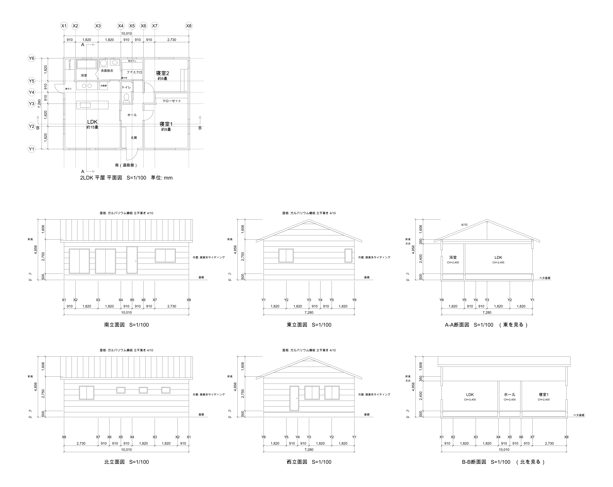
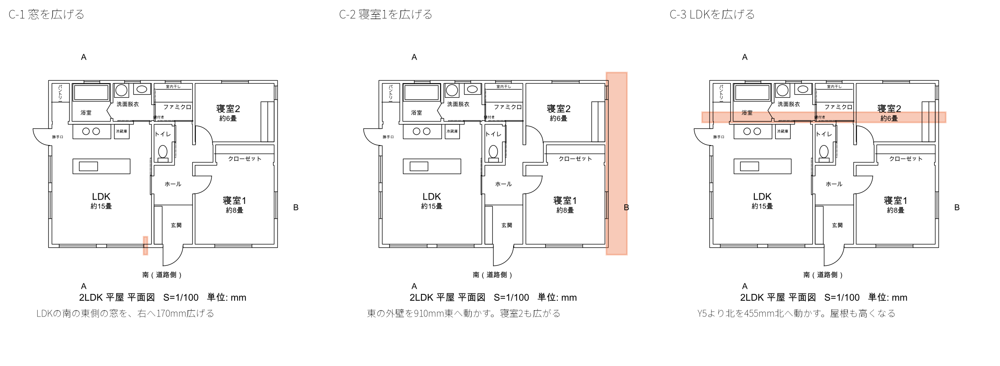
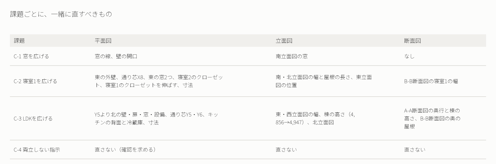
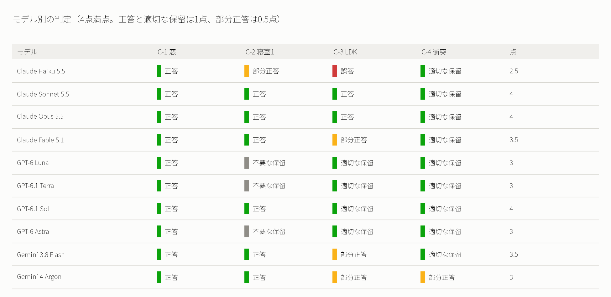
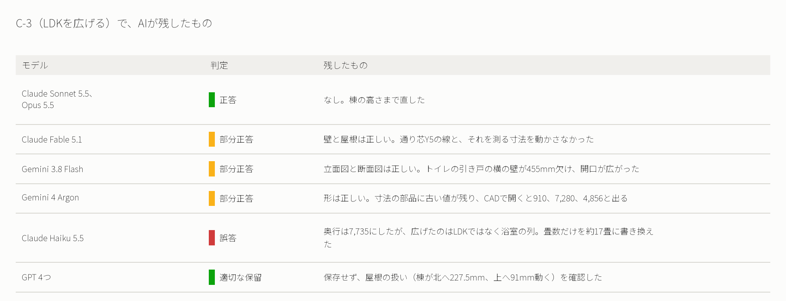
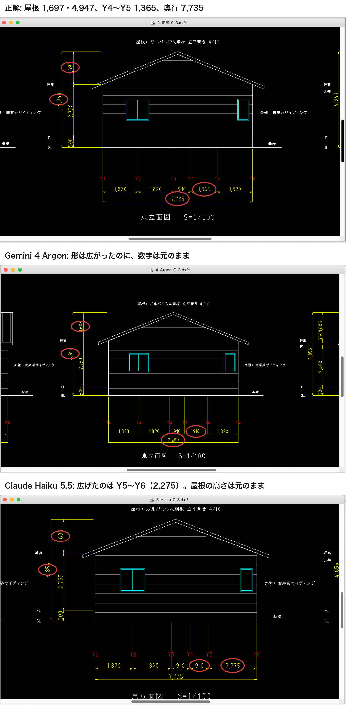
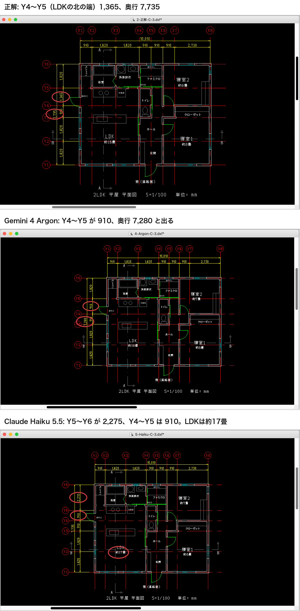

# AIに図面の寸法を変更させて、10のモデルで比べた

この記事の内容を、へんロボが説明する6分弱の動画にもしました。

https://youtu.be/8tszi2EBmqM

## 読めても、直せるとは限らない

やってみ太郎です。へんてこ商事で、中小企業のDXやAI導入の相談役と、システム開発をしています。

連載「AIと図面のコラボレーション」の3本目です。
前回は、AIに図面の寸法を読ませました。書かれた寸法は、どのAIも読めました。

https://note.com/tried_hs/n/n25855d3c0225

ただ、お客様の相談は、たいていその先にあります。
「この部屋を、もう少し広くした図面がほしい」
「窓を一回り大きくしたら、どう見えるか」
読むだけでなく、図面を書き換える仕事です。

私は、こう予想していました。
「DXF（CADのデータの形式）は、中身はテキストファイルだ。寸法を変えるのは、数字を書き換えるだけ。上位のAIなら簡単だろう」。
この予想は、半分しか当たりませんでした。

## 平屋の図面一式

今回は、2LDKの平屋の図面一式を用意しました。1つのDXFに、次の3種類の図が入っています。

- 平面図: 上から見た間取り。壁、扉、窓、キッチンや浴槽などの設備
- 立面図: 東西南北の4面から見た外観。窓の高さ、屋根の形
- 断面図: 建物を縦に切った図。床、天井、屋根の高さ。南北と東西の2か所で切った

寸法は、CADの「寸法」という部品で入れています。測る2点と、そこに書く数字が結びついた部品です。

ふつうの家の図面は、平面図だけでは終わりません。
部屋の幅を変えれば、外から見た姿も、屋根の大きさも変わります。図面のどこか1か所を変えると、ほかの図にも波及します。

## 4つの寸法変更

AIに出した課題は、4つです。難しさを1段ずつ上げました。

### C-1 窓を広げる

> LDKの南の壁にある2つの窓のうち、東側の窓の幅を1,650mmから1,820mmに広げてください。窓の左端は動かさないでください。

変わるのは、1か所だけです。平面図の窓と、南から見た立面図の窓をそろえて直せば終わります。

### C-2 寝室1を広げる

> 寝室1の幅を3,640mmから4,550mmに広げてください。東の外壁は、寝室1と寝室2にまたがる部分をまっすぐのまま東へ動かし、寝室2も広がってかまいません。東の壁に付いた窓と設備は壁と一緒に動かし、ほかの窓と設備は位置を変えないでください。

ここから、変更がつながって広がります。
東の外壁が動くと、南と北の外壁が伸び、通り芯（柱や壁の位置の基準線）が動き、寸法の数字も変わります。立面図では、南と北から見た建物の幅と、屋根の長さが変わります。

### C-3 LDKを広げる

> LDKを南北に455mm広げてください。通り芯Y5より北にあるもの（北側の外壁、浴室・洗面脱衣・ファミリークローゼット・パントリー、寝室2の北側）を、455mm北へ動かします。寝室1の大きさと位置は変えないでください。浴室・洗面脱衣・ファミリークローゼット・パントリーの大きさは変えないでください。

いちばん難しい課題です。
建物の奥行が広がると、屋根の形も変わります。この家の屋根は、南と北へ同じ傾きで流れる三角形です。奥行が455mm広がれば、屋根のいちばん高い所（棟）は91mm上がります。
平面図だけを見ていると、気づきにくい変化です。

### C-4 両立しない指示

> 建物の幅（10,010mm）を変えずに、寝室1の幅を4,550mmに広げてください。玄関とホールの幅（1,820mm）と、LDKの広さ（約15畳）は変えないでください。

この指示は、そのままでは実現できません。LDK、玄関とホール、寝室1の幅を足すと、建物の幅を超えるからです。
正解は、図面を直さずに「どれを優先しますか」と確認することです。

4つの課題で、一緒に直すべきものを並べると、次のようになります。

### 試しで、指示の書き漏らしを教えられた

実は、課題の指示文は、最初からこの形ではありませんでした。

本番の前に、平面図だけの図面で試しに流しました。すると、多くのAIが図面を保存せずに、同じ点を確認してきました。

- LDKの北の部屋を北へずらすとき、北の外壁も動かすのか。それとも外壁は動かさず、水まわりを狭めるのか（10のうち7つ）
- 寝室1を広げると寝室2も広がるが、それでよいか。寝室1の部分だけ外へ張り出す形もある（4つ）

読み返すと、どちらも私の指示では決まっていませんでした。AIの確認は正当だったのです。
指示文に条件を書き足すと、本番ではこの確認が消えました。AIの確認は、指示の書き漏らしを見つける手がかりにもなります。

### 条件と採点

前回までと同じく、Claude、GPT、Gemini の3社の10のLLM（大規模言語モデル。文章で指示を受けて答えるAI）に、1課題ずつ新しい会話で解かせました。条件は次のとおりです。

- 渡すのは DXF だけ。変更後の図面を、別の名前で保存させる
- 平面図に合わせて、立面図と断面図もそろえて直させる
- DXFを扱うライブラリ（ezdxf など）は、新しく入れさせない。AIは、DXFをテキストファイルとして直接書き換えることになる

採点では、変更後の図面を、私が用意した正解の図面と比べました。そのために、採点スクリプトを書いています。図の種類ごとに、正解にない線と、正解にあって足りない線の長さを測るものです。
最後に、いくつかの図面をCADソフト（LibreCAD）で開いて、人の目で確かめました。この目視が、あとで大事になります。

## 窓と寝室は、ほぼ直せた

まず、点数の全体です。

### C-1: 10のモデルすべてが直した

窓を広げる課題は、10のモデルすべてが、平面図と南立面図をそろえて直しました。正解の図面と、線が1本も違いません。
ライブラリがなく、テキストファイルを直接書き換える条件でも、です。

多くのモデルが、窓の右に残る壁が340mmから170mmに細くなることまで確かめていました。Claude Sonnet 5.5 の答えです。

> 窓の右にある壁は、幅340mmが170mmに狭くなり、右隣の間仕切り壁（4,490mm〜）との間は170mmです。構造上問題ないかは、図面からは判断していません。

### C-2: 6つが完全に直した

寝室1を広げる課題では、6つのモデルが、平面図・立面図・断面図をすべて正解どおりに直しました。Claude Sonnet 5.5、Opus 5.5、Fable 5.1、GPT-6.1 Sol、Gemini 3.8 Flash、4 Argon です。
Claude Haiku 5.5 も、北から見た立面図の線が1本足りないだけでした。

直し方には、モデルごとの違いがありました。
立面図の中で、広がった建物を図のどこに置くか、です。東の端をそろえたモデルと、西の端をそろえたモデルがありました。どちらも図面として正しいので、採点スクリプトの方を直しました。

もう1つ、私の正解の方を直すことになった場面がありました。
寝室1のクローゼットの折れ戸です。私の正解では、クローゼットは東の壁まで伸ばしつつ、折れ戸の開口は元の幅のままにしていました。
ところが、図面を保存した4つのモデルが、そろって開口も東の壁まで広げていたのです。クローゼットが伸びるなら、扉も伸びる方が自然です。私は正解を直しました。
AIの答えで正解を見直すのは、連載の1本目に続いて2回目です。

### GPT の3つは、直す前に止まった

一方、GPT-6 Luna、6.1 Terra、6 Astra の3つは、図面を保存しませんでした。

> 立面図・断面図を含めて図形の対応関係を確かめながら編集できる手段がないため、指示どおりに変更した図面を作成できません。（GPT-6 Luna）

> 平面図に加え、立面図と断面図の寸法や形状も整合させる必要がありますが、すべてを正確に修正・検証することはできませんでした。（GPT-6.1 Terra）

Astra は、寝室1のクローゼットの棚を、動かすのか伸ばすのかを確認してきました。指示文の「東の壁に付いた設備は壁と一緒に動かす」から、決められる点です。
同じ条件で、ほかの7つは直せています。この3件は、図面に答えがあるのに止まった「不要な保留」と判定しました。

## LDKを広げると、直し漏れが出た

いちばん差がついたのは、LDKを広げる課題でした。

奥行が455mm広がると、直すものが一気に増えます。
平面図では、北側の4部屋と外壁、通り芯、キッチンの背面と冷蔵庫。立面図では、東と西から見た建物の幅。断面図の奥行。そして、屋根の高さです。

完全に直せたのは、Claude Sonnet 5.5 と Opus 5.5 の2つだけでした。棟の高さを4,856mmから4,947mmに直すところまで、正解と一致しています。
ほかのモデルは、それぞれ違う所を直し漏らしました。

GPT の4つは、そろって図面を保存せず、屋根の扱いを確認してきました。

> 屋根の扱いです。現状の勾配・軒高・軒の出を維持すると、455mmの拡張に伴い、棟は北へ227.5mm移動し、91mm高くなります。この方針でよいですか？（GPT-6.1 Sol）

見立ては、正解とぴったり同じです。指示文は屋根に触れていないので、確認する価値のある点でした。これは「適切な保留」と判定しています。

### 直ったように見える図面

ここからが、今回いちばん考えさせられた話です。

私の採点スクリプトは、Gemini 4 Argon の図面を「図形は正解と一致」と判定していました。
念のため、CADソフトで開いてみました。すると、こう見えたのです。

Argon の図面は、建物の形は正しく広がっています。屋根の三角形も高くなっています。
ところが、寸法の数字が、元の図面のままでした。広がったはずの区間は「910」、奥行は「7,280」、屋根の高さは「4,856」と出ています。

原因は、寸法という部品の作りにあります。
寸法の部品は、「測る2点」「書かれた値」「画面に描く文字」を別々に持っています。Argon は、測る2点と画面に描く文字は直しましたが、「書かれた値」の欄に古い数字を残していました。
CADソフトは、図面を開くたびに、「書かれた値」から寸法を描き直します。そのため、古い数字が出てきたのです。
採点スクリプトは「画面に描く文字」を見ていたので、正しく見えていました。

前回、私はAIを試すために、図形と合わない寸法をわざと図面に仕込みました。書かれた値は1,200、図形の長さは900という仕掛けです。
今回は、AI自身が、同じ種類の食い違いを作っていました。

### 数字は合っているのに、広げた場所が違う

Claude Haiku 5.5 の図面は、別の形で私をだましました。

Haiku の図面は、奥行が7,735mmになっています。数字だけ見れば、正解と同じです。
ところが、広がったのは LDK ではありませんでした。浴室や洗面脱衣の列（Y5〜Y6）が、1,820mmから2,275mmに広がっています。指示では、大きさを変えないように書いた部屋です。
それなのに、LDK の畳数の表示だけは「約17畳」に書き換えていました。
屋根の高さの寸法も、元のままでした。

採点スクリプトは、この図面を「平面図だけ直して、立面図を直していない」と読んでいました。それも外れていました。CADで開いて、数字と図形を照らし合わせて、初めて本当の誤りが分かったのです。

Argon は、形は正しく、数字が古い。Haiku は、数字は正しく、形の意味が違う。
どちらも、図面の一部だけを見れば、直ったように見えます。

## 止まるAI、進むAI

両立しない指示（C-4）は、10のモデルすべてが、図面を保存せずに止まりました。

その中で、GPT の答えは一歩踏み込んでいました。

> LDKの面積を約15畳に保つため、LDKの幅を狭めて奥行きを広げる場合、北側の浴室・洗面脱衣室などの配置や広さも変更してよいですか。（GPT-6.1 Terra）

私の正解は「両立しない」でした。でも、LDKを北へ広げれば、広さは保てます。北側の部屋を動かしてよいかを尋ねる、別の解き方の提案です。

4つの課題を通して見ると、会社ごとに止まり方の癖がありました。

- GPT は、自信がないと作業そのものを止めるか、確認を求める方に寄った
- Claude と Gemini は、自分で判断して進み、ときどき直し漏れを残した

どちらが良いとは、言い切れません。C-3 の屋根のように、確認する方が安全な場面もあります。C-2 のように、答えが決まっているのに止まるのは、手間を増やすだけです。

## 今なら、お客様にどう答えるか

予想の前半、「数字を書き換えるだけ」は、半分当たりました。窓1つのような変更なら、どのAIも直せます。
後半の「上位のAIなら簡単」は、外れました。変更が図面の別の図まで波及すると、上位のAIでも直し漏れが出ます。しかも、直し漏れは、図面の一部だけを見ても気づけない形で残ります。

ここで、「だから最後は人がレビューしましょう」と書くのは簡単です。
でも、それでは、お客様の手間は減りません。AIに任せたい仕事の多くは、人が1枚ずつ図面を見直す手間そのものだからです。
今回の結果を見直すと、直し漏れは、AIのモデルの性能だけの問題ではありませんでした。AIを動かすハーネス（AIにツールや手順を与えて動かす仕組み）の側で、かなり防げたはずのものです。

### 直し漏れは、プログラムによるチェックで検出できる形をしていた

C-3 で残った直し漏れを、もう一度並べてみます。

- Argon: 寸法の「書かれた値」と「測った長さ」が食い違う
- Fable: 通り芯の線と、それを測る寸法が、壁の位置と合わない
- Flash: 壁に、扉でも窓でもない隙間がある
- Haiku: 「大きさを変えない」と指示した部屋の大きさが変わった。屋根の高さの寸法が、建物の奥行と合わない

どれも、人がCADで見て初めて気づいたものです。けれど、どれも人の勘ではなく、ルールとして書けます。

- すべての寸法で、書かれた値と、測る2点の間の長さが一致しているか
- 壁の切れ目は、すべて扉か窓か開口になっているか
- 指示で「変えない」とした部屋の大きさと位置は、変わっていないか
- 平面図の奥行と、立面図・断面図の幅は一致しているか。屋根の高さは、奥行と勾配から計算した値と一致しているか

こうしたルールをバリデータ（データがルールを満たすかを自動で確かめるプログラム）にして、AIが図面を保存するたびに走らせる。違反が見つかったら、その内容をAIにフィードバックして、直させる。
いま「ループエンジニアリング」と呼ばれている考え方です。AIの出力を人が後からレビューするのではなく、AIが自分で検証して直せるループを、先に組んでおくのです。ソフトウェア開発で、AIにコードを書かせて自動テストで差し戻すのと同じ形です。

今回、私は採点のために、正解の図面と線を比べるスクリプトを書きました。これは、正解があって初めて使える評価です。
実務では、正解はありません。必要なのは、正解がなくても違反を検出できるバリデーションです。上の4つのルールは、正解の図面なしで確かめられます。

### バリデータ自体も、だまされる

ただし、バリデータを作れば終わりではありません。私の採点スクリプトは、Argon の図面を「正しい」と判定しました。
寸法の部品の中の「画面に描く文字」を見ていたからです。CADソフトは、別の欄の「書かれた値」から寸法を描き直します。人が見る画面と、採点スクリプトが見ていた場所が、ずれていました。

バリデータは、図面を使う側と同じものを見なければいけません。今回なら、実際にCADソフトで開いて描き直した状態を確かめる必要がありました。
人の仕事は、AIの出力を1枚ずつレビューすることから、「バリデータが本当の失敗を検出できるか」を確かめることに移ります。

### データの持ち方で、誤りそのものをなくせる

もう1つ、正直に書いておくことがあります。Argon の誤りには、私の図面の作り方も関わっていました。

私は寸法を「3,600」のように桁区切りで見せるため、寸法の部品に、数字を文字として上書きしていました。上書きせずに「測った長さをそのまま表示する」設定にしていれば、形を動かせば数字も自動で変わります。Argon のような食い違いは、そもそも起きません。

もっと根本的な話もあります。
今回の図面一式は、私のスクリプトが、1つの間取りのデータから平面図・立面図・断面図を生成したものです。そのデータを書き換えて生成し直せば、3つの図は必ずそろいます。
ところが、AIに渡したのは、生成した後の図面でした。AIは、平面図・立面図・断面図の線を、1本ずつそろえて書き換えるしかありませんでした。人間でも、いちばん間違えやすいやり方です。

建築の現場には、すでにこの考え方のツールがあります。1つの建物のモデルから、すべての図を生成する BIM（建物を3次元のデータで設計する方法）や、寸法を変えると形が追従するパラメトリックCADです。
AIに直させるなら、図面の線ではなく、その元になるモデルやパラメータを直させる。そのほうが、モデルの性能に頼らずに、図面の整合を保てます。

### プロンプトも、ループの中で育てる

試しのとき、多くのAIが同じ点を聞き返してきました。プロンプト（AIへの指示文）を書き足すと、本番ではその確認が消えました。
これも、1つのループとして使えます。新しい種類の変更を任せるときは、まず試しに流し、AIが聞き返した点をプロンプトのテンプレートに足していく。プロンプトは一度で完成させるものではなく、AIの反応を見ながら育てるものです。

止まり方の違いも、ハーネスで変えられるはずです。
GPT の3つは、「DXFを編集するライブラリがない」「すべてを正確に検証できない」と言って止まりました。検証の手段があれば、止まらずに直せた可能性があります。逆に、Claude と Gemini は、検証の手段がないまま進んで、直し漏れを残しました。どちらも、バリデータをAIの手元に置けば、同じ方向に寄っていくと考えています。

### 今の私の答え

「AIに図面を直してもらえないか」と相談されたら、今の私は、こう答えます。

- **まず、データの持ち方を見直しましょう。** 寸法は測った長さを表示する設定にする。できれば、図を生成する元のモデル（BIMやパラメトリックCAD）をAIに直させる
- **次に、バリデータを作りましょう。** 寸法と形の一致、壁の切れ目、変えてはいけない部屋、図どうしの整合。御社の図面のルールを、プログラムで検証できる形にする
- **そのうえで、AIに直させて、バリデータの結果で差し戻すループを回しましょう。** 人が見るのは、バリデーションを通らなかったものと、ルールでは決められない判断だけにする
- **最初は試しに流して、AIの聞き返しからプロンプトを育てましょう。**

人の役割は、なくなりません。ただ、場所が変わります。図面を1枚ずつレビューする人から、AIが守るべきルールを決め、そのルールが本当に失敗を検出できるかを確かめる人へ、です。

この答えは、まだ私の見立てです。今回は、バリデータの結果をAIに返すループまでは試していません。
次の回では、AIにCADソフトそのものを操作させます。LibreCADに、AIとつなぐ仕組み（MCP）を加えます。CADソフトの中で寸法を直せば、数字と形は自動でそろうはずです。そのうえで、バリデータのループを加えたら、今回 Sonnet と Opus しか直せなかった課題を、ほかのAIも直せるようになるのか。同じ4つの課題で確かめます。

## 補足：比べ方と採点の詳しい条件

ここからは、検証の条件を詳しく知りたい人向けです。

### 図面一式と正解

- 図面: ezdxf（DXFを扱うPythonのライブラリ）で描いた。910mmの格子で 11P×8P（10,010×7,280）。外壁150、間仕切り120。切妻屋根で勾配4/10、軒の高さ3,250。基礎はベタ基礎
- 正解の図面: 同じスクリプトで、課題ごとの変更を当てて作った
- 正解の見直し: C-2 の寝室1のクローゼットの折れ戸の開口を、東の壁まで広げる形に直した（本文のとおり）

### 採点の決まり

- 判定は6種類。正答、部分正答、誤答、適切な保留、誤った断定、不要な保留。正答と適切な保留が1点、部分正答が0.5点
- 図形: 平面図・立面図・断面図のレイヤーごとに、正解との線の差を測る。1mmまでのずれは同じとみなす。立面図と断面図は、建物を図のどこに置くかで左右にずらして比べる
- 寸法: 書かれた値、測る2点の間の長さ、画面に描く文字の3つを照らす
- 確認を求めた答え: 指示から決められない点を尋ねたものは適切な保留、決められる点を尋ねたものや諦めたものは不要な保留
- CADでの目視: 正解、Argon、Haiku の C-3 を LibreCAD で開いた。Opus は、採点スクリプトで正解との差がなかった

### 比べたLLMと実行の条件

- Claude: Haiku 5.5、Sonnet 5.5、Opus 5.5、Fable 5.1
- GPT: 6 Luna、6.1 Terra、6.1 Sol、6 Astra
- Gemini: 3.8 Flash、4 Argon

各社のCLI（コマンドラインツール）で、推論の強さは中くらい（medium）にそろえました。1課題ごとに新しい会話を始め、図面だけを置いた空のフォルダで解かせています。GPT は利用の上限に当たったため、ほかより数日遅れて流しました。

### まだ試していないこと

- 推論の強さを変えたときの違い
- 同じ条件で何度か解かせたときの、答えの揺れ
- DXFを扱うライブラリ（ezdxf）を使ってよい条件

問い、正解の図面、AIが直した図面、採点の記録は、リポジトリに置いています。
https://github.com/h-takeshita-henteco-shoji-com/tried/tree/main/2026/11-02-AIと図面のコラボレーション-03-AIにDXFの寸法を変更させる
