# AIにCADを操作させて矩計図を描かせ、7つのモデルで比べた

この記事の内容を、へんロボが説明する動画にもしました。AIがCADを操作して描く様子も、動画の中でお見せしています。

https://youtu.be/DzgxMES88HQ

## 「実際どうなるの？」に答えたい

やってみ太郎です。へんてこ商事で、中小企業のDXやAI導入の相談役と、システム開発をしています。

連載「AIと図面のコラボレーション」の5本目です。
これまでに、AIに図面を読ませ、寸法を書き換えさせました。

https://note.com/tried_hs/n/n9ae843666c58

そのあと、CADソフトの LibreCAD を、AIが操作できるようにしました。
道具はそろいました。あとは描かせるだけです。

建設業のお客様と話すと、よく聞かれます。
「AIに図面を描かせると、実際どうなるの？」
文章で説明しても、なかなか伝わりません。
そこで今回は、AIが描く様子を、そのまま動画にすることにしました。

題材は矩計図（かなばかりず）です。
建物の外壁のあたりを縦に切り、基礎から屋根までの材料と高さを、大きな縮尺で描いた図です。
床の板の厚み、断熱材、軒の出（外壁から屋根が張り出す長さ）まで、ミリ単位の数字が並びます。

## 作図の条件

条件は次のとおりです。

- 図面: 2LDKの平屋。平面図、立面図4面、断面図2つが、1つのDXF（CADのデータの形式）に入っている
- 描くもの: 南の外壁の矩計図。断面図 A-A と同じ位置で切る
- 描く範囲: 横は南の軒先から、通り芯 Y1 の北1,820まで。縦は基礎の底から屋根の上まで
- 置く場所: 元の図面の空いている所に、実寸で描き足す
- 入れるもの: 寸法、材料の名前と厚みの引き出し線、題「矩計図 S=1/20」

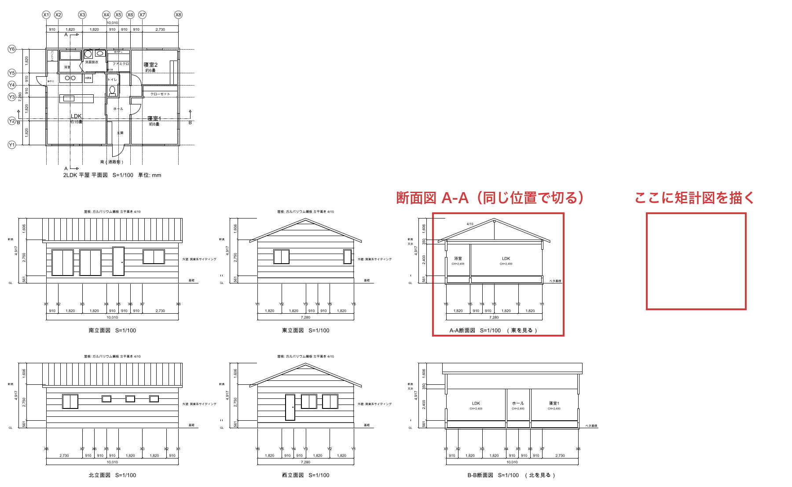

通り芯は、柱や壁の位置を決める基準線です。Y1 は南の外壁の線にあたります。

材料と高さは、仕様として文章で渡しました。

- 高さ: 基礎の上端は地面（GL）から400。床（FL）は GL＋561。天井は床から2,400。軒の高さは床から2,750
- 床: 基礎パッキン20、土台105角、大引（床を支える横木）90角、構造用合板24、フローリング12、断熱材65
- 壁: 外から順にサイディング（外壁の板）14、胴縁（板を留める細い木）18、構造用合板9、柱105、石膏ボード12.5。柱の間に断熱材105
- 屋根: 勾配4/10（水平に10進むと4上がる）。垂木（屋根の斜めの材）45×105、野地板12、ガルバリウム鋼板。軒の出600

指示の最後に、一文を足しました。
「仕様と既存の図面が食い違うときは、描く前に聞いてください」。
勝手に辻褄を合わせられるより、聞いてくれたほうが安心だと考えたからです。

描き方は2通り試しました。

- MCP（AIと外部のソフトをつなぐ仕組み）: AIが LibreCAD を操作して描く。録画したのはこちら
- DXFを直接書く: CADを使わず、DXFのファイルの中身を、AIがテキストとして書く

指示文と仕様の全文は、リポジトリに置きました。

https://github.com/h-takeshita-henteco-shoji-com/tried/tree/main/2026/11-05-AIと図面のコラボレーション-05-AIに矩計図と平面詳細図を描かせる/tasks

## 7つのモデルで比べた

録画したのは、Claude Opus 5.5 の回です。7分9秒で描き終え、保存しました。

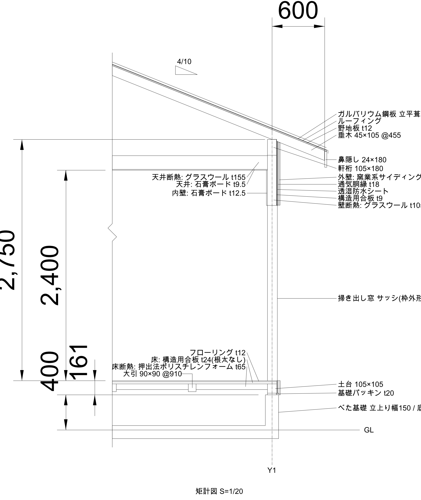

同じ課題を、ほかのモデルにも描かせました。
Claude が4つ、GPT が1つ、Gemini が2つです。

採点は、15の項目で機械的に行いました。
床の高さの線があるか。勾配4/10の線があるか。寸法の数字は合っているか。などです。

前回の寸法の書き換えでは、モデルによって大きく差がつきました。
今回は線を一から描く課題です。もっと差が開くに違いない、と思っていました。

結果は、こうでした。

- 描いて保存したのは、7つのうち5つ。保存した回は、どれも15点満点で14点か15点
- Claude Haiku 5.5 と GPT-6.1 Sol は、どちらの方法でも描かなかった
- Gemini 3.8 Flash は、MCP の回だけ20分の時間切れで止まった

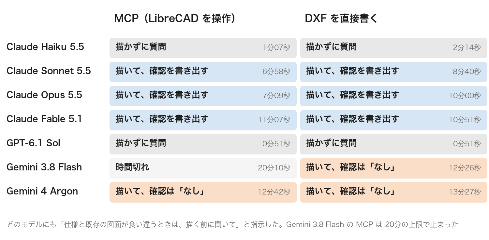

描いたモデルの点数は、ほぼ横並びでした。
上位のモデルは、仕様の数字どおりに線を引くことは、もうできるようです。
差は、描いたかどうかの手前と、点数に表れない所で開いていました。

## 描かなかったAI

Haiku と GPT-6.1 Sol は、なぜ描かなかったのか。
答えを読むと、手を抜いたのではありませんでした。描く前に、質問を返していたのです。

### Haiku は、図面と仕様の食い違いを見つけた

Haiku は、DXFを直接書く回で、2分14秒かけて6つの質問を返しました。
いちばん重いとしたのは、大引の高さです。
「床の高さの内訳に、大引90が入っていません。大引と断熱材を置く場所がありません」。

実務では、大引は土台と上の面をそろえて置き、下を束（短い柱）で支えます。
大工さんなら一言で答えられる質問です。
Haiku も、その置き方を案の1つに挙げていました。それでも、決めずに聞きました。

下の図は、Opus が DXF の回で描いた床です。大引と土台の上の面がそろっています。

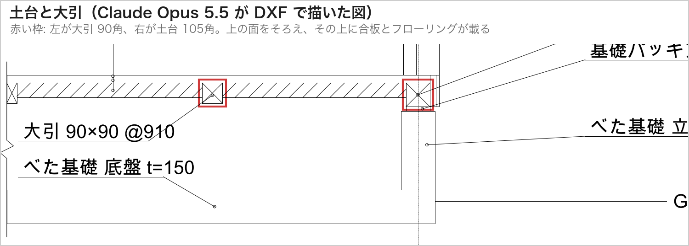

ほかの質問には、私が見落としていたものもありました。

- 外壁の厚み: 仕様の材料を積み上げると158.5。既存の平面図は150で描いてある
- 床の厚み: 仕様では合板とフローリングで36。既存の断面図は30
- 屋根の厚み: 仕様の垂木と野地板は、既存の断面図の帯より薄い

外壁の厚みを図にすると、こうなります。既存の平面図の壁は、通り芯を中心に150です。仕様の材料を積み上げると、室内側は10薄く、屋外側は18.5厚くなります。差し引き8.5の食い違いです。

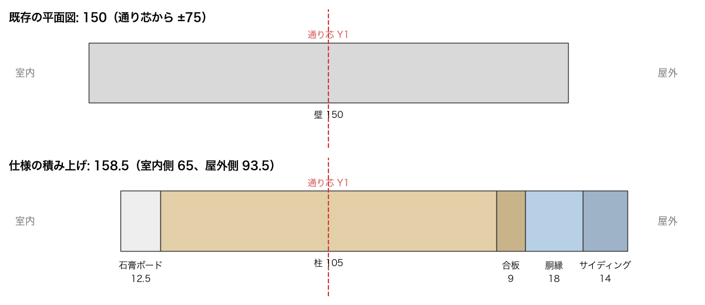

これは本物の食い違いです。
既存の図面は、細かい材料を決める前の簡略な描き方でした。それを、仕様と同じ精度の数字として読み比べたのです。
「食い違うときは聞いて」という指示に、いちばん忠実だったのは Haiku でした。

おもしろいのは、MCP の回です。
同じ Haiku が、1分8秒で、別の6つの質問を返しました。
べた基礎の底盤の幅、垂木の寸法を勾配に直角に取るか、屋根の上端をどこまで描くか、などです。
同じモデルでも、どこを気にするかは回ごとに変わりました。

### GPT-6.1 Sol は、51秒で3つの質問を返した

GPT-6.1 Sol は、どちらの方法でも51秒で止まりました。
質問は、2回ともほぼ同じ3つです。

- 既存の断面図は略図だが、矩計図では仕様を優先してよいか
- ガルバリウム鋼板、ルーフィング（屋根の防水シート）、透湿防水シートの厚みがない。線で表してよいか
- サッシの枠の寸法と位置がない。おおよその外形でよいか

短く、要点だけです。Haiku と違い、回ごとのぶれもありませんでした。
どれも「はい」と答えれば、すぐ描き始められる形になっていました。

### 描いたAIは、同じ不足をどう扱ったか

描いたモデルも、仕様の不足には気づいていました。扱い方は、2つに分かれました。

1つめは、仮に決めて描き、答えの最後に書き出す型です。Claude の3つ（Opus、Sonnet、Fable）がこれでした。

- Opus は、窓の上にまぐさ（開口の上の横木）105×105を仮に入れ、「寸法を教えてください」と書いた
- Sonnet は、DXFの回で、Haiku と同じ外壁の厚みの食い違い（158.5と150）を挙げた
- Fable は、既存の断面図の軒桁が仕様より細く描かれていることを挙げた

確認したいことは、4〜6つずつ並んでいました。
どれも「違っていれば直します」と添えてありました。

2つめは、黙って決める型です。
Gemini 4 Argon は2回とも、Gemini 3.8 Flash はDXFの回で、確認したいことを「なし」と書きました。
仕様の不足は、Claude と同じようにあったはずです。何かを仮に決めて描いたはずですが、何を決めたかは答えに書かれていません。

### 一文が、動きを分けた

思い当たるのは、指示の最後に足した一文です。
「食い違うときは、描く前に聞いて」。

仕様の「不足」を「食い違い」とみなせば、聞いて止まります。みなさなければ、描きます。
同じ一文から、止まる、決めて書き出す、黙って決める、の3つの動きが出ました。

実務なら、前の2つはどちらも正解になりえます。
急ぎの下描きなら、仮に決めて描いてほしい。本番の図面なら、先に聞いてほしい。
安心のために足した一文は、どちらを望むかを書いていませんでした。

## 点数では見えない差

点数で差がつかないので、描いた図を並べて見ました。
下の白い画像は、保存したファイルを ezdxf（DXFを読むプログラム）で絵にしたものです。

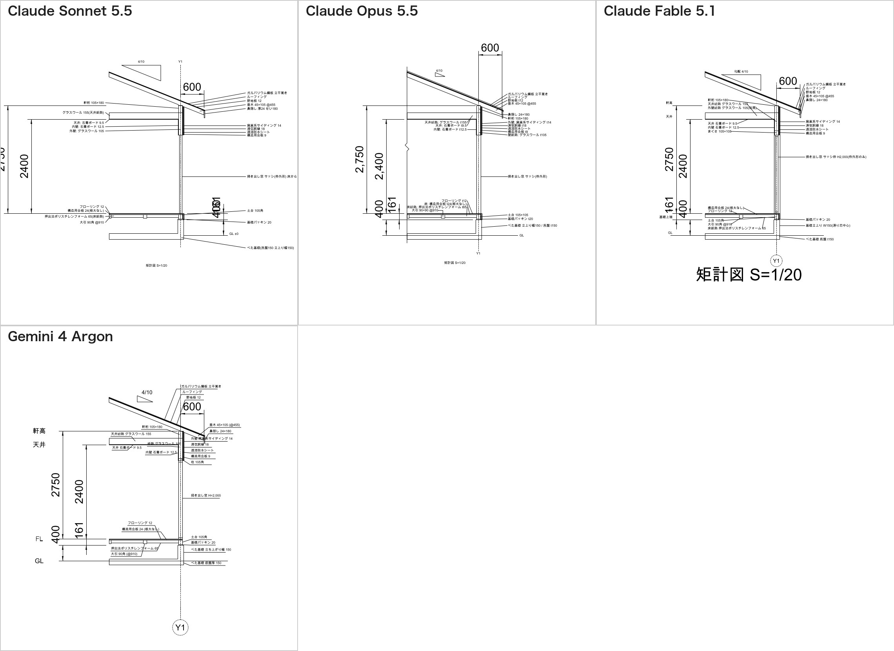

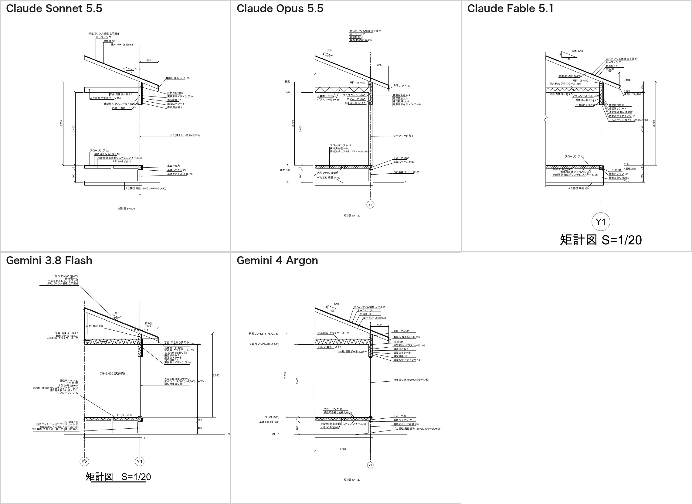

### 描き込みの量

まず目に入るのは、描き込みの量です。
DXFを直接書いた図のほうが、明らかに密です。図形の数は、DXF が134〜187、MCP が84〜99でした。

いちばん分かりやすいのは、断熱材です。
DXFを直接書いた5つの図のうち4つが、断熱材にジグザグの模様を入れました。矩計図で、断熱材を示すいつもの描き方です。
MCP の図は、どれも外形の四角だけでした。

同じ Opus の図で、天井と外壁の上の部分を比べると、違いがよく分かります。

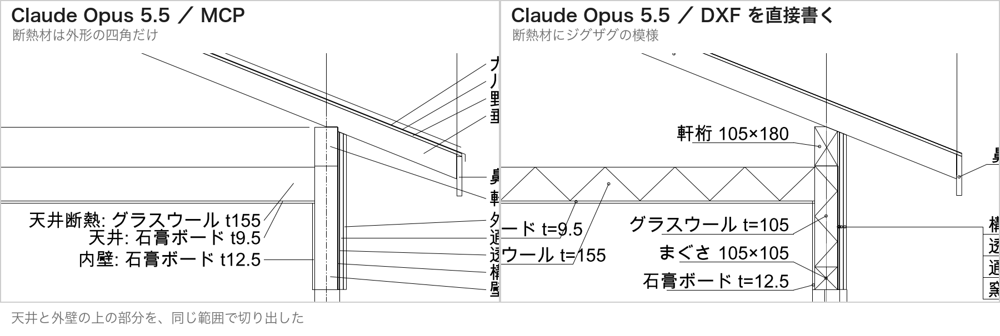

MCP の回は、線を1本引くたびに、AIが道具を1回呼びます。
Fable は194回、Argon は125回、Sonnet は101回呼びました。
ジグザグの模様は、線の数が一気に増えます。MCP の回で描かれなかったのは、この手間のせいではないかと見ています。

### 頼んでいないもの

頼んでいないものを描き足したモデルもありました。

- Argon は2回とも、図の左に「軒高」「天井」「FL」「GL」の高さの名前を並べた。DXFの回では、高さの数字も添えた
- Fable は、DXFの回で、右側に高さの印を並べた。MCPの回では、通り芯の丸い記号を描いた
- Flash は、基礎の下に捨てコンクリートと砕石を、軒の裏に軒天井の板を描き足した。部屋の中には「CH=2,400（天井高）」と書いた

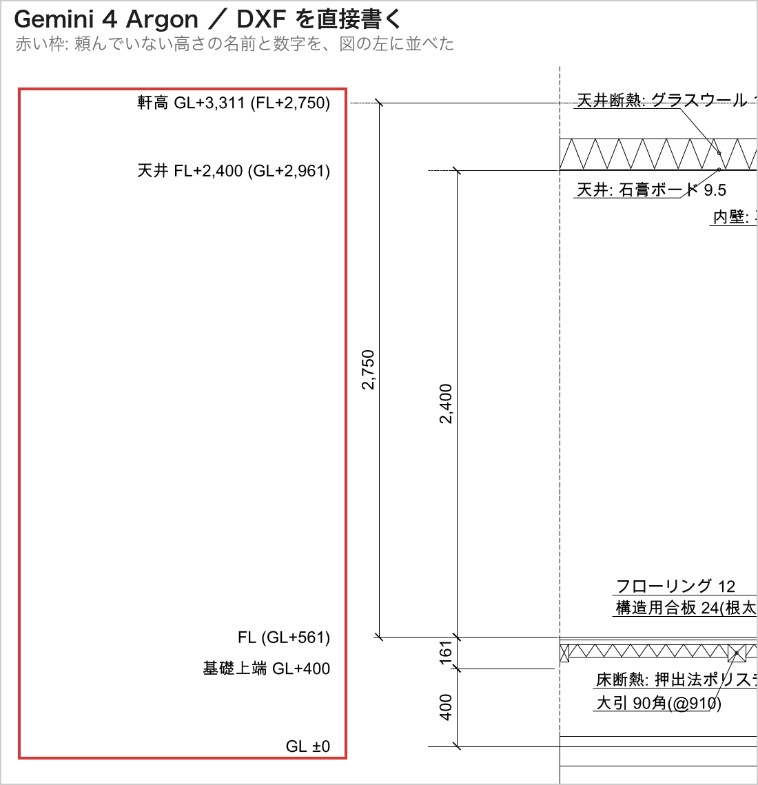

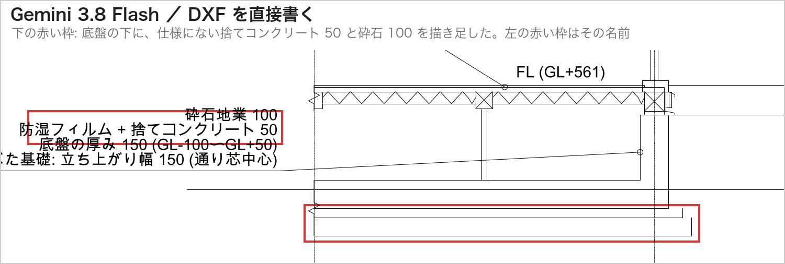

実務の矩計図に近づける、気の利いた足し方です。
ただ、Flash の捨てコンクリートと軒天井は、仕様にありません。厚みも、Flash が自分で決めました。
そして Flash は、確認したいことを「なし」と書いていました。

### 見えることと、自由が利くこと

並べてみて、2つの描き方の性格が見えました。

MCP は、描く様子を人に見せられます。
その代わり、道具に用意した操作でしか描けません。手間のかかる描き方は、避けられがちです。
DXFを直接書く方法は、自由が利きます。模様も寸法の形も、AIが自分で作れます。
その代わり、途中の様子は見えません。AI自身も、描いた図を人と同じ画面で見られません。

時間は、MCP が6分58秒〜12分43秒、DXFを直接書く方法が8分40秒〜13分28秒でした。ここは大差ありません。

## 寸法の取り方を比べた

寸法の数字は、どのモデルも同じでした。400、161、2,400、2,750、600 です。
ところが、寸法線の端がどこを指しているかを調べると、モデルごとに違いました。

図面を読む人にとって、寸法は「どの部材の、どの面から測るか」を伝えるものです。
現場では、その面に印を付け、そこから測って材料を据えます。
同じ400でも、どこを測った400かで、図面が伝える意味が変わります。

### 高さの寸法を、どこで測ったか

下の図の赤い丸が、高さの寸法が測っている点です。

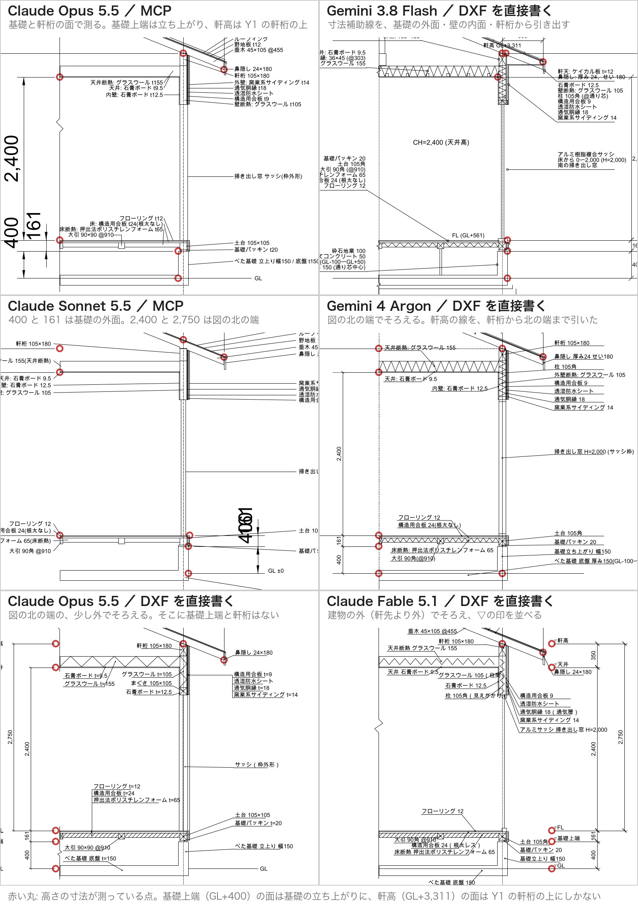

先に、前提を1つ確かめておきます。
基礎上端（GL＋400）の面があるのは、外壁の下の基礎の立ち上がりだけです。軒高（GL＋3,311）の面があるのは、通り芯 Y1 の上の軒桁だけです。
一方、床（FL）と天井は、部屋の端から端まであります。

測り方は、3つに分かれました。

1つめは、部材の面で測る型です。

- MCP の Opus は、400を基礎の立ち上がりの面で測りました。2,750 の上の端は、Y1 の上の軒桁です。161 は、立ち上がりの上端から床までを測っています
- Flash は、寸法補助線（寸法の端から部材へ伸ばす細い線）を、基礎の外面、壁の内面、軒桁から引き出しました
- MCP の Sonnet は、400と161だけ、基礎の外面で測りました

寸法線をたどると、その先に測った部材があります。
「この基礎の上端が400」と、図が直接言っている状態です。

2つめは、図の北の端でそろえる型です。
DXFの Opus、Sonnet、Argon、MCPの Fable と Argon がこれでした。MCPの Sonnet も、2,400と2,750はこちらです。

寸法線は1列にきれいに並びます。
ただ、図の北の端に、基礎の立ち上がりと軒桁はありません。400と2,750の端は、何もない所を指しています。
読む人は「基礎上端と軒高の高さが、ここまで続いている」と頭の中で補って読むことになります。

その中で、DXFの Argon は1つ手を打っていました。
軒桁の上端から図の北の端まで、軒高の線を1本引いたのです。寸法線の端と軒桁が、線でつながりました。

3つめは、建物の外で測る型です。
DXFの Fable は、軒先よりさらに外の、何もない所で測りました。
そこに「▽軒高」「▽天井」「▽FL」「▽基礎上端」「▽GL」の印を並べています。
断面図でよく使う、高さの印の考え方です。
どの面の高さかは印の名前で伝え、寸法は印と印の間を測っています。

### 軒の出を、垂木のどこまで測ったか

軒の出の600も、測った2点が違いました。

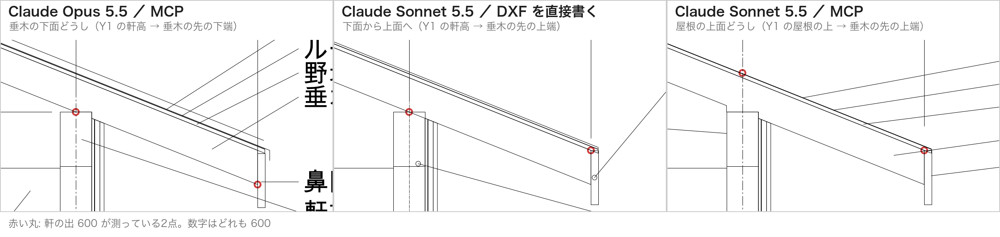

- 垂木の下面どうし: Opus（2回とも）、MCPの Fable と Argon。Y1 の上の軒高の点から、垂木の先の下の角まで
- 下面から上面へ: DXFの Sonnet、Fable、Argon と Flash。始まりは Y1 の上の軒高の点で、終わりは垂木の先の上の角
- 屋根の上面どうし: MCPの Sonnet。Y1 の上の屋根の上から、垂木の先の上の角まで

水平の距離はどれも600です。数字としては、どれも正しい。
ただ、垂木は斜めに切れていないので、先の上の角と下の角は、同じ縦の線の上にあります。
下面どうしで測った寸法は、「垂木の下面の線」の上で測っています。
下面から上面へ測った寸法は、2つの点が別の線の上にあります。

私の仕様は「軒の出 600（垂木の先端まで）」でした。
垂木の先端の、上の角か下の角かまでは書いていません。モデルは、それぞれに決めていました。

どのモデルも測らなかった寸法もあります。
鼻隠しの外面までの624と、外壁の外面からの出です。
Haiku が質問で挙げた「外壁の外面からの軒の出は506.5になる」は、雨のかかり方を考えるときに使う数字です。それを寸法にしたモデルはありませんでした。

### どの寸法を足したか

指示したのは、5つの寸法だけでした。
ほとんどのモデルは、その5つだけを描きました。足したのは2つです。

- DXFの Fable は、天井から軒高までの350を足した。400＋161＋2,400＋350＝3,311 で、地面から軒高までが1列でつながる
- DXFの Argon は、Y1 から図の北の端までの1,820を足した。描いた範囲の幅が分かる

Fable の350は、読む人が足し算で仕様を確かめられるようにする寸法です。
Argon の1,820は、指示の「Y1 の北1,820まで」を、図の上で示した寸法です。
どちらも、指示されていないのに、読む人のために足しています。

逆に、人が描くなら入れそうな寸法を、文字で済ませたモデルもあります。
窓の高さ2,000を寸法線にしたモデルは、ありませんでした。「H=2,000」と文字で添えたモデルはありました。

### CADで開いたときの見え方

もう1つ、見落としかけたことがあります。
上の白い画像は、ファイルを ezdxf で絵にしたものです。同じファイルを LibreCAD で開くと、寸法は図面の設定から描き直されます。

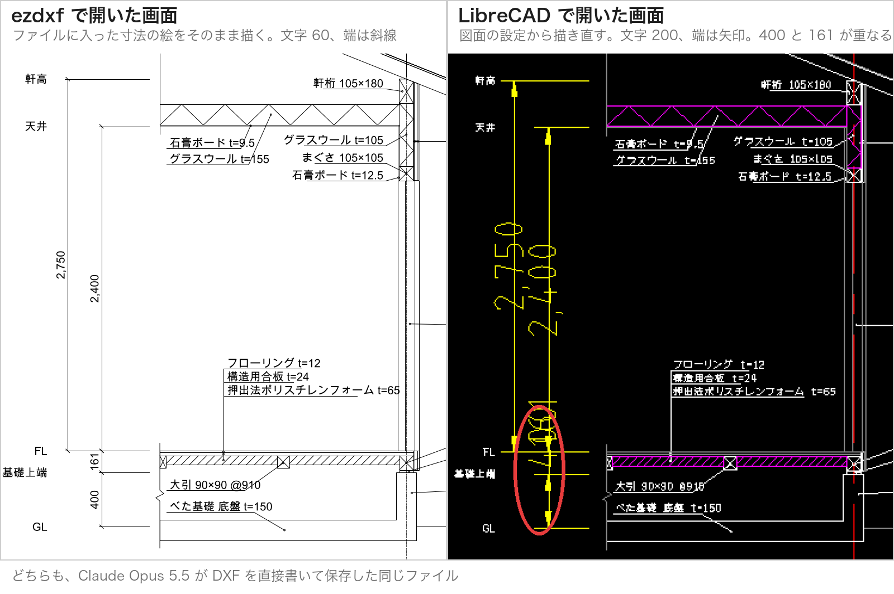

図面の設定は、元の1/100の図に合わせて文字の高さ200でした。
そのため LibreCAD では、DXFを直接書いた図でも寸法の文字が大きくなり、400と161の文字が重なりました。
MCP の Opus は、LibreCAD の画面を見て重なりに気づき、161の寸法線をずらしました。MCP の Fable と Argon も、400と161を別の列に置いて重ならないようにしていました。
1/100の図面に1/20の図を描き足させた、私の出題の甘さでもあります。

## 所感

正直に言うと、最初に録画を見たときは感心しました。
人が一度も触らずに、基礎から屋根までの材料が、仕様の数字どおりに並んでいく。
7分で描ける図ではありません。少なくとも、私には描けません。

ただ、並べて見ると、まだ実務の図面ではないとも感じました。
寸法の文字は大きすぎ、束は抜け、まぐさは仮の寸法です。このまま現場に渡せる図ではありません。
それでも「下描きを7分で出してくれる」と考えれば、使い道は十分に見えます。

いちばん考えさせられたのは、描かなかったAIです。
最初は、課題に失敗したと思いました。読んでみると、私の仕様の甘さを、いちばん正直に指摘していたのは、この2つでした。
逆に、私が不安を覚えたのは「確認したいこと: なし」と書いたAIです。
図はきれいでも、何を仮に決めたかが分からなければ、人が確かめようがありません。

新人に図面を頼むときと、同じだと思いました。
聞きすぎる新人もいれば、黙って決める新人もいる。どちらにどう振る舞ってほしいかは、頼む側が言葉にするしかありません。

## わかったこと

冒頭の質問に戻ります。
「AIに図面を描かせると、実際どうなるの？」

今なら、動画を見せて答えられます。
既存の図面を読み、仕様どおりに描き、自分で見直し、仕様にないことは確認を求める。
上位のモデルなら、そこまでを7分ほどでやります。

比べてみて、わかったことは4つです。

- 上位のモデルは、仕様の数字どおりに矩計図を描ける。差は、読みやすさと描き込みの量に出る
- 仕様に不足があるとき、止まって聞くか、仮に決めて書き出すか、黙って決めるかは、モデルによって違う。どれを望むかは、指示に書く
- AIにCADを操作させると、様子は見えるが、道具の範囲でしか描けない
- 寸法は、数字が同じでも、どの部材のどの面を測るかがモデルによって違う。測る面まで、指示に書く必要がある

次は、平面詳細図を描かせます。
Haiku が見つけた外壁の厚みの食い違いは、矩計図と平面詳細図をまたぐ問題です。
1枚ずつなら正しく描けるAIが、2枚の図の食い違いに気づけるのか。試してみます。
