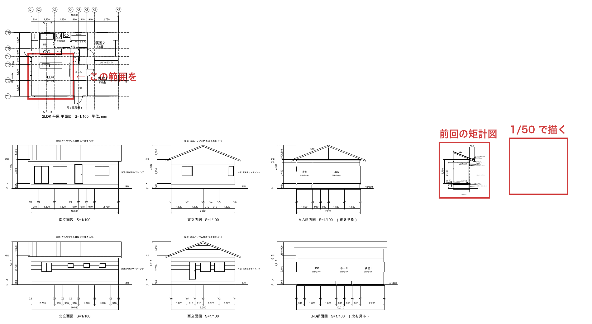
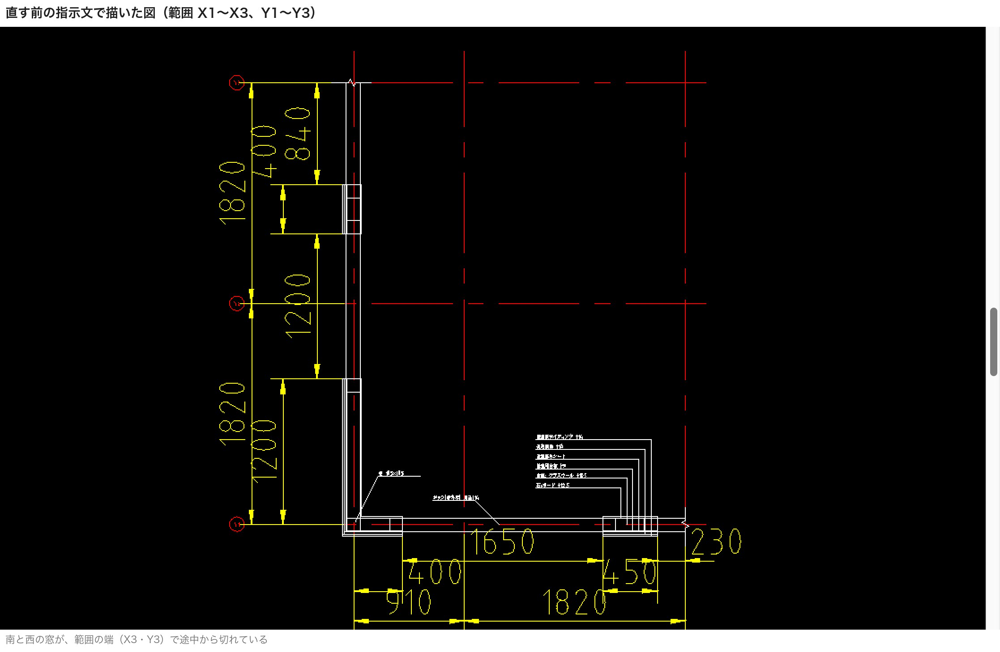
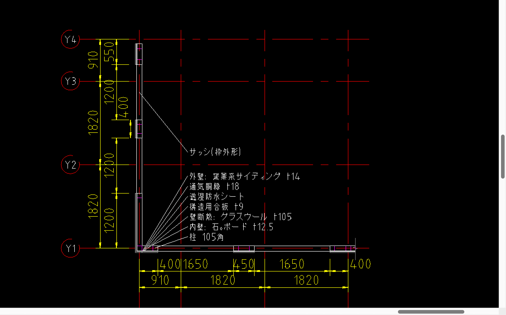
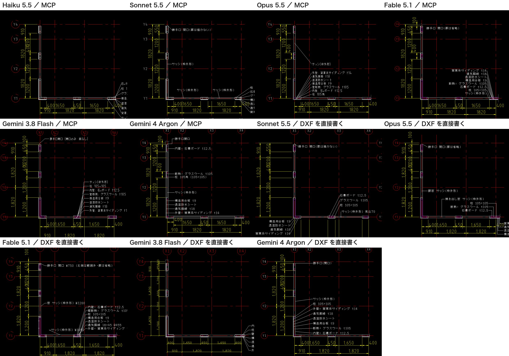
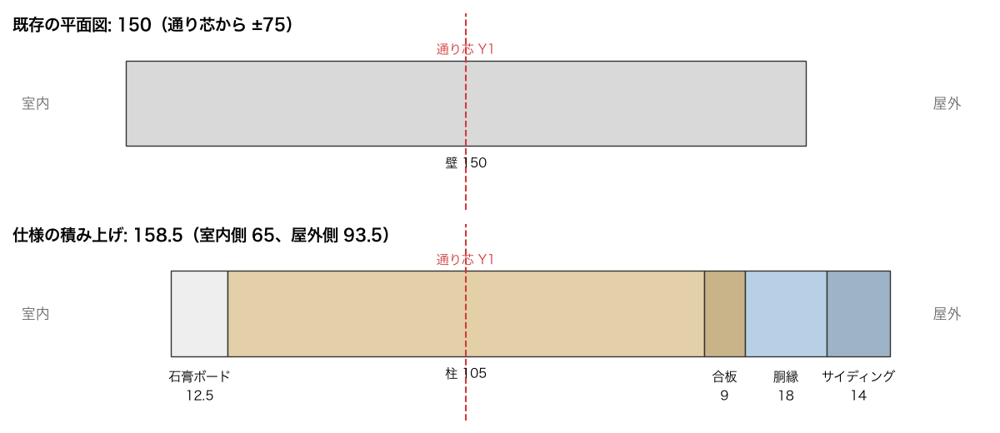
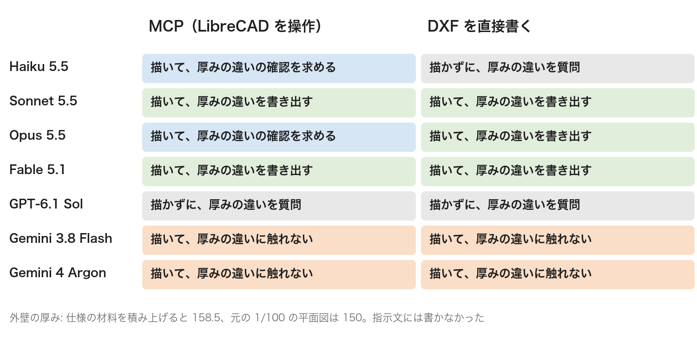
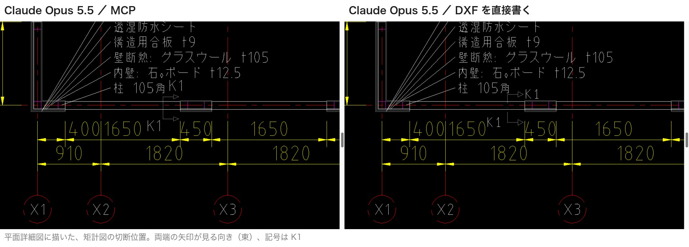

# AIにCADで平面詳細図を描かせ、7つのモデルで比べた

この記事の内容を、へんロボが説明する動画にもしました。AIがCADを操作して描く様子も、動画の中でお見せしています。

https://youtu.be/4LbY4S_-Buo

## 矩計図の次は、平面詳細図

やってみ太郎です。へんてこ商事で、中小企業のDXやAI導入の相談役と、システム開発をしています。

連載「AIと図面のコラボレーション」の6本目です。
前回は、AIにCADを操作させて、矩計図（外壁まわりを縦に切った詳しい図）を描かせました。

https://note.com/tried_hs/n/n8e3396606a9e

前回、ひとつ気になることが残りました。
描かずに質問を返した Claude Haiku が、「外壁の厚みが、仕様と既存の平面図で違う」と指摘したのです。
仕様の材料を積み上げると158.5mm。元の1/100の平面図は150mmで描いてあります。

この食い違いは、矩計図と平面図をまたぐ問題です。
そこで今回は、平面詳細図を描かせることにしました。平面図を1/50に詳しくした図で、外壁の層が上から見えます。
厚みの違いに、AIは自分で気づくのか。それが今回の一番の関心でした。

## 作図の条件

条件は次のとおりです。

- 図面: 前回と同じ2LDKの平屋。前回AIが描いた矩計図も入っている
- 描く範囲: LDKの南西の角。通り芯（柱や壁の位置の基準線）X1〜X4、Y1〜Y4
- 置く場所: 図面の空いている所に、実寸で描き足す。縮尺は1/50
- 描くもの: 外壁の層、柱、窓の開口とサッシ、通り芯、寸法、材料の名前と厚みの引き出し線
- 外壁の仕様: 前回の矩計図と同じ。柱105、構造用合板9、通気胴縁18、サイディング14、石膏ボード12.5、断熱材105



前回の反省から、指示文に2つ書き足しました。

- 寸法は、通り芯から測る
- 仕様にないことは、仮に決めて描き、すべて書き出す。既存の図面と食い違うときは、描かずに聞く

外壁の厚みの食い違いは、あえて書きませんでした。AIが自分で気づくかを見たかったからです。

描き方は前回と同じく2通りです。

- MCP（AIと外部のソフトをつなぐ仕組み）: AIが LibreCAD を操作して描く
- DXFを直接書く: CADを使わず、図面のファイルの中身を、AIがテキストとして書く

## 最初の指示文は、AIに直された

まず Claude Opus 5.5 で1回試しました。5分21秒で描き終えています。
ところが、答えの最後に「確認したいこと」が3つ並んでいました。

1つめ。
「仕様では『柱は通り芯の交点に置く』ですが、次の4つの交点は、どれも元の平面図の窓の開口の中にあります。このため、これらの柱は描いていません」。

2つめ。
「南の窓と西の窓は、範囲の端の X3・Y3 をまたいでいます。このため、窓の幅は範囲の中では測れません」。



3つめ。
「文字の高さ 30 は、S=1/50 で印刷すると 0.6mm で、とても小さくなります。このままでよいかを教えてください」。

どれも、私の指示文の誤りでした。
柱の置き方は、窓のことを考えずに書いていました。範囲は、窓の位置を確かめずに決めていました。
文字の高さは、矩計図の1/20の感覚のまま小さくしていました。

AIは、誤った指示に合わせて無理に描きませんでした。
矛盾する所は描かずに残し、理由を添えて聞いてきました。

指示文を直しました。
範囲を X1〜X4、Y1〜Y4 に広げ、窓が丸ごと入るようにしました。
柱は「開口の中の交点には置かない」とし、文字の高さは150（1/50で印刷して3mm）にしました。

## 7つのモデルで比べた

直した指示文で、もう一度 Opus に描かせ、その様子を録画しました。冒頭の動画で使っています。
6分58秒で描き終え、保存しました。



同じ課題を、7つのモデルに、2通りの方法で描かせました。Claude が4つ、GPT が1つ、Gemini が2つです。
採点は、12の項目で機械的に行いました。通り芯、外壁の層、柱、寸法、文字の高さ、などです。

結果は、前回とよく似ていました。

- 描いて保存したのは、14回のうち11回
- 保存した回は、どれも12点満点で9.8〜12点
- GPT-6.1 Sol は2回とも、Claude Haiku は DXF の回で、描かずに質問を返した

並べると、図の形はほとんど同じでした。



点数でも、見た目でも、差はつきません。
差が出たのは、外壁の厚みへの反応でした。

## 外壁の厚みに、誰が気づいたか

おさらいです。外壁の厚みは、仕様と元の平面図で食い違っています。



指示文には、このことを書いていません。
それでも、気づいたモデルは多くありました。気づき方は、きれいに分かれました。



### Claude は、全部の回で気づいた

Claude の4つは、描いた回も描かなかった回も、すべてこの違いに触れていました。
ただ、その先の動きは2つに分かれました。

1つは、描いたうえで、確認を求める動きです。MCP の Opus はこう書きました。
「1/100 の図なので略して描いたものと考えて、仕様のほうで描きました。これでよいでしょうか」。

もう1つは、描いたうえで、判断を書き出して終える動きです。MCP の Sonnet はこう書きました。
「これは簡略表現の違いと考え、食い違いとは扱っていません」。
確認したいことは「なし」でした。

どちらも、1/100の平面図は略図だと読んでいます。実務でもそう読むのが自然です。
違うのは、その判断を人に預けるか、自分で引き取るかです。

DXF の Haiku は、描く前に止まりました。
「158.5で描き、元の平面図の壁も直すのをおすすめします」。
前回、最初にこの食い違いを見つけたのも Haiku でした。2回続けて、いちばん慎重でした。

### GPT は、描かずに聞いた

GPT-6.1 Sol は、2回とも約40秒で止まりました。
「平面詳細図では、元の平面図の壁厚150mmに代えて、指定仕様・矩計図の壁厚158.5mmを採用してよいですか？」

指示文には「既存の図面と食い違うときは、描かずに聞く」と書きました。
GPT は、その指示にいちばん忠実でした。短い質問1つで、答えればすぐ描ける形になっています。

### Gemini は、触れなかった

Gemini の2つは、4回とも、厚みの違いに触れませんでした。
描いた図の壁は、仕様の層で描かれています。仕様のほうで描いたのです。
ただ、元の平面図と違うことは、答えのどこにも書かれていません。確認したいことは「なし」でした。

前回と同じ傾向です。
Gemini は、決めたことを書き出さずに進みます。図はきれいでも、人がどこを確かめればよいかが分かりません。

## 点数に出ない差

ほかにも、点数に出ない差がありました。

1つは、寸法の文字の重なりです。
西の壁の「400」と「1,200」の文字が、いくつもの図で重なりました。
寸法の文字の高さが、図面全体の設定（1/100用の200）のままだからです。前回と同じ問題です。
MCP の Opus は、描いたあと画面を見て重なりに気づき、寸法線をずらしていました。

もう1つは、Gemini 3.8 Flash の寸法です。
DXFを直接書いた回で、前回と同じく、寸法を「寸法」の部品ではなく線と文字で描きました。
見た目は寸法ですが、CADで点を動かしても、数字は追いかけてきません。

## 切断位置をそろえる

平面詳細図ができたので、もう1つ課題を出しました。
矩計図と平面詳細図を、互いに対応させる課題です。

実際の図面では、平面図に「ここで切った断面が、あの図です」という印を描きます。
切断線と、見る向きの矢印と、記号です。

AIには、次の3つを頼みました。

- 平面詳細図に、矩計図の切断位置（元の平面図の x=1,800）の切断線を描き、東を見る矢印と記号「K1」を付ける
- 矩計図の題を「矩計図 K1 S=1/20」に直す
- 2枚を照らし合わせ、食い違いがあれば仕様に合わせて直す

元にしたのは、Opus が描いた平面詳細図と、前回 Opus が描いた矩計図です。
実は、この2枚はもともとそろっています。正解は「食い違いなし。何も直さない」です。



結果は、拍子抜けするほど順調でした。

- 14回とも保存した。かかった時間は1分21秒〜14分10秒
- 読めた13回すべてが「食い違いなし」と答え、壁やサッシを動かした回はなかった
- 12回が8点満点。MCP の Haiku は矢印を描かずに7点

細かい所まで見ていたのは、ここでも Claude でした。
Opus は、MCPでもDXFでも、9つの項目を表にして照らし合わせました。
そのうえで「透湿防水シートの線が、両方の図とも合板の外側から1mm外に描かれている」と指摘しました。
2枚がそろっているので直していない、と書き添えています。

ひとつだけ、困ったことが起きました。
Gemini 3.8 Flash が DXF を直接書いた回で、保存したファイルが壊れていたのです。

```
  9
$HANDSEED
D
20000
```

DXFでは、値の前の行に、値の種類を表す番号が入ります。そこに「D」と書かれていました。
CADのソフトは、この行で読むのをやめてしまいます。LibreCAD は、開こうとして応答しなくなりました。
答えには「保存しました」とあり、確認したいことは「なし」でした。

## 所感

正直に言うと、最初に驚いたのは、AIに指示文を直されたことでした。
柱の置き方も、範囲も、文字の高さも、私の書き方の誤りです。
AIは、誤りに合わせて無理に描かず、「ここが矛盾しています」と返してきました。
人に図面を頼むとき、指示の誤りを指摘してくれる相手は、ありがたいものです。

外壁の厚みの結果は、前回の見立てを強めました。
同じ食い違いを前にして、Claude は気づいて書き出し、GPT は止まって聞き、Gemini は黙って進みました。
私が任せやすいのは、気づいたことを書き出してくれる相手です。止まって聞く相手も、急ぎでなければ安心です。
黙って進む相手は、図がきれいなほど、かえって確かめにくくなります。

壊れたファイルにも考えさせられました。
図面が間違っているより、開けないほうが困ります。しかも、答えは「保存しました」でした。
AIに図面を描かせるなら、保存したファイルが開けるかを、人か道具で必ず確かめる必要があります。

## わかったこと

今回わかったことは4つです。

- 平面詳細図も、上位のモデルは仕様どおりに描ける。点数でも見た目でも、差はほとんどつかない
- 指示文の誤りは、AIが描く前に指摘してくれることがある。最初は1回試して、答えの「確認したいこと」を読むとよい
- 図をまたぐ食い違いに、Claude は全部の回で気づき、GPT は止まって聞き、Gemini は触れなかった
- AIが「保存しました」と答えても、ファイルが開けるとは限らない

次は、仕様が足りないときや、既存の図面と両立しないときの動き方を、正面から比べます。
今回、Gemini は食い違いに触れませんでした。食い違いをはっきり仕込んだら、気づけるのか。試してみます。
