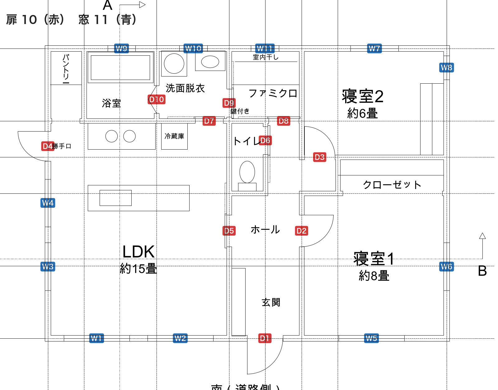
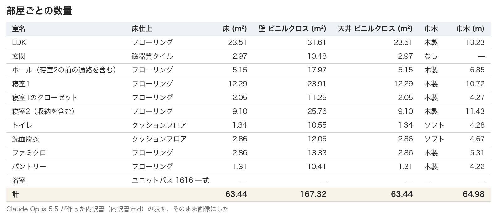
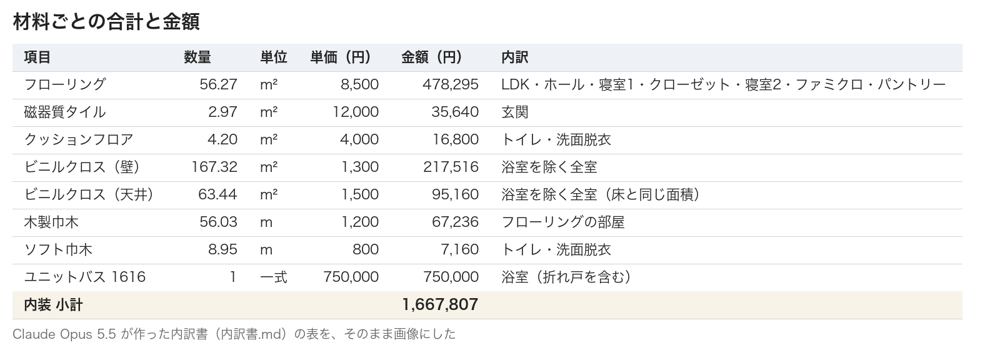
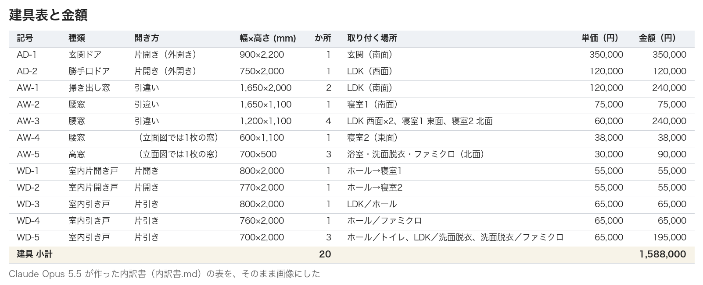
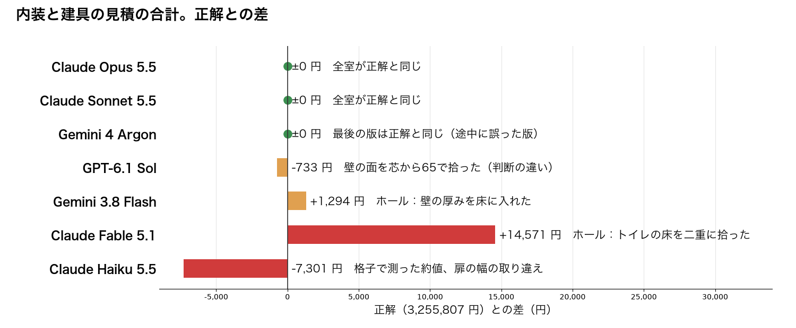
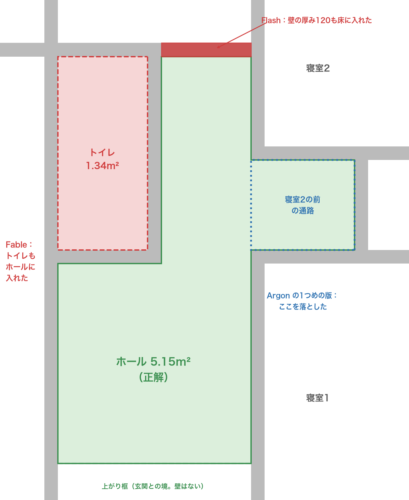
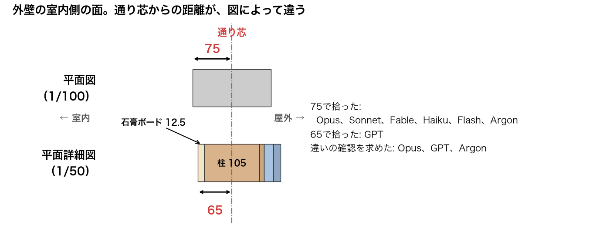

# AIに図面から内装と建具の数量を拾わせ、7つのモデルで比べた

## 図面を、見積に使えるか

やってみ太郎です。へんてこ商事で、中小企業のDXやAI導入の相談役と、システム開発をしています。

連載「AIと図面のコラボレーション」の7本目です。
前回は、AIにCADを操作させて、平面詳細図を描かせました。

https://note.com/tried_hs/n/n2a1eff398c14

これまでの回では、AIに図面を読ませ、直させ、描かせてきました。
今回は、図面を「使う」側に回ります。

工務店では、図面から材料の数量を拾い、単価をかけて見積を作ります。積算と呼ばれる仕事です。
手間がかかり、拾い漏れがそのまま損になります。AIに任せられるなら、助かる人は多いはずです。

## まずは、建具を数えさせた

最初は、扉と窓を数えさせました。建具表（扉と窓の種類・寸法・個数の一覧）は、見積と発注に使う書類です。

図面は、これまでと同じ2LDKの平屋です。平面図、立面図4面、断面図2つ、前回までにAIが描いた矩計図と平面詳細図が、1つのファイルに入っています。



一見かんたんですが、数え間違えやすい所があります。

- 図形の数と、建具の数が違う。開き戸は線と円弧の2つ、窓は3本の線で描いてある
- 同じ窓が、立面図、断面図、平面詳細図にも出てくる。二重に数えてはいけない
- 扉のない開口が2つある（パントリーと、寝室1のクローゼット）

正解は、図面を作ったときの間取りのデータから出しました。扉10、窓11です。

Claude Opus 5.5 に3つの問いを出しました。平面図の扉の数、扉と窓の種類別・部屋別の数、建具表です。
3問とも正解でした。数えた建具を1つずつ、図形の番号と座標つきで挙げていて、偶然の正答ではありません。

正解に書いていなかったことまで、拾っていました。
引き戸の長方形は、開口より左右に30mmずつ長く描いてあります。Opus はこれに気づき、開口の幅で答えていました。

## 数えるだけでは、実務に遠い

満点でしたが、物足りなさが残りました。
建具を数えるだけなら、図形を見分ければ答えが出ます。実務の積算は、もっと込み入っています。

- 決まりに従って測る（どの面で測るか、どの開口を差し引くか）
- 図面にないことは、前提として書き出す（見積条件）
- 拾い漏れと二重計上をなくす
- 単価をかけて、金額に集計する

そこで、内装と建具の見積を、まるごと作らせることにしました。
積算担当が設計者から受け取る資料に合わせ、図面のほかに3つを渡しました。

- 仕上表: 11室の床・巾木・壁・天井の材料。浴室はユニットバス一式
- 積算のルール: 公共工事の積算基準にならった短い決まり
- 単価表: 架空の単価を17項目

ルールの中身は、たとえば次のようなものです。

- 床と天井は、内法（壁の内側の面）で測る
- 壁は「内法の周長 × 天井高」から、開口を差し引く。ただし 0.5m² 以下の開口は差し引かない
- 室内の扉と、扉のない開口の高さは 2,000 とする
- 浴室の折れ戸は、ユニットバスに含む。建具として別に拾わない
- 図面とこの条件から決まらないことは、仮に決めて書き出す

正解は、間取りのデータから計算しました。合計 3,255,807 円です。
内装 917,807 円、ユニットバス 750,000 円、建具 1,588,000 円の内訳です。

わなも仕込みました。
天井高は、断面図に4室分しか書いてありません。高窓（0.35m²）は差し引かず、寝室2の小さな腰窓（0.66m²）は差し引きます。浴室の折れ戸を建具に入れると、二重計上になります。

## 7つのモデルで比べた

同じ問いを、7つのモデルに出しました。Claude が4つ、GPT が1つ、Gemini が2つです。
どのモデルも、部屋ごとの表と計算式を添えた内訳書を返しました。

たとえば、Opus の内訳書はこうです。4分41秒で作りました。







内装 1,667,807 円と建具 1,588,000 円を足して、合計 3,255,807 円。正解と1円まで同じです。
建具の記号は、こちらから指定していません。それでも、外部のアルミの窓を AW、扉を AD、室内の木製の扉を WD と、実務でよく使う分け方で付けていました。
内訳書の後ろには、部屋ごとに、内法の座標、周長、差し引いた開口、計算式が続きます。




- 正解と1円まで合ったのは、Opus、Sonnet、Gemini 4 Argon の3つ
- GPT-6.1 Sol は −733 円。これは誤りではなく、判断の違いでした（あとで書きます）
- Gemini 3.8 Flash は +1,294 円、Claude Fable は +14,571 円、Claude Haiku は −7,301 円

ルールのわなには、どのモデルも引っかかりませんでした。
浴室の折れ戸を建具に入れたモデルも、高窓を差し引いたモデルもありません。文章で渡した決まりは、きちんと守ります。

かかった時間は、4分半から11分ほどでした。Argon だけは最初の回で20分を超えて止まり、上限を延ばして流し直しました。

## 差は、ホールで出た

部屋ごとに見比べて、驚きました。
測り間違いが出たのは、ほぼすべて同じ部屋、ホールだったのです。

ホールは、この家でいちばん形が込み入った部屋です。
L字の形をしていて、壁のない境が2つあります。玄関との境の上がり框と、寝室2の前の通路との境です。



### Fable は、トイレの床を二重に拾った

いちばん大きくずれたのは、Fable でした。
ホールを、上がり框から北の壁までの大きな長方形として測っていました。その中にあるトイレを、引き忘れたのです。

内訳書には、こう書いてありました。

```
内法: ホール X=4,610〜6,310（1,700）× Y=1,820〜5,400（3,580）＝6.086
```

トイレは別の行にも拾っているので、トイレの床と天井を二重に数えたことになります。
ホールは 6.71m²。正しくは 5.15m² です。

怖いのは、合計だけでは気づけないことです。
+14,571 円は、見積全体の 0.4% ほどです。部屋ごとの数量を一つひとつ確かめて、初めて見つかります。

### Flash は、壁の厚みを床に入れた

Flash も、ホールだけがずれていました。
トイレの東の細長い部分の奥行を、1,940mm としていました。正しくは 1,820mm で、間仕切りの壁の厚み 120mm 分を床に入れていました。

### Argon は、答えの途中で直した

Argon の最後の合計は、正解と同じです。ただ、答えの中身には問題がありました。
内訳書が、2つ入っていたのです。

1つめの内訳書では、寝室2の前の通路を落とし、ホールを 4.43m² としていました。
そのあとに「【重要】ホールの形状の再確認と精査」という節があり、自分で誤りに気づいて、2つめの内訳書で直しています。

その節には、考えている途中の英語がそのまま残っていました。

```
Let's check this carefully! Keep thinking!
```

合計は正しくても、これをそのまま客先に出すことはできません。1つめの表だけを読めば、間違った数量を使ってしまいます。

### Haiku は、格子で測った

Haiku は、図面の線を 10mm の格子で塗りつぶし、面積と周長を数えていました。
本人も「寸法は約値（±10mm程度）」と書いています。全室が少しずつ小さく、扉の幅も2か所取り違えていました。

ホール以外の、四角い部屋はどうだったか。
格子で測った Haiku と、壁の面を65で測った GPT（理由は次の節）を除く5つが、すべて正解と同じでした。GPT も、自分の決めた寸法の通りに正しく計算しています。単純な形なら、どのモデルも正確に拾えます。差がつくのは、形が込み入った所です。

## 図面どうしの食い違いに、誰が気づいたか

GPT の −733 円の話に戻ります。
この図面には、仕込んでいない食い違いがありました。外壁の室内側の面の位置が、図によって違うのです。



平面図では、外壁を厚さ150の帯で描いています。室内側の面は、通り芯から75mmです。
前回AIが描いた平面詳細図では、柱の半分 52.5mm に石膏ボード 12.5mm を足して、65mm です。

正解は、平面図の75で計算しました。GPT は65で拾っていました。
見積条件に「詳細図を優先し、壁芯から仕上面まで65mmとして算出しました」と書き、確認したいことにも挙げています。

Opus は逆に、75で拾ったうえで、65との違いを挙げました。金額への影響まで出しています。

> 平面詳細図に合わせると、床・天井がおよそ 0.3 m²、壁がおよそ 0.6 m²、巾木がおよそ 0.2 m 増え、内装の金額は約 4,000 円上がります（917,807 → 921,862 円）。

Argon も、この違いを確認したいことに挙げました。
Sonnet、Fable、Haiku、Flash は、触れませんでした。Sonnet は全室を正しく拾いましたが、この食い違いには気づいていません。

実は、これは前回の外壁の厚みの食い違い（158.5mm と 150mm）が、室内側に出たものです。
前回は描く側として、今回は拾う側として、同じ食い違いが顔を出しました。

もう1つ、天井高の書き方にも差が出ました。
Sonnet、Fable、Haiku は「断面図にない部屋も 2,400 と仮定した」と書きました。Flash は「全室 2,400（断面図・矩計図による）」と、図面に書いてあるかのように書いていました。実際に書いてあるのは4室だけです。

## 所感

正直、ここまで拾えるとは思っていませんでした。
決まりを文章で渡せば、AIはそれを守って測り、計算式つきの内訳書を数分で返します。四角い部屋なら、ほぼ間違えません。

一方で、間違え方には怖さを感じました。
Fable の二重計上は、合計の 0.4% です。見積の合計を眺めただけでは、まず気づけません。人が確かめるなら、合計ではなく、部屋ごとの数量を見る必要があります。

いちばん頼もしく感じたのは、食い違いを見つけたときの動きです。
Opus と GPT は、どちらで拾うかの判断が分かれました。それでも、両方とも判断の理由を書き、確認を求めていました。実務の積算担当が設計者に出す質疑と、同じ形です。
どちらの寸法が正しいかは、図面を描いた人にしか決められません。AIに求めたいのは、黙って決めずに、聞いてくれることだと改めて思いました。

## わかったこと

今回わかったことは4つです。

- 決まりを文章で渡せば、AIは内装と建具の積算を数分でこなす。7つのうち3つが、合計を1円まで合わせた
- 測り間違いは、形が込み入った部屋（L字で、壁のない境がある部屋）に集まる。四角い部屋は、ほぼすべてのモデルが正確だった
- 二重計上のような誤りは、合計では見えない。確かめるときは、部屋ごとの数量を見る
- 図面どうしの食い違いを挙げたのは、Opus、GPT、Argon の3つ。どちらで拾うかは分かれたが、3つとも理由を書いて確認を求めた

次は、外装と屋根を足します。外壁の開口の差し引き、妻壁の三角、屋根の勾配の伸びなど、測り方の判断が増えます。
渡す決まりも減らし、AIが自分で測り方を決めて書き出せるかを比べます。

問い、積算の条件、正解を計算したスクリプト、各モデルの内訳書は、リポジトリに置いています。

https://github.com/h-takeshita-henteco-shoji-com/tried/tree/main/2026/11-07-AIと図面のコラボレーション-07-AIに建具を数えさせて建具表を作る
