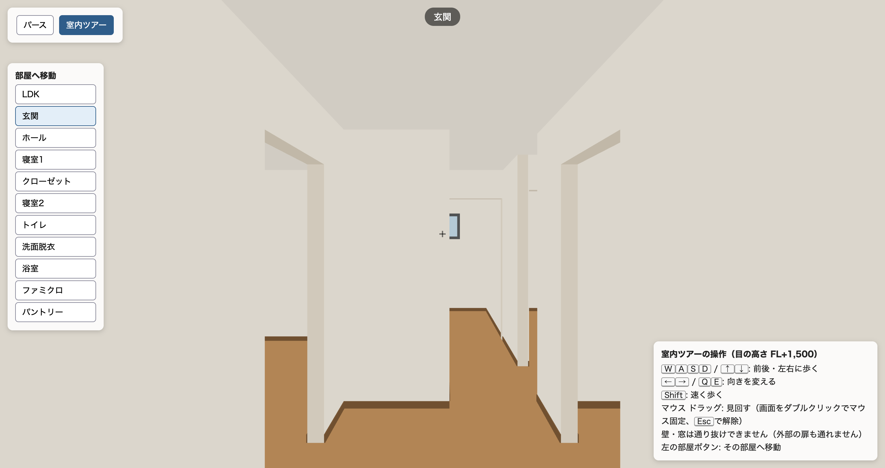
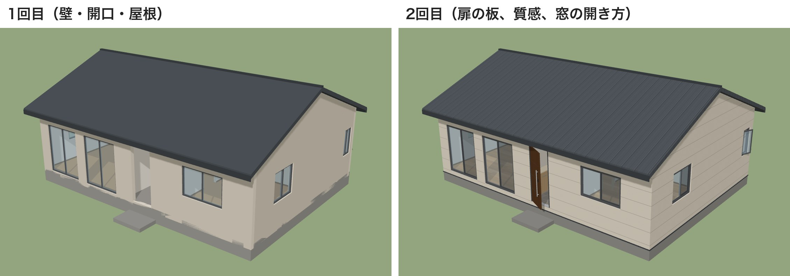
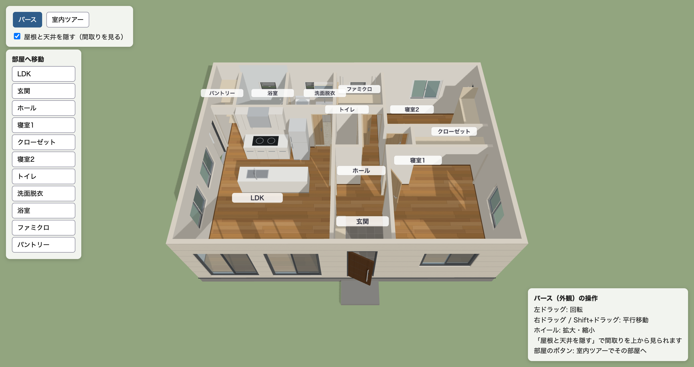
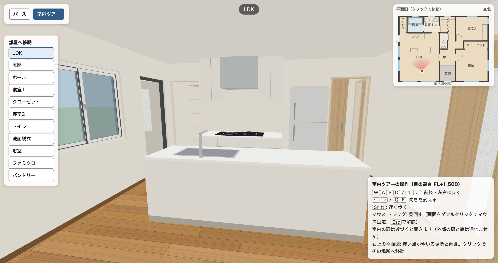
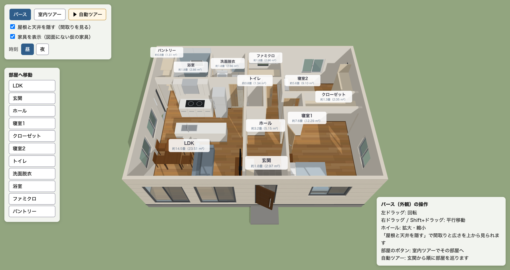
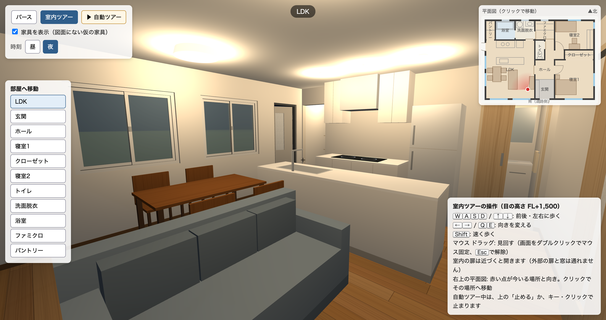
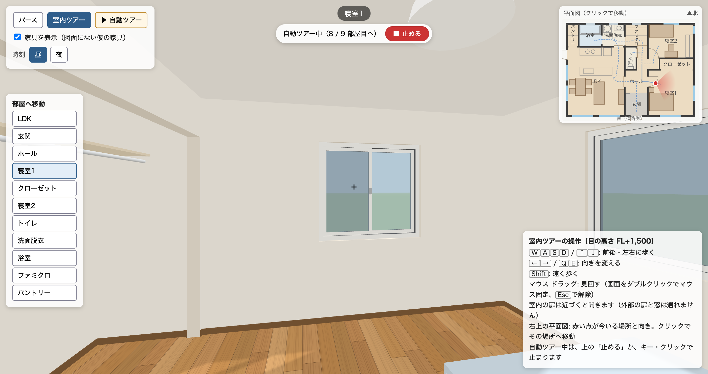

# AIに図面から3Dの室内ツアーを作らせた

AIが作った3Dモデルと室内ツアーは、ブラウザでそのまま動かせます。パソコンで開いてみてください。

https://h-takeshita-henteco-shoji-com.github.io/tried/137-house-tour/

この記事の内容を、へんロボが説明する動画にもしました。ページを動かす様子も、動画の中でお見せしています。

https://youtu.be/LQxz_RdDRYw

## 図面を、立体で見せたい

やってみ太郎です。へんてこ商事で、中小企業のDXやAI導入の相談役と、システム開発をしています。

連載「AIと図面のコラボレーション」の8本目です。
前回は、AIに図面から内装と建具の数量を拾わせ、見積を作らせました。

https://note.com/tried_hs/n/ne572e5e543a9

この連載では、同じ2LDKの平屋の図面を使ってきました。平面図、立面図、断面図、AIが描いた矩計図と平面詳細図です。
図面は、設計者には多くを語ります。ただ、施主にとっては読みにくいものです。打合せでは、平面図より立体のほうがずっと伝わります。

実は今回、最初は別のことを試していました。図面について、AIと会話を続けられるかです。
「その部屋の窓は」「先ほどの扉は」と続けて聞き、12問のうち10問は正しく答えました。
ただ、手応えを感じるうちに、もっと見たいものが出てきました。この図面から、立体が作れないか。
そこで途中で、テーマを切り替えました。

## 作らせたもの

AIは Claude Opus 5.5 です。three.js（ブラウザで3Dを描くための仕組み）を使い、Webページとして作らせました。

渡したものは3つです。

- 図面: これまでの平屋の図面（DXF、CADのファイル）
- 仕上表: 部屋ごとの床・壁・天井の材料（前回の見積で使ったもの）
- 指示: 壁、扉と窓の開口、床、天井高、屋根を図面から立ち上げる。外観を回して見る「パース」と、歩いて回る「室内ツアー」の2つのモードを作る

指示の一部は、こうです。

```
外壁と間仕切りは厚みも含めて立ち上げ、扉と窓は図面の位置・幅・高さで開口にしてください。
「室内ツアー」は目の高さ1,500mmで、キーボードとマウスで歩け、壁を通り抜けない。
```

人はコードを1行も書いていません。指示を書いて、できたものを見ただけです。

## 1回目: 10分で、寸法の正しい家が建った

Opus は10分47秒で、HTMLのファイルを1つ作りました。
ブラウザで開くと、切妻屋根の家が建っていました。屋根を隠すと、間取りが見えます。



見た目より気になったのは、寸法です。ページの中に書かれた数値を、図面を作ったときの間取りのデータと照らし合わせました。

- 外壁の窓11か所と外の扉2か所: 位置、幅、高さがすべて一致
- 間仕切りの位置と長さ、室内の扉と扉のない開口の位置: すべて一致
- 床の高さ、天井高 2,400、軒の高さ、屋根の勾配 4/10、軒の出 600、けらば 300: すべて一致

前回の見積で、多くのモデルがつまずいたホールの形もそうです。寝室2の前の通路への切れ目まで、正しく立ち上がっていました。

室内ツアーでは、部屋の名前のボタンで移動し、目の高さで歩けます。
4つの方向に歩かせてみると、扉の開口を通って隣の部屋へ進み、家の外には出ませんでした。壁は通り抜けません。

一方で、足りない所もありました。

- 扉は開口だけで、戸の板がない。玄関も勝手口も、穴が開いているように見える
- キッチンや浴槽などの設備がない

Opus は答えに、設備は高さが図面から決まらないので立体にしていない、と書いていました。
図面にないものは作らない。これはこれで、正しい判断です。

## 2回目: 打合せに出せる形へ

ここからは、指示を重ねて育てることにしました。
1回目のページと、建具表（扉と窓の開き方、ガラス、錠の一覧）を渡し、6つを頼みました。

- 扉の板を、建具表の開き方どおりに付ける
- 窓の開き方と、すりガラスを見分けられるようにする
- 平面図の設備を立体にする。高さは一般的な寸法で仮に決め、書き出す
- 床の木目、タイルの目地、外壁と屋根の筋を、画像を使わずに描く
- 室内ツアーに、小さな平面図（ミニマップ）を出す
- 基礎と外壁の境にちらつく縞を直す



30分ほどで、見違えるページになりました。



アイランドキッチン、背面収納とIHコンロ、冷蔵庫、浴槽、洗面台、下駄箱が立ち上がっています。
玄関の床はタイル、ほかの部屋はフローリングの木目です。

室内に入ると、こう見えます。



設備の高さは、図面にありません。Opus は13項目を仮に決め、表にして書き出しました。キッチンは850、冷蔵庫は1,800、便座は400、といった具合です。
図面の2つの円を「IHコンロ」と読み、その上にレンジフードと吊戸棚を付けたことも書いていました。

縞の原因も、自分で突き止めていました。
床下の箱が、外壁の外の面と同じ面で重なっていたのが原因だ、とのことです。3Dでよく起きる、2つの面が重なってちらつく現象です。

## 3回目: 家具、自動ツアー、夜

同じ会話を続けて、打合せの場面を考えた5つを頼みました。

- 家具を置く。図面にないので、切り替えで消せるようにする
- 玄関から扉を通って各部屋を巡る「自動ツアー」。部屋ごとに名前と広さを出す
- 昼と夜の切り替え。夜は天井の照明をつける
- 浴室をユニットバスらしくし、トイレと洗面に小物を足す
- 間取りの部屋の名前の下に、広さを出す



夜にすると、天井の照明がつきます。



「自動ツアー」を押すと、玄関から歩き出します。ホール、LDK、洗面、浴室と巡り、部屋ごとに止まって広さを出します。
右上のミニマップには、順路が点線で出ます。



驚いたのは、部屋の広さの数字です。
LDK 23.51m²、寝室1 12.29m²、ホール 5.15m²。前回、見積の正解として計算した内法の面積と、小数第2位まで同じでした。
図面の「約15畳」は壁の中心で測った値で、内法だと小さくなる、とも書き添えていました。

確かめ方にも感心しました。
自動ツアーの経路を 20mm おきに調べ、壁や家具に当たらないこと。開口の前と開き戸が動く範囲を、家具がふさいでいないこと。どちらも数値で確かめた、と答えていました。

## 3回で、何が変わったか

- 1回目（10分47秒）: 壁、開口、屋根。寸法はすべて正しい。扉の板と設備はない
- 2回目（30分）: 扉の板、窓の開き方、設備、質感、ミニマップ
- 3回目（16分39秒）: 家具、自動ツアー、昼と夜、浴室の小物、広さの表示

壁、開口、屋根の寸法は、3回を通して変わっていません。
2回目の答えには、元のファイルと比べて、寸法の数値、壁16本、開口23か所が変わっていないことを確かめた、と書かれていました。例外は1つだけで、玄関ポーチの踏み台を、水切りとぶつかるので 17mm 短くした、とのことです。

1回目と2回目の版も、残してあります。

https://h-takeshita-henteco-shoji-com.github.io/tried/137-house-tour/round1.html

https://h-takeshita-henteco-shoji-com.github.io/tried/137-house-tour/round2.html

## 所感

正直に言うと、ここまでできるとは思っていませんでした。
図面と仕上表を渡して1時間足らずで、施主に見せられる室内ツアーができました。しかも寸法は、図面どおりです。

いちばん大事だと感じたのは、1回目で寸法が正しかったことです。
見た目は、あとから指示を重ねればいくらでも良くなります。でも、土台の寸法が違えば、どれだけ飾っても打合せには使えません。

もう1つは、図面にないものの扱いです。
設備の高さ、家具の大きさ、照明の数。Opus は、どれも自分で決めて、表にして書き出しました。家具には「図面にない仮の家具」と書いて、消せるようにしています。
施主に見せる立体は、どうしても図面より多くを語ります。どこまでが図面で、どこからが仮の決めかを分けておくことが、打合せの道具には欠かせないと思いました。

## わかったこと

今回わかったことは4つです。

- 図面と仕上表から、AIは寸法の正しい3Dモデルを10分ほどで作れる
- 指示を重ねれば、扉、設備、家具、自動ツアーまで足して、打合せの道具に育てられる
- 部屋の広さも、図面から正しく計算できた。前回の見積の正解と同じ値だった
- 図面にないもの（設備の高さ、家具）は、仮に決めて書き出させ、切り替えで消せるようにするとよい

次は、同じ指示をほかのモデルにも出し、1回目の寸法の正しさを比べてみます。

指示文、AIの答え、3つの版のページは、リポジトリに置いています。

https://github.com/h-takeshita-henteco-shoji-com/tried/tree/main/2026/11-07-AIと図面のコラボレーション-08-AIに図面から室内ツアーを作らせる
